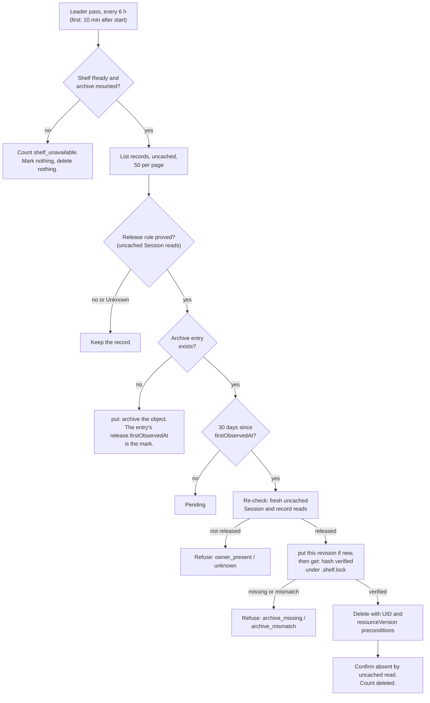

# DESIGN-024: Coordination record retention: archive, then delete

- **Status:** Accepted 2026-10-12; no source yet
- **Decision:** [ADR-004](../adrs/004-coordination-record-retention.md) (Q-29,
  Tom, 2026-10-12: "Archive, then delete (Recommended)")
- **Amends:** [DESIGN-010](010-atomic-task-claims.md),
  [DESIGN-013](013-published-stopped-context.md) and
  [DESIGN-014](014-durable-offline-inbox.md); each carries a dated note
- **Delivery:** [plan 11](../backlog/11-project-workspaces.md), units R1 to R7
- **Tracking:** [#175](https://github.com/thaynes43/dev-env/issues/175)

Everything here is default off. Two operator flags turn it on, in a haynes-ops
change that comes last (section 10).

## 1. What runs, in one picture



## 2. Release rules and absence proof

The four kinds live in the operator namespace (`dev-env-system`). Their Sessions
live in the session namespaces the operator reconciles (`dev-agents`).

| Kind | Rule name | Released when | Deleted with |
|---|---|---|---|
| TaskClaim | `owner-absent` | `spec.owner` UID is absent | itself |
| PublishedContext | `source-absent` | `spec.source` UID is absent | itself |
| InboxMessage | `sender-absent-recipient-done` | `spec.sender` UID is absent, and an InboxReadAck exists for this message UID and `spec.recipient` UID, or the recipient UID is absent | its ack, if any |
| InboxReadAck | `message-released` | its message is released, or its message UID is absent from the live store | its message |

**Absence proof for one Session identity** (namespace, name, UID), each an
uncached read through the operator's API reader:

- `GET agentsessions/<name>` in that namespace answers NotFound: **absent**
  (`not-found`).
- It answers an object with a different UID: **absent** (`uid-replaced`). UIDs
  are never reused, so the original is gone.
- It answers an object with the same UID: **present**, whatever its phase,
  deletion timestamp, retention condition or Pod state.
- Anything else is **Unknown**: a timeout, a 5xx, a 403, a "no match for kind"
  (the CRD is not served), or a namespace the operator does not reconcile.
  Unknown releases nothing and is counted.

An InboxReadAck lookup for the message rule is an uncached GET of the ack's
deterministic name. Its spec must name this message UID and this recipient UID.
A message's absence for the ack rule is the same NotFound or UID check on the
message.

Within one pass, Session answers are memoized by namespace and name, so a pass
reads each Session once. The re-check before a delete (section 5) never uses
the memo.

**What absence means.** The operator lifts a Session's finalizer only in
`releaseIfEmpty`, after uncached reads find its Pod, its home volume and any
workspace hold Pod gone. So an absent Session is a finished reap, unless an admin
lifted the finalizer by hand. Absence is not general stop proof (ADR-004); the
30 days are the margin.

**Known gap.** `releaseIfEmpty` refuses every Session for which
`privateHistoryEnabled` is true. With the installed
`--enable-private-history-retention=true`, that is every Session without a
shared workspace. Those Sessions are never absent, so their records are never
released. This design does not change that. Follow-up F1 in plan 11 holds it.

## 3. The archive volume

- **PersistentVolumeClaim** `dev-env-coordination-archive` in `dev-agents`:
  `ReadWriteOnce`, storage class `ceph-block` (the in-cluster Rook pool, which
  allows online expansion), 5 GiB, annotation
  `kustomize.toolkit.fluxcd.io/prune: disabled` so Flux never deletes it.
- **Mounted only by the shelf pod** (`dev-env-shelf`, D-67) at
  `/home/dev/.coordination-archive`. The operator reaches it only by exec into
  that pod, as it reaches rescues. The shelf has no ServiceAccount token, no
  network and a CPU limit, and that stays true.
- **The shelf Deployment's strategy becomes `Recreate`.** Today it rolls with
  `maxSurge: 1` and `maxUnavailable: 0`. A surge pod scheduled on another node
  cannot attach a ReadWriteOnce volume, so the rollout would stall. Recreate
  costs about a minute without a shelf on each shelf update. Archived reads
  answer 503 in that minute, and the runnable waits for its next pass.
- **Nothing else mounts it.** Templates name only two kinds of claim: the shared
  claim and workspace claims. The operator's template check (`internal/templates`)
  refuses templates in which either is this claim. No other haynes-ops manifest
  names it.
- **No backup off the cluster.** Like rescue bundles (D-10), the archive holds
  private text and does not leave the cluster. Its durability is the Ceph pool's
  replication. A backup elsewhere would need an owner decision.
- **Kept indefinitely.** agentd has no command that removes an archive entry.

**Why not `dev-env-shared`.**

1. Every session pod mounts `dev-env-shared` read-write at `~/.shared`. Any agent
   could read or change the archive there, bypassing the API's scopes. The
   archive holds every project's message and context text.
2. The shelf's pruner deletes by age on that volume (rescues and logs after 30
   days). Records kept indefinitely do not belong beside a pruner.
3. It is CephFS, shared by many writers. The archive needs one writer and a plain
   local filesystem, where `flock` and `rename` behave simply.

## 4. `agentd ctl coord-archive`: put, get, list

Three subcommands, run by the operator in the shelf pod by exec. Each checks
that `/home/dev/.coordination-archive` is a mount point (D-48's check) and
answers `no_archive` otherwise. `agentd shelf --coordination-archive` refuses to
start without that mount; without the flag, the shelf starts as today.

**Layout:**

```
/home/dev/.coordination-archive/
  .shelf.lock                     flock: exclusive for put, shared for get and list
  .incoming/<random>/             a put in progress
  v1/<resource>/<project>/<name>/<uid>/<resourceVersion>-<first 16 hex of sha256>/
    object.json                   the full object, canonical JSON
    manifest.json
```

`<resource>` is `taskclaims`, `publishedcontexts`, `inboxmessages` or
`inboxreadacks`. A TaskClaim name can return with a new UID (the task was claimed
again), so entries are keyed by UID, resourceVersion and hash, not name alone.

**Canonical JSON.** The object as the API server returned it (an uncached
unstructured read, so no field is dropped by the operator's Go types), decoded
with numbers kept as written, re-encoded with sorted keys, no extra whitespace
and no HTML escaping. `object.sha256` is the SHA-256 of those bytes. Records are
immutable, so the same resourceVersion normally gives the same bytes, across
operator versions too. The API server can serve a different form of one
resourceVersion, for example after the CRD gains a default. That form gets its
own entry, because the hash is part of the key, so it never conflicts with the
first.

**Manifest** (`manifest.json`, no message, context, prompt or rules text):

```json
{
  "format": "dev-env.coordination-archive.v1",
  "resource": "inboxmessages",
  "kind": "InboxMessage",
  "apiVersion": "coordination.dev-env.haynesops.com/v1alpha1",
  "namespace": "dev-env-system",
  "name": "message.<32 hex>.<32 hex>",
  "uid": "<record UID>",
  "resourceVersion": "<resourceVersion>",
  "project": "<project>",
  "recipientUID": "<recipient Session UID; messages and acks only>",
  "messageUID": "<message UID; acks only>",
  "release": {
    "rule": "sender-absent-recipient-done",
    "firstObservedAt": "2026-10-12T17:13:14Z",
    "sessions": [
      {"role": "sender", "namespace": "dev-agents", "name": "<name>", "uid": "<uid>",
       "observed": "not-found", "observedAt": "2026-10-12T17:13:14Z"},
      {"role": "recipient", "namespace": "dev-agents", "name": "<name>", "uid": "<uid>",
       "observed": "acknowledged", "ackUID": "<ack UID>", "observedAt": "2026-10-12T17:13:14Z"}
    ]
  },
  "object": {"sha256": "<64 hex>", "bytes": 3172},
  "archivedAt": "2026-10-12T17:13:15Z",
  "archivedBy": "dev-env-operator <version>"
}
```

`observed` is `not-found`, `uid-replaced`, `acknowledged` or, for an ack,
`message-released` or `message-absent`.

**`put`** reads one JSON request on stdin, at most 256 KiB: the manifest without
`archivedAt`, and the object. Under the exclusive lock it:

1. Validates the format, resource, name and UID patterns, and that the object's
   kind, namespace, name, UID and resourceVersion match the manifest.
2. Re-encodes the object canonically. It refuses (`invalid`) when the bytes or
   the hash differ from what the operator sent.
3. If the target directory exists: same object bytes, so it returns the stored
   manifest unchanged, including its original `firstObservedAt`; different bytes
   (a hash-prefix collision, or a damaged entry) is `conflict`, and nothing is
   written.
4. Otherwise it writes both files into `.incoming/<random>/`, fsyncs them and the
   directory, renames the directory into place and fsyncs the parent.
5. Removes `.incoming` entries older than one hour (a crashed put). That is the
   only removal in the package.

It prints the stored manifest.

**`get --resource R --name N [--uid U] [--resource-version V --sha256 H]`**,
under the shared lock, finds the entry (without `--uid`, the most recently
archived one for that name; without `--resource-version`, the most recent one
for that UID), re-reads `object.json`, recomputes its SHA-256 and compares it
with the manifest. It prints `{"manifest": ..., "object": ...}`. A mismatch is
`corrupt`; a name under two projects is `ambiguous`. It never prints bytes it
could not verify.

**`list --resource R --project P [--recipient-uid U] [--limit N] [--after C]`**,
under the shared lock, prints manifests only, newest `archivedAt` first, at most
100 per page, with an opaque `next` cursor.

**Errors** are one JSON object on stdout, `{"error": "<code>", "message": "..."}`,
with exit status 1. Codes: `not_found`, `conflict`, `corrupt`, `ambiguous`,
`invalid`, `no_archive`. The operator's shelf client treats an unknown command
(an older shelf image) as `no_archive`. Protocol types live in
`internal/agentd/protocol/coordarchive.go`; the work in `internal/agentd/coordarchive.go`.

## 5. The retention runnable

Package `internal/coordretention`, wired in `cmd/dev-env-operator`. A
controller-runtime runnable with `NeedLeaderElection() == true`, like the shelf
pruner (D-67) and the activity reaper (D-66).

**Settings:**

| Flag | Default | Rule |
|---|---|---|
| `--enable-coordination-archive-reads` | false | Turns on the read fallback (section 6). |
| `--enable-coordination-retention` | false | Turns on the runnable. The operator refuses to start with it on and reads off, so a deleted record is never unreadable while deletes run. |
| `--coordination-retention-grace` | 720h | May lengthen the grace. A value under 720h is refused at start. |

**A pass.** The first pass starts 10 minutes after the leader starts, then one
every 6 hours, each with a 30-minute deadline.

1. Find the shelf pod (`internal/shelf`), Running and Ready. Without it, or when
   it answers `no_archive`, the pass ends as `shelf_unavailable`.
2. For each kind enabled in this operator, list records uncached and unstructured
   in the operator namespace, 50 per page.
3. Evaluate the release rule (section 2). Not released or Unknown: keep it.
4. Released, and `get` answers `not_found` for this name and UID: `put` it with
   `firstObservedAt` = now. That is the **mark**. Count `marked`.
5. Released and marked, less than the grace ago: count it as pending.
6. Released and marked at least the grace ago: release it.

**Releasing one record** (one function, `release`):

1. **Re-check.** Fresh uncached reads of every Session the rule names (no memo)
   and of the record itself. Any answer other than released refuses
   (`owner_present` or `unknown`). A record that is gone is done.
2. **Archive this revision.** If this UID has no entry any more, refuse
   (`archive_missing`); the next pass marks it again and the grace restarts. If
   no entry matches its resourceVersion and the hash of its canonical re-read,
   `put` it with the `firstObservedAt` of this UID's existing entry. A metadata
   edit by an admin since the mark gives a new revision; the grace does not
   restart.
3. **Verify** (`archiveVerified`). `get` this name, UID, resourceVersion and
   hash. The stored hash, the manifest hash and the hash of the canonical re-read
   must be equal. Otherwise refuse (`archive_missing` when the entry is gone,
   `archive_mismatch` when it differs). A corrupt entry is never overwritten
   (`put` answers `conflict`), so that record stays live until a human looks.
4. **Delete** (`deleteRecord`), with
   `client.Preconditions{UID: &uid, ResourceVersion: &rv}`. Conflict refuses
   (`precondition_failed`); the next pass archives the new revision. NotFound
   counts as done. 403 refuses (`forbidden`).
5. **Confirm** with an uncached read: NotFound or another UID. Count `deleted`.

An InboxMessage and its ack go as one unit. Both are archived and verified
first. Then the message is deleted, then the ack. If the ack's delete fails, the
next pass finds an ack whose message is absent and releases it under
`message-released`; its archived mark already holds the message's time.

**Caps.** At most 256 deletes and 1024 puts in one pass. The rest waits for the
next pass.

**Memory.** Lists are paged. One page of contexts is at most about 3.5 MiB
(50 times 64 KiB plus metadata). Nothing is cached between passes; the archive
is the only state.

**Metrics** (the leader exports them; other replicas export none of these):

| Metric | Type | Labels |
|---|---|---|
| `dev_env_coordination_retention_passes_total` | counter | `result`: `complete`, `partial` (deadline or cap), `shelf_unavailable`, `failed` |
| `dev_env_coordination_retention_last_complete_pass_timestamp_seconds` | gauge | none |
| `dev_env_coordination_retention_marked_total` | counter | `kind` |
| `dev_env_coordination_retention_deleted_total` | counter | `kind` |
| `dev_env_coordination_retention_pending` | gauge | `kind`, from the last complete pass |
| `dev_env_coordination_retention_refused_total` | counter | `kind`, `reason`: `unknown`, `owner_present`, `archive_missing`, `archive_mismatch`, `precondition_failed`, `forbidden` |

The existing `dev_env_coordination_records*` series keep their names. Their help
text changes from "never deleted" to counting live records.

**Rights.** The runnable uses the operator's existing get and list on the four
kinds and on AgentSessions, its existing pods/exec into the shelf, and the new
namespace-scoped delete (section 9). It needs no update, patch or
deletecollection.

**An absent UID that comes back.** It cannot, except after an etcd restore. Then
the re-check finds the owner present and refuses. The runnable keeps no memory
of that, so after the Session's later deletion the old mark's grace has already
run and the record goes at the next pass. It is archived and verified first, so
only the 30 days are skipped (ADR-004 C-29).

## 6. Reads: fall back to the archive

On with `--enable-coordination-archive-reads`. The live path does not change and
never waits for the shelf.

**Single reads.** On a live NotFound, the API asks the shelf `get`:

- `GET /v1/task-claims/{claim}`, with a new optional `?uid=`. A claim name can
  return with a new owner: the live claim answers first, and `?uid=` reaches an
  archived one.
- `GET /v1/published-contexts/{context}`
- `GET /v1/inbox/{message}` and `GET /v1/inbox/{message}/ack`
- `POST /v1/inbox/{message}/ack`, for an identical retry only. Retries of other
  creates cannot happen: their Session is absent. A recipient that acknowledged
  can retry its ack after the release. If the archive holds an ack by this
  recipient for this message, the API answers 200 with `archived: true`; otherwise
  404. Nothing is written.

The API authorizes the archived object with the same checks as a live one, from
its immutable spec: project scopes, claim metadata scope, context payload scope,
inbox recipient UID with a live Pod, or the coordinator content scope. A
recipient whose UID is absent cannot authenticate, so after that only the
coordinator scope reads its messages, as today. An unauthorized or foreign
caller gets the same uniform answer as for a live record.

The answer is the live wire shape plus `archived: true` and `archivedAt`. A name
in neither place is today's NotFound answer. No shelf, `no_archive`, `corrupt`,
`ambiguous` or a failed exec is 503 `unavailable`, never 404.

**Lists.** `GET /v1/task-claims`, `/v1/published-contexts` and `/v1/inbox` accept
`?archived=only`. That returns archived entries only, with the same scope filters
as the live list, newest first, at most 100 per page with a `continue` token.
Without the parameter, a list is live only and never touches the shelf. Without a
shelf, `archived=only` is 503.

**Unchanged.** The fixed canary result route (DESIGN-022) reads live records only;
its strict client refuses unknown fields, and canary originals are never
released (section 2). The directory contexts route stays live only. Creates
never read the archive. A released claim's task is claimable again, and the
same-work label check (DESIGN-010) sees live claims only.

**Clients.** `archived` and `archivedAt` are additive. R4 adds a test for every
existing client of these routes that it still decodes the answers.

**A residual, accepted.** While the shelf is down, a scoped caller asking for a
name that is not live gets 503, while a live record outside its scope gets 404.
That tells the caller the name is not live. Names are full digests of identities
the caller must already know, and nothing else is revealed.

## 7. Bounds and alerts

- **Per Session: lifetime, unchanged.** A Session's records are released only
  when it is absent. So a Session that can still create sees its full lifetime
  count. No code change.
- **Per project: live.** The counts already list live records, so released
  records free the project bound with no code change.
- **Wording.** R4 updates `apiv1.CodeLimitExceeded`'s comment, the
  `dev_env_coordination_records*` help text and agentd's `ErrContextLimit`
  message: a project bound frees 30 days after its Sessions are gone, a Session
  bound never does, and an immediate retry still does not help.
- **Defaults stay:** per Session and per project, claims 512 and 4096,
  publications 128 and 1024, messages 512 and 4096.

**Alerts** (haynes-ops `operator/app/prometheusrule.yaml`, group
`dev-env-operator.rules`, severity `critical`, which is what reaches Tom's phone):

```yaml
- alert: DevEnvCoordinationRecordsNearLimit
  expr: |
    max by (kind, project) (dev_env_coordination_records)
      / on (kind) group_left
    max by (kind) (dev_env_coordination_record_limit{scope="project"})
      >= 0.8
  for: 1h
- alert: DevEnvCoordinationArchiveFilling
  expr: |
    max by (persistentvolumeclaim) (kubelet_volume_stats_used_bytes{namespace="dev-agents",persistentvolumeclaim="dev-env-coordination-archive"})
      / max by (persistentvolumeclaim) (kubelet_volume_stats_capacity_bytes{namespace="dev-agents",persistentvolumeclaim="dev-env-coordination-archive"})
      >= 0.8
  for: 1h
```

The first uses only metrics the operator exports today, so it can ship first
(unit R1). Its description says: retention frees records only 30 days after
their Sessions are gone, and never for private Sessions (the known gap); find
the busy Session with `dev_env_coordination_records_session_max`; an automated
responder reports and changes nothing; a manual delete follows DESIGN-010's
recovery, with its export, and only by Tom. The second's fix is a larger PVC
request in git.

## 8. Guard tests

**`TestOnlyRetentionDeletesCoordinationRecords`** (`internal/coordretention`),
modelled on `TestOnlyTheGuardDeletes`. It type-checks the module's non-test
packages and fails when:

1. a client `Delete`, `DeleteAllOf`, `Update` or `Patch` call takes a TaskClaim,
   PublishedContext, InboxMessage, InboxReadAck or one of their lists, anywhere
   outside `coordretention.deleteRecord`;
2. a package that imports the coordination API group makes such a call on an
   unstructured or metadata-only object, outside `deleteRecord` and a reviewed
   allow-list in the test;
3. `deleteRecord` holds more than one `Delete`, or its `Delete` lacks
   `client.Preconditions` with both `UID` and `ResourceVersion`;
4. `deleteRecord` has a caller other than `release`, or `release` can reach it
   without first calling `releaseRechecked` and `archiveVerified`;
5. `internal/coordretention` calls `DeleteAllOf` at all.

**`TestRetentionGuardScanCatches`** runs the same scan over
`testdata/guardscan`, a file never compiled, where each function breaks one rule.
The scan must name every one, or a pass proves less than it claims. The test
names the scan's known gaps, as the controller's does. The controller's syntax
scanner moves to a shared test helper; the controller's tests keep their
behaviour.

**`TestArchiveNeverRemoves`** (`internal/agentd`): the archive code removes files
only under `.incoming/`.

## 9. haynes-ops changes

All under `kubernetes/main/apps/dev-env-system/`, each in its own reviewed PR:

1. **R1, any time:** `DevEnvCoordinationRecordsNearLimit` (section 7).
2. **R5, after the agent image with `coord-archive` is released:**
   - `storage/app/pvc.yaml`: the PVC (section 3).
   - `shelf/app/deployment.yaml`: `strategy: {type: Recreate}`; the volume and its
     mount at `/home/dev/.coordination-archive`; `args: ["shelf",
     "--coordination-archive"]`; the image pin of that release.
   - `DevEnvCoordinationArchiveFilling` (section 7).
3. **R6, after the operator release with R3 and R4:**
   - `crds/app/coordination-retention-operator.yaml`: Role
     `dev-env-coordination-retention` in `dev-env-system`, rule
     `apiGroups: [coordination.dev-env.haynesops.com]`,
     `resources: [taskclaims, publishedcontexts, inboxmessages, inboxreadacks]`,
     `verbs: [delete]`, bound to ServiceAccount `dev-env-operator` only. No
     `deletecollection`, no ClusterRole, no other subject. A separate Role, so a
     rollback removes exactly this right.
   - `operator/app/helmrelease.yaml`: the operator pin, then
     `--enable-coordination-archive-reads=true`, then
     `--enable-coordination-retention=true`.

No worker, agent or coordinator grant changes. The session template is unchanged.

## 10. Rollback

- **Retention off** (`--enable-coordination-retention=false`): no marks, no
  deletes. Archived records stay readable while reads stay on.
- **Reads off too:** archived records answer NotFound, as if gone. Nothing in the
  archive is lost; turning reads back on restores them.
- **Remove the Role:** deletes answer 403, counted as `forbidden`. Nothing is
  lost.
- **Operator below the release:** the same as both flags off. DESIGN-010's
  rollback floor still applies.
- **Shelf image below `coord-archive`:** the operator sees `no_archive`; archived
  reads answer 503 and the runnable waits.
- **The PVC** is never deleted by a rollback (`prune: disabled`).
- **Restoring one record** is a manual path for Tom only: `kubectl exec` into the
  shelf, `agentd ctl coord-archive get`, strip the server fields, `kubectl create`.
  It gets a new UID. A TaskClaim whose task was claimed again fails with
  AlreadyExists, and the new owner keeps it. No API route restores.

## 11. Acceptance

Tests run one package at a time under `nice -n 19`, `GOMAXPROCS=2`,
`go test -p 2`. No burners, stress or wide loops, no local image build.

**Envtest** (real API server, the AgentSession and coordination CRDs, a fake
clock, and the real agentd archive code over `t.TempDir()` behind an in-process
exec fake, so the protocol is exercised):

- **E1, archive before delete.** A Session's claim, context, and message with its
  ack. The Session goes (finalizer lifted). Pass 1 marks all four and deletes
  none. A pass at 30 days minus a minute deletes none. A pass after 30 days
  deletes them. A recorded call order shows each `get` verify before its
  `Delete`. Each archive hash equals the hash of the object read before the pass.
  The fallback GET answers each with `archived: true`.
- **E2, refusals.** Each leaves the record live and counts its reason:
  the archive entry removed after the mark (re-marked, not deleted); stored bytes
  altered (`archive_mismatch`, never overwritten); no shelf or `no_archive`
  (nothing marked; archived reads 503); owner present, including Reaping and
  private-history-retained Sessions (never marked); Unknown from an injected
  timeout, 5xx and "no match for kind"; a label changed between verify and
  delete (`precondition_failed`, then the next pass archives the new revision
  and deletes); no delete Role (`forbidden`).
- **E3, the inbox rule.** Sender absent and recipient present without an ack:
  kept. The recipient acks: released, the message deleted before the ack. An ack
  whose delete failed is released on the next pass. A recipient ack retry after
  the release answers 200 with `archived: true` and writes nothing.
- **E4, rights.** Run as `dev-env-operator` under haynes-ops' Roles, copied into
  `testdata/` as the broker and keeper suites do. Delete works only in the
  operator namespace and only on the four kinds; deletecollection is refused. A
  session ServiceAccount cannot get or delete them.
- **E5, bounds.** A project at a small test bound refuses; after a release it
  accepts. A live Session's per-Session count does not drop.
- **E6, a replaced owner.** Same name, new UID: released.
- **E7, two passes at once.** Exactly one delete succeeds. Each revision has one
  archive entry.

Unit tests (fake client) cover what envtest cannot: an owner present after its
mark, the 720h floor, and the reads-off-retention-on start refusal. agentd tests
cover put idempotency and conflict, crash debris, canonical JSON, the hash
recheck, ambiguity and the mount check.

**Installed** (R7, a verification record): the shelf mounts the archive and
`coord-archive list` answers an empty page; `kubectl auth can-i` shows delete for
`dev-env-operator` on the four kinds in `dev-env-system` and not for a session
ServiceAccount; the retention metrics appear and a pass completes; a live GET
is unchanged and `?archived=only` answers an empty page. An end-to-end release
needs a genuinely absent owner. With the installed private-history flag that
first comes after follow-up F1, so the installed release is recorded then. A
synthetic record would need Tom; it is optional.

## 12. Delivery units

Plan 11 tracks these: R1 alert; R2 agentd archive commands; R3 runnable, guard
tests and envtest E1, E2, E4, E6, E7; R4 read fallback, wording, E3, E5 and the
templates check; R5 and R6 haynes-ops; R7 installed record. F1, the HOME expiry
policy, needs its own owner question and closes the known gap.
