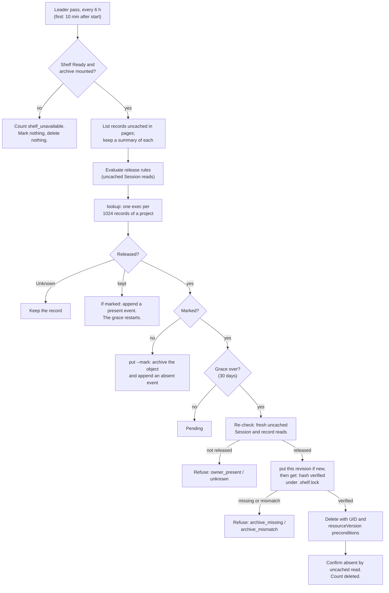

# DESIGN-024: Coordination record retention: archive, then delete

- **Status:** Accepted 2026-10-12; R2 archive commands in source; coordination retention runnable in source 2026-10-17 and still default off; R3–R7 not accepted or installed
- **Decision:** [ADR-004](../adrs/004-coordination-record-retention.md) (Q-29,
  Tom, 2026-10-12: "Archive, then delete (Recommended)")
- **Amends:** [DESIGN-010](010-atomic-task-claims.md),
  [DESIGN-013](013-published-stopped-context.md),
  [DESIGN-014](014-durable-offline-inbox.md) and
  [DESIGN-001 D-67](001-dev-env-v2.md) (the shelf); each carries a dated note
- **Delivery:** [plan 11](../backlog/11-project-workspaces.md), units R0 to R7
- **Tracking:** [#175](https://github.com/thaynes43/dev-env/issues/175)

**Runnable slice, 2026-10-17:** the section 5 leader runnable is in source and
still default off. The operator starts it only with
`--enable-coordination-retention`, which defaults to false and is refused unless
`--enable-coordination-archive-reads` is also set.
`--coordination-retention-grace` defaults to 720h; a shorter value is refused at
start. No deployment or flag default turns it on. This is source in review, not
R3, installed, or MVP acceptance.

Everything here is default off. Two operator flags turn it on, in a haynes-ops
change that comes last (section 9).

**Source checkpoint, 2026-10-14:** the [bounded ingestion slice](../verification/coordination-archive-ingestion-2026-10-14.md)
verifies full canonical objects against manifest identities and digests without
discarding unknown fields or numeric encodings. The next bounded R2 slice stores
and reads one exact immutable revision under the shelf lock. It reuses the
history archive's mount check, bounded no-link reads and fsync/rename helpers.
Identical object bytes retain the original manifest and re-sync the files and
publication directories, repairing a prior rename followed by fsync failure.
A damaged entry or hash
prefix collision refuses the put without changing that revision. A read returns
only canonical bytes whose complete identity, size and digest match the stored
manifest and requested revision.

The [storage verification](../verification/coordination-archive-storage-2026-10-14.md)
records the focused local suite. The subsequent R2 slice publishes the UID's
immutable all-record index and, for InboxMessage only, its recipient index.
Entries contain identity and first publication time, never object text.
Publication uses a fsynced private staging file and an exclusive hard link;
an existing entry is never replaced. A staging link may remain until the later
age-bounded incoming cleanup; index reads permit at most two links. Matching
existing entries are re-synced before success.

The first publication time comes from verified revision manifests for this UID.
A later revision's clock is clamped to that time if the clock moves back, so it
cannot create a second index name. Identical puts repair missing indices after
interrupted revision/index publication. Damaged or substituted entries and linked
directories refuse the put. Revision manifests are walked in bounded batches
within this UID, never across a project.

These primitives have no API, absence event, latest-revision resolution,
retention, release or deletion authority. Remaining commands remain R2 work. R2
and installed acceptance are incomplete. Deployment and
activation remain held.

**Minimal command slice:** unmarked `agentd ctl coord-archive put` reads one
bounded JSON request with `manifest` and `object`, publishes through the existing
storage/indices, and prints the stored manifest with `graceStart: null`.
It refuses an existing nonempty event journal rather than guessing grace state.
`get --resource R --name N --uid U --resource-version V --sha256 H` resolves one
exact revision across projects and verifies the complete bytes before printing.
A name under two projects is ambiguous. General latest-revision selection,
`--mark`, event commands and list remain unsupported and fail closed.
This is a partial R2 command demonstration, not full R2 or installed acceptance.
Local tests use synthetic temporary files on existing filesystems; no mount,
activation, public mount-bypass option or live client is involved.
The [CLI demonstration](../verification/coordination-archive-cli-2026-10-14.md)
records the runnable command test, matching digest and corruption refusal.

**Read-only discovery slice, 2026-10-14:** `lookup` accepts one JSON array
of 1 to 1024 identities (`resource`, `project`, `name`, `uid`) on stdin and
returns an array in the same order. Each item contains that identity, `holds`,
`revisions` (resourceVersion and sha256, sorted lexically without claiming time
order), and `graceStart: null`. Missing UIDs return `holds: false` and an empty
revision array. It walks only each requested UID in 128-name batches and reads
bounded manifests, never object bytes or indices. Metadata/path validation is
structural; lookup is not object verification. Exact `get` remains that proof.

This initial lookup refuses a nonempty or unreadable event journal rather than
inventing grace. Invalid paths, linked or malformed manifests and incomplete
revision directories return an error with no partial results. Its stdin cap is
the existing 1 MiB + 64 KiB; output metadata is capped at 4 MiB, with an `invalid`
error rather than truncation if the complete batch would exceed the bound.
Neither this cap nor unsupported marked UIDs provides release eligibility.
The [lookup fixture](../verification/coordination-archive-lookup-2026-10-14.md)
exercises put -> lookup -> exact verified get and corruption refusal locally.
The event journal/grace transitions remain the next source prerequisite for
marked lookup; full R2 and installed acceptance remain incomplete.

**Journal slice, 2026-10-14:** append-only events use the accepted eight-digit
sequence and absent/present/reset states. Readers scan names in 128-entry
batches, require one canonical bounded event per contiguous sequence, and fold
in sequence order with constant journal memory. Unknown fields/states, linked
or malformed entries, gaps/duplicate sequences, and backward timestamps refuse
state reconstruction. A first absent after present/reset starts grace; repeated
marked puts retain that start. Present/reset clears it. Missing or empty
journals remain unmarked, including after an archive revision is lost.

`put --mark` takes an `event` alongside manifest/object and publishes verified
revision/index data before the absent event under one exclusive lock. Plain
put and lookup report the actual recorded grace. `mark` takes 1–1024
identity/event items (present/reset only); it skips unmarked UIDs. Input uses
the existing request cap, each event is at most 8 KiB, and metadata output stays
within 4 MiB. Event publication reuses private fsynced staging and exclusive
hard links, never overwrites a file, and retries sync after visible publication
failure. A failed mark batch may have published a prefix; retry safely skips
already-cleared UIDs and repairs durability without rewriting events.

Events are bounded structural observations supplied by the trusted shelf caller,
not authenticated Session absence or permission to release. No live reads,
retention runnable, grace-expiry decision or deletion is added. The
[journal fixture](../verification/coordination-archive-journal-2026-10-14.md)
shows local marked lookup transitions and finite refusal/repair cases. General
get/list and shelf startup wiring remain R2 work;
installed consumers and all live/activation/cutover gates remain held.

**General get selector slice, 2026-10-14:** the source reader accepts optional
UID and paired resourceVersion/SHA256 selectors. It discovers the unique project
for the name before reading any object. With UID omitted, it compares the UID's
first recorded publication time (the same minimum manifest time used by its
immutable index); a later revision of an older UID does not reorder UID births.
Default UID selection also requires its immutable birth-index entry to match;
missing or inconsistent birth metadata refuses rather than reranking that UID.
With revision omitted, it compares that UID's recorded revision archivedAt.
Only the selected object is read, with the existing complete canonical identity,
size and digest verification. A damaged selected object never falls back to an
older one. Explicit UID/revision pins remain usable without default ordering.

Traversal retains bounded 128-name batches and constant candidate state, rather
than collecting/sorting an archive. Every metadata candidate needed for ordering
must be canonical, path-bound and consistent with its UID's immutable identity.
Malformed/incomplete or linked candidates refuse selection; names in two projects
remain ambiguous even with explicit pins. A revision/hash pair without UID applies
to the selected UID only; it never searches an older UID for a matching revision.

**Ordering limit:** accepted metadata supplies recorded timestamps, not a separate
publication sequence. Equal greatest UID/revision times do not identify a unique
latest candidate and return ambiguous, with no object. No directory enumeration,
resourceVersion, UID or digest lexical order breaks ties. Recorded time selection
does not prove strict arrival order after clock rollback. That chronology choice
is unestablished; no new sequence/clock policy is introduced or full acceptance
claimed for it. The [selector fixture](../verification/coordination-archive-selectors-2026-10-14.md)
records the independent safe portion and explicit-pin escape from time ambiguity.
General selector source support is separate from installed acceptance; list and
shelf startup wiring remain R2 work.

## 1. What runs, in one picture



## 2. Release rules and absence proof

The four kinds live in the operator namespace (`dev-env-system`). Their Sessions
live in the session namespaces the operator reconciles (`dev-agents`).

| Kind | Rule name | Released when | Deleted with |
|---|---|---|---|
| TaskClaim | `owner-absent` | `spec.owner` UID is absent | itself |
| PublishedContext | `source-absent` | `spec.source` UID is absent | itself |
| InboxMessage | `sender-absent-recipient-done` | `spec.sender` UID is absent, and an InboxReadAck exists for this message UID and `spec.recipient` UID, or the recipient UID is absent | its ack, if any |
| InboxReadAck | `message-released` | its message was released: the message UID is absent from the live store **and** the archive holds that message UID | its message |

The ack rule needs both halves. A message that left the live store some other
way, for example by Tom's manual recovery (DESIGN-010), has no archive entry, so
its ack stays. That manual path deletes a message's ack with it anyway.

**Absence proof for one Session identity** (namespace, name, UID), each an
uncached read through the operator's API reader:

- `GET agentsessions/<name>` in that namespace answers NotFound: **absent**
  (`not-found`).
- It answers an object with a different UID: **absent** (`uid-replaced`). UIDs
  are never reused, so the original is gone.
- It answers an object with the same UID: **present**, whatever its phase,
  deletion timestamp, retention condition or Pod state.
- Anything else is **Unknown**: a timeout, a 5xx, a 403, a "no match for kind"
  (the CRD is not served), or a namespace the operator does not reconcile.
  Unknown releases nothing and is counted.

An InboxReadAck lookup for the message rule is an uncached GET of the ack's
deterministic name. Its spec must name this message UID and this recipient UID.
A message's absence for the ack rule is the same NotFound or UID check on the
message.

Within one pass, Session answers are memoized by namespace and name, so a pass
reads each Session once. The re-check before a delete (section 5) never uses
the memo.

**What absence means.** The operator lifts a Session's finalizer only in
`releaseIfEmpty`, after uncached reads find its Pod, its home volume and any
workspace hold Pod gone. So an absent Session is a finished reap, unless an admin
lifted the finalizer by hand. Absence is not general stop proof (ADR-004); the
30 days are the margin.

**Sessions that are never absent.** `releaseIfEmpty` refuses every Session for
which `privateHistoryEnabled` is true. Two groups follow:

- **Canary originals**, always. They are protected Sessions
  (`privateHistoryProtected`) even with the private-history flag off, so their
  records, the managed-output publications included, stay live. The fixed canary
  result reader (DESIGN-022) needs them live.
- **Every Session without a shared workspace**, while the installed operator runs
  with `--enable-private-history-retention=true`. This is the known gap. Their
  records are never released. This design does not change that. Follow-up F1 in
  plan 11 holds it.

*Amended 2026-10-12 ([ADR-005](../adrs/005-private-home-expiry.md), Q-31; F1
decided): a private Session's HOME is archived, then deleted, 30 days after a
recorded stop proof ([DESIGN-025](025-private-home-expiry.md)). A reaped one is
then released by the one new exception in `releaseIfEmpty` and becomes absent,
and its records follow this design from there. Canary originals never expire, so
they and their records stay present. Until DESIGN-025's deletion is on (its unit
H9), the gap remains in practice.*

## 3. The archive volume

- **PersistentVolumeClaim** `dev-env-coordination-archive` in `dev-agents`:
  `ReadWriteOnce`, storage class `ceph-block` (the in-cluster Rook pool, which
  allows online expansion), 5 GiB, annotation
  `kustomize.toolkit.fluxcd.io/prune: disabled` so Flux never deletes it.
- **Its PersistentVolume is `Retain`.** `ceph-block` provisions with reclaim
  policy `Delete`, and after a delete the archive is the only copy. Flux's
  annotation stops only Flux. The operator's `dev-agents` Role has
  `persistentvolumeclaims: delete` for session volumes; its guarded deletes (D-45)
  name only `home-<session>` claims, which can never be this name. Still, no
  single delete may lose the archive. After the claim binds, Tom sets its
  PersistentVolume's `persistentVolumeReclaimPolicy` to `Retain`; no agent tier
  may write a PersistentVolume. The PV is named by the provisioner, so git cannot
  carry this. A second storage class with `reclaimPolicy: Retain` could, but it
  would add a Rook class for one claim; that is not adopted. R7 checks the policy.
- **Mounted only by the shelf pod** (`dev-env-shelf`, D-67) at
  `/home/dev/.coordination-archive`. The operator reaches it only by exec into
  that pod, as it reaches rescues. The shelf has no ServiceAccount token, no
  network and a CPU limit, and that stays true.
- **Nothing else mounts it.** Templates name only two kinds of claim: the shared
  claim and workspace claims. The operator's template check (`internal/templates`)
  refuses templates in which either is this claim. No other haynes-ops manifest
  names it.
- **No backup off the cluster.** Like rescue bundles (D-10), the archive holds
  private text and does not leave the cluster. Its durability is the Ceph pool's
  replication. A backup elsewhere would need an owner decision.
- **Kept indefinitely.** agentd has no command that removes an archive entry.

**Who can read it.** Exec into the shelf reads every project's archived messages
and contexts. RBAC does not keep agents out. The `dev-env-agent` ClusterRole
grants `pods/exec` cluster-wide, so `kubectl auth can-i create pods/exec -n
dev-agents` answers yes for it. Admission does: the ValidatingAdmissionPolicy
`dev-env-identity-guard` refuses every exec in the three dev-env namespaces to
every `dev-agents` identity except `dev-env-workbench`. That covers the baseline
agent and every broker `grant-*` ServiceAccount, break-glass included. **The
archive's privacy depends on that guard.** `dev-env-workbench`, which the guards
exempt, does not exist today; a change that creates it must account for this
archive. E4 and R7 prove the refusal (section 11).

*Amended 2026-10-12 ([ADR-006](../adrs/006-private-home-expiry-corrections.md),
D-87): that guard and the Kyverno `dev-env-exec-guard` match only `dev-agents`
identities, so "agents cannot read it" (ADR-004) holds for v2 agents and API
callers only. v1's OPERATOR tier (`dev/dev-env`, every agent in the v1 pod, and
`upgrade-agent/dev-env-ops`) holds `pods/exec` and Job `create` across the
cluster: it can exec into the shelf, or run a Job on the shelf's node that
mounts this claim, and read, rewrite or delete any entry. `dev-env-broker` and
`dev-env-keeper` hold `pods/exec` in `dev-agents` with no name limit.
cluster-admin, node, storage and hypervisor access reach every volume. An
archive guard closes the direct paths for both archives: for every
ServiceAccount but `dev-env-operator`, no exec, attach, port-forward or
ephemeral container on the shelf, no other Pod or workload that mounts either
archive claim, and no change to the shelf Deployment's pod template except by
Flux or a `rollout restart` that changes only its `restartedAt` annotation
([DESIGN-025](025-private-home-expiry.md) section 7). Whichever of R5 and
DESIGN-025's H7 ships first ships it, after a check that no v1 workflow execs
into the shelf. R7 also records that a v1 identity's exec into the shelf is
refused.*

*Amended 2026-10-13 ([ADR-007](../adrs/007-preserve-v1-archive-trust-boundary.md),
Q-35/D-89, owner answer relayed through oversight): v1 remains unchanged until
its decommissioning after accepted MVP. The earlier v1 shelf-denial proposal
and R7's corresponding denial expectation are superseded. Both archives remain
reachable through v1's current administrator access. H7/R5 guard untrusted v2
actors, including broker and keeper, while preserving v1 identities and proven
controller descendants of their authorized workloads. No new rights or
technical isolation from v1 are claimed. Human/admin paths and separate
Retain, installed acceptance and activation gates remain. See DESIGN-025
sections 7 and 20 for the current contract and relay limits.*

**What the shelf's other duties pay.** Mounting a ReadWriteOnce volume changes
D-67's pod:

- **Every shelf update is an outage.** The Deployment's strategy becomes
  `Recreate`. Today it rolls with `maxSurge: 1` and `maxUnavailable: 0`, but a
  surge pod on another node cannot attach the volume, so the rollout would stall.
  The shelf image follows the templates' agent pin, so this happens on each agent
  release. For about a minute there is no shelf: `GET /v1/rescues`, a restore
  (which holds its rescue through the shelf) and archived reads answer 503, and
  the pruner and the retention runnable wait for their next pass.
- **A node loss can strand it.** The replacement pod may wait on the volume:
  `Multi-Attach error` in its events, or ceph-csi reporting the image still in
  use. Kubernetes detaches the volume once the old pod is gone, which can wait
  until the lost node is removed or marked out of service. Until then there is
  no shelf, so no rescue list, restore, prune or archived read. Alert
  `DevEnvShelfUnavailable` (section 7) pages after 30 minutes.

**Recovering the attachment after a node loss** (Tom; no agent tier can taint a
node):

1. Confirm the node is really down, not just unreachable: `omnictl get
   machinestatus` and the PVE or PiKVM console. Never apply step 2 to a running
   node; two writers would corrupt the volume.
2. Apply the non-graceful shutdown taint:
   `kubectl taint node <node> node.kubernetes.io/out-of-service=nodeshutdown:NoExecute`.
   Kubernetes then force-deletes the node's pods and detaches their volumes.
3. Watch the shelf become Ready. Remove the taint when the node is back.

A separate archive pod would keep these costs off the rescue routes. The ruling
names the shelf, so that is not adopted without an owner decision.

**Why not `dev-env-shared`.**

1. Every session pod mounts `dev-env-shared` read-write at `~/.shared`, so any
   agent could read or change the archive there, bypassing the API's scopes. The
   archive volume is reachable only by exec into the shelf, which the identity
   guard refuses to agents.
2. The shelf's pruner deletes by age on that volume (rescues and logs after 30
   days). Records kept indefinitely do not belong beside a pruner.
3. It is CephFS, shared by many writers. The archive needs one writer and a plain
   local filesystem, where `flock` and `rename` behave simply.

## 4. `agentd ctl coord-archive`

Five subcommands, run by the operator in the shelf pod by exec: `put` and `mark`
write; `lookup`, `get` and `list` read. Each checks that
`/home/dev/.coordination-archive` is a mount point (D-48's check) and answers
`no_archive` otherwise. `agentd shelf --coordination-archive` refuses to start
without that mount; without the flag, the shelf starts as today.

**Layout:**

```
/home/dev/.coordination-archive/
  .shelf.lock              flock: exclusive for put and mark; shared for lookup, get and list
  .incoming/<random>/      a write in progress
  v1/<resource>/<project>/
    records/<name>/<uid>/
      <resourceVersion>-<first 16 hex of sha256>/
        object.json        the full object, canonical JSON
        manifest.json
      events/<seq>-<state>.json            append-only: absent, present or reset
    index/all/<YYYY-MM>/<archivedAt>-<uid>.json
    index/recipient/<recipient UID>/<YYYY-MM>/<archivedAt>-<uid>.json   messages only
```

`<resource>` is `taskclaims`, `publishedcontexts`, `inboxmessages` or
`inboxreadacks`. A TaskClaim name can return with a new UID (the task was claimed
again), so records are keyed by UID, and revisions by resourceVersion and hash.
`<archivedAt>` in an index name is fixed-width UTC (`20261012T171315.000000000Z`),
so names sort by time. `<seq>` is eight digits, from `00000001`, per UID.

**Canonical JSON.** The object as the API server returned it (an uncached
unstructured read, so no field is dropped by the operator's Go types), decoded
with numbers kept as written, re-encoded with sorted keys, no extra whitespace
and no HTML escaping. `object.sha256` is the SHA-256 of those bytes. Records are
immutable, so the same resourceVersion normally gives the same bytes, across
operator versions too. The API server can serve a different form of one
resourceVersion, for example after the CRD gains a default. That form gets its
own revision, because the hash is part of the key, so it never conflicts with
the first.

**Size bound.** `MaxArchiveObjectBytes` is 1 MiB of canonical bytes. A text field
holds at most 64 KiB, and JSON escapes a control character as six bytes, so text
alone can reach 384 KiB; `apiv1.MaxContextRequestBytes` (`6*MaxContextBytes +
4096`) sizes requests the same way. Metadata adds annotations (at most 256 KiB by
API validation) and managed fields. A `put` request is at most
`MaxArchiveObjectBytes + 64 KiB`, and carries the object as a JSON value, not a
string, so nothing is escaped twice. An object over the bound is never archived,
so it is never deleted: the runnable refuses it as `archive_invalid` (section 5).

**Manifest** (`manifest.json`, no message, context, prompt or rules text):

```json
{
  "format": "dev-env.coordination-archive.v1",
  "resource": "inboxmessages",
  "kind": "InboxMessage",
  "apiVersion": "coordination.dev-env.haynesops.com/v1alpha1",
  "namespace": "dev-env-system",
  "name": "message.<32 hex>.<32 hex>",
  "uid": "<record UID>",
  "resourceVersion": "<resourceVersion>",
  "project": "<project>",
  "recipientUID": "<recipient Session UID; messages and acks only>",
  "messageUID": "<message UID; acks only>",
  "object": {"sha256": "<64 hex>", "bytes": 3172},
  "archivedAt": "2026-10-12T17:13:15Z",
  "archivedBy": "dev-env-operator <version>"
}
```

**Events** (`events/<seq>-<state>.json`) record what the runnable observed:

```json
{
  "format": "dev-env.coordination-archive.event.v1",
  "state": "absent",
  "at": "2026-10-12T17:13:14Z",
  "rule": "sender-absent-recipient-done",
  "sessions": [
    {"role": "sender", "namespace": "dev-agents", "name": "<name>", "uid": "<uid>",
     "observed": "not-found"},
    {"role": "recipient", "namespace": "dev-agents", "name": "<name>", "uid": "<uid>",
     "observed": "acknowledged", "ackUID": "<ack UID>"}
  ],
  "by": "dev-env-operator <version>"
}
```

`state` is `absent` (the rule was proved), `present` (the rule was proved not
to hold again, for example a Session came back), `hold` (the owner was seen
while a grace was open; the grace start stays, and the record is not deleted
from that grace) or `reset` (the archive lost a marked revision, or a held
grace is cleared). A shelf image from before `hold` reads a journal that
contains one as corrupt, so those records stay refused until the shelf is new
enough again. Do not roll the shelf image back after a hold has been written.
`observed` is `not-found`, `uid-replaced`, `present`, `acknowledged` or, for an
ack, `message-released`. A UID is **marked** while it has a grace start. Its
last event is then `absent` or `hold`. `hold` does not clear the grace start.
Its **grace start** is the `at` of the first `absent` event after its last
`present` or `reset` event. An event file is never rewritten.

**`put [--mark]`** reads one JSON request on stdin: the manifest without
`archivedAt`, the object and, with `--mark`, an `absent` event. Under the
exclusive lock it:

1. Validates the format, resource, name and UID patterns, that the object's kind,
   namespace, name, UID and resourceVersion match the manifest, and the size
   bound. Any failure is `invalid`.
2. Re-encodes the object canonically. It refuses (`invalid`) when the bytes or
   the hash differ from what the operator sent.
3. If the revision directory exists: same object bytes keep it; different bytes
   (a hash-prefix collision, or a damaged entry) are `conflict`, and nothing is
   written.
4. Otherwise it writes both files into `.incoming/<random>/`, fsyncs them and the
   directory, renames the directory into place and fsyncs the parent.
5. Writes each index entry this UID lacks (in `index/all`, and for a message in
   its recipient's index), named by the UID's first `archivedAt`, the same way.
   A put that crashed between steps 4 and 5 is repaired by the next put.
6. With `--mark`, appends the `absent` event unless the UID is already marked.
7. After durable revision publication, index repair and journal success, removes
   eligible `.incoming` entries older than one hour (a crashed write). That is
   the only removal in the package. Unknown or unsafe old debris, or a cleanup
   failure, refuses `put` success; any already-published immutable bytes remain
   readable. A retry does not rewrite those bytes. Unknown debris is preserved
   for separately authorized operator investigation and resolution; this does
   not imply live deletion authority. The [incoming cleanup verification](../verification/coordination-archive-incoming-2026-10-15.md)
   records the bounded source/offline evidence.

It prints the stored manifest and the UID's grace start.

**`mark`** reads up to 1024 events on stdin, each `present`, `hold` or `reset`
with its identity, and appends each to a UID that is marked. Others are skipped.
It never appends `absent`; only `put --mark` does, so nothing is marked before
it is archived.

**`lookup`** reads up to 1024 identities (resource, project, name, UID) on stdin
and, under the shared lock, prints for each whether the archive holds it, its
revisions (resourceVersion and hash) and its grace start, or null when unmarked.
It reads no object and verifies nothing; that is `get`'s job. About 200 bytes an
identity.

**`get --resource R --name N [--uid U] [--resource-version V --sha256 H]`**,
under the shared lock, finds the revision (without `--uid`, the UID archived most
recently under that name; without `--resource-version`, that UID's most recent
revision), re-reads `object.json`, recomputes its SHA-256 and compares it with
the manifest. It prints `{"manifest": ..., "object": ...}`. A mismatch is
`corrupt`; a name under two projects is `ambiguous`. It never prints bytes it
could not verify.

**`list --resource R --project P [--recipient-uid U] [--limit N] [--after C]`**,
under the shared lock, walks one index newest first: `index/recipient/<U>` with
`--recipient-uid`, `index/all` otherwise. For each entry it reads that UID's
latest revision, verifies its hash and prints the manifest and the object with
`spec.text` removed. An entry that fails the check is printed as `{"uid": ...,
"error": "corrupt"}`, without the object. A page ends at `--limit` items (at most
100) or at 4 MiB of output, whichever comes first, with an opaque `next` cursor
(the last emitted index name); a terminal page has no `next` cursor. An invalid
month or index filename has no trustworthy entry identity and refuses the whole
page as `corrupt`, without objects; a valid index filename whose entry body or
selected revision is corrupt is reported in-band with its UID and no object. A
page costs one directory read per month it touches and a few file reads per
item. Month-name selection uses bounded batches, rescanning the parent only
after exhausting a batch, rather than retaining the full month history.

**Errors** are one JSON object on stdout, `{"error": "<code>", "message": "..."}`,
with exit status 1. Codes: `not_found`, `conflict`, `corrupt`, `ambiguous`,
`invalid`, `no_archive`. The operator's shelf client treats an unknown command
(an older shelf image) as `no_archive`. Protocol types live in
`internal/agentd/protocol/coordarchive.go`; the work in `internal/agentd/coordarchive.go`.

## 5. The retention runnable

Package `internal/coordretention`, wired in `cmd/dev-env-operator`. A
controller-runtime runnable with `NeedLeaderElection() == true`, like the shelf
pruner (D-67) and the activity reaper (D-66).

**Settings:**

| Flag | Default | Rule |
|---|---|---|
| `--enable-coordination-archive-reads` | false | Turns on the read fallback (section 6). |
| `--enable-coordination-retention` | false | Turns on the runnable. The operator refuses to start with it on and reads off, so a deleted record is never unreadable while deletes run. |
| `--coordination-retention-grace` | 720h | May lengthen the grace. A value under 720h is refused at start. |

**Shelf execs are limited.** Every `coord-archive` exec, from the runnable or the
API, takes a slot from a per-replica limit of 2. The runnable holds at most one.
An API read that gets no slot within 2 seconds answers 503 `unavailable`. Each
exec keeps the shelf client's one-minute timeout and 8 MiB output cap. With two
operator replicas, at most four archive execs reach the shelf at once. Rescue and
prune execs (D-67) take no slot, so archive traffic cannot queue them. R2
measures a worst-case `get`'s peak memory in the shelf container. R5 raises the
shelf's 256 MiB limit if four of them and a prune do not fit with room to spare.

**A pass.** The first pass starts 10 minutes after the leader starts, then one
every 6 hours, each with a 30-minute deadline.

1. **Shelf.** Find the shelf pod (`internal/shelf`), Running and Ready. Without
   it, or when it answers `no_archive`, the pass ends as `shelf_unavailable`.
2. **Summaries.** For each kind enabled in this operator, list records uncached
   and unstructured in the operator namespace: pages of 10 for PublishedContexts
   and InboxMessages, 50 for TaskClaims and InboxReadAcks. Keep only a summary of
   each record: kind, project, name, UID, resourceVersion, and the Session and
   ack identities its rule needs. Drop the object.
3. **Rules.** Evaluate each summary (section 2): released, kept, or Unknown.
   Kept means uncached reads proved the rule does not hold: a Session it needs
   absent is present, or the recipient has not acknowledged.
4. **Lookups.** For each kind and project, `lookup` every live record in batches
   of 1024, with the message identity of every ack whose message is absent. That
   is one exec per 1024 records, never one per record.
5. **Work.** From the rules and lookups:
   - released, not marked: **mark**. Re-read the record uncached by name; if its
     UID or resourceVersion differs from the summary, leave it for the next pass.
     Otherwise `put --mark`. Count `marked`.
   - released, marked, grace not over: count it as pending.
   - released, marked, grace over: **release** it (below).
   - kept, and marked: append a `hold`, then a `present`, each batched in one
     `mark` exec per project. The hold keeps the grace start and blocks a
     delete. The present clears it. The grace restarts at the next observed
     absence. Count `grace_reset`. The release re-check does the same hold
     before its present.
   - Unknown: nothing. Count it.
6. **Order.** Marks and releases run in a stable order (kind, project, name, UID),
   starting just after the key where the last pass stopped, and wrap round. The
   leader keeps that key in memory; a new leader starts from the beginning. So a
   pass that stops early never starves the records after its stopping point.

**Releasing one record** (one function, `release`):

1. **Re-check.** Fresh uncached reads of every Session the rule names (no memo)
   and of the record itself. Kept appends a `present` event and refuses
   (`owner_present`). Unknown refuses (`unknown`). A record that is gone is done.
2. **Archive this revision.** If this UID has no revision, append a `reset`
   event and refuse (`archive_missing`); the next pass marks it again and the
   grace restarts. If no revision matches its resourceVersion and the hash of its
   canonical re-read, `put` it without `--mark`. A metadata edit by an admin since
   the mark gives a new revision; the grace does not restart. A canonical re-read
   over `MaxArchiveObjectBytes` refuses (`archive_invalid`); so does one at mark
   time, and that record is never marked.
3. **Verify** (`archiveVerified`). `get` this name, UID, resourceVersion and
   hash. The stored hash, the manifest hash and the hash of the canonical re-read
   must be equal. Otherwise refuse (`archive_missing` when the revision is gone,
   `archive_mismatch` when it differs). A corrupt revision is never overwritten
   (`put` answers `conflict`), so that record stays live until a human looks.
4. **Delete** (`deleteRecord`), with
   `client.Preconditions{UID: &uid, ResourceVersion: &rv}`. Conflict refuses
   (`precondition_failed`); the next pass archives the new revision. NotFound
   counts as done. 403 refuses (`forbidden`).
5. **Confirm** with an uncached read: NotFound or another UID. Count `deleted`.

An InboxMessage and its ack go as one unit: marking the message marks its ack
too, and while the message is live the ack is handled only through it. Both are
archived and verified first. Then the message is deleted, then the ack. If the
ack's delete fails, the next pass finds an ack whose message is absent and
archived, and releases it under `message-released`. The ack keeps its own mark,
made with the message's.

**Caps.** At most 256 marks and 256 releases in one pass. The rest waits for the
next pass, which starts where this one stopped. A pass stopped only by a cap
ends `capped`, which counts as progress: a backlog drains over several passes
without an alert. A pass stopped by its deadline ends `partial`.

**Memory.** Lists are paged and only summaries are kept. A page of 10
publications or messages is at most about 10 MiB of JSON at the size bound, and
far less in practice (text alone is at most 384 KiB escaped). A page of 50 claims
or acks holds no text. A batch of 1024 lookups prints about 200 KiB. Nothing is
kept between passes but the resume key; the archive holds the rest.

**Hold, 2026-10-17.** A present that fails to append leaves the old absence
in place, and that tail still equals the grace start. That equality is not a
fence. Before the present, the pass appends `hold`. `hold` keeps the grace
start and is not an absent tail, so a later leader will not delete from it.
That leader appends `reset` for a held record only. A grace with no hold is
unchanged by a leader restart. A shelf lookup with no journal tail refuses
the release as `archive_outdated`.

**Metrics** (the leader exports them; other replicas export none of these):

| Metric | Type | Labels |
|---|---|---|
| `dev_env_coordination_retention_passes_total` | counter | `result`: `complete`, `capped` (stopped only at a cap), `partial` (stopped at the deadline), `shelf_unavailable`, `failed`; every `result` is set to 0 when the runnable starts |
| `dev_env_coordination_retention_last_progress_timestamp_seconds` | gauge | none; set to the leader's start time when the runnable starts, then to the end of each `complete` or `capped` pass |
| `dev_env_coordination_retention_marked_total` | counter | `kind` |
| `dev_env_coordination_retention_grace_resets_total` | counter | `kind` |
| `dev_env_coordination_retention_deleted_total` | counter | `kind` |
| `dev_env_coordination_retention_pending` | gauge | `kind`, from the last `complete` or `capped` pass |
| `dev_env_coordination_retention_refused_total` | counter | `kind`, `reason`: `unknown`, `archive_outdated`, `owner_present`, `archive_invalid`, `archive_missing`, `archive_mismatch`, `precondition_failed`, `forbidden` |

The existing `dev_env_coordination_records*` series keep their names. Their help
text changes from "never deleted" to counting live records.

**Rights.** The runnable uses the operator's existing get and list on the four
kinds and on AgentSessions, its existing pods/exec into the shelf, and the new
namespace-scoped delete (section 9). It needs no update, patch or
deletecollection.

**An absent UID that comes back.** It cannot, except after an etcd restore. Then
the pass or the re-check finds the Session present, appends a `present` event and
deletes nothing. The grace starts again at the next observed absence. A record is
never deleted sooner than 30 days after the latest absence began, which is the
conservative reading of the ruling's "first observed absence" (ADR-004 C-29).

## 6. Reads: fall back to the archive

On with `--enable-coordination-archive-reads`. The live path does not change and
never waits for the shelf.

**Single reads.** On a live NotFound, the API takes an exec slot and asks the
shelf `get`:

- `GET /v1/task-claims/{claim}`, with a new optional `?uid=`. A claim name can
  return with a new owner: the live claim answers first, and `?uid=` reaches an
  archived one.
- `GET /v1/published-contexts/{context}`
- `GET /v1/inbox/{message}` and `GET /v1/inbox/{message}/ack`
- `POST /v1/inbox/{message}/ack`, for an identical retry only. Retries of other
  creates cannot happen: their Session is absent. A recipient that acknowledged
  can retry its ack after the release. If the archive holds an ack by this
  recipient for this message, the API answers 200 with `archived: true`; otherwise
  404. Nothing is written.

The API authorizes the archived object with the same checks as a live one, from
its immutable spec: project scopes, claim metadata scope, context payload scope,
inbox recipient UID with a live Pod, or the coordinator content scope. A
recipient whose UID is absent cannot authenticate, so after that only the
coordinator scope reads its messages, as today. An unauthorized or foreign
caller gets the same uniform answer as for a live record.

**Item shape.** An archived item is the live item, built by the same projection
(`claimView`, `contextMetadata`, `inboxMetadata`, `inboxAckView`) from the
verified object, plus `archived: true` and `archivedAt` (the UID's first archive
time). Those projections read only the name, UID, creation time and immutable
spec, so every revision gives the same item. An archived TaskClaim's `ownerState`
and `stopState` are `Unknown`, which is what the live projection gives for an
absent owner; the API makes no Session read for it. Single reads include the
text where the live read does.

Item reads and revision recovery have separate library entry points.
`CoordArchive.GetItemSelected` selects a UID and its latest verified revision
under the existing shared lock, verifies the matching first-publication index,
and returns the UID's first archive time. It does not accept revision/hash pins.
`GetSelected` and `GetExact` retain revision-selection and recovery semantics:
explicit-UID and pinned queries keep their stored revision receipt and can
recover without a valid birth index. A missing or damaged birth index refuses an
item read rather than inventing a time or falling back. This source seam alone
does not wire the CLI, shelf transport or TaskClaim HTTP route.

**Transport contract.** `agentd ctl coord-archive get-item --resource R --name N
[--uid U]` is the read-only transport for `GetItemSelected`: it returns the same
full-object result protocol as `get`, accepts no revision or hash pins, and
rejects unknown pins or flags as usage errors before archive access. It consumes
no stdin; its usual settings and mount validation, canonical JSON, and error exit
handling remain. `shelf.CoordinationArchive.GetItem` rejects nonempty pins before
exec and otherwise uses that command, while legacy `get`, `GetSelected`, and
`GetExact` retain their selector, pin, receipt, and explicit-UID recovery behavior.

A name in neither place is today's NotFound answer. No shelf, no free exec slot,
`no_archive`, `corrupt`, `ambiguous` or a failed exec is 503 `unavailable`, never
404.

**Lists.** `GET /v1/task-claims`, `/v1/published-contexts` and `/v1/inbox` accept
`?archived=only`. That returns archived items only, with the same scope filters,
item shape (without text, like the live lists) and page sizes as the live list:
100 for claims and messages, 20 for contexts. The API runs one `list` per page:
a recipient's inbox scope reads its recipient index, any other scope the
project's `index/all`. It projects each object and leaves out an item the shelf
marked `corrupt`; a later `get` of that name answers 503. The `continue` token
wraps the shelf's cursor and binds the route, project, recipient and limit, like
the live cursors. Without the parameter, a list is live only and never touches
the shelf. Without a shelf or a free slot, `archived=only` is 503.

**Unchanged.** The fixed canary result route (DESIGN-022) reads live records only;
its strict client refuses unknown fields, and canary originals are never
released (section 2). The directory contexts route stays live only. Creates
never read the archive. A released claim's task is claimable again, and the
same-work label check (DESIGN-010) sees live claims only.

**Clients.** `archived` and `archivedAt` are additive. R4 adds a test for every
existing client of these routes that it still decodes the answers.

**A residual, accepted.** While the shelf is down, a scoped caller asking for a
name that is not live gets 503, while a live record outside its scope gets 404.
That tells the caller the name is not live. Names are full digests of identities
the caller must already know, and nothing else is revealed. This departs from
the uniform 404 of DESIGN-013 and DESIGN-014; both carry it in their amendment
notes.

## 7. Bounds and alerts

- **Per Session: lifetime, unchanged.** A Session's records are released only
  when it is absent. So a Session that can still create sees its full lifetime
  count. No code change.
- **Per project: live.** The counts already list live records, so released
  records free the project bound with no code change.
- **Wording.** R4 updates `apiv1.CodeLimitExceeded`'s comment, the
  `dev_env_coordination_records*` help text and agentd's `ErrContextLimit`
  message: a project bound frees 30 days after its Sessions are gone, a Session
  bound never does, and an immediate retry still does not help.
- **Defaults stay:** per Session and per project, claims 512 and 4096,
  publications 128 and 1024, messages 512 and 4096.

**Alerts** (haynes-ops `operator/app/prometheusrule.yaml`, group
`dev-env-operator.rules`, severity `critical`, which is what reaches Tom's phone):

```yaml
- alert: DevEnvCoordinationRecordsNearLimit
  expr: |
    max by (kind, project) (dev_env_coordination_records)
      / on (kind) group_left
    max by (kind) (dev_env_coordination_record_limit{scope="project"})
      >= 0.8
  for: 1h
- alert: DevEnvShelfUnavailable
  expr: |
    max(kube_deployment_status_replicas_available{namespace="dev-agents",deployment="dev-env-shelf"}) < 1
  for: 30m
- alert: DevEnvCoordinationArchiveFilling
  expr: |
    max by (persistentvolumeclaim) (kubelet_volume_stats_used_bytes{namespace="dev-agents",persistentvolumeclaim="dev-env-coordination-archive"})
      / max by (persistentvolumeclaim) (kubelet_volume_stats_capacity_bytes{namespace="dev-agents",persistentvolumeclaim="dev-env-coordination-archive"})
      >= 0.8
  for: 1h
- alert: DevEnvCoordinationRetentionStalled
  expr: |
    (time() - max(dev_env_coordination_retention_last_progress_timestamp_seconds) > 2 * 86400)
    or
    (sum(increase(dev_env_coordination_retention_passes_total{result=~"partial|shelf_unavailable|failed"}[2d])) >= 4
      unless sum(increase(dev_env_coordination_retention_passes_total{result=~"complete|capped"}[2d])) > 0)
  for: 1h
```

The first uses only metrics the operator exports today, so it can ship first
(unit R1). Its description says: retention frees records only 30 days after
their Sessions are gone, and never for private Sessions (the known gap); find
the busy Session with `dev_env_coordination_records_session_max`; an automated
responder reports and changes nothing; a manual delete follows DESIGN-010's
recovery, with its export, and only by Tom.

`DevEnvShelfUnavailable` covers D-67's rescue list, restore and prune as well as
the archive. Its description links the attachment recovery in section 3.
`DevEnvCoordinationArchiveFilling`'s fix is a larger PVC request in git.
`DevEnvCoordinationRetentionStalled` fires when no pass has made progress
(`complete` or `capped`) for two days. Its first half reads the gauge, which
starts at the leader's start time, so it also fires when a new leader never
makes progress. Its second half sums the pass counters over every leader's
series, so leader changes cannot hide a stall: four or more failed passes in
two days with none making progress fire too. Every `result` series starts at 0
when the runnable starts, ten minutes before its first pass, so `increase()`
counts a new leader's first failure instead of dropping it as the first sample. Both series exist only while
retention is on, so the alert is silent before R6 and after a rollback that
turns retention off.

## 8. Guard tests

**`TestOnlyRetentionDeletesCoordinationRecords`** (`internal/coordretention`),
modelled on `TestOnlyTheGuardDeletes`. It type-checks the module's non-test
packages and fails when:

1. a client `Delete`, `DeleteAllOf`, `Update` or `Patch` call takes a TaskClaim,
   PublishedContext, InboxMessage, InboxReadAck or one of their lists, anywhere
   outside `coordretention.deleteRecord`;
2. a package that imports the coordination API group makes such a call on an
   unstructured or metadata-only object, outside `deleteRecord` and a reviewed
   allow-list in the test;
3. `deleteRecord` holds more than one `Delete`, or its `Delete` lacks
   `client.Preconditions` with both `UID` and `ResourceVersion`;
4. `deleteRecord` has a caller other than `release`, or `release` can reach it
   without first calling `releaseRechecked` and `archiveVerified`;
5. `internal/coordretention` calls `DeleteAllOf` at all.

**`TestRetentionGuardScanCatches`** runs the same scan over
`testdata/guardscan`, a file never compiled, where each function breaks one rule.
The scan must name every one, or a pass proves less than it claims. The test
names the scan's known gaps, as the controller's does. The controller's syntax
scanner moves to a shared test helper; the controller's tests keep their
behaviour.

**`TestArchiveNeverRemoves`** (`internal/agentd`): the archive code removes files
only under `.incoming/`, and never rewrites a file once it is renamed into place.

## 9. haynes-ops changes

All under `kubernetes/main/apps/dev-env-system/`, each in its own reviewed PR:

1. **R1, any time:** `DevEnvCoordinationRecordsNearLimit` (section 7).
2. **R5, after the agent image with `coord-archive` is released:**
   - `storage/app/pvc.yaml`: the PVC (section 3).
   - `shelf/app/deployment.yaml`: `strategy: {type: Recreate}`; the volume and its
     mount at `/home/dev/.coordination-archive`; `args: ["shelf",
     "--coordination-archive"]`; the image pin of that release; a memory limit
     raised if R2's measurement needs it; and its header comment, which says
     today that it mounts only `dev-env-shared`.
   - `DevEnvShelfUnavailable` and `DevEnvCoordinationArchiveFilling` (section 7).
   - After the claim binds: Tom sets the PV to `Retain` (section 3).
   - *Added 2026-10-12 (ADR-006, D-87):* `kubernetes/main/apps/kyverno/policies/app/dev-env-archive-guard.yaml`,
     the archive guard of section 3's note, before the claim is mounted, unless
     DESIGN-025's H7 shipped it first. Its parity check comes first: no v1
     workflow execs into the shelf. ADR-007/Q-35 now requires the compatible
     trusted-v1 boundary in section 3; absence of observed use permits no v1
     permission removal.
3. **R6, after the operator release with R3 and R4:**
   - `crds/app/coordination-retention-operator.yaml`: Role
     `dev-env-coordination-retention` in `dev-env-system`, rule
     `apiGroups: [coordination.dev-env.haynesops.com]`,
     `resources: [taskclaims, publishedcontexts, inboxmessages, inboxreadacks]`,
     `verbs: [delete]`, bound to ServiceAccount `dev-env-operator` only. No
     `deletecollection`, no ClusterRole, no other subject. A separate Role, so a
     rollback removes exactly this right.
   - `operator/app/helmrelease.yaml`: the operator pin, then
     `--enable-coordination-archive-reads=true`, then
     `--enable-coordination-retention=true`.
   - `DevEnvCoordinationRetentionStalled` (section 7).

No worker, agent or coordinator grant changes. The session template is unchanged.

## 10. Rollback

- **Retention off** (`--enable-coordination-retention=false`): no marks, no
  deletes. Archived records stay readable while reads stay on.
- **Reads off too:** archived records answer NotFound, as if gone. Nothing in the
  archive is lost; turning reads back on restores them.
- **Remove the Role:** deletes answer 403, counted as `forbidden`. Nothing is
  lost.
- **Operator below the release:** the same as both flags off. DESIGN-010's
  rollback floor still applies.
- **Shelf image below `coord-archive`:** the operator sees `no_archive`; archived
  reads answer 503 and the runnable waits.
- **The PVC** is never deleted by a rollback (`prune: disabled`), and its PV is
  `Retain`, so even a deleted claim leaves the data on a Released PV.
- **Restoring one record** is a manual path for Tom only: `kubectl exec` into the
  shelf, `agentd ctl coord-archive get`, strip the server fields, `kubectl create`.
  It gets a new UID. A TaskClaim whose task was claimed again fails with
  AlreadyExists, and the new owner keeps it. No API route restores.

## 11. Acceptance

Tests run one package at a time under `nice -n 19`, `GOMAXPROCS=2`,
`go test -p 2`. No burners, stress or wide loops, no local image build.

**Envtest** (real API server, the AgentSession and coordination CRDs, a fake
clock, and the real agentd archive code over `t.TempDir()` behind an in-process
exec fake, so the protocol is exercised):

- **E1, archive before delete.** A Session's claim, context, and message with its
  ack. The Session goes (finalizer lifted). Pass 1 marks all four and deletes
  none. A pass at 30 days minus a minute deletes none. A pass after 30 days
  deletes them. A recorded call order shows each `get` verify before its
  `Delete`. Each archive hash equals the hash of the object read before the pass.
  The fallback GET answers each with `archived: true`, and `?archived=only`
  lists them in the live item shape.
  *2026-10-17:* `TestEnvtestArchiveBeforeDelete` runs the retention runnable
  against a real API server and the real coordination archive on a temp
  directory. The mount check is stubbed the same way the archive tests stub
  it. One absent owner's claim is marked and kept, kept again one minute
  inside the grace, then deleted once the grace is over. The archive get is
  recorded before that delete. The stored bytes equal the canonical claim
  read before that delete, and their hash matches the manifest. A context,
  a message, an ack, a process exec, and the archived-read API remain.
  Put, mark, and lookup cross one canonical JSON object before the real
  archive, which is the ctl request boundary.
- **E2, refusals.** Each leaves the record live and counts its reason:
  the revision removed after the mark (`archive_missing`, a `reset` event, then
  re-marked with a new grace); stored bytes altered (`archive_mismatch`, never
  overwritten); an object over the size bound (`archive_invalid`, never marked);
  no shelf or `no_archive` (nothing marked; archived reads 503); owner present,
  including Reaping and private-history-retained Sessions (never marked); Unknown
  from an injected timeout, 5xx and "no match for kind"; a label changed between
  verify and delete (`precondition_failed`, then the next pass archives the new
  revision and deletes); no delete Role (`forbidden`). A worst-case publication
  (64 KiB of U+0001, about 384 KiB escaped) is archived, verified and deleted.
  *2026-10-17:* `TestArchiveMismatchLeavesTheRecord` runs on the fake client.
  The verify read returns altered bytes. The record stays, the refusal is
  `archive_mismatch`, and the stored bytes stay the original put.
  `TestArchiveMissingLeavesTheRecord` also runs on the fake client. The verify
  read answers not found after the put. The record stays, the refusal is
  `archive_missing`, and the runnable does not write a replacement. The reset
  and the new grace remain. `TestShelfUnavailableDoesNotDelete` counts
  archive calls. A missing shelf pod makes none. `no_archive` makes one probe
  lookup and no put or mark. `TestOversizeRecordIsNotMarked` runs on the fake
  client. A record whose canonical bytes exceed the archive bound stays live,
  the refusal is `archive_invalid`, and the pass does not put or mark it.
  Archived reads answering 503 remain. The E2 envtest remains.
- **E3, the inbox rule.** Sender absent and recipient present without an ack:
  kept. The recipient acks: released, the message deleted before the ack. An ack
  whose delete failed is released on the next pass. An ack whose message was
  deleted by hand, with no archive entry, is kept. A recipient ack retry after
  the release answers 200 with `archived: true` and writes nothing.
  *2026-10-17:* `TestInboxReleaseDeletesTheMessageBeforeTheAck` runs one pass
  on the fake client. The message delete is recorded before the ack delete.
  `TestInboxAckDeletesOnTheNextPassAfterAConflict` leaves the ack in place
  when its delete conflicts, then deletes it on the next pass once the message
  is gone. `TestEnvtestInboxRule` runs the keep decisions on a real API server:
  a present recipient without an ack stays kept, an ack releases the message,
  and an acknowledgement whose message is gone and not archived stays kept.
  Delete order remains the fake-client tests.
- **E4, rights.** Run as `dev-env-operator` under haynes-ops' Roles, copied into
  `testdata/` as the broker and keeper suites do. Delete works only in the
  operator namespace and only on the four kinds; deletecollection is refused. A
  session ServiceAccount cannot get or delete them. With `dev-env-identity-guard`
  copied into `testdata/` too, `dev-env-agent` and a `grant-*` ServiceAccount are
  refused exec into a `dev-agents` pod by that policy, though RBAC allows it;
  the test checks the refusal names the policy, not a missing node.
  *2026-10-17:* `TestEnvtestRetentionDeleteRight` loads the R6 Role from
  `testdata/` and runs it on a real API server. The operator ServiceAccount can
  delete each of the four kinds in `dev-env-system`. A collection delete is
  refused, a delete in another namespace is refused, and a delete of a
  SessionDirectory is refused. The session ServiceAccount cannot get or delete
  a claim. The test binds only this Role, so those refusals are this Role's
  boundary, not the rest of the haynes-ops operator Roles. The identity-guard
  exec refusal remains. This test does not install the Role.
- **E5, bounds.** A project at a small test bound refuses; after a release it
  accepts. A live Session's per-Session count does not drop.
  *2026-10-17:* `TestEnvtestBoundsAndSameWorkUnderOperatorRole` deletes one
  live claim on the real API server. While the project is still under its
  bound, the remaining owner is refused by the per-session bound. Another
  owner can then create. The operator role used for creates cannot delete;
  the delete is the effect of retention's guarded delete.
- **E6, a replaced owner.** Same name, new UID: released.
  *2026-10-17:* `TestEnvtestReplacedOwnerReleases` creates the Session and both
  claims on a real API server. The claim that still names the old UID is
  released. The claim that names the live UID stays kept. The delete after
  grace stays in the fake-client tests.
- **E7, two passes at once.** Exactly one delete succeeds. Each revision has one
  archive entry.
  *2026-10-17:* `TestSecondPassDoesNotDeleteTheSameRevision` runs a second pass
  on the fake client. The record stays gone, the delete count stays one, and
  the pass does not archive that revision again.
  `TestEnvtestTwoPassesDeleteOnce` runs two passes at once on a real API
  server and the real coordination archive. Both reach the delete. Exactly one
  delete succeeds, and the archive keeps one revision.

Unit tests (fake client) cover what envtest cannot: an owner present after its
mark (a `present` event, then a full new grace after the next absence), the 720h
floor, the reads-off-retention-on start refusal, the exec slot limit (a read
that gets no slot answers 503), and the resume key (a capped pass, then the next
pass starts after it). agentd tests cover put idempotency and conflict, crash
debris, the index repair after a crash between the rename and the index write,
canonical JSON, the hash recheck, events only appended, `lookup` and `mark`
batches, `list` paging across months and its 4 MiB page cut, ambiguity and the
mount check. R2 also measures the peak memory of a worst-case `get` in a
container with the shelf's limits.

**Installed** (R7, a verification record): the shelf mounts the archive and
`coord-archive list` answers an empty page; the archive's PV is `Retain`;
`kubectl auth can-i` shows delete for `dev-env-operator` on the four kinds in
`dev-env-system` and not for a session ServiceAccount; from a session pod, an
exec into the shelf is refused by `dev-env-identity-guard` although `kubectl auth
can-i create pods/exec -n dev-agents` answers yes; the retention metrics appear
and a pass completes; a live GET is unchanged and `?archived=only` answers an
empty page. An end-to-end release needs a genuinely absent owner. With the
installed private-history flag that first comes after follow-up F1, so the
installed release is recorded then. A synthetic record would need Tom; it is
optional.
*Amended 2026-10-12 (Q-31): F1 is DESIGN-025. The first genuinely absent owner
is its first expired, reaped Session, so this end-to-end release is recorded in
DESIGN-025's unit H10, 30 days after that Session is released.*

## 12. Delivery units

Plan 11 tracks these: R0 this design, ADR-004 and the amendments; R1 alert; R2
agentd archive commands; R3 runnable, exec limit, guard tests and envtest E1, E2,
E4, E6, E7; R4 read fallback, wording, E3, E5 and the templates check; R5 and R6
haynes-ops; R7 installed record. F1, the HOME expiry policy, needs its own owner
question and closes the known gap.
*Amended 2026-10-12: Tom answered it (Q-31, "Archive, then delete
(Recommended)"). [ADR-005](../adrs/005-private-home-expiry.md) records it and
[DESIGN-025](025-private-home-expiry.md) specifies it. Its history archive is a
second shelf-only volume beside this one; this archive does not change. The
shelf's node-loss recovery (section 3) detaches both.*
