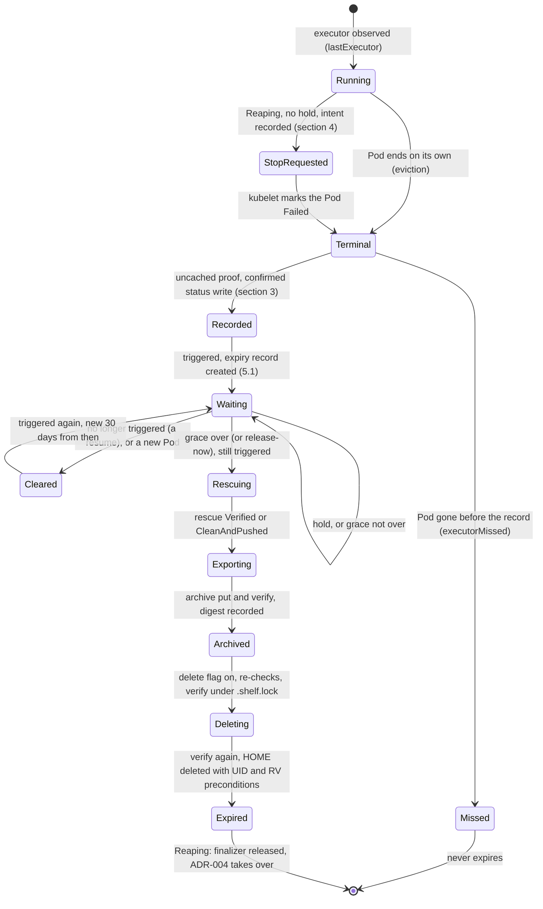

# DESIGN-025: Private session HOME expiry: archive, then delete

- **Status:** Accepted 2026-10-12; corrected the same day after its review
  ([ADR-006](../adrs/006-private-home-expiry-corrections.md), D-87). H1, the
  terminal record (#236, section 3.6), shipped in 2.25.0; H2 installed it with
  the record on, 2026-10-12 (haynes-ops #3852 and #3854). H3, the stop
  request for Reaping Sessions (section 4), is in progress on branch
  `agent/h3-reap-stop-request`. H4 to H10 have no source yet
- **Decision:** [ADR-005](../adrs/005-private-home-expiry.md) (Q-31, Tom,
  2026-10-12: "Archive, then delete (Recommended)"), amended by
  [ADR-006](../adrs/006-private-home-expiry-corrections.md)
- **Amends:** [DESIGN-008](008-private-provider-history-retention.md),
  [DESIGN-019](019-private-pod-retention-guard.md),
  [DESIGN-013](013-published-stopped-context.md),
  [DESIGN-024](024-coordination-record-retention.md) and
  [DESIGN-001](001-dev-env-v2.md) D-45, D-55, D-62 and D-67; each carries a
  dated note
- **Delivery:** [plan 11](../backlog/11-project-workspaces.md), units H0 to H10
- **Tracking:** [#174](https://github.com/thaynes43/dev-env/issues/174)

Everything here is default off. Five operator flags turn it on, in haynes-ops
changes that come in the order of section 13. Deletion is the last, after the
archived-history read is accepted on the installed system.

## 1. What runs, in one picture



Rescuing, Exporting and Archived can also go to Cleared, until Deleting is
recorded. After that nothing cancels.

Only a Reaping Session is ever stopped (ADR-006). A Suspended Session past its
archive deadline reaches Terminal only when its executor ends on its own.

## 2. Which Sessions are eligible

A Session is **eligible** when all of these hold, each read uncached:

- `spec.workspace` and `spec.projectCanary` are both absent.
- `status.privateHistory` passes `privateHistoryIdentity`, its `admission` is
  `Started` and its `homeUID` is set. A HOME the operator never bound
  (`admission: Unknown`) is never eligible.
- `status.privateHistory.executorTerminal` (section 3) exists for
  `lastExecutor.podUID`.

A Session is **triggered** when it is eligible and it is Reaping
(`deletionTimestamp` set), or it is Suspended and its D-62 archive timer is due
(`suspendedAt` plus `archiveAfter` has passed, computed as `archiveDue` does
today). A suspended Session before its deadline is never triggered. The expiry
record exists only while the Session is triggered (5.1, 5.3).

Two rules keep "triggered" from flapping:

- **Unknown is not false.** `archiveDue` answers "not due" when the Session has
  no `archiveAfter` of its own and the templates do not load
  (`internal/controller/reconciler.go`). For the expiry that answer is Unknown:
  no record is created and none is cancelled, the reason `unknown` is counted,
  and the reconcile asks again in a minute. Only a timer computed from a spec or
  templates value that is not yet due counts as not triggered.
- **Latched from `Deleting`.** Once the record reaches `Deleting` (written in the
  same status write as `status.archivedAt`, 6.5), the Session counts as
  triggered whatever the timer says, as today's archive path treats a recorded
  `archivedAt` as due. A longer `archiveAfter` or a templates failure then
  cannot strand a Session that has `archivedAt` set but can neither resume nor
  finish its delete.

The operator stops an executor only for a Reaping Session (section 4). A
Suspended Session past its deadline is triggered only if its executor ended on
its own, such as by an eviction, and that end was recorded. One whose executor
still runs keeps its HOME until it is reaped (ADR-006).

**Never eligible, by design:**

- **Canary originals** (`spec.projectCanary`), whatever their state. Release-now
  is refused for them with `canary`. The fixed result reader (DESIGN-022) reads
  their records live, and ADR-004 keeps those records live because canary
  originals are never absent.
- **Shared-workspace Sessions.** They keep their own lifecycle.
- **A Session with no terminal record:** its executor was never observed (never
  started, or only a known non-attempt, `executorNotCreated`), or it vanished
  before its termination was recorded. Plan 11 follow-up F2 covers a Session that
  provably never admitted a HOME.

## 3. The durable terminal record

### 3.1 Where it lives

A new optional field beside the existing executor record,
`status.privateHistory.executorTerminal`:

| Field | Bound | What |
|---|---|---|
| `version` | enum `1` | |
| `podUID` | 128 | must equal `lastExecutor.podUID` |
| `phase` | enum `Succeeded`, `Failed` | the Pod's phase |
| `reason` | 128 | `status.reason`, such as `DeadlineExceeded` or `Evicted` |
| `podResourceVersion` | 64 | the observed revision |
| `nodeName`, `nodeUID` | 253, 128 | the node that reported it |
| `leaseRenewedAt` | time | the node lease's renew time at the observation |
| `observedAt` | time | the operator's clock at the observation |
| `containers` | at most 16 items | `name` (63), `exitCode`, `reason` (128), `finishedAt`, for regular, init and ephemeral containers |
| `claudeConfigDir`, `codexHome` | 256 each | the executor's provider directories, relative to HOME, when its agent container sets each literally; empty otherwise (section 6.3) |

**Why beside `lastExecutor`, not inside it.** `observePrivateHistory` rebuilds
`lastExecutor` on every reconcile that sees the executor Pod, and carries only
`conversationID` forward (`internal/controller/private_history.go`). A record
inside it would be dropped by that rebuild, the rule below would refuse the
write, and the Session's status would freeze. A sibling is never touched by the
rebuild.

Schema rules (CEL on `privateHistory`, each with a case in
`agentsession_validation_test.go`):

- `executorTerminal` can be set only when `lastExecutor` is set, and
  `executorTerminal.podUID` equals `lastExecutor.podUID`.
- Once set it never changes and is never removed:
  `!has(oldSelf.executorTerminal) || (has(self.executorTerminal) && self.executorTerminal == oldSelf.executorTerminal)`.
  `lastExecutor` already cannot be erased or have its UID replaced.
- `executorTerminal` and `executorMissed` (3.4) never both exist.
- `stopState` keeps its single value `Unknown`. The terminal record is evidence
  for expiry only. It is not DESIGN-010's stop contract and authorizes no claim
  transfer, resume or replacement.

### 3.2 What the operator checks before it writes

`observePrivateHistory` gains one step. When the recorded executor Pod exists,
the Session controls it, its UID is `lastExecutor.podUID` and `executorTerminal`
is absent, the operator runs `verifyExecutorTerminated`. It reads uncached:

1. **The Pod:** same UID and controller, phase `Succeeded` or `Failed`, and
   `allContainersTerminated` (today's helper in `workspace_stop.go`): every
   regular, init and ephemeral container has a `terminated` state with a
   `finishedAt`, and none is running or waiting. The Pod has no `DisruptionTarget`
   condition with reason `DeletionByPodGC`.
2. **The node:** `spec.nodeName` is set; the Node exists, is not deleting, and
   has exactly one `Ready` condition, which is `True`.
3. **The node lease** in `kube-node-lease`: held by that node, owned by that
   node's UID, renewed within the last 40 seconds and not in the future.

Points 2 and 3 are the shared stop verifier's (`PodWorkspaceStopVerifier`). They
mean that a live kubelet wrote the terminated status. When the Pod garbage
collector marks a Pod `Failed` for a lost node, the node is not Ready, so that
status never counts. The verifier is refactored into one helper that the shared
and private paths both call; the shared path keeps its own extra rules
(`RestartPolicyNever`, no deletion timestamp).

A private executor runs with `RestartPolicy: Always`, so a container that is
terminated for a moment does not prove anything there. The terminal **phase**
does: a Pod in phase `Succeeded` or `Failed` never runs again.

A Pod with a deletion timestamp still counts, as long as its phase is terminal
and the rest holds. Current kubelets move a Pod that is being deleted to a
terminal phase before the object goes, so that status can be the last chance to
record it. Nothing here depends on that.

### 3.3 When it is written

- **On every reconcile** of a Session with a private retention record and a
  bound HOME, canary originals included, whose executor Pod is terminal and
  unrecorded. Pod status changes already
  reconcile the Session, so the write usually lands within a second of the
  kubelet's report.
- **While a check fails** (node not Ready, lease stale, a read error), the
  reconcile asks again in 30 seconds and writes nothing.
- **Before anything else in that reconcile.** No step that could remove or
  change the Pod runs in a reconcile that has not first confirmed the record.
- **With today's confirmed write** (`writePrivateHistory`): a status update, then
  an uncached re-read that compares the stored record with the intended one. A
  stale CRD that prunes the field fails that comparison, and nothing later acts
  on a record that was not stored.

With `--enable-private-terminal-record` on, it is written whatever the other
expiry flags say. Recording deletes nothing, and it keeps a proof that would
otherwise be lost.

### 3.4 How it survives

- **Pod loss.** The record is in the Session's status in etcd. The Pod is not
  needed after it. With the record confirmed, a missing executor Pod is
  `ExecutorEnded`, not today's PreservationUnknown error ("the recorded private
  executor is absent"). Without it, that error and its condition stay as they
  are, and the Session never expires.
- **Operator restarts and leader changes.** The record is the only state, and it
  is immutable. A new leader reads it. Two overlapping reconcilers write the same
  record; the second gets a Conflict or finds it already stored.
- **Flag changes.** Turning the record flag off stops new records. Existing ones
  stay, and the schema keeps them.
- **An etcd restore** to a point before the record loses it. The operator then
  sees whatever the restore brought back. It never writes a record on a guess.

**The missed marker.** When an uncached read finds the recorded executor Pod
NotFound and `executorTerminal` is absent, the operator writes
`status.privateHistory.executorMissed` (`version` 1, `podUID` equal to
`lastExecutor.podUID`, `observedAt`) once, by a confirmed write. It never
changes and is never removed, and `executorTerminal` can never be written beside
it. `dev_env_private_executor_terminal_total{result="missed"}` counts that write
only, so each Session counts once, whatever the operator restarts and leader
changes. That is the talosw02 case (ADR-005 Context): the two 1011 canaries get
their marker, and count once, when H2 turns the record on. A Pod of that name
with another UID is not missed; it is today's "private executor was replaced".

### 3.5 Rights

`verifyExecutorTerminated` needs `get` on Nodes and on Leases in
`kube-node-lease`. The operator has neither today; the shared verifier fails
closed for the same reason. haynes-ops grants them in H2 (section 12). Without
them no record is ever written, and nothing expires.

### 3.6 In source (H1, #236)

Implemented in `internal/controller/private_terminal.go`, called from
`observePrivateHistory`, with the confirmed write in `Reconcile`. The node and
lease checks are `executorNodeLive` in `workspace_stop.go`, which
`PodWorkspaceStopVerifier` now calls too. Details the sections above leave open:

- **The recorded executor only.** A record is taken only for a Pod whose UID was
  `lastExecutor.podUID` before the reconcile began. A Pod first observed already
  terminal gets `lastExecutor` in one confirmed write and its terminal record in
  the next reconcile, a second later.
- **When a mark may be added** (`terminalRecordApplies`): the flag is on,
  `privateHistoryIdentity` passes, `admission` is `Started`, `homeUID` is set,
  `lastExecutor` is set, and neither `executorTerminal` nor `executorMissed`
  exists. The missed marker follows the same rule, so a Session whose HOME was
  never bound gets neither, and neither does any Session while the flag is off,
  whether its Pod stands or is gone. With the gate closed nothing reads a Node
  or a Lease.
- **Bounds.** A Pod with more than 16 containers is refused, never truncated.
  `reason` fields are cut to 128 bytes. Times are stored to the second, so the
  confirmed write compares equal.
- **Provider directories.** From the `agent` container only: the last `env`
  entry of the name, a literal absolute value with no `$` (so no `$(VAR)`
  expansion), strictly inside the `home` volume's mount (no `subPath`), and
  neither inside nor containing another mount of that container. Anything else
  is empty.
- **The clock.** `executorNodeLive` reads the clock once, after the lease read,
  and returns that reading. The lease's freshness, `observedAt` and the shared
  proof's `verifiedAt` all use it, so a kubelet renewal that lands during the
  reads is fresh, not future.
- **Before H2.** The operator has no `get` on Nodes or Leases, so the node read is
  Forbidden: the check fails closed, `refused` is counted, the reconcile asks
  again in 30 seconds, and no record is ever written.
- **`ExecutorEnded`.** With the record and no Pod, `PrivateHistoryRetained` is
  True with reason `ExecutorEnded`. A Session that still wants its Pod is phase
  `Failed`, `PodReady` reason `ExecutorEnded`, as it was while the ended Pod
  stood (`PodEnded`); the executor latch still refuses a replacement. A Session
  that wants its Pod gone keeps `RetentionPending`, and `RemovalBlocked` keeps
  that reason.
- **Counting.** `dev_env_private_executor_terminal_total` is registered at start
  whatever the flag, each result at 0. `recorded` and `missed` count when the API
  server acknowledges the status update with the mark: its response holds
  exactly the intended record. The confirming re-read still gates everything
  after the write. When another write to the Session lands between the update
  and that re-read, the reconcile fails and retries, finds the mark stored, and
  neither writes nor counts it again: the mark still counts once. A pruned field
  is never acknowledged, so it never counts. An update whose response is lost
  (a timeout after the write landed) is not counted either; the mark is still
  stored, and its condition shows it. `refused` counts each refused observation
  of a terminal executor.
- **Two reconcilers** (3.4). One whose re-read finds a newer revision of the
  Session writes nothing; one whose update carries an older revision gets a
  Conflict. Either way the Session holds one mark, counted once.

Tests: `TestPrivateHistoryExecutorTerminalRecordIsImmutableAndBound` (T16, the
record part) in `api/v1alpha1`; `TestPrivateTerminalRecordOnTheAPIServer`
(envtest: T15, T6 with restarts as new reconcilers, and T16's rebuild case) and
the unit tests in `internal/controller/private_terminal_test.go`, among them
`TestPrivateTerminalGateHoldsWhetherThePodStandsOrNot`,
`TestPrivateTerminalReadsTheClockAfterTheLease`,
`TestPrivateTerminalCountedWhenAnotherWriteOvertakesTheReRead` and
`TestPrivateTerminalOverlappingReconcilers`; for the shared path,
`TestWorkspaceStopVerifierReadsTheClockAfterTheLease`.

## 4. Reaching a terminal state: the stop request

An ordinary private executor never ends on its own. agentd keeps running after
the agent exits, and the Pod's restart policy (`Always`) restarts a container
that exits. DESIGN-019 keeps the Pod through suspend and reap. So without a stop
request, only an eviction or a node shutdown would ever end one.

**Reaping only (ADR-006).** The operator stops a private executor only when its
Session is Reaping. A reap is an explicit request to end a Session, and it
already ends the executor of every non-private Session. A Suspended Session is
never stopped, before or after its archive deadline: that would end a live
Session that no human asked to end (plan 11 follow-up F3).

**The request.** With `--enable-private-executor-stop`, when a Session is
eligible in shape (section 2, without the terminal record), Reaping, carries no
owner hold (section 9), and its recorded executor Pod is running, the operator
stops it:

1. It reads the Session and the Pod uncached. The Session is Reaping with no
   hold. The Pod's UID is `lastExecutor.podUID`, the Session controls it, and it
   is not a hold pod.
2. **The intent.** It writes `status.privateHistory.stopRequest` (`version` 1,
   `podUID` equal to `lastExecutor.podUID`, `requestedAt`) by a status update
   that carries the resourceVersion of the Session it just read, and confirms it
   by an uncached re-read. A hold annotation written after that read changes the
   resourceVersion, so the update gets a Conflict and nothing is sent. A retry
   repeats the same update, with the stored intent unchanged and the
   resourceVersion of its own fresh read. So every patch follows a read that
   found no hold and a write that nothing overtook. A hold written after the
   confirmed write comes too late, and the stop goes ahead. `stopRequest` never
   changes once set and is never removed.
3. It computes `elapsed` from `status.startTime` and sends one JSON patch
   (`stopPrivateExecutor`):

   ```json
   [{"op": "test", "path": "/metadata/uid", "value": "<podUID>"},
    {"op": "test", "path": "/metadata/resourceVersion", "value": "<rv>"},
    {"op": "add", "path": "/spec/activeDeadlineSeconds", "value": <elapsed + 30>}]
   ```

   `activeDeadlineSeconds` may be set on a running Pod, and only set or lowered.
   It counts from the Pod's start, hence `elapsed`. A Pod that already has a lower
   value is left alone.
4. The kubelet stops the containers with the Pod's termination grace (agentd
   forwards SIGTERM to the agent) and marks the Pod `Failed`, reason
   `DeadlineExceeded`. The Pod object stays, and section 3 records it.

A Conflict or a failed `test` means the Session or the Pod changed: the next
reconcile judges again from point 1. The event `ExecutorStopRequested` names the
Pod UID.

**What it does not do.** It deletes no Pod and changes no HOME byte. It never
stops a Suspended Session, a held Session, a canary (which has its own deadline)
or a shared executor. A Reaping Session cannot be resumed, so the stop never
races a resume.

**What it costs (ADR-006 C-39).** Any API caller may reap any Session, as in v1
(`reapSession`). A mistaken reap of a live private Session now ends that agent.
Its HOME, transcripts and Pod object stay, but the executor latch (DESIGN-008)
refuses a replacement, so it cannot run again. A hold set before the reap
prevents the stop.

## 5. The expiry record and its steps

### 5.1 The record

`status.privateHistory.expiry`, created by a confirmed write in the first
reconcile that finds the Session eligible **and triggered** (section 2). An
eligible Session that is not triggered, such as an active Session whose executor
was evicted, gets no record. So creating and cancelling are complements: a record
exists while the Session is triggered, and a Session that stops being triggered
loses it (5.3).

| Field | What |
|---|---|
| `version` | `1` |
| `executorUID` | the terminal record it rests on; equals `lastExecutor.podUID` |
| `homeUID` | equals `privateHistory.homeUID` |
| `graceStart` | for the Session's first record (`expiryClearedAt` absent), `executorTerminal.observedAt`: Q-31's 30 days run from the first recorded stop proof. For a record made after a cancel, its creation time, which is the first reconcile that finds the Session triggered again. An operator outage only delays that, so the grace is never shorter |
| `dueAt` | `graceStart` plus the grace (720h, or longer by flag) |
| `phase` | `Waiting`, `Rescuing`, `Exporting`, `Archived`, `Deleting`, `Expired` |
| `releaseNowAt` | when release-now was first seen for this record |
| `holdIntent` | a random id, written by a confirmed write before the hold pod is created, and set on the pod as an annotation |
| `holdPodUID` | the hold pod the expiry made, recorded once it is observed |
| `rescueStamp` | the rescue it relies on (`status.rescue.stamp`) |
| `archive` | `entry`, `contentSHA256`, `bytes`, `files`, `gitBundles`, `archivedAt` |
| `deletingAt`, `homeDeletedAt` | times |
| `refusal`, `refusalAt` | the current refusal reason, for `kubectl get`, the condition and the gauge; cleared by the confirmed write of the next step that passes |

`status.privateHistory.expiryClearedAt` keeps the time of the last cancel.

Schema rules: `executorUID` and `homeUID` match their sources; `phase` moves only
forward in the order above; `archive` never changes once set; the record may be
removed only while its phase is before `Deleting`; once `Deleting` it can only
become `Expired`, and once `Expired` it never changes.

A condition, `HomeExpiry`, reports the phase or the refusal and the due time.
The API's session view does not change; `kubectl`, the condition and the
metrics show the state.

### 5.2 The steps and their re-checks

Every step starts with the **common re-check**, all uncached: the Session (same
UID, still eligible and triggered, no hold), its retention
identity, the terminal record, the expiry record, and the HOME claim (UID equals
`homeUID`, controlled by the Session, the operator's finalizer and admission
annotation present, not deleting, except in `Deleting` for this step's own
delete in progress, 6.5). A read error is Unknown: nothing happens, the
reason `unknown` is counted, and the reconcile asks again in a minute. A
mismatch refuses with its reason (section 10) and nothing happens.

| Phase | The step | Its own re-checks | Then |
|---|---|---|---|
| (none) | Create the record | eligible and triggered | `Waiting` |
| `Waiting` | Wait | `now >= dueAt`, or release-now | `Rescuing` |
| `Rescuing` | Remove the ended executor Pod, if it is still there (`expiryPodRemovalAllowed`) | Pod UID is `executorUID`, phase still terminal; delete with UID and resourceVersion preconditions | |
| `Rescuing` | Create the hold pod (6.1) | `holdIntent` recorded first; the Session's Pod name is NotFound; no Pod in the namespace mounts the claim (uncached list) | `holdPodUID` recorded once the pod is observed (6.1, adoption) |
| `Rescuing` | Run the rescue (6.2) | hold pod is `holdPodUID`, Running; claim UID re-read; the hold pod's `home` volume names the claim | `Exporting` once the verdict is valid |
| `Exporting` | Export and archive (6.3, 6.4) | rescue still valid, same stamp and same hold pod; shelf Ready with the history archive mounted | `Archived`, with `archive` recorded; then the hold pod is removed (`expiryHoldRemovalAllowed`) |
| `Archived` | Stop here while deletion is off | | |
| `Archived` | Prepare the delete (6.5) | `verify` under `.shelf.lock` gives `contentSHA256`; no Pod for the name; no Pod mounts the claim | `Deleting`, with `deletingAt` and, for a suspended Session, `status.archivedAt`, in one confirmed write |
| `Deleting` | Delete the HOME (6.5), on every attempt | the same checks again in the same call path: `verify` under `.shelf.lock`, no Pod for the name, no Pod mounts the claim; then the delete with the claim's UID and resourceVersion as preconditions | `Expired` |
| `Expired` | Reaping: release the Session (6.6) | no Pod, no claim, by uncached reads | ADR-004 |

Each step is idempotent. After an operator restart, the next reconcile finds the
phase in status and repeats only what is not confirmed: a hold pod that carries
this record's `holdIntent` is adopted (6.1), an archive entry that exists with
the same digest is `exists`, and a claim that is already gone counts as deleted.
`Deleting` is never a licence to delete on its own: every attempt, after a
restart, a Conflict or any other error, runs the archive `verify` and the Pod
checks again before it deletes (6.5).

**Retry cadence.** A step refused for Unknown is tried again in one minute. A
step refused for any other reason is re-checked, and its refusal re-counted and
re-recorded in `refusal`, every 15 minutes while the Session stays refused. The
gauge `dev_env_home_expiry_refusing` (section 10) shows the Sessions refused
right now, so its alert does not depend on that cadence. A step that passes
clears `refusal` and `refusalAt` in its own confirmed write, so a fixed cause
stops the alert at the next re-check.

### 5.3 What cancels it

- **No longer triggered.** A resume of a suspended Session, or an archive timer
  that is no longer due because a spec or templates value lengthened
  `archiveAfter`. Templates that do not load are Unknown, never a cancel
  (section 2). A Reaping Session is triggered for good, and so is any Session
  whose record has reached `Deleting`. Before `Deleting`, the expiry's hold pod is
  removed first (`expiryHoldRemovalAllowed`) and confirmed gone by an uncached
  read, while the record still names it, so it is never mistaken for a new Pod.
  Then the record is removed by a confirmed write and `expiryClearedAt` is set.
  The HOME stays. An archive entry already written stays too; it is never
  removed. A later record is created only when the Session is triggered again,
  and its 30 days start then (5.1). From `Deleting` on, a resume is refused: a
  suspended Session has `status.archivedAt` by then, written in the same status
  write as `Deleting` (6.5), and a reaped one cannot resume.
- **A new Pod.** Any Pod of the Session's name, or any Pod that mounts its claim,
  whose UID is neither `executorUID` nor `holdPodUID`, and that is not the
  expiry's own hold pod awaiting adoption (6.1). The expiry's own hold pod, if
  any, is removed as above, then the record is removed and the Session gets
  today's PreservationUnknown ("private executor was replaced"). Nothing else is
  deleted.
- **A hold** (section 9). Nothing moves on while it is set, and no stop request
  is sent (section 4); the grace clock keeps running. A hold pod the expiry made
  is removed (`expiryHoldRemovalAllowed`), because nothing needs it, and is made
  again after the hold is lifted if the step still needs it. A hold never cancels
  the record.
- **Identity changes.** A changed Session UID, a HOME claim with another UID, a
  deleting claim, a canary or workspace binding: refused
  (`identity_changed`, `home_replaced`). Nothing is deleted, and a human looks.

## 6. Step details

### 6.1 The hold pod, bound to the HOME UID

It is D-55's hold pod: the Session's Pod name, the label
`dev-env.haynesops.com/hold: "true"`, `agentd hold`, S-class resources, no agent
credentials, the session volume, the shared volume and `/creds` for the rescue's
Git credential helper. Six additions:

- It is made for a private Session only by the expiry, only in `Rescuing`, and
  only after the executor Pod is gone (the same name).
- It carries the annotations `dev-env.haynesops.com/private-history-home-uid`
  (the HOME UID), `dev-env.haynesops.com/home-expiry-executor` (the executor
  UID) and `dev-env.haynesops.com/home-expiry-hold-intent` (the record's
  `holdIntent`). `observePrivateHistory` already ignores hold pods for the
  executor record.
- **Intent first, then adoption.** The operator writes `holdIntent` into the
  expiry record by a confirmed write before it calls Create, like the executor
  intent of DESIGN-008. An operator can restart between the Create and the write
  of `holdPodUID`. So before it treats a Pod as new, it adopts a Pod that the
  Session controls, that has the hold label, and whose three annotations match
  this record's `holdIntent`, `executorUID` and `homeUID`: it records that Pod's
  UID as `holdPodUID` by a confirmed write. A hold-labelled Pod with any other
  intent is a new Pod (5.3). The match rests on the controller reference, which
  must name the Session's UID, not on who may create Pods. Other identities can
  create Jobs in `dev-agents` (v1's OPERATOR tier can), but a Job's Pod names the
  Job as its controller, and a Pod has at most one controller reference, so it
  cannot carry the Session's. An identity that can create a bare Pod there with
  any owner reference (the operator, cluster-admin) is outside what this check
  defends against, as it is for every guard here.
- **Making it again.** After an owner hold, or after archive was turned off and
  on again (section 14), the hold pod may have to be made again. `holdPodUID`
  keeps naming the old pod while it terminates, so that pod is never a new Pod.
  Only once uncached reads show the Session's Pod name NotFound and no Pod
  mounting the claim does the operator clear `holdPodUID` and write a new
  `holdIntent`, in one confirmed write, and then create the pod.
- **Its removal.** The expiry's hold pod is removed only through
  `expiryHoldRemovalAllowed`, a fifth named guard exception (ADR-006). D-45's
  `podRemovalAllowed` refuses every Pod of a protected private Session before it
  reaches `holdRemovalAllowed`, and `holdRemovalAllowed` keeps a Running,
  un-rescued hold pod while the Session wants its Pod gone, so neither could
  remove it. The new function is nil only when the Pod has the hold label, the
  Session controls it, its UID is the record's `holdPodUID`, its three
  annotations match the record, and the expiry no longer needs it: the record is
  being cancelled (5.3), an owner hold is set, archive is off (section 14), the
  record is `Archived` or later, or the hold pod ended. The delete carries the
  Pod's UID and resourceVersion as preconditions. A Pod awaiting adoption is
  adopted first, then judged.
- **The binding.** A Pod names its claim, not the claim's UID. The operator
  checks the claim's UID before it creates the pod, again once the pod runs, and
  in the common re-check of every later step. While a Pod uses a claim,
  `pvc-protection` keeps the claim until the Pod is gone, a claim that is being
  deleted fails the re-check, and only the guard deletes one. So the name keeps
  the same UID while the hold pod runs.

### 6.2 The Git rescue

`agentd ctl rescue --stop-agent` by exec in the hold pod, as D-51 and D-55 run it,
with the verdict recorded in `status.rescue`. `Verified` or `CleanAndPushed`
(with `VolumeEmpty`) is valid. A failure keeps the hold pod, retries every 15
minutes and pages after D-57's window, as today. The bundle lands on the shared
volume at `rescue/<session>/<stamp>/` (D-48).

### 6.3 The history export

`agentd ctl history-export plan` runs by exec in the hold pod. It reads HOME
only: every file is opened `O_RDONLY|O_NOFOLLOW`, and it never creates, changes
or removes anything there. It prints one JSON plan: the files it would export,
each with its size, mode, modification time, SHA-256 and the SHA-256 of each
1 MiB block, plus every name it excluded and why. Then `history-export stream
--plan-sha256 <h>` writes exactly those files as a tar stream to stdout,
re-hashing each file as it reads it. If any file differs from the plan, it stops
and the step refuses (`export_changed`).

**Which directories.** The provider directories are the executor's, not the
hold pod's. A hold pod gets the templates' common `env` (`internal/controller/pod.go`)
but not the profile's `env` or `envFrom`, so its own `CLAUDE_CONFIG_DIR` or
`CODEX_HOME` may differ from the executor's. The terminal record (3.1) keeps the
executor's paths, relative to HOME, only when the agent container's `env` sets
each one literally (a `value`, not a `valueFrom`; the last entry of that name
wins). Kubernetes ranks `env` above `envFrom`, so a literal entry is the
effective value whatever a profile's `envFrom` holds. The operator cannot read
an `envFrom` source (it reads no Secrets), and neither variable is in
`templates.ReservedEnv`, so an unset or indirect variable could come from one.
Then the record keeps the path empty, and the export refuses (`layout_unknown`)
rather than read a default directory and delete the real history. haynes-ops
sets both literally in the template `env` today. A path outside HOME is refused
(`layout_unknown`) too.

**Where each provider keeps history.** From the repository:

- **Claude.** `internal/agentd/settings.go`: the config directory is
  `$CLAUDE_CONFIG_DIR`, else `~/.claude`; the state file `.claude.json` sits in
  that directory when the variable is set, else in HOME. R-02 section 2.3: the
  conversation transcript is `projects/<cwd-key>/<id>.jsonl`; `.credentials.json`
  holds the Max login and MCP OAuth entries; `.claude.json` holds the account and
  organization identifiers. R-01: transcripts under `~/.claude/projects/-home-dev/`.
  `internal/agentd/activity.go`: the local session registry is
  `sessions/<pid>.json`. `internal/agentd/render.go`:
  `projects/<key>/memory` is a link to the shared memory (DESIGN-001 6.6), not
  private history.
- **Codex.** `internal/agentd/settings.go`: `$CODEX_HOME`, else `~/.codex`.
  `internal/agentd/codex_auth.go`: agentd writes the login to
  `$CODEX_HOME/auth.json`. `internal/agentd/codex_host_config.go` refuses a
  `sqlite_home` other than `$CODEX_HOME`, so the state databases live there.
  `internal/agentd/codex_host_process.go`: `app-server-daemon/`,
  `app-server-control/` (a socket) and `packages/` are runtime state.
  docs/keeper-codex-auth.md links the pinned Codex source.
- **agentd.** `internal/agentd/launch.go`: the task records in `~/.agentd`
  (`boot.json`, `launch.json`, `resume.json`, `task-result.json`, `tui-exit.json`,
  `task-events.jsonl`, `task-source.json`). `internal/agentd/decisions.go`: the
  current question-and-answer record `child-decision.json` and the answered ones
  under `decisions/`. `internal/agentd/managed_output.go`: captured assistant
  text under `managed-output/`. The other names come from `statePath` and
  `StateDir` joins across `internal/agentd` (locks, runtime and setup state,
  Git rescue files) and from `files.go`'s temporary names
  (`.<name>.agentd-*`). `internal/agentd/settings.go` `LogPath`: the agent's log
  is `~/work/<name>.log`; D-67 prunes its shared copy.

The top-level names below come from a names-only listing of a v1 HOME on
2026-10-12 (Claude Code 2.1.292, Codex 0.160.1). H4 confirms them against the
agent image's pinned versions and keeps them in
`internal/agentd/historyexport_layout.go`, with a fixture tree per provider.

**The classification.** Every top-level entry of each provider directory gets one
class. An entry in no class refuses the export (`unknown_entry`), so a new layout
blocks expiry until a source change classifies it (ADR-005 C-34). Excluded names
are listed in the manifest with their size; credentials with their name only.

| Provider | History: exported | Not history: listed, not exported | Credentials: never exported |
|---|---|---|---|
| Claude | `projects/` (transcripts and per-session subdirectories; links not followed), `history.jsonl` (prompt history), `jobs/`, `feedback/` | `file-history/` (edit snapshots), `paste-cache/` and `uploads/` (copies of user or workspace files under names that say nothing about them; see below); `CLAUDE.md`, `agents/`, `settings.json` and `settings.json.*`, `plugins/`, `skills/`, `cache/`, `state/`, `daemon/`, `daemon.lock`, `daemon.status.json`, `policy-limits.json*`, `remote-settings.json`, `statusline-command.sh`, `.last-cleanup`; `sessions/` (runtime registry with key files); `.claude.json` and `backups/` (account identifiers); `shell-snapshots/` and `session-env/` (environment captures, which can hold secrets) | `.credentials.json` and `.credentials.json.*` |
| Codex | `sessions/` (`<YYYY>/<MM>/<DD>/rollout-*.jsonl`), `archived_sessions/`, `session_index.jsonl`, `history.jsonl`, `state_*.sqlite*`, `memories_*.sqlite*`, `goals_*.sqlite*`, `queue_*.sqlite*`, `generated_images/` | `attachments/` (copies of user files; see below); `config.toml`, `AGENTS.md`, `rules/`, `skills/`, `plugins/`, `packages/`, `cache/`, `models_cache.json`, `app-server-control/`, `app-server-daemon/`, `log/`, `logs_*.sqlite*`, `installation_id`, `.tmp/`, `rollout-migrations/`, `thread-writer-locks/`, `mcp-oauth-locks/`, `.sqlite-maintenance.lock`, `.personality_migration`, `.sandbox_migration`; `shell_snapshots/` (environment captures) | `auth.json`, `auth.json.*`, `.credentials.json`, `.credentials.json.*` |
| agentd | the seven task records above; `child-decision.json` and `decisions/`; `managed-output/`; and `~/work/<session>.log` | locks (`agent.pid`, `deliver.lock`, `rescue.lock`, `project-bootstrap.lock`, `codex-host-supervisor.lock`); runtime and setup state (`native-invocation.json`, `native-started.json`, `codex-access-generation.json`, `codex-host-config.json`, `codex-host-start-intent.json`, `codex-host-preparation.json`, `common-rule-ownership.json`, `common-launch-inputs.json`, `project-bootstrap.json`, `project-snapshot.json`, `project-rules.md`, `project-roots/`, `project-sync/`, `workspace-supervisor`, `workspace-admission.json`, `workspace-stop-request.json`); Git files the rescue covers (`rescue-*.bundle`, `rescue-index-*`); temporary copies (`.<name>.agentd-*`) | none expected; the refusal still applies |

**agentd is classified by name too.** An entry of `~/.agentd` in no class
refuses the export (`unknown_entry`), as for the providers; there is no
catch-all. H4's `TestHistoryLayoutCoversAgentdState` scans `internal/agentd` for
every name it writes under its state directory and fails when the table lacks
one, so a new agentd file is classified in the change that adds it.

**Copies of user and workspace files are not exported (ADR-006).** The credential
refusal below works on names. Claude's `file-history/` keeps snapshots of edited
files under hashed names, so a snapshot of an edited `.env`, kubeconfig or key
file would pass it. `paste-cache/`, `uploads/` and Codex `attachments/` keep
pasted or attached content the same way. So those subtrees are listed, with
their size, and not exported. Code goes through the Git rescue, and the
conversation through the transcripts. H4 checks against the pinned versions
whether any other exported subtree stores such copies, and excludes it too.

A SQLite file goes with its `-wal` and `-shm` files. The executor has ended and
the hold pod runs no agent, so nothing writes them during the copy.

The rest of HOME is not exported. Repositories and worktrees go through the Git
rescue. `.ssh/`, `.config/` and the like are never read.

**The credential refusal.** Inside an exported subtree, any of these refuses the
whole export with `credential_in_tree`, and the HOME stays:

- a base name, compared without case, that is `auth.json`, `.credentials.json`,
  `credentials.json`, `access.json`, `.git-credentials`, `.netrc`, `kubeconfig`,
  `gh_token`, `hosts.yml`, `dev-env-hw` or `.env`;
- a base name that starts with `auth.json.`, `.credentials.json.`, `id_rsa`,
  `id_dsa`, `id_ecdsa`, `id_ed25519` or `.env.`, so temporary and backup copies
  count too (a v1 HOME had a `.credentials.json.tmp.<suffix>`);
- a base name that ends with `.pem`, `.key`, `.p12` or `.pfx`;
- a regular file with more than one hard link;
- a file whose SHA-256 equals that of a credential file found in HOME or of
  `/creds/gh_token`, so a renamed whole copy counts too.

**Other refusals.** Inside an exported subtree: a socket, FIFO or device
(`unexpected_entry`); a path deeper than 64 levels or longer than 1024 bytes
(`unexpected_entry`). Over 2 GiB or over 100,000 files in total, or one file
over 512 MiB (`export_too_large`). A symbolic link is never followed. It is
listed by name, as excluded with class `link`.

**Not checked:** the content of transcripts. An agent may have printed a secret
into one. The archive is guarded (section 7, with the limits named there) and
its reads are scoped (section 8), but the bytes are kept (ADR-005 C-35).

### 6.4 Transfer and archive

The operator runs the stream in the hold pod and pipes its stdout straight into
`agentd ctl history-archive put` in the shelf pod. Nothing is written to the
operator's disk or logged. The pipe buffers at most 1 MiB. One export runs at a
time per operator, it takes one of the per-replica shelf exec slots of
DESIGN-024 section 5 (whichever of R3 and H5 lands first builds that limit), and
the pair of execs has a 15-minute timeout instead of the shelf's minute.

The operator writes the first line of `put`'s stdin: the **content manifest**
(`content.json`), canonical JSON as in DESIGN-024 section 4. It joins:

- what the operator knows: format `dev-env.history-archive.v1`; the Session's
  namespace, name and UID; its saved project (from the claim snapshot; empty when
  it has none); the provider; `homeUID`; the terminal record; the rescue's stamp,
  result and pod UID;
- the plan from the hold pod: files with sizes, hashes and block hashes, excluded
  names and their classes;
- the rescue bundle files under `rescue/<session>/<stamp>/` that the shelf will
  copy, from the rescue's own manifest.

`contentSHA256` is the SHA-256 of those canonical bytes. Times that change on a
retry (`archivedAt`, `archivedBy`) go in a separate `entry.json`, so an identical
retry gives the same digest.

### 6.5 Verify and delete

With `--enable-home-expiry-delete`. Points 1 and 2 run on **every** attempt
that can remove the HOME, in the same call path as the delete: the first one
from `Archived`, and every retry in `Deleting` after a restart, a Conflict or
any other error. `Deleting` only records that a resume is refused from now on;
it never lets a delete skip the checks.

1. The common re-check, then `history-archive verify --session-uid U
   --content-sha256 H` under the shared `.shelf.lock`: it re-hashes every file,
   every block list and `content.json`. Any difference refuses
   (`archive_mismatch`; `archive_missing` when the entry is gone). The operator
   never writes over an entry.
2. An uncached read confirms no Pod of the name and no Pod that mounts the
   claim (`claim_in_use` otherwise). The hold pod went when the archive was
   recorded.
3. From `Archived` only: one confirmed status write records `phase: Deleting`,
   `deletingAt` and, for a suspended Session, `status.archivedAt` (as D-62's
   `recordArchive` writes it). One write, so a Session can never hold
   `archivedAt` without `Deleting`, which would leave it unable to run and never
   triggered again. A resume is refused from here on.
4. `deleteVolume` deletes the claim with
   `client.Preconditions{UID: &homeUID, ResourceVersion: &rv}`, where `rv` is the
   revision read in point 1. Today it passes the UID only; this path adds the
   resourceVersion. Then `releaseVolume` lifts the operator's finalizer by an
   update that carries the claim's UID and the resourceVersion of a fresh
   uncached read. A Conflict refuses (`precondition_failed`); the next reconcile
   starts again from point 1.
5. An uncached read confirms NotFound, or another UID. Then `phase: Expired`
   and `homeDeletedAt`.

In `Deleting`, a claim with the recorded UID whose deletion has already started
is this step's own delete in progress (a restart or an error fell after the
delete in point 4).
The common re-check accepts it there, and only there. The retry runs points 1
and 2 again, then lifts the operator's finalizer. A verify that fails in
`Deleting` refuses; the record cannot go back, the HOME stays, and
`DevEnvHomeExpiryNeedsOwner` fires.

The PersistentVolume behind the claim follows its storage class (`Delete` on
`gasha01-rbd`). The archive is the copy that remains.

### 6.6 Release

A Reaping Session with an `Expired` record is released by `releaseIfEmpty`: its
one new exception admits a private Session whose expiry record is `Expired`, its
`homeUID` matches, and uncached reads find no Pod and no claim. `releaseSession`
admits the same Session and refuses every other protected one, canaries always.
The Session is then absent, and ADR-004's 30 days start for its records.

A suspended Session stays, phase `Archived`, until it is reaped. Then it is
released at once, the same way.

## 7. The history archive volume

**A sibling of DESIGN-024's volume.** ADR-005 gives the reasons: a different size
class, a different shape, more sensitive content. Everything else is the same.

- **PersistentVolumeClaim** `dev-env-history-archive` in `dev-agents`:
  `ReadWriteOnce`, `ceph-block`, 20 GiB to start (online expansion), annotation
  `kustomize.toolkit.fluxcd.io/prune: disabled`.
- **Its PersistentVolume is `Retain`.** Tom sets it after the claim binds; no
  agent tier writes a PersistentVolume (DESIGN-024 section 3). H7 checks it.
- **Mounted only by the shelf**, at `/home/dev/.history-archive`. A shelf with an
  RWO volume uses `Recreate` (DESIGN-024 section 3); whichever of R5 and H7 comes
  first sets it, and a second volume adds no new cost to its updates. After a
  node loss both volumes must detach; DESIGN-024's recovery steps do both.
- **Who can reach it (corrected by ADR-006).** The templates check refuses a
  template that names this claim; H6 adds the name beside the coordination
  archive's (DESIGN-024 R4). `dev-env-identity-guard` and the Kyverno
  `dev-env-exec-guard` refuse exec into the shelf to every `dev-agents` identity,
  so v2 agents and API callers cannot reach it. Those guards match only
  `dev-agents` identities, so today these can:
  - **v1's OPERATOR tier**, `dev/dev-env` (every agent in the v1 pod) and
    `upgrade-agent/dev-env-ops`: `pods/exec` and Job `create` across the cluster
    (haynes-ops `apps/dev/dev-env/app/rbac.yaml`). It can exec into the shelf, or
    run a Job on the shelf's node that mounts the claim, and read, rewrite or
    delete any entry;
  - **`dev-env-broker` and `dev-env-keeper`**: `pods/exec` in `dev-agents` with
    no name limit;
  - **`dev-env-operator`**, by design, through `agentd ctl history-archive`;
  - **cluster-admin identities**, and node, storage and hypervisor
    administrators, as for every volume in the cluster.
- **The archive guard (H7, or DESIGN-024's R5 if that ships first).** A new
  admission policy covers both archives. For
  every ServiceAccount except `dev-env-operator`, it refuses exec, attach and
  port-forward into the shelf pod, and ephemeral containers on it. It refuses a
  Pod or workload (Job, CronJob, Deployment, ReplicaSet, StatefulSet, DaemonSet)
  that mounts `dev-env-history-archive` or `dev-env-coordination-archive`, except
  the shelf Deployment and the ReplicaSet and Pod its controllers make from it.
  It refuses any change to the shelf Deployment's pod template by anyone but
  Flux's `kustomize-controller`, except one that changes only the
  `kubectl.kubernetes.io/restartedAt` annotation (`kubectl rollout restart`),
  which leaves the pod spec as it was.
  Human users keep their access. It needs a Pod lookup at admission, so it
  follows `dev-env-exec-guard`'s Kyverno pattern. It narrows v1 at the shelf
  only. On 2026-10-12 no runbook in haynes-ops or this repository execs into the
  shelf; H7 checks again, with an RBAC listing of every identity that holds
  `pods/exec` or Job `create` in `dev-agents`. If a v1 workflow needs that
  access, it is a question for Tom before the guard ships, because no v2 guard
  may cut a capability agents use today. If Tom's phone path acts as a
  ServiceAccount (section 9's check), the guard names that account.
- **No backup off the cluster**, and kept indefinitely. agentd has no command
  that removes an entry.

**Layout:**

```
/home/dev/.history-archive/
  .shelf.lock                 flock: exclusive for put, shared for verify, get, list and read
  .incoming/<random>/         a write in progress
  v1/<project or _none>/<session UID>/<first 16 hex of contentSHA256>/
    content.json              the content manifest
    entry.json                archivedAt, archivedBy
    blocks/<n>.json           block hashes of file n
    files/<root>/<path>       the exported files; root is claude, codex, agentd or log
    git/<stamp>/...           the rescue bundle and its manifest
  index/<project or _none>/<YYYY-MM>/<archivedAt>-<session UID>-<16 hex>.json
```

**`agentd ctl history-archive`**, run by the operator in the shelf:

- **`put`** reads the content manifest, then the tar stream. Under the exclusive
  lock it validates the manifest (format, bounds, names, no `..` or absolute
  path, the credential names again). It writes each tar entry into
  `.incoming/<random>/`, hashing as it writes. It refuses (`invalid`) a tar entry
  the manifest does not list, a listed file that is missing, or a size or hash
  that differs. It copies the rescue files from `/home/dev/.shared/rescue/`, which
  the shelf already mounts (D-67), and checks each against the rescue manifest's
  hash. It fsyncs, renames the directory into place, fsyncs the parent and writes
  the index entry. An existing entry with the same `content.json` is `exists`;
  with a different one, `conflict`, and nothing is written. Debris in
  `.incoming` older than one hour is removed; that is the only removal.
- **`verify`** re-hashes an entry completely under the shared lock and prints
  `contentSHA256` or `corrupt`.
- **`get`** prints an entry's `content.json` after checking its hash.
- **`list --project P [--limit N] [--after C]`** walks the project's index newest
  first and prints each entry's verified summary, at most 100 a page.
- **`read --session-uid U --content C --file N --offset O`** returns at most
  64 KiB of one file. It first checks the hash of each 1 MiB block it reads
  against the file's block list, and that block list against `content.json`. It
  never prints bytes it could not verify.

`agentd shelf --history-archive` refuses to start without the mount (D-48's
check). Errors are DESIGN-024's: one JSON object, codes `not_found`, `conflict`,
`corrupt`, `invalid`, `no_archive`. Protocol types live in
`internal/agentd/protocol/historyarchive.go`.

## 8. Reads of archived history

On with `--enable-history-archive-reads`. Every read goes to the shelf through
one of DESIGN-024's exec slots. Three routes:

| Route | Answers |
|---|---|
| `GET /v1/history?project=P[&limit=&continue=]` | archived histories of one project, newest first: Session name and UID, provider, `archivedAt`, `contentSHA256`, bytes, file count, the terminal phase and time |
| `GET /v1/history/{sessionUID}[?content=]` | one entry's manifest view: identity, provider, terminal record, rescue, files (path, bytes, SHA-256) and excluded names; the newest entry unless `content` names another |
| `GET /v1/history/{sessionUID}/file?path=&offset=[&content=]` | one page: at most 64 KiB, base64, with `offset`, `next`, `eof` and the file's SHA-256 |

Every item and answer carries `archived: true` and `archivedAt`.

**Scope.** DESIGN-013's payload-read scope, unchanged: `contextReadScope(project)`
with the project from the verified `content.json`. The project must be in
`--context-payload-read-projects`, and the caller must be a live Session of that
project or a configured coordinator. A history with no project is readable by no
API caller. Through exec into the shelf, it is readable by Tom and by the
identities section 7 names until the H7 guard ships; after that, by Tom and the
operator, and still by cluster-admin, node and storage access.

**Answers that reveal nothing.** The list route checks the scope for `P` before
it asks the shelf. A single read first requires that the caller has the payload
scope for at least one project; otherwise it answers 404 at once. Then it reads
the entry; a project outside the caller's scope is 404, like an entry that does
not exist. No shelf, no free slot, `no_archive`, `corrupt` or a failed exec is
503 `unavailable`, never 404. Because every caller that reaches the shelf gets
503 while it is down, existence is not revealed.

**Not served:** the Git bundles (code goes through D-67's restore), and any
excluded or credential name's content. `agent-run history list|show|read` is the
client. These routes are new, so no existing client decodes them.

This read is the **#174 read**. Deletion stays off until H8 records it working on
the installed system: an authorized read of a real archived history, and a
refusal for a caller outside its scope.

## 9. Owner overrides: hold and release-now

One annotation on the AgentSession, `dev-env.haynesops.com/home-expiry`:

- `hold`: nothing moves on (5.3), and no stop request is sent (section 4);
  removing the annotation lifts it. To keep a private executor running through
  a reap, set the hold before the reap.
- `release-now`: skips the grace of the current expiry record, and nothing else.
  The operator records `releaseNowAt`. The annotation is a standing instruction
  while it is there: a record made after a cancel sees it too.

Any other value is ignored and counted (`override_invalid`).

**Owner-only, by admission.** `dev-env-identity-guard` already refuses every
`dev-agents` identity any write to `dev-env.haynesops.com` objects. A new small
ValidatingAdmissionPolicy, `dev-env-home-expiry-guard`, matches AgentSession
`CREATE` and `UPDATE`. It refuses a request that adds, changes or removes this
annotation when the requester is a ServiceAccount, which covers the operator, the
broker, the keeper, Flux and every agent. Tom acts as himself with `kubectl`.
Before H7 writes the policy, check which identity Tom's phone path uses (for
example Headlamp). If it is a ServiceAccount, the policy names that one account
explicitly, in the reviewed haynes-ops change.

No dev-env code writes the annotation: `TestNoCodeWritesHomeExpiryOverride`. No
API route sets it.

## 10. Metrics and alerts

Exported by the leader:

| Metric | Type | Labels |
|---|---|---|
| `dev_env_private_executor_terminal_total` | counter | `result`: `recorded`, `missed` (counted only when the `executorMissed` marker is written, so once per Session across restarts and leader changes; 3.4), `refused` (terminal, but the node or lease check failed) |
| `dev_env_private_executor_stop_requests_total` | counter | `result`: `sent`, `conflict` (the intent write or the patch), `held` (a hold refused it) |
| `dev_env_home_expiry_sessions` | gauge | `phase`: `unproven` (private, retained, no terminal record), `waiting`, `held`, `rescuing`, `exporting`, `archived`, `deleting` |
| `dev_env_home_expiry_expired_total` | counter | none |
| `dev_env_home_expiry_archived_bytes_total` | counter | none |
| `dev_env_home_expiry_refusing` | gauge | `reason`: the number of Sessions whose current `refusal` is that reason, from the last reconcile of each; the reasons below. A Session leaves it when a step passes (which clears `refusal`), when its expiry record is removed, or when the Session is gone |
| `dev_env_home_expiry_refused_total` | counter | `reason`: `unknown`, `identity_changed`, `home_replaced`, `claim_in_use`, `canary`, `override_invalid`, `layout_unknown`, `unknown_entry`, `unexpected_entry`, `credential_in_tree`, `export_too_large`, `export_changed`, `shelf_unavailable`, `archive_conflict`, `archive_missing`, `archive_mismatch`, `precondition_failed`, `forbidden` |
| `dev_env_home_expiry_overdue_seconds` | gauge | none; the largest `now - dueAt` over triggered, unheld Sessions not yet `Archived` (or `Expired` with deletion on) |

Rescue failures keep their own condition and page (D-57).

**Alerts** (haynes-ops `operator/app/prometheusrule.yaml`, group
`dev-env-operator.rules`):

```yaml
- alert: DevEnvHomeExpiryNeedsOwner        # critical
  expr: |
    sum by (reason) (dev_env_home_expiry_refusing{reason=~"credential_in_tree|unknown_entry|unexpected_entry|layout_unknown|export_too_large|archive_conflict|archive_missing|archive_mismatch|home_replaced|identity_changed"}) > 0
  for: 15m
- alert: DevEnvHomeExpiryStalled           # critical
  expr: max(dev_env_home_expiry_overdue_seconds) > 2 * 86400
  for: 1h
- alert: DevEnvHistoryArchiveFilling       # critical
  expr: |
    max(kubelet_volume_stats_used_bytes{namespace="dev-agents",persistentvolumeclaim="dev-env-history-archive"})
      / max(kubelet_volume_stats_capacity_bytes{namespace="dev-agents",persistentvolumeclaim="dev-env-history-archive"})
      >= 0.8
  for: 1h
- alert: DevEnvPrivateExecutorEndedUnrecorded   # warning
  expr: increase(dev_env_private_executor_terminal_total{result="missed"}[1h]) > 0
```

`DevEnvHomeExpiryNeedsOwner` names reasons that never clear on their own. It
reads the gauge of Sessions refused right now, so it keeps firing until the
refusal is gone, whatever the retry cadence (5.2). Its description says: the HOME is kept; find the Session with `kubectl get
agentsessions` and its `HomeExpiry` condition; a credential in the tree or an
unknown entry needs a source change or Tom's decision, never a manual delete by
an agent; an automated responder reports and changes nothing.
`DevEnvPrivateExecutorEndedUnrecorded` is a warning: nothing is at risk, the HOME
is simply kept for good. Because `missed` counts only the marker's write, it
fires once per Session, not again after each operator restart.
`DevEnvShelfUnavailable` (DESIGN-024) covers the shelf.

The rule ships in H7 (section 12), so it never fires for the two 1011 canaries.
H2 wrote their markers within a second of the first 2.25.0 leader taking its
lease (2026-10-12 23:22:49 UTC), before the first scrape, which already read
`missed` = 2; and by the time H7 loads the rule they are far outside its
one-hour window. The H2 post-check verifies them directly instead: an
`executorMissed` marker stored on each Session, and `missed` = 2 on the leader
that wrote them. (Corrected
2026-10-12: this paragraph used to say the two canaries fire the alert once
when H2 turns the record on, which section 12's order cannot produce.)

## 11. Guard tests

- **`TestOnlyTheGuardDeletes`** (extended): a private executor Pod is deleted only
  through `expiryPodRemovalAllowed` (terminal record confirmed, phase
  `Rescuing`); the expiry's hold pod only through `expiryHoldRemovalAllowed`
  (6.1); a private HOME only through `expiryVolumeRemovalAllowed` (phase
  `Deleting` confirmed); `releaseIfEmpty` and `releaseSession` lift a protected
  Session's finalizer only with an `Expired` record, and never for a canary. Each
  exception is one function, and the scan names all five.
- **`TestExpiryDeleteNeedsVerify`**: the HOME delete, and the finalizer lift of a
  claim already deleting, are reachable only after `historyArchiveVerified`,
  `expiryRechecked` and `noPodUsesHome` in the same call path, on every attempt,
  the retries from `Deleting` included, like DESIGN-024's rule 4.
- **`TestOnlyStopPrivateExecutorPatchesPods`**: apart from create and the guarded
  deletes, the only Pod write in the module is `stopPrivateExecutor`. Its patch
  holds exactly the two `test` operations and the one
  `/spec/activeDeadlineSeconds` operation, and it is reachable only after
  `stopIntentConfirmed` in the same call path.
- **`TestHistoryLayoutCoversAgentdState`** (`internal/agentd`): every name agentd
  writes under its state directory is in the agentd classification (6.3).
- **`TestHistoryExportReadsOnly`** (`internal/agentd`): the export opens HOME
  files only with `O_RDONLY|O_NOFOLLOW` and makes no create, rename, chmod or
  remove call under HOME.
- **`TestHistoryArchiveNeverRemoves`**: the archive code removes files only under
  `.incoming/` and never rewrites a file once it is renamed into place.
- **`TestNoCodeWritesHomeExpiryOverride`**.

Each scan has a `testdata` file, never compiled, where each function breaks one
rule, and the scan must name every one.

## 12. haynes-ops changes

Under `kubernetes/main/apps/dev-env-system/` unless named otherwise, each its
own reviewed PR:

1. **H2, after the H1 operator release:** the CRD copy (before the pin);
   ClusterRole `dev-env-operator-node-read` (`nodes: get`) and Role
   `dev-env-operator-node-lease-read` in `kube-node-lease` (`leases: get`), bound
   to `dev-env-operator` only; the operator pin; then
   `--enable-private-terminal-record=true`. Nothing is stopped or deleted.
2. **H7, after the H4 agent image and the H5 and H6 operator release:**
   - `storage/app/pvc.yaml`: `dev-env-history-archive` (section 7);
   - `shelf/app/deployment.yaml`: the second volume and mount, `--history-archive`,
     the image pin, and the header comment;
   - `rbac/app/home-expiry-guard.yaml`: `dev-env-home-expiry-guard` (section 9),
     after the identity check;
   - `kubernetes/main/apps/kyverno/policies/app/dev-env-archive-guard.yaml`: the
     archive guard (section 7, ADR-006), after its parity check, before the
     claim is mounted. It covers DESIGN-024's archive too, so whichever of
     DESIGN-024's R5 and this unit ships first ships the guard;
   - the alerts of section 10 except stalled;
   - after the claim binds: Tom sets the PV to `Retain`;
   - then `--enable-private-executor-stop=true`,
     `--enable-home-history-archive=true` and
     `--enable-history-archive-reads=true`, in that order.
3. **H9, after H8 is merged:** `--enable-home-expiry-delete=true` and
   `DevEnvHomeExpiryStalled`.

No worker, agent or coordinator grant changes. The session template does not
change. The operator already has `pods: patch`, `pods: delete`,
`persistentvolumeclaims: delete` and `pods/exec` in `dev-agents`.

## 13. Rollout, default off

| Flag | Default | Rule |
|---|---|---|
| `--enable-private-terminal-record` | false | Records terminal observations (section 3). |
| `--enable-private-executor-stop` | false | The stop request for Reaping Sessions (section 4). Refused at start without the terminal record flag. |
| `--enable-home-history-archive` | false | Expiry up to `Archived`. Refused at start without the terminal record flag. |
| `--enable-history-archive-reads` | false | The read routes (section 8). |
| `--enable-home-expiry-delete` | false | `Deleting` and `Expired`, and the release. Refused at start unless archive and reads are both on. |
| `--home-expiry-grace` | 720h | May lengthen the grace; under 720h is refused at start. |

The order is the units': the record first, because each day without it can lose
a proof; then stop, archive and reads; then H8's installed read; only then
delete. With archive on and delete off, Sessions stop at `Archived`, their HOMEs
intact, and the archive is readable. That is the state in which H8 checks the
read.

## 14. Rollback

- **Delete off:** no more deletes; Sessions stay at `Archived`. Nothing is lost.
- **Archive off:** no new hold pods or exports. A record mid-step stays in its
  phase; the operator removes the expiry's hold pod
  (`expiryHoldRemovalAllowed`), because nothing needs it. The HOME stays.
- **Stop off:** no new stop requests. Executors already stopped stay stopped;
  that cannot be undone. Their HOMEs and Pod objects stay, and a Reaping Session
  cannot be resumed anyway (ADR-006 C-39).
- **Record off:** no new records. Existing records stay.
- **Reads off:** archived histories answer 404, as if none existed. The archive
  is unchanged; turning reads back on restores them.
- **Operator below the release:** its Go types lack the new fields, so its status
  writes for a Session with a terminal or expiry record drop them, and the schema
  refuses those writes. Those Sessions' status then freezes, and nothing is
  deleted. Once one record exists, do not roll the operator back below the
  release that writes it (ADR-005 C-38).
- **Removing the override policy** would let ServiceAccounts set the override.
  Do not; turn the delete flag off instead.
- **The PVC** is never pruned, and its PV is `Retain`.
- **A deleted HOME** cannot come back. The archive holds its history and Git
  bundle. Restoring work is a manual path for Tom: copy the archived bundle back
  into the shared volume's `rescue/` and restore with D-67. A native
  conversation cannot be resumed from the archive; it can only be read.

## 15. Acceptance

Tests run one package at a time under `nice -n 19`, `GOMAXPROCS=2`,
`go test -p 2`. No burners, stress or wide loops, no local image build.

**Envtest** (a real API server with the AgentSession CRD, Node and Lease objects,
a fake clock, and the real agentd export and archive code over `t.TempDir()`
behind an in-process exec fake). Envtest has no kubelet, so a test sets the Pod's
status itself.

- **T1, archive before delete.** A reaped private Session with a terminal record.
  At 30 days minus a minute nothing happens. After 30 days: the executor Pod is
  removed, a hold pod bound to the HOME UID is made, the rescue passes, the
  history is exported and archived, `verify` runs, and then the claim is deleted
  with UID and resourceVersion preconditions. A recorded call order shows
  `verify` before the delete. The Session is released. The archive entry's hash
  equals the plan's, and `GET /v1/history/{uid}` answers `archived: true`.
- **T2, refusal on a missing or changed archive.** The entry removed after
  `Archived`: `archive_missing`, no delete. One byte changed: `archive_mismatch`,
  never overwritten. No shelf, or a shelf without the mount:
  `shelf_unavailable`, and reads answer 503.
- **T3, refusal on a credential in the tree.** Each of: `auth.json` copied into
  `.codex/sessions/2026/10/12/`; a `.credentials.json.tmp.x` inside `projects/`; a
  hard link to `auth.json` named `x.jsonl`; a renamed whole copy of the Codex
  login. Each refuses `credential_in_tree`; nothing is archived and the HOME
  stays. An unclassified top-level name refuses `unknown_entry`, in a provider
  directory and in `~/.agentd` alike. A `file-history/` snapshot of a `.env`
  under a hashed name is not exported, and the manifest lists `file-history/`
  as excluded; `decisions/` and `managed-output/` are exported. An executor whose
  `CLAUDE_CONFIG_DIR` or `CODEX_HOME` is unset or comes from a `valueFrom`
  refuses `layout_unknown`.
- **T4, canaries never expire.** A canary original, terminal record written,
  reaped, 60 days on: no expiry record, no hold pod, no stop request, HOME kept.
  Release-now on it is refused (`canary`).
- **T5, Pod loss after the record still expires.** The record is confirmed, then
  the Pod is deleted, as a node reboot would. The Session is not
  PreservationUnknown. After the grace it is archived and its HOME deleted.
- **T6, Pod loss without the record never expires.** The Pod ends while its node
  is NotReady (no record), then it is deleted. PreservationUnknown and
  `executorMissed`; 60 days on, nothing has happened; `missed` is 1, and still 1
  after the manager is restarted twice.
- **T7, resume cancels.** A suspended Session whose executor was evicted (terminal
  record written), before its archive deadline: no record. Past the deadline:
  record `Waiting`, grace from the terminal record. Resumed: the record is
  removed, the HOME kept, and no record is made while it is not suspended.
  Suspended again and due: a new record whose 30 days start then. A resume after
  `Deleting` is refused, and `archivedAt` never exists without `Deleting`. With
  the templates made unreadable at `Waiting`: no cancel, `unknown` counted, the
  grace unchanged. With `archiveAfter` lengthened at `Waiting`: a cancel; at
  `Deleting`: no cancel, and the delete goes on.
- **T8, a new Pod cancels.** A Pod of the Session's name with another UID
  appears: record removed, PreservationUnknown, nothing deleted.
- **T9, owner overrides.** A hold at `Waiting` and at `Archived`: nothing moves;
  lifted, it goes on. A hold at `Rescuing` with a Running hold pod: the hold pod
  is removed through `expiryHoldRemovalAllowed`, no PreservationUnknown, and it
  is made again once the hold is lifted. A cancel at `Exporting` removes the hold
  pod before the record. Release-now skips the grace but not the record, rescue,
  export or verify. With `dev-env-home-expiry-guard` copied into `testdata/`, the
  annotation set by `dev-env-agent`, a `grant-*` ServiceAccount and
  `dev-env-operator` is refused, and set by a user is admitted.
- **T10, Unknown.** An injected timeout, 5xx or 403 on each read of each step:
  no transition, `unknown` counted.
- **T11, a replaced HOME.** The claim deleted and made again with a new UID:
  `home_replaced`, nothing deleted. Another Pod mounting the claim:
  `claim_in_use`.
- **T12, restarts.** The manager stopped and started between every two steps:
  the expiry resumes from status, with one archive entry and one delete. One
  restart falls between the hold pod's create and the write of `holdPodUID`: the
  pod is adopted by its `holdIntent`, nothing is cancelled and no
  PreservationUnknown is raised. A hold-labelled Pod with another intent is a new
  Pod and cancels. A restart in `Deleting`, before and after the claim delete:
  the retry runs `verify` and the Pod checks again first; with the archive
  changed in between, it refuses `archive_mismatch` and the claim (deleting or
  not) stays, held by the operator's finalizer; with a debug Pod mounting the
  claim, it refuses `claim_in_use`. With the templates unreadable across the
  restart in `Deleting`: the Session stays triggered and the delete goes on. An owner hold lifted while the old hold pod still terminates:
  nothing is cancelled, and the new intent is written only after that pod is
  gone.
- **T13, two reconcilers.** Overlapping leaders: one delete succeeds; the archive
  `put` is `exists` for the other.
- **T14, the stop request.** A reaped private executor gets a confirmed
  `stopRequest`, then exactly one patch with the two `test` operations; a
  Conflict leaves it for the next reconcile. A hold annotation written between
  the Session read and the intent write makes the write conflict, and no patch
  is sent. A held reaped Session, a canary, a shared executor and a suspended
  Session, before or after its archive deadline (the idle-timer case), get none.
  With the flag off, none.
- **T15, the record's checks.** No record while the node is NotReady, the lease
  is stale or held by another node UID, a container is still running, or the Pod
  has `DisruptionTarget` with `DeletionByPodGC`. A record once the checks pass,
  confirmed by re-read; a stale schema that prunes it is detected.
- **T16, the schema.** The terminal record cannot change, be removed, or name
  another UID; it and `executorMissed` never coexist; `stopRequest` cannot change
  or be removed; the expiry phase moves only forward; the archive digest cannot
  change; the expiry record can be removed before `Deleting` (a cancel) but not
  from `Deleting` on. An update that drops the terminal record is always
  refused. A reconcile that rebuilds `lastExecutor` (a new node name or
  generation) keeps `executorTerminal` unchanged, and the status write
  succeeds.
- **T17, the flags.** Delete off: Sessions stop at `Archived`. Delete on without
  archive or reads: the operator refuses to start.

**Unit tests:** the classification over fixture trees of each provider's observed
names; canonical `content.json`; block hashes; tar stream checks (an extra entry,
a missing one, a changed one); size bounds; SQLite triples; links not followed;
`..` and absolute paths refused by `put`; the `read` page and block check; the
720h floor.

**Measured in H4:** the peak memory and CPU time of a 2 GiB export in a container
with the hold pod's S limits, and of `put` and `verify` with the shelf's limits.
H7 raises the shelf's memory limit if the measurement needs it.

**Installed:**

- **H8**, a verification record: the history archive mounted and its PV `Retain`;
  `kubectl auth can-i` showing node and lease `get` for `dev-env-operator`; a real
  private Session stopped at reap, its terminal record, and its expiry at
  `Archived` with its HOME intact; `GET /v1/history/{uid}` and a file page read by
  a caller in its project's scope; a refusal (404) for a caller outside it; the
  identity guard refusing an agent's exec into the shelf. This is the #174 read
  acceptance that deletion waits for.
- **H10**, a verification record after H9: the first `Expired` Session, its claim
  gone, its archive verifying, the Session released, and 30 days later the
  ADR-004 release of its records (DESIGN-024 R7's end-to-end release).

## 16. Delivery units

Plan 11 tracks these:

| Unit | Where | What |
|---|---|---|
| H0 | dev-env docs | ADR-005, this design and the amendments; ADR-006's corrections |
| H1 | dev-env source, in source (#236) | the terminal record: CRD fields and rules (`executorTerminal` and `executorMissed` beside `lastExecutor`), `verifyExecutorTerminated` (the shared verifier refactored), the confirmed write, the missed marker, `ExecutorEnded`, metrics, the record flag; T6, T15, T16 (record part) |
| H2 | haynes-ops | CRD copy, node and lease read, operator pin, record on |
| H3 | dev-env source | the stop request for Reaping Sessions only: the `stopRequest` intent, the hold check, the patch and its guard test; T14 |
| H4 | dev-env source | agentd `history-export plan\|stream`, `history-archive put\|verify\|get\|list\|read`, `agentd shelf --history-archive`, the layout tables (agentd by name, the copy subtrees excluded) and fixtures, `TestHistoryExportReadsOnly`, `TestHistoryArchiveNeverRemoves`, `TestHistoryLayoutCoversAgentdState`, the measurement |
| H5 | dev-env source | the expiry record and steps up to `Archived`, the private hold pod and `expiryHoldRemovalAllowed`, the relay, overrides, metrics, the guard test extensions; T1 to T13 up to `Archived` |
| H6 | dev-env source | the read routes and `agent-run history`, client tolerance tests, the delete and release steps (off), `TestExpiryDeleteNeedsVerify`; T1, T2, T5, T12, T13 and T17 to the end |
| H7 | haynes-ops | the archive PVC, shelf mount, override policy, the archive guard after its parity check, alerts, `Retain` by Tom, then stop, archive and reads on |
| H8 | dev-env docs | installed record of the archived read (#174) |
| H9 | haynes-ops | delete on, stalled alert |
| H10 | dev-env docs | installed record of the first expiry and the ADR-004 release |

## 17. Known limits

- **No record, no expiry.** A Session whose executor was never observed, or
  vanished before its record, keeps its HOME until Tom removes it by hand. That
  includes the two 1011 canaries lost on talosw02, which are canaries anyway.
- **Never-started Sessions.** A private Session with `admission: NeverStarted`, no
  executor attempt and no HOME is still never released. Plan 11 follow-up F2
  holds that narrow case: it has nothing to archive, so it needs no owner
  question, but it is not part of Q-31.
- **Suspended Sessions are not stopped.** A suspended private Session whose
  executor still runs never expires until it is reaped. A stop at the suspended
  deadline is not planned; it needs its own owner question (plan 11 follow-up F3,
  ADR-006).
- **A reap ends a private executor** (section 4, ADR-006 C-39). A mistaken reap
  ends a live agent; only a hold set before it prevents that.
- **The archive guard does not reach** cluster-admin, node, storage or hypervisor
  access (section 7).
- **Copies of user files are not archived:** `file-history/`, `paste-cache/`,
  `uploads/` and `attachments/` go with the HOME (6.3).
- **Transcript content is not scanned** for secrets (6.3).
- **Archived history is read, not resumed.**
- **The archive grows without limit**, like DESIGN-024's.
