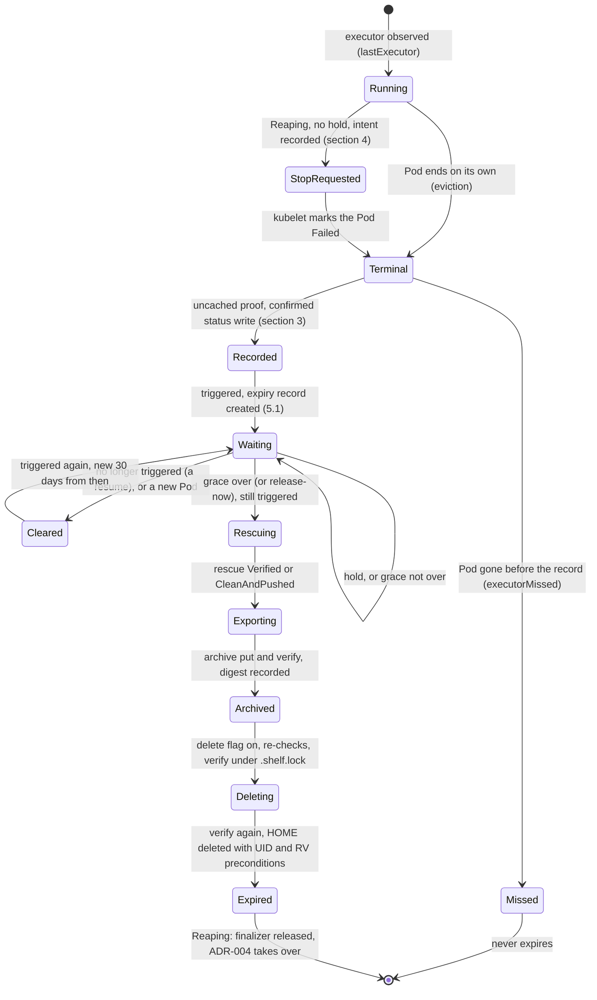

# DESIGN-025: Private session HOME expiry: archive, then delete

- **Status:** Accepted 2026-10-12; corrected the same day after its review
  ([ADR-006](../adrs/006-private-home-expiry-corrections.md), D-87). H1, the
  terminal record (#236, section 3.6), shipped in 2.25.0; H2 installed it with
  the record on, 2026-10-12 (haynes-ops #3852 and #3854). H3, the stop
  request for Reaping Sessions (section 4.1, #244), and H4, agentd's history
  export and archive (section 7.1, #246), are in release 2.26.0, default off.
  H5, the operator's expiry up to `Archived` (section 5.4), is in source in
  #251, default off, with its review findings handled the same day. H6, the
  archived-history reads (section 8.1) and the delete and release steps
  (section 6.7), is in source in #254, both default off, with its review
  findings handled the same day. H7 has an installed unmounted PVC; its guard
  preserves v1 under ADR-007/Q-35. H8 to H10 remain unaccepted.
  *Installed, 2026-10-13:* H3 in the 2.26.0 operator and H4 in the 2.26.0
  task template's agent image (haynes-ops #3877, #3878, #3880); H5 and H6 in
  2.27.0 (#3885, #3886, #3887). Every new flag is off; only the terminal
  record is on. The shelf, which runs H4's `history-archive`, still runs agent
  2.9.1 and waits for H7. H7 is next.
- **Decision:** [ADR-005](../adrs/005-private-home-expiry.md) (Q-31, Tom,
  2026-10-12: "Archive, then delete (Recommended)"), amended by
  [ADR-006](../adrs/006-private-home-expiry-corrections.md) and
  [ADR-007](../adrs/007-preserve-v1-archive-trust-boundary.md) (Q-35, relayed)
- **Amends:** [DESIGN-008](008-private-provider-history-retention.md),
  [DESIGN-019](019-private-pod-retention-guard.md),
  [DESIGN-013](013-published-stopped-context.md),
  [DESIGN-024](024-coordination-record-retention.md) and
  [DESIGN-001](001-dev-env-v2.md) D-45, D-55, D-62 and D-67; each carries a
  dated note
- **Delivery:** [plan 11](../backlog/11-project-workspaces.md), units H0 to H10
- **Tracking:** [#174](https://github.com/thaynes43/dev-env/issues/174)

Everything here is default off. Five operator flags turn it on, in haynes-ops
changes that come in the order of section 13. Deletion is the last, after the
archived-history read is accepted on the installed system.

## 1. What runs, in one picture



Rescuing, Exporting and Archived can also go to Cleared, until Deleting is
recorded. After that nothing cancels.

Only a Reaping Session is ever stopped (ADR-006). A Suspended Session past its
archive deadline reaches Terminal only when its executor ends on its own.

## 2. Which Sessions are eligible

A Session is **eligible** when all of these hold, each read uncached:

- `spec.workspace` and `spec.projectCanary` are both absent.
- `status.privateHistory` passes `privateHistoryIdentity`, its `admission` is
  `Started` and its `homeUID` is set. A HOME the operator never bound
  (`admission: Unknown`) is never eligible.
- `status.privateHistory.executorTerminal` (section 3) exists for
  `lastExecutor.podUID`.

A Session is **triggered** when it is eligible and it is Reaping
(`deletionTimestamp` set), or it is Suspended and its D-62 archive timer is due
(`suspendedAt` plus `archiveAfter` has passed, computed as `archiveDue` does
today). A suspended Session before its deadline is never triggered. The expiry
record exists only while the Session is triggered (5.1, 5.3).

Two rules keep "triggered" from flapping:

- **Unknown is not false.** `archiveDue` answers "not due" when the Session has
  no `archiveAfter` of its own and the templates do not load
  (`internal/controller/reconciler.go`). For the expiry that answer is Unknown:
  no record is created and none is cancelled, the reason `unknown` is counted,
  and the reconcile asks again in a minute. Only a timer computed from a spec or
  templates value that is not yet due counts as not triggered.
- **Latched from `Deleting`.** Once the record reaches `Deleting` (written in the
  same status write as `status.archivedAt`, 6.5), the Session counts as
  triggered whatever the timer says, as today's archive path treats a recorded
  `archivedAt` as due. A longer `archiveAfter` or a templates failure then
  cannot strand a Session that has `archivedAt` set but can neither resume nor
  finish its delete.

The operator stops an executor only for a Reaping Session (section 4). A
Suspended Session past its deadline is triggered only if its executor ended on
its own, such as by an eviction, and that end was recorded. One whose executor
still runs keeps its HOME until it is reaped (ADR-006).

**Never eligible, by design:**

- **Canary originals** (`spec.projectCanary`), whatever their state. Release-now
  is refused for them with `canary`. The fixed result reader (DESIGN-022) reads
  their records live, and ADR-004 keeps those records live because canary
  originals are never absent.
- **Shared-workspace Sessions.** They keep their own lifecycle.
- **A Session with no terminal record:** its executor was never observed (never
  started, or only a known non-attempt, `executorNotCreated`), or it vanished
  before its termination was recorded. Plan 11 follow-up F2 covers a Session that
  provably never admitted a HOME.

## 3. The durable terminal record

### 3.1 Where it lives

A new optional field beside the existing executor record,
`status.privateHistory.executorTerminal`:

| Field | Bound | What |
|---|---|---|
| `version` | enum `1` | |
| `podUID` | 128 | must equal `lastExecutor.podUID` |
| `phase` | enum `Succeeded`, `Failed` | the Pod's phase |
| `reason` | 128 | `status.reason`, such as `DeadlineExceeded` or `Evicted` |
| `podResourceVersion` | 64 | the observed revision |
| `nodeName`, `nodeUID` | 253, 128 | the node that reported it |
| `leaseRenewedAt` | time | the node lease's renew time at the observation |
| `observedAt` | time | the operator's clock at the observation |
| `containers` | at most 16 items | `name` (63), `exitCode`, `reason` (128), `finishedAt`, for regular, init and ephemeral containers |
| `claudeConfigDir`, `codexHome` | 256 each | the executor's provider directories, relative to HOME, when its agent container sets each literally; empty otherwise (section 6.3) |

**Why beside `lastExecutor`, not inside it.** `observePrivateHistory` rebuilds
`lastExecutor` on every reconcile that sees the executor Pod, and carries only
`conversationID` forward (`internal/controller/private_history.go`). A record
inside it would be dropped by that rebuild, the rule below would refuse the
write, and the Session's status would freeze. A sibling is never touched by the
rebuild.

Schema rules (CEL on `privateHistory`, each with a case in
`agentsession_validation_test.go`):

- `executorTerminal` can be set only when `lastExecutor` is set, and
  `executorTerminal.podUID` equals `lastExecutor.podUID`.
- Once set it never changes and is never removed:
  `!has(oldSelf.executorTerminal) || (has(self.executorTerminal) && self.executorTerminal == oldSelf.executorTerminal)`.
  `lastExecutor` already cannot be erased or have its UID replaced.
- `executorTerminal` and `executorMissed` (3.4) never both exist.
- `stopState` keeps its single value `Unknown`. The terminal record is evidence
  for expiry only. It is not DESIGN-010's stop contract and authorizes no claim
  transfer, resume or replacement.

### 3.2 What the operator checks before it writes

`observePrivateHistory` gains one step. When the recorded executor Pod exists,
the Session controls it, its UID is `lastExecutor.podUID` and `executorTerminal`
is absent, the operator runs `verifyExecutorTerminated`. It reads uncached:

1. **The Pod:** same UID and controller, phase `Succeeded` or `Failed`, and
   `allContainersTerminated` (today's helper in `workspace_stop.go`): every
   regular, init and ephemeral container has a `terminated` state with a
   `finishedAt`, and none is running or waiting. The Pod has no `DisruptionTarget`
   condition with reason `DeletionByPodGC`.
2. **The node:** `spec.nodeName` is set; the Node exists, is not deleting, and
   has exactly one `Ready` condition, which is `True`.
3. **The node lease** in `kube-node-lease`: held by that node, owned by that
   node's UID, renewed within the last 40 seconds and not in the future.

Points 2 and 3 are the shared stop verifier's (`PodWorkspaceStopVerifier`). They
mean that a live kubelet wrote the terminated status. When the Pod garbage
collector marks a Pod `Failed` for a lost node, the node is not Ready, so that
status never counts. The verifier is refactored into one helper that the shared
and private paths both call; the shared path keeps its own extra rules
(`RestartPolicyNever`, no deletion timestamp).

A private executor runs with `RestartPolicy: Always`, so a container that is
terminated for a moment does not prove anything there. The terminal **phase**
does: a Pod in phase `Succeeded` or `Failed` never runs again.

A Pod with a deletion timestamp still counts, as long as its phase is terminal
and the rest holds. Current kubelets move a Pod that is being deleted to a
terminal phase before the object goes, so that status can be the last chance to
record it. Nothing here depends on that.

### 3.3 When it is written

- **On every reconcile** of a Session with a private retention record and a
  bound HOME, canary originals included, whose executor Pod is terminal and
  unrecorded. Pod status changes already
  reconcile the Session, so the write usually lands within a second of the
  kubelet's report.
- **While a check fails** (node not Ready, lease stale, a read error), the
  reconcile asks again in 30 seconds and writes nothing.
- **Before anything else in that reconcile.** No step that could remove or
  change the Pod runs in a reconcile that has not first confirmed the record.
- **With today's confirmed write** (`writePrivateHistory`): a status update, then
  an uncached re-read that compares the stored record with the intended one. A
  stale CRD that prunes the field fails that comparison, and nothing later acts
  on a record that was not stored.

With `--enable-private-terminal-record` on, it is written whatever the other
expiry flags say. Recording deletes nothing, and it keeps a proof that would
otherwise be lost.

### 3.4 How it survives

- **Pod loss.** The record is in the Session's status in etcd. The Pod is not
  needed after it. With the record confirmed, a missing executor Pod is
  `ExecutorEnded`, not today's PreservationUnknown error ("the recorded private
  executor is absent"). Without it, that error and its condition stay as they
  are, and the Session never expires.
- **Operator restarts and leader changes.** The record is the only state, and it
  is immutable. A new leader reads it. Two overlapping reconcilers write the same
  record; the second gets a Conflict or finds it already stored.
- **Flag changes.** Turning the record flag off stops new records. Existing ones
  stay, and the schema keeps them.
- **An etcd restore** to a point before the record loses it. The operator then
  sees whatever the restore brought back. It never writes a record on a guess.

**The missed marker.** When an uncached read finds the recorded executor Pod
NotFound and `executorTerminal` is absent, the operator writes
`status.privateHistory.executorMissed` (`version` 1, `podUID` equal to
`lastExecutor.podUID`, `observedAt`) once, by a confirmed write. It never
changes and is never removed, and `executorTerminal` can never be written beside
it. `dev_env_private_executor_terminal_total{result="missed"}` counts that write
only, so each Session counts once, whatever the operator restarts and leader
changes. That is the talosw02 case (ADR-005 Context): the two 1011 canaries get
their marker, and count once, when H2 turns the record on. A Pod of that name
with another UID is not missed; it is today's "private executor was replaced".

### 3.5 Rights

`verifyExecutorTerminated` needs `get` on Nodes and on Leases in
`kube-node-lease`. The operator has neither today; the shared verifier fails
closed for the same reason. haynes-ops grants them in H2 (section 12). Without
them no record is ever written, and nothing expires.

### 3.6 In source (H1, #236)

Implemented in `internal/controller/private_terminal.go`, called from
`observePrivateHistory`, with the confirmed write in `Reconcile`. The node and
lease checks are `executorNodeLive` in `workspace_stop.go`, which
`PodWorkspaceStopVerifier` now calls too. Details the sections above leave open:

- **The recorded executor only.** A record is taken only for a Pod whose UID was
  `lastExecutor.podUID` before the reconcile began. A Pod first observed already
  terminal gets `lastExecutor` in one confirmed write and its terminal record in
  the next reconcile, a second later.
- **When a mark may be added** (`terminalRecordApplies`): the flag is on,
  `privateHistoryIdentity` passes, `admission` is `Started`, `homeUID` is set,
  `lastExecutor` is set, and neither `executorTerminal` nor `executorMissed`
  exists. The missed marker follows the same rule, so a Session whose HOME was
  never bound gets neither, and neither does any Session while the flag is off,
  whether its Pod stands or is gone. With the gate closed nothing reads a Node
  or a Lease.
- **Bounds.** A Pod with more than 16 containers is refused, never truncated.
  `reason` fields are cut to 128 bytes. Times are stored to the second, so the
  confirmed write compares equal.
- **Provider directories.** From the `agent` container only: the last `env`
  entry of the name, a literal absolute value with no `$` (so no `$(VAR)`
  expansion), strictly inside the `home` volume's mount (no `subPath`), and
  neither inside nor containing another mount of that container. Anything else
  is empty.
- **The clock.** `executorNodeLive` reads the clock once, after the lease read,
  and returns that reading. The lease's freshness, `observedAt` and the shared
  proof's `verifiedAt` all use it, so a kubelet renewal that lands during the
  reads is fresh, not future.
- **Before H2.** The operator has no `get` on Nodes or Leases, so the node read is
  Forbidden: the check fails closed, `refused` is counted, the reconcile asks
  again in 30 seconds, and no record is ever written.
- **`ExecutorEnded`.** With the record and no Pod, `PrivateHistoryRetained` is
  True with reason `ExecutorEnded`. A Session that still wants its Pod is phase
  `Failed`, `PodReady` reason `ExecutorEnded`, as it was while the ended Pod
  stood (`PodEnded`); the executor latch still refuses a replacement. A Session
  that wants its Pod gone keeps `RetentionPending`, and `RemovalBlocked` keeps
  that reason.
- **Counting.** `dev_env_private_executor_terminal_total` is registered at start
  whatever the flag, each result at 0. `recorded` and `missed` count when the API
  server acknowledges the status update with the mark: its response holds
  exactly the intended record. The confirming re-read still gates everything
  after the write. When another write to the Session lands between the update
  and that re-read, the reconcile fails and retries, finds the mark stored, and
  neither writes nor counts it again: the mark still counts once. A pruned field
  is never acknowledged, so it never counts. An update whose response is lost
  (a timeout after the write landed) is not counted either; the mark is still
  stored, and its condition shows it. `refused` counts each refused observation
  of a terminal executor.
- **Two reconcilers** (3.4). One whose re-read finds a newer revision of the
  Session writes nothing; one whose update carries an older revision gets a
  Conflict. Either way the Session holds one mark, counted once.

Tests: `TestPrivateHistoryExecutorTerminalRecordIsImmutableAndBound` (T16, the
record part) in `api/v1alpha1`; `TestPrivateTerminalRecordOnTheAPIServer`
(envtest: T15, T6 with restarts as new reconcilers, and T16's rebuild case) and
the unit tests in `internal/controller/private_terminal_test.go`, among them
`TestPrivateTerminalGateHoldsWhetherThePodStandsOrNot`,
`TestPrivateTerminalReadsTheClockAfterTheLease`,
`TestPrivateTerminalCountedWhenAnotherWriteOvertakesTheReRead` and
`TestPrivateTerminalOverlappingReconcilers`; for the shared path,
`TestWorkspaceStopVerifierReadsTheClockAfterTheLease`.

## 4. Reaching a terminal state: the stop request

An ordinary private executor never ends on its own. agentd keeps running after
the agent exits, and the Pod's restart policy (`Always`) restarts a container
that exits. DESIGN-019 keeps the Pod through suspend and reap. So without a stop
request, only an eviction or a node shutdown would ever end one.

**Reaping only (ADR-006).** The operator stops a private executor only when its
Session is Reaping. A reap is an explicit request to end a Session, and it
already ends the executor of every non-private Session. A Suspended Session is
never stopped, before or after its archive deadline: that would end a live
Session that no human asked to end (plan 11 follow-up F3).

**The request.** With `--enable-private-executor-stop`, when a Session is
eligible in shape (section 2, without the terminal record), Reaping, carries no
owner hold (section 9), and its recorded executor Pod is running, the operator
stops it:

1. It reads the Session and the Pod uncached. The Session is Reaping with no
   hold. The Pod's UID is `lastExecutor.podUID`, the Session controls it, and it
   is not a hold pod.
2. **The intent.** It writes `status.privateHistory.stopRequest` (`version` 1,
   `podUID` equal to `lastExecutor.podUID`, `requestedAt`) by a status update
   that carries the resourceVersion of the Session it just read, and confirms it
   by an uncached re-read. A hold annotation already on that read refuses the
   intent. A hold annotation written after that read changes the
   resourceVersion, so the update gets a Conflict and nothing is sent. A retry
   repeats the same update, with the stored intent unchanged and the
   resourceVersion of its own fresh read. So every patch follows a read that
   found no hold and a write that nothing overtook. A hold written after the
   confirmed write comes too late, and the stop goes ahead. `stopRequest` never
   changes once set and is never removed.
3. It computes `elapsed`, the Pod's age at the stored `requestedAt`, from
   `status.startTime`, and sends one JSON patch (`stopPrivateExecutor`):

   ```json
   [{"op": "test", "path": "/metadata/uid", "value": "<podUID>"},
    {"op": "test", "path": "/metadata/resourceVersion", "value": "<rv>"},
    {"op": "add", "path": "/spec/activeDeadlineSeconds", "value": <elapsed + 30>}]
   ```

   `activeDeadlineSeconds` may be set on a running Pod, and only set or lowered.
   It counts from the Pod's start, hence `elapsed`. A Pod that already has a lower
   value is left alone. Because `elapsed` comes from stored fields, every
   operator computes the same deadline whatever its own clock says.
4. The kubelet stops the containers with the Pod's termination grace (agentd
   forwards SIGTERM to the agent) and marks the Pod `Failed`, reason
   `DeadlineExceeded`. The Pod object stays, and section 3 records it.

A Conflict or a failed `test` means the Session or the Pod changed: the next
reconcile judges again from point 1. The event `ExecutorStopRequested` names the
Pod UID.

**What it does not do.** It deletes no Pod and changes no HOME byte. It never
stops a Suspended Session, a held Session, a canary (which has its own deadline)
or a shared executor. A Reaping Session cannot be resumed, so the stop never
races a resume.

**What it costs (ADR-006 C-39).** Any API caller may reap any Session, as in v1
(`reapSession`). A mistaken reap of a live private Session now ends that agent.
Its HOME, transcripts and Pod object stay, but the executor latch (DESIGN-008)
refuses a replacement, so it cannot run again. A hold set before the reap
prevents the stop.

### 4.1 In source (H3, #244)

Implemented in `internal/controller/private_stop.go`. It is called from
`removePod`'s private branch, which every Reaping Session with a Pod reaches.
That happens only in a reconcile whose private history observation changed
nothing, so `lastExecutor` is already stored and confirmed. The schema field is
`status.privateHistory.stopRequest` (`version` 1, `podUID`, `requestedAt`). Two
CEL rules say it names `lastExecutor.podUID`, and that once set it never changes
and is never removed. A schema test covers them (T16, stop part). Details the
section above leaves open:

- **The gate** (`privateStopApplies`). `--enable-private-executor-stop` must be
  on, and so must `--enable-private-terminal-record`. The operator refuses to
  start with the first flag and not the second. `terminalRecordApplies` must
  hold, so that the stop's own record can still be written: the record flag is
  on, `privateHistoryIdentity` passes, `admission` is `Started`, `homeUID` is
  set, `lastExecutor` is set, and neither `executorTerminal` nor
  `executorMissed` exists. The Session must also be Reaping, with no
  `spec.workspace` and no `spec.projectCanary`. The observation must have found
  nothing Unknown. A replaced executor, a foreign owner or a HOME binding that
  does not verify each stops it.
- **The Pod.** The Pod must be the recorded executor (same UID, controlled by the
  Session, not a hold pod). It must not be terminal and must not be deleting.
  It must have `status.startTime`, and it must have no `activeDeadlineSeconds`
  at or below the one the stop would set. A Pod that never started is not
  stopped, because no deadline can be computed for it.
- **The hold.** Any value of `dev-env.haynesops.com/home-expiry` except
  `release-now` blocks the stop, a mistyped `hold` included. This fails closed.
  Since the review of #251 the expiry reads such a value as a hold too
  (section 9). `release-now` skips only the expiry's grace, so it does not block
  the stop.
- **The intent.** `stopIntentConfirmed` reads the Session uncached and checks
  the gate and the hold again. It reads the Pod uncached. It then updates the
  status with the stored intent, or a new one at the operator's clock,
  truncated to the second. The hold check on this read is what makes a hold
  written before the intent win when it lands after the reconcile's own read of
  the Session: the update's resourceVersion already includes that hold, so no
  Conflict would catch it. The update carries that read's resourceVersion and
  is confirmed by `writePrivateHistoryAcknowledged`'s re-read. When the intent
  is already stored, as after a restart, the update is a no-op whose
  resourceVersion check still refuses a Session changed since the read. Two
  cases count `conflict` and are judged again a second later: a Conflict, and
  an update that was acknowledged but whose re-read another write, such as a
  heartbeat, overtook. The next reconcile adopts an intent that was stored. A
  pruned field fails the confirmation, and nothing is sent.
- **The gate is a type.** Only `stopIntentConfirmed` builds a non-zero
  `confirmedStopIntent`, the confirmed Session and the Pod as read for it, and
  it builds it only after its confirmed write. `stopPrivateExecutor` takes one
  and refuses the zero value. So no patch can follow an intent that failed,
  whatever a caller does with the error. The guard test pins all of this.
- **The patch.** `stopPrivateExecutor` sends `privateStopPatch` for the Pod
  that `stopIntentConfirmed` read; its `test` operations refuse a Pod changed
  since. The deadline is the Pod's age at the stored `requestedAt` in whole
  seconds, rounded up, plus 30. Before an intent is stored, the operator's clock
  stands in for it. A patch sent late, after a failure or a restart between the
  intent and the patch, so gets less than 30 seconds of grace, or none; the
  kubelet still stops the containers with the Pod's termination grace. An
  existing higher deadline is lowered: JSON patch `add` replaces it. A Conflict
  counts `conflict`, and so does an Invalid when a fresh read shows the Pod
  changed or gone. A failed `test` is Invalid (422). The next reconcile then
  judges again. An Invalid on an unchanged Pod (an admission policy, Pod
  validation) is a failure. Once the patch has landed, the Pod has exactly the
  deadline that every operator computes from the stored intent, so no
  reconcile, restart or second replica sends another, whatever its clock says.
  A deadline computed from each operator's own clock would not hold this: a
  replica whose clock lagged the patching one by more than the time since the
  patch would compute a lower deadline and patch again (review of #244).
- **Failures.** The stop never ends the reconcile early, so the Session's status
  is written whatever happens. A failure other than a change is logged. The
  `RemovalBlocked` condition names it, and it is tried again in 30 seconds.
- **Counting.** `dev_env_private_executor_stop_requests_total` is registered at
  start whatever the flag, each result at 0. `sent` counts a patch the API server
  accepted. `held` counts each reconcile that a hold refuses, so it rises while a
  held Session keeps being reconciled. The event `ExecutorStopRequested` (action
  `StopRequest`) names the Pod UID and the deadline.
- **Rollback.** Turning the flag off sends no new intent and no new patch. A
  stored `stopRequest` stays, as the schema requires. An operator below this
  release drops the field on its status writes, and the schema refuses them, as
  for the terminal record (section 14).

Tests: `TestPrivateHistoryStopRequestIsImmutableAndBound` in `api/v1alpha1`;
`TestPrivateExecutorStopFlagIsExplicitDefaultOffAndNeedsTheRecord` in
`cmd/dev-env-operator`; and in `internal/controller`:
`TestPrivateStopReapRecordsIntentThenOnePatchThenTerminal`,
`TestPrivateStopRefusals` (flag off, record flag off, held, an unknown or empty
override value, suspended before and after the deadline with the idle timer,
running, canary, unbound HOME, Unknown admission, an executor of another intent,
a replaced executor, a hold pod, not started, terminal, a lower deadline, the
missed marker), `TestPrivateStopNeverForASharedExecutor`,
`TestPrivateStopReleaseNowIsNoHold`, `TestPrivateStopLowersAHigherDeadline`,
`TestPrivateStopHoldBetweenReadAndIntentWins`,
`TestPrivateStopHoldBeforeTheIntentReadWins`,
`TestPrivateStopPrunedIntentSendsNothing`,
`TestPrivateStopPersistentRefusalIsNoConflict`,
`TestPrivateStopIntentOvertakenByAnotherWrite`,
`TestPrivateStopRestartAdoptsTheIntentAndNeverPatchesTwice`,
`TestPrivateStopLaggingClockPatchesOnce`,
`TestPrivateStopTwoReplicasPatchOnce`, the envtest
`TestPrivateStopOnTheAPIServer` (the whole flow to the terminal record, a hold
written before the intent's read and one written between that read and the
intent, and a stale Pod resourceVersion on a real API server), and the guard tests
`TestOnlyStopPrivateExecutorPatchesPods` and
`TestPodWriteScanCatchesPodWrites` (section 11).

## 5. The expiry record and its steps

### 5.1 The record

`status.privateHistory.expiry`, created by a confirmed write in the first
reconcile that finds the Session eligible **and triggered** (section 2). An
eligible Session that is not triggered, such as an active Session whose executor
was evicted, gets no record. So creating and cancelling are complements: a record
exists while the Session is triggered, and a Session that stops being triggered
loses it (5.3).

| Field | What |
|---|---|
| `version` | `1` |
| `executorUID` | the terminal record it rests on; equals `lastExecutor.podUID` |
| `homeUID` | equals `privateHistory.homeUID` |
| `graceStart` | for the Session's first record (`expiryClearedAt` absent), `executorTerminal.observedAt`: Q-31's 30 days run from the first recorded stop proof. For a record made after a cancel, its creation time, which is the first reconcile that finds the Session triggered again. An operator outage only delays that, so the grace is never shorter |
| `dueAt` | `graceStart` plus the grace (720h, or longer by flag) |
| `phase` | `Waiting`, `Rescuing`, `Exporting`, `Archived`, `Deleting`, `Expired` |
| `releaseNowAt` | when release-now was first seen for this record |
| `holdIntent` | a random id, written by a confirmed write before the hold pod is created, and set on the pod as an annotation |
| `holdPodUID` | the hold pod the expiry made, recorded once it is observed |
| `rescueStamp` | the rescue it relies on (`status.rescue.stamp`) |
| `archive` | `entry`, `contentSHA256`, `bytes`, `files`, `gitBundles`, `archivedAt` |
| `deletingAt`, `homeDeletedAt` | times |
| `refusal`, `refusalAt` | the current refusal reason, for `kubectl get`, the condition and the gauge; cleared by the confirmed write of the next step that passes |

`status.privateHistory.expiryClearedAt` keeps the time of the last cancel.

Schema rules: `executorUID` and `homeUID` match their sources; `phase` moves only
forward in the order above; `archive` never changes once set; the record may be
removed only while its phase is before `Deleting`; once `Deleting` it can only
become `Expired`, and once `Expired` it never changes. `expiryClearedAt` is never
removed and never moves back, and a write that removes the record must set an
`expiryClearedAt` newer than the one before (added after the review of #251), so
an operator that does not know these fields cannot drop them (section 14).

A condition, `HomeExpiry`, reports the phase or the refusal and the due time.
The API's session view does not change; `kubectl`, the condition and the
metrics show the state.

### 5.2 The steps and their re-checks

Every step starts with the **common re-check**, all uncached: the Session (same
UID, still eligible and triggered, no hold), its retention
identity, the terminal record, the expiry record, and the HOME claim (UID equals
`homeUID`, controlled by the Session, the operator's finalizer and admission
annotation present, not deleting, except in `Deleting` for this step's own
delete in progress, 6.5). A read error is Unknown: nothing happens, the
reason `unknown` is counted, and the reconcile asks again in a minute. A
mismatch refuses with its reason (section 10) and nothing happens.

| Phase | The step | Its own re-checks | Then |
|---|---|---|---|
| (none) | Create the record | eligible and triggered | `Waiting` |
| `Waiting` | Wait | `now >= dueAt`, or release-now | `Rescuing` |
| `Rescuing` | Remove the ended executor Pod, if it is still there (`expiryPodRemovalAllowed`) | Pod UID is `executorUID`, phase still terminal; delete with UID and resourceVersion preconditions | |
| `Rescuing` | Create the hold pod (6.1) | `holdIntent` recorded first; the Session's Pod name is NotFound; no Pod in the namespace mounts the claim (uncached list) | `holdPodUID` recorded once the pod is observed (6.1, adoption) |
| `Rescuing` | Run the rescue (6.2) | hold pod is `holdPodUID`, Running; claim UID re-read; the hold pod's `home` volume names the claim | `Exporting` once the verdict is valid |
| `Exporting` | Export and archive (6.3, 6.4) | rescue still valid, same stamp and same hold pod; shelf Ready with the history archive mounted | `Archived`, with `archive` recorded; then the hold pod is removed (`expiryHoldRemovalAllowed`) |
| `Archived` | Stop here while deletion is off | | |
| `Archived` | Prepare the delete (6.5) | `verify` under `.shelf.lock` gives `contentSHA256`; no Pod for the name; no Pod mounts the claim | `Deleting`, with `deletingAt` and, for a suspended Session, `status.archivedAt`, in one confirmed write |
| `Deleting` | Delete the HOME (6.5), on every attempt | the same checks again in the same call path: `verify` under `.shelf.lock`, no Pod for the name, no Pod mounts the claim; then the delete with the claim's UID and resourceVersion as preconditions | `Expired` |
| `Expired` | Reaping: release the Session (6.6) | no Pod, no claim, by uncached reads | ADR-004 |

Each step is idempotent. After an operator restart, the next reconcile finds the
phase in status and repeats only what is not confirmed: a hold pod that carries
this record's `holdIntent` is adopted (6.1), an archive entry that exists with
the same digest is `exists`, and a claim that is already gone counts as deleted.
`Deleting` is never a licence to delete on its own: every attempt, after a
restart, a Conflict or any other error, runs the archive `verify` and the Pod
checks again before it deletes (6.5).

**Retry cadence.** A step refused for Unknown is tried again in one minute. A
step refused for any other reason is re-checked, and its refusal re-counted and
re-recorded in `refusal`, every 15 minutes while the Session stays refused. The
gauge `dev_env_home_expiry_refusing` (section 10) shows the Sessions refused
right now, so its alert does not depend on that cadence. A step that passes
clears `refusal` and `refusalAt` in its own confirmed write, so a fixed cause
stops the alert at the next re-check.

### 5.3 What cancels it

- **No longer triggered.** A resume of a suspended Session, or an archive timer
  that is no longer due because a spec or templates value lengthened
  `archiveAfter`. Templates that do not load are Unknown, never a cancel
  (section 2). A Reaping Session is triggered for good, and so is any Session
  whose record has reached `Deleting`. Before `Deleting`, the expiry's hold pod is
  removed first (`expiryHoldRemovalAllowed`) and confirmed gone by an uncached
  read, while the record still names it, so it is never mistaken for a new Pod.
  Then the record is removed by a confirmed write and `expiryClearedAt` is set.
  The HOME stays. An archive entry already written stays too; it is never
  removed. A later record is created only when the Session is triggered again,
  and its 30 days start then (5.1). From `Deleting` on, a resume is refused: a
  suspended Session has `status.archivedAt` by then, written in the same status
  write as `Deleting` (6.5), and a reaped one cannot resume.
- **A new Pod.** Any Pod of the Session's name, or any Pod that mounts its claim,
  whose UID is neither `executorUID` nor `holdPodUID`, and that is not the
  expiry's own hold pod awaiting adoption (6.1). The expiry's own hold pod, if
  any, is removed as above, then the record is removed and the Session gets
  today's PreservationUnknown ("private executor was replaced"). Nothing else is
  deleted.
- **A hold** (section 9). Nothing moves on while it is set, and no stop request
  is sent (section 4); the grace clock keeps running. A hold pod the expiry made
  is removed (`expiryHoldRemovalAllowed`), because nothing needs it, and is made
  again after the hold is lifted if the step still needs it. A hold never cancels
  the record.
- **Identity changes.** A changed Session UID, a HOME claim with another UID, a
  deleting claim, a canary or workspace binding: refused
  (`identity_changed`, `home_replaced`). Nothing is deleted, and a human looks.

### 5.4 In source (H5, #251)

The expiry up to `Archived` is in `internal/controller/private_expiry.go`, the
relay of 6.4 in `history_relay.go`, the metrics in `private_expiry_metrics.go`,
the two guard exceptions in `guard.go` and the shelf exec slots in
`internal/shelf/slots.go`. The schema fields are `status.privateHistory.expiry`
and `expiryClearedAt` (5.1), with the rules of 5.1 as CEL, each with a case in
`TestPrivateHomeExpiryRecordIsBoundAndForwardOnly` (T16, expiry part). Nothing
in H5 writes `Deleting` or `Expired`, and nothing deletes a HOME. Details the
sections above leave open:

- **The gate.** `--enable-home-history-archive` acts only with
  `--enable-private-terminal-record`, and the operator refuses to start with the
  first and not the second. `--home-expiry-grace` under 720h is refused at start.
  A record's `dueAt` is fixed when the record is made; a later flag change moves
  the grace of later records only.
- **Where it runs.** `Reconcile` calls it for every protected private Session,
  after the private history observation found nothing to write, so the terminal
  record it rests on is stored and confirmed. A canary original returns at once.
  A Session with no terminal record and no expiry record costs no read, nor does
  one with no record that the cache shows not triggered. A record parked where
  no step can act costs none either (`expiryQuiet`): the cache shows it at
  `Waiting` before its grace ends (or held), or at `Archived`; no refusal to
  re-check; still eligible and triggered; no override that would act; the HOME
  claim bound as the common re-check asks; and no Pod but the ended executor's
  at `Waiting`, of the name or mounting the claim. Changes to these reconcile
  the Session, and the requeue covers the grace. Every other reconcile reads
  uncached: the Session, the Pod of its name, the HOME claim, and a list of the
  namespace's Pods for those that mount the claim. Every write follows those
  uncached reads.
- **The order of the checks.** A hold pod awaiting adoption is adopted; then a
  new Pod cancels; then a Session no longer triggered cancels; then an owner hold
  (any value but `release-now`, section 9) stops everything else (and removes
  the hold pod); then a trigger that is
  Unknown changes nothing; then a refused step waits for its 15 minutes; then the
  common re-check; then the step of the phase. A step that writes, deletes,
  creates or runs a rescue ends the reconcile, and the next one judges again
  from uncached reads.
- **The record is made** only while nothing but the recorded executor holds the
  HOME: a Pod of the name with another UID, or another Pod that mounts the claim,
  keeps it from starting and gives today's PreservationUnknown, since a new Pod
  would cancel the record at once. A Pod of another name that mounts the claim is
  found in the cache whenever the Session has a terminal record and no expiry
  record, triggered or not, so the PreservationUnknown of a cancel it caused
  stays while the Pod is there (a Pod of the Session's name is
  `observePrivateHistory`'s). That finding reports only; it decides no write.
  The record is made while the owner holds the expiry too: a hold stops the
  steps, not the grace. `releaseNowAt` is recorded when the record is made or
  when Waiting ends, whichever first sees release-now.
- **The hold pod** is `buildHoldPod`'s, with the three annotations. A new intent
  is written with `holdPodUID` cleared, in one confirmed write, whenever no hold
  pod is recorded or the recorded one is gone; the create follows in the next
  reconcile, and the pod is adopted in the one after. A hold pod that is
  terminating keeps its record entry, and the expiry waits for it. A hold pod
  that ended is removed (`expiryHoldRemovalAllowed`, ended) and made again. The
  rescue and the export run only in a hold pod in phase `Running`.
- **The rescue** is D-51's in the hold pod, recorded in `status.rescue` by
  `recordRescue`. A failure retries after D-55's 15 minutes and pages as any
  rescue failure (D-57). A rescue that cannot run is Unknown. `Exporting` needs a
  valid rescue that ran in the current hold pod: a hold pod made again after an
  owner hold or archive off and on is rescued again first, and `rescueStamp`
  follows it.
- **A new agent image.** The hold pod keeps the image it was made with, and the
  export runs from it. Five refusals clear only with a change to the export's
  source: `layout_unknown`, `unknown_entry`, `unexpected_entry`,
  `export_too_large` and `export_invalid`. When the 15-minute re-check finds one
  of them recorded and the templates name another agent image than the hold
  pod's, the hold pod is removed (`expiryHoldRemovalAllowed`, stale image), and
  one of the new image is made, rescued and exported from. With the same image
  the re-check exports again from the same hold pod, as for any refusal.
  Templates that do not load remake nothing. Before this (review of #251) the
  refusal and its alert stayed until someone toggled the owner hold or the
  archive flag, which no document named.
- **The export's flags** come from the terminal record (`claudeConfigDir`,
  `codexHome`). `--rescue` is given only for a `Verified` rescue: the directory of
  its `lastBundle`, `rescue/<session>/<stamp>[-N]/manifest.json`. A `Verified`
  rescue whose `lastBundle` is not that shape refuses `export_invalid`. The
  project is the project snapshot's (`dev-env.haynesops.com/project-snapshot`),
  and empty when the Session has none, it does not parse, or it names another
  repository: such a history is readable by no API caller.
- **The relay.** It finds the shelf pod and takes a shelf exec slot before the
  plan, so a missing shelf or a busy one costs no plan, which hashes the whole
  history. The plan's digest is the SHA-256 of the canonical line the plan
  printed. A plan that is not canonical JSON, or that has a field the operator
  does not know, is Unknown: the operator would drop that field from
  `content.json`. One export runs at a time per operator, and each relay takes
  one of two shelf exec slots per replica (`shelf.ExecSlots`, DESIGN-024 section
  5), for the plan, the stream and put together, and again for the verify. A
  busy relay is no refusal: the step runs again in a minute, and a recorded
  refusal stands. The plan, the stream and put share one 15-minute deadline
  (6.4's), and the verify has 15 minutes of its own. The stream is piped into put
  through an `io.Pipe`, which holds no bytes, and has a context of its own. The
  side that ended first names the cause: a stream that ended first with a
  refusal other than `io_error` is that refusal, and one that broke first made
  put read a short tar (Unknown); a put that ended first cancels the stream's
  exec, which client-go would otherwise drain to its end, and put's answer
  stands. A put that answers `exists` reads none of the stream. The hold pod is
  reached by name, as D-51's rescue is: an uncached read after put must find the
  same hold pod UID, or nothing is recorded and the next reconcile judges the
  new Pod (an entry put stored stays, unreferenced, as every entry does). Then
  `verify` runs in the shelf, under the archive's shared `.shelf.lock`.
- **The operator's memory.** agentd's bounds allow a plan of about 129 MiB (a
  64 MiB content manifest and the block lists). The operator runs with a
  256 MiB limit, and holds the plan, its decoded form and `content.json` at
  once, so it takes plans of at most 16 MiB (`historyPlanOutputMax`) and
  refuses a longer one as `plan_too_large`, a recorded refusal that
  `DevEnvHomeExpiryNeedsOwner` names. It is not agentd's `export_too_large`:
  only an operator release with a higher cap clears it, never a new agent image,
  so it does not remake the hold pod (below; advisory review of #251). Without that cap, a plan inside H4's
  bounds would have killed the operator for its memory, and every new leader
  would have tried the export again (review of #251). The relay also builds
  no second copy of the plan: it decodes it with `json.Unmarshal` and checks
  it with `protocol.CanonicalEqual`, which compares the canonical bytes with
  the plan's line as it writes them. `protocol.CanonicalJSON` now rewrites a
  value's compact encoding instead of building a tree of generic maps; its
  bytes are the same as before, which `TestCanonicalJSONMatchesTheGenericEncoding`
  and its fuzz seeds hold against the old encoding, so an operator and an
  agentd of different releases agree on every digest. `TestHistoryRelayMeasure`
  (skipped unless `DEV_ENV_HISTORY_RELAY_MEASURE_FILES` is set) measured a
  16 MiB plan of 42,000 files at about 80 MiB of live heap and 130 MiB of peak
  RSS above the operator's own (about 25 MiB on 2026-10-13); a 15.6 MiB plan of
  12,000 files with 1,000-byte paths at 124 MiB. H7 repeats it in the operator's
  container (section 15).
- **Archived** is written after an uncached re-read finds the record still at
  `Exporting` with the same hold pod and rescue, and the Session still eligible,
  triggered and unheld; otherwise the next reconcile exports again, and put
  answers `exists`. The archive's `gitFiles` (5.1's table says `gitBundles`)
  counts the rescue directory's files, its manifest and bundles, as put reports
  them. `dev_env_home_expiry_archived_bytes_total` counts once, when the API
  server acknowledges the `Archived` write. Then the hold pod is removed.
- **Refusals.** Unknown writes nothing, is counted at most once a minute per
  Session (the cadence of its retry, not of events) and retried in a minute.
  Every other reason is written to `refusal` and `refusalAt` (a CEL rule keeps
  them together) by a confirmed write, counted, given a Warning event, and
  re-checked every 15 minutes; the steps wait until then, while adoption,
  cancels and the hold still run on every reconcile. A re-check whose common
  checks and step pass clears the refusal: by the step's own write, or, when the
  step has nothing to write (it waits for the grace, a starting hold pod or a
  rescue retry, or it is `Archived`), by a confirmed write of its own. So a fixed
  cause stops the alert at the next re-check. A refusal the export recorded
  (agentd's codes, `export_invalid`, `plan_too_large`, `shelf_unavailable` and
  the three archive reasons) is the export's to clear, by `Archived` or another refusal: the new
  intent, the adoption and the rescue that come before a new export keep it, so
  a hold pod made again does not resolve the alert and fire it once more.
  agentd's codes map as: the export's six keep their names, `invalid` from either
  side is `export_invalid` (a new reason, section 10), `conflict` is
  `archive_conflict`, `corrupt` is `archive_mismatch`, `not_found` is
  `archive_missing`, `no_archive` is `shelf_unavailable` and `io_error` is
  `unknown`. No shelf pod, no history relay, or a failed exec into the shelf is
  `shelf_unavailable`; a failed exec into the hold pod is `unknown`; a plan over
  the operator's own cap is `plan_too_large` (a new reason, section 10). A Conflict on
  a guarded delete counts `precondition_failed`, and the step runs again.
  `canary` and `override_invalid` count at most once per 15 minutes per Session;
  the operator keeps those times for the last 15 minutes only.
- **`claim_in_use` before `Deleting`.** A Pod other than the executor and the
  expiry's hold pod, of the name or mounting the claim, is a new Pod and cancels
  (5.3) before any step runs, so `claim_in_use` is not reached in H5; the step
  keeps the check so that a change to that order fails closed. T11's
  `claim_in_use` is the delete step's (H6), from `Deleting` on, where nothing
  cancels.
- **The hold pod's guard judges its evidence.** `expiryHoldRemovalAllowed`
  takes the reconcile's uncached reads: a cancel needs them to show the Session
  no longer triggered or a new Pod holding the HOME, and archive off needs the
  flag off, besides the owner hold, `Archived` and an ended hold pod it checked
  before. A stale image needs the record before `Archived` with one of the five
  refusals above, and loaded templates that name another agent image than the
  hold pod's agent container runs.
- **A cancel** removes the expiry's own hold pod first; the next reconcile's
  uncached reads confirm it gone while the record still names it, and only then
  is the record removed and `expiryClearedAt` set. A new Pod also sets today's
  PreservationUnknown for that reconcile, and the record does not start again
  while the Pod is there. `expiryClearedAt` only moves forward, as the schema
  asks: a replica whose clock is not past the last cancel sets it a second after
  that one. A record made after a cancel starts its grace no earlier than the
  cancel, whatever the replica's clock says.
- **Archive off** adopts a hold pod awaiting adoption and removes the expiry's
  hold pod; the record stays in its phase.
- **The archive timer's start.** With `--enable-home-history-archive` on, a
  private Session's recorded executor that ended, with its terminal record
  confirmed, counts as no Pod of the Session's own for `status.suspendedAt`
  (D-62): it never runs again. So a Suspended Session whose executor was evicted
  is triggered at its deadline while the ended Pod object stands. With the flag
  off nothing changes: the timer starts only once the Pod is gone, as before.
  Canary originals never enter the expiry, so their timer keeps that rule with
  the flag on too. `archiveDue` and the trigger share one deadline function,
  `archiveDeadline`.
- **The condition** `HomeExpiry` has the phase as its reason, or `Held`,
  `Refused`, `Unknown` (status Unknown), `HoldPodStarting` or `RescueFailed`, and
  names `dueAt`, the archive entry and the refusal.
- **The gauges** are computed at scrape time from the cache on every replica, as
  D-57's are, so a new leader needs no warm-up; the counters rise in the leader.
  The refusing gauge reads each record's `refusal`, so `unknown` is never in it.

Tests: in `internal/controller`, against the fake client with agentd's own
export and archive behind an in-process exec,
`TestHomeExpiryArchivesAfterTheGraceAndKeepsTheHome` (T1 to `Archived`),
`TestHomeExpiryNeverForCanariesUnprovenSessionsOrWithAFlagOff` (T4, T6),
`TestHomeExpiryResumeAndArchiveDeadline` (T7), `TestHomeExpiryNewPodCancels`
(T8), `TestHomeExpiryOwnerOverrides` and
`TestHomeExpiryCancelAtExportingRemovesTheHoldPodFirst` (T9),
`TestHomeExpiryUnknownReadsChangeNothing` (T10),
`TestHomeExpiryReplacedHomeIsRefused` (T11),
`TestHomeExpiryExportRefusalsKeepTheHome` (T2, T3),
`TestHomeExpiryAdoptsItsHoldPodAndWaitsForTheOldOne` (T12),
`TestHomeExpirySecondOperatorFindsTheEntry` (T13),
`TestHomeExpiryArchiveOffRemovesItsHoldPod` (section 14),
`TestHomeExpiryRefusalClearsWhenItsCauseIsFixed`,
`TestHomeExpiryTimerStartOnlyWithTheArchiveOn`,
`TestHomeExpiryForeignMountStaysVisibleAfterTheCancel`,
`TestHomeExpiryExportFromAReplacedHoldPodIsNotRecorded`,
`TestHomeExpiryParkedRecordsSkipTheUncachedReads`,
`TestHomeExpiryPodGuardTable`, `TestHomeExpiryHoldGuardTable`,
`TestHomeExpiryGauges` and `TestExecHistoryRelayAnswers` (the plan cap among
its cases); after the review of #251, in `private_expiry_paths_test.go`,
`TestHomeExpiryArchivesAVerifiedRescueWithItsGitBundles` (a `Verified` rescue's
bundles archived beside the history, and `export_invalid` for a bundle
directory that is not the rescue's own),
`TestHomeExpiryHoldDuringTheExportKeepsArchivedAndRescuesTheNewHoldPod`,
`TestHomeExpiryVerifyThatDoesNotMatchRefuses`,
`TestHomeExpiryRemakesTheHoldPodForANewImage` and
`TestHomeExpiryPlanCapKeepsItsHoldPodAcrossImages`; on a real API server,
`TestHomeExpiryOnTheAPIServer` (T1 to `Archived`, T5, T12 with a fresh operator
for every step, T13 with two operators at once, two cancels on one clock, and
the schema) and
`TestHomeExpiryOverrideGuardIsOwnerOnly` (T9's admission part, with the
reference policy in `testdata/haynes-ops/home-expiry-guard.yaml`, a control-plane
identity among the refused); the guard
scans of section 11; `TestPrivateHomeExpiryRecordIsBoundAndForwardOnly` in
`api/v1alpha1`; `TestHomeHistoryArchiveFlagIsExplicitDefaultOffAndNeedsTheRecord`
in `cmd/dev-env-operator` (T17's flag part); `TestExecSlotsLimitAndRelease`
in `internal/shelf`; `TestCanonicalJSONMatchesTheGenericEncoding` and
`FuzzCanonicalJSONMatchesTheGenericEncoding` in `internal/agentd/protocol`; and
the measurement `TestHistoryRelayMeasure`. Mutation probes of the review (one
test run each) now fail a test: the Git rescue's flag dropped, the hold re-check
before `Archived` removed, an export on an earlier hold pod's rescue, a verify
answer ignored; and each new rule broken: the remake for a new image, its
guard's refusal check, the refusal kept through the remake, the mistyped hold,
the cancel time that moves forward, and the canary's archive timer.

## 6. Step details

### 6.1 The hold pod, bound to the HOME UID

It is D-55's hold pod: the Session's Pod name, the label
`dev-env.haynesops.com/hold: "true"`, `agentd hold`, S-class resources, no agent
credentials, the session volume, the shared volume and `/creds` for the rescue's
Git credential helper. Six additions:

- It is made for a private Session only by the expiry, only in `Rescuing`, and
  only after the executor Pod is gone (the same name).
- It carries the annotations `dev-env.haynesops.com/private-history-home-uid`
  (the HOME UID), `dev-env.haynesops.com/home-expiry-executor` (the executor
  UID) and `dev-env.haynesops.com/home-expiry-hold-intent` (the record's
  `holdIntent`). `observePrivateHistory` already ignores hold pods for the
  executor record.
- **Intent first, then adoption.** The operator writes `holdIntent` into the
  expiry record by a confirmed write before it calls Create, like the executor
  intent of DESIGN-008. An operator can restart between the Create and the write
  of `holdPodUID`. So before it treats a Pod as new, it adopts a Pod that the
  Session controls, that has the hold label, and whose three annotations match
  this record's `holdIntent`, `executorUID` and `homeUID`: it records that Pod's
  UID as `holdPodUID` by a confirmed write. A hold-labelled Pod with any other
  intent is a new Pod (5.3). The match rests on the controller reference, which
  must name the Session's UID, not on who may create Pods. Other identities can
  create Jobs in `dev-agents` (v1's OPERATOR tier can), but a Job's Pod names the
  Job as its controller, and a Pod has at most one controller reference, so it
  cannot carry the Session's. An identity that can create a bare Pod there with
  any owner reference (the operator, cluster-admin) is outside what this check
  defends against, as it is for every guard here.
- **Making it again.** After an owner hold, or after archive was turned off and
  on again (section 14), the hold pod may have to be made again. `holdPodUID`
  keeps naming the old pod while it terminates, so that pod is never a new Pod.
  Only once uncached reads show the Session's Pod name NotFound and no Pod
  mounting the claim does the operator clear `holdPodUID` and write a new
  `holdIntent`, in one confirmed write, and then create the pod.
- **Its removal.** The expiry's hold pod is removed only through
  `expiryHoldRemovalAllowed`, a fifth named guard exception (ADR-006). D-45's
  `podRemovalAllowed` refuses every Pod of a protected private Session before it
  reaches `holdRemovalAllowed`, and `holdRemovalAllowed` keeps a Running,
  un-rescued hold pod while the Session wants its Pod gone, so neither could
  remove it. The new function is nil only when the Pod has the hold label, the
  Session controls it, its UID is the record's `holdPodUID`, its three
  annotations match the record, and the expiry no longer needs it: the record is
  being cancelled (5.3), an owner hold is set, archive is off (section 14), the
  record is `Archived` or later, the hold pod ended, or (since the review of
  #251) the export refused for a reason only a source change clears and the
  templates now name another agent image (5.4). The delete carries the
  Pod's UID and resourceVersion as preconditions. A Pod awaiting adoption is
  adopted first, then judged.
- **The binding.** A Pod names its claim, not the claim's UID. The operator
  checks the claim's UID before it creates the pod, again once the pod runs, and
  in the common re-check of every later step. While a Pod uses a claim,
  `pvc-protection` keeps the claim until the Pod is gone, a claim that is being
  deleted fails the re-check, and only the guard deletes one. So the name keeps
  the same UID while the hold pod runs.

### 6.2 The Git rescue

`agentd ctl rescue --stop-agent` by exec in the hold pod, as D-51 and D-55 run it,
with the verdict recorded in `status.rescue`. `Verified` or `CleanAndPushed`
(with `VolumeEmpty`) is valid. A failure keeps the hold pod, retries every 15
minutes and pages after D-57's window, as today. The bundle lands on the shared
volume at `rescue/<session>/<stamp>/` (D-48).

### 6.3 The history export

`agentd ctl history-export plan` runs by exec in the hold pod. It reads HOME
only: every file is opened read-only, one path component at a time from HOME
with `O_NOFOLLOW` (7.1), and it never creates, changes or removes anything
there. It prints one JSON plan: the files it would export,
each with its size, mode, modification time, SHA-256 and the SHA-256 of each
1 MiB block, plus every name it excluded and why. Then `history-export stream
--plan-sha256 <h>` writes exactly those files as a tar stream to stdout,
re-hashing each file as it reads it. If any file differs from the plan, it stops
and the step refuses (`export_changed`).

**Which directories.** The provider directories are the executor's, not the
hold pod's. A hold pod gets the templates' common `env` (`internal/controller/pod.go`)
but not the profile's `env` or `envFrom`, so its own `CLAUDE_CONFIG_DIR` or
`CODEX_HOME` may differ from the executor's. The terminal record (3.1) keeps the
executor's paths, relative to HOME, only when the agent container's `env` sets
each one literally (a `value`, not a `valueFrom`; the last entry of that name
wins). Kubernetes ranks `env` above `envFrom`, so a literal entry is the
effective value whatever a profile's `envFrom` holds. The operator cannot read
an `envFrom` source (it reads no Secrets), and neither variable is in
`templates.ReservedEnv`, so an unset or indirect variable could come from one.
Then the record keeps the path empty, and the export refuses (`layout_unknown`)
rather than read a default directory and delete the real history. haynes-ops
sets both literally in the template `env` today. A path outside HOME is refused
(`layout_unknown`) too.

**Where each provider keeps history.** From the repository:

- **Claude.** `internal/agentd/settings.go`: the config directory is
  `$CLAUDE_CONFIG_DIR`, else `~/.claude`; the state file `.claude.json` sits in
  that directory when the variable is set, else in HOME. R-02 section 2.3: the
  conversation transcript is `projects/<cwd-key>/<id>.jsonl`; `.credentials.json`
  holds the Max login and MCP OAuth entries; `.claude.json` holds the account and
  organization identifiers. R-01: transcripts under `~/.claude/projects/-home-dev/`.
  `internal/agentd/activity.go`: the local session registry is
  `sessions/<pid>.json`. `internal/agentd/render.go`:
  `projects/<key>/memory` is a link to the shared memory (DESIGN-001 6.6), not
  private history.
- **Codex.** `internal/agentd/settings.go`: `$CODEX_HOME`, else `~/.codex`.
  `internal/agentd/codex_auth.go`: agentd writes the login to
  `$CODEX_HOME/auth.json`. `internal/agentd/codex_host_config.go` refuses a
  `sqlite_home` other than `$CODEX_HOME`, so the state databases live there.
  `internal/agentd/codex_host_process.go`: `app-server-daemon/`,
  `app-server-control/` (a socket) and `packages/` are runtime state.
  docs/keeper-codex-auth.md links the pinned Codex source.
- **agentd.** `internal/agentd/launch.go`: the task records in `~/.agentd`
  (`boot.json`, `launch.json`, `resume.json`, `task-result.json`, `tui-exit.json`,
  `task-events.jsonl`, `task-source.json`). `internal/agentd/decisions.go`: the
  current question-and-answer record `child-decision.json` and the answered ones
  under `decisions/`. `internal/agentd/managed_output.go`: captured assistant
  text under `managed-output/`. The other names come from `statePath` and
  `StateDir` joins across `internal/agentd` (locks, runtime and setup state,
  Git rescue files) and from `files.go`'s temporary names
  (`.<name>.agentd-*`). `internal/agentd/settings.go` `LogPath`: the agent's log
  is `~/work/<name>.log`; D-67 prunes its shared copy.

The top-level names below come from a names-only listing of a v1 HOME on
2026-10-12 (Claude Code 2.1.292, Codex 0.160.1). H4 confirms them against the
agent image's pinned versions and keeps them in
`internal/agentd/historyexport_layout.go`, with a fixture tree per provider.

**H4's confirmation (2026-10-13).** The agent image pins Claude Code 2.1.296
and Codex 0.160.1 (`images/agent/Dockerfile`). H4 checked three sources: a
names-only listing of a v1 HOME written by Codex 0.160.1 and Claude Code
2.1.292; Claude Code 2.1.296's own list of its config directory's
subdirectories, which is 2.1.292's list plus `remote-control`; and the Codex
source at `rust-v0.160.1`. The table below includes what the check added:

- **Claude:** `telemetry/`, not history (Claude Code's own event queue).
- **Codex:** `thread_history_*.sqlite*`, history (the thread item store,
  `codex-rs/thread-store`); `visualizations/`, history (inline visualizations
  the model drew, by date, like `generated_images/`); `tmp/` and
  `version.json`, not history (scratch files and the update check).
- **agentd**, from `TestHistoryLayoutCoversAgentdState`: `initial-usage/`,
  history (the initial usage observation, DESIGN-018); `mcp-managed.json`; the
  publication intents `published-context.<hash>.json`; and the locks
  `native-invocation.lock`, `child-decision.lock`, `common-rules.lock` and
  `published-context.lock`, all not history. The supervisor's lock is
  `workspace-supervisor.lock`, not `workspace-supervisor`.

H4 also checked the exported subtrees for copies of user files. Claude's
`projects/<key>/` holds the transcripts `<id>.jsonl`, `<id>/subagents/`
(subagent transcripts), `<id>/tool-results/` (tool output too long to keep
inline in the transcript), `<id>/workflows/`, `bridge-pointer.json` and the
`memory` link. A tool result is part of the conversation the transcript
records, not a copy the client makes on its own, so it is exported under
ADR-005 C-35 like the transcript. No other exported subtree keeps copies.

**Known to Claude Code 2.1.296 and not classified.** No observed HOME holds
these, so they keep no class, and a HOME that has one refuses
(`unknown_entry`) until a change classifies it: `agent-memory`,
`agent-memory-local`, `agent-memory-project`, `api-dumps`, `chrome`,
`cowork_plugins`, `debug`, `downloads`, `dump-prompts`, `feedback-bundles`,
`file-transfers`, `ide`, `image-cache`, `local`, `local-settings`, `logs`,
`mcp-discovery-cache`, `mcp-skill-archives`, `plans`, `project-settings`,
`remote`, `remote-control`, `scratch`, `seed-admin`, `shares`, `startup-perf`,
`statsig`, `storage-v2`, `systemd`, `tasks`, `teams`, `todos`, `traces` and
`usage-data`. Some of them (`plans`, `todos`, `tasks`, `agent-memory*`) may
hold history. Classifying them needs a HOME that has them, so plan 11 follow-up
F4 holds the work.

**The classification.** Every top-level entry of each provider directory gets one
class. An entry in no class refuses the export (`unknown_entry`), so a new layout
blocks expiry until a source change classifies it (ADR-005 C-34). Excluded names
are listed in the manifest with their size; credentials with their name only.
The size counts regular files from directory listings and `Lstat` only, at most
64 levels down and 1,000,000 names a plan. A count that stops there, or at a
name it cannot list or stat (a path past `PATH_MAX`, say), is marked `partial`,
a lower bound. It never refuses the export: nothing under an excluded name is
exported.

| Provider | History: exported | Not history: listed, not exported | Credentials: never exported |
|---|---|---|---|
| Claude | `projects/` (transcripts and per-session subdirectories; links not followed), `history.jsonl` (prompt history), `jobs/`, `feedback/` | `file-history/` (edit snapshots), `paste-cache/` and `uploads/` (copies of user or workspace files under names that say nothing about them; see below); `CLAUDE.md`, `agents/`, `settings.json` and `settings.json.*`, `plugins/`, `skills/`, `cache/`, `state/`, `daemon/`, `daemon.lock`, `daemon.status.json`, `policy-limits.json*`, `remote-settings.json`, `statusline-command.sh`, `.last-cleanup`, `telemetry/`; `sessions/` (runtime registry with key files); `.claude.json` and `backups/` (account identifiers); `shell-snapshots/` and `session-env/` (environment captures, which can hold secrets); temporary copies agentd leaves when it stops mid-write (`.<name>.agentd-*`) | `.credentials.json` and `.credentials.json.*` |
| Codex | `sessions/` (`<YYYY>/<MM>/<DD>/rollout-*.jsonl`), `archived_sessions/`, `session_index.jsonl`, `history.jsonl`, `state_*.sqlite*`, `memories_*.sqlite*`, `goals_*.sqlite*`, `queue_*.sqlite*`, `thread_history_*.sqlite*`, `generated_images/`, `visualizations/` | `attachments/` (copies of user files; see below); `config.toml`, `AGENTS.md`, `rules/`, `skills/`, `plugins/`, `packages/`, `cache/`, `models_cache.json`, `app-server-control/`, `app-server-daemon/`, `log/`, `logs_*.sqlite*`, `installation_id`, `.tmp/`, `tmp/`, `version.json`, `rollout-migrations/`, `thread-writer-locks/`, `mcp-oauth-locks/`, `.sqlite-maintenance.lock`, `.personality_migration`, `.sandbox_migration`; `shell_snapshots/` (environment captures); temporary copies agentd leaves when it stops mid-write (`.<name>.agentd-*`) | `auth.json`, `auth.json.*`, `.credentials.json`, `.credentials.json.*`; `.codex-access-*` (agentd's temporary copy of the login, left when it stops mid-write) |
| agentd | the seven task records above; `child-decision.json` and `decisions/`; `managed-output/`; `initial-usage/`; and `~/work/<session>.log` | locks (`agent.pid`, `deliver.lock`, `rescue.lock`, `project-bootstrap.lock`, `codex-host-supervisor.lock`, `native-invocation.lock`, `child-decision.lock`, `common-rules.lock`, `published-context.lock`, `workspace-supervisor.lock`); runtime and setup state (`native-invocation.json`, `native-started.json`, `codex-access-generation.json`, `codex-host-config.json`, `codex-host-start-intent.json`, `codex-host-preparation.json`, `common-rule-ownership.json`, `common-launch-inputs.json`, `mcp-managed.json`, `project-bootstrap.json`, `project-snapshot.json`, `project-rules.md`, `project-roots/`, `project-sync/`, `workspace-admission.json`, `workspace-stop-request.json`); publication intents (`published-context.*.json`); Git files the rescue covers (`rescue-*.bundle`, `rescue-index-*`); temporary copies agentd leaves when it stops mid-write (`.<name>.agentd-*`, `.receipt-*`, `.codex-access-*`, which here holds a receipt or a start intent, never a login) | none expected; the refusal still applies |

**agentd is classified by name too.** An entry of `~/.agentd` in no class
refuses the export (`unknown_entry`), as for the providers; there is no
catch-all. H4's `TestHistoryLayoutCoversAgentdState` scans `internal/agentd` for
every name it writes under its state directory and fails when the table lacks
one, so a new agentd file is classified in the change that adds it.

**Copies of user and workspace files are not exported (ADR-006).** The credential
refusal below works on names. Claude's `file-history/` keeps snapshots of edited
files under hashed names, so a snapshot of an edited `.env`, kubeconfig or key
file would pass it. `paste-cache/`, `uploads/` and Codex `attachments/` keep
pasted or attached content the same way. So those subtrees are listed, with
their size, and not exported. Code goes through the Git rescue, and the
conversation through the transcripts. H4 checks against the pinned versions
whether any other exported subtree stores such copies, and excludes it too.

A SQLite file goes with its `-wal` and `-shm` files. The executor has ended and
the hold pod runs no agent, so nothing writes them during the copy.

The rest of HOME is not exported. Repositories and worktrees go through the Git
rescue. `.ssh/`, `.config/` and the like are never read.

**The credential refusal.** Inside an exported subtree, any of these refuses the
whole export with `credential_in_tree`, and the HOME stays:

- a base name, compared without case, that is `auth.json`, `.credentials.json`,
  `credentials.json`, `access.json`, `.git-credentials`, `.netrc`, `kubeconfig`,
  `gh_token`, `hosts.yml`, `dev-env-hw` or `.env`;
- a base name that starts with `auth.json.`, `.credentials.json.`, `id_rsa`,
  `id_dsa`, `id_ecdsa`, `id_ed25519` or `.env.`, so temporary and backup copies
  count too (a v1 HOME had a `.credentials.json.tmp.<suffix>`);
- a base name that ends with `.pem`, `.key`, `.p12` or `.pfx`;
- a regular file with more than one hard link. One exception: a file at the
  top of agentd's state directory whose only other name is its own copy
  `.<name>.agentd-*` beside it. `writeFileOnce` links its synced copy into place
  and then removes the copy, so agentd stopping between the two leaves
  `task-source.json` that way, and the file has no name outside the directory;
- a file whose SHA-256 equals that of a credential file found in HOME or of
  `/creds/gh_token`, so a renamed whole copy counts too.

**Other refusals.** Inside an exported subtree: a socket, FIFO or device
(`unexpected_entry`); a path deeper than 64 levels or longer than 1024 bytes
(`unexpected_entry`). Over 2 GiB or over 100,000 files in total, or one file
over 512 MiB (`export_too_large`). A name that is not valid UTF-8
(`unexpected_entry`): JSON cannot carry it, so the manifest and the stream would
name different files.

**Links.** A symbolic link is never followed. A history name at the top of a
provider or agentd directory that is a link, and a log that is a link, refuse
(`unexpected_entry`): HOME's delete would remove what they name, or keep it,
without archiving it either way. Inside a history subtree, a link is listed by
name as excluded with class `link` when its target, read as text and never
followed, lies outside HOME or on the shared volume mounted in HOME, such as
Claude's `projects/<key>/memory`. A link to anything else in HOME refuses
(`unexpected_entry`), for the same reason. A link at the top of a provider
directory under a not-history name, such as render's `CLAUDE.md`, is listed
with class `link`.

**Not checked:** the content of transcripts. An agent may have printed a secret
into one. The archive is guarded (section 7, with the limits named there) and
its reads are scoped (section 8), but the bytes are kept (ADR-005 C-35).

### 6.4 Transfer and archive

The operator runs the stream in the hold pod and pipes its stdout straight into
`agentd ctl history-archive put` in the shelf pod. Nothing is written to the
operator's disk or logged. The pipe buffers at most 1 MiB. One export runs at a
time per operator, it takes one of the per-replica shelf exec slots of
DESIGN-024 section 5 (whichever of R3 and H5 lands first builds that limit), and
the pair of execs has a 15-minute timeout instead of the shelf's minute.

The operator writes the first line of `put`'s stdin: the **content manifest**
(`content.json`), canonical JSON as in DESIGN-024 section 4. It joins:

- what the operator knows: format `dev-env.history-archive.v1`; the Session's
  namespace, name and UID; its saved project (from the claim snapshot; empty when
  it has none); the provider; `homeUID`; the terminal record; the rescue's stamp,
  result and pod UID;
- the plan from the hold pod: files with sizes, hashes and block hashes, excluded
  names and their classes;
- the rescue bundle files under `rescue/<session>/<stamp>/` that the shelf will
  copy, from the rescue's own manifest.

`contentSHA256` is the SHA-256 of those canonical bytes. Times that change on a
retry (`archivedAt`, `archivedBy`) go in a separate `entry.json`, so an identical
retry gives the same digest.

### 6.5 Verify and delete

With `--enable-home-expiry-delete`. Points 1 and 2 run on **every** attempt
that can remove the HOME, in the same call path as the delete: the first one
from `Archived`, and every retry in `Deleting` after a restart, a Conflict or
any other error. `Deleting` only records that a resume is refused from now on;
it never lets a delete skip the checks.

1. The common re-check, then `history-archive verify --session-uid U
   --content-sha256 H` under the shared `.shelf.lock`: it re-hashes every file,
   every block list and `content.json`. Any difference refuses
   (`archive_mismatch`; `archive_missing` when the entry is gone). The operator
   never writes over an entry.
2. An uncached read confirms no Pod of the name and no Pod that mounts the
   claim (`claim_in_use` otherwise). The hold pod went when the archive was
   recorded.
3. From `Archived` only: one confirmed status write records `phase: Deleting`,
   `deletingAt` and, for a suspended Session, `status.archivedAt` (as D-62's
   `recordArchive` writes it). One write, so a Session can never hold
   `archivedAt` without `Deleting`, which would leave it unable to run and never
   triggered again. A resume is refused from here on.
4. `deleteVolume` deletes the claim with
   `client.Preconditions{UID: &homeUID, ResourceVersion: &rv}`, where `rv` is the
   revision read in point 1. Today it passes the UID only; this path adds the
   resourceVersion. Then `releaseVolume` lifts the operator's finalizer by an
   update that carries the claim's UID and the resourceVersion of a fresh
   uncached read. A Conflict refuses (`precondition_failed`); the next reconcile
   starts again from point 1.
5. An uncached read confirms NotFound, or another UID. Then `phase: Expired`
   and `homeDeletedAt`.

In `Deleting`, a claim with the recorded UID whose deletion has already started
is this step's own delete in progress (a restart or an error fell after the
delete in point 4).
The common re-check accepts it there, and only there. The retry runs points 1
and 2 again, then lifts the operator's finalizer. A verify that fails in
`Deleting` refuses; the record cannot go back, the HOME stays, and
`DevEnvHomeExpiryNeedsOwner` fires.

The PersistentVolume behind the claim follows its storage class (`Delete` on
`gasha01-rbd`). The archive is the copy that remains.

### 6.6 Release

A Reaping Session with an `Expired` record is released by `releaseIfEmpty`: its
one new exception admits a private Session whose expiry record is `Expired`, its
`homeUID` matches, and uncached reads find no Pod and no claim. `releaseSession`
admits the same Session and refuses every other protected one, canaries always.
The Session is then absent, and ADR-004's 30 days start for its records.

A suspended Session stays, phase `Archived`, until it is reaped. Then it is
released at once, the same way.

### 6.7 In source (H6, #254)

The delete and the release are in `internal/controller/private_expiry_delete.go`,
with the guard exceptions `expiryVolumeRemovalAllowed`, `deleteExpiryHome`,
`releaseExpiryHome` and `expiryReleaseAllowed` in `guard.go`. They act only
with `--enable-home-expiry-delete`, which the operator refuses at start unless
`--enable-home-history-archive` and `--enable-history-archive-reads` are both
on (section 13). The flag stays off until H8 records the archived read on the
installed system (#174). Details the sections above leave open:

- **One call path per attempt.** `prepareExpiryDelete` (from `Archived`) and
  `removeExpiredHome` (in `Deleting`) each call, in this order:
  `historyArchiveVerified` (point 1's verify, under `.shelf.lock`; its answer
  must name the recorded digest and entry), `expiryRechecked` (fresh uncached
  reads made after the verify, which can take minutes: the same record at the
  same phase with the same archive, still eligible, triggered and unheld, and
  the common re-check), and `noPodUsesHome` on that view (point 2). Only then
  does the first write `Deleting` and the second delete. The delete takes the
  Session and the claim from that same view. `TestExpiryDeleteNeedsVerify`
  pins the order (section 11).
- **The `Deleting` write** carries `deletingAt` and, for a Session that is not
  Reaping, `status.archivedAt`, in one status update that carries the
  resourceVersion of the fresh read, confirmed by a re-read. A resume
  (`resumeSession`, an optimistic-locked patch that refuses `archivedAt`) and
  this write therefore exclude each other. A Session that is not Reaping and
  has `archivedAt` and a record at `Deleting` or later reports phase
  `Archived`.
- **The delete** (`deleteExpiryHome`) runs `expiryVolumeRemovalAllowed` (the
  Session private and no canary, its retention identity intact, the record
  `Deleting` with its archive and its terminal record, the claim the bound one
  by name and UID and controlled by the Session, and `archivedAt` for a
  Session that is not Reaping), deletes the claim with
  `client.Preconditions{UID, ResourceVersion}` unless it is already deleting,
  reads it again uncached, and lifts the operator's finalizer
  (`releaseExpiryHome`) by a merge patch with the fresh resourceVersion. A
  Conflict or Invalid counts `precondition_failed`, and the next reconcile
  starts again from the verify.
- **A claim being deleted whose finalizer is already lifted** (Kubernetes'
  `pvc-protection` still holds it) is waited on every 30 seconds without a
  verify: nothing is left for the operator to remove. **A claim that is gone**,
  or another claim of its name, makes the record `Expired` with
  `homeDeletedAt`, by a confirmed write; `dev_env_home_expiry_expired_total`
  counts it once, when the API server acknowledges the write.
- **Nothing cancels from `Deleting` on.** A Pod that mounts the claim refuses
  `claim_in_use`. An owner hold stops the delete and the release, as it stops
  every step. With the delete flag off, a record at `Deleting` waits there,
  with its HOME if it still has one, and costs no uncached reads.
- **A refusal recorded at `Archived`** with the delete off is re-checked every
  15 minutes by the common re-check and then the delete's verify, and a verify
  that passes clears it, so a repaired archive or a fixed cause clears its
  alert. It may be the verify's own (`archive_missing`, `archive_mismatch`,
  `shelf_unavailable`), the common re-check's (`identity_changed`,
  `home_replaced`, recorded with the delete on or off), or `claim_in_use` from
  the delete's Pod check while the delete was on. (Corrected after the review
  of #254: this used to say the verify is the only step at `Archived` that
  refuses.) Clearing any of them needs the shelf. If the shelf is down at that
  re-check, the refusal becomes `shelf_unavailable` instead of clearing: the
  refusing gauge moves to that reason, `DevEnvHomeExpiryNeedsOwner` no longer
  names the old one, and `DevEnvShelfUnavailable` (DESIGN-024) shows the cause.
  The first re-check after the shelf is back clears it. A busy shelf or an
  Unknown verify keeps the refusal as it is and tries again in a minute.
- **The re-check after the verify** (`expiryRechecked`) judges the Session
  again from reads made after the verify, because an owner or a resume may act
  while it runs, and the write that follows carries those reads'
  resourceVersion, which already includes the change. A hold written during
  the verify stops the step: at `Archived` no `Deleting` is written, and in
  `Deleting` the claim is not deleted. A suspended Session resumed during the
  verify at `Archived` is no longer triggered, so neither `Deleting` nor
  `status.archivedAt` is written, and the next reconcile cancels the record
  with the HOME kept.
- **The release** (`releaseExpiredSession`) asks `releaseIfEmpty`, whose one
  new exception (`expiryReleaseAllowed`: a Reaping private Session, no canary,
  its record `Expired` for the bound HOME) lets it read the Pod and claim names
  uncached and call `releaseSession`, which keeps every other protected Session,
  canaries always. A Session that is not Reaping stays.
- **Conditions.** From `Deleting` on, the HOME's absence is the expiry's own
  doing: `PrivateHistoryRetained` says `HomeDeleting` or `HomeExpired` and
  names the archive entry, instead of `PreservationUnknown`.
- **The overdue gauge** counts a record until `Expired`, not `Archived`, when
  the delete is on (`HomeExpiryCollector.DeleteOn`), so H9's
  `DevEnvHomeExpiryStalled` sees a delete that stalls.

Tests: in `internal/controller`, `private_expiry_delete_test.go`:
`TestHomeExpiryDeletesOnlyAfterVerifyAndReleases` (T1 to the end and T17's
delete-off half: a recorded order of verify before each claim delete, UID and
resourceVersion preconditions, `Expired` counted once, the Session released,
the archive still verifying), `TestHomeExpiryDeleteRefusesAMissingOrChangedArchive`
(T2 and T12: `archive_missing`, `archive_mismatch` at `Archived` and in
`Deleting`, a restart between the claim delete and the finalizer lift with the
archive changed in between, the claim kept deleting and held),
`TestHomeExpiryDeleteNeedsTheShelf`, `TestHomeExpiryDeleteRefusesAClaimInUseAndHonoursTheHold`
(T11's `claim_in_use` and a hold in `Deleting`),
`TestHomeExpiryDeletingWaitsWithTheDeleteOff`,
`TestHomeExpiryPodLostAfterTheRecordStillExpires` (T5),
`TestHomeExpirySuspendedSessionArchivedAtGoesWithDeleting` (T7: `archivedAt`
never without `Deleting`, no cancel from a longer `archiveAfter` or unreadable
templates, phase `Archived`, released only once reaped),
`TestHomeExpiryDeleteTwoOperatorsDeleteOnce` (T13), the guard table
`TestHomeExpiryVolumeAndReleaseGuardTable` and
`TestHomeExpiryOverdueCountsToExpiredWithTheDeleteOn`; after the review of
#254, `TestHomeExpiryHoldDuringTheDeleteVerifyStopsIt` and
`TestHomeExpiryResumeDuringTheDeleteVerifyCancels` (an owner hold, and a
resume, written during the verify) and
`TestHomeExpiryDeleteVerifyThatDoesNotMatchRefuses` (a verify that answers
another digest or another entry refuses `archive_mismatch` at `Archived` and
in `Deleting`); on a real API server,
`TestHomeExpiryOnTheAPIServer` now continues each H5 case to the release with a
fresh operator for every step (T1, T5, T12), adds a changed archive in
`Deleting` and a record moved back that the schema refuses, and runs T13's two
operators at once to one claim delete; `TestHistoryReadsAndHomeDeleteFlagsAreExplicitDefaultOff`
in `cmd/dev-env-operator` (T17).

## 7. The history archive volume

**A sibling of DESIGN-024's volume.** ADR-005 gives the reasons: a different size
class, a different shape, more sensitive content. Everything else is the same.

- **PersistentVolumeClaim** `dev-env-history-archive` in `dev-agents`:
  `ReadWriteOnce`, `ceph-block`, 20 GiB to start (online expansion), annotation
  `kustomize.toolkit.fluxcd.io/prune: disabled`.
- **Its PersistentVolume is `Retain`.** Tom sets it after the claim binds; no
  agent tier writes a PersistentVolume (DESIGN-024 section 3). H7 checks it.
- **Mounted only by the shelf**, at `/home/dev/.history-archive`. A shelf with an
  RWO volume uses `Recreate` (DESIGN-024 section 3); whichever of R5 and H7 comes
  first sets it, and a second volume adds no new cost to its updates. After a
  node loss both volumes must detach; DESIGN-024's recovery steps do both.
- **Who can reach it (ADR-006, amended by ADR-007/Q-35).** The templates check refuses a
  template that names this claim; H6 adds the name beside the coordination
  archive's (DESIGN-024 R4). In source (H6): `templates.ArchiveClaims` holds
  both names, and `Validate` refuses either as `sharedClaim` or
  `workspace.claim`, the two claims a template can name. `dev-env-identity-guard` and the Kyverno
  `dev-env-exec-guard` refuse exec into the shelf to every `dev-agents` identity,
  so v2 agents and API callers cannot reach it. Those guards match only
  `dev-agents` identities, so today these can:
  - **v1's OPERATOR tier**, `dev/dev-env` (every agent in the v1 pod) and
    `upgrade-agent/dev-env-ops`: `pods/exec` and Job `create` across the cluster
    (haynes-ops `apps/dev/dev-env/app/rbac.yaml`). It can exec into the shelf, or
    run a Job on the shelf's node that mounts the claim, and read, rewrite or
    delete any entry;
  - **`dev-env-broker` and `dev-env-keeper`**: `pods/exec` in `dev-agents` with
    no name limit;
  - **`dev-env-operator`**, by design, through `agentd ctl history-archive`;
  - **cluster-admin identities**, and node, storage and hypervisor
    administrators, as for every volume in the cluster.
- **The archive guard (H7, or DESIGN-024's R5 if that ships first).** A new
  admission policy covers both archives, under
  [ADR-007](../adrs/007-preserve-v1-archive-trust-boundary.md). It refuses shelf
  exec, attach, port-forward and ephemeral containers for untrusted
  ServiceAccounts, including v2 agents, broker and keeper. It refuses their
  Pods and workloads (Job, CronJob, Deployment, ReplicaSet, StatefulSet,
  DaemonSet) that mount either archive claim. It limits their changes to the
  shelf pod template; the real Flux reconciler, operator, human users and a
  pure `restartedAt` rollout restart retain the intended paths.
  **v1 stays unchanged under Q-35:** preserve its existing administrator
  identities and legitimate controller-created descendants, without adding
  RBAC rights. Verify the authorized parent chain for descendant exceptions;
  a label, owner reference or chosen operator ServiceAccount alone is not
  authority for an untrusted caller. Existing trusted human/administrator
  routes remain reachable. The archives are not isolated from v1, node,
  storage or hypervisor administrators. A policy cannot claim otherwise.
  H7's read-only parity scan found no executable shelf-access or archive-mount
  workflow; that does not authorize removing an unused v1 permission. Its
  validation must prove both untrusted-v2 refusal and unchanged trusted-v1
  paths. Actual old/new and CONNECT inputs are required; ordinary Kyverno
  CLI fixtures are insufficient (section 20). Q-33 (section 18) preserves
  Tom's personal Kubernetes account; Q-34 (section 19) directs discovery from
  accessible evidence. Headlamp's shared backend is not an owner-override
  exception. This archive guard is separate from that exact-user override.
  The [H7 implementation contract](../verification/h7-compatible-guard-contract-2026-10-13.md)
  lists the fixed current trusted infrastructure routes, bounded controller
  proof, activation-baseline requirements and separate installed acceptance.
- **No backup off the cluster**, and kept indefinitely. agentd has no command
  that removes an entry.

**Layout:**

```
/home/dev/.history-archive/
  .shelf.lock                 flock: exclusive for put, shared for verify, get, list and read
  .incoming/<random>/         a write in progress
  v1/<project or _none>/<session UID>/<first 16 hex of contentSHA256>/
    content.json              the content manifest
    entry.json                archivedAt, archivedBy
    blocks/<n>.json           block hashes of file n
    files/<root>/<path>       the exported files; root is claude, codex, agentd or log
    git/<stamp>/...           the rescue bundle and its manifest
  index/<project or _none>/<YYYY-MM>/<archivedAt>-<session UID>-<16 hex>.json
```

**`agentd ctl history-archive`**, run by the operator in the shelf:

- **`put`** reads the content manifest, then the tar stream. Under the exclusive
  lock it validates the manifest (format, bounds, names, no `..` or absolute
  path, the credential names again, each of the four roots once, and a rescue
  that lets the HOME go: `Verified` with that rescue's own bundle directory, or
  `CleanAndPushed`). It writes each tar entry into
  `.incoming/<random>/`, hashing as it writes. It refuses (`invalid`) a tar entry
  the manifest does not list, a listed file that is missing, or a size or hash
  that differs. It copies the rescue files from `/home/dev/.shared/rescue/`, which
  the shelf already mounts (D-67), and checks each against the rescue manifest's
  hash. It fsyncs, renames the directory into place, fsyncs the parent and writes
  the index entry. An existing entry with the same `content.json` is `exists`;
  with a different one, `conflict`, and nothing is written. Debris in
  `.incoming` older than one hour is removed; that is the only removal.
- **`verify`** re-hashes an entry completely under the shared lock and prints
  `contentSHA256` or `corrupt`.
- **`get`** prints an entry's `content.json` after checking its hash.
- **`list --project P [--limit N] [--after C]`** walks the project's index newest
  first and prints each entry's verified summary, at most 100 a page.
- **`read --session-uid U --content C --file N --offset O`** returns at most
  64 KiB of one file. It first checks the hash of each 1 MiB block it reads
  against the file's block list, and that block list against `content.json`. It
  never prints bytes it could not verify.

`agentd shelf --history-archive` refuses to start without the mount (D-48's
check). Errors are DESIGN-024's: one JSON object, codes `not_found`, `conflict`,
`corrupt`, `invalid`, `no_archive`. Protocol types live in
`internal/agentd/protocol/historyarchive.go`.

### 7.1 In source (H4, #246)

agentd's half of sections 6.3, 6.4 and 7 is in `internal/agentd/historyexport.go`,
`historyexport_layout.go` and `historyarchive.go`, with the wire types in
`internal/agentd/protocol/historyarchive.go`. Nothing calls it yet. The
operator's relay, the expiry steps and the read routes are H5 and H6. The
sections above leave these details open:

- **Export flags.** `agentd ctl history-export plan --session S
  --claude-config-dir D --codex-home D [--rescue SESSION/STAMP]`. The
  directories are the terminal record's, relative to HOME. An empty, absolute
  or unclean one, one outside HOME, one reached through a link, a root that is
  not a directory, two roots that overlap, or a root on the shared volume all
  refuse `layout_unknown`. A
  provider directory that does not exist is a root marked `absent`. `stream`
  takes the same flags plus `--plan-sha256 H`.
- **The plan** is one line of canonical JSON on stdout. Its SHA-256 is the plan
  digest. `stream` plans again and refuses `export_changed` unless the digest
  is the same, then writes a PAX tar: one regular entry per planned file, named
  `<root>/<path>` (`claude`, `codex`, `agentd` or `log`), mode 0600, in the
  plan's order. A failure after the first byte of the tar goes to stderr as
  the JSON error, because stdout carries the tar.
- **The Git rescue** goes in the plan when `--rescue` names one. Every file of
  `rescue/<session>/<stamp>/` must be the manifest or a bundle the manifest
  names. The manifest must be complete and name this Session and directory,
  and each bundle must match the manifest's size and SHA-256. `put` copies the
  files from the shelf's own shared mount and checks each hash again.
- **Credential digests** come from the credential entries of the two provider
  directories and from `$AGENTD_GH_TOKEN_FILE` (default `/creds/gh_token`).
  That token is the one file the export reads through a link, because a
  Secret volume's files are links into `..data/`. Empty files are never
  compared, or every empty file would match.
- **put's stdin** is the canonical `content.json` line, a newline, then the
  tar. The operator fills `session`, `project`, `provider`, `homeUID`,
  `terminal` and `rescue`. `protocol.HistoryContentFromPlan` copies the plan's
  part. In `content.json` a file carries `blocksSHA256`, the SHA-256 of its
  canonical block list, and the list itself goes to `blocks/<n>.json`. `put`
  refuses `invalid` for any of these: bytes that are not canonical, an unknown
  field, a bound exceeded, a name the 6.3 checks refuse or that is not UTF-8, a
  log other than `<session>.log`, or tar entries that are not exactly the
  manifest's files in its order. It also refuses `invalid` a manifest that
  proves less than a whole export, because verify compares an entry only with
  its own manifest and the delete follows verify. Each of the four roots must
  be there once, agentd's at `.agentd` and the log's at `work/<session>.log`.
  The rescue's result must be `Verified` or `CleanAndPushed` (6.2) and its
  stamp a report's stamp, `YYYYMMDD-HHMM`. A `Verified` rescue must carry its
  Git part, and a Git part must be that rescue's directory, `<stamp>` or
  `<stamp>-N` for a later rescue in the same minute (D-48), never an older
  rescue's. `--archived-by` goes to `entry.json`. A put that is refused or
  fails removes its own `.incoming` directories at once, the index file's
  included, so retries cannot fill the volume. Only a crash leaves debris, and
  a later put removes it once it is an hour old.
- **Index entries** are named
  `index/<project or _none>/<YYYY-MM>/<archivedAt as 20060102T150405.000000000Z>-<session UID>-<16 hex>.json`.
  Each is hard-linked from `.incoming`, so it never replaces a file. A put that
  answers `exists` writes a missing index entry, which repairs a put that
  stopped between the rename and the index. A put that stopped between the
  link and removing its `.incoming` copy leaves the index file with two links;
  `list` reads it all the same, and a put an hour later removes the copy.
- **The archive lock** is `.shelf.lock` at the archive's root: exclusive for
  `put`, shared for the reads.
- **Reads.** `verify --session-uid U --content-sha256 H`, `get --session-uid U
  [--content-sha256 H]`, `list --project P [--limit N] [--after CURSOR]` (an
  empty `P` lists the histories with no project) and `read --session-uid U
  --content-sha256 H --file ROOT/PATH --offset N`. `verify` also refuses a file
  the manifest does not list. A `list` item that fails its check is printed as
  `{"error":"corrupt"}` with its UID, time and digest, and nothing else.
- **`manifest` (added in H6, #254).** `history-archive manifest --session-uid U
  [--content-sha256 H] [--offset N] [--limit N]` prints one page of an entry's
  verified manifest, under the shared lock: everything `content.json` holds but
  the file and excluded-name lists, their counts, and at most 1,000 of those
  items (`protocol.MaxHistoryManifestPage`), the files first, then the excluded
  names, with `offset` and `next` counting in that one sequence. `--limit 0`
  prints the header and counts only. An offset past the end is an empty page,
  never an error. So the API never holds a whole `content.json` (up to 16 MiB
  for an entry this operator archived) to show part of it. `get` does not
  change.
- **Errors** are one JSON object, `{"error", "message", "path"}`, with exit
  status 1. The `path` names an entry, never its bytes. The export's codes are
  section 10's reasons (`layout_unknown`, `unknown_entry`, `unexpected_entry`,
  `credential_in_tree`, `export_too_large`, `export_changed`), plus `invalid`
  for a request or a rescue that does not fit and `io_error` for a failed read,
  which the operator takes as Unknown. The archive's codes are `not_found`,
  `conflict`, `corrupt`, `invalid` and `no_archive`. A put that finds an entry
  whose `content.json` cannot be read, or one with the same `content.json` but
  a damaged `entry.json`, answers `corrupt`; `conflict` is only a readable
  manifest that differs.
- **Bounds** are 6.3's, plus at most 100,000 excluded names, 1,000,000 names
  counted under them (sizes past that are `partial`), 64 Git files, 2 GiB of
  Git files and a 64 MiB content manifest. The plan refuses
  `export_too_large` when its part of the manifest would leave less than
  64 KiB of that for the operator's part (under 2 KiB), so a plan put can
  never take refuses at once.
- **Opens.** Every read of HOME, of the shared volume and of the archive goes
  through `openBeneath`: it opens the base directory (HOME, the shared volume or
  the archive), then each component below it with `O_NOFOLLOW`, relative to the
  directory before it. So no component below the base is a link, even a
  directory swapped for one between a check and an open. That covers `put`'s
  copy of the Git rescue from the shared volume, which agents can write. The
  hashes would catch changed bytes anyway; this keeps the export from reading a
  file through a link at all. `Lstat` calls that only classify a name still
  take a path, and a link swapped in there makes the next open fail. The
  archive's writes take paths too: only the operator reaches the archive.
- **Guard scans.** `TestHistoryExportReadsOnly` allows only `openBeneath`'s
  opens and `readCredentialReference`'s one `os.O_RDONLY` open outside HOME.
  `openBeneath` alone opens a base directory (`os.OpenFile` with
  `historyBaseFlags`), walks below it with `syscall.Openat`
  (`historyDirFlags`, or its flags parameter for the last component) and wraps
  the descriptors with `os.NewFile`; every call of it passes `historyOpenFlags`
  (`O_RDONLY|O_NOFOLLOW|O_NONBLOCK`) or `historyDirFlags`. The scan refuses any
  call that writes, follows links or walks with the standard library, and any
  call into another file except `sharedIsMounted`. `TestHistoryArchiveNeverRemoves` allows these and nothing
  else:
  - a removal only in `removeIncoming`;
  - a rename only in `publishIncoming`;
  - a hard link only in `linkIndexEntry`;
  - a create or a write-mode open only in the `incoming*` functions and the
    lock.

  Each of those functions first checks that its path is under `.incoming`.
  `TestHistoryLayoutCoversAgentdState` resolves every name that
  `internal/agentd` passes to `statePath`, to `filepath.Join` of the state
  directory, to `os.CreateTemp` there or to `workspaceFileLock`, and the
  temporary copy any helper that calls `os.CreateTemp(filepath.Dir(path), …)`
  writes beside a state file, directly or through another helper
  (`writeFileAtomic`, `writeFileOnce`, `writeWorkspaceJSON`,
  `writeCodexPrivateAtomic`, `writeJSONFile`). It fails on a name the table
  lacks or cannot resolve, and on a rule that names nothing. Each
  scan has a never-compiled file under `testdata/historyscan/`.
- **Tests:** `TestHistoryExportPlanFollowsTheAllowlists`,
  `TestHistoryExportStreamWritesThePlan`,
  `TestHistoryExportRefusesCredentialsAnywhere` (nested names, temporary
  names, upper case, hard links, renamed copies of each login and of the token),
  `TestHistoryExportRefusesUnclassifiedEntries`,
  `TestHistoryExportRefusesUnknownLayouts`,
  `TestHistoryExportRefusesUnexpectedEntries` (links into HOME, names that are
  not UTF-8), `TestHistoryExportListsLinksHOMEKeeps`,
  `TestHistoryExportKeepsAgentdsInterruptedWrite`,
  `TestHistoryExportNeverOpensThroughALink`,
  `TestHistoryExportCountsExcludedTreesWithinBounds`, `TestHistoryExportSizeCaps`,
  `TestHistoryExportListsTheGitRescue`,
  `TestHistoryArchivePutStoresAndIsIdempotent`,
  `TestHistoryArchivePutRefusesStreamsThatDifferFromTheManifest`,
  `TestHistoryArchivePutRefusesManifestsThatProveLess`,
  `TestHistoryArchiveSizeCaps`, `TestHistoryArchiveVerifyDetectsTamper`,
  `TestHistoryArchivePartialPutRecoversAfterARestart`,
  `TestHistoryArchiveGetListAndRead`, `TestHistoryArchiveNeedsItsVolume`,
  `TestHistoryArchiveChecksTheGitRescueItCopies`, the scans above and their
  testdata checks, and `TestHistoryExportCommands` in `cmd/agentd`.

## 8. Reads of archived history

On with `--enable-history-archive-reads`. Every read goes to the shelf through
one of DESIGN-024's exec slots. Three routes:

| Route | Answers |
|---|---|
| `GET /v1/history?project=P[&limit=&continue=]` | archived histories of one project, newest first: Session name and UID, provider, `archivedAt`, `contentSHA256`, bytes, file count, the terminal phase and time |
| `GET /v1/history/{sessionUID}[?content=]` | one entry's manifest view: identity, provider, terminal record, rescue, files (path, bytes, SHA-256) and excluded names; the newest entry unless `content` names another |
| `GET /v1/history/{sessionUID}/file?path=&offset=[&content=]` | one page: at most 64 KiB, base64, with `offset`, `next`, `eof` and the file's SHA-256 |

Every item and answer carries `archived: true` and `archivedAt`.

**Scope.** DESIGN-013's payload-read scope, unchanged: `contextReadScope(project)`
with the project from the verified `content.json`. The project must be in
`--context-payload-read-projects`, and the caller must be a live Session of that
project or a configured coordinator. A history with no project is readable by no
API caller. Through exec into the shelf, it is readable by Tom and by the
identities section 7 names until the H7 guard ships; after that, by Tom and the
operator, and still by cluster-admin, node and storage access.

**Answers that reveal nothing.** The list route checks the scope for `P` before
it asks the shelf. A single read first requires that the caller has the payload
scope for at least one project; otherwise it answers 404 at once. Then it reads
the entry; a project outside the caller's scope is 404, like an entry that does
not exist. No shelf, no free slot, `no_archive`, `corrupt` or a failed exec is
503 `unavailable`, never 404. Because every caller that reaches the shelf gets
503 while it is down, existence is not revealed.

**Not served:** the Git bundles (code goes through D-67's restore), and any
excluded or credential name's content. `agent-run history list|show|read` is the
client. These routes are new, so no existing client decodes them.

This read is the **#174 read**. Deletion stays off until H8 records it working on
the installed system: an authorized read of a real archived history, and a
refusal for a caller outside its scope.

### 8.1 In source (H6, #254)

The routes are in `internal/apiserver/history.go`, their wire types in
`internal/apiserver/apiv1/history.go` (standard library only), the shelf side
in `internal/shelf/history.go` (`HistoryReader`: `history-archive
list|manifest|read` by exec, agentd's refusal decoded from its exit status 1),
and the client in `internal/agentrun/history.go`. Details the section above
leaves open:

- **Off** (`--enable-history-archive-reads` false, the default): every history
  route answers 404 `not_found` right after authentication, before the caller
  is classified, as if no history existed.
- **Pages.** The list takes `limit` 1 to 100 (default 20) and `continue`, the
  cursor agentd printed. The manifest view takes `limit` 1 to 1,000 (default
  100) and `continue`, a decimal offset into the files followed by the
  excluded names (agentd's `manifest`, section 7.1); every page carries the
  identity, terminal record, rescue, roots, Git file names and the counts. A
  file page is at most 64 KiB, base64 in JSON.
- **The list** checks the scope for `P` before the shelf is asked and answers
  403 `forbidden` for a project outside it, as DESIGN-013's routes do; `P` is
  the caller's own word, so a 403 reveals nothing of the archive. A history
  with no project is never listed. A list item whose check failed comes back
  as `error: corrupt` with its UID, time and digest only.
- **A single read** answers 404 at once when the caller has the payload scope
  for no project, including a caller the API cannot classify. Then it asks the
  shelf for the entry's header (`manifest`, limit 0 for a file page) and checks
  the entry's project, from its verified `content.json`, before anything of the
  entry is returned: another project, no project and no entry are the same 404.
  A file page reads the file only after that check, pinned to the digest the
  header named, so no offset or path check can tell an out-of-scope entry from
  none. A path is checked as the export checks names: a credential's name is no
  file path (400), and an excluded name has no file in the entry (404).
- **503.** No shelf, no free shelf exec slot, `no_archive`, `corrupt`,
  `io_error`, an exec that failed and an answer for another entry are 503
  `unavailable` for every caller in scope, logged without content. In scope,
  a file the entry lacks is 404 and an offset past its end is 400.
- **A damaged entry reveals no more than a missing one** (advisory review of
  #254). agentd's refusal for an entry it found but could not verify names the
  entry's directory in its `path`, `v1/<project or _none>/<session UID>/<16
  hex>`, never its bytes. An entry whose directory names a project outside the
  caller's scope, or no project, then answers 404 like an entry that does not
  exist; in scope it is 503. Only a refusal that names no entry, the shelf's
  own, is 503 for every caller. The directory's project is used to hide, never
  to serve.
- **Slots.** Each read takes one of the replica's two shelf exec slots
  (`shelf.ExecSlots`), the same limit the H5 relay takes from, so archive
  traffic never crowds the shelf, and a replica holds at most two pages in
  memory at once.
- **`agent-run history list|show|read`.** `read --all` follows the pages,
  pinned to the first page's entry, and from offset 0 checks the whole file
  against the archive's SHA-256. `show` and `read` refuse a Session UID that
  is not a Kubernetes UID before any request, and escape it in the path, as
  every other verb escapes its path argument (review of #254); the API
  refuses such a UID too. A 404 says what it may mean: nothing in the
  caller's scope, the reads off, or an operator older than these routes.

Tests: `TestHistoryReadsOffAnswer404`, `TestHistoryListIsScopedBeforeTheShelf`,
`TestHistoryManifestIsScopedAndPaged`, `TestHistoryFilePageChecksTheScopeFirst`,
`TestHistoryReadsTakeAShelfSlot` and `TestHistoryReadsARealArchivedEntry` (T1's
read: agentd's own export and archive, the shelf reader and the routes; a
changed block is 503 and never served) in `internal/apiserver`;
`TestHistoryReaderRunsTheArchiveReads` and `TestHistoryReaderErrors` in
`internal/shelf`; `TestHistoryArchiveManifestPages` in `internal/agentd`; and in
`internal/agentrun`, `TestHistoryListTableAndNewFields` and
`TestHistoryShowAndItsPages` (answers with fields the client does not know),
`TestHistoryReadFollowsThePagesAndChecksTheHash` and
`TestHistoryOnAnOperatorWithoutTheReads` (the client tolerance tests), and
`TestHistoryUsage` (a Session UID that would change the route or the query is
refused before any request).

## 9. Owner overrides: hold and release-now

One annotation on the AgentSession, `dev-env.haynesops.com/home-expiry`:

- `hold`: nothing moves on (5.3), and no stop request is sent (section 4);
  removing the annotation lifts it. To keep a private executor running through
  a reap, set the hold before the reap.
- `release-now`: skips the grace of the current expiry record, and nothing else.
  The operator records `releaseNowAt`. The annotation is a standing instruction
  while it is there: a record made after a cancel sees it too.

Any other value holds, for the expiry as for the stop request (4.1): it fails
closed, so a mistyped `hold` never lets a step through. The expiry counts it
(`override_invalid`, once per 15 minutes per Session while it is there), the
`HomeExpiry` condition says `Held` and names the value, and the gauge counts the
Session as `held`. (Corrected after the review of #251, 2026-10-13: this section
used to say the expiry ignores such a value, which failed open: the ended
executor would go, and the rescue and archive with it, while the stop request
held.)

**Owner-only, by admission.** `dev-env-identity-guard` already refuses every
`dev-agents` identity any write to `dev-env.haynesops.com` objects. A new small
ValidatingAdmissionPolicy, `dev-env-home-expiry-guard`, matches AgentSession
`CREATE` and `UPDATE`. It refuses a request that adds, changes or removes this
annotation when the requester is a ServiceAccount, which covers the operator, the
broker, the keeper, Flux and every agent. Tom acts as himself with `kubectl`.
Q-33 (section 18) replaces the proposed phone ServiceAccount exception with Tom's
personal Kubernetes identity. Establish that authenticated username from accessible
evidence before writing the identity-dependent policy (Q-34, section 19).

In source (H5, corrected after the advisory review of #251): the reference copy
refuses every `system:` identity, not only ServiceAccounts, so control-plane and
node identities cannot set the override either. Human users are outside it, so
it enforces "no code and no component", not "Tom alone". Before H7 ships it,
list the users and groups that can update AgentSessions; if anyone but Tom is
among them, the policy matches on Tom's identity instead (refusing every user
but him), in the same reviewed haynes-ops change. `TestHomeExpiryOverrideGuardIsOwnerOnly`
refuses three ServiceAccounts and `system:kube-controller-manager`, and admits a
user.

No dev-env code writes the annotation: `TestNoCodeWritesHomeExpiryOverride`. No
API route sets it.

## 10. Metrics and alerts

Exported by the leader:

| Metric | Type | Labels |
|---|---|---|
| `dev_env_private_executor_terminal_total` | counter | `result`: `recorded`, `missed` (counted only when the `executorMissed` marker is written, so once per Session across restarts and leader changes; 3.4), `refused` (terminal, but the node or lease check failed) |
| `dev_env_private_executor_stop_requests_total` | counter | `result`: `sent`, `conflict` (the intent write or the patch), `held` (a hold refused it) |
| `dev_env_home_expiry_sessions` | gauge | `phase`: `unproven` (private, retained, no terminal record), `waiting`, `held`, `rescuing`, `exporting`, `archived`, `deleting` |
| `dev_env_home_expiry_expired_total` | counter | none |
| `dev_env_home_expiry_archived_bytes_total` | counter | none |
| `dev_env_home_expiry_refusing` | gauge | `reason`: the number of Sessions whose current `refusal` is that reason, from the last reconcile of each; the reasons below. A Session leaves it when a step passes (which clears `refusal`), when its expiry record is removed, or when the Session is gone |
| `dev_env_home_expiry_refused_total` | counter | `reason`: `unknown`, `identity_changed`, `home_replaced`, `claim_in_use`, `canary`, `override_invalid`, `layout_unknown`, `unknown_entry`, `unexpected_entry`, `credential_in_tree`, `export_too_large`, `export_changed`, `export_invalid` (agentd's `invalid`: a rescue directory or a manifest that does not fit; added in H5, 5.4), `plan_too_large` (a plan over the operator's own 16 MiB cap; added in H5, 5.4), `shelf_unavailable`, `archive_conflict`, `archive_missing`, `archive_mismatch`, `precondition_failed`, `forbidden` |
| `dev_env_home_expiry_overdue_seconds` | gauge | none; the largest `now - dueAt` over triggered, unheld Sessions not yet `Archived` (or `Expired` with deletion on) |

Rescue failures keep their own condition and page (D-57).

**Alerts** (haynes-ops `operator/app/prometheusrule.yaml`, group
`dev-env-operator.rules`):

```yaml
- alert: DevEnvHomeExpiryNeedsOwner        # critical
  expr: |
    sum by (reason) (dev_env_home_expiry_refusing{reason=~"credential_in_tree|unknown_entry|unexpected_entry|layout_unknown|export_too_large|export_invalid|plan_too_large|archive_conflict|archive_missing|archive_mismatch|home_replaced|identity_changed"}) > 0
  for: 15m
- alert: DevEnvHomeExpiryStalled           # critical
  expr: max(dev_env_home_expiry_overdue_seconds) > 2 * 86400
  for: 1h
- alert: DevEnvHistoryArchiveFilling       # critical
  expr: |
    max(kubelet_volume_stats_used_bytes{namespace="dev-agents",persistentvolumeclaim="dev-env-history-archive"})
      / max(kubelet_volume_stats_capacity_bytes{namespace="dev-agents",persistentvolumeclaim="dev-env-history-archive"})
      >= 0.8
  for: 1h
- alert: DevEnvPrivateExecutorEndedUnrecorded   # warning
  expr: increase(dev_env_private_executor_terminal_total{result="missed"}[1h]) > 0
- alert: DevEnvHomeExpiryOverrideInvalid   # warning
  expr: increase(dev_env_home_expiry_refused_total{reason="override_invalid"}[1h]) > 0
```

`DevEnvHomeExpiryNeedsOwner` names reasons that never clear on their own. It
reads the gauge of Sessions refused right now, so it keeps firing until the
refusal is gone, whatever the retry cadence (5.2). Its description says: the HOME is kept; find the Session with `kubectl get
agentsessions` and its `HomeExpiry` condition; a credential in the tree or an
unknown entry needs a source change or Tom's decision, never a manual delete by
an agent; an automated responder reports and changes nothing. For
`layout_unknown`, `unknown_entry`, `unexpected_entry`, `export_too_large` and
`export_invalid`, the source change is an agent image whose export takes the
HOME: once the templates name the new agent image, the next 15-minute re-check
makes a hold pod of it and exports again (5.4); nothing needs toggling. For
`plan_too_large` it is an operator release whose plan cap takes the HOME; the
re-check after the rollout exports again from the same hold pod.
`DevEnvHomeExpiryOverrideInvalid` is a warning: a value of the owner override
that is neither `hold` nor `release-now` holds the expiry (fail closed,
section 9), so nothing is lost, but the owner meant something else. It counts
once per 15 minutes per Session while the value is there, so it keeps firing
until the value is corrected or removed. (Added after the review of #251.)
`DevEnvPrivateExecutorEndedUnrecorded` is a warning: nothing is at risk, the HOME
is simply kept for good. Because `missed` counts only the marker's write, it
fires once per Session, not again after each operator restart.
`DevEnvShelfUnavailable` (DESIGN-024) covers the shelf.

The rule ships in H7 (section 12), so it never fires for the two 1011 canaries.
H2 wrote their markers within a second of the first 2.25.0 leader taking its
lease (2026-10-12 23:22:49 UTC), before the first scrape, which already read
`missed` = 2; and by the time H7 loads the rule they are far outside its
one-hour window. The H2 post-check verifies them directly instead: an
`executorMissed` marker stored on each Session, and `missed` = 2 on the leader
that wrote them. (Corrected
2026-10-12: this paragraph used to say the two canaries fire the alert once
when H2 turns the record on, which section 12's order cannot produce.)

## 11. Guard tests

- **`TestOnlyTheGuardDeletes`** (extended): a private executor Pod is deleted only
  through `expiryPodRemovalAllowed` (terminal record confirmed, phase
  `Rescuing`); the expiry's hold pod only through `expiryHoldRemovalAllowed`
  (6.1); a private HOME only through `expiryVolumeRemovalAllowed` (phase
  `Deleting` confirmed); `releaseIfEmpty` and `releaseSession` lift a protected
  Session's finalizer only with an `Expired` record, and never for a canary. Each
  exception is one function, and the scan names all five.
- **`TestExpiryDeleteNeedsVerify`**: the HOME delete, and the finalizer lift of a
  claim already deleting, are reachable only after `historyArchiveVerified`,
  `expiryRechecked` and `noPodUsesHome` in the same call path, on every attempt,
  the retries from `Deleting` included, like DESIGN-024's rule 4.
- **`TestOnlyStopPrivateExecutorPatchesPods`**: apart from create and the guarded
  deletes, the only Pod write in the module is `stopPrivateExecutor`. Its patch
  holds exactly the two `test` operations and the one
  `/spec/activeDeadlineSeconds` operation, and it is reachable only after
  `stopIntentConfirmed` in the same call path. In source (H3): the scan parses
  every non-test Go file of the module. It counts as a Pod write a
  controller-runtime `Patch`, `Update`, `Apply` or `Delete`, on the object or a
  subresource, and a subresource `Create` (an eviction, say), of an object
  declared as a corev1 Pod or named like one. It also counts a typed clientset
  `Pods(...)` write and a REST `Patch`, `Put`, `Delete` or non-exec `Post` on
  `Resource("pods")`. The only ones allowed are the one JSON `Patch` in
  `stopPrivateExecutor`, built by `privateStopPatch`, and the `Delete` in
  `deletePod`. `stopPrivateExecutor` has one caller,
  `requestPrivateExecutorStop`, which calls `stopIntentConfirmed` first. A
  non-zero `confirmedStopIntent` is built only in `stopIntentConfirmed`, after
  its `writePrivateHistoryAcknowledged` call, and no other function writes its
  fields. The test also pins `privateStopPatch`'s three operations. Its
  testdata is `testdata/podwritescan`.
- **`TestHistoryLayoutCoversAgentdState`** (`internal/agentd`): every name agentd
  writes under its state directory is in the agentd classification (6.3).
- **`TestHistoryExportReadsOnly`** (`internal/agentd`): the export opens HOME
  files only read-only through `openBeneath`, one component at a time with
  `O_NOFOLLOW` (7.1), and makes no create, rename, chmod or remove call under
  HOME.
- **`TestHistoryArchiveNeverRemoves`**: the archive code removes files only under
  `.incoming/` and never rewrites a file once it is renamed into place.
- **`TestNoCodeWritesHomeExpiryOverride`**. In source (H5): the scan reads every
  non-test Go file of the module. `AnnotationHomeExpiry` may appear only as the
  key of a read, `X.Annotations[...]` or `X.GetAnnotations()[...]`, that is not
  assigned to or deleted, and no string literal names the key except the
  constant's declaration. Its testdata is `testdata/overridescan`.

In source (H5), `TestOnlyTheGuardDeletes` names `deleteExpiryExecutor` (after
`expiryPodRemovalAllowed`, one caller `removeExpiredExecutor`) and
`deleteExpiryHold` (after `expiryHoldRemovalAllowed`, one caller
`removeExpiryHold`), and `TestOnlyStopPrivateExecutorPatchesPods` allows a Pod
delete in those two and in `deletePod` only.

In source (H6), `TestOnlyTheGuardDeletes` also names the claim `Delete` in
`deleteExpiryHome` and the `RemoveFinalizer` in `releaseExpiryHome`, each after
`expiryVolumeRemovalAllowed`; `releaseExpiryHome`'s one caller,
`deleteExpiryHome`; and `deleteExpiryHome`'s one caller, `removeExpiredHome`,
after `noPodUsesHome`. `releaseIfEmpty` and `releaseSession` keep a protected
Session unless `expiryReleaseAllowed` holds. `TestExpiryDeleteNeedsVerify`
reads every non-test file of the package: each call of `deleteExpiryHome` and
each write of phase `Deleting` must follow, in the same function and in this
order, `historyArchiveVerified` as an `if`'s init whose condition is
`!<its first result>` and whose body returns, `expiryRechecked` with its view
checked against nil and a return, and `noPodUsesHome` on that view as an
`if`'s init whose condition is `<its result> != nil` and whose body returns
(the two conditions since the review of #254); the delete must take the
Session and claim from that view. It must see exactly one delete and one
`Deleting` write. Its testdata is `testdata/expirydeletescan`, where eleven
functions each break one rule and two keep them all.

Each scan has a `testdata` file, never compiled, where each function breaks one
rule, and the scan must name every one.

## 12. haynes-ops changes

Under `kubernetes/main/apps/dev-env-system/` unless named otherwise, each its
own reviewed PR:

1. **H2, after the H1 operator release:** the CRD copy (before the pin);
   ClusterRole `dev-env-operator-node-read` (`nodes: get`) and Role
   `dev-env-operator-node-lease-read` in `kube-node-lease` (`leases: get`), bound
   to `dev-env-operator` only; the operator pin; then
   `--enable-private-terminal-record=true`. Nothing is stopped or deleted.
2. **H7, after the H4 agent image and the H5 and H6 operator release:**
   - `storage/app/pvc.yaml`: `dev-env-history-archive` (section 7);
   - `shelf/app/deployment.yaml`: the second volume and mount, `--history-archive`,
     the image pin, and the header comment;
   - `rbac/app/home-expiry-guard.yaml`: `dev-env-home-expiry-guard` (section 9),
     after the identity checks (Tom's personal username under Q-33, and the users and groups that
     can update AgentSessions); the reference copy, with its envtest, is this
     repository's `internal/controller/testdata/haynes-ops/home-expiry-guard.yaml`
     (H5);
   - `kubernetes/main/apps/kyverno/policies/app/dev-env-archive-guard.yaml`: the
     archive guard (section 7, ADR-007/Q-35), preserving v1 after its parity check, before the
     claim is mounted. It covers DESIGN-024's archive too, so whichever of
     DESIGN-024's R5 and this unit ships first ships the guard;
   - the alerts of section 10 except stalled;
   - the operator's memory: `GOMEMLIMIT` at about 200 MiB on the operator's
     container (its limit is 256 MiB), so the collector works harder before the
     limit than the default doubling of the heap allows; and
     `TestHistoryRelayMeasure` run once in a Job with the operator's limits at
     the 16 MiB plan cap (5.4), cold, before the archive flag;
   - after the claim binds: Tom sets the PV to `Retain`;
   - just before the stop flag, a read-only check: list the Reaping private
     Sessions (no `spec.workspace`, no `spec.projectCanary`) whose recorded
     executor Pod still runs. They were reaped under the old rule, which let a
     private executor keep running (ADR-005 C-37), and the flag stops each of
     them at once. Name them in the PR so Tom can set a hold
     (`dev-env.haynesops.com/home-expiry`, section 9) on any he wants to keep
     running before the flag merges. On 2026-10-12 there were none: five private
     Sessions, all canary originals, none Reaping;
   - then `--enable-private-executor-stop=true`,
     `--enable-home-history-archive=true` and
     `--enable-history-archive-reads=true`, in that order.
3. **H9, after H8 is merged:** `--enable-home-expiry-delete=true` and
   `DevEnvHomeExpiryStalled`.

No worker, agent or coordinator grant changes. The session template does not
change. The operator already has `pods: patch`, `pods: delete`,
`persistentvolumeclaims: delete` and `pods/exec` in `dev-agents`.

## 13. Rollout, default off

| Flag | Default | Rule |
|---|---|---|
| `--enable-private-terminal-record` | false | Records terminal observations (section 3). |
| `--enable-private-executor-stop` | false | The stop request for Reaping Sessions (section 4). Refused at start without the terminal record flag. |
| `--enable-home-history-archive` | false | Expiry up to `Archived`. Refused at start without the terminal record flag. |
| `--enable-history-archive-reads` | false | The read routes (section 8). |
| `--enable-home-expiry-delete` | false | `Deleting` and `Expired`, and the release. Refused at start unless archive and reads are both on. |
| `--home-expiry-grace` | 720h | May lengthen the grace; under 720h is refused at start. |

The order is the units': the record first, because each day without it can lose
a proof; then stop, archive and reads; then H8's installed read; only then
delete. With archive on and delete off, Sessions stop at `Archived`, their HOMEs
intact, and the archive is readable. That is the state in which H8 checks the
read.

## 14. Rollback

- **Delete off:** no more deletes; Sessions stay at `Archived`. Nothing is lost.
- **Archive off:** no new hold pods or exports. A record mid-step stays in its
  phase; the operator removes the expiry's hold pod
  (`expiryHoldRemovalAllowed`), because nothing needs it. The HOME stays.
- **Stop off:** no new stop requests. Executors already stopped stay stopped;
  that cannot be undone. Their HOMEs and Pod objects stay, and a Reaping Session
  cannot be resumed anyway (ADR-006 C-39).
- **Record off:** no new records. Existing records stay.
- **Reads off:** archived histories answer 404, as if none existed. The archive
  is unchanged; turning reads back on restores them.
- **Operator below the release:** its Go types lack the new fields, so its status
  writes for a Session with a terminal, stop or expiry record drop them, and the
  schema refuses those writes. Those Sessions' status then freezes, and nothing
  is deleted. Once one record exists, do not roll the operator back below the
  release that writes it (ADR-005 C-38). For the expiry record this holds only
  since the review of #251: a record may be removed before `Deleting` (a
  cancel), so H5 as first written let an older operator (2.25, 2.26) drop it and
  `expiryClearedAt` silently; a Session triggered again after a roll forward
  would then have taken its grace from the old terminal observation, against
  ADR-005's new 30 days. The two rules of 5.1 on `expiryClearedAt` close that:
  it is never removed or moved back, and removing the record needs a newer one
  in the same write, which an older operator cannot write.
- **Removing the override policy** would let ServiceAccounts set the override.
  Do not; turn the delete flag off instead.
- **The PVC** is never pruned, and its PV is `Retain`.
- **A deleted HOME** cannot come back. The archive holds its history and Git
  bundle. Restoring work is a manual path for Tom: copy the archived bundle back
  into the shared volume's `rescue/` and restore with D-67. A native
  conversation cannot be resumed from the archive; it can only be read.

## 15. Acceptance

Tests run one package at a time under `nice -n 19`, `GOMAXPROCS=2`,
`go test -p 2`. No burners, stress or wide loops, no local image build.

**Envtest** (a real API server with the AgentSession CRD, Node and Lease objects,
a fake clock, and the real agentd export and archive code over `t.TempDir()`
behind an in-process exec fake). Envtest has no kubelet, so a test sets the Pod's
status itself.

- **T1, archive before delete.** A reaped private Session with a terminal record.
  At 30 days minus a minute nothing happens. After 30 days: the executor Pod is
  removed, a hold pod bound to the HOME UID is made, the rescue passes, the
  history is exported and archived, `verify` runs, and then the claim is deleted
  with UID and resourceVersion preconditions. A recorded call order shows
  `verify` before the delete. The Session is released. The archive entry's hash
  equals the plan's, and `GET /v1/history/{uid}` answers `archived: true`.
- **T2, refusal on a missing or changed archive.** The entry removed after
  `Archived`: `archive_missing`, no delete. One byte changed: `archive_mismatch`,
  never overwritten. No shelf, or a shelf without the mount:
  `shelf_unavailable`, and reads answer 503.
- **T3, refusal on a credential in the tree.** Each of: `auth.json` copied into
  `.codex/sessions/2026/10/12/`; a `.credentials.json.tmp.x` inside `projects/`; a
  hard link to `auth.json` named `x.jsonl`; a renamed whole copy of the Codex
  login. Each refuses `credential_in_tree`; nothing is archived and the HOME
  stays. An unclassified top-level name refuses `unknown_entry`, in a provider
  directory and in `~/.agentd` alike. A `file-history/` snapshot of a `.env`
  under a hashed name is not exported, and the manifest lists `file-history/`
  as excluded; `decisions/` and `managed-output/` are exported. An executor whose
  `CLAUDE_CONFIG_DIR` or `CODEX_HOME` is unset or comes from a `valueFrom`
  refuses `layout_unknown`.
- **T4, canaries never expire.** A canary original, terminal record written,
  reaped, 60 days on: no expiry record, no hold pod, no stop request, HOME kept.
  Release-now on it is refused (`canary`).
- **T5, Pod loss after the record still expires.** The record is confirmed, then
  the Pod is deleted, as a node reboot would. The Session is not
  PreservationUnknown. After the grace it is archived and its HOME deleted.
- **T6, Pod loss without the record never expires.** The Pod ends while its node
  is NotReady (no record), then it is deleted. PreservationUnknown and
  `executorMissed`; 60 days on, nothing has happened; `missed` is 1, and still 1
  after the manager is restarted twice.
- **T7, resume cancels.** A suspended Session whose executor was evicted (terminal
  record written), before its archive deadline: no record. Past the deadline:
  record `Waiting`, grace from the terminal record. Resumed: the record is
  removed, the HOME kept, and no record is made while it is not suspended.
  Suspended again and due: a new record whose 30 days start then. A resume after
  `Deleting` is refused, and `archivedAt` never exists without `Deleting`. With
  the templates made unreadable at `Waiting`: no cancel, `unknown` counted, the
  grace unchanged. With `archiveAfter` lengthened at `Waiting`: a cancel; at
  `Deleting`: no cancel, and the delete goes on.
- **T8, a new Pod cancels.** A Pod of the Session's name with another UID
  appears: record removed, PreservationUnknown, nothing deleted.
- **T9, owner overrides.** A hold at `Waiting` and at `Archived`: nothing moves;
  lifted, it goes on. A hold at `Rescuing` with a Running hold pod: the hold pod
  is removed through `expiryHoldRemovalAllowed`, no PreservationUnknown, and it
  is made again once the hold is lifted. A cancel at `Exporting` removes the hold
  pod before the record. Release-now skips the grace but not the record, rescue,
  export or verify. With `dev-env-home-expiry-guard` copied into `testdata/`, the
  annotation set by `dev-env-agent`, a `grant-*` ServiceAccount and
  `dev-env-operator` is refused, and set by a user is admitted.
- **T10, Unknown.** An injected timeout, 5xx or 403 on each read of each step:
  no transition, `unknown` counted.
- **T11, a replaced HOME.** The claim deleted and made again with a new UID:
  `home_replaced`, nothing deleted. Another Pod mounting the claim:
  `claim_in_use`.
- **T12, restarts.** The manager stopped and started between every two steps:
  the expiry resumes from status, with one archive entry and one delete. One
  restart falls between the hold pod's create and the write of `holdPodUID`: the
  pod is adopted by its `holdIntent`, nothing is cancelled and no
  PreservationUnknown is raised. A hold-labelled Pod with another intent is a new
  Pod and cancels. A restart in `Deleting`, before and after the claim delete:
  the retry runs `verify` and the Pod checks again first; with the archive
  changed in between, it refuses `archive_mismatch` and the claim (deleting or
  not) stays, held by the operator's finalizer; with a debug Pod mounting the
  claim, it refuses `claim_in_use`. With the templates unreadable across the
  restart in `Deleting`: the Session stays triggered and the delete goes on. An owner hold lifted while the old hold pod still terminates:
  nothing is cancelled, and the new intent is written only after that pod is
  gone.
- **T13, two reconcilers.** Overlapping leaders: one delete succeeds; the archive
  `put` is `exists` for the other.
- **T14, the stop request.** A reaped private executor gets a confirmed
  `stopRequest`, then exactly one patch with the two `test` operations; a
  Conflict leaves it for the next reconcile. A hold annotation written between
  the Session read and the intent write makes the write conflict, and no patch
  is sent. A held reaped Session, a canary, a shared executor and a suspended
  Session, before or after its archive deadline (the idle-timer case), get none.
  With the flag off, none. An operator restart between the intent and the patch
  adopts the stored intent and sends one patch, and two overlapping replicas
  land one patch. The terminal record follows once the kubelet ends the Pod
  (4.1).
- **T15, the record's checks.** No record while the node is NotReady, the lease
  is stale or held by another node UID, a container is still running, or the Pod
  has `DisruptionTarget` with `DeletionByPodGC`. A record once the checks pass,
  confirmed by re-read; a stale schema that prunes it is detected.
- **T16, the schema.** The terminal record cannot change, be removed, or name
  another UID; it and `executorMissed` never coexist; `stopRequest` cannot change
  or be removed; the expiry phase moves only forward; the archive digest cannot
  change; the expiry record can be removed before `Deleting` (a cancel), and
  only with a newer `expiryClearedAt` in the same write, but not from `Deleting`
  on; `expiryClearedAt` is never removed and never moves back, so a write that
  drops the record and it, as an older operator's does, is refused. An update
  that drops the terminal record is always refused. A reconcile that rebuilds
  `lastExecutor` (a new node name or generation) keeps `executorTerminal`
  unchanged, and the status write succeeds.
- **T17, the flags.** Delete off: Sessions stop at `Archived`. Delete on without
  archive or reads: the operator refuses to start.

**Unit tests:** the classification over fixture trees of each provider's observed
names; canonical `content.json`; block hashes; tar stream checks (an extra entry,
a missing one, a changed one); size bounds; SQLite triples; links not followed;
`..` and absolute paths refused by `put`; the `read` page and block check; the
720h floor.

**Measured in H4:** the peak memory and CPU time of a 2 GiB export in a container
with the hold pod's S limits, and of `put` and `verify` with the shelf's limits.
H7 raises the shelf's memory limit if the measurement needs it.

**Measured in H5 (after the review of #251):** the operator's memory for one
relay, `TestHistoryRelayMeasure`, in the dev-env pod under `nice -n 19` and
`GOMAXPROCS=2`, with the default `GOGC` and no memory limit:

| Plan | Files | content.json | Peak heap above the start | Peak RSS above the start |
|---|---|---|---|---|
| 7.5 MiB | 20,000 (120-byte paths) | 6.0 MiB | 70 MiB | 74 MiB |
| 15.8 MiB | 42,000 (120-byte paths) | 12.7 MiB | 110 MiB | 130 MiB |
| 15.6 MiB | 12,000 (1,000-byte paths) | 14.7 MiB | 121 MiB | 124 MiB |
| 22.6 MiB | 60,000 (120-byte paths) | 18.1 MiB | 194 MiB | 210 MiB |

The heap column counts objects not yet swept, so it includes garbage. With
`GOMEMLIMIT=40MiB`, which makes the collector run as often as it can, the
15.8 MiB plan peaked at 81 MiB of heap and 77 MiB of RSS: about its live set.
Before the streaming canonical encoder, the 22.6 MiB plan peaked at 355 MiB of
RSS above the start. Hence the 16 MiB cap, and H7's `GOMEMLIMIT` and
in-container run (section 12).

H4's measurement (2026-10-13). `TestHistoryExportMeasure` is skipped unless
`DEV_ENV_HISTORY_MEASURE_MIB` is set. It ran in the dev-env pod under
`nice -n 19` and `GOMAXPROCS=2`, on files of 32 MiB with a warm page cache. One
process did the plan, the stream piped into `put` (both ends) and the verify:

| History | plan CPU | stream and put CPU | verify CPU | Go heap | peak RSS |
|---|---|---|---|---|---|
| 256 MiB | 0.32 s | 1.42 s | 0.34 s | 24 MiB | 61 MiB |
| 1 GiB | 1.29 s | 5.50 s | 1.28 s | 28 MiB | 58 MiB |

Memory does not grow with the history: every file is streamed through 1 MiB
buffers. CPU is about 1.3 s per GiB for each hashing pass. At 2 GiB that
predicts about 2.6 s for the plan, about 5 s for the hold pod's stream (which
plans again), about 6 s for the shelf's put and about 2.6 s for its verify, all
on one core. None of this was run in a container with the hold pod's or the
shelf's limits: the work order allowed no cluster change. H7 runs it there,
with a cold cache, before it sets the shelf's limits.

**Installed:**

- **H8**, a verification record: the history archive mounted and its PV `Retain`;
  `kubectl auth can-i` showing node and lease `get` for `dev-env-operator`; a real
  private Session stopped at reap, its terminal record, and its expiry at
  `Archived` with its HOME intact; `GET /v1/history/{uid}` and a file page read by
  a caller in its project's scope; a refusal (404) for a caller outside it; the
  identity guard refusing an agent's exec into the shelf. This is the #174 read
  acceptance that deletion waits for.
- **H10**, a verification record after H9: the first `Expired` Session, its claim
  gone, its archive verifying, the Session released, and 30 days later the
  ADR-004 release of its records (DESIGN-024 R7's end-to-end release).

## 16. Delivery units

Plan 11 tracks these:

| Unit | Where | What |
|---|---|---|
| H0 | dev-env docs | ADR-005, this design and the amendments; ADR-006's corrections |
| H1 | dev-env source, in source (#236) | the terminal record: CRD fields and rules (`executorTerminal` and `executorMissed` beside `lastExecutor`), `verifyExecutorTerminated` (the shared verifier refactored), the confirmed write, the missed marker, `ExecutorEnded`, metrics, the record flag; T6, T15, T16 (record part) |
| H2 | haynes-ops | CRD copy, node and lease read, operator pin, record on |
| H3 | dev-env source | the stop request for Reaping Sessions only: the `stopRequest` intent, the hold check, the patch and its guard test; T14 |
| H4 | dev-env source | agentd `history-export plan\|stream`, `history-archive put\|verify\|get\|list\|read`, `agentd shelf --history-archive`, the layout tables (agentd by name, the copy subtrees excluded) and fixtures, `TestHistoryExportReadsOnly`, `TestHistoryArchiveNeverRemoves`, `TestHistoryLayoutCoversAgentdState`, the measurement |
| H5 | dev-env source, in source (#251, 5.4) | the expiry record and steps up to `Archived`, the private hold pod and `expiryHoldRemovalAllowed`, the relay, overrides, metrics, the guard test extensions; T1 to T13 up to `Archived` |
| H6 | dev-env source, in source (#254, 6.7 and 8.1) | the read routes and `agent-run history`, client tolerance tests, the delete and release steps (off), `TestExpiryDeleteNeedsVerify`; T1, T2, T5, T12, T13 and T17 to the end |
| H7 | haynes-ops | the archive PVC, shelf mount, override policy, the archive guard after its parity check, alerts, `Retain` by Tom, then stop, archive and reads on |
| H8 | dev-env docs | installed record of the archived read (#174) |
| H9 | haynes-ops | delete on, stalled alert |
| H10 | dev-env docs | installed record of the first expiry and the ADR-004 release |

## 17. Known limits

- **No record, no expiry.** A Session whose executor was never observed, or
  vanished before its record, keeps its HOME until Tom removes it by hand. That
  includes the two 1011 canaries lost on talosw02, which are canaries anyway.
- **Never-started Sessions.** A private Session with `admission: NeverStarted`, no
  executor attempt and no HOME is still never released. Plan 11 follow-up F2
  holds that narrow case: it has nothing to archive, so it needs no owner
  question, but it is not part of Q-31.
- **Suspended Sessions are not stopped.** A suspended private Session whose
  executor still runs never expires until it is reaped. A stop at the suspended
  deadline is not planned; it needs its own owner question (plan 11 follow-up F3,
  ADR-006).
- **A reap ends a private executor** (section 4, ADR-006 C-39). A mistaken reap
  ends a live agent; only a hold set before it prevents that.
- **The archive guard does not reach** cluster-admin, node, storage or hypervisor
  access (section 7).
- **Copies of user files are not archived:** `file-history/`, `paste-cache/`,
  `uploads/` and `attachments/` go with the HOME (6.3).
- **Transcript content is not scanned** for secrets (6.3).
- **Archived history is read, not resumed.**
- **The archive grows without limit**, like DESIGN-024's.

## 18. H7 owner identity: Q-33

**Answered directly in this chat, 2026-10-13.** Tom's ruling:

> Headlamp should go away once dev-env v2 is fully adopted and I’ll always need my k8s account.

H7 must preserve Tom's personal Kubernetes identity as a permanent access path.
The owner controls use that identity, not an exception for Headlamp's shared
ServiceAccount. This does not retire Headlamp now: its retirement comes after
full v2 adoption. Tom's exact authenticated Kubernetes username is not yet
established; the coordinator is checking accessible read-only evidence before
the identity-dependent policies are written.

The original read-only check established `frontend/headlamp`, bound to
`cluster-admin`, as Headlamp's configured backend. It did not establish Tom's
actual phone path or a sole user. Direct RBAC also allows AgentSession update
and patch for the operator, Flux's helm and kustomize controllers, the generic
garbage collector and `system:masters`. Group membership does not identify Tom.

The Codex chat first submitted Q-33 through
`functions.request_user_input_async`; the tool accepted submission, but Tom
reported that the question never arrived. A later `request_user_input` attempt
returned unavailable in Default mode. The question was then put in this existing
chat and Tom answered directly. His answer is authority for this identity choice;
it does not establish native phone-prompt acceptance.

No haynes-ops change has been made. F4, both cold resource measurements, the
archive PV's owner-set `Retain`, H8's session source and the delete gate remain
separate. No credential, admission, cleanup or immediate Headlamp retirement
permission follows from this ruling.

## 19. Personal Kubernetes username: Q-34

**Workstation request withdrawn, 2026-10-13.** The coordinator asked what username
`kubectl auth whoami` shows on Tom's own machine. Tom replied:

> Why are you stopping? I can’t answer these questions from my phone.

The coordinator must discover what it can from accessible read-only cluster and
configuration evidence and continue independent prerequisite work. This is not a
new approval gate for the whole H7 sequence. The first unit, an unmounted history
PVC, does not depend on Tom's exact username.

The pod's ServiceAccount identity, a kubeconfig context label, Headlamp's shared
account and the `system:masters` group are not substitutes for that authenticated
username. Keep the identity-dependent policies pending until it is established.

The 2026-10-13 17:06 UTC audit found an exact historical personal username in
haynes-ops' 2026-07-29 cluster inspection and the same current Omni Admin account,
last active 2026-10-10. It did not observe current personal Kubernetes
authentication. The username remains in local evidence, not this public repo.
An exact-user guard can be prepared as a candidate with a reviewed private
identity parameter; current personal access acceptance remains separate. See the
[prerequisite checkpoint](../verification/h7-prerequisites-2026-10-13.md).

## 20. H7 archive trust boundary: Q-35

**Owner answer relayed through oversight, 2026-10-13.**
[ADR-007](../adrs/007-preserve-v1-archive-trust-boundary.md) (D-89) records the
narrow amendment to ADR-006. [Issue #261](https://github.com/thaynes43/dev-env/issues/261)
preserves the read-only finding and relay provenance.

At 17:36 UTC, live RBAC and haynes-ops source `a287a4f6` establish that
`dev/dev-env` and `upgrade-agent/dev-env-ops` can create Jobs in
`dev-env-system` and exec into the two Running operator Pods. A Job can select
the exempt operator ServiceAccount; both operator Pods have projected token
mounts. Existing source guards match v2 identities or direct v1 TokenRequests,
not those borrowing paths. No token was read and no exec, Job or bypass probe
was attempted. Kyverno listing was denied; it was not an empty policy listing.
The scoped parity scan found no executable existing shelf-access or
archive-claim-mount workflow.

The original native submission asked whether v1 keeps its existing trusted
administrator access during migration or archived history must be technically
isolated from v1 before use. Tool submission succeeded; phone delivery was not
verified. The separate oversight relay contains the question, "During migration,
can v1 retain trusted admin access, or must the archives be technically isolated
from v1 before use?", and Tom's quoted answer:

> v1 must remain the same until it’s decommissioned after the MVP has been accepted

The coordinator read that relay. The original oversight thread returned no
turns, so the original user turn and native answer were not directly observed.
Receipt `q35-relayed-answer-r1.json`, SHA-256
`b8b96a86eb81628733dd4e86068f029b9b99fd7eeed38842f5e01988d7b32903`, records
these limits. Peer messages grant no independent authority. This answer is
used only to constrain already-authorized compatible v2 work: preserve v1's
behavior, configuration and current access. It supplies no new privilege,
archive activation, destructive action or automatic decommissioning approval.
Accepted MVP precedes decommissioning; the existing separate owner approval
still applies. Do not ask Tom this same migration choice again.

The compatible archive guard under section 7's trusted-v1 boundary merged in
[haynes-ops #3902](https://github.com/thaynes43/haynes-ops/pull/3902), `650f3a04`.
The [source and hook checkpoint](../verification/h7-compatible-guard-source-and-hook-2026-10-13.md)
records passing actual-expression fixtures, native review and deployed lookup
permissions, plus Flux health and the registered Fail webhook. Complete
installed request outcomes and the audited pre-mount baseline remain pending.
The separate reader's failed attempt and existing-access hold are recorded in
section 21; use that current route without changing v1 access.
No narrowing of v1 shelf access or credential borrowing is authorized. Tom's
personal Kubernetes account remains permanent under Q-33; preserving Headlamp's
current administrator route creates no shared-SA owner-override exception.
The history PVC remains unused. Owner-set PV Retain, F4, both cold measurements,
later flags and installed read acceptance remain separate gates.

Validation also needs correction: the pinned Kyverno CLI 1.19.1 does not simulate
CEL CONNECT and sets UPDATE oldObject from the new resource, so ordinary CLI
fixtures do not establish exec matching or a pure restartedAt update. An evaluator
of the actual expressions with explicit synthetic old/new requests now passed
in #3902; real webhook verification remains separate.
[Pinned CLI source](https://github.com/kyverno/kyverno/blob/v1.19.1/cmd/cli/kubectl-kyverno/processor/operation.go).

## 21. Existing-access evidence and hold: Q-36

**D-90, operational direction, recorded 2026-10-13.** At 21:05 UTC, oversight
asked whether it could tell this coordinator to hold the new metadata reader
and use existing Mac access for the evidence. It explained the pre-use workload
and archive-mount baseline plus named guard readiness/webhook configuration,
excluding conversations and actual guard-behavior proof. The relay quotes Tom:
"Go for it". The coordinator read the relay's parent instruction and transcript;
the original owner thread returned no turns. Original owner-turn and native
prompt delivery remain unobserved. Receipt `q36-relayed-direction-r1.json`,
SHA-256 `96ea06588570ba276c09956e0799e539202d53cfbb2e584155da7ca48a4d373c`.

The [failure and existing-access checkpoint](../verification/h7-reader-failure-and-existing-access-2026-10-13.md)
records the timing: #3904 merged and its foundation/read grants applied before
the relay arrived; the dependent Job had already failed automatically on its
first source-mismatched policy read, before any inventory. Actual Pod timezone
injection also exceeded reviewed confinement. Preserve that failed attempt.

Hold further reader access/deployment and use bounded existing authorized Mac
reads, without credential export, permission expansion or mutations. The relay
explicitly requires reporting already-deployed state without undo. No withdrawal
of installed grants, retry, replacement, cleanup or later gate is approved.
Diagnose the source mismatch, verify any CRD/API default against pinned primary
source, review a focused source-only collector/transport correction and check
the bounded receipt. Mac reads reached the same mismatch without access denial.
Independent review supports a historical nine-kind workload baseline and matching
protected lineage, with zero archive references. Strict transport and full audit
acceptance remain unestablished; the source-only Mac correction preserves the
failed reader and exact policy checks. All real-request, Retain, F4,
cold-measurement, restore and activation gates remain intact. This operational
direction creates no architecture ADR and does not change Q-33 or ADR-007.
