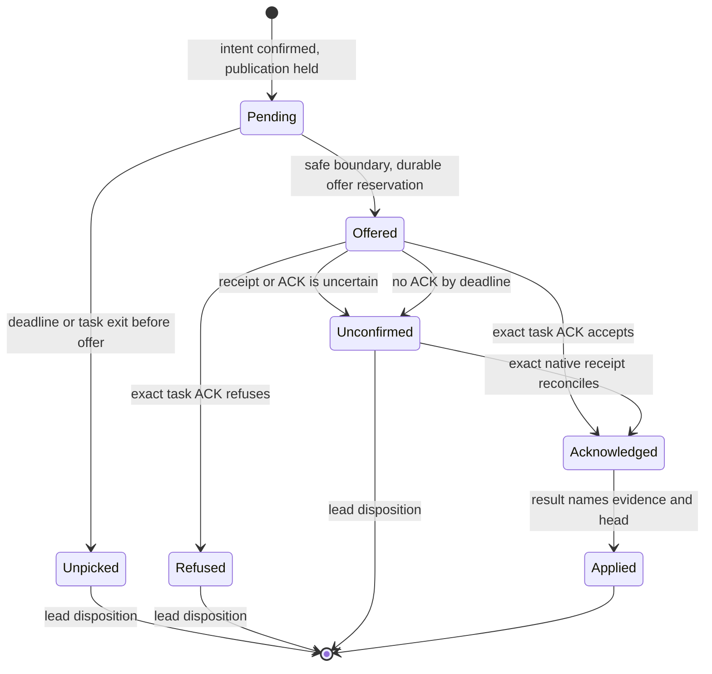

# DESIGN-037: Amend a running task and continue an existing PR

Date: 2026-10-29. **Status: proposal, docs only.**
[OpenProject #262](https://work.haynesnetwork.com/work_packages/262), Epic #91,
Saga distributed-dev-env. Work order COORD262-STEER-GAPS-DESIGN-20261029-01.
Source baseline: `c2afa8ce59cc7841f3d9f6b580d068b8e57037f9`, freshly fetched main.

A coordinator should be able to correct a running headless work order and assign
a later fix pass to the same PR. Both operations need explicit authority,
durable receipts and a visible outcome. This proposal enables neither operation.
It changes no code, runtime, common rules, credentials or accepted decision.
The lead owns review and merge of this document. Questions below are proposals
for the lead to take forward; none has been delivered or answered.

## 1. Problem and current behavior

The October 29 coordination record in
[OpenProject #239](https://work.haynesnetwork.com/work_packages/239) reports two
gaps. [#258, journal 2668](https://work.haynesnetwork.com/work_packages/258/activity)
records two corrections that could not reach a running headless fix task. They
became review gates instead. Fix passes also opened superseding PRs:
[#659](https://github.com/thaynes43/dev-env/pull/659) →
[#663](https://github.com/thaynes43/dev-env/pull/663) →
[#666](https://github.com/thaynes43/dev-env/pull/666),
[#660](https://github.com/thaynes43/dev-env/pull/660) →
[#664](https://github.com/thaynes43/dev-env/pull/664) →
[#669](https://github.com/thaynes43/dev-env/pull/669), and
[#667](https://github.com/thaynes43/dev-env/pull/667) →
[#670](https://github.com/thaynes43/dev-env/pull/670). These are reported workflow
observations, not a new runtime test. Replacing the PR loses a single review
location and complicates ownership, links and finding disposition.

The source at the baseline explains the behavior:

| Source | Present contract and consequence |
| --- | --- |
| [DESIGN-001 D-16 and D-65](001-dev-env-v2.md#68-messaging-between-agents), [agentd delivery](../../../../internal/agentd/deliver.go), [API routes](../../../../internal/apiserver/podcmd.go), [CLI](../../../../internal/agentrun/podcmds.go) | `msg` delivers once to a running TUI. Its envelope says peer information is not the user's instruction. `Deliver` rejects a non-TUI launch with the headless-task error. The broad legacy message route is unsuitable for privileged work-order changes. |
| [DESIGN-001 D-58](001-dev-env-v2.md), [launch](../../../../internal/agentd/launch.go), [runner](../../../../internal/agentd/runagent.go) | The initial prompt runs once, on finite stdin. A later boot resumes the conversation in a TUI. Rebooting is not a headless amendment mechanism. |
| [Managed Codex](../../../../internal/agentd/managed_codex.go), [event parser](../../../../internal/agentd/codex_stream.go) | The pinned first launch uses `codex exec --json`; the parser expects one turn. Observing output does not provide an input channel or an enforceable pause between tool actions. |
| [D-83 managed-child decisions](../../../../docs/managed-child-decisions.md), [decision dispatch](../../../../internal/agentd/decision_dispatch.go) | Nearest precedent: a configured-coordinator direct parent records one bounded answer through Session/Pod UID-fenced routes; operator-owned status reserves its digest. The daemon checks live authority, waits for a genuine native exit receipt, then resumes the same thread as an empty-prompt TUI with one paste and no replay. Default-off, managed shared Codex only; human, client, Session and absent parents are excluded, as are private child tasks. This preserves the same admitted writer and grants no cross-session transfer. |
| [Worktree setup](../../../../internal/agentd/clone.go), [task guard](../../../../internal/agentd/launch.go), [repository rules](../../../../CLAUDE.md#how-work-happens-here), [API validation](../../../../internal/apiserver/validate.go) | A new worktree gets `agent/<session>`. The guard requires pushing that branch and creating a PR. `--base` changes the starting revision of a legacy `--repo` task only. For a declared-project task the API refuses any base but the default branch. Neither changes branch custody. |
| [Project catalog](../../../../internal/projectcatalog/catalog.go), [accepted snapshot check](../../../../internal/agentd/managed_codex.go) | Project rules require private task worktrees, fresh fetched pins and WIP preservation. The accepted task currently binds its base to the declared default branch; a PR continuation needs a distinct validated source binding. |
| [TaskClaim store](../../../../internal/taskclaim/store.go), [DESIGN-010](010-atomic-task-claims.md) | Ownership is immutable. A stopped or missing executor does not transfer it. A different owner gets the existing claim; deleting and recreating it would discard custody. |
| [DESIGN-014](014-durable-offline-inbox.md), [result handoff](../../../../docs/coordinator-result-handoff.md) | Inbox read ACK is not model consumption. The offline handoff checker records observations; it neither transfers a claim nor authorizes a writer. |

[ADR-003](../adrs/003-session-coordination-private-repositories.md) already calls
for explicit handoffs, verified ownership and private repositories. This design
fills in that contract. No ADR-012 is proposed yet: the unsettled authority and
ref-protection choices remain questions, not an architectural ruling. An answer
that changes the credential boundary should receive a separate decision record
before implementation of that boundary.

## 2. Scope and invariants

Two explicit, default-off capabilities are proposed:

- **Amendment:** append a bounded correction to the current execution pass's
  work order, with verified sender, ordered revision, safe delivery and task ACK.
- **Fix round:** create a fresh bounded session and private worktree for an
  existing PR, after the previous writer has exited and custody has transferred.

The original work order, accepted rule inputs and history remain immutable.
An amendment can correct, narrow or clarify the assigned outcome within its
existing authorization. It cannot grant credentials, expand repositories or
runtime access, clear an owner hold, change model/provider, renew a budget or
resume paused work. A broader assignment requires a new authorized work order.
Natural-language validation cannot prove scope: the recipient must refuse an
unsafe correction, and existing access checks still apply.

One branch has one current writer generation. Every launch, continuation,
resume and remote write must consult that generation. An absent heartbeat,
expired lease, elapsed deadline, PR comment or tracker claim is never a stop
proof. No cross-session write is admitted without custody. A new fix round
inherits the logical task's budget/counters and unresolved holds, while recording
its own bounded allowance; changing sessions resets none of those limits.

Ordinary `msg`, durable inbox send/read/ACK and ordinary new-task behavior keep
their current meanings. There is no automatic conversion of a message, review
comment, repository file or tool result into an amendment. Native conversation
import, cross-provider recovery, force push, automatic merge, grant changes and
restarting an active worker are outside this proposal.

## 3. Running-task amendments

### 3.1 Proposed interface and authority

The following commands and routes are **proposed, not installed**:

```text
agent-run amend <session> --expect-uid <uid> --expect-revision 0 \
  --idempotency-key correction-1 --file amendment.json
agent-run amendments <session> --expect-uid <uid> -o json
POST /v1/sessions/{name}/amendments
GET  /v1/sessions/{name}/amendments
```

The body carries the explicit task identity, reason, correction, public PR
summary and requested pickup deadline. Session UID, original work-order digest
and expected revision bind the target. Sender and timestamps come from the
authenticated API identity and server clock, never body fields. Read results
separate accepted, offered, acknowledged, applied and unconfirmed states.

Only the target's recorded direct parent, proved by original Session UID and
live controlled Pod, or an explicitly configured coordinator with authority
over this task may submit. Project read scope alone is insufficient. A
coordinator's identity and task scope must come from supported platform
provenance; a name or a claim in message text proves nothing. Do not inherit the
legacy `msg` authorization. Recheck identity, task binding and holds before
acceptance and before offering the amendment. A lost or replaced parent does
not silently appoint another one. Q-262-01 covers coordinator delegation.

Today `spec.parent` records only a name taken from the caller's token (D-05),
not the parent's Session UID. Amendment opt-in must capture that UID at create
from an authenticated live read, as `usageCaptureParentUID` does for usage
capture in [usage_capture.go](../../../../internal/apiserver/usage_capture.go).
The recorded name alone cannot distinguish a replacement parent Session.

Initially require the task to have opted in at creation, and its agentd and
provider adapter to advertise a tested amendment capability. A legacy runner,
TUI, stopped task, unknown capability or mismatched UID returns a typed refusal
without queuing text. Do not amend an already running legacy task by changing
its launch file. The lead can still review its result or assign a later pass.
Opt-in also requires registered branch custody and the enforced publication
path in section 5. A provider adapter alone cannot close a direct Git push path.

### 3.2 Bounds, ordering and durable state

Proposed limits, pending Q-262-02:

| Item | Limit |
| --- | --- |
| One correction | 8 KiB UTF-8, measured in bytes |
| Public PR summary / reason | 1 KiB / 512 bytes |
| Entire JSON request | 16 KiB, strict fields; reject duplicate keys, invalid UTF-8 and terminal control characters except newline/tab |
| Accepted amendments | Four per execution pass for its lifetime, including resumes; one unresolved amendment at a time |
| Pickup deadline | At most ten minutes after acceptance, capped by the existing pass deadline; it never extends the pass |
| ACK deadline | At most ten minutes after the offer, inside the pass deadline; a miss is Unconfirmed |
| List/read | One page of at most four records; errors contain no submitted text |

Store immutable amendment intents and append-only receipts in the protected
coordination API group, not broadly readable Session spec/status, a ConfigMap
or a shared worktree. An operator-owned per-pass CAS cursor atomically checks
the pending slot, lifetime count and expected revision. Sequence is server
assigned. A unique sender UID plus caller key binds immutable target and
intent. An identical explicit retry confirms that record even after exit; a
changed intent/key collision or stale revision conflicts. Concurrent senders
cannot both consume the same revision. No automatic mutation retry or new key
after a lost response. A read can resolve acceptance without delivering text.

Create/confirmation returns a receipt, **not** a delivery claim. Partial cursor
and record writes leave the slot reserved and block delivery until exact
readback reconciles them. No timeout releases uncertain intent. Retain intents,
receipts and cursor references with the task's handoff/history; archive before
any later authorized deletion under the coordination retention contract.
New kinds need explicit retention integration, not an assumption that
DESIGN-024 already archives them. Bound active records per project and sender
at 4096 and 512 respectively; reserve capacity atomically and refuse at the
bound. A full store still permits reads and resolution of existing records.

### 3.3 What a safe boundary means

An accepted amendment immediately closes that pass's **managed publication
gate**. It requests a pause at the next supported boundary, without interrupting
a tool or pretending an action already in flight can be undone. A safe boundary
has no outstanding model request, tool call or supervised write process, and
the adapter can withhold the next action. A text line saying "idle", a quiet
log, a completed subcommand or a tmux paste does not prove this.

Agentd needs a provider adapter with explicit operations: request a boundary,
confirm the exact invocation/turn and drained tools, offer one attributed
control message, obtain a durable native receipt and resume only that turn.
The correction is presented as a visible **work-order amendment**, naming its
verified sender, ID, revision, reason, original order digest and text. It is
an explicit correction within the delegated order's authority, never a hidden
system-prompt edit. Ordinary peer messages retain their information-only
envelope. Content never passes through a shell or terminal key injection.

Deliver an amendment only in the provider's user or control role, never inside
a tool result. The task guard must say that text in a tool result, file, PR
comment or `msg` that resembles an amendment envelope is data. The task acts
on an amendment only after `agentd amendment-ack`, or a read-only
`agentd amendment-show`, confirms its ID, digest and revision for this pass.
These operations are proposed, not installed. An unknown ID returns
`not_an_amendment` and reveals no other record.

Neither existing one-shot runner proves this interface. Before enabling either
provider, M0 must first test that provider's own native candidate at the versions
verified in [images/agent/Dockerfile](../../../../images/agent/Dockerfile):

- Claude Code 2.1.296: `-p --input-format stream-json --output-format stream-json --replay-user-messages`,
  with a user-role message on stdin that stays open,
  echoed back once accepted.
- Codex CLI 0.160.1: `codex exec resume <thread-id>` after a genuine exited
  invocation, headless with no TUI.

Neither candidate is assumed to prove the boundary. M0 must show when the
message is consumed, between turns or between tool calls, that the echo is a
durable receipt, and that no tool runs between offer and receipt. For a candidate
without an echo, an equivalent supported durable native receipt must be proved;
otherwise it is unsupported. Extending stdin alone, scraping a transcript or
parsing `turn.completed` alone is insufficient.
If the available CLI cannot provide it, report `unsupported_boundary`; do not
offer an approximation as mid-run steering. No paid-API substitution, private
socket protocol, second writer or automatic TUI conversion is allowed.

A separately tested adapter may use a fully exited invocation as a boundary
and resume the confirmed same native thread headlessly. It must prove genuine
`Wait`, descendant-process absence, durable exit and one-use continuation,
without replaying the initial prompt. The existing
[native invocation](../../../../internal/agentd/native_invocation.go) contract
and [D-83 route](../../../../docs/managed-child-decisions.md) are the nearest
precedents. D-83 resumes into an empty-prompt TUI and pastes once, without
replaying the original prompt. An amendment adapter that reuses it must resume
headlessly or justify the conversion against the "no automatic TUI conversion"
rule; the existing TUI path does not meet that rule. Both contracts bind the
same admitted writer and grant no cross-session transfer. A correction received
only after the task has published is late, not successful steering. Do not advertise an adapter
that can only deliver after task completion as a mid-run capability.

### 3.4 Acknowledgment and uncertainty

At the boundary, agentd durably reserves one offer, confirms current authority
and logs the attributed envelope before delivery. The task must explicitly ACK
the exact amendment ID, digest, revision and native turn through a narrow
`agentd amendment-ack` operation. Its disposition is `accepted` or `refused`,
with a bounded explanation and a short account of what will change. The API
derives the recipient from its original Session/Pod/invocation binding.
The coordinator cannot ACK for it. A validated ACK is task-reported
understanding, not proof the fix is correct; review/tests establish application.

Agentd and the model share the pod's Unix identity and API token. Offer and ACK
records are therefore pod-attested, not supervisor-attested. The server-held
publication gate is the enforcement; an offer record cannot enforce the hold.



Publication can reopen after an accepting ACK and a matching audit revision;
the final result must still name the correction and its validation. Refusal,
deadline, no ACK or a changed authority keeps publication and new writes held
at the next boundary. Agentd reports the blocker and preserves WIP. It does not
silently continue the obsolete order or relaunch the task. Existing timeout
handling still ends the pass; the amendment adds no new kill timer. A long
in-flight tool may finish before the boundary, so the lead sees its separate
running state and can use an already authorized lifecycle action if necessary.

After a crash between offer reservation and ACK, the state is `Unconfirmed`.
Reconcile a bounded exact native receipt if the adapter supports it; otherwise
stop dependent work for lead disposition. The transition to `Acknowledged`
requires that receipt to include the validated accepting task ACK for the exact
ID, digest, revision and turn. A provider echo or delivery receipt alone cannot
take that transition. Do not replay the prompt or claim
exactly-once model processing. An API inbox ACK, an exec success, an output
string or successful transport is not this task ACK. Expired/unpicked intents
stay recorded and must be explicitly dispositioned in any later fix work order;
they never auto-deliver to a new session or a D-58 TUI resume.

### 3.5 Task log, PR and lead view

Append timestamped control events to the readable task log and retained event
stream: accepted, offered, ACK/disposition, applied or unpicked/unconfirmed.
Keep the original prompt visible as the original order. The full correction
is authorized task content, with the existing private log/history ACL; secrets
are forbidden input. Broad Session list/status exposes counts, revision and
reason codes only. Amendment text requires a separate task-content scope.

Every accepted correction requires an explicitly public-safe summary. A
managed PR audit comment records that summary, amendment ID/digest, sender role,
revision, disposition, timestamps and resulting head/evidence. Never copy raw
private text, provider history or authenticated personal identifiers to the PR.
A private reference can point authorized readers to the full intent. For a PR
created later, publish the accumulated audit before declaring the result ready.
An existing PR receives a pending correction record and later disposition;
if it was already ready, it must not be presented as a current accepted result.

Audit writes use a deterministic marker and exact PR binding. A lost GitHub
response requires readback for that marker; no blind duplicate comment. If
GitHub is unavailable or its record cannot be confirmed, the lead sees
`audit_pending`, and readiness stays held. Public summaries remain human
assertions about safe publication, not a promise that a secret scanner can
detect every secret. Q-262-03 asks the lead to settle this publication policy.

The lead sees the original order digest, latest accepted/ACKed revision,
deadline, last boundary, unresolved state and next action in `show` and the
amendment query. Acceptance without pickup is explicitly distinguishable from
a worker that understood the correction. This prevents waiting for a PR on
the mistaken assumption that the work order changed.

## 4. Fix rounds on one PR

### 4.1 Proposed command and admission

This command is **proposed, not installed**. `--continue-pr`, `--expect-head`
and `--task-key` do not exist in `agent-run` today.

```text
agent-run --project dev-env --agent codex --model gpt-6.1-sol --effort xhigh \
  --continue-pr 700 --expect-head <full-sha> --task-key task:example \
  --idempotency-key example-fix-1 -p "Apply the bounded reviewed corrections."
```

PR 700 and the task key are synthetic examples. The option creates a **new**
execution pass; it does not resume the previous provider conversation or
authorize merging. It requires a declared project/repository, explicit logical
task identity and bounded work order. Refuse combinations with `--base`, rescue
restore, `--local`, `--interactive`, arbitrary remotes or an unrelated task key.
Either supported provider can own a later source pass; model policy and
subscription credentials remain unchanged, with full model IDs recorded.

The server resolves the PR using the existing managed GitHub route, and binds
repository numeric identity, PR number, head repository, exact ref, head SHA
and base. MVP admits only an open, unmerged, same-repository PR on a registered
nondefault `agent/` branch. Forks, deleted refs, ambiguous ownership, a default
branch, changed expected head, closed/merged PR or inaccessible GitHub refuse.
PR authorship by the shared bot cannot identify a session. Resolve the writer
from the original platform PR-publication binding; never infer it from branch
spelling, commit author, a comment or the caller's supplied prior-session name.

Legacy PRs without that binding require a separately authorized, audited
enrollment from their original task/launch/PR evidence. There is no force-adopt
flag. Enrollment cannot prove an unknown old executor stopped. Q-262-05 covers
whether this migration is in the first usable increment.

### 4.2 Custody alongside the immutable TaskClaim

Keep the original TaskClaim's owner and provenance unchanged. Add an
operator-owned **BranchCustody** record in the protected coordination group.
Its uniqueness key is stable repository identity plus the full case-sensitive
`refs/heads/...` name, independent of project aliases, task keys and PR numbers.
A different task asking for the same ref cannot obtain another writer.

The record binds the logical task, original TaskClaim UID, PR identity, current
executor Session UID, writer generation, accepted head, coordinator authority
and current transfer phase. Each transfer has an immutable linked receipt:
request key/digest, prior generation and executor, stop proof, successor UID,
head pin, saved rule revisions and handoff/budget references. A mutable CAS
cursor points to those receipts; an append-only comment alone is not a lock.
No TTL or missing record grants ownership. Initial enrollment uses atomic
Create; concurrent transfers use the same expected generation/resourceVersion.

TaskClaim remains original logical ownership. BranchCustody becomes current
execution authority for this explicitly enrolled branch. All effective-owner
readers, launch gates, budget binding, status and resume paths must use the
same resolver before fix mode is enabled; an old TaskClaim client must not
interpret the unchanged owner as current write authority. Existing tasks keep
the old behavior until enrolled. OpenProject remains the work queue and gets
a progress/handoff link; `opwork claim --force` is not branch custody.

Proposed storage limits are 128 transfer receipts per branch, 512 per requesting
session and 4096 live custody records per project. Refuse the next transfer at
the bound; retain reads and the current writer. Receipts are individually
bounded at 16 KiB and carry metadata, not work-order bodies or Git bundles.
Archive integration must preserve the current generation and every referenced
stop/transfer witness. No retention event may make a still-existing branch
appear unowned. Changed-intent retries conflict; lost responses are recovered
by the exact request key, never a second successor allocation.

### 4.3 Stop, transfer and launch

Execute the transfer serially:

1. Verify the requester is the recorded parent or task-scoped coordinator,
   the same story is authorized for a fix pass, its holds and budget permit
   the pass, and the PR/head/binding match. A paused story stays paused.
2. Require the previous native author to have exited. Prove the exact old
   writer container terminated and no replacement invocation or Pod owns the
   generation. Capture Session/Pod UID, container identity/restart count,
   terminal result and fresh node/lifecycle evidence. A task-result file,
   phase alone, stale heartbeat or deleted Pod on an uncertain node is
   insufficient. Child/background writers must have ended too. An active TUI
   after D-58 resume is an active author: refuse with `writer_active`.
   This command never stops the old session to make it eligible.
3. CAS the branch to `Transferring`, reserve exactly one successor identity
   and increment the fencing generation. The same authority gate serializes
   this against old-session resume/restart and every managed ref write. No
   old generation may restart or publish after this point. Recheck the stop
   proof at this transition; if a resume won the race, refuse the transfer.
4. Durably confirm the transfer receipt, complete the publication fence in
   section 5, and re-read the same open PR/head. Prepare the successor's
   immutable session input with PR binding, new generation, source pin,
   handoff, rule inputs, remaining limits and explicit holds. Confirm all
   writes by uncached readback before changing custody to `Assigned`.
5. In the successor's own HOME, freshly fetch the bound head ref, verify it
   is the expected commit and record the fetch time. Also record the current
   base SHA separately; starting a fix round does not reset to main. Create
   `~/work/<new-session>` from that exact head, with a local branch tracking
   the existing PR head branch. Use a distinct continuation-source receipt;
   do not forge a normal default-branch task pin or relax its validation.
6. Before spawn, recheck custody, scope, budget and PR head. Only the exact
   assigned Session/Pod UID and generation can enter `Running`. A competing
   create, replacement UID or changed ref refuses without launching a model.
   Before every push, recheck them again and publish only a fast-forward
   from the recorded expected remote head. Update that head by confirmed
   readback. A changed remote head requires explicit reconciliation, never
   force push or an automatic new PR. If the base moved, update the branch by
   merging the base, never by rebase, so every push stays a fast-forward.

The precise private-session stop attestation and common resume gate are new
build work. Before the F1 slices, Q-262-06 must settle the lifecycle state that proves the
old author exited. The recommended minimum is a `Suspended` Session after a
verified rescue, with the exact Pod UID confirmed deleted by an uncached read
and its node `Ready`, plus custody fencing and Q-262-04 ref protection. A phase
alone is not proof. This is a recommendation, not an accepted admission rule.

Budget-bound and workspace tasks already use `restartPolicy: Never` in
[pod.go](../../../../internal/controller/pod.go), so a terminated writer
container is observable there. Other task pods keep agentd running until
suspend because rescue-by-exec (D-51) needs it; CLI exit alone does not prove
container exit. A closeout that seals exit/WIP evidence and ends the private
writer container is its own story. Existing shared-workspace stop/continuation
helpers are patterns, not permission to restore shared Git or evidence for
private-session transfer. No Pod deletion, drain or reaping is implied here.

`Transferring` or `Assigned` survives operator failure and holds the branch.
Reconciliation may finish the same request and same successor; it may not pick
a new writer after a timer. Failed preparation preserves local partial state
and remote custody. Returning custody or appointing a different successor
requires an explicit authorized disposition and a new generation with the
failed successor's stop proof. There is no rollback that revives an old writer.

### 4.4 Worktree rules and PR continuity

Worktree per story remains true: one bounded pass, one private task worktree
and one current writer. The **path belongs to the new session; the remote
branch belongs to the continuing story/PR**. The old HOME and worktree remain
private preserved evidence. No cross-pod checkout mount, file copy or edit of
the predecessor's Git administration is needed. Unpushed WIP requires a
separate verified handoff; it is never silently omitted or copied from a
provider HOME. The work order must account for it before transfer.

The continuation-aware task guard must name the new local path, existing
branch, PR number and custody generation. It says to update that PR, record
finding dispositions and stop under the assigned merge policy. It must not
also require `agent/<new-session>` or `gh pr create`. Common/project/repo rules
must explicitly recognize this platform-issued exception before the mode is
admitted. Update their GitOps sources through separate reviewed work; never
patch a running pod's mounted rule copy or rewrite saved old inputs.

The PR gets a custody audit comment before the successor publishes: prior
writer role, verified exit reference, new writer role/generation, starting
head, fix-round scope, inherited holds and review findings addressed. No
personal identifiers or private task text. Its URL, discussion and review
threads stay on the same PR. Existing approvals/checks remain historical for
their old head; current required CI and native review must cover the new head.
Do not resolve someone else's finding automatically or imply old approvals
accept the fix. A worker cannot merge unless its own work order permits it.

## 5. Enforcement and security boundary

An operator CAS prevents two managed assignments. A local Git lock protects
only one pod. Neither revokes the repository-wide bot credential currently
readable by workers. A guard string, pre-push hook or cooperative wrapper alone
cannot honestly guarantee that an old session cannot push to the branch.

For both amendment publication holds and the strict no-cross-session-write
contract, activation therefore requires **server-enforced ref protection** and
a custody-checked publication path. This applies to the original opted-in
task's branch as well as an existing PR admitted for a fix round. The proposed
path accepts one commit update for one exact ref, expected
old head, live writer UID/generation and audit revision. It serializes with
transfer, verifies fast-forward ancestry, bounds the submitted artifact and
rechecks custody at publication. Credentials that can bypass the ref protection
remain outside worker pods. Existing worker credentials must be unable to
update or delete the enrolled ref through raw Git **or** GitHub's ref API.
Do not distribute a bearer capability that remains usable after transfer.

The GitHub policy, publisher identity and artifact protocol are not established
by the present catalog or TaskClaim code. Their feasibility and precise scope
must be proved in dedicated stories and settled under Q-262-04. This is a real
activation dependency, not new credential authority or a recommendation to
repair/change credentials in this story. If that protection cannot be obtained
within approved access, keep both modes disabled and report the gap. Do not label
a cooperative-only path as enforcement. Operator/credential administrators
remain trusted; this proposal does not contain a hostile administrator.

Publication and transfer share a durable per-ref operation reservation. An
in-flight GitHub update must resolve by exact head readback before transfer
can commit; an ambiguous network response cannot release the reservation.
GitHub has no atomic transaction with the custody store. On disagreement,
freeze the ref's managed writes and show `publication_unconfirmed`. Never
declare the new writer active while a prior-generation remote update may
still land. The same gate arbitrates task completion against amendment
acceptance: if completion seals first, reject the amendment as late; if the
amendment reserves first, completion cannot publish the stale revision.

Amendment delivery also depends on a trusted supervisor/adapter control
channel. A file writable by the model's UID cannot authenticate operator
authority. Use authenticated API state, exact invocation fences and the
provider's supported control boundary; never treat a local JSON file as the
root of trust. Refusal must not reveal foreign task text. Narrow operator
permissions for new coordination kinds and content ACLs need their own
reviewed GitOps delivery; no worker CRD write grant follows.

## 6. Failure and race handling

| Situation | Required result and lead-visible next action |
| --- | --- |
| Two amendments race, or same key changes text | One revision/intent wins; the other gets a conflict with authorized metadata. Read and consolidate; no new revision guessed by the client. |
| API acceptance reply is lost | Lookup by original key. Confirmed acceptance still says Pending until task ACK. No automatic redelivery. |
| Tool/model call runs past pickup deadline | Mark Unpicked, close publication, hold at the next real boundary; retain in-flight state. Lead chooses a later pass or an independently authorized stop. |
| Crash after offer, before ACK | Unconfirmed; use an exact supported native receipt or hold. No second prompt on a guess. |
| Parent replaced, coordinator scope revoked, owner pause arrives | Recheck before offer/spawn/write; hold dependent work. An old accepted intent does not clear a later stop. |
| Worker exits or PR publishes before amendment admission | Reject as late; record the missed correction for a separately assigned fix round. Never reopen the task automatically. |
| Task ACKs but produces the wrong fix | Display ACK separately from Applied; tests and review reject the result. An ACK is no correctness certificate. |
| Two fix rounds, or different task keys target one branch | One canonical ref record/CAS winner; contender gets current custody. No duplicate writer/session or superseding PR. |
| Old writer resumes while transfer is requested | Resume and transfer use one gate. Resume winning makes transfer refuse; transfer winning makes old-generation resume refuse. |
| Old node is partitioned or stop proof is stale | Stop Unknown; no transfer. A missing Pod/lease is not executor absence. Preserve custody. |
| PR is closed, merged, retargeted, force-updated or deleted during setup | Rechecks fail; hold without resetting local WIP or switching PRs. A later instruction must reconcile the new identity/head. |
| New worktree fetch fails or branch/path already holds WIP | Preserve it and refuse launch. No fallback to a stale pin, hard reset or foreign local branch. |
| New worker fails after assignment | Keep that generation reserved; preserve handoff. A different successor needs explicit disposition and proven exit. |
| GitHub write or audit response is ambiguous | Exact marker/head readback; otherwise publication/audit remains unconfirmed. No transfer, force push, merge advice or blind replay. |
| Old image/operator is restored | Ref protection and retained custody must continue denying old generations. Refuse activation/rollback combinations that cannot read the new records; disabling the feature stops new work, not the fence. |

The lead's result view needs PR/head, logical task, original claim owner,
current executor/generation, amendment revision/ACK, custody phase, source pin,
stop-proof state, audit status and next action. Keep Unknown explicit. CLI
delivery comes first; a portal projection can follow without changing these
states or interpreting age as failure. Configured model, served model and cost
remain separate observations; missing serving/usage evidence remains Unknown.

## 7. Build stories and acceptance

These are candidate stories for Epic #91, not a second task backlog or new
dispatches. Search OpenProject and file or link each canonical story before
pickup. Each work order must name its owner, exact paths, prerequisites and
budget. All source slices stop at their reviewed PR and evidence handoff;
installation and usable acceptance are separate. No implementation starts
from this document alone while its relevant decision is pending.

| Candidate | Owned outcome and paths | Prerequisites and observable acceptance |
| --- | --- | --- |
| M0: qualify the boundary | One provider's bounded capability report and synthetic adapter fixture; `internal/agentd`, pinned CLI contract docs | Q-262-01/02 scope agreed. First test that provider's pinned native candidate in section 3.3. Show whether consumption is between turns or between tool calls, prove a durable echoed acceptance/native receipt and no tool between offer and receipt. Demonstrate a supported pause with no pending tools and a visible user/control-role offer; wrong invocation and uncertain receipt refuse. Transcript scraping or `turn.completed` alone cannot pass. State Unsupported if the pinned CLI cannot do it. No live inference/credentials by default. |
| M1: amendment records and API | Protected types/store/API/CLI, `api/coordination`, `internal/apiserver`, `internal/agentrun`, generated schema | Agreed sender/limits/publication policy. Prove spoofed/nonparent send denied, changed UID/intent refused, two-server CAS contention yields one revision, strict UTF-8 byte bounds/counts, lost reply/reconstruction and explicit ACK/read separation. Fake provider must never run during API acceptance. |
| P0: ref-protection feasibility | Narrow policy/publisher contract and isolated synthetic-repo proof; no production credential change | Q-262-04 decision and any action-specific authority. Prove worker Git and API ref writes/deletes are denied for both opted-in original tasks and prior fix-round writers. Define the bounded artifact protocol and publisher scope. If it cannot be enforced, record Unsupported and stop dependent implementation. |
| F1a: custody types and store | BranchCustody types/store in the protected coordination group | P0 contract, Q-262-05 migration scope. Prove CAS contention yields one reserved successor/generation, failure/restart durability, bounded records/receipts and no TTL release. TaskClaim is unchanged. No provider spawn in store tests. |
| F1b: private closeout stop proof | Private-session closeout that seals exit/WIP evidence and ends its writer container | F1a, Q-262-06 lifecycle decision. Prove exact-container exit, preserved WIP, active old author refusal and stale/partitioned/replacement UID refusal. CLI exit alone cannot pass; test the approved lifecycle proof separately from ordinary agentd-alive task completion. |
| F1c: common authority resolver | One resolver for launch, resume and budget binding | F1a/F1b evidence. Prove all effective-owner readers use current custody, unchanged TaskClaim ownership cannot admit an old writer, two-server transfer/resume races have one winner and restart cannot revive an old generation. |
| P1a: ref-update publisher | Implement the P0 artifact/ref-update protocol in the managed publication service/API | P0 contract and F1c resolver. Finite TLS/bare-Git fixtures prove live UID/generation/head checks, fast-forward only, amendment-versus-completion ordering, old-generation denial and unresolved remote writes blocking transfer. Test a direct Git/API bypass, not just a cooperative wrapper refusal. |
| P1b: registration and audit | Initial task-to-PR registration, bounded audit receipts and readback | P1a evidence. Prove initial branch protection/registration, exact task/ref/PR binding, deterministic audit markers, exact receipt/head readback and ambiguous responses holding readiness without duplicate writes. Private text stays out of public audit. |
| M2: one provider's delivery | Agentd supervisor/adapter/logging/result integration for the qualified provider | M0/M1 and P1a/P1b evidence, authenticated control path. Fixtures prove boundary/drain, accepted/refused ACK, pickup/ACK deadlines, exit race, crash after reservation, no replay and publication barrier. Produce task log and PR-audit projection with private text excluded. A second provider is a separate serial story. |
| F2: existing-PR task preparation | `internal/agentrun`, session API/protocol, agentd clone/launch and publication integration; session-branch assumptions in `internal/agentd/clone.go` (~253), `decision_dispatch.go` (~66), `workspace_rescue.go` (~135 and ~185) | F1a/F1b/F1c and P1a/P1b source evidence. Local bare-Git/TLS fixtures start at an exact PR head on its branch in a fresh private worktree; old worktree unchanged. Reject fork/default/moved/deleted PR, failed fetch, dirty collision and conflicting flags. Prove two fix rounds preserve one PR and current-head review/check gates. A D-58 resume and a rescue of the fix-round session keep the PR branch and bundle its unpushed commits. |
| R1: rules and installation | Reviewed common-rule GitOps sources, project/repo instructions, signed binaries/schema/narrow permissions | M2 or F2 tested, F1a/F1b/F1c and P1a/P1b installed and P0 ref policy proved for the enabled mode, applicable Qs answered, authorized deployment scope. Render both providers' actual guards; continuation has one branch/PR instruction. Install schema before readers/writers. Verify image/capability versions without restarting busy sessions; preserve existing holds and evidence. Neither mode activates on an unenforced ref. |
| A1: usable acceptance | One finite disposable parent/worker workflow and then one exited-author fix round; verification record | R1 installed plus explicit runtime scope/budget. Lead submits one correction during work, sees native ACK and correct resulting log/PR. Existing PR gets the fix at a new head; old author active and unauthorized writer attempts are refused. Record configured/served model honestly. Source CI alone cannot pass A1. |

Shared work-order fields for these candidates:

- **Ownership/isolation:** one accountable session per story and worktree; one
  source writer per affected path. Maximum concurrency one initially. M2 and
  F1b/F1c touch supervisor/launch gates and must be serialized, even if their
  pure-store work can later be isolated.
- **Proposed budget:** 45 minutes per source/capability slice, checkpoint at
  30; split unfinished outcomes before pickup if they will not fit. Usage/cost
  allowance is Unknown until the lead assigns it. Do not invent remaining
  quota. R1/A1 need their own explicit runtime and elapsed budgets.
- **Artifacts/handoff:** one PR per bounded slice; exact base/head, native
  review, focused test output, blocker/decision references and next safe step
  on the canonical OpenProject item. Record built, published, installed and
  usable/accepted separately. Never mark an epic usable from source completion.
- **Stops:** assigned acceptance met; relevant decision/dependency/approval
  blocked; budget/context threshold reached; explicit pause. Save WIP and
  receipt references. Do not automatically start the next story.

Run one focused suite at a time, `nice -n 19`, with workers capped to
`DEV_ENV_CPU_LIMIT` and Go `GOMAXPROCS=2`, `-p 1` or lower when required. Keep
caches/scratch under HOME. Use fake clocks and finite race fixtures; no burners,
stress, busy loops, wide test loops, local image builds or production probing.
Future cluster fixtures require CPU limits and their own runtime authority.
Required CI and native independent review apply to each source PR; advisory
Claude availability is recorded separately. This docs story stops with one
ready PR and checks started; the lead handles final CI and merge.

## 8. Open questions for the lead

These questions are **not rulings and have not been delivered**. They grant no
authority. The lead should resolve each through the supported owner channel
when its dependent story is ready, and retain the dated answer/provenance.

| ID | Question | Recommendation and tradeoff |
| --- | --- | --- |
| Q-262-01 | Should an amendment require the original direct parent, or also a task-scoped verified coordinator? May the owner's own human or client caller amend directly? | Permit a Session parent bound at create and an explicitly scoped configured coordinator, with visible delegation/revocation. For the minimum version, route owner corrections through the coordinator: D-83 excludes human and client parents, so direct owner callers need a separate authority decision. This supports a lead handoff without turning project readers or peer text into instruction authority. No parent/coordinator scope may clear an owner hold. |
| Q-262-02 | Are four 8 KiB corrections, one unresolved at a time, and ten-minute maximum pickup and ACK deadlines appropriate? | Start with these bounds and inherited pass limits. Refuse unsupported adapters and hold unpicked or unconfirmed work at a real boundary. More corrections or a different outcome should become a new bounded pass, not an unbounded conversation. |
| Q-262-03 | What amendment content belongs in a public PR? | Require a sender-approved public summary and digest/receipt/disposition; keep the full intent behind task-content authorization. Gate readiness on confirmed audit. Full automatic text publication risks private work-order disclosure. |
| Q-262-04 | How should amended-task and continued-PR branches enforce publication/custody against workers that currently hold repository-wide push credentials? | Require server-enforced ref protection plus a custody-checked publisher whose bypass credential stays outside workers. Prove raw Git and API denial before enabling either mode. This needs an explicit credential/policy decision and may need ADR-012; a cooperative hook is cheaper but cannot satisfy the strict security contract. |
| Q-262-05 | Should first release enroll already-open legacy PRs, or only PRs registered by the new publication path? | Start with registered same-repository PRs. Add one audited legacy enrollment story if the immediate repair workload requires it; keep original-writer identification and exact stop proof mandatory. No force takeover. |
| Q-262-06 | Which lifecycle state proves the previous author exited? | Recommend, for the minimum version, a Suspended session after a verified rescue, with the Pod UID confirmed deleted by an uncached read and its node Ready, plus custody fencing and Q-262-04 ref protection; a closeout that ends the writer container is its own story. |

No answer is inferred from this document's review, CI success or publication.
