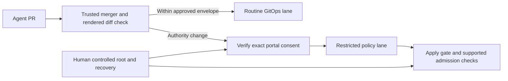

# DESIGN-039: Guard access-policy changes without blocking routine deploys

- **Status:** Proposed, 2026-10-30. Design only; no activation or decision.
- **Tracking:** OpenProject [#269](https://work.haynesnetwork.com/work_packages/269),
  Epic [#112](https://work.haynesnetwork.com/work_packages/112), Saga #85.
- **Work orders:** POLICY269-GUARD-DESIGN-20261030-01;
  docs fixes POLICY269-GUARD-DESIGN-FIX-20261030-02.
- **Source examined:** dev-env `9377637b8a1f253521118af6d2f934d7dbf27a3a`;
  haynes-ops `8d841940d3e64d447ee2272dad81554b87d28e63`, read only.
  Fix-round configuration and history checks: haynes-ops
  `a84481c28ed5dee9e17b98a32a96389bda14126a`; dev-env history
  `23163d265013f529512324c8363f08a59ceb22a0`.
- **Related:** [DESIGN-034](034-agent-asks-and-approvals-board.md),
  [DESIGN-036](036-standing-rules.md),
  [ADR-011](../adrs/011-standing-rules-as-policy-asks.md), all read on main.

## 1. Outcome and controlling scope

Agents keep deploying ordinary applications through GitOps without asking Tom
to review every deployment. An agent cannot use the repository's delivery
identity to grant itself more access or disable the controls that stop it.
An approved administrative action remains possible, including a reviewed
change to those controls.

A separate delivery service would merge ordinary deployments automatically.
Changes that widen access or weaken a guard would need verified consent for
the exact change. The service and its keys must sit outside what an ordinary
agent can replace.

Tom's direction is recorded in **#261 journal 2828**, 2026-10-30:

> I can't be the only reviewing everything on that repo agents need to deploy
> things there all the time. We can backlog coming up with a robust solution
> that doesn't put us in handcuffs but is secure to agents getting around policies

The work order also carries the **2026-10-30 04:05 restriction, #239 relay**:
access-control changes are review only; an approved admin capability must
remain possible. This proposal installs nothing. It changes no ruleset,
CODEOWNERS, RBAC, policy, credential, workload or live setting. Its questions
are recommendations for later delivery, not rulings or approval requests.
Managed standing rules remain disabled under journal 2828. Existing access
and explicit holds remain as they are. No global read-only lockdown is proposed.

The recommendation below needs Tom's review before implementation is activated.
There is no new ADR: this document compares proposals and leaves the choices
open rather than presenting an unapproved architectural decision as adopted.

## 2. Evidence and threat model

### What was checked

The source pins above were freshly fetched for this story. Read-only GitHub
queries on 2026-10-30 confirmed that haynes-ops is public and its effective
[main rules][main-rules] require a PR with
`required_approving_review_count: 0`, `require_code_owner_review: false` and
`require_last_push_approval: false`. The [Main ruleset][main-ruleset] has no
required status check rule. The separate Edge ruleset does not govern main.
No `CODEOWNERS` file exists anywhere in the pinned main tree. These API links
are mutable observations, dated here; the source links below are immutable.

This was a source and repository-settings inspection, not a live cluster
audit or an exploit test. No grants, Kubernetes requests or trial policy
objects were created. Installed effective rights, current connections and
the complete population of GitHub actors were not tested.

### Attacker, assets and boundary

Assume a mistaken, prompt-injected or malicious agent can write and propose
changes using its legitimate session identity and the shared haynes-dev-bot
GitHub delivery route. The [keeper's token permission set](../../../../internal/keeper/github.go)
includes contents, pull-request and workflow writes; this source observation
does not inspect or expose a token. The agent can read public source and
arrange several valid PRs. A second agent using the same credential is not an independent authority.
Do not assume the agent follows instructions when testing the enforcement.

Protect Kubernetes and external-system permissions, network reach, credential
exposure, approval records, grant lifetime and revocation, and the code and
configuration that enforce them. Include permission changes to other identities
the agent can cause to act for it. A policy file's location is not the boundary.

The root of trust must be outside what ordinary agent delivery can replace:
repository administration, trusted consent verification, the merger, and the
restricted policy reconciler. Compromise of that root or a cluster administrator
is outside the guarantee. Agents changing a root's deployment through an
ordinary PR is in scope and must be refused. Existing approved rights are
not retroactively removed or certified safe by this design.

### Current paths to wider access

Each row describes a source-supported possibility through GitOps, not a claim
that an agent exercised it. A PR may still face workflow checks and the
platform's other controls; those do not establish verified human consent.

| Surface and real files | How a merged change can widen access | Current boundary and gap |
|---|---|---|
| **Legacy GrantPolicy:** [policies][policies], [policy Kustomization][policy-ks], [matcher](../../../../internal/broker/match.go), [schema](../../../../api/v1alpha1/accessgrant_types.go) | Add a legacy policy or broaden requester profiles/repos, targets, roles, ports or TTL. Replacing an attested variant with legacy selectors can remove the attestation prerequisite. The broker then matches a later request. | The broker reads policies, and schema/matcher exclude some dangerous scopes. They do not require a portal consent digest for ordinary policies. This is DESIGN-036 SR6's recorded bypass. D-88 attestation is an agent claim, not verified human consent. |
| **RBAC roles and bindings:** [agent role/bindings][agent], [catalog][catalog], [broker RBAC][broker-rbac], [workbench RBAC][workbench] | Add verbs or subjects; widen namespaces; add bind, escalate or impersonate authority; change a role already referenced by a binding. Aggregated ClusterRoles can gain permissions without changing that binding. | The baseline cannot write RBAC directly. Flux can deliver its desired RBAC. Mutable catalog roles affect existing grants too; checking only a GrantPolicy digest misses this path (DESIGN-036 SR-K). |
| **Egress:** [platform tier][platform], [web tier][web], [broker policy builder](../../../../internal/egress/policy.go) | Add a namespaced CiliumNetworkPolicy or cluster-wide allow, broaden selectors/destinations/ports, or alter labels that select a tier. Additive allows can open a route without editing the original restriction. | Broker-owned policies have ownership checks. A separately applied allow or changed baseline need not be broker-owned. Protect CNP, CCNP, ordinary NetworkPolicy, relevant identity labels and both sides of a permitted connection. |
| **Admission guards:** [dev-env-agent-guard][agent-guard], [dev-env-identity-guard][identity-guard], [broker guard][broker-guard], [exec guard][exec-guard], [Kyverno RBAC policy][kyverno-rbac], [pod baseline][kyverno-pss], [RBAC exceptions][kyverno-rbac-exceptions], [pod exceptions][kyverno-pss-exceptions] | Remove a binding or policy, change a subject/namespace exclusion, relax validation, change failure behavior, or replace the enforcing component. DELETE/prune matters as much as CREATE/UPDATE. Add a PolicyException in kyverno or a name to exceptions/rbac-legit.yaml; switch a rule to Audit; rely on the RBAC-escalation webhook's fail-open `failurePolicy: Ignore`. | Kyverno already enforces RBAC-escalation and pod-security baselines on what Flux applies, but its policies and exceptions arrive by the same unreviewed path. Its RBAC policy covers cluster-admin/admin/edit/controller bindings and wildcard/escalate/bind/impersonate roles. The CEL guards match specific Kubernetes callers; Flux is not the session caller. API-managed VAPs also cannot protect their own policy/binding kinds; see §3. |
| **Secrets: ClusterSecretStore:** [onepassword-connect][cluster-secret-store] | Add an ExternalSecret in any namespace naming any item the store reads, and use it in a workload the agent controls. | The store sets no namespace conditions. Agents cannot read Secrets via the API, but a merged workload can. New ExternalSecret references and Secret consumers are credential-access changes. |
| **Session profiles and templates:** [templates][templates], [ConfigMap generator][template-generator], [controller construction](../../../../internal/controller/pod.go) | Change effective serviceAccount, secret/env/mount references, default profile, egress labels or the agent image. A stronger identity or credential mount can be supplied without changing a grant. | Strict template parsing protects shape and owned paths, not consent to a valid but more powerful profile. Full is the default; workbench names a different ServiceAccount and mounts additional material. Future session construction and any adoption/drain effects need separate review. |
| **Broker and other authority services:** [broker HelmRelease][broker-config], [broker RBAC][broker-rbac], [keeper credential RBAC][keeper-credentials], [operator HelmRelease][operator-config] | Change a feature flag, policy source/namespace, credential source, service identity, command, config or image to bypass the expected verifier. Similar risks apply to the portal answerer, keeper and a future merger/checker. | A signed image proves publication provenance, not that its behavior has approved authority. A new enforcing binary or a downgrade can bypass a configuration-only check. Code and dependency changes across repositories enter through the deployed artifact digest. |
| **Flux and render inputs:** [GitRepository/cluster][flux-source], [cluster-apps][flux-apps], [controller config][flux-config], [RBAC Kustomization][rbac-ks] | Change a source/ref/path, impersonated identity, patch, generator, substitution, chart or dependency. Move a protected object to an ordinary app directory; make a chart create it; remove it from inventory so prune deletes a guard. | Flux follows haynes-ops main. The inspected Kustomizations do not set `serviceAccountName`; this inspection did not prove the controllers' installed effective RBAC. Protect the entire apply chain, not just `grant-policies/`. |
| **Merge/check machinery:** [Main ruleset][main-ruleset], [Diff Scope workflow][diff-scope] | Merge valid YAML without an approving review; weaken a checker in one PR and widen access in the next; spoof a check from an untrusted producer; exploit an author exemption or an incomplete diff. | Diff Scope is advisory on main and author-gated to `haynes-ops-bot[bot]`; it is not a consent gate for every delivery identity. Running the script from base helps one PR, but does not prevent a later PR using a weakened base. Instruction-level merge wrappers are not an independent repository boundary. |

The baseline already has useful guarded runtime writes and exec; this is not
a read-only identity awaiting its first grant. DESIGN-036 §2 and Q-261-05
explain that distinction. Do not call existing instruction-level approval a
broker-enforced restriction. Likewise, repository selectors are chosen at
session launch; they are not proof of trusted project membership.

## 3. Options

Effort estimates are relative design estimates, not quotas or implementation
commitments. Every option needs protection for its own configuration and updates.

| Option | Security | Routine-deploy friction | Effort and limit |
|---|---|---|---|
| **A. Path-scoped rulesets and a separate merger identity** | Strong for an exhaustive protected path set when GitHub enforces the identity split. Weak against new paths, charts and generated objects unless paired with rendered-object checks. | Ordinary paths can keep automated delivery. Protected proposals go through the merger; Tom need not review unrelated apps. | Medium. GitHub's one path-conditional review is [code-owner review][github-codeowners], which needs a user account or team with write access; journal 2828 rules out CODEOWNERS and Tom-only review, so it is excluded. Otherwise branch rules select refs, not file paths. Documented push rules restrict paths in private/internal repositories and affect every push, including proposal branches. haynes-ops is public, so do not assume this primitive is available here. Qualify plan/API capabilities before choosing it. |
| **B. Admission or Flux-side gate: consent digest or pinned policy objects** | Stops unapproved effective objects even if a PR merges. A trusted reviewed pin can preserve exact legacy policy objects; new managed rules require verified portal consent. Must cover deletes, controller-produced objects and guard updates too. | Existing approved objects reconcile normally. Only changed authority waits. A failed verifier blocks that authority change, not unrelated app reconciliation. | High. Requires isolated apply identities and a root ordinary Flux cannot edit. A pin stored beside freely editable manifests is not a root. A broker-only check closes GrantPolicy matching, not RBAC/network/profile bypasses. |
| **C. CI policy-diff gate keyed to recorded approval** | Good early explanation and exact diff checks if the producer and required-check configuration are independent. A workflow/script editable by the same bot, an author exemption or path-only diff is insufficient. | Most routine PRs pass automatically. Authority changes show the missing consent and exact scope. | Medium for the classifier, high for credible isolation/render coverage. Main currently requires no checks. Required App-bound status and merger enforcement must be installed separately; this design adds neither. |
| **D. Separate policy repository** | A useful ownership and release boundary if ordinary agents cannot merge there and ordinary Flux cannot apply policy objects from anywhere else. A directory move alone closes nothing. | Routine apps remain in haynes-ops. Policy releases have their own consent and delivery flow; cross-repo changes need coordinated versions. | High migration and operations cost. Protect haynes-ops source refs, policy-repo pins, trust keys and root-controller configuration or the agent can redirect the source. |
| **E. Kyverno or ValidatingAdmissionPolicy on policy CRs** | Useful for GrantPolicy shape, allowed compiler identity, immutable role versions, references and narrowly specified invariants. Applies regardless of Git file path. | Known valid policy updates and ordinary workloads pass without human review. | Medium for bounded checks. CEL is not a general external-consent client or arbitrary graph/digest engine. Kyverno is already installed and enforces restrict-rbac-escalation and pod-security-baseline on Flux applies; extending it is cheaper than a new engine, but its fail-open webhook and its PolicyExceptions join the protected root. Neither protects every admission control object or its own deploy root. Pair with B and protected delivery. |

[GitHub's available-rules documentation][github-rules] supports the limits in A;
no new GitHub plan or repository visibility change is proposed. A separate merger
can instead be enforced at the branch boundary, with automatic classification
of every PR. That alternative routes routine merges through a service rather
than through Tom.

[Kubernetes documents][vap-limits] that API-managed VAPs cannot match VAPs or
their bindings. Admission configuration therefore needs a protected delivery
and RBAC boundary; do not claim a recursive CEL guard solves it. A Kyverno rule
on `GrantPolicy` can check bounded object data, but an agent-supplied
`approved: true` annotation cannot authenticate consent. Trusted receipts or
parameters must have their own protected writers and revocation checks.

[Flux supports ServiceAccount impersonation][flux-impersonation]. Splitting
reconciliation is meaningful only if effective RBAC prevents the ordinary
reconcilers, including Helm, from applying protected objects or changing the
restricted reconciler. Merely giving one Kustomization another serviceAccount
while leaving a broad alternate controller route does not establish isolation.

## 4. Recommended composition, subject to review

Combine **C with a separate trusted merger**, **B as the apply boundary**, and
**E for local invariants**. Start in the existing repositories. Keep D as a
fallback if the protected root cannot be made independent there. Use A's
path inventory for review and early detection, without treating filenames or
an unavailable public-repository feature as the security guarantee.

### Automatic routine delivery

At activation, use an administrator-reviewed GitHub branch rule that prevents
ordinary bot identities from updating main outside the delivery service.
The separate merger receives only the authority needed to merge PRs; it has
no repository-administration or live-cluster credential. Required tests remain
enforced by separate rules that its update permission cannot waive. General
agent credentials cannot impersonate it, alter the rule or mint its checks.
Qualify the actual GitHub App/ruleset behavior before activation.
Its key is not a GitHub Actions secret in any repository where the shared
delivery token has workflow write, and not an item the unconditioned
ClusterSecretStore can deliver to an ordinary namespace.

An agent requests delivery of a PR and exact head. The service checks normal
CI/review requirements and a trusted policy classifier, then merges a routine
change automatically. It does not ask Tom to review that deployment. This is
a proposed replacement delivery mechanism, not a new instruction to invoke an
unimplemented service or a restriction installed by this document.

The classifier compares the complete rendered old and proposed object sets
under a fixed renderer and approved authority baseline. Inspect additions,
updates, deletions, selectors, aggregated roles and resolved dependencies.
Evaluate the proposed merge result, not a stale PR diff. Unsupported renderers,
unresolved chart output, changed roots or incomplete output are review-required.
Do not evaluate PR-provided code with merger credentials. Resolve external
inputs to immutable digests and bind render configuration/tool versions too.

“Routine” means within a previously approved deployment envelope: for example,
an ordinary application's image update, replica count or non-authority config
with unchanged identity, security context, credential access, network reach
and authority dependencies. Render equality alone cannot assess executable
behavior. An image/command change to a workload that holds policy-write rights,
merger credentials or approval authority is protected even when RBAC is equal.

Broker/operator/keeper/portal-answerer and enforcement-controller artifacts,
their trust configuration and deployment inputs belong to that protected set.
An already approved artifact pin can use routine delivery within its envelope;
a new enforcing artifact needs consent or the qualified G269-1b release
contract that proves the approved enforcement component is unchanged. A
signature alone is insufficient. If UI and approval enforcement share an
artifact, this conservative classification has real release friction; a later
source story may isolate them. Do not promise every current dev-env image bump
will automatically qualify as routine. G269-1b must be built and qualified
before activation so unchanged enforcement code can keep shipping automatically.

Measured 2026-10-23 to 10-30, using full UTC dates through the source pins
above: **32 dev-env releases**, **19 operator/broker deployment-file commits**
(of which **10 changed operator/broker image pins**), and **5 commits touching
the grant-core paths**. The release contract is part of the recommendation.
The release count uses GitHub `publishedAt`, from v2.41.0 through v2.68.0.
The deployment count uses `git log` over the operator and broker HelmRelease
files; flags, pilot selections and comments explain why it exceeds image-pin
changes. The grant-core count uses `internal/broker/`, `internal/grantattest/`,
`internal/egress/`, `internal/grantexpiry/`, `internal/apiserver/grants.go` and
`internal/apiserver/grant_attestation.go`, including tests and comments. It is
a narrow friction sample, not the full proposed enforcement source set:
including the Ask store/handlers and portal answer path raises it to **9**.
G269-1b must define that full set and its dependencies before classifying a
release; these counts do not establish that any release is safe.

### Verified consent for authority changes

For a classified authority change, the service requires a typed approval
adapter beyond DESIGN-034 v1. Reuse its BFF-derived human identity, fresh
group/resource checks and CSRF boundary. Use DESIGN-036's standing-rule type
only for a standing-rule change. V1 free-text action/target fields and D-88
agent attestations cannot supply a machine-verifiable receipt for this gate.

Bind consent to repository identity, PR, base and head, canonical old/new
authority digests, the complete protected object/dependency set, renderer and
classifier versions, compiled permission/immutable role digests, approval kind,
expiry and policy epoch. The private audit also retains approver and current
group-policy evidence. Public PRs carry opaque references and safe summaries,
never raw principals, credentials or approval bearer tokens.

The trusted verifier reads the authoritative approval and revocation state.
It checks that consent covers the exact proposed effect and remains valid
immediately before reserving delivery. No author exemption, copied tracker
comment, relay, agent vote or self-written annotation is evidence of consent.
Changed material scope requires new consent. Base/head changes invalidate the
gate receipt; recomputation may reuse human consent only where a qualified
adapter proves the exact approved meaning is unchanged. Never silently rebase
an approved widening onto a broader baseline.

Reserve the exact one-off delivery intent durably with CAS. A lost merge
response is Unknown until the same intent is reconciled; do not consume a
second approval or blindly repeat delivery. Admission/install uses the same
immutable authorization, rather than spending the one-off again on every Flux
reconcile. An exact replay of the installed revision is idempotent. A standing
rule permits repeated matching grants under its own limits, not repeated
policy widening. Preserve DESIGN-036's admission/revoke serialization and
issued-grant cleanup work; this guard does not replace SR2 or SR-K.

Merge and cluster apply are not one transaction. Before first apply, recheck
authoritative consent and epoch, and serialize install admission with revocation
in a durable record. A revoked or expired unused authorization cannot be
activated by late Flux; a merged PR can remain awaiting installation. Once
install admission wins, record the issued operation and fence its workers
through completion or cleanup. Later cancellation has the adapter's stated
limits, not an instant-undo promise. Retain authorization for exact installed-
revision reconciliation; expiry of the one-off delivery window does not by
itself delete the approved resulting configuration.

### An apply boundary that survives a malicious manifest

Ordinary Flux/Helm reconciliation uses identities whose effective permissions
cannot write protected RBAC, grants, network controls, admission configuration
or the workloads/configuration that enforce approval and delivery. Any chart
that creates these objects takes the policy lane. The restricted policy
reconciler verifies authorized rendered content before apply, with admission
checks on supported kinds as a second boundary. Include CREATE, UPDATE, DELETE,
prune, replacement, owner-reference garbage collection and indirect controllers.
Do not assume admission checks on a parent automatically constrain its children.

Only exact legacy names and canonical permission digests in an administrator-
reviewed baseline are accepted without a new managed-rule approval. That
baseline also binds referenced role permissions and relevant dependencies.
It preserves existing accepted access; it does not rename agent attestation
as portal consent. A new legacy-shaped policy, duplicate object under another
name, or changed referenced role cannot bypass the managed-rule gate.

The baseline, approval epoch, verifier configuration, reconciliation identities,
admission bindings, protected image pins and source refs form one protected
root bundle. Ordinary reconciliation cannot update or delete it, impersonate
its writer, or deploy another controller with equivalent rights. Root updates
need a distinct reviewed admin-change adapter checked by the currently trusted
version. Keep the merger/checker implementation and executable release inputs
outside ordinary agents' replacement authority, including across repositories.
An unrestricted Flux route remaining alongside the gate fails acceptance.

### Approved administration and outage behavior

Keep ordinary guarded runtime actions and approved deployment envelopes usable.
For an access change beyond them, offer a typed administrative request naming
the exact action/objects or role revision, target, limits and expiry. After
verified consent, a separately authorized executor may perform that bounded
action. It receives no implied standing permission to edit the guard or mint
new credentials. Administrative access is possible; it is not a permanent
general-agent exemption or an `admin=true` flag.

Existing break-glass is not assumed to allow guard/RBAC edits: the current
[identity guard][identity-guard] intentionally excludes those rights. A future
approved admin adapter must honestly name any required changes to that catalog
or use a separate human-controlled recovery route. It must not borrow the
workbench, Headlamp, Flux or keeper identity. No new account, grant or credential
is created here.

If consent cannot be verified, hold the dependent authority change. Unrelated
routine reconciliation keeps running. A merger outage blocks new service merges,
including routine ones; there is no general-bot bypass. Size and operate that
service accordingly, and keep a human-controlled, audited recovery path for a
broken verifier. Its exact authorization and credential custody need Tom's
review. Never “recover” by making the general agent read only everywhere or
by letting it disable enforcement. Root recovery must preserve existing sessions.

Reconcile drift against the last approved baseline and report the exact object,
digest and unknown facts. Do not auto-delete live permissions, kill sessions or
copy credentials in response to a mismatch. Restore and downgrade must not
resurrect revoked consent: require an external epoch and close new protected
admissions until authorized reconciliation. Existing connections, already begun
actions and copied static credentials cannot be undone by this guard.

This is a target boundary, not current deployment evidence. Routine and policy
lanes require effective RBAC separation, including controller-generated objects.

## 5. Proposed build stories and acceptance

These labels are design slices, not a second backlog. Search OpenProject under
Epic #112 and link #269 before filing any bounded follow-up. Coordinate the
standing-rule parts with Epic #254/SR6 rather than duplicating those stories.
Do not pick up a build under this work order. Each first delivery is source
only, default off or offline, with tests and a durable handoff. Installation,
activation and usable acceptance are separate later authorizations.

Before pickup, record one owner, exact repo/worktree/file custody, ready
prerequisites, budget and stop criteria. Propose one worker, about 1–2 hours
per source slice with a 90-minute checkpoint; split anything that does not fit.
Token/API cost is Unknown. No concurrency is assumed between shared schemas,
root configuration or controller identities. Only isolated fixtures may proceed
in parallel after their contracts are fixed. G269-1 and G269-3 are expected
to need two or more slices each; split them at pickup.

| Slice / serial prerequisites | Source-only deliverable and acceptance |
|---|---|
| **G269-1 — authority inventory and renderer contract**; design review | Bounded typed inventory of protected kinds, authority workloads, transitive inputs and known deployment envelopes. Pin and compare rendered old/new sets across Kustomize, Helm and substitutions; unknown inputs require review. Fixtures detect moved/new files, additional policies, CRDs, aggregated RBAC, ExternalSecret/SecretStore references, prune and chart-generated controls. Include safe ordinary-app positive cases and service-account/secret/label changes. No merge/apply integration. |
| **G269-1b — enforcing-artifact release contract**; G269-1 | Define the enforcement source set (broker, grantattest, egress, grant and Ask-answer handlers, portal answer path), including transitive code, dependencies and build inputs. Bind a signed digest to its source commit and diff that set against the last approved digest's commit using trusted build provenance. Unchanged: routine within the existing deployment envelope. Changed or unknown provenance: consent. Fixtures: portal-only presentation and agentd-only releases with unchanged enforcement inputs stay routine; a broker change or a missing commit annotation needs consent. Source only. Qualify before activation. |
| **G269-2 — approval/digest adapter**; G269-1 contract, DESIGN-034/F2 authority and audit contract; DESIGN-036 for rule semantics | Exact canonical approval envelope and authoritative verifier with expiry, epoch, revocation, group provenance, CAS reservation and Unknown/reconciliation semantics. Tests refuse D-88 claims, free-text answers, spoofed actors, changed role/dependency digests, changed base/head, replay and restored consent. No generic executor or policy writer; default off. |
| **G269-3 — isolated merger and required-check producer**; G269-1, G269-1b and G269-2 | Implement a narrow service and offline GitHub adapter plus proposed admin-owned settings, without creating an App or installing rules. Every author and every PR gets the same exact-merge-result check. Tests show routine delivery needs no new human approval, widening requires consent, PR code cannot mint/check/replace the service, and missing checks fail closed. Prove no direct-push or check-bypass entitlement in the proposed role split. No live merge. |
| **G269-4 — restricted apply and local validation**; G269-1/2; fixed G269-3 trust root | Source manifests and finite API/admission fixtures for separated Kustomize/Helm identities, protected root updates and policy-CR invariants. Cover arbitrary path/chart RBAC, CNP/CCNP, GrantPolicy, template privilege, Kyverno policy/PolicyException changes, ExternalSecret references and Secret consumers, guard deletion/prune, alternate controller/impersonation and self-update. Prove ordinary identities cannot change API-exempt admission configuration; do not claim VAP self-protection. No cluster installation. Split controller and admission work into separately owned stories if needed. |
| **G269-5 — legacy baseline, admin and recovery contract**; G269-1/2/4; owner choices below | Produce an inspectable baseline candidate from pinned source, not a live approval. Bind catalog roles and dependencies; mark attested/legacy provenance honestly. Define typed admin scope, one-use/TTL/revoke/audit and human-held recovery custody with refusal fixtures. Positive fixtures retain useful admin and ordinary deployment cases; negative ones reject standing bypasses. No credential enrollment, migration, live probe or automatic rights removal. |
| **G269-6 — activation review packet**; source slices independently reviewed, required CI; signed artifacts where applicable | Source-only packet names exact ruleset/App permissions, images, root bundle, schema/guards, apply identities, every affected workflow, preservation/rollback plan and bounded disposable tests. Verify an ordinary deployment and an approved admin case are both feasible. Verify G269-1b keeps releases with unchanged enforcement code routine. Activation needs one new GitHub App for the merger and check producer, and its key custody: the only new credential this design foresees. Tom reviews the exact activation scope; no settings, GitOps activation merge or runtime change before that review and explicit authorization. |
| **G269-7 — later installed/usable evidence**; separately authorized G269-6 activation, qualified Asks path and SR prerequisites | A new story first prepares source-only trial definitions. Execution remains held for Tom. On authorization, prove routine deployment without a fresh approval, denied self-widening through every matrix row, one exact consented policy change, an approved admin action, revocation/expiry/restore/downgrade refusal and isolated verifier outage. Record exact heads/digests, installed identities and observed effects. No v1 restart or valuable session as a fixture. |

Use fake clocks and deterministic race tests. No CPU burners, stress or wide
test loops. Run one suite at a time with at most `DEV_ENV_CPU_LIMIT` workers,
capped at two for Go. Cluster tests require their own authorization and CPU
limits. No secret values or private approval identities enter fixtures or git.

Report reviewed source, tested source, signed publication, installed enforcement
and usable/owner-accepted behavior separately. A ready docs PR meets this
worker's delivery boundary; it does not close SR6 or certify the live bypass
fixed. Activation must preserve existing explicit holds and running sessions.

## 6. Open questions — recommendations, not rulings

**Q-269-NN have not been delivered.** The lead owns later delivery one at a
time through its verified route. This work order records them only. None
reopens Q-261-05/06, Q-255-01 or another hold. Journal 2828 answered
Q-261-04 part 2. Q-269-01 generalizes the still-open Q-261-04 part 1;
ask them together.

| ID | Question and recommendation | Alternative / dependent gate |
|---|---|---|
| **Q-269-01** | May routine merges pass automatically through a separate delivery service, while authority changes need verified consent? Recommend yes, with ordinary agent PR authorship retained and no Tom review for changes within an approved envelope. | Conditional path enforcement if GitHub actually supports it for this public repo. Settle before G269-3 activation; no global Tom-only review or CODEOWNERS change. |
| **Q-269-02** | Where should the merger and apply root bundle live so ordinary agents cannot replace it? Recommend an independently administered pinned root first; choose a separate policy repository if that isolation cannot be demonstrated in the existing layout. | Separate policy repository from the outset. Settle trust custody before either merge or apply enforcement is activated. A new repo/account is not authorized by this recommendation. |
| **Q-269-03** | Who may approve authority changes and invoke admin recovery? Recommend the explicitly configured policy-admin capability with fresh portal group/resource checks, plus a separately human-controlled audited recovery path. | Tom alone initially for root updates, with later scoped delegation. Reconcile Q-261-01 and F2 authority without assuming ordinary portal login conveys policy-admin rights. Activation waits for the choice. |
| **Q-269-04** | May exact reviewed legacy policy and role digests form the initial baseline without changing existing use? Recommend yes, after an explicit inventory review; additions or widening require new verified consent. | Migrate each legacy policy to a managed rule before enforcement. Neither option silently removes existing approved access or upgrades agent attestation into human verification. Holds baseline activation and SR6 integration. |
| **Q-269-05** | Should new enforcing images be protected until a qualified release contract proves their enforcement component unchanged? Recommend yes, with G269-1b built before activation, so releases that leave enforcement code unchanged stay automatic. Ordinary app images and already approved enforcing pins remain automatic within their envelope. | First split UI/rendering from approval enforcement to reduce policy-review frequency. Use the measured release friction in §4 to qualify G269-1b before activation; signatures alone cannot approve new authority behavior. |

## 7. Source links

haynes-ops links below use the inspected immutable main commits. Kyverno and
ClusterSecretStore links use the fix-round pin; the others retain the original
inspection pin. Names and paths come from repository source; no additional
operational endpoints are introduced.

[main-rules]: https://api.github.com/repos/thaynes43/haynes-ops/rules/branches/main
[main-ruleset]: https://github.com/thaynes43/haynes-ops/rules/14013135
[policies]: https://github.com/thaynes43/haynes-ops/blob/8d841940d3e64d447ee2272dad81554b87d28e63/kubernetes/main/apps/dev-env-system/grant-policies/app/policies.yaml
[policy-ks]: https://github.com/thaynes43/haynes-ops/blob/8d841940d3e64d447ee2272dad81554b87d28e63/kubernetes/main/apps/dev-env-system/grant-policies/ks.yaml
[agent]: https://github.com/thaynes43/haynes-ops/blob/8d841940d3e64d447ee2272dad81554b87d28e63/kubernetes/main/apps/dev-env-system/rbac/app/agent.yaml
[catalog]: https://github.com/thaynes43/haynes-ops/blob/8d841940d3e64d447ee2272dad81554b87d28e63/kubernetes/main/apps/dev-env-system/rbac/app/grant-catalog.yaml
[broker-rbac]: https://github.com/thaynes43/haynes-ops/blob/8d841940d3e64d447ee2272dad81554b87d28e63/kubernetes/main/apps/dev-env-system/rbac/app/broker.yaml
[workbench]: https://github.com/thaynes43/haynes-ops/blob/8d841940d3e64d447ee2272dad81554b87d28e63/kubernetes/main/apps/dev-env-system/rbac/app/workbench-operator.yaml
[platform]: https://github.com/thaynes43/haynes-ops/blob/8d841940d3e64d447ee2272dad81554b87d28e63/kubernetes/main/apps/dev-env-system/network/app/session-platform.yaml
[web]: https://github.com/thaynes43/haynes-ops/blob/8d841940d3e64d447ee2272dad81554b87d28e63/kubernetes/main/apps/dev-env-system/network/app/session-web.yaml
[agent-guard]: https://github.com/thaynes43/haynes-ops/blob/8d841940d3e64d447ee2272dad81554b87d28e63/kubernetes/main/apps/dev-env-system/rbac/app/agent-guard.yaml
[identity-guard]: https://github.com/thaynes43/haynes-ops/blob/8d841940d3e64d447ee2272dad81554b87d28e63/kubernetes/main/apps/dev-env-system/rbac/app/identity-guard.yaml
[broker-guard]: https://github.com/thaynes43/haynes-ops/blob/8d841940d3e64d447ee2272dad81554b87d28e63/kubernetes/main/apps/dev-env-system/rbac/app/broker-guard.yaml
[exec-guard]: https://github.com/thaynes43/haynes-ops/blob/8d841940d3e64d447ee2272dad81554b87d28e63/kubernetes/main/apps/kyverno/policies/app/dev-env-exec-guard.yaml
[templates]: https://github.com/thaynes43/haynes-ops/blob/8d841940d3e64d447ee2272dad81554b87d28e63/kubernetes/main/apps/dev-env-system/templates/app/templates.yaml
[template-generator]: https://github.com/thaynes43/haynes-ops/blob/8d841940d3e64d447ee2272dad81554b87d28e63/kubernetes/main/apps/dev-env-system/templates/app/kustomization.yaml
[broker-config]: https://github.com/thaynes43/haynes-ops/blob/8d841940d3e64d447ee2272dad81554b87d28e63/kubernetes/main/apps/dev-env-system/broker/app/helmrelease.yaml
[keeper-credentials]: https://github.com/thaynes43/haynes-ops/blob/8d841940d3e64d447ee2272dad81554b87d28e63/kubernetes/main/apps/dev-env-system/rbac/app/keeper-credentials.yaml
[operator-config]: https://github.com/thaynes43/haynes-ops/blob/8d841940d3e64d447ee2272dad81554b87d28e63/kubernetes/main/apps/dev-env-system/operator/app/helmrelease.yaml
[flux-source]: https://github.com/thaynes43/haynes-ops/blob/8d841940d3e64d447ee2272dad81554b87d28e63/kubernetes/main/flux/config/cluster.yaml
[flux-apps]: https://github.com/thaynes43/haynes-ops/blob/8d841940d3e64d447ee2272dad81554b87d28e63/kubernetes/main/flux/apps.yaml
[flux-config]: https://github.com/thaynes43/haynes-ops/blob/8d841940d3e64d447ee2272dad81554b87d28e63/kubernetes/main/flux/config/flux.yaml
[rbac-ks]: https://github.com/thaynes43/haynes-ops/blob/8d841940d3e64d447ee2272dad81554b87d28e63/kubernetes/main/apps/dev-env-system/rbac/ks.yaml
[diff-scope]: https://github.com/thaynes43/haynes-ops/blob/8d841940d3e64d447ee2272dad81554b87d28e63/.github/workflows/diff-scope.yml
[github-rules]: https://docs.github.com/en/repositories/configuring-branches-and-merges-in-your-repository/managing-rulesets/available-rules-for-rulesets
[vap-limits]: https://kubernetes.io/docs/reference/kubernetes-api/admissionregistration/validating-admission-policy-v1/
[flux-impersonation]: https://fluxcd.io/flux/components/kustomize/kustomizations/#role-based-access-control

[kyverno-rbac]: https://github.com/thaynes43/haynes-ops/blob/a84481c28ed5dee9e17b98a32a96389bda14126a/kubernetes/main/apps/kyverno/policies/app/restrict-rbac-escalation.yaml
[kyverno-pss]: https://github.com/thaynes43/haynes-ops/blob/a84481c28ed5dee9e17b98a32a96389bda14126a/kubernetes/main/apps/kyverno/policies/app/pod-security-baseline.yaml
[kyverno-rbac-exceptions]: https://github.com/thaynes43/haynes-ops/blob/a84481c28ed5dee9e17b98a32a96389bda14126a/kubernetes/main/apps/kyverno/policies/app/exceptions/rbac-legit.yaml
[kyverno-pss-exceptions]: https://github.com/thaynes43/haynes-ops/blob/a84481c28ed5dee9e17b98a32a96389bda14126a/kubernetes/main/apps/kyverno/policies/app/exceptions/pss-baseline.yaml
[cluster-secret-store]: https://github.com/thaynes43/haynes-ops/blob/a84481c28ed5dee9e17b98a32a96389bda14126a/kubernetes/main/apps/external-secrets/external-secrets/stores/clustersecretstore.yaml
[github-codeowners]: https://docs.github.com/en/repositories/managing-your-repositorys-settings-and-features/customizing-your-repository/about-code-owners
