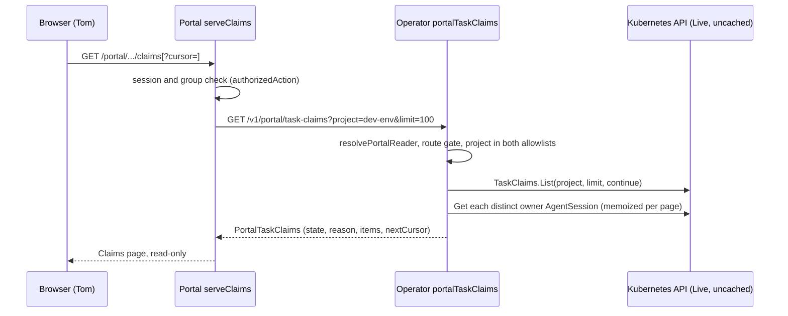

# DESIGN-045: A read-only Claims view in the portal

- **Status:** Proposed; documentation only, 2026-11-02.
- **Tracking:** [Story OP359](https://work.haynesnetwork.com/work_packages/359)
  (parent #120), a consumer of the canonical shared-claims story
  [OP322](https://work.haynesnetwork.com/work_packages/322).
- **Builds on:** [DESIGN-010](010-atomic-task-claims.md),
  [DESIGN-029](029-portal-foundations.md), [DESIGN-041](041-upgrade-attempt-claims.md).
- **Base:** `main` at `071f20c`. Implementation waits for PR #850, which owns
  `server.go` and `production.go` today (section 8).

## 1. Goal and non-goals

Tom opens one portal page and sees who owns which task, the owner's current
state, and since when. The page lists the project's existing TaskClaims. It is
read-only and uses the portal's existing operator token.

Non-goals: claim writes, release, takeover or reassignment; grants and
approvals; archived claims (`archived=only`); a Tasks-view join; actor and
provenance detail; any read of inbox, published context, directory or
transcript stores. No new credential, RBAC, network policy or CRD.

## 2. What exists

- `listTaskClaims` (`internal/apiserver/taskclaims.go`) serves
  `GET /v1/task-claims`. Its `claimReadScope` calls `claimCaller`, which admits
  only sessions and coordinators. The portal-reader switch in `serve()`
  (`server.go`) refuses the portal reader before that.
- `resolvePortalReader` (`portal_reader.go`) proves the pod-bound token of
  `dev-agents/dev-env-v2-portal` against the live pod.
- `sessionTaskClaims` (`session_taskclaims.go`) returns
  `apiv1.SessionTaskClaims{State, Reason, Items}` to `agent-run show`.
- The question audit (`portal_question_audit.go`) is the model: its own flag,
  a subset project list, one gate checked in `Handler()` and in `serve()`.

**Reuse of `SessionTaskClaims`.** Reuse its words and its rule: `State` is
`Available` or `Unknown`, and an Unknown `Reason` (`Unconfigured`,
`ScopeUnconfirmed`, `Unavailable`) never means "no claims". Do not reuse the
type. It has no cursor, because `ListOwned` reads one owner's claims (up to
4096) at once; a project list needs pages. Its items are full `apiv1.TaskClaim`
values with the actor's ServiceAccount, pod name and pod UID and the catalog
and rules revisions, where the portal gets an allowlist, as in DESIGN-029.
`ClaimBinding` is for maintenance grants only. Changing the type would change
the `agent-run show` wire shape. So the route gets its own type with the same
words, plus `Empty` and paging.

## 3. Read path

**Route.** `GET /v1/portal/task-claims` (`apiv1.PortalTaskClaimsPath`, new
file). Only GET is registered; other methods get 405.

**Query.** Strict, like `portalPageQuery`. `project` is required and must pass
`projectcatalog.ValidName`. `limit` is 1 to 100 in canonical decimal, default
50 (`portalPageDefault`, `portalPageMax`). `cursor` is optional: base64url JSON
`{continue, project, limit}`, at most `portalCursorMax` (2048) bytes, refused
when its project or limit differs from the request (so one project's listing
never resumes from another's position). Any other key, a repeated key, `;` or a
non-canonical path is 400. One store page per request, never a refill loop.

**Store.** `s.TaskClaims.List(ctx, project, limit, continue)`: one uncached
project-label list. Any store error, an expired continue token included, makes
the whole page `Unknown`/`Unavailable`. No partial items.

**Owner state.** One `s.Live.Get` per distinct owner (namespace, name, UID) on
the page, memoized: at most 100, as `listTaskClaims` does today. The owner
must be in `s.Policy.SessionNamespace`. `claimView` folds every miss into
`Unknown`; this projection does not. `owner.state` is `Deleting` when the
same-UID Session has a deletion time, else its phase (`Pending`, `Running`,
`Idle`, `Draining`, `Suspended`, `Archived`, `Failed`). It is `Replaced` when
the name now has another UID, `NotFound` on a not-found Get, and `Unknown` on
any other error or an empty or unrecognized phase. `owner.freshness` follows
`portalSummary`: a heartbeat within `portalFreshFor` (15 minutes) is
`observed`, older is `stale`, missing or future is `unknown`. A future
`heartbeatAt` is never sent. The portal learns nothing new here:
`listPortalSessions` already lists every session in `dev-agents`.

**Projected fields.** Per item: claim `name`, `uid`, `repository`, `taskKey`,
`github` (provenance owner/repo, only to build a link), `createdAt`, and
`owner {name, uid, state, freshness, heartbeatAt}`. Per page: `version`
(`portaltaskclaims.v1`), `project`, `state`, `reason`, `items`, `limit`,
`nextCursor`, `complete`, `observedAt`.

**Withheld.** The actor (kind, ServiceAccount, pod name, pod UID); catalog and
rules revisions; default branch; initial pin state; reported head and its
time; owner namespace; `stopState` (always `Unknown` today). The route reads no
message body, prompt, transcript, rules text, inbox, published context,
directory record, token or Secret. A response over 256 KiB is
`Unknown`/`Unavailable`, never truncated.

| `state` / `reason` | Meaning |
| --- | --- |
| `Available` / `Complete` | Any other successful read with no further page. |
| `Available` / `Truncated` | `nextCursor` is set. The page may hold zero items. |
| `Empty` / `Complete` | First page (no cursor), store page complete, zero items. |
| `Unknown` / `Unconfigured` | `claimsAvailable()` fails on this operator. |
| `Unknown` / `ScopeUnconfirmed` | `project` is not in both allowlists. No store read. |
| `Unknown` / `Unavailable` | The store read or the response bound failed. |

## 4. Authorization

- **New flags, default off:** `--enable-portal-task-claims` and
  `--portal-task-claims-projects=<list>` (`ParseTaskClaimReadProjects`).
  Parsing refuses them unless `--enable-portal-reader` and
  `--enable-task-claims` are set and every portal project is in
  `--task-claims-read-projects`. An empty list leaves the route unregistered.
- **Per request,** the handler rechecks the project against both lists and
  admits only `kindPortalReader`. It does not call or change `claimCaller` or
  `claimReadScope`.
- **No widening.** `/v1/task-claims` and `/{claim}` keep `coordinator: true`
  and stay refused to the portal reader. Session and coordinator scope do not
  change. The operator already has TaskClaim get/list and AgentSession get.
  The portal reuses `secrets/OPERATOR_TOKEN` and `ca/operator-ca.crt`.
- **Separate review.** Turning the flags on in haynes-ops is an operator
  authorization change, in its own reviewed PR (section 9).

## 5. The portal page

**Place.** A Claims page at
`/portal/projects/dev-env/environments/internal/claims`, with a "Claims" item
in `product-nav` and `product-mobile-nav` (`web/portal/views.html`). A Tasks
column is not possible yet: OpenProject ids do not map to claim keys
(Q-359-01).

**Config.** `config/claims.json` in the ConfigMap `dev-env-v2-portal-config`,
exactly `{"enabled":true,"project":"dev-env"}`, read like `config/asks.json`
(strict JSON, exact keys). Missing or `enabled:false` means no source.

**Read.** One request with `limit=100`. The portal follows no cursor itself; a
"Next page" link carries it. The page time is the operator's `observedAt`.

| Column | Content |
| --- | --- |
| Owner session | The name, linked to `SessionsPath?session=<uid>` when the UID matches `sessionUIDQuery`. |
| Task | The `taskKey`, with the repository under it. |
| Owner state | The label below. Every row also says the claim is held. |
| Since | `createdAt`, exact UTC in a `<time>` element, aged from `observedAt`, never the browser clock. |
| Tracker | `issue:<n>` links to `https://github.com/<github>/issues/<n>` when both parts pass the TaskClaim grammars. Other keys: "No tracker link" (Q-359-02, Q-359-03). |

| Wire owner state | Freshness | Label |
| --- | --- | --- |
| `Running`, `Idle` | `observed` | Active |
| `Draining` | `observed` | Draining |
| `Pending` | any | Starting |
| `Running`, `Idle`, `Draining` | `stale` | Stale since <heartbeat> |
| `Running`, `Idle`, `Draining` | `unknown` | Unknown (no heartbeat) |
| `Suspended` | any | Suspended |
| `Archived`, `Failed`, `Deleting` | any | Ended (phase shown) |
| `NotFound`, `Replaced` | any | Owner not found |
| `Unknown`, or any word not in this table | any | Unknown owner |

**Order and counts.** A complete page is sorted newest first. A truncated page
keeps store order and says "More claims exist. Order is not sorted across
pages." One line counts the labels on this page. It is never a project total.

| Condition | Page text (summary) |
| --- | --- |
| No portal config | Claims are not connected. |
| HTTP 401 or 403 | The operator refused this read. No claims are shown. This is not an empty list. |
| HTTP 404 | This operator does not serve claims to the portal. |
| HTTP 400 or 5xx, timeout, bad body, `Unknown`/`Unavailable` | Claims could not be read. Unknown, not empty. |
| `Unknown` / `Unconfigured` | Claims are not enabled on the operator. |
| `Unknown` / `ScopeUnconfirmed` | dev-env is outside the portal's claim scope. |
| `Empty` | No TaskClaims recorded for dev-env at <time>. Work without a claim is not shown. |
| `Available` | The table, plus "Next page" when truncated. |

The page has no form, button or POST route. Its style is a Go string beside
`viewsStyle`, like `asksStyle`, with no CSS comments: the CSP hash test breaks
on them.

## 6. Truthfulness rules

1. A claim is not a grant, an approval or permission to act. The page says so.
2. Claims are immutable. No label says released, free or available to take. A
   stale, ended or missing owner keeps the claim. Nothing transfers by TTL,
   staleness or a page action. Only coordination retention (DESIGN-024, off in
   the live operator) archives a claim.
3. Unknown is never shown as Active. Active needs a matching UID, `Running` or
   `Idle`, and a heartbeat within 15 minutes.
4. Empty comes only from a complete, authorized, first-page read. Every refusal
   or failure is a named Unknown state.
5. No process exit or task result marks a claimed task done here. Times come
   only from the source (`createdAt`, heartbeat) and `observedAt`; a future
   time is Unknown.

## 7. Test plan

Run suites one at a time through the Makefile (two CPUs, `nice -n 19`).

- **apiserver unit** (`internal/apiserver/portal_taskclaims_test.go`, fake
  client): unregistered when off; POST gets 405; the portal reader reaches only
  the exact GET path and is still refused on `/v1/task-claims` and `/{claim}`;
  other caller kinds refused; query strictness (repeated or unknown key, `;`,
  limit 0, 101 and `050`, bad or mismatched cursor, `RawPath`);
  `Unconfigured`; `ScopeUnconfirmed` with no store call; `Unavailable`;
  `Empty`; many (120 claims in three pages of 50, no duplicates); each owner
  state and freshness, one Get per distinct owner; the JSON key set equals the
  allowlist; the size bound. Flag tests in `cmd/dev-env-operator` cover each
  missing prerequisite, the subset rule, duplicates and `*`.
- **envtest** (`internal/apiserver/portal_taskclaims_envtest_test.go`, with the
  `askAPI.portal()` pattern of `asks_envtest_test.go`): real TaskClaim CRDs and
  a pod-bound portal token; paging on real continue tokens; a replaced portal
  pod and a session token both get 403.
- **Portal** (`web/portal/session/claims_test.go`, `web/portal/claims_test.go`):
  httptest TLS with a pinned CA; strict decode refuses unknown keys and words;
  each HTTP status, timeout and oversize body maps to its state; the token is
  read on each request; every page state and label renders; Unknown never
  renders "Active"; links go only to `github.com` and Sessions; nav
  `aria-current`; CSP hash; no form.
- **Preview and Playwright:** `web/portal/preview/claims.go` (`--claims <dir>`)
  writes synthetic `claims-empty`, `claims-many` (120, truncated),
  `claims-unknown-owner`, `claims-refused`, `claims-unavailable` and
  `claims-not-connected`. Playwright (MCP, `localhost`) checks each at 1280x800
  and 390x844: no horizontal overflow, cards on mobile, Claims in both navs.
  Screenshots go in the source PR.

## 8. Files and the #850 boundary

**New files:** `internal/apiserver/apiv1/portal_taskclaims.go` (path, version,
words, types, item check); `internal/apiserver/portal_taskclaims.go`
(`PortalTaskClaimsConfig`, `portalTaskClaimsEnabled`,
`registerPortalTaskClaims`, `portalTaskClaimsRoute`, handler, query, cursor,
owner projection); `cmd/dev-env-operator/portal_taskclaims_config.go`;
`web/portal/claims.go` and `claims.html`; `web/portal/session/claims.go`
(`ClaimsPath`, `ClaimsSource`, `optionalClaimsSource`, `serveClaims`, labels);
`web/portal/preview/claims.go`; and their tests. No new Go package, so the
CLAUDE.md Layout block does not change.

**Other edits, not frozen:** `web/portal/session/assembly.go` (a `Claims`
field and one route branch), `web/portal/views.html` (two nav links),
and `web/portal/preview/main.go` (`--claims`).

**Frozen-file edits, after #850 merges:**

| File | Place (at `071f20c`) | Edit |
| --- | --- | --- |
| `internal/apiserver/server.go` | `Server` struct, after `TaskClaimReadProjects []string` (line 122) | Add `PortalTaskClaims PortalTaskClaimsConfig` with a one-line comment. |
| `internal/apiserver/server.go` | `Handler()`, after the question-audit block (lines 267-269) | Add `s.registerPortalTaskClaims(mux)`. |
| `internal/apiserver/server.go` | `serve()` portal-reader switch, after the question-audit `case` (line 446; #850 adds a case above it) | Add `case s.portalTaskClaimsRoute(r):`. |
| `cmd/dev-env-operator/main.go` | flag registration and the `Server` literal | Add the two flags and the `PortalTaskClaims` field; the parsing lives in the new `portal_taskclaims_config.go`. |
| `web/portal/session/production.go` | `LoadProduction`, after the `optionalAsksSource` block (lines 185-188) | Add `claims, err := optionalClaimsSource(root, operatorCA)` and its `errProductionConfig` return. |
| `web/portal/session/production.go` | the `AssemblyConfig` literal (line 257) | Add `Claims: claims,`. |
| `web/portal/session/product.go` | `serveProduct`, where the page is built | Add `page.ClaimsNav = c.Claims != nil` (released to UI after #850). |

No edit to `apiv1/types.go`, `validate.go` or `allowance_reader.go`.

*Implemented 2026-11-02:* portal side in #855 (`b7aba1d`), operator route and
wiring in #856. The `serve()` case also checks `RawPath`.

## 9. Rollout

1. **Source PR (dev-env),** default off, with this design. Merging runs
   `publish.yml`, which signs `dev-env-operator` and `dev-env-portal` images.
2. **Operator PR (haynes-ops), alone and reviewed.** In
   `kubernetes/main/apps/dev-env-system/operator/app/helmrelease.yaml`, pin the
   operator image and add the two flags with `dev-env`. Its three prerequisite
   flags are already set. This is the authorization change. Rollback: drop the
   two flags.
3. **Portal PR (haynes-ops).** In `kubernetes/main/apps/dev-env-system/portal/app/`,
   pin the image in `deployment.yaml` and add `claims.json` to `config.yaml`.
   Rollback: drop the key. Step 2 first avoids a "not served" page; either
   order is safe, because a missing half shows a named state.
4. **Usable check.** Tom opens Claims. For one known claim, owner, task key and
   since match `agent-run show <owner>` and the owner `opwork show` records for
   that story. Record the evidence on OP359.

None of this touches v1's `dev-env/app/resources/**` or restarts an agent
session.

## 10. Questions

Each goes to Tom through the lead's phone route, one at a time. None blocks
the default-off source.

| ID | Question | Recommendation |
| --- | --- | --- |
| Q-359-01 | Claims page or a Tasks column? | A Claims page now. A Tasks column needs an explicit OpenProject-to-claim binding that does not exist. |
| Q-359-02 | How does a claim name its OpenProject item? Keys today are `issue:<n>` (GitHub) or `task:<key>`. | Adopt `task:op<id>` for claims made for an OpenProject story and link only that exact grammar. Until then, "No tracker link". |
| Q-359-03 | Link DESIGN-041 keys `task:upgrade.pr<N>.<head40>` to the GitHub PR? | Yes. The grammar is exact. Show the PR link and a short head. |
| Q-359-04 | A separate portal flag, or `--task-claims-read-projects` alone? | Separate and subset-checked, so widening claim scope never widens the portal by accident. |
| Q-359-05 | Show archived claims once coordination archive reads are on? | Not in v1. A later story, once `CoordinationArchiveReads` is live. |
