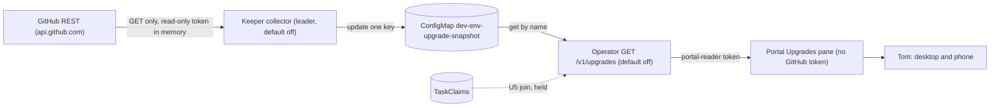

# DESIGN-046: A read-only Upgrades pane in the portal

- **Status:** Proposed; documentation only, 2026-11-02. Nothing is built or activated.
- **Tracking:** [Story OP360](https://work.haynesnetwork.com/work_packages/360), Epic
  #173. Dependency [OP325](https://work.haynesnetwork.com/work_packages/325) (claim-state
  source). Reference inventory [OP317](https://work.haynesnetwork.com/work_packages/317)
  (Accepted; report journal 3765, completion 3770).
- **Builds on:** [DESIGN-041](041-upgrade-attempt-claims.md) (claim key and join),
  [DESIGN-045](045-portal-claims-view.md) (portal claim route), [DESIGN-031](031-pages-lookup.md).
- **Source examined:** dev-env `071f20c23c1ad78d65400fca0aa5529934063653`; haynes-ops
  `e3925621805df55c135b19454ac864e49487c5c6` (main, 2026-11-02).
- **Constraints (OP360):** read-only. No new GitHub credential in the portal without
  explicit approval. No merging, rerunning or enabling automerge.

## 1. Goal and non-goals

Tom opens one portal page and sees every open upgrade PR in the listed repositories.
Each row gives the repository, PR, update, state, canonical claim owner, since, an
evidence link and the source observation time. The states are pending, in progress,
stuck, failed checks, held, manual-only and Unknown. Holds and manual carve-outs are
shown and never changed. Tom can check the page against an OP317-style inventory
taken at the same time.

Non-goals:

- No actions: no merge, rerun, label edit, approval, Dependency Dashboard checkbox or
  automerge control. Links open GitHub pages only.
- No GitHub token, GitHub client or GitHub egress in the portal.
- No new ownership store. Owners come only from DESIGN-041 TaskClaims.
- No hosted-extraction or manager coverage audit; that matrix stays in OP325. No
  self-hosted Renovate. No copy of the haynes-ops disposition classifier's rules.

## 2. What exists

- The portal reads the operator as `portal-reader` (`resolvePortalReader`,
  `internal/apiserver/portal_reader.go`); the portal switch in `Server.serve` admits it
  on a fixed route list. The portal has no GitHub reader. `claimCaller`
  (`taskclaims.go`) refuses it; DESIGN-045 proposes `GET /v1/portal/task-claims`.
- The operator makes no GitHub call, and its egress policy (haynes-ops
  `network/app/operator.yaml`) names no GitHub host. It can create, delete and exec pods.
- The keeper mints the haynes-dev-bot token with `GitHubApp.Mint`
  (`internal/keeper/github.go`), down-scoped to `DefaultDevBotPermissions`. A
  permission the App lacks fails the mint with 422. Its egress policy
  (`network/app/keeper.yaml`) allows `api.github.com` and no other GitHub host. Its
  leader-only work sits behind default-off `--enable-*` flags (`cmd/dev-env-keeper/main.go`).
- The keeper keeps a bounded JSON document in a GitOps-created ConfigMap
  (`ConfigMapNoticeStore`, `notifier.go`; haynes-ops `secrets/app/keeper-notices.yaml`,
  created empty with `ssa: IfNotPresent`; Role `get, update, patch` on that name only).
- The operator has default-off cached-read routes with exact bindings
  (`ProviderSourceReports`, `AggregateAllowanceReports`). The portal enables a source
  with a mounted file such as `config/pages-alertmanager.json` (`session/pages.go`).
  `internal/pages/response.go` defines `CanonicalClaimReference` and `ClaimOwner`.
- haynes-ops `.github/workflows/pr-disposition.yml` runs at `17 */2 * * *`. It gives
  each open `renovate[bot]` PR one `disposition:*` label. It reads current-head
  `<!-- shepherd-vet sha=… -->` verdicts by `haynes-ops-bot[bot]`, and logs
  `claim: 'Unknown'`, `claimBasis: 'no-supported-upgrade-claim-actor'`. Its reasons
  exist only in job logs, which redirect off `api.github.com`.
- haynes-ops `.renovate/holds.json5` records each hold as a `packageRule` whose first
  `description` line starts with `HELD`.

## 3. Backend source options

| | A. Keeper snapshot, operator serves it | B. Upgrade-attempt claims only | C. Operator reads GitHub |
|---|---|---|---|
| Lists pending, failed, held PRs | Yes | No. Claims exist only for claimed heads; none exist for haynes-ops (Q-325-01 held) | Yes |
| Token in the portal | None | None | None |
| New credential use | Keeper mints a read-only token from the App it holds; memory only | None | A GitHub token in the operator |
| New RBAC or egress | Keeper update and operator get on one ConfigMap. No egress change | Portal claim scope (DESIGN-045) | Secret or App key mount and `api.github.com` egress for the operator |
| Owner column | Joined from B in stage U5 | Yes, for claimed heads | Same join as A |

**Recommendation: A, with B as its owner join (U5).** The keeper already holds the
App key and the GitHub egress. The operator stays free of GitHub credentials. The
portal reads one more exact GET with its existing token. Every session can already
read ConfigMaps and already holds the same installation's token, so the snapshot
widens no read. Rejected variant: the portal reads the ConfigMap itself. That adds
Kubernetes RBAC to the portal and skips the portal-reader switch.

## 4. Collector

One pass every 30 minutes (Q-360-03). Every request is a GET to `api.github.com`:

1. `GET /installation/repositories`: is each listed repository installed or archived?
2. `GET /repos/{r}/pulls?state=open`: keep `renovate[bot]` PRs and the classifier's
   `isShepherd` PRs (`haynes-ops-bot[bot]`, head ref `shepherd/`).
3. Per PR, `pulls/{n}` at the start and end of its reads. A changed head, labels,
   `auto_merge`, draft or comment count makes the row Unknown, as in the classifier.
4. `commits/{head}/check-runs` and `commits/{head}/status`.
5. `issues/{n}/comments`. Keep only parsed marker fields: current-head `shepherd-vet`
   verdicts by `haynes-ops-bot[bot]`, and DESIGN-041 `upgrade-claim` markers by listed
   producer accounts. Comment bodies are never stored.

Bounds: 25 repositories, 300 rows, 300 requests and 512 KiB per pass, 10 seconds per
request, ETags where GitHub returns them. GitHub counts all tokens of one installation
against one rate limit, which every session's `gh` shares; 30-minute passes stay under
600 requests an hour. Past a bound, the remaining repositories are `BudgetExhausted`.
The token is minted per pass, kept in memory, never logged and never written.

## 5. Snapshot and row model

Document `upgrade-snapshot/v1`: `collector` (build from `internal/version`),
`window.startedAt` and `window.completedAt` (collector clock), `repos[]`,
`rows[]`, `droppedRows`, `requestsUsed`. Each repo has `name`, `coverage`
(`Read`, `Unreadable` with HTTP status, `NotInstalled`, `Archived`, `BudgetExhausted`,
`Truncated`), `openUpgradePRs` (null unless `Read`) and its dashboard issue URL if found.

| Row field | Content and source |
|---|---|
| `repository`, `number`, `url`, `kind` | `owner/repo`; PR number; `https://github.com/...` link; `renovate` or `shepherd` |
| `title`, `headSha`, `draft`, `createdAt` | From `pulls/{n}`; title at most 200 characters |
| `update` | `dependency` (one parsed "Package" cell, else null), `updateType` (`type/*` label), `datasource` (`renovate/*` label); null fields render "Unknown" |
| `state`, `stateBasis` | Section 6; the basis names the evidence, such as `current-head-vet-hold` |
| `checks` | `condition` (`Passed`, `Running`, `Failed`, `NoChecks`, `Unknown`), success/skipped/failed/running counts, up to five failed names with run URLs, `statuses` (`Read`, `Denied`, `None`) |
| `autoMerge` | `enabled`, `disabled` or `Unknown`, by the classifier's `mergeState` rule |
| `dispositionLabel` | The `disposition:*` label, shown as a label only |
| `vet` | `sha`, `verdict`, comment URL, `createdAt`; null without a current-head vet |
| `claim` | `condition` (`Available`, `Superseded`, `Unknown`, `NotChecked`), `basis`, `reference` and `owner` in the `internal/pages` shapes; owner fields "Unknown" unless Available |
| `since`, `sinceBasis` | Source event time: `pr-created`, `check-completed`, `vet-commented`, `claim-created`, `hold-recorded`; null when none exists |
| `evidenceURL` | The link that proves the state; only `https://github.com` |
| `observedAt` | Collector clock at the row's last consistent read |

The operator answers `{snapshot, servedAt, ageSeconds, freshness}`. `freshness` is
`fresh` up to 60 minutes after `window.completedAt`, `stale` after that and `expired`
after 24 hours. A missing, damaged, oversized or wrong-version document answers
`{"availability":"Unknown","reason":…}`, as `ProviderSourceReports` does.

## 6. States

Precedence, first match wins: Unknown, held, failed checks, in progress, manual-only,
stuck, pending. A row that matches nothing is Unknown. Every other fact stays visible.

| State | Required evidence, at the PR's current head |
|---|---|
| Unknown | The default. A PR read failed, changed during the read or was cut by a bound; or the repository is not `Read`. Unknown checks block only failed checks, stuck and pending. |
| held | A `shepherd-vet` comment by `haynes-ops-bot[bot]` with verdict HOLD. For a no-PR row (U6), a `HELD` entry in the holds file at a pinned commit. |
| failed checks | A complete check read with a run concluded `failure`, `timed_out` or `startup_failure`. |
| in progress | A DESIGN-041 join that is Available. Never running checks, a running Job, a label or `predictedOwner`. |
| manual-only | A vet verdict that is neither AUTO-MERGE nor HOLD; or, after U7, a head-bound classifier record with a manual reason. |
| stuck | Open more than 7 days (OP317's "old"; Q-360-03) with none of the above. |
| pending | Open, complete reads, none of the above. |

Under these rules most haynes-ops PRs that are labelled `manual-only` show as stuck or
pending, with the label beside the state, until U7 lands. That is the true evidence.

## 7. Truthfulness rules

1. Unknown is the default. A row leaves it only when every read it needs completed,
   matched across the double read and fit the bounds.
2. A label is not a state. `disposition:*`, `type/*` and `renovate/*` labels are shown
   as labels. They never make a row held, manual-only, in progress or pending.
3. An owner comes only from an Available DESIGN-041 join. Otherwise the owner is
   Unknown with its basis. Unknown never means unclaimed. A `predictedOwner`, a Job
   result or a marker without a canonical read is not an owner.
4. Coverage is stated. A repository that is not `Read` is Unknown. Counts read "at
   least N" when any repository is Unknown. Empty requires every listed repository
   `Read`. A missing config or zero PRs does not prove hosted coverage (OP325).
5. No check runs and no statuses is "No checks", never passing. A contradictory check
   record (OP317's haynes-ops#3871 shape), or a `cancelled`, `stale` or
   `action_required` run, makes checks Unknown. Denied statuses do not: the row's
   checks are judged on check runs alone and labelled "Check runs only; commit
   statuses not readable". A failed check run still proves failed checks, but a row
   with denied statuses never shows "No checks" or "Passed" as complete.
6. Times come from GitHub, a TaskClaim or the collector's clock at the read. `since` is
   null when no source event exists. No time is interpolated or taken from the browser.
   A stale snapshot shows its age on every state. An expired one renders states Unknown
   and keeps the last recorded state as secondary text.
7. Holds and carve-outs are read, never edited. The pane has no form and no POST.

## 8. Portal page

**Place.** `/portal/projects/dev-env/environments/internal/upgrades`, with an
"Upgrades" link in `product-nav` (`web/portal/views.html`). The bottom `mobile-nav` has
five items and DESIGN-045 adds a sixth; a seventh gets about 49 px at 390 px, too
narrow for its label. On phones a "Pages | Upgrades" tab switch at the top of both
screens reaches it, and the Pages item stays current (Q-360-06). Links appear only when
`config/upgrades.json` is exactly `{"enabled":true}` in `dev-env-v2-portal-config`,
read like `config/asks.json`.

**Desktop (1280).** A source line: "Keeper snapshot · observed 14:05 UTC (12 min ago)
· 20 of 21 repositories read". A coverage banner names each Unknown repository and
its reason. State chips with counts filter the table: All, Unknown, Held, Failed
checks, Stuck, In progress, Manual-only, Pending. The table is grouped by repository,
sorted by precedence and then oldest `since`. Columns: PR, Update, State, Owner,
Since, Checks, Evidence. A second line holds labels, draft, auto-merge and the vet.

**Mobile (390).** The chips scroll sideways. Each row is a card: state and age, then
repository and PR, title, owner, since and evidence links. No table.

| Page state | When | Shows |
|---|---|---|
| Not connected | No portal config, or HTTP 404 | "The upgrades source is not connected." No counts |
| Refused | HTTP 401 or 403 | "The operator refused this read." Never an empty list |
| Unavailable | 5xx, timeout, `availability: Unknown`, bad body | "Unavailable. Unknown, not empty." |
| Empty | Fresh, every repository `Read`, zero rows | "No open upgrade PRs in 21 of 21 listed repositories, observed …" |
| Partial coverage | Any repository Unknown | Banner, rows and "at least" counts; zero rows say "in the 20 read; 1 Unknown" |
| Stale | Older than 60 minutes | Banner with age; each state reads "as of 12:01" |
| Expired | Older than 24 hours | States Unknown; last recorded state as secondary text |

State badges carry text, not color alone. Styles go beside `viewsStyle` with no CSS
comments; they break the stylesheet's CSP hash test.

## 9. Test plan

Suites run through the Makefile (two CPUs, `nice -n 19`), one at a time.

- **Fixtures.** Synthetic only, no real tokens. One mirrors OP317's shape: 33 rows in 4
  repositories, 7 failed checks, 13 older than 7 days, 3 `stranded` labels, 0
  auto-merge, one contradictory check record, two with no checks, one with denied
  statuses. Others: vet HOLD, vet decline, claim Available, Superseded and Unknown, a
  head race, a non-GitHub link (dropped), oversize, damaged, each page state.
- **Unit.** Pure package: every precedence pair; label-only rows never leave pending or
  stuck; unknown and case-variant keys refused; bounds; `since` never synthesized.
  Collector, against an httptest fake GitHub and fake clock: GET only, double-read
  races, paging, budget exhaustion, 403, 404, archived, no token in the ConfigMap or
  logs. Operator route: off is 404, exact GET, portal switch case, other callers
  refused, no writes, freshness at each boundary. Portal: each page state,
  `aria-current`, links only to `github.com`, CSP and focus tests, no form.
- **Preview and Playwright.** `go run ./web/portal/preview -upgrades <new dir>` writes
  one page per scenario; serve with `python3 -I -m http.server --bind 127.0.0.1`. Use
  the Playwright MCP at 1280x800 and 390x844: screenshots; `scrollWidth` no wider than
  the viewport; tab switch reachable; visible keyboard focus. Screenshots go in the PR.
- **Installed acceptance.** After U4, run a read-only OP317-style inventory inside one
  snapshot window. Per-repository counts, failed and held lists and auto-merge counts
  must match, or each difference is explained. Tom clicks through on desktop and phone.

## 10. Stories

OP360 budgets one implementation story; U1 is that story. U2 to U7 are follow-ups,
created search-first under Epic #173. OP360 acceptance needs U1 in a reviewed green PR,
U2 to U4 installed, then Tom's click-through against an OP317-style inventory.

| Story | Changes | Separate runtime or authorization |
|---|---|---|
| U1 Contract and pane on fixtures | dev-env: pure `internal/upgradeview` (schema, strict parser, state derivation, bounds, fixtures) with its CLAUDE.md Layout line; portal page, hidden nav and tab switch, preview scenarios, Playwright evidence | None; default off |
| U2 Keeper collector | dev-env: leader-only runnable behind `--enable-upgrade-snapshot` (default off); read-only mint; ConfigMap writer | None in source |
| U3 Operator route and portal read | dev-env: `GET /v1/upgrades` behind a default-off flag bound to one ConfigMap name; portal switch case; portal client. Edits `server.go` and `production.go`, so it follows PR #850 and DESIGN-045's source PR | None in source |
| U4 Activation | haynes-ops: empty ConfigMap (`ssa: IfNotPresent`, `prune: disabled`); keeper Role `get, update, patch` and operator Role `get` on that name; keeper and operator args; portal config; pins | **Yes**: Q-360-01 and Q-360-02, reviewed GitOps PRs; then installed evidence and Tom's click-through |
| U5 Owner join | dev-env: `/v1/upgrades` joins markers to TaskClaims by DESIGN-041 section 5, gated like DESIGN-045 | **Yes**: OP325's producer, Q-325-01 and Q-360-04 |
| U6 Config hold rows | dev-env: read `.renovate/holds.json5` at a pinned commit; one held row per `HELD` entry; entries outside the convention are not listed, and the coverage line says so | Needs `contents: read` in the U4 mint |
| U7 Classifier evidence | haynes-ops: the classifier publishes a head-bound disposition record readable on `api.github.com`; the collector reads it for manual-only | **Yes**: Q-360-05, reviewed workflow change |

None of these touch v1 `dev-env/app/resources/**` or restart an agent session.

## 11. Questions

The lead delivers each to Tom one at a time. None blocks U1, which is default off.

| ID | Question | Recommendation |
|---|---|---|
| Q-360-01 | May the keeper mint a second haynes-dev-bot token, down-scoped to `pull_requests`, `checks`, `issues`, `contents` and `statuses` read, held in memory for the collector only? | Yes. All but `statuses` are read-level subsets of `DefaultDevBotPermissions` (`internal/keeper/github.go`). `statuses` is not in that set, so first confirm the App holds `statuses: read`; a permission it lacks makes the mint fail with 422. Without it, U4 mints without `statuses` and rule 5's "check runs only" label applies. The alternative, reusing the write-capable token, is broader. |
| Q-360-02 | Which repositories does the pane list? | The OP317 accessible set without the archived one, plus `dev-env-templates`, so its 404 shows as Unknown. Keep the list in GitOps. |
| Q-360-03 | What cadence and stuck age? | 30-minute passes, stale after 60 minutes, stuck after 7 days (OP317's "old"). |
| Q-360-04 | May upgrade rows show canonical owners from haynes-ops claims? | Yes, after OP325's producer and Q-325-01, through DESIGN-045's subset-checked portal claim flag with `haynes-ops` listed. No new claim scope. |
| Q-360-05 | Should the classifier publish a head-bound disposition record, such as a neutral check run with its reason? | Yes, in its own haynes-ops story. Without it, manual-only comes only from vet verdicts. |
| Q-360-06 | On phones, a Pages/Upgrades tab switch or a seventh bottom item? | The tab switch. Seven items do not fit 390 px with labels. Tom judges it at click-through. |
