# DESIGN-054: Scheduled agent work

Date: 2026-11-04. OpenProject Story #397 ("Provider-neutral scheduled agent-work
executor"), with #396 (reminder MVP activation) and #206 (reminders with the
Workspace calendar), Epic #95. Builds on [DESIGN-032](032-reminders.md).
Owner: session `dev-env-1104-010332` (Opus 5.5 coordinator for reminders and
scheduled work).

## State: proposed design only

| Layer | State |
|---|---|
| Design | this document, proposed; revised after native independent and advisory reviews |
| Source | none yet; increments in "Delivery" below |
| Installed / usable | no. Nothing here is deployed, scheduled or sent |

## Requirements

Tom's statement (2026-11-04, relayed by the parent session `dev-env-1027-010058`;
recorded as input, not as an approval of any live step):

> "there need to be pushover notifications and we should use admin@haynesnetwork.com
> calendar to schedule and event and they can hold the state if we need or serve as
> a source for the reminder. We should also be able to have tasks kick off at the
> scheduled time that use a dev-env-ops style agent to open a remote session and
> interact with me on whatever work was scheduled. Or it could be headless if I'm not
> needed in the loop"

From that statement and OP206/OP396/OP397:

| ID | Requirement |
|---|---|
| R1 | A scheduled item notifies Tom by Pushover when it is due (DESIGN-032's `pushover:default`). |
| R2 | A scheduled item can appear as an event in the admin@haynesnetwork.com calendar. |
| R3 | Calendar events may be a source **for reminders**: Tom adds an event and a reminder results. |
| R4 | At its due time a scheduled item can start agent work: **interactive** (a remote session Tom joins from his phone, the dev-env-ops pattern) or **headless** (a task session that reports a result). |
| R5 | Due time is local wall time in an IANA zone, with DESIGN-032's DST and recurrence rules. |
| R6 | Durable, idempotent, deduplicated: a restart, failover, replay or retry never loses an occurrence and never starts its work twice. |
| R7 | At due time, authority, expiry and provider availability are checked again. Nothing stored at creation (a token, a quota reading) is trusted. A failed check parks the occurrence with a reason and tells Tom. |
| R8 | Every occurrence has an accountable receiving owner and a recorded result, including no-op, parked and failed. |
| R9 | Scheduling grants no authority. Dispatch uses the operator's existing session creation path and its limits. |
| R10 | A notification alone is not an executor; a calendar event alone is not a claim. |

## Decisions

1. **A separate `ScheduledWork` resource, not a new Reminder target.** Starting agent
   work needs its own fields, RBAC and authority checks; a Reminder only sends a
   message. `ScheduledWork` reuses `internal/reminders`' schedule arithmetic
   (`Resolve`, the occurrence iterator, the gap and fold rules). S2 generalises
   `ScheduleOf`, which takes a `ReminderSpec` today, to take the shared schedule
   fields.
2. **The executor runs in the operator, leader only**, behind a default-off flag,
   `--enable-scheduled-work`. The operator owns session creation and already
   creates sessions on its own (`internal/standby`). It reads with the API reader
   (uncached), as the reminder routes do.
3. **The CRD is the state of record. The calendar is a projection only** for
   scheduled work (R10). Calendar intake is for reminders (R3), never for agent work.
4. **No stored credentials, and no authority beyond the owner's.** The executor
   never holds or reuses a caller's token. It never dispatches with more reach than
   the owner could have used itself at the due time (see "Authority").
5. **Pages go through Reminders.** The operator has no Pushover sender; the keeper
   does. Each page is its own one-shot `Reminder`, keyed by (occurrence, event,
   attempt): `due`, `link`, `parked`, `failed`, `result` or `skipped`. A sent Reminder is final and is
   never reused. The keeper sends it with DESIGN-032's claim-before-send. The
   occurrence keeps a bounded `pages` list with each Reminder's name and delivery
   state (`sent`, `failed`, `ambiguous`). **Pages are best-effort.** Failing to
   create a page Reminder, or the Reminder kind not being served (the releaser runs
   even with the flag off), is recorded as `skipped` on the occurrence. It never holds
   a finalizer, a claim or a state change.

## Data contract

```yaml
apiVersion: dev-env.haynesops.com/v1alpha1
kind: ScheduledWork
spec:
  title: "Loki retention trend audit"        # 1-120
  owner: human/dev-env-system/tom            # set by the API from the token, immutable
  due: "2026-12-03T09:00"
  timeZone: America/New_York
  recurrence: {...}                          # DESIGN-032 shape; absent = one-shot
  notAfter: "2027-02-01T00:00:00Z"           # required; at most 180 days after creation
  mode: headless | interactive
  work:
    template: ops-audit                      # names an entry in the scheduled-work ConfigMap
    repo: haynes-ops                         # must be allowed by the template
    prompt: "..."                            # <= 8 KiB, the work order
  notify: [pushover:default]                 # DESIGN-032 targets
  calendar: calendar:haynesnetwork           # optional projection, through a companion Reminder
  editor: human/... | session/<name>/<uid>   # written by the API in the same write as every spec change
  cancelled: false                           # set by cancel; a schema rule stops it being undone
status:
  approval:                                  # written only by the API's human approve route
    by: human/...
    at: ...
    specHash: <sha256 of every spec field except editor and cancelled>
  nextDue: ...                               # as DESIGN-032
  planHash: ...                              # as DESIGN-032; an edit re-plans from now
  counts: {succeeded, failed, parked, skipped, ended, ambiguous, cancelled}  # lifetime; skipped adds `missed`
  occurrences:                               # a map keyed by `at`; newest 50 terminal ones kept; non-terminal ones are never pruned
  - at: "2026-12-03T14:00:00Z"
    state: Pending|Claimed|Dispatched|Delivered|Opened|Running|Succeeded|Failed|Ended|Parked|Skipped|Ambiguous|Cancelled
    delivery: accepted|refused|ambiguous     # interactive work-order delivery; a note, not a state
    reason: "..."
    claimedAt: ...
    retriedAt: ...                           # set by a human approve or retry of a Parked occurrence
    attempt: 0                               # 0, then +1 on each approve or retry; at most 3 (a fourth retry is refused)
    missed: 1                                # how many due times one Skipped record stands for (outage collapse)
    session: sw-1a2b3c4d5e6f-202612031400
    specHash: <sha256>                       # the authority-carrying spec fields at claim (as approval.specHash)
    execution: {state, reason}               # headless: copied from Session status.taskResult (Succeeded|Failed|TimedOut|Unknown)
    reported: {summary, prURLs, headSHAs}    # headless: the agent's own retained outcome; a claim, not validated
    pages:                                   # at most 8, keyed by (event, attempt); when full, the oldest attempt's entries are dropped (their Reminders remain)
    - {event: due|link|parked|failed|result|skipped, attempt: 0, reminder: <name>, state: sent|failed|ambiguous|skipped}
```

`approval` is in **status**, not spec. Only the operator's `POST .../approve`
route, for a human caller, writes it. `specHash` covers every spec field except
`editor` and `cancelled`, so any edit Tom did not see (including `notify`,
`calendar` and `title`) changes it, and the
approval no longer matches and is void.

**Who may edit.** Only the owner or a human may edit a spec. A coordinator may
cancel, but not edit (unlike the reminder routes, where any coordinator may edit).
The API sets `spec.editor` to the caller in the same write as the spec change, so
the two cannot diverge. Admission lets only the operator's ServiceAccount write
`scheduledworks`, so no one else can set `editor`. A standing basis (below) holds
only while `spec.editor` is that basis's own principal. So an edit by anyone but
the owner turns the item into one that needs Tom's approval for that exact spec. A haynes-ops ValidatingAdmissionPolicy
admits create, update and status writes on `scheduledworks` from the operator's
ServiceAccount only. The keeper and every other identity get no write.

**Schema guards (S2).** The CRD itself enforces these, so a buggy executor cannot
break them: a terminal occurrence state never changes; an occurrence's `session`,
`specHash` and `reported` are set once; `attempt` never decreases and is at most 3;
`retriedAt` needs `attempt` > 0; `missed` only on `Skipped`; at most 8 pages per
occurrence, keyed by (event, attempt), trimmed by `AppendPage`, which drops the
oldest attempt first and never fails; interactive work needs at least one `notify`
target; `owner` and `editor` match `^(human|client|coordinator|session)/[^/]+/[^/]+$`.
That `delivery` appears only on interactive work is left to the executor, because an
occurrence rule cannot read the mode at claim time.

**Dispatch templates** are GitOps data in their own ConfigMap,
`dev-env-system/dev-env-scheduled-work`, not in `dev-env-templates`. Putting them
there would change the templates revision and drain every idle session, and an
older operator would refuse the whole document. Each template fixes the agent,
model id, effort, size, profile, allowed repos, maximum duration (headless), and the bases it admits (`human`, `session`, `approved`). The
request names a template; it cannot raise any of these. With no ConfigMap, the
executor dispatches nothing. A template for "dev-env-ops style" interactive work
uses the existing `ops` profile. The operator image that reads the ConfigMap ships
before the data (S6).

## Authority (R7, R9)

An occurrence dispatches on exactly one of these, checked at the due time:

| Basis | Condition at due time | Session is created as |
|---|---|---|
| **Human owner** | `spec.editor` is the owner, and the template admits `human` | the operator's client identity `client/dev-env-system/scheduled-work`, within the template's fixed bounds |
| **Human approval** | `status.approval.specHash` equals the current spec's hash, and the template admits `approved` work (a template's admitted classes are `human`, `session` and `approved`). The owner's own class is not checked, because Tom approved this exact spec; that is how client and coordinator owners run | the same client identity, within the template's fixed bounds |
| **Live session owner** | `spec.editor` is the owner; the owner session (by UID) is **proven live**: operating mode Running, phase Running or Idle, a heartbeat within the staleness bound, and not ended by the session-end rule below. A drain onto a new revision is neither live nor ended. This basis is checked **before the claim**, like the caps: while the owner is unproven the occurrence stays `Pending`, and when grace ends it goes to `Parked`. An unproven state never grants authority; the template admits `session` | **a child of the owner**, through the same validation as if the owner created it now: its profile, depth, per-parent child cap and mode rules all apply |

Anything else parks with reason `no standing authority`, and Tom is paged. He can
approve it, which binds his approval to the spec he saw. A suspended or ended
coordinator's authority does not outlive it. Client and coordinator owners (the v1
pod's agents are clients) have no basis of their own and always need approval. The
client identity is never a way around a session's limits, because a session owner
without approval dispatches as its own child.

## Occurrence lifecycle

```mermaid
stateDiagram-v2
  [*] --> Pending
  Pending --> Claimed: due, caps free and the authority basis holds; CAS on resourceVersion
  Pending --> Parked: grace ended while the live-owner basis stayed unproven
  Pending --> Cancelled: cancel before claim
  Pending --> Skipped: missed beyond grace, notAfter passed, previous still running, or at capacity until grace ends
  Claimed --> Parked: revalidation check 2 or later fails
  Claimed --> Cancelled: item cancelled at revalidation
  Claimed --> Skipped: notAfter passed at revalidation
  Claimed --> Dispatched: session created or adopted
  Claimed --> Skipped: no session and grace ended before a create
  Claimed --> Ambiguous: derived-name session lacks the matching UID label or occurrence annotation
  Dispatched --> Running: headless session Running
  Dispatched --> Failed: not Running (headless) or Ready (interactive) by due + grace
  Dispatched --> Succeeded: headless taskResult Succeeded (also a fast task never seen Running)
  Running --> Succeeded: headless taskResult Succeeded
  Dispatched --> Failed: headless taskResult Failed or TimedOut, or session reaped with no taskResult
  Running --> Failed: headless taskResult Failed or TimedOut, or session reaped with no taskResult
  Dispatched --> Ended: headless taskResult Unknown (exit 0 with no success event)
  Running --> Ended: headless taskResult Unknown
  Dispatched --> Delivered: interactive, delivery attempted (accepted or ambiguous)
  Dispatched --> Failed: interactive delivery refused (409) for 10 minutes after Dispatched
  Dispatched --> Ended: interactive session ended before delivery
  Delivered --> Opened: Remote Control state registered, link paged
  Delivered --> Failed: Remote Control state login-required
  Delivered --> Ended: session ended (never registered)
  Opened --> Ended: session ended
  Parked --> Claimed: human approves or retries (opens a fresh window from retriedAt; the cap check applies as for any claim)
  Parked --> Skipped: no human action within the decision window
```



- **Headless results come from `status.taskResult`, never from the phase.** A
  session's phase is its pod's: a session whose pod ended is `Failed` whatever its
  task did (D-44). So a fast task that succeeds before `Running` is ever observed
  shows phase Failed. The occurrence's terminal state follows `taskResult.state`:
  `Succeeded`, `Failed` or `TimedOut` map to `Succeeded`, `Failed`, `Failed`, and
  `Unknown` (exit 0 with no success event) maps to `Ended`. A session that ended or
  was reaped with no `taskResult` is `Failed` ("ended without a task result").
  `Succeeded` means only that the task process reported success. The agent's
  retained outcome (`reported`) is its own claim about the work. The executor copies
  it and does not validate it; the receiver judges the work. A page for a result
  says "reported", never "done".
- **Claim.** The leader changes `Pending` to `Claimed` with a compare-and-set on the
  object's resourceVersion, as DESIGN-032 claims a reminder occurrence.
- **Exactly-once dispatch.** The session name is derived, not generated:
  `sw-<first 12 hex of the ScheduledWork UID>-<occurrence UTC YYYYMMDDHHMM>`. The
  create itself refuses a duplicate (`AlreadyExists`). A deposed leader's late
  create and a new leader's create cannot both succeed; the loser adopts the
  winner's session. The session also carries the label
  `dev-env.haynesops.com/scheduled-work=<full uid>` and the annotation
  `dev-env.haynesops.com/scheduled-work-occurrence=<unix seconds>`, and the
  annotation `dev-env.haynesops.com/scheduled-work-name=<ScheduledWork name>` that
  the releaser reads, all set in the atomic Create. Adoption checks
  both. A derived-name session whose label or annotation does not match (a prefix
  collision) is never adopted: the occurrence is `Ambiguous`. A matching session
  found while its occurrence is already terminal is left alone (no redispatch; the
  releaser handles its finalizer). The fixed-name entry point is new. It must run
  everything `createSessionMode` runs (canary and pilot refusal, named-coordinator
  admission, depth and child caps), not only `newSession`, which is all
  `CreateStandby` calls.
- **The guarantee is at most one agent launch per occurrence** (S3b1 review,
  2026-11-04). Two overlapping leaders can both reach the create: a stalled or
  deposed leader's create can be in flight for as long as it stalls. The derived
  name alone stops a second create only while a session holds it. So:
  1. The releaser never lifts the finalizer before the session's start deadline
     plus a release margin (`scheduledwork.ReleaseMargin`, 2 minutes), whatever
     the reason for the release. It writes the occurrence's record at once; only
     the release waits. The blocked gauge leaves this expected wait out.
  2. The fixed-name entry checks the API's clock right before the Create. Past
     the start deadline it creates nothing (`ErrPastStartDeadline`), and the
     occurrence is `Skipped` ("not created before grace ended").
  3. agentd refuses a first launch past the deadline, by the node's clock (S3c).

  A late create therefore either finds the name taken and adopts that session,
  or comes after the deadline plus the margin, when agentd refuses its launch.
  This holds while the operator-to-node clock skew is under the margin. It is
  not "exactly one create": a second session object can exist and fail to
  start, and it is recorded like any session that ended.
- **Launch gate.** Before the first pod of a session that carries the
  scheduled-work label (its volume does not exist yet), the reconciler reads the
  ScheduledWork uncached. It refuses the session as invalid (`SessionInvalid`:
  phase Failed, no pod, no volume) when its occurrence would never record it:
  - the item is gone or was recreated;
  - it records no occurrence at that instant;
  - the occurrence names another session;
  - the occurrence is already final without naming this one.

  The last case is a stalled leader's create that landed after the live leader's
  final record. A failed read leaves the session waiting. No session without the
  label is read, and pods are unchanged. When such a session is released, the
  releaser logs it and counts it in `dev_env_scheduled_work_late_sessions_total`
  (`AlreadyTerminal` with an empty `session`).
- **A created session cannot vanish unrecorded.** The session is created with the
  finalizer `dev-env.haynesops.com/scheduled-work-retained` in the same atomic
  Create, as `ProjectCanaryFinalizer` does (`apiserver/project_canaries.go`). It is
  removed only by the **releaser** (below), and only after that occurrence's terminal
  state and result are in the ScheduledWork status, written with a compare-and-set.
  So whenever a
  session with the derived name has ever existed, either it still exists or its
  occurrence already carries a recorded outcome. A reaped session's rescue and
  archive run first and are unchanged; the finalizer only holds the object until the
  record is written.
- **Claimed without a session** (a crash between claim and create, or a lost create
  response). The claimer reads with the uncached API reader, never a listing cache.
  If the derived name is absent **and** the occurrence still has no recorded
  outcome, then by the rule above no session was ever created. The claimer runs the
  revalidation again (it may be stale) and creates, while the occurrence is still
  inside its grace period, counted from the due time. After grace it is `Skipped`
  ("not created before grace ended"). Nothing is unknown here, so it is not
  `Ambiguous`. The latest any work starts is the due time plus grace. A recorded
  outcome is never followed by a new create, and an ended session is never recreated
  or resumed.
- **The session-end rule.** A scheduled session has ended when **any** of these
  holds:
  - its operating mode is Suspended, or its phase is Suspended, Failed or Archived;
  - for task mode, a task verdict exists: `status.taskResult`, or until the
    reconciler writes it, the same verdict derived from `agent.task` (a test pins the
    two derivations together). The retained outcome alone is not an end, because it
    can be written before the verdict;
  - its phase is Running or Idle and `standby.AgentEnded` holds with the pod-age
    proof (`unprovenAgentEnd` false). That keeps its booting and drain guard: an
    agent restarted by a drain onto a new revision is not an end.

  `standby.AgentEnded` alone is not enough, because it returns false for every
  suspended session. Without the first clause, an idle suspend would never end an
  occurrence, free a slot or release a finalizer. The executor (`Ended`, `Succeeded`,
  `Failed`, the caps) and the releaser use this one rule. A suspended interactive
  session that Tom resumes later is outside the occurrence; its outcome stays
  `Ended`.
- **The releaser, and why the finalizer cannot strand a session.** The release path
  is part of the AgentSession reconciler, which always runs. It is **not** behind
  `--enable-scheduled-work`, and it is not the executor runnable. It acts only on a
  session that carries the finalizer and has ended by the session-end rule, or that is
  being deleted. It never deletes, suspends or changes a session in any other way, so
  active user work is untouched. For each such session it:
  1. reads the owning ScheduledWork, uncached, in the operator's namespace
     (`dev-env-system`, where the Reminders are; the executor and API create items
     there), by the name in the session's annotation
     `dev-env.haynesops.com/scheduled-work-name`, and checks its UID
     against the label (a Get by UID does not exist). A UID mismatch means the item
     was deleted and recreated under the same name, which counts as deleted;
  2. if the occurrence has no terminal state yet, writes one with a compare-and-set:
     the headless outcome from Session status, `Ended` ("participation not
     observed") for interactive even when reaped, or `Failed` "session reaped before
     it ended" for a headless session being deleted with no task verdict (unless its
     operating mode is Suspended). Status cannot show whether deletion or the end came
     first, so the verdict decides. A session past its start deadline is `Failed`
     "not started before grace ended" in both modes only on positive evidence from
     agentd: its report of `agent.status` `failed` with `agent.message` =
     `protocol.StartDeadlinePassed`, the refused first launch (the heartbeat copies
     agentd's agent error into `agent.message`). Missing telemetry never counts: a
     session with no agent report is not proof that the agent never launched,
     because a heartbeat can be lost or late while the agent runs. Such a session
     gets the reason it would get anyway: "session reaped before it ended",
     "ended without a task result", or `Ended` "participation not observed" for
     interactive. The session's own mode, not the item's current `spec.mode`,
     decides headless or interactive. Because the heartbeat writes the task's exit
     and its reported outcome separately, the releaser keeps the finalizer a little
     longer after a task verdict so that a late `reported` is copied into the
     terminal record. The wait is one fixed window of the operator's clock, read
     from the session alone: from 10 seconds before to 2 minutes after the task's
     recorded finish (`agent.task.finishedAt`). No reconcile moves its end, so the
     wait lasts at most 2 minutes 10 seconds however often the session is judged,
     and a fresh operator reads the same window after a restart. A finish more than
     10 seconds ahead of the operator's clock (pod clock skew, a bad heartbeat) is
     not trusted: the releaser does not wait for it, and a late `reported` is then
     not copied. This is the exit for every non-terminal state, including
     `Delivered` and a delivery marked `ambiguous`. An occurrence that is absent, or
     that names another session, is released with no record. A missing or
     unreadable label or annotation keeps the finalizer, and so does a session name
     that is not the one its label and occurrence annotation derive
     (`sw-<first 12 hex of the item UID>-<occurrence UTC YYYYMMDDHHMM>`);
  3. if the ScheduledWork no longer exists (a person deleted it; the API offers only
     cancel), there is nothing to record, and nothing can redispatch it. It logs that
     and goes on. A NotFound counts as deleted only when it is the API server's
     answer for this item and an uncached read shows the CRD still exists. The
     answer must be a Status whose details name the item in the `scheduledworks`
     resource of this group. A NotFound without those details does not count, and
     neither does the plain-text 404 the API server gives for a version it does not
     serve: client-go fills that error's details from the request, so only its
     `UnexpectedServerResponse` cause tells it apart. With the CRD present, either
     one is held as an unserved kind. Once the CRD is removed, a cached mapping
     returns a plain NotFound, and that case follows the unserved-kind rule below. If the read fails because the kind is not served (`NoKindMatch` or a
     discovery error), that is **not** proof the objects are gone. It releases only
     when **both** of these hold: the session's own start-deadline annotation has
     passed (due plus grace, or `retriedAt` plus grace for a retried occurrence), so
     no executor will create for it again; and an uncached read of the CustomResourceDefinition
     returns NotFound. On any other error it keeps the finalizer and raises the
     blocked metric;
  4. removes the finalizer, once the session's start deadline plus the release
     margin has passed (see "The guarantee" above).

  A leader-only sweep lists labelled sessions uncached every 5 minutes and queues
  them to the reconciler, so a missed event cannot strand one. A finalizer holder
  that lost its label is not listed; its own events still bring it to the
  releaser, which holds it for its metadata and counts the hold. Metrics:
  `dev_env_scheduled_work_release_blocked` (a gauge computed from the cache at
  scrape time, the S6 page source: every session in the namespace that still holds
  the finalizer, with or without the label, after it ended or while being deleted.
  The end is judged with the cached pod where the session-end rule needs one, so an
  agent end the pod-age proof shows is counted) and
  `dev_env_scheduled_work_release_holds_total{reason}` (diagnosis only).
  Pages from the releaser are S4; S3a creates no Reminders. The releaser starts **no** watch or
  informer on ScheduledWork: S3a ships before S6 installs the CRD, and a watch on an
  absent kind would stop the manager from starting. The guard test that pins every finalizer
  removal site (`guard_test.go`) gains this site, and nothing else may remove it.

  The existing rescue and archive guards keep their own finalizer and order. The
  releaser waits on nothing they do, so neither waits on the other. Its cases:

  | Situation | Behaviour |
  |---|---|
  | Flag off, or executor never ran | the releaser still runs in the reconciler and releases |
  | ScheduledWork deleted | step 3: release without a record; nothing can redispatch it |
  | Status write keeps failing | the finalizer stays and the session stays Terminating. The reconciler exports `dev_env_scheduled_work_release_blocked`; a PrometheusRule in haynes-ops (S6) pages through the existing Alertmanager Pushover receiver. Releasing without the record would break the exactly-once rule |
  | Operator rolled back to an image without the releaser | see the rollout order below |

  **Rollout order and rollback rule.** The releaser ships in an operator release
  (S3a) **before** any image that can set the finalizer (the executor, S3b). So no
  image sets a finalizer that the running image cannot release. Rolling the operator
  back below S3a is supported only while no session carries the finalizer. The S6
  runbook gives the read-only check (`kubectl get agentsessions -n dev-agents -l
  dev-env.haynesops.com/scheduled-work`, which must be empty) and makes it a
  precondition of such a rollback. If someone rolls back anyway, the stranded
  sessions are released when the operator is rolled forward through GitOps. This
  design adds no manual finalizer patch and no new deletion authority.
- **Finalizer removed by hand.** No operator path strips the finalizer. If a person
  strips it, and the session is then deleted before the occurrence's grace ends, the
  executor cannot tell that from a create that never happened. This is the one stated
  limit. A haynes-ops admission rule (S6) admits removal of this finalizer from the
  operator's ServiceAccount only, so a person must first override that rule.
- **Acceptance tests (S3).** Envtest cases for: a lost create response
  (`AlreadyExists` → adopt); a session completed and reaped inside the occurrence's
  grace (counted from the due time)
  (outcome recorded first, no second create); session idempotence only while
  unfinished (no reliance on it); a stale cached listing (the uncached read is used);
  two leaders overlapping (one create wins, the other adopts); and an executor
  restart at every state.
- **Start deadline, enforced in the pod.** The executor creates each scheduled
  session with a start deadline, the due time plus grace, as a session annotation.
  The controller passes it into the pod as it passes the task-budget deadline
  (`controller/pod.go`). agentd checks it **before any boot side effect**, as
  `armTaskBudgetDeadline` does (`agentd/task_budget.go`). It applies **only to the
  first launch**: agentd checks it only when the session has no launch record yet
  (`~/.agentd/launch.json` on the persistent volume, `agentd/launch.go`). agentd
  checks again at the first launch itself, because a boot that starts before the
  deadline can reach the launch after it (a slow clone, the project bootstrap). The
  last check follows workspace admission, which can wait up to
  `sharedGitAdminBudget` for the workspace's lock, and comes right before
  `StartAgent` writes `launch.json`. **The deadline bounds the launch record.**
  Once `launch.json` exists the session counts as launched: run-agent does not
  check the deadline again, and no later boot is refused. A remote session whose
  boot holds its agent (no usable login, or a login ceremony opening) has no
  launch record yet. The login poll checks the deadline while it holds; past it,
  agentd records the same failed boot (`start deadline passed`) and starts
  nothing, even when a login lands later. Codex remote sessions never write
  `launch.json`, so the controller refuses the annotation on them and agentd skips
  the check for them: scheduled sessions are Claude, or Codex task mode. The value
  must be RFC 3339 UTC ending in `Z`, at most 64 bytes, parsed by one shared
  `protocol.ParseStartDeadline`. A bad value, or the annotation on a Codex remote
  session, is a session agentd would refuse: the API's precheck
  (`CheckAgentdSession`) refuses it before a create, and the reconciler fails it
  (`SessionInvalid`, no pod, no volume), so its occurrence ends instead of
  waiting in `Pending`. The deadline reaches the pod as `AGENTD_START_DEADLINE`, set
  only when the annotation is present, so other pods are byte-identical. Golden
  digests, generated on the commit before S3c, pin the builder's pods and the
  reconciler's own (`sessionPod`: shared workspace, task budget, child decision,
  private history, original HOME, and each pilot and instruction image). A
  scheduled session runs only on the templates image: a pilot or instruction
  image may predate S3c, so on every pod build the reconciler keeps the
  templates image for a scheduled session. A build never fails for this, because
  a rebuild after the first launch must not end the session. The API refuses a
  scheduled session that asks for coordinator instructions, so nothing is lost
  silently. A session
  that started in time and boots again later (a drain onto a new revision, a
  preempted pod, Tom resuming it after an idle suspend) is never refused. If the
  deadline has passed before the first launch, agentd never launches the agent and
  does not exit, so the pod does not crash-loop. It reports boot as complete and the
  agent state as `failed` with `agent.message` = `protocol.StartDeadlinePassed`
  ("start deadline passed"), so `AgentEnded`
  (which is false while boot reads `booting`) and the session-end rule see an end
  once the 5-minute pod-age proof holds. The guarantee needs **an S3c operator and
  an S3c agent image**: the operator passes the deadline into the pod and the
  agent image checks it. With both at S3c or later it holds without a running
  executor: flag off, or the operator down. A rollback of either below S3c is
  covered by the rollout rule: S3c ships before the executor that sets the
  annotation (S3b) is enabled (S6), and rolling either back below S3c has the
  precondition of a rollback below S3a, an empty `kubectl get agentsessions -n
  dev-agents -l dev-env.haynesops.com/scheduled-work`, because every session the
  executor creates carries that label with its deadline. A pod that was
  unschedulable or stuck pulling its image until after
  the deadline starts no work. The session-end rule sees an ended agent, and the
  releaser records `Failed` ("not started before grace ended") and pages
  (best-effort; see Decision 5). The executor, when it is running, does the same
  earlier: at the deadline it first suspends the unstarted session through the
  normal suspend path (rescue first), then records `Failed`. If it dies between the
  two writes, agentd's check still stops the late start. Suspending is its one
  session write besides create. It applies only to a session with its label and
  finalizer, only while its agent container has never started (no `startedAt` and
  a restart count of 0 in the pod's container status, read uncached), and is never a
  delete. If that read cannot prove the container never started, the executor does
  not suspend **and records nothing**. The occurrence then ends only through the
  session-end rule and the releaser, which records the real `taskResult` (a task
  launched just before the deadline is not marked `Failed` while it runs).
  agentd's first-launch check is the guarantee either way.
- **Missed occurrences.** An occurrence found more than a grace period late (default
  15 minutes for headless, 2 hours for interactive) is `Skipped` with a reason, and
  is not run late without a person. This deliberately differs from DESIGN-032,
  whose reminders fire up to 6 hours late and whose one-shots always fire: a stale
  page is harmless, a stale task is not. When the executor starts after an outage,
  all the missed occurrences of one item collapse into one `Skipped` record whose
  `missed` field holds the count (so `counts.skipped` grows by `missed`), with a
  count and one page.
- **Caps across leaders (S3b1 review).** The cap is counted right before each
  claim's compare-and-set, from a fresh uncached listing of every item and every
  labelled session, not from the pass's earlier listing. An occurrence with a
  session counts in its session's own mode; one without a session yet counts in
  the item's current mode. Adopting a late session into a Parked occurrence also
  takes a slot, so it waits for a free one. While it waits, the Parked
  occurrence does not expire, because its session's outcome is still recorded
  into it. The remaining bound: leaders that check at the same moment can each
  take the last slot, so the cap can be exceeded by about one per overlapping
  leader.
- **Concurrency.** One unfinished occurrence per ScheduledWork (`Parked` does not count as unfinished, so a parked occurrence never blocks the next one); a later occurrence
  that comes due while one runs is `Skipped` ("previous still running"). Separate
  global caps: `--scheduled-work-max-headless` (default 2) and
  `--scheduled-work-max-interactive` (default 1). The cap is checked **before** the
  claim: an occurrence at a cap stays `Pending` until its grace ends, then is
  `Skipped` ("at capacity"). Interactive templates must set
  `spec.lifecycle.idleSuspendAfter` (default 4 hours), so an unjoined session frees
  the interactive slot through the normal idle suspend, not after 3 days.
- **Edits.** An edit while an occurrence is `Claimed`, `Dispatched` or `Running`
  applies from the next occurrence; the one in flight runs to its end on the spec it
  was claimed with (its `specHash` is recorded on the occurrence). An edit voids a
  human approval (above). Cancel stops future occurrences and does not stop a running
  session; the owner or a human can reap that session through the normal route.

## Due-time revalidation (R7)

Before dispatch, the claimer checks, in order. The first check ends the occurrence;
every later failure parks it:

1. The item is not cancelled and `notAfter` has not passed. A cancelled item makes
   the occurrence `Cancelled`, and a passed `notAfter` makes it `Skipped`. Approval
   cannot change either, so neither parks.
2. The authority basis above, checked again after the claim (the live-owner basis is also a pre-claim condition).
3. The template still exists. Its repo, model id and profile are still in it, and
   in `dev-env-templates` now, not at creation.
4. **Provider availability, honestly bounded.** Headless Claude tasks run on the
   static `CLAUDE_CODE_OAUTH_TOKEN` (`controller/pod.go`); interactive sessions run
   on the keeper's login. The operator reads no login state before dispatch. After
   dispatch, the session reports it: agentd sets `status.remoteControl.state` to
   `login-required` (`agentd/remote.go`), and the occurrence fails fast on it. No
   supported quota reading exists for the operator. A quota or credit wall
   therefore shows up as a failed or idle session, which is recorded as `Failed` with
   the session's own reason. It is not predicted.
5. The normal session creation limits for the chosen basis (above).

A parked occurrence pages Tom with the reason and waits for a human approve, retry
or cancel. An occurrence keeps the `specHash` it was claimed with (set once). If the
spec has changed since that claim, a retry of the parked occurrence is refused, and
the occurrence is `Skipped` ("spec changed after claim"). An approval of the edited
spec applies from the next occurrence. S5 must not move a retried attempt's start deadline past the deadline of a
session that still holds the occurrence's derived name: the finalizer's hold is measured from that session's own
deadline, which bounds a late create. A retry waits until no session of the derived name is held. A human approve or retry sets `retriedAt` and opens a fresh window for
that occurrence only. Its grace, the claim-without-session rule and the start
deadline passed to agentd all count from `retriedAt`, not from the due time. A
person can therefore run parked work late on purpose, which the "missed
occurrences" rule otherwise never does. A parked occurrence no one acts on within the
decision window (default 24 hours, or until the item's next occurrence is due,
whichever comes first) becomes `Skipped` ("parked, not approved in time"). Parked
entries therefore never pile up, even though non-terminal entries are never pruned.

## Interactive and headless (R4)

| | Headless | Interactive |
|---|---|---|
| Session | `task` mode, prompt = work order, `maxDuration` from the template | `remote` mode (Remote Control); the schema allows no prompt; `idleSuspendAfter` from the template |
| Work order | the prompt | delivered after the pod is Ready through the existing message route. A 409 while it boots is retried for 10 minutes from `Dispatched`, then the occurrence is `Failed`. An exec error marks the delivery `ambiguous` and it is not re-sent; the page says so, and the occurrence still ends through the session |
| Tom | not needed | paged: title, session name and the session's claude.ai link once `status.remoteControl.url` is set. The work order says the session waits for Tom before it acts |
| Ends | agent exits; outcome file read from Session status | the session ends by the session-end rule (Tom ends or suspends it, or the template's idle suspend), or it is reaped |
| Result | `execution` from `taskResult`; `reported` (`summary`, `prURLs`, `headSHAs`) copied from the retained outcome as the agent's claim, unvalidated; paged per `notify` | `Ended`, with the result `participation not observed`. The session's own handoff is the work's result. There is no outcome capture (task mode only) |

**What the executor can observe about interactive work.** The platform has no
signal that Tom joined. `status.remoteControl.state` is Remote Control
*registration*, not a person in the session. `status.agent.attached` counts tmux
clients, not phone participants. So the executor claims only what it observes:
`Dispatched` (session created), `Delivered` (work order accepted by the message
route, or `ambiguous`), `Opened` (state `registered`, link paged), `Ended`
(the session-end rule, under which a drain onto a new revision is not an end).
It binds to the agentd protocol's state constants (`registered`,
`login-required`), not to free text; the CRD's values are still marked
`TODO(plan 03)`, so S4 pins them in a test. It never records that Tom joined or
that the work succeeded, and it does not read the session's conversation to find
out. The interactive cap counts an occurrence until `Ended`. Once a session has
started, the executor never suspends it (its only suspend is the start-deadline
one above, before any start), because it cannot tell whether Tom joined; the
template's `idleSuspendAfter` bounds how long an unjoined session holds the slot. A real participation signal would be a separate
item, and none is assumed here.

**Receiver.** The result goes to the owner. A human owner is paged. A session owner
reads it with `agent-run schedule show`; and when the child was created as its
child, the owner also gets it through the normal parent routes. The executor sends
no inbox messages: an `InboxMessage` needs a session sender, and naming an arbitrary
receiver session would route agent-written text into sessions the owner does not own.

## Calendar (R2, R3)

- **Projection, through a companion Reminder.** The keeper has no write on
  `scheduledworks`, so it cannot keep sync state there. With `calendar:` set, the
  executor keeps one companion `Reminder` per ScheduledWork, with a calendar-only
  target and the same schedule. It updates the Reminder when the item is edited and
  cancels it when the item is cancelled. Its `until` is capped at `notAfter`. A
  count-based series is first converted to the `until` of its last occurrence,
  because DESIGN-032 refuses `count` and `until` together. Today a
  Reminder with no Pushover target finishes at its last occurrence, and a finished
  Reminder can be neither edited nor cancelled, nor does its calendar entry sync. So
  S4 amends DESIGN-032 with a **projection** Reminder: calendar targets only, it stays
  pending until it is cancelled or its `until` passes, and the scheduler keeps
  syncing and deleting its event. DESIGN-032's scheduler then owns the event:
  one event per series, with an RRULE, keyed by the Reminder's namespace and name.
  The event ID, spec hash, failure backoff and delete-on-cancel stay in the
  Reminder's status, as they do today (`scheduler.go`). Losing the calendar never
  changes the ScheduledWork. The projection depends on the keeper's reminder
  scheduler, which starts only with its Pushover credential (DESIGN-032); that
  dependency is stated, not removed.
- **Intake (reminders only, later item).** The adapter has no list call today. Intake
  needs a read interface, filtering on the organiser (accepted invitations bring
  outside events), and skipping events the projection wrote (or it loops). It creates
  reminders, never scheduled work.
- **Boundary (checked 2026-11-04, metadata only).** No platform identity reaches the
  admin@haynesnetwork.com calendar. The only Workspace ExternalSecret in the cluster
  is `frontend/sigoalumni-workspace-adc`, a different domain's identity that must not
  be borrowed. The `full` and `workbench` session profiles mount
  `dev-env-gcp-secret` at `/etc/gcp`; haynes-ops records it as sigo-alumni tooling
  (backlog item 04), not a haynesnetwork.com Workspace identity, so it is out of
  bounds too. The v1 pod's egress to `www.googleapis.com` serves that sigoalumni
  work. The keeper has no Google egress. The real adapter needs the identity, the
  calendar ID, the ExternalSecret and the egress listed in DESIGN-032, each approved
  by Tom. Until then calendar targets are `skipped`, reason `calendar: unconfigured`.
- **Ruling, 2026-11-04 (Tom's answer to the phone prompt from
  `dev-env-1104-010332`; canonical record OpenProject #206 comment 5604):** the
  method is a **DWD service account**, limited to the `calendar.events` scope and
  impersonating admin@haynesnetwork.com. Tom creates it in the haynesnetwork.com
  Workspace admin console and stores the key in 1Password. The agent then wires the
  ExternalSecret `dev-env-keeper-calendar` and the keeper's egress to
  `oauth2.googleapis.com` and `www.googleapis.com` through a reviewed haynes-ops
  PR. There is no refresh token, so no single-owner rotation risk. This chooses the
  method only. It is not access and not a credential: no such account exists yet,
  and live access is Unknown until it is created and one read is tested. Creating
  the account, the ExternalSecret and egress PR, and the first live calendar write
  each still need Tom's action-specific approval.
- **DWD reach, recorded risk.** Domain-wide delegation authorises the client for
  the scope across the whole domain. Impersonating admin@ is the caller's choice,
  not a limit Google enforces, so the key could reach any haynesnetwork.com user's
  calendar events. Mitigation: the key is mounted only into the keeper's `app`
  container; the adapter takes its subject from a fixed keeper flag, never from a
  request; and the scope is `calendar.events` only.

## API and CLI

`/v1/scheduled-work` with the reminder routes' shape (create, list, show, edit,
cancel). `POST /v1/scheduled-work/{name}/approve` and `.../retry` are for humans
only. `agent-run schedule create|list|show|edit|cancel|approve|retry`, standard
library only.

## Delivery

| Step | Content | Gate |
|---|---|---|
| S1 | this design | PR |
| S2 | CRD types, validation tests, shared schedule package | PR, CI |
| S3a | the session-end rule and the releaser in the AgentSession reconciler, with envtest: flag off, ScheduledWork deleted or recreated under the same name, kind not served, an idle-suspended session, a drained session (not ended), a reaped session with the rescue finalizer present, a status write failing, an operator restart mid-release, a transient discovery error (finalizer kept), the kind unserved before and after due plus grace, a page Reminder that cannot be created (release not blocked), and a never-launched agent past its start deadline reaching the end rule through the pod-age proof. Shipped in a release before S3b | PR, CI, native review, release |
| S3c | agentd's first-launch start deadline (controller passes the annotation into the pod, fails a session with a bad value or a Codex remote session, and keeps a scheduled session on the templates image; agentd refuses a late first launch, including after admission and while a remote boot holds its agent, and reports boot complete, agent `failed`), with unit tests and golden pod digests. Ships in an **operator release and an agent image release** that haynes-ops installs **before** S3b's executor is enabled (S6), so no executor-created session can run without the check | PR, CI, release, haynes-ops operator and agent image pins |
| S3b | executor runnable with fake creator, fake clock and envtest (claim, derived-name adoption after leader change, prefix-collision refusal, re-revalidation within grace, a terminal occurrence's session left alone, a drain not counted as an end, park per authority basis, skip, caps checked before claim, a fast headless success before Running (phase Failed, taskResult Succeeded → Succeeded), taskResult Unknown → Ended, approve of a Parked occurrence after grace running from retriedAt, an unapproved Parked occurrence expiring to Skipped, the start deadline: suspend before the Failed record; agentd refusing a late first launch with no executor running, and never refusing a later boot of a session that started in time) | PR, CI, native review |
| S4 | outcome collection; pages and the calendar projection through keyed companion Reminders, with the DESIGN-032 projection-Reminder amendment; interactive work-order delivery and the observable states, pinned to agentd's state constants | PR, CI |
| S5 | API and CLI, including human approve with specHash and edit rights (owner or human only; `spec.editor` in the same write) | PR, CI |
| S6 | haynes-ops: CRD copy, Roles, a ClusterRole with `get` on the one `customresourcedefinitions` object `scheduledworks.dev-env.haynesops.com` (resourceNames) for the releaser, the admission policies (status writes, finalizer removal), the operator pin, then the templates ConfigMap, then the flag. **Do not enable `--enable-scheduled-work` before S3b2**: S3b1 wires `DenyAll` and `NoTemplates`, so every real occurrence would be recorded `Parked` and then `Skipped` | Tom approves activation |
| S7 | live: one headless and one interactive test occurrence | Tom approves the first real run |
| C1 | real calendar adapter | Tom provisions the DWD identity (OP206) |

Acceptance is S7: a real occurrence dispatched, its result recorded and paged,
plus a leader restart that neither loses nor repeats it.
