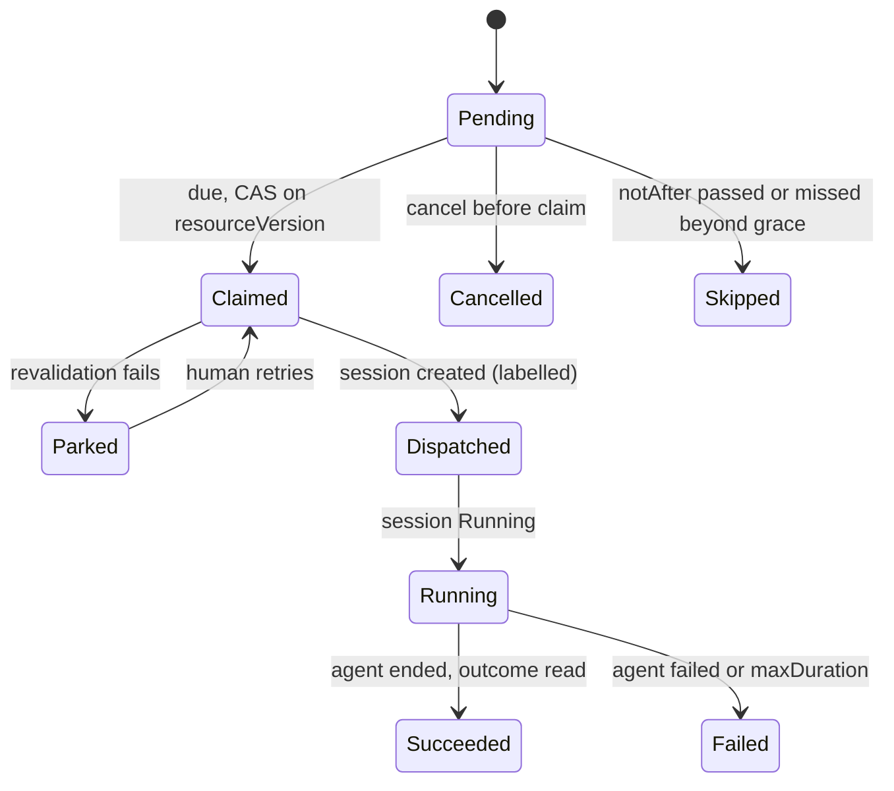

# DESIGN-054: Scheduled agent work

Date: 2026-11-04. OpenProject Story #397 ("Provider-neutral scheduled agent-work
executor"), with #396 (reminder MVP activation) and #206 (reminders with the
Workspace calendar), Epic #95. Builds on [DESIGN-032](032-reminders.md).
Owner: session `dev-env-1104-010332` (Opus 5.5 coordinator for reminders and
scheduled work).

## State: proposed design only

| Layer | State |
|---|---|
| Design | this document, proposed |
| Source | none yet; increments in "Delivery" below |
| Installed / usable | no. Nothing here is deployed, scheduled or sent |

## Requirements

Tom's statement (2026-11-04, relayed by the parent session `dev-env-1027-010058`;
recorded as input, not as an approval of any live step):

> "there need to be pushover notifications and we should use admin@haynesnetwork.com
> calendar to schedule and event and they can hold the state if we need or serve as
> a source for the reminder. We should also be able to have tasks kick off at the
> scheduled time that use a dev-env-ops style agent to open a remote session and
> interact with me on whatever work was scheduled. Or it could be headless if I'm not
> needed in the loop"

From that statement and OP206/OP396/OP397:

| ID | Requirement |
|---|---|
| R1 | A scheduled item notifies Tom by Pushover when it is due (DESIGN-032's `pushover:default`). |
| R2 | A scheduled item can appear as an event in the admin@haynesnetwork.com calendar. |
| R3 | Calendar events may be a source: Tom adds an event and a reminder results. |
| R4 | At its due time a scheduled item can start agent work: **interactive** (a remote session Tom joins from his phone, the dev-env-ops pattern) or **headless** (a task session that reports a result). |
| R5 | Due time is local wall time in an IANA zone, with DESIGN-032's DST and recurrence rules. |
| R6 | Durable, idempotent, deduplicated: a restart, failover, replay or retry never loses an occurrence and never starts its work twice. |
| R7 | At due time, authority, expiry and provider availability are checked again. Nothing stored at creation (a token, a quota reading) is trusted. A failed check parks the occurrence with a reason and tells Tom. |
| R8 | Every occurrence has an accountable receiving owner and a recorded result, including no-op, parked and failed. |
| R9 | Scheduling grants no authority. Dispatch uses the operator's existing session creation path and its limits. |
| R10 | A notification alone is not an executor; a calendar event alone is not a claim. |

## Decisions

1. **A separate `ScheduledWork` resource, not a new Reminder target.** Starting agent
   work needs its own fields, RBAC and authority checks. A Reminder only sends a
   message. `ScheduledWork` reuses `internal/reminders`' schedule arithmetic (`Due`,
   `TimeZone`, `Recurrence`, the gap and fold rules), so both resources resolve
   occurrences identically.
2. **The executor runs in the operator, leader only**, behind a default-off flag,
   `--enable-scheduled-work`. The operator already creates sessions, applies the
   agent, depth and budget limits, and runs the standby runnable that creates a
   `remote` session on its own (`internal/standby`). The executor follows the
   standby pattern: it creates sessions through `apiserver.Server`'s creation path,
   labels them, and never touches another session.
3. **The CRD is the state of record. The calendar is a projection and an intake.**
   A calendar event never starts work by itself (R10). See "Calendar".
4. **No stored credentials.** The executor dispatches as its own fixed client
   identity, `client/dev-env-system/scheduled-work` (like `StandbyParent`). It
   never holds or reuses the creating caller's token.

## Data contract

```yaml
apiVersion: dev-env.haynesops.com/v1alpha1
kind: ScheduledWork
spec:
  title: "Loki retention trend audit"        # 1-120
  owner: human/dev-env-system/tom            # from the token, immutable
  receiver: session/<name>/<uid> | human/... # who gets the result; defaults to owner
  due: "2026-12-03T09:00"
  timeZone: America/New_York
  recurrence: {...}                          # DESIGN-032 shape; absent = one-shot
  notAfter: "2027-02-01T00:00:00Z"           # required; at most 180 days after creation
  mode: headless | interactive
  work:
    template: ops-audit                      # a GitOps-allowlisted dispatch template
    repo: haynes-ops                         # must be allowed by the template
    prompt: "..."                            # <= 8 KiB, the work order
  notify: [pushover:default]                 # DESIGN-032 targets
  calendar: calendar:haynesnetwork           # optional projection
  approval:                                  # set only by a human caller (PATCH .../approve)
    by: human/...
    at: ...
status:
  occurrences:                               # bounded window, newest 20 kept
  - at: "2026-12-03T14:00:00Z"
    state: Pending|Claimed|Dispatched|Running|Succeeded|Failed|Parked|Skipped|Cancelled
    reason: "..."
    session: dev-env-1203-140000
    claimedBy: <leader pod UID>
    result: {summary, prURLs, headSHAs}      # from the session's retained outcome
    notified: sent|failed|ambiguous|skipped
```

**Dispatch templates** are GitOps data in `dev-env-templates` under
`scheduledWork.templates`. Each fixes the agent, model id, effort, size, profile,
allowed repos and maximum duration. The request names a template; it cannot raise
any of them. With no templates configured, the executor dispatches nothing. A
template for "dev-env-ops style" interactive work uses the existing `ops` profile.

## Occurrence lifecycle



- **Claim.** The leader changes `Pending` to `Claimed` with a compare-and-set on the
  object's resourceVersion, as DESIGN-032 claims a reminder occurrence. Only the
  claimer dispatches.
- **Exactly-once dispatch.** The created session carries the label
  `dev-env.haynesops.com/scheduled-work=<uid>` and the annotation
  `.../occurrence=<unix seconds>`, plus an idempotency key `sw-<uid>-<unix>`.
  After a crash between creation and the status write, the new leader lists
  sessions by that label and adopts the match instead of creating again. Session
  idempotency keys alone are not enough: they dedupe only while a session is
  unfinished (V-03), and the label lookup has no such window.
- **Missed occurrences.** An occurrence found more than a grace period late (default
  15 minutes; 2 hours for interactive) is `Skipped` with a reason and a page. It is
  not run late without a person deciding, because a stale task can be harmful.
  A recurring item then moves to its next occurrence.
- **Concurrency.** One unfinished occurrence per ScheduledWork; a later occurrence
  that comes due while one runs is `Skipped` ("previous still running"). A global
  cap (`--scheduled-work-max-active`, default 2) applies across items.

## Due-time revalidation (R7)

Before dispatch, the claimer checks, in order, and parks on the first failure:

1. The item is not cancelled and `notAfter` has not passed.
2. **Authority.** A human owner, or a recorded human `approval`, is standing
   authority until `notAfter`. A session owner without approval only authorises
   work while that exact session UID still exists and is not Archived or Failed. An
   ended coordinator's authority does not outlive it, and no token is reused.
3. The template still exists, and the repo, model id and profile are still in it
   and in `dev-env-templates` now (not at creation).
4. **Provider availability.** The task budget ledger (`internal/taskbudget`) admits
   the dispatch now. A claude template is refused when the keeper's Claude login
   state is not usable, from the existing auth status.
5. The normal session creation limits pass (agent count, depth, size).

A parked occurrence pages Tom with the reason and waits for a human retry or cancel.

## Interactive and headless (R4)

| | Headless | Interactive |
|---|---|---|
| Session | `task` mode, prompt = work order | `remote` mode (Remote Control), the work order as its first message |
| Tom | not needed | paged: title, session name and how to open it |
| Ends | agent exits; outcome file read from Session status | Tom ends it, or the normal idle suspend |
| Result | `summary`, `prURLs`, `headSHAs` copied to the occurrence; paged per `notify` | an outcome file if written; otherwise "ended without outcome" |
| Receiver | inbox message to a session receiver; page to a human receiver | same |

Interactive work waits for Tom: it does not act on his behalf before he joins. Its
work order says so.

## Calendar (R2, R3)

- **Projection.** With `calendar:` set, the keeper writes one event per occurrence
  with a deterministic event ID (DESIGN-032's adapter contract) and updates its
  description with the state. Losing the calendar never changes the CRD.
- **Intake.** A calendar event can propose a reminder (R3). For agent work an event
  becomes a `ScheduledWork` **without approval**, owned by the calendar intake
  identity, so it parks at its due time unless Tom approves it. Write access to a
  calendar is not authority to run agents.
- **Boundary (checked 2026-11-04, metadata only).** No platform identity reaches the
  admin@haynesnetwork.com calendar. The only Workspace ExternalSecret in the cluster
  is `frontend/sigoalumni-workspace-adc`, a different domain's identity that must not
  be borrowed. The `full` and `workbench` session profiles mount
  `dev-env-gcp-secret` at `/etc/gcp`; haynes-ops records it as sigo-alumni tooling
  (backlog item 04), not a haynesnetwork.com Workspace identity, so it is out of
  bounds too. The v1 pod's egress to `www.googleapis.com` serves that sigoalumni
  work. The keeper has no Google egress. The real adapter needs the identity, the
  calendar ID, the ExternalSecret and the egress listed in DESIGN-032, each approved
  by Tom. Until then calendar targets are `skipped`, reason `calendar: unconfigured`.
- **Ruling, 2026-11-04 (Tom, phone prompt from `dev-env-1104-010332`):** the
  identity is a **DWD service account**, limited to the `calendar.events` scope and
  impersonating admin@haynesnetwork.com. Tom creates it in the haynesnetwork.com
  Workspace admin console and stores the key in 1Password. The agent then wires the
  ExternalSecret `dev-env-keeper-calendar` and the keeper's egress to
  `oauth2.googleapis.com` and `www.googleapis.com` through a reviewed haynes-ops
  PR. There is no refresh token, so no single-owner rotation risk. This chooses the
  method only. Creating the account and its first live write are still Tom's steps.

## API and CLI

`/v1/scheduled-work` with the reminder routes' shape (create, list, show, edit,
cancel), plus `POST /v1/scheduled-work/{name}/approve` and `.../retry` for humans
only. `agent-run schedule create|list|show|edit|cancel|approve|retry`, standard
library only.

## Delivery

| Step | Content | Gate |
|---|---|---|
| S1 | this design | PR |
| S2 | CRD types, validation tests, shared schedule package | PR, CI |
| S3 | executor runnable with fake creator, fake clock and envtest (claim, adopt after crash, park, skip, cap) | PR, CI, native review |
| S4 | outcome collection and notification, result to inbox | PR, CI |
| S5 | API and CLI | PR, CI |
| S6 | haynes-ops: CRD copies, Roles, flags off then on, one template | Tom approves activation (with OP396) |
| S7 | live: one headless and one interactive test occurrence | Tom approves the first real run |
| C1 | real calendar adapter | Tom provisions and approves the identity (OP206) |

Acceptance is S7: a real occurrence dispatched, its result recorded and paged,
plus a leader restart that neither loses nor repeats it.
