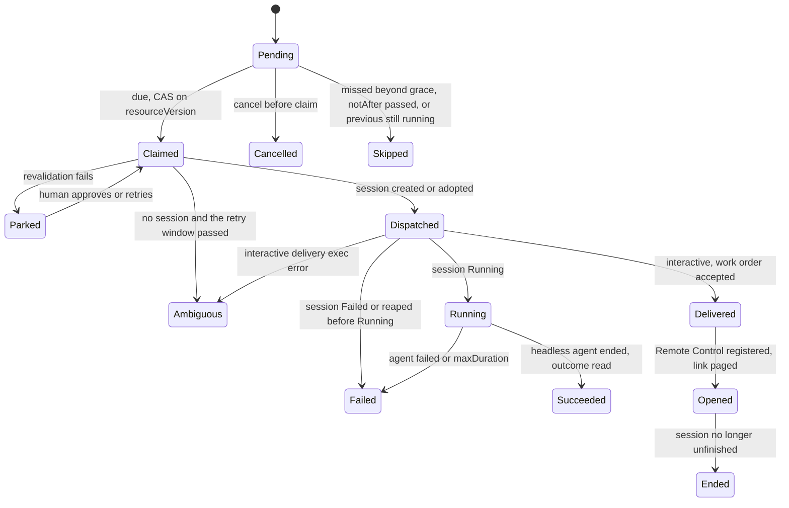

# DESIGN-054: Scheduled agent work

Date: 2026-11-04. OpenProject Story #397 ("Provider-neutral scheduled agent-work
executor"), with #396 (reminder MVP activation) and #206 (reminders with the
Workspace calendar), Epic #95. Builds on [DESIGN-032](032-reminders.md).
Owner: session `dev-env-1104-010332` (Opus 5.5 coordinator for reminders and
scheduled work).

## State: proposed design only

| Layer | State |
|---|---|
| Design | this document, proposed; revision 2 after a native independent review |
| Source | none yet; increments in "Delivery" below |
| Installed / usable | no. Nothing here is deployed, scheduled or sent |

## Requirements

Tom's statement (2026-11-04, relayed by the parent session `dev-env-1027-010058`;
recorded as input, not as an approval of any live step):

> "there need to be pushover notifications and we should use admin@haynesnetwork.com
> calendar to schedule and event and they can hold the state if we need or serve as
> a source for the reminder. We should also be able to have tasks kick off at the
> scheduled time that use a dev-env-ops style agent to open a remote session and
> interact with me on whatever work was scheduled. Or it could be headless if I'm not
> needed in the loop"

From that statement and OP206/OP396/OP397:

| ID | Requirement |
|---|---|
| R1 | A scheduled item notifies Tom by Pushover when it is due (DESIGN-032's `pushover:default`). |
| R2 | A scheduled item can appear as an event in the admin@haynesnetwork.com calendar. |
| R3 | Calendar events may be a source **for reminders**: Tom adds an event and a reminder results. |
| R4 | At its due time a scheduled item can start agent work: **interactive** (a remote session Tom joins from his phone, the dev-env-ops pattern) or **headless** (a task session that reports a result). |
| R5 | Due time is local wall time in an IANA zone, with DESIGN-032's DST and recurrence rules. |
| R6 | Durable, idempotent, deduplicated: a restart, failover, replay or retry never loses an occurrence and never starts its work twice. |
| R7 | At due time, authority, expiry and provider availability are checked again. Nothing stored at creation (a token, a quota reading) is trusted. A failed check parks the occurrence with a reason and tells Tom. |
| R8 | Every occurrence has an accountable receiving owner and a recorded result, including no-op, parked and failed. |
| R9 | Scheduling grants no authority. Dispatch uses the operator's existing session creation path and its limits. |
| R10 | A notification alone is not an executor; a calendar event alone is not a claim. |

## Decisions

1. **A separate `ScheduledWork` resource, not a new Reminder target.** Starting agent
   work needs its own fields, RBAC and authority checks; a Reminder only sends a
   message. `ScheduledWork` reuses `internal/reminders`' schedule arithmetic
   (`Resolve`, the occurrence iterator, the gap and fold rules). S2 generalises
   `ScheduleOf`, which takes a `ReminderSpec` today, to take the shared schedule
   fields.
2. **The executor runs in the operator, leader only**, behind a default-off flag,
   `--enable-scheduled-work`. The operator owns session creation and already
   creates sessions on its own (`internal/standby`). It reads with the API reader
   (uncached), as the reminder routes do.
3. **The CRD is the state of record. The calendar is a projection only** for
   scheduled work (R10). Calendar intake is for reminders (R3), never for agent work.
4. **No stored credentials, and no authority beyond the owner's.** The executor
   never holds or reuses a caller's token. It never dispatches with more reach than
   the owner could have used itself at the due time (see "Authority").
5. **Pages go through Reminders.** The operator has no Pushover sender; the keeper
   does. The executor creates a keyed one-shot `Reminder` for each page, and the
   keeper sends it with DESIGN-032's claim-before-send. The occurrence records the
   Reminder name and copies its delivery state (`sent`, `failed`, `ambiguous`).

## Data contract

```yaml
apiVersion: dev-env.haynesops.com/v1alpha1
kind: ScheduledWork
spec:
  title: "Loki retention trend audit"        # 1-120
  owner: human/dev-env-system/tom            # set by the API from the token, immutable
  due: "2026-12-03T09:00"
  timeZone: America/New_York
  recurrence: {...}                          # DESIGN-032 shape; absent = one-shot
  notAfter: "2027-02-01T00:00:00Z"           # required; at most 180 days after creation
  mode: headless | interactive
  work:
    template: ops-audit                      # names an entry in the scheduled-work ConfigMap
    repo: haynes-ops                         # must be allowed by the template
    prompt: "..."                            # <= 8 KiB, the work order
  notify: [pushover:default]                 # DESIGN-032 targets
  calendar: calendar:haynesnetwork           # optional projection
status:
  approval:                                  # written only by the API's human approve route
    by: human/...
    at: ...
    specHash: <sha256 of owner, mode, work, schedule, notAfter>
  nextDue: ...                               # as DESIGN-032
  planHash: ...                              # as DESIGN-032; an edit re-plans from now
  counts: {succeeded: 0, failed: 0, parked: 0, skipped: 0}
  occurrences:                               # newest 50 kept; counts are lifetime
  - at: "2026-12-03T14:00:00Z"
    state: Pending|Claimed|Dispatched|Delivered|Opened|Running|Succeeded|Failed|Ended|Parked|Skipped|Ambiguous|Cancelled
    reason: "..."
    claimedAt: ...
    session: sw-1a2b3c4d-202612031400
    result: {summary, prURLs, headSHAs}      # from the session's retained outcome (headless)
    page: {reminder: <name>, state: sent|failed|ambiguous|skipped}
```

`approval` is in **status**, not spec. Only the operator's `POST .../approve`
route, for a human caller, writes it. Any spec edit changes `specHash`, so the
approval no longer matches and is void. A haynes-ops ValidatingAdmissionPolicy
admits create, update and status writes on `scheduledworks` from the operator's
ServiceAccount only. The keeper and every other identity get no write.

**Dispatch templates** are GitOps data in their own ConfigMap,
`dev-env-system/dev-env-scheduled-work`, not in `dev-env-templates`. Putting them
there would change the templates revision and drain every idle session, and an
older operator would refuse the whole document. Each template fixes the agent,
model id, effort, size, profile, allowed repos, maximum duration (headless), and the owner classes it admits (`human`, `session`). The
request names a template; it cannot raise any of these. With no ConfigMap, the
executor dispatches nothing. A template for "dev-env-ops style" interactive work
uses the existing `ops` profile. The operator image that reads the ConfigMap ships
before the data (S6).

## Authority (R7, R9)

An occurrence dispatches on exactly one of these, checked at the due time:

| Basis | Condition at due time | Session is created as |
|---|---|---|
| **Human owner** | the template admits `human` | the operator's client identity `client/dev-env-system/scheduled-work`, within the template's fixed bounds |
| **Human approval** | `status.approval.specHash` equals the current spec's hash, and the template admits the owner's class | the same client identity |
| **Live session owner** | the owner session (by UID) is `unfinished()` exactly as `sessions.go` defines it (not reaped, suspended, archived or failed, and its agent not ended); the template admits `session` | **a child of the owner**, through the same validation as if the owner created it now: its profile, depth, per-parent child cap and mode rules all apply |

Anything else parks with reason `no standing authority`, and Tom is paged. He can
approve it, which binds his approval to the spec he saw. A suspended or ended
coordinator's authority does not outlive it. Client and coordinator owners (the v1
pod's agents are clients) have no basis of their own and always need approval. The
client identity is never a way around a session's limits, because a session owner
without approval dispatches as its own child.

## Occurrence lifecycle



- **Claim.** The leader changes `Pending` to `Claimed` with a compare-and-set on the
  object's resourceVersion, as DESIGN-032 claims a reminder occurrence.
- **Exactly-once dispatch.** The session name is derived, not generated:
  `sw-<first 8 hex of the ScheduledWork UID>-<occurrence UTC YYYYMMDDHHMM>`. The
  create itself refuses a duplicate (`AlreadyExists`). A deposed leader's late
  create and a new leader's create cannot both succeed; the loser adopts the
  winner's session. The session also carries the label
  `dev-env.haynesops.com/scheduled-work=<uid>`. This needs a creation entry point
  that takes a fixed name; `CreateStandby` generates names and ignores idempotency
  keys, so S3 adds a sibling.
- **A created session cannot vanish unrecorded.** The session is created with the
  finalizer `dev-env.haynesops.com/scheduled-work-retained` in the same atomic
  Create, as `ProjectCanaryFinalizer` does (`apiserver/project_canaries.go`). Only
  the executor removes it, and only after it has written that occurrence's terminal
  state and result to the ScheduledWork status with a compare-and-set. So whenever a
  session with the derived name has ever existed, either it still exists or its
  occurrence already carries a recorded outcome. A reaped session's rescue and
  archive run first and are unchanged; the finalizer only holds the object until the
  record is written.
- **Claimed without a session** (a crash between claim and create, or a lost create
  response). The claimer reads with the uncached API reader, never a listing cache.
  If the derived name is absent **and** the occurrence still has no recorded
  outcome, then by the rule above no session was ever created, and the create is
  retried. The retry is bounded to 10 minutes after `claimedAt`, because the
  revalidation at claim time goes stale. After that the occurrence is `Ambiguous`
  and needs a person. A recorded outcome is never followed by a new create, and an
  ended session is never recreated or resumed.
- **Finalizer removed by hand.** No operator path strips the finalizer. If a person
  strips it, and the session is then deleted within the 10-minute window, the
  executor cannot tell that from a create that never happened. This is the one stated
  limit. A haynes-ops admission rule (S6) admits removal of this finalizer from the
  operator's ServiceAccount only, so a person must first override that rule.
- **Acceptance tests (S3).** Envtest cases for: a lost create response
  (`AlreadyExists` → adopt); a session completed and reaped inside the retry window
  (outcome recorded first, no second create); session idempotence only while
  unfinished (no reliance on it); a stale cached listing (the uncached read is used);
  two leaders overlapping (one create wins, the other adopts); and an executor
  restart at every state.
- **Missed occurrences.** An occurrence found more than a grace period late (default
  15 minutes for headless, 2 hours for interactive) is `Skipped` with a reason, and
  is not run late without a person. This deliberately differs from DESIGN-032,
  whose reminders fire up to 6 hours late and whose one-shots always fire: a stale
  page is harmless, a stale task is not. When the executor starts after an outage,
  all the missed occurrences of one item collapse into one `Skipped` record with a
  count and one page.
- **Concurrency.** One unfinished occurrence per ScheduledWork; a later occurrence
  that comes due while one runs is `Skipped` ("previous still running"). Separate
  global caps: `--scheduled-work-max-headless` (default 2) and
  `--scheduled-work-max-interactive` (default 1). An occurrence at a cap waits up to
  its grace period, then is `Skipped` ("at capacity").
- **Edits.** An edit while an occurrence is `Claimed`, `Dispatched` or `Running`
  applies from the next occurrence; the one in flight runs to its end on the spec it
  was claimed with (its `specHash` is recorded on the occurrence). An edit voids a
  human approval (above). Cancel stops future occurrences and does not stop a running
  session; the owner or a human can reap that session through the normal route.

## Due-time revalidation (R7)

Before dispatch, the claimer checks, in order, and parks on the first failure:

1. The item is not cancelled and `notAfter` has not passed.
2. The authority basis above.
3. The template still exists. Its repo, model id and profile are still in it, and
   in `dev-env-templates` now, not at creation.
4. **Provider availability, honestly bounded.** Headless Claude tasks run on the
   static `CLAUDE_CODE_OAUTH_TOKEN` (`controller/pod.go`); interactive sessions run
   on the keeper's login. For an interactive Claude template, the executor checks the
   keeper login projection's recorded expiry through metadata the operator already
   reads. No supported quota reading exists for the operator. A quota or credit wall
   therefore shows up as a failed or idle session, which is recorded as `Failed` with
   the session's own reason. It is not predicted.
5. The normal session creation limits for the chosen basis (above).

A parked occurrence pages Tom with the reason and waits for a human retry or cancel.

## Interactive and headless (R4)

| | Headless | Interactive |
|---|---|---|
| Session | `task` mode, prompt = work order, `maxDuration` from the template | `remote` mode (Remote Control); the schema allows no prompt |
| Work order | the prompt | delivered after the pod is Ready through the existing message route. A 409 while it boots is retried for up to the grace period, then the occurrence is `Failed`. An exec error makes the delivery `Ambiguous` and it is not re-sent; the page says so |
| Tom | not needed | paged: title, session name and the session's claude.ai link once `status.remoteControl.url` is set. The work order says the session waits for Tom before it acts |
| Ends | agent exits; outcome file read from Session status | the session leaves `unfinished()` by any normal path: Tom ends or suspends it, or the normal idle suspend |
| Result | `summary`, `prURLs`, `headSHAs` copied to the occurrence; paged per `notify` | `Ended`, with the result `participation not observed`. The session's own handoff is the work's result. There is no outcome capture (task mode only) |

**What the executor can observe about interactive work.** The platform has no
signal that Tom joined. `status.remoteControl.state` is Remote Control
*registration*, not a person in the session. `status.agent.attached` counts tmux
clients, not phone participants. So the executor claims only what it observes:
`Dispatched` (session created), `Delivered` (work order accepted by the message
route), `Opened` (registered, link paged), `Ended` (session no longer
unfinished). It never records that Tom joined or that the work succeeded, and it
does not read the session's conversation to find out. The interactive cap counts an
occurrence until `Ended`. The executor does not suspend a session Tom has not
joined, because it cannot tell. A real participation signal would be a separate
item, and none is assumed here.

**Receiver.** The result goes to the owner. A human owner is paged. A session owner
reads it with `agent-run schedule show`; and when the child was created as its
child, the owner also gets it through the normal parent routes. The executor sends
no inbox messages: an `InboxMessage` needs a session sender, and naming an arbitrary
receiver session would route agent-written text into sessions the owner does not own.

## Calendar (R2, R3)

- **Projection.** With `calendar:` set, the keeper writes one event per series, with
  an RRULE for a recurring item, keyed by namespace and name. That is DESIGN-032's
  existing adapter contract (`calendar.go`). The event description carries the item's
  state. Losing the calendar never changes the CRD.
- **Intake (reminders only, later item).** The adapter has no list call today. Intake
  needs a read interface, filtering on the organiser (accepted invitations bring
  outside events), and skipping events the projection wrote (or it loops). It creates
  reminders, never scheduled work.
- **Boundary (checked 2026-11-04, metadata only).** No platform identity reaches the
  admin@haynesnetwork.com calendar. The only Workspace ExternalSecret in the cluster
  is `frontend/sigoalumni-workspace-adc`, a different domain's identity that must not
  be borrowed. The `full` and `workbench` session profiles mount
  `dev-env-gcp-secret` at `/etc/gcp`; haynes-ops records it as sigo-alumni tooling
  (backlog item 04), not a haynesnetwork.com Workspace identity, so it is out of
  bounds too. The v1 pod's egress to `www.googleapis.com` serves that sigoalumni
  work. The keeper has no Google egress. The real adapter needs the identity, the
  calendar ID, the ExternalSecret and the egress listed in DESIGN-032, each approved
  by Tom. Until then calendar targets are `skipped`, reason `calendar: unconfigured`.
- **Ruling, 2026-11-04 (Tom's answer to the phone prompt from
  `dev-env-1104-010332`; canonical record OpenProject #206 comment 5604):** the
  method is a **DWD service account**, limited to the `calendar.events` scope and
  impersonating admin@haynesnetwork.com. Tom creates it in the haynesnetwork.com
  Workspace admin console and stores the key in 1Password. The agent then wires the
  ExternalSecret `dev-env-keeper-calendar` and the keeper's egress to
  `oauth2.googleapis.com` and `www.googleapis.com` through a reviewed haynes-ops
  PR. There is no refresh token, so no single-owner rotation risk. This chooses the
  method only. It is not access and not a credential: no such account exists yet,
  and live access is Unknown until it is created and one read is tested. Creating
  the account, the ExternalSecret and egress PR, and the first live calendar write
  each still need Tom's action-specific approval.
- **DWD reach, recorded risk.** Domain-wide delegation authorises the client for
  the scope across the whole domain. Impersonating admin@ is the caller's choice,
  not a limit Google enforces, so the key could reach any haynesnetwork.com user's
  calendar events. Mitigation: the key is mounted only into the keeper's `app`
  container; the adapter takes its subject from a fixed keeper flag, never from a
  request; and the scope is `calendar.events` only.

## API and CLI

`/v1/scheduled-work` with the reminder routes' shape (create, list, show, edit,
cancel). `POST /v1/scheduled-work/{name}/approve` and `.../retry` are for humans
only. `agent-run schedule create|list|show|edit|cancel|approve|retry`, standard
library only.

## Delivery

| Step | Content | Gate |
|---|---|---|
| S1 | this design | PR |
| S2 | CRD types, validation tests, shared schedule package | PR, CI |
| S3 | executor runnable with fake creator, fake clock and envtest (claim, derived-name adoption after leader change, retry window, park per authority basis, skip, caps) | PR, CI, native review |
| S4 | outcome collection; pages through keyed Reminders; interactive work-order delivery and the observable states | PR, CI |
| S5 | API and CLI, including human approve with specHash | PR, CI |
| S6 | haynes-ops: CRD copy, Roles, the admission policies (status writes, finalizer removal), the operator pin, then the templates ConfigMap, then the flag | Tom approves activation |
| S7 | live: one headless and one interactive test occurrence | Tom approves the first real run |
| C1 | real calendar adapter | Tom provisions the DWD identity (OP206) |

Acceptance is S7: a real occurrence dispatched, its result recorded and paged,
plus a leader restart that neither loses nor repeats it.
