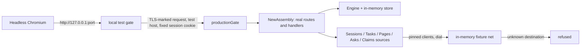

# DESIGN-055: A local test instance of the portal

- **Status:** Proposed, 2026-11-05. The first implementation is in draft PR
  [#944](https://github.com/thaynes43/dev-env/pull/944).
- **Origin:** Tom asked why agents need the live UI when they can host an
  identical test instance locally, with no auth, and drive it with headless
  Chrome or Playwright tests.
- **Tracking:** [Story OP476](https://work.haynesnetwork.com/projects/haynes-engineering/work_packages/476),
  "Agent-local portal UI/API development and testing entry".
- **Builds on:** [DESIGN-029](029-portal-foundations.md) (portal foundations),
  [DESIGN-045](045-portal-claims-view.md) (Claims), the preview harness in
  `web/portal/preview`.
- **How-to:** [docs/portal-local-test.md](../../../../docs/portal-local-test.md).

## 1. Goal and non-goals

An agent starts the portal on a loopback address and drives it like a
browser user. The instance serves the production routes, handlers, decoders,
templates, CSS and CSP. Data comes from fixtures, and one fixed test principal
is always signed in. Agents use it for development and UI acceptance.

Non-goals: live Authentik login, live group authorization, the Postgres store,
send, launch and history actions, and any deployment. The instance gives no
access to anything live.

## 2. What exists

- The live portal runs at `dev-env-v2.haynesops.com` behind Authentik. Agents
  hold no browser credential for it (DESIGN-029), so authenticated checks were
  Tom's.
- `web/portal/preview` writes static HTML from fixtures through the page
  builders. It skips the request path: the gate, the session engine, the
  assembly's routing, the source transports and the decoders' HTTP framing.
- `session.LoadProduction` builds the real handler. It requires the mounted
  production contract: pinned URLs, secrets, CA bundles, a TLS certificate and
  a reachable Postgres. It cannot run in a session pod.

## 3. Decision

Add a test boundary that reuses the production assembly and replaces only
what needs live identity or live services. The boundary is a build tag.

| Part | Production | Local test instance |
| --- | --- | --- |
| Gate | `productionGate` | `productionGate`, behind the local test gate (section 4) |
| Routes and handlers | `NewAssembly` | `NewAssembly`, unchanged |
| Session engine | `Engine` with Postgres store | `Engine` with an in-memory store holding one seeded session |
| Identity provider | Authentik code flow | none: login answers unavailable, no ID token verifies |
| Authorizer | `CurrentAuthorizer` (live UserInfo groups) | fixed principal, on the resources `allowedResource` admits |
| Sessions, Tasks, Pages, Asks, Claims | pinned HTTPS clients to cluster services | the same clients, dialling in-memory fixture servers |
| Attention reader | `portal.UnavailableReader` | the same |
| Pages, Asks, Claims | each on only when its mounted config enables it | always on |
| Asks answers | form shown when the store keeps command receipts (Postgres) | no form: the in-memory store keeps no receipts |
| Send, launch, history | opt-in per target, need Postgres and the live operator | off: no composer, Sessions uses the read-only CSP |
| Listener | TLS on `:8443` | plain HTTP on a loopback IP |

The tag is `portallocaltest`. Two files carry it:
`web/portal/session/localtest.go` and the command `web/portal/localtest`.
`make build-portal` and `images/portal/Dockerfile` never set it, so the
deployed binary contains none of this code. `make build-portal` passes an
empty `-tags=`, so a tag set through `GOFLAGS` cannot reach the portal build.
A production build with the tag set by mistake would still have no path to
it: `cmd/dev-env-portal` takes no flag and calls only `ServeProduction`.

## 4. The test gate

The gate stands in for the TLS listener and the browser login. For each
request it:

1. Refuses a client that is not loopback, a Host that is not the bound
   address (or `localhost` with its port), and an absolute-form URL. The Host
   check stops DNS rebinding from another site.
2. Rewrites the request as the production gate expects: Host
   `portal.localtest.invalid`, a TLS connection-state marker, and the fixed
   session cookie in place of any cookie the client sent.
3. Translates only an Origin equal to the request's own `http://` Host to
   the test origin. A cross-origin form post keeps its Origin and fails the production
   check.
4. Adds a banner as the first element of every HTML body, prefixes the page
   title with "Local test", and adds a first line to every plain-text answer.
   The banner uses the existing `.banner` class, so it needs no CSP change.

Then `productionGate` applies its own checks, including the forwarded-identity
refusal, and the assembly serves the page.

The fixed principal has its own issuer, `https://issuer.localtest.invalid/fixture-only/`,
and subject `local-test-reader`. The production engine refuses a session from
any issuer but Authentik's.

## 5. Fixtures and the network

- Sessions and Tasks use `scripts/trials/portal_product/sessions.json` and
  `tasks.json`, the envelopes the preview harness reads. The instance clock is
  the Sessions fixture's `now`, so pages render the same way each run.
- Pages, Asks and Claims use small synthetic records in `localtest.go`.
- Each upstream name the portal pins (operator, OpenProject, Alertmanager) is
  served by an in-memory HTTP server over `net.Pipe`. The operator and
  OpenProject servers present certificates from a fresh in-memory CA that the
  pinned clients trust. Every other destination, protocol or port is refused.
  Nothing leaves the process. `NewLocalTest` refuses to build the instance if
  any source's client has a proxy or a dialer other than the fixture net.
- The source clients read token files, as in production. The instance writes
  unsigned fixture tokens to a fresh private temporary directory and removes it
  on exit. Only the in-memory fixture servers accept them. They are not
  credentials.

## 6. Isolation proofs

Default build, so CI and the image path run them:

- `TestLocalTestExcludedFromDefaultBuild`: `localtest.go` is ignored without the
  tag, `web/portal/localtest` has no files without it, and no default-build
  file, the Dockerfile, the portal `main.go` or the portal build line in the
  Makefile names the tag.
- `TestPortalCommandRefusesLocalTestSelectors`: the production command refuses
  local-test flags and words before any work.
- `TestProductionRefusesLocalTestShapedRequests`: the production gate and
  engine refuse plain HTTP, loopback and test hosts, each forwarded-identity
  header, and a session minted for the local test issuer.

Tagged (`make test-portal-localtest`, which `make test` runs):

- Every page renders with the banner, its fixture rows and a production CSP
  header; Sessions and Tasks match production's policy exactly. Every
  upstream was reached through the fixture net.
- The gate refuses non-loopback clients, other hosts and ports, absolute-form
  URLs and forwarded identity.
- Login does not start. A cross-origin logout is refused, and a same-origin
  logout revokes the fixed session.
- The fixture network refuses every other destination within a 2s deadline.
- The command refuses non-loopback, wildcard, name and Unix-socket listen
  values.

## 7. Limits

The instance proves UI and handler behaviour on fixtures. It does not prove
live login, live group authorization, the Postgres store, real operator or
OpenProject responses, TLS, or the deployment. Unix sockets are refused:
Chromium cannot open them, and the gate binds the Host to an IP and port.

It is not a copy of the live configuration. Pages, Asks and Claims are always
on here, while the live portal enables each by its mounted config, so the
live navigation can differ. The Asks answer form, the send composer, launch
and history are absent here, so those controls need the live portal or a
follow-up. Logging out revokes the one fixed session; every page then
redirects to a login that is unavailable until the instance restarts.
The clock is frozen at the fixture's `now`, so pages never age or go stale.
The banner adds a row at the top, so screenshots and overflow comparisons
against the live portal differ by that row.

## 8. Follow-ups

- Send, launch and history with fixture transports and an in-memory receipt
  store, so the composer can be driven.
- An Attention metadata fixture, if Attention is wired in production.
- Selecting other fixture scenarios, for example the preview's product states.
