# DESIGN-061: Task-session clean-up within 7 days

- **Status:** Proposed 2026-11-10 for coordinator review. Nothing is built,
  switched on or deleted by this document. Source of section 2 items 1 and 7
  (the `bundle` field and the three agentd commands, 3.1): OpenProject #519,
  not installed. Source of items 2 to 6 and 8 to 12 (the operator's path,
  default off): OpenProject #520, section 3.2, not installed.
- **Decision:** [ADR-020](../adrs/020-task-session-cleanup.md) (Tom, 2026-11-10).
- **Changes, for task Sessions only:** [DESIGN-025](025-private-home-expiry.md),
  [DESIGN-044](044-two-tier-home-retention.md), DESIGN-001 D-45 (dated notes
  come with the source PR). **Tracking:** OpenProject #518.
- **Evidence:** dev-env 3a5cefaa (all line numbers), haynes-ops b789c1b5, live
  reads at 2026-11-10T00:59Z (`kubectl` as the workbench identity, Prometheus).

## 0. In short

- Reuse DESIGN-025's expiry record, hold pod, rescue, guarded delete and
  release, with a second policy for `spec.mode: task`: no history archive, no
  wait after a reap, 168h after any other end, the verified bundle in its place.
- One CRD change: an optional `bundle` field, and the CEL rule that refuses
  `Archived`, `Deleting` and `Expired` without `archive` relaxed to accept it
  (`agentsession_types.go:943`).
- Two clean-ups at once, purged first. 346 of the 388 eligible Sessions are due
  at switch-on and drain in about half a day. 77 stay outside this path (53 with
  no recorded stop, 1 for OP515, 20 pilots, 3 canaries). Tom ruled on the one
  question: the 53 are cleaned too, as a later source step (section 9, F6).

## 1. Triggers and clocks

**Review correction, 2026-11-10 (OP520).** For a task that was not reaped,
the stored `dueAt` is the deadline. A changed `--task-cleanup-grace` applies
only when a new record is made; restarting at hour 24 with 1h cannot shorten
a record made with 168h. A reap still makes that record due immediately.

| Cause | Live | Starts when | Wait after the clock |
|---|---|---|---|
| Purged (`deletionTimestamp` set) | 35 | its terminal record is confirmed | none |
| Finished (Suspended: `TaskComputeReclaimed` 237, `ExecutorEnded` 111) | 348 | the same | 168h |
| Failed (Pod ended, `operatingMode: Running`) | 29 | the same | 168h |

**The clock is `status.privateHistory.executorTerminal.observedAt`**, written
once after an uncached read shows the recorded executor Pod terminal on a Ready
node with a fresh lease (`private_terminal.go:132-180`). The schema binds it to
`lastExecutor.podUID` (`agentsession_types.go:818`) and forbids changing it
(`:821`). The record copies it into `graceStart`, also immutable (`:937`).

| Event in the 7 days | Effect on the clock |
|---|---|
| Pod reclaim or Pod loss | none: the Pod goes only after the record exists (DESIGN-025 24); the clock lives in Session status |
| operator restart, new leader | none: the clock is read from status |
| `agent-run resume` | none: it only patches `operatingMode` (`lifecycle.go:30-39`); a private task never gets a second executor (ADR-008); the trigger ignores `operatingMode` |
| `agent-run msg`, an inbox message | none: `msg` answers 409 without a running Pod (`podcmd.go:56-63`); an inbox message is a record, not a write to the HOME |
| a new Pod on the HOME | the record is cancelled and `PreservationUnknown` is set, as today (`private_expiry.go:595-597`, `:996-1021`); a later record starts no earlier than the cancel (`:557-565`), so the wait only grows |

For a finished task `observedAt` falls 10 to 12 minutes after the provider
exited: the reclaim grace (`terminal_task_reclaim.go:28`, live `10m`). 27 of
the 29 Failed tasks have no finish time at all. So one clock replaces ADR-018's
`finishedAt` first, and it is never earlier than the finish.

**"ASAP" for a purge.** The reap's stop took 31 s on two probes
(`dev-env-1109-234800`: reaped 23:49:32Z, recorded 23:50:03Z;
`haynes-studio-1110-001254`: 00:20:53Z, 00:21:24Z). The clean-up adds 3 to 5
minutes (section 4), so the HOME is gone about 5 minutes after the reap. During
the backlog a purge jumps the queue and waits for at most one clean-up: 15
minutes at worst.

### 1.1 The stop proof includes the volume's release (Q-OP515-1)

**Review correction, 2026-11-10 (OP520).** The terminal record proves the
containers ended, not that kubelet finished tearing the Pod down. Before the
first hold pod, every replacement, and the HOME claim's delete, the operator
makes a stateless release proof through its uncached API reader:

- The executor node still has the recorded name and UID, is Ready with a
  fresh lease, and does not list the HOME volume in `status.volumesInUse`.
- It lists **all Nodes**, then reads each Node and its lease. Each must be
  Ready, not deleting, with a lease owned by that Node UID, renewed within
  40 seconds and not in the future. None may list the HOME volume. A missing,
  replaced-during-read, NotReady or stale-lease Node, or a read failure,
  leaves release unproven. A replacement Node's empty volume list cannot
  pass using its predecessor's lease.
- The PV is bound to this claim UID and supplies the CSI name
  `kubernetes.io/csi/<driver>^<volumeHandle>`. No Pod uses the claim. Every
  mounting Pod from the LIST counts, including the Session's own name, and
  that name is reconciled with the earlier GET. These separate Kubernetes
  reads are not an atomic snapshot.

No remembered hold-node name is needed. A new leader therefore checks a
previous hold's node even after that Pod disappeared from the API. The
`volumesInUse` check covers same-node mounts, where ReadWriteOnce does not
require a detach. This still relies on the CSI driver's unmount not being
lazy; Pod disappearance and VolumeAttachment alone are not release proof.

**Rollout rights (H1).** In addition to cluster-wide `get` on
`persistentvolumes`, the operator needs cluster-wide `list` and `get` on
`nodes`, and `get` for every Node's Lease in `kube-node-lease` (no
`resourceNames` restriction). This story changes no haynes-ops grant.

When release is unproven, nothing mounts the HOME. The clean-up looks again
every 30 seconds, bounded by the remaining attempt time. At the 30-minute
attempt deadline it records `volume_not_released`, frees
its slot and keeps the HOME, re-checking every 15 minutes. Before a delete,
the clean-up waits up to 5 minutes, looking every 5 seconds, for the node to
drop the HOME's volume after the hold pod is removed, and only then records
`volume_not_released` and keeps the HOME. The H4 probes of 2026-11-10 refused
four of five deletes about one second after the hold pod was removed, while
that pod's node still listed the volume. The wait is the leader's memory,
separate from the rescue step's clock, so a restart starts a new 5 minutes,
and the record keeps its slot while it waits. A recorded refusal drops that
clock, so the next attempt waits again. Polls while that wait is
already running and the volume is still listed do not re-hash the bundle.
The verify and the other delete checks run on the first look, and again on
the pass that deletes or refuses.

## 2. The smallest change

| Option | Verdict |
|---|---|
| **reuse the expiry pipeline (chosen)** | it already has the trigger, a forward-only record, a hold pod bound to the HOME UID with intent and adoption (6.1), the rescue, a delete guarded by UID and resourceVersion, and the release of a reaped Session (6.5 to 6.7), all surviving restarts |
| a fresh controller path | it would need the same record fields and guard exceptions again |
| `--enable-private-history-retention` off | the 470 marked Sessions would still need this path: the latch is permanent (`private_history.go:36-47`, ADR-008 "No unmarking") |
| the bundle written into `archive` | conditions, the verify and DESIGN-025 8's reads would take a rescue directory for a history entry |

A task record skips `Exporting`. Each step still moves forward in the schema's
order (`:938`):

```mermaid
stateDiagram-v2
    [*] --> Waiting: terminal record confirmed (task, in scope)
    Waiting --> Waiting: not due, queued or paused
    Waiting --> Rescuing: due and admitted (purged at once, else observedAt+168h)
    Rescuing --> Rescuing: volume not released (1.1) or rescue refused: kept, listed
    Rescuing --> Archived: valid rescue in the hold pod, bundle verified on the shelf
    Archived --> Deleting: hold pod gone, bundle verified again, archivedAt if not reaped
    Deleting --> Expired: HOME deleted with UID and resourceVersion
    Expired --> [*]: reaped Session released; finished Session deleted, then released
```



**Scope.** The terminal task reclaim's static scope
(`terminal_task_reclaim.go:197`): `mode: task`, with no workspace, canary,
pilot (`projectcanary.IsPilot`) or original-HOME binding, and the clean-up flag
on. A finished task waits while its descendants run
(`terminalTaskChildrenStopped`, `:46-86`; three task parents today). A purged
one does not. Every other Session keeps DESIGN-025, which stays off.

**The code.** Sizes are estimates, in lines.

| # | Where | Change | Lines |
|---|---|---|---|
| 1 | `api/v1alpha1` | `PrivateHomeExpiryStatus.Bundle`: `stamp`, `result` (`Verified` or `CleanAndPushed`), `manifest`, `manifestSHA256`, `bundles`, `bytes`, `verifiedAt`. CEL `:943` becomes `has(self.archive) \|\| has(self.bundle)`; `bundle` never changes once set; never both. The only CRD change, and unavoidable: `:943` refuses the phases the delete and release need | 50 |
| 2 | new `controller/task_cleanup.go` | scope; trigger (Reaping, or the terminal record exists, whatever `operatingMode` says; `spec.mode` is always `task`); effective due (`graceStart` if Reaping, otherwise the stored `dueAt`; changed grace applies to new records only); 1.1's release check; queue, slots, breaker, free-space gate (section 4); removal of a finished Session once `Expired` | 380 |
| 3 | `private_expiry.go` | `reconcileHomeExpiry` (`:467-533`) picks the policy before `homeExpiryOn()` (`:144`); `startHomeExpiry` (`:538-581`) sets `dueAt` by cause; `expiryWait` (`:680-703`) takes the effective due and the queue; `expiryRescueAndExport` (`:710-794`) checks 1.1 before `createExpiryHold` (`:1041`), goes from a valid rescue to `Archived` with `bundle`, runs `drop-log` before the hold pod goes, never calls the relay; `expiryQuiet` (`:354-390`) and `homeExpiryTriggered` (`:181-199`) follow the policy | 120 |
| 4 | `private_expiry_delete.go` | `homeExpiryDeleteOn` (`:35`) true for the policy; `historyArchiveVerified` (`:80-103`) becomes `keptWorkVerified`: a shelf re-hash for `Verified`, and for `CleanAndPushed` a check that `status.rescue` still names the hold pod and stamp; `expiryRechecked` (`:122`) compares `bundle` | 80 |
| 5 | `guard.go` | `expiryVolumeRemovalAllowed` (`:529`) accepts a verified `bundle` on a task record; `expiryHoldRemovalAllowed` (`:449-494`) learns the policy's off state and trigger; new `taskSessionRemovalAllowed` and `deleteCleanedTaskSession` delete an `Expired` finished Session with UID and resourceVersion preconditions and background propagation, like the API's reap (`apiserver/sessions.go:496-498`); two rows in `guardedCalls` (`guard_test.go:253-293`); RBAC already allows it (haynes-ops `rbac/app/operator.yaml:58-60`) | 90 |
| 6 | nil safety | these read `Expiry.Archive` and would panic on a bundle record: `private_expiry.go:1260-1261`, `private_expiry_delete.go:204-206, 274-276, 298-300`, `private_history.go:430-432, 555-556`, `reconciler.go:1723` | 30 |
| 7 | `internal/agentd`, `cmd/agentd`, `internal/shelf` | `agentd ctl rescue --strict-home` (section 3); `agentd ctl rescue-verify [--id <session>/<stamp>]` in the shelf re-hashes each bundle against its manifest (`checkBundleFile`, `shelf.go:372`) and prints the manifest's SHA-256 and the shared volume's free and total bytes, under `ExecSlots` (`slots.go:13`); `agentd ctl drop-log` in the hold pod removes the Session's own `logs/<session>.log` from the shared volume | 250 |
| 8 | `cmd/dev-env-operator/main.go` | flags (below) | 50 |
| 9 | texts | `privateRetention` (`private_history.go:402-470`), `setHomeExpiryCondition` (`private_expiry.go:1245`), `agent-run reap` (`agentrun/sessions.go:515`), `show`, `list` (section 6) | 120 |
| 10 | metrics | section 6 | 100 |
| 11 | tests | unit (fake client, in-process exec); envtest for CEL and two operators; a case per refusal (section 3) and group (section 5) | 900 |
| 12 | docs, same PR | DESIGN-025 section 26; DESIGN-044; DESIGN-001 D-45, D-55, D-62 notes; `agent-run help reap\|rescue`; handoff. Also the two places that promise the retained outcome, which now lasts until the Session is cleaned up, 7 days after a finished task ends (ADR-020 C-54): CLAUDE.md "Headless task outcome" and the workflow guide's "Retain a task's PR and handoff after pod reclaim" | - |

| Flag | Change | Code default | Live after rollout |
|---|---|---|---|
| `--enable-task-session-cleanup` | new; needs terminal record, executor stop and leader election; false is the stop switch | false | true |
| `--task-cleanup-grace` | new; 1h to 168h, else refused; new records only | 168h | 168h |
| `--task-cleanup-max-active` | new; 0 pauses admission, active ones finish; enable=false stops; at most 3, so one of the 4 reconcile workers stays free (`reconciler.go:105`) | 2 | 2 |
| `--task-cleanup-min-shared-free` | new | 2Gi | 2Gi |
| `--task-cleanup-sessions` | new; names allowed at every step and before claim/Session deletion, empty for all; excluded records park in any phase; enable=false stops all | empty | empty |
| `--enable-home-history-archive` | retired by ADR-020; true refuses startup; DESIGN-061 F1 removes the code | false | false |
| `--enable-history-archive-reads` | retired by ADR-020; true refuses startup; DESIGN-061 F1 removes the code | false | false |
| `--enable-home-expiry-delete` | retired by ADR-020; true refuses startup; DESIGN-061 F1 removes the code | false | false |
| unchanged: `--home-expiry-grace`; `--enable-private-terminal-record`, `-private-executor-stop`, `-terminal-task-pod-reclaim` | archive grace retains its 720h floor; terminal flags supply the task's stop proof | 720h; false | 720h; true, as now |

**Review correction, 2026-11-10 (OP520).** No record ownership changes.
The three retired flags above refuse operator startup, even when their old
dependencies are set. Thus DESIGN-025 cannot pick up a task left at
`Rescuing` when cleanup is switched off. Its direct-reconciler unit tests
remain as they are until F1 removes the code. Private interactive Sessions
keep their HOME, as ADR-020 point 6 requires. A stored non-reaped `dueAt`,
including one made with 720h, is obeyed; a reap remains immediately due.

## 3. The unpushed-work bundle

`agentd ctl rescue --stop-agent` runs in the hold pod, for 10 minutes at most
(`controller/rescue.go:53`).

| It checks | Where in `agentd/rescue.go` |
|---|---|
| every clone directly under `~/repos`, first fetched from origin (60 s at most) | `clonesIn` `:165-184`, `:186-200` |
| every worktree of each clone, wherever it lives, so `~/work` is covered | `listWorktrees` `:217-239` |
| tracked edits and non-ignored untracked files, committed through a temporary index to `rescue/<worktree>-<stamp>`; the worktree, index and branch stay as they were; a detached HEAD on no ref is anchored the same way | `:30-40` |
| every branch, tag and stash entry whose commit origin lacks | `unpushedRefs` `:483-516` |
| **new, clean-up only (`--strict-home`):** every directory directly under `~/work`, or directly under HOME and not hidden, that holds `.git` must be a `~/repos` clone or a worktree one lists; otherwise "stray repository PATH". Without this, a clone outside `~/repos` would be deleted unseen. Hidden tool state (`~/.claude`, `~/.cache`) is not scanned. As built (3.1), HOME itself and the entries of `~/repos` are checked too | `task_cleanup.go` |

**What is saved.** One thin bundle per clone with unpushed refs, against
origin's default branch. agentd checks each with `git bundle verify`, copies it
to the shared volume, reads it back, and writes `manifest.json` last
(`bundle.go:47-110`), all in `rescue/<session>/<stamp>/`. Nothing else is
saved: gitignored files, files outside a repository and transcripts go.

**Verified twice.** The controller grades the report
(`controller/rescue.go:400-460`): `Verified` when every unpushed ref is bundled,
`CleanAndPushed` when every clone was fetched and nothing is unpushed, else
`Failed`. For `Verified`, the shelf's `rescue-verify` re-hashes every bundle,
and the manifest digest goes into `bundle.manifestSHA256` in the `Archived`
write. Each delete attempt verifies again in the same call path; a missing file
or another digest refuses (`bundle_missing`, `bundle_mismatch`), HOME kept.

**Read back, and kept 30 days.** `agent-run rescue list --session NAME` lists
the bundle. `agent-run rescue restore NAME/STAMP -p "<task>"` fetches it into
`refs/rescued/` (`agentrun/help.go:509-533`). The prune keeps every rescue
whose Session exists (`shelf/pruner.go:85-103`). Every 6 hours it removes those
of gone Sessions whose manifest `createdAt` is past `bundleRetention` (720h,
templates): 30 days from the bundle, written minutes before the release.

**Refusals keep the Session.** Nothing is deleted on a guess.

| Rescue says | Then |
|---|---|
| a merge, rebase, cherry-pick or revert in progress (`rescue.go:257-261`); an untracked nested repository (`:374-378`); over 50 MiB untracked (`:383-385`); a submodule off its commit, dirty, stashed or unpushed (`:319-360`); a stray repository | refused `rescue_refused`; the hold pod is removed, the slot freed and the HOME kept; listed (section 6) and tried once a day, last in the queue, in case a newer agent image handles it |
| a fetch or a bundle write failed (transient) | retries every 15 minutes (`HoldRetry`) within the attempt's total 30-minute limit (section 4); failures never restart that clock; the breaker counts them |

### 3.1 Command contract

Built in OpenProject #519 (section 2, items 1 and 7). No controller calls
these yet; without them every rescue, shelf and session behaves as before.
Each command prints one JSON document on stdout, indented, and its errors on
stderr. Exit 2 is always a usage error, with nothing on stdout.

**`agentd ctl rescue --stop-agent --strict-home`**, in the hold pod. The
flags may come in either order; `--strict-home` alone also works. It is
refused (exit 2) twice over, with `--workspace-stop-proof-stdin`, or with any
other argument. It prints `ctl rescue`'s report (`protocol.RescueReport`)
with one more field, `strictHome`.

| It looks at | It skips |
|---|---|
| HOME itself; every entry directly under `~/work`, hidden ones included; every entry directly under `~/repos` or HOME that is not hidden | hidden entries of HOME (`~/.claude`, `~/.cache`) and of `~/repos` (a clone in progress); the shared volume's mount; files; links to nothing; anything deeper; a `~/lost+found` this pod's user cannot search (mkfs makes it root's, so the agent, the same user, could not write into it) |

An entry counts when it is a directory, or a link to one, that holds `.git`
(a directory, a file or a link) or is a bare repository (`HEAD`, `objects/`
and `refs/` at its top). It passes in two cases, comparing paths with links
resolved. It may be a clone under `~/repos` (`clonesIn`: `.git` is a
directory). Or it may be a worktree that `git worktree list --porcelain` of
such a clone lists (bare and prunable entries left out) whose
`git rev-parse --path-format=absolute --git-common-dir` is that clone's
`.git`. A listing alone can be stale: a removed worktree whose path now holds
another clone stays listed. The check runs after the agent stop and before any
commit or bundle. This story adds `~/repos`, HOME itself and bare
repositories to the ruling's two places. Each holds work the rescue would not
see, a separate-git-dir clone in `~/repos` among them.

| Outcome | Report | Exit |
|---|---|---|
| passed | `"strictHome": {}`, then the rescue exactly as without the flag | 0, or 1 when that rescue is not OK |
| refused | `ok: false`, `cleanAndPushed: false`, `repos: []`, no `bundle`; nothing committed, nothing written to the shared volume; `strictHome.stray` (sorted, at most 32) and `strictHome.refused` | 1 |
| empty volume (D-55) | the usual empty report with `"strictHome": {}` | 0 |
| a shared-workspace session | nothing on stdout; stderr: `--strict-home checks a private HOME` | 1 |

`strictHome.refused` is one line. Causes come first, then each stray, joined by
`"; "`, and after four items `and N more`:

```json
"strictHome": {
  "stray": ["/home/dev/work/side-project"],
  "refused": "stray repository /home/dev/work/side-project"
}
```

The causes are `cannot list the worktrees of CLONE: ...` (its worktrees then
also show as stray) and `cannot inspect PATH: ...` (a permission or I/O error
on the entry or its `.git`, or `git rev-parse --git-common-dir` failing in a
listed worktree).

Known limits: it looks one level deep (section 9). It skips a complete clone
in a hidden `~/repos/.name`, which the rescue does not see either. It also
skips repositories inside hidden tool state.

**`agentd ctl rescue-verify [--id <session>/<stamp>] [--timeout D]`**, in the
shelf. The id is the rescue's directory under `rescue/`, which can be
`<stamp>-2`. Take it from the report's `bundle.dir` or
`status.rescue.lastBundle`, not from the stamp. `--timeout` is agentd's own
deadline, 50s by default, 1s to 30m. Past it, agentd stops waiting for the
lock or hashing and fails. Exit 2 means extra arguments, `--id` without a
value or with an empty one, an id that `ParseRescueID` refuses, or a
`--timeout` out of range. The operator calls it through
`shelf.RescueVerifier.Verify(ctx, id)`. That call takes one of the replica's
`ExecSlots` with `TryTake`, and answers `ErrSlotsBusy` without an exec when
none is free. It passes `--timeout` as five sixths of the exec timeout
(`Shelf.Timeout`, a minute by default, so 50s), so agentd ends first. It
checks the document against the exit status and gives a refusal back as a
result, not an error. Set `Shelf.Timeout` longer for a large bundle.

```json
{
  "version": 1,
  "id": "dev-env-1110-021204/20261110-0213",
  "manifest": "rescue/dev-env-1110-021204/20261110-0213/manifest.json",
  "manifestSHA256": "<64 hex>",
  "bundles": 2,
  "bytes": 41984,
  "ok": true,
  "sharedFreeBytes": 19327352832,
  "sharedTotalBytes": 21474836480
}
```

| Outcome | Document | Exit |
|---|---|---|
| without `--id` | `version`, `ok: true`, the two space figures (statfs: `Bavail` and `Blocks` times the fragment size, as df) | 0 |
| every bundle matches | as above | 0 |
| `bundle_missing` | `ok: false`, `refusal`, `detail`: `rescue/`, `rescue/<session>`, the rescue's directory, its manifest or a bundle it names is absent, or is not a directory or regular file as it should be (a link counts as neither) | 1 |
| `bundle_mismatch` | the same: the manifest is over 4 MiB, not JSON, not version 1, names another session or directory, says `complete: false`, lists no bundle, lists a repo without a verified bundle, or a bundle outside its directory; or a bundle's size or SHA-256 differs from the manifest | 1 |
| a failure: the shared volume not mounted, statfs failed or contradicts itself, an I/O error, the deadline | nothing on stdout; stderr says why | 1 |

On a refusal, `manifestSHA256`, `bundles` and `bytes` are what was read before
it. They are for a person and prove nothing. `detail` is at most 512 bytes,
and values quoted from the manifest are cut first. An ok answer with `--id`
always names at least one bundle, as a `Verified` record must. The command
reads the manifest once, hashes those bytes and parses the same bytes. It
opens every file without following a final link and checks the open file. It
takes `.shelf.lock` shared and without blocking, retrying every 100 ms until
its deadline. So a prune or a restore's hold waits for it, other verifies do
not, and a verify the operator gave up on never holds the lock on. Without
`--id` it takes no lock. It writes nothing but `.shelf.lock` when that is
absent, and it runs no git.

**`agentd ctl drop-log`**, in the hold pod, with no arguments; the session
comes from `AGENTD_SESSION`. It removes `logs/<session>.log` from the shared
volume and nothing else: not another session's log, not a `.tmp-*` copy in
progress, not the HOME's `~/work/<session>.log`.

```json
{ "session": "dev-env-1110-021204", "path": "logs/dev-env-1110-021204.log", "removed": true, "bytes": 2581 }
```

It opens `logs/` without following a link and removes the copy relative to
that directory, so a `logs/` swapped for a link cannot send the unlink
elsewhere.

| Outcome | Exit |
|---|---|
| removed (`removed: true`, `bytes` its size), or there was none (`removed: false`, `bytes: 0`; also when `logs/` is absent) | 0 |
| a failure, nothing removed, nothing on stdout: no session or a name that is not one; an agent this pod started is running (its pid file names a live process); the shared volume not mounted; `logs/` is not a real directory; the copy is not a regular file; an I/O error | 1 |

**What part 2 (#520) relies on.**

- `strictHome` is absent from a report made without the flag. A clean-up
  rescue whose report lacks it ran on an agentd without the check and is a
  failure.
- A non-empty `strictHome.refused` is a permanent refusal (`rescue_refused`).
  It is never transient, so the breaker never counts it. Grade it before the
  existing rules, which also flag such a report for its empty `repos`.
- For `Verified`, the `Archived` write takes `manifestSHA256`, `bundles` and
  `bytes` from an ok `rescue-verify` into `bundle`. Every later verify must be
  ok with the same three, or the HOME is kept. `sharedFreeBytes` feeds the 2Gi
  gate.
- A `drop-log` failure does not keep the HOME. The 30-day prune is the
  fallback (section 9).
- The schema (section 2 item 1) also refuses: a `bundle` before `Archived`, or
  on a record that was `Exporting`; a `bundle.stamp` other than
  `rescueStamp`; a manifest outside `rescue/<session>/<stamp>[-N]/`. It checks
  that phases move forward and that each phase has its fields, not every step:
  `Waiting` straight to `Deleting` with a bundle passes it, as with an
  archive, so the controller keeps the order.

### 3.2 In source (part 2, OP520)

Built on part 1 (#519) in `internal/controller`: `task_cleanup.go` (the
policy, the queue, 1.1, the grading, the bundle verify, the finished
Session's delete), `task_cleanup_text.go` (section 6's texts),
`task_cleanup_metrics.go` (section 6's metrics), with the policy's branches in
`private_expiry.go`, `private_expiry_delete.go`, `guard.go`,
`private_history.go`, `reconciler.go` and `terminal_task_reclaim.go`; the five
flags in `cmd/dev-env-operator`; `agent-run reap`, `show` and `help reap|rescue`
in `internal/agentrun`. Nothing calls it while `--enable-task-session-cleanup`
is off, and nothing is installed. Details the sections above leave open:

- **Which policy owns a record** (`taskPolicy`). A record holding a `bundle` is
  always the clean-up's, whatever the flag: with the flag off its hold pod
  goes and the record stays where it is (section 8's stop). A record holding
  an `archive`, or at `Exporting`, keeps DESIGN-025. Any other Session in the
  scope of section 2 is the clean-up's while the flag is on. With the flag off
  a record without a bundle reaches no active pipeline: startup refuses all
  three retired archive flags (review correction, 2026-11-10).
- **Due time (review correction, 2026-11-10).** The stored `dueAt` is obeyed
  except after a reap, which is immediately due. The owner's release-now
  still skips the wait; a hold still stops every step.
- **A Session the clean-up owns is never given a Pod again**, and its rescue is
  never marked superseded, whatever `operatingMode` says: a Failed task's
  `operatingMode` is Running, and a resume patches it, but a private task never
  runs again (ADR-008). Without this, the rescue the clean-up relies on would
  be superseded the moment its hold pod went. The rescue record is written
  while the expiry record still names the hold pod it ran in
  (`recordTaskRescue`), not while the Session wants its Pod gone, which a
  Failed task does not.
- **The terminal task reclaim** may still remove a finished task's ended
  executor while its record is at `Waiting`; from `Rescuing` on the clean-up's
  own step removes a Pod that still stands.
- **1.1's wait (review correction, 2026-11-10).** The release polling clock
  lives in the leader's memory, but the durable attempt deadline caps it;
  a new leader cannot extend the total attempt beyond 30 minutes.
  A volume that is not CSI, a PersistentVolume that is not bound to the claim,
  or a read that fails (the cluster-wide `get` on PersistentVolumes is H1's)
  never shows the release. Before every hold and before deleting the claim,
  all Nodes and their leases are read uncached (section 1.1); no hold-node
  state is kept in memory (review correction, 2026-11-10). An overlapping
  leader's hold for an older intent can still cancel a pre-delete record as
  a new Pod, keeping the HOME.
- **Grading** (`gradeTaskRescue`). A non-empty `strictHome.refused` is
  `StrictHomeRefused`, graded first. A report without `strictHome`, or agentd
  refusing `--strict-home` as a usage error (exit 2, an agent image from before
  #519), is `StrictHomeUnchecked`, a failure. Section 3's transient row is
  `FetchFailed` and `BundleFailed`: they keep the hold pod, run again after
  HoldRetry and count in the breaker. Every other failure (`StrictHomeRefused`,
  `StrictHomeUnchecked`, `WorktreeRefused`, `NotProven`,
  `BootstrapInterrupted`, `RepoError`, `ReportMismatch`, `AgentNotStopped`,
  `AgentStillRunning`) is `rescue_refused`: the hold pod goes first, then the
  refusal is written and the slot frees. The breaker counts only
  `StrictHomeUnchecked` of these, since a stale image fails every clean-up
  alike. A day later the record goes back into the queue, last, with a new
  hold intent, so a new hold pod, of the templates' image then, is the one
  judged. A rescue that could not run at all (no exec) is Unknown, as in
  DESIGN-025: nothing is recorded, and it is asked again in a minute.
- **Only the strict rescue is kept.** The leader remembers which hold pods'
  rescues it ran with `--strict-home` and graded. A rescue in the hold pod
  that it did not (an earlier leader's, or DESIGN-025's) runs again before
  anything is kept, so after a leader change one rescue per active clean-up
  runs twice.
- **A stuck attempt ends (review correction, 2026-11-10).** The attempt's
  total age is capped at 30 minutes, including failed reports, replacements
  release waits and a terminating hold. Retry requeues and rescue/verify
  execution use the remaining attempt time; a late report cannot save a
  bundle after the deadline. The hold intent carries its start time plus a new
  unique suffix for each replacement, within the existing 64-character
  field. Restarting the operator cannot reset that time. Older intents use
  the hold's creation time, or the first observation if no time is available.
  A retry admitted through the queue starts a new attempt. At the bound,
  `attempt_stuck` frees the slot and keeps the HOME; the operator requests
  removal of its hold, and retries no earlier than an hour later. A
  replacement still requires section 1.1's release proof. Three ended holds
  with no graded rescue also end an attempt.
- **The queue (review correction, 2026-11-10).** A record at `Rescuing`,
  `Archived` or `Deleting` holds a slot until a refusal is recorded. An owner
  hold frees the slot only when its refusal is durable, so an unobserved
  hold that is removed cannot let two records use the same slot.
  Every inactive record needs queue admission again before resuming,
  including after a refusal clears or an owner hold is lifted. Rescuing
  retries get a new hold intent; later phases keep their verified bundle.
  Adopting a late-created hold only records its UID and preserves a cleanup
  refusal, including while cleanup is off; adoption cannot re-admit work.
  Refusals wait a day for `rescue_refused`, an hour for `attempt_stuck` or a
  shelf/bundle failure at Rescuing, and 15 minutes otherwise. The cache and
  per-leader reservations bound ordinary admission; section 4 states the
  remaining overlap window. A finished parent's descendants are checked
  before admission and a known running descendant delays it 15 minutes.
- **Texts name no queue position.** Section 6's example ("2 run now ... 5 are
  ahead of it") would rewrite the status of every queued Session each time
  the queue moved. The text says "the clean-up is queued: at most 2 run at
  once, purged sessions first, then the oldest", and a pause names its reason
  and the floor, not the free bytes. The HomeExpiry condition starts with
  "task clean-up (DESIGN-061)", which `agent-run` reads: the API has no field
  that says the clean-up applies, so `agent-run reap` prints the task text only
  when a condition names it, and keeps the private text otherwise.
- **The finished Session's delete** is `deleteCleanedTaskSession`, after
  `taskSessionRemovalAllowed` (in scope, not Reaping, its identity intact, the
  record `Expired` for the bound HOME with a bundle), with UID and
  resourceVersion preconditions and background propagation, from
  `removeCleanedTaskSession` once uncached reads find no Pod and no claim. It
  is one more row of `TestOnlyTheGuardDeletes`. The release is then
  `releaseExpiredSession`'s, unchanged. `expiryVolumeRemovalAllowed` accepts a
  kept `bundle` in place of an archive on a task Session's record only
  (`keptBundle`); the verify the delete path runs first is now
  `keptWorkVerified`, which `TestExpiryDeleteNeedsVerify` pins in the same
  place `historyArchiveVerified` was.
- **Metrics.** `dev_env_task_cleanup_sessions{state}` and
  `..._oldest_seconds{state}` read 0 everywhere while the clean-up is off.
  While it is on, DESIGN-025's three gauges leave out the Sessions the
  clean-up owns, and its counters count none of their refusals or deletes,
  so no alert counts one twice. `..._deleted_total{cause}` counts each Session
  once, at its release: `purged` when it was reaped before its HOME's delete
  began, else `finished`. `..._duration_seconds` counts from the first start
  this leader saw to the release; after a leader change that clean-up is not
  observed. `..._paused{reason}` reads the leader's memory; another replica
  reports only `max_active_zero`. The breaker starts over after its hour.
- **A denied Session delete** (Forbidden) is said in the HomeExpiry condition
  and a Warning event and looked at again in 15 minutes; an `Expired` record
  never changes, so nothing is recorded. The Session's guard also refuses
  while the owner holds it.
- **Rollout needs, in order (#521):** the CRD copy of part 1 (H1, before any
  pin); the operator's cluster-wide `get` on `persistentvolumes` (H1); the
  templates' agent image and the shelf at a release with `--strict-home`,
  `drop-log` and `rescue-verify` (H2): with an older agent image every rescue
  is refused as `StrictHomeUnchecked`, three of them pause the clean-up for an
  hour, and every HOME stays; with an older shelf every Verified bundle's
  verify fails (`shelf_unavailable`, HOME kept); then the pin (H3); then the
  flags (H4, H5). The operator already
  may delete Sessions, Pods and claims and patch claims in `dev-agents`.

Tests: `internal/controller/task_cleanup_test.go`,
`task_cleanup_refusal_test.go`, `task_cleanup_misc_test.go` and the envtest
`task_cleanup_envtest_test.go`; `TestTaskCleanupFlagsAreExplicitDefaultOffAndBounded`
in `cmd/dev-env-operator`; `TestReapTaskSessionUnderTheCleanupSaysWhatIsTrue`
in `internal/agentrun`. The PR lists each against #520's acceptance.

## 4. How many at once, and the backlog

**Review correction, 2026-11-10 (OP520).** Cleanup requires leader election;
the operator refuses startup with cleanup on and `--leader-elect=false`.
Within a leader, the queue counts active records and local reservations.
**Remaining window:** two leaders briefly overlapping with lagging caches
can still admit different records above the cap. Election and re-admission
reduce the ordinary exposure; this is not a distributed reservation or a
strict cross-leader cap. No lock needs a person to clear it.

Every recorded refusal frees its slot, including an owner hold's refusal;
an owner hold not yet recorded still counts against the cap. The record
must be admitted again before resuming in any active phase. An attempt
lasts at most 30 minutes: failed fetch/bundle reports never renew it, and
release waits and a terminating hold are included. Retry requeues and
rescue/verify execution are bounded by the remaining attempt time. At the
bound it records a refusal, retains HOME, frees the slot,
and cannot mount a replacement until all-node release is proven (1.1).
The non-empty session allowlist parks excluded records in every phase and
is checked immediately before claim and Session deletion. `max-active=0`
pauses new admissions; active records finish. `enable-task-session-cleanup=false`
is the stop switch.


**Cap and order.** `--task-cleanup-max-active=2` counts task records at
`Rescuing`, `Archived` or `Deleting`. A due record leaves `Waiting` only when
fewer than the cap are active (cache plus the leader's in-memory reservations,
so four workers cannot overshoot), it heads the queue (purged first by
`deletionTimestamp`, then effective due time, then name), and nothing pauses
the clean-up. Queued records are judged from the cache each minute.

**Backlog at switch-on.** 388 eligible (Codex 284, Claude 102, Cursor 2). 346
are due at once: 34 purged, 312 with a stop at least 7 days old. 42 come due
within the week, 30 of them on 2026-11-10. All 388 records are written in the
first minutes, one status write each.

**Cost per Session.** This is reasoned here and measured on the probes.

| Step | Time |
|---|---|
| hold pod start, mostly the RBD attach | 2.5 min for the one hold pod standing today (`dev-env-1020-002245`, scheduled 03:28:22Z and Ready 03:30:50Z on 2026-10-27) |
| rescue | usually under 1 min (one fetch of at most 60 s per clone, then status and bundles); never over 10 min |
| shelf verify | seconds |
| hold pod stop, claim delete, RBD image removal | about 1 min |

At 3 to 5 minutes each, two at a time, **346 Sessions take about 9 to 15
hours**. If every rescue ran to its 10-minute limit, it would take under 2 days.

| Load | Cost |
|---|---|
| hold pods | 2 at a time, scheduled like session pods, at session priority; S class: requests 100m and 1Gi, limits 2 CPU and 4Gi (read from the standing hold pod) |
| reconcile workers | a rescue holds 1 of the 4 for up to 10 minutes; at cap 2, two stay free |
| shared volume | 1.1 GB used of 20 GiB; the 18 rescues on it (thin bundles) total 4.7 MB |
| operator memory | 7-day peak 139 MiB against the 256Mi limit; no history plan is loaded (DESIGN-025 5.4: up to 16 MiB), only rescue reports of a few KB, so **256Mi holds** |

**It stops itself.** No new clean-up starts, active ones finish, and
`dev_env_task_cleanup_paused{reason}` reads 1, when:

| Reason | When |
|---|---|
| `shared_volume_low` | the shelf reports under 2Gi free; checked before each start, cached a minute |
| `shelf_unavailable` | the shelf does not answer |
| `rescue_failures` | three rescues in a row failed; pauses an hour; a valid rescue resets it |
| `max_active_zero` | the manual pause, `--task-cleanup-max-active=0`, through GitOps |

An answer that is not cached is not one of these pauses. A record judged then stays queued, as it is, until a shelf call fails, free space is low, the breaker is open, or max-active is 0.

## 5. What is never deleted by this path (counts at 2026-11-10T00:59Z)

| Group | Count | What it means | Who decides |
|---|---|---|---|
| Interactive (`local`, `remote`) | 33 (13 suspended) | ruling point (4): they keep D-51 and D-62; `dev-env-1019-141220`, marked private before ADR-008, stays under DESIGN-025, which is off | nobody |
| Running tasks | 2, plus 2 pending canaries | not ended | nobody |
| `RetentionPending` (reaped, no terminal record) | 1, `dev-env-1029-222313` | the Pod ended, but one container status is unknown, so the stop is not proven | OP515 (PR #1019) |
| `PreservationUnknown` (`executorMissed`) | 53, Suspended | the Pod was gone before its end was recorded (markers of 2026-10-27, Sessions created 10-19 to 10-26); ADR-005: "Absence alone never proves stop" | Tom, 2026-11-10: clean them too (section 9); built as F6 |
| Volume not released (1.1) | none expected: all 7 HOMEs Prometheus shows mounted belong to interactive Sessions | the old node still lists the volume 30 minutes on, or the node is gone | Tom |
| Canaries (`spec.projectCanary`) | 3 Failed, 2 Pending | the fixed result reader reads them live (DESIGN-022) | F5 |
| Pilots (`projectcanary.IsPilot`) | 20 Failed | the sealed C7 pilot runs of 2026-10-16 (DESIGN-027) | F5 |
| Rescue refused | unknown until it runs | section 3 | one by one |
| Owner hold (`dev-env.haynesops.com/home-expiry: hold`) | 0 | Tom's | Tom |

`SuspendNeedsRescue` (29 Failed tasks, 2 pending canaries; `reconciler.go:1588`)
is not a group of its own. It is the ordinary suspend asking for a rescue that
must never run in a private HOME's own Pod. Its 6 ordinary Failed tasks are
cleaned like finished ones, and its pilots and canaries stay.

**Totals.** Of the 465 finished or purged task Sessions, 388 are cleaned and 77
kept. Of the 404 created more than 7 days ago, 327 are cleaned, and all 77 kept
Sessions are among those 404. 97 of the 388 are children of coordinator
`dev-env-1027-010058`, and the ruling does not exempt them.

## 6. What a person sees

`PodReady`, `PrivateHistoryRetained` and `RemovalBlocked` carry one text, built
from status alone, in DESIGN-025 25.1's style:

| Step | Reason | Text (example) |
|---|---|---|
| Waiting, finished | `ExecutorEnded` | the agent stopped: its task ended, recorded 2026-11-03T17:31:21Z; the task clean-up deletes its HOME and this session from 2026-11-10T17:31:21Z, 7 days after that, once any work that never reached GitHub is saved as a git bundle (DESIGN-061) |
| Waiting, purged | `ExecutorEnded` | reap accepted; the agent was stopped as the reap asked (its Pod ended at the operator's stop deadline), recorded T; the task clean-up deletes its HOME now, once any work that never reached GitHub is saved as a git bundle |
| Queued, paused | `ExecutorEnded` | ...; the clean-up is queued: 2 run now, at most 2 at once, and 5 are ahead of it. Or: ...; the clean-up is paused: the shared volume has 1.4 GiB free and needs 2 GiB |
| Rescuing | `ExecutorEnded` | ...; the clean-up waits for node N to release the HOME's volume. Or: ...; it is saving work that never reached GitHub, in hold pod NAME |
| Archived | `ExecutorEnded` | ...; work that never reached GitHub is saved as rescue NAME/STAMP (3 refs, 41 KB), kept 30 days after this session is gone; the HOME is deleted next. Or: every repository was clean and pushed, so nothing was saved; the HOME is deleted next |
| Deleting | `HomeDeleting` | the HOME home-NAME is being deleted and the session can no longer be resumed; rescue NAME/STAMP is kept |
| Expired | `HomeExpired` | the HOME is deleted; this session is removed next; rescue NAME/STAMP is kept until DATE |
| Refused | `ExecutorEnded` | the clean-up keeps the HOME: the rescue refused (a merge or rebase is in progress (MERGE_HEAD) in /home/dev/work/NAME); a person decides; it is tried again at T |

A task record's `HomeExpiry` reason is `Waiting`, `Queued`, `Paused`, `Saving`,
`Saved`, `Deleting`, `Deleted`, `Refused` or `Held`, never `Archived`.

| agent-run | Prints |
|---|---|
| `reap` (private task) | "reaping NAME: reap accepted; it is a task session, so the operator stops its agent, saves any work that never reached GitHub as a git bundle (kept 30 days), then deletes its HOME and the session, normally within minutes; agent-run show NAME follows it"; once judged, the `RemovalBlocked` text (25.2) |
| `show` | "Pending, reaping: clean-up queued", "saving unpushed work" or "deleting the HOME"; NotFound after the release |
| `list` | `PodReady`'s text |
| `rescue list --session NAME` | the bundle, also after the release |

**Gauges** come from the cache on both replicas, so alerts use `max`; a `sum`
doubles (the live `dev_env_reaped_sessions_retained` sums to 66 for 33).

| Metric | Meaning |
|---|---|
| `dev_env_reaped_sessions_retained{reason}` (reused) | falls as purges drain |
| `dev_env_task_cleanup_sessions{state}`, `..._oldest_seconds{state}` | state is one of `waiting`, `queued`, `rescuing`, `saved`, `deleting`, `refused`, `held`, `unproven` or `protected`; age runs from the clock (for `unproven`: `executorMissed.observedAt` or `deletionTimestamp`) |
| `dev_env_task_cleanup_paused{reason}` | section 4 |
| `..._deleted_total{cause}`, `..._refused_total{reason}`, `..._duration_seconds` | cause is `purged` or `finished`; refusals; time from start to `Expired` |

**The alert** (haynes-ops `operator/app/prometheusrule.yaml`) fires when a
finished or purged task Session is over 8 days past its clock and still has its
HOME, owner holds, canaries and pilots left out. It fires on day one for the 54
unproven Sessions until F6 and OP515 clean them, as intended.

```yaml
- alert: DevEnvTaskCleanupOverdue   # warning
  expr: max(dev_env_task_cleanup_oldest_seconds{state=~"waiting|queued|rescuing|saved|deleting|refused|unproven"}) > 8 * 86400
  for: 1h
```

A rescue the task clean-up ran in its own hold pod is not in `dev_env_session_rescue_failed`, so `DevEnvRescueFailed` does not page for it. The test is the clean-up's own: `status.rescue.podUID` equals the record's `holdPodUID` while the task policy owns the Session, and the same rescue stays out after the daily retry clears that UID and writes a new hold intent, until the next rescue replaces it, when that rescue is at or after the clock the clean-up uses (the stored due time, grace start when the Session is reaped, or release-now when that is earlier) and did not run in the recorded executor; `RescueFailed` stays True, and once the record says `rescue_refused` the Session is `dev_env_task_cleanup_sessions{state="refused"}`, so the critical alert does not count it twice.

**Events:** `TaskCleanupStarted` (the due time); `ExecutorRemoved`, `HoldPod`
and `Rescue` as today; `TaskCleanupSaved` (the rescue's name, refs and bytes,
or "clean and pushed"); `HomeDeleted` ("deleted the HOME home-NAME (uid U) after
rescue NAME/STAMP verified again"); `TaskCleanupSessionRemoved` (the rescue and
its keep date); and `TaskCleanupRefused`, a warning.

## 7. What is removed or left off because of this

This change deletes nothing. The expiry record, hold pod, rescue, shelf prune
and `agent-run rescue` stay for this path, D-51, D-55 and D-62. Each follow-up
is a bounded story, started after this path is accepted.

| Id | Piece, and what still uses it | Follow-up story |
|---|---|---|
| F1 | `--enable-home-history-archive`, `history_relay.go`, `agentd ctl history-export`/`history-archive`, the shelf's `--history-archive`, `--enable-history-archive-reads`, `/v1/history`, `agent-run history`, D-92's read, `--enable-home-expiry-delete`, `--home-expiry-grace`: only private non-task Sessions, one today; the archive is empty | retire DESIGN-025's history path (code, flags, routes, CLI, docs); first decide `dev-env-1019-141220`, which ruling (4) leaves alone, so by default it keeps its HOME |
| F2 | the H7 metadata reader and audit (haynes-ops; not Ready since 2026-10-13): nothing | remove both Kustomizations and their special cases (kube-prometheus-stack, upgrade-agent); Q-36's hold on their grants needs Tom |
| F3 | PVC `dev-env-history-archive` (20Gi, `Retain`, mounted by no Pod): nothing | delete it; Tom removes the `Retain` PV by hand |
| F4 | `internal/homeretention`, `cmd/home-retention-dry-run`: offline only | keep or delete |
| F5 | canaries and pilots (section 5) | clean them under ADR-020 after retiring their live readers (DESIGN-022, DESIGN-027) |
| F6 | the 53 `PreservationUnknown` Sessions | ruled yes on 2026-11-10 (section 9): a source step after D2, with one more CEL change (a task record may rest on `executorMissed`) and the substitute proof of section 9 |
| F7 | a task Session's usage and cost numbers, which live only in its status and go with it (ADR-020 C-54) | a small ledger that survives clean-up: counters of tokens and cost by agent, model and repository, added once per Session when its usage observation is accepted, so Prometheus keeps the totals; under the usage epic (OP509) |

## 8. Rollout

One PR per step, squash-merged after `CI - Success`; each waits for the last.

| # | Repo | Change | Verify | Roll back |
|---|---|---|---|---|
| D1 | dev-env | this ADR and design | review | - |
| D2 | dev-env | section 2, items 1 to 12, default off; then a release. It may land as two PRs, each one worker session: first items 1 and 7 (the record's `bundle` field and the three agentd commands, which change nothing until called), then the rest | `make test` (unit and envtest), CI, native review | revert |
| H1 | haynes-ops | CRD copy of the release (`crds/app/agentsessions.yaml`), before any pin (haynes-ops #3502); the operator's cluster-wide `get` on `persistentvolumes`, `get/list` on all Nodes and `get` on all their leases in `kube-node-lease` (1.1) | the CRD has `bundle`; no status changes; `kubectl auth can-i` shows the new `get` for the operator | revert |
| H2 | haynes-ops | templates image to the release (hold pods need `--strict-home`, `drop-log`); shelf image from 2.9.1 to the release, no archive mount | the new shelf pod is Ready; `agent-run rescue list` answers; idle Sessions drain as on any template bump | revert |
| H3 | haynes-ops | operator pin, flags unchanged | 2/2 Ready; session pod UIDs and restarts unchanged; no `expiry` written | previous pin |
| H4 | haynes-ops | the alert; `--enable-task-session-cleanup=true`, `--task-cleanup-max-active=1`, `--task-cleanup-sessions=` the probes | the proof below | flag off |
| H5 | haynes-ops | the allowlist removed; `--task-cleanup-max-active=2` | the backlog drains (section 4) | `max-active=0` |

**The proof (H4)** uses the coordinator's purged probes `dev-env-1109-234800`,
`haynes-studio-1110-000448`, `haynes-studio-1110-001254`,
`haynes-studio-1110-001254-2` and `haynes-studio-1110-001255`. They are
trivial, so they will likely prove `CleanAndPushed` and leave nothing to read
back. Add one probe that commits a file to a local branch, leaves one untracked
file, and is purged.

For each probe, check:

- the events, in order (section 6);
- `status.rescue` and the record's `bundle`;
- that the HOME claim, its PV and then the Session are NotFound;
- the timings, which replace section 4's estimate.

For the extra probe, `agent-run rescue restore NAME/STAMP -p "show the rescued
branch and the untracked file"` must show both (acceptance 3 of #518).
Throughout, the interactive count stays at 33 (13 suspended), and about 388
records stand `waiting` or `queued` while the allowlist holds.

**Before the backlog (H5), save what goes with the Sessions.** The coordinator
exports one line per Session to be cleaned (name, repository, agent, model,
created and ended times, tokens and cost as its status reports them, PR links
from the retained outcome) and attaches the file to OpenProject #518. It holds
no secret and no transcript. ADR-020 C-54 says why.

**The backlog (H5).** Watch
`sum by (state) (max without (pod, instance) (dev_env_task_cleanup_sessions))`,
the paused gauge, `DevEnvRescueFailed` for a rescue outside the clean-up (a task clean-up refusal is not in that alert), the clean-up's hold pods (at most 2;
`kubectl -n dev-agents get pods -l dev-env.haynesops.com/hold=true`), the shared
volume and operator memory. To **pause**, set `--task-cleanup-max-active=0`;
active clean-ups finish. To **stop**, set `--enable-task-session-cleanup=false`;
its hold pods go and records stay. **Roll back with flags, never with an older
operator:** once a record holds `bundle`, an operator without the field cannot
write that Session's status (ADR-005 C-38, DESIGN-025 section 14).

## 9. Risks, and the one case the ruling does not cover

| Risk | What limits it |
|---|---|
| a reap is final within minutes (ADR-020 C-50); any authorized API caller can reap (`sessions.go:465-510`) | an owner hold set before the reap; the bundle keeps unpushed Git work |
| bundles sit on a volume every session mounts read-write, so an agent could remove one within its 30 days | D-48's exposure, not new; the verify catches a removal before the HOME goes, not after |
| `CleanAndPushed` rests on a fetch at rescue time (`rescue.go:186-200`), not DESIGN-044's authenticated receipt; a thin bundle needs origin's default branch to restore | D-51 and D-62 make the same test for every interactive archive |
| `--strict-home` looks one level deep and misses `~/work/a/b` | a recorded limit |
| the shelf jumps from 2.9.1 to the release | under `RollingUpdate` a bad pod stalls and the old one keeps serving |
| removing a Session removes `taskOutcome`, usage observations and `agent-run show`, and no other store holds them (ADR-020 C-54) | before H5 the coordinator saves a usage summary of the Sessions to be cleaned on OpenProject #518 (section 8); follow-up F7 keeps totals that survive clean-up; what a story needs longer goes on its tracker item |
| the task log copy is removed (`drop-log`), reading "nothing else is kept" (ADR-020 point 4) to include it | the 30-day prune is the fallback if the removal fails |
| coordination records still follow ADR-004: 30 days after the Session is gone | not HOME data; a later story if Tom wants |

Decided from Tom's words, not asked: the backlog is included; Failed counts as
finished; canaries and pilots wait for F5 only because their readers go first.

**Q1** (by phone, recorded on #518). Tom approved "the 404 finished task
sessions older than 7 days ... after the unpushed-work check on each". The
story says "Never delete a volume while its agent may still be running: the
stop must be proven". For 53 of them the two conflict.

> "53 finished task sessions lost their pods on Oct 27 before the system
> recorded that their agents had stopped. Nothing has run on them since, but
> the system cannot prove the stop the way it does for the other 388, so the
> new clean-up keeps them. Clean them up the same way (unpushed work saved as a
> bundle, then deleted), taking 'no pod has used the volume for 7 days, and the
> clean-up's pod could mount it' as the proof?"
> Options: "Yes, clean them up (Recommended)" / "No, keep them for me to look at".

**Ruled 2026-11-10.** Tom answered by phone prompt in the coordinator's
session (recorded at 2026-11-10T01:44:55Z by its shell clock, on #518): "Yes, clean them
too (Recommended)". The prompt he saw, in plainer words than the draft above:
"53 old task sessions from mid to late October lost their pods before the
system wrote down that the agent had stopped. Nothing runs on them and nothing
has their disks mounted (checked just now). The new 7-day clean-up would skip
them, because it cannot prove the stop the usual way. Should it clean them up
too? Any work that never reached GitHub is still saved first." The option he
chose read: "Take 'no pod and no mount for more than 7 days' as proof the agent
stopped. Unpushed work is saved as a bundle, then the session and its disk are
deleted." Just before asking, the coordinator read the cluster: no Pod of any
of these names, and no Pod mounting any of their HOMEs.

The proof is: 7 days since
`executorMissed.observedAt`; an uncached read with no Pod of the name and none
mounting the claim; 1.1 passing on `lastExecutor.nodeName`; and the hold pod
attaching the ReadWriteOnce volume, which fails while another node holds it,
followed by a full rescue. It is built as F6; until then the 53 stay, named by
the alert.
