# DESIGN-061: Task-session clean-up within 7 days

- **Status:** Proposed 2026-11-10 for coordinator review. Nothing is built,
  switched on or deleted by this document.
- **Decision:** [ADR-020](../adrs/020-task-session-cleanup.md) (Tom, 2026-11-10).
- **Changes, for task Sessions only:** [DESIGN-025](025-private-home-expiry.md),
  [DESIGN-044](044-two-tier-home-retention.md), DESIGN-001 D-45 (dated notes
  come with the source PR). **Tracking:** OpenProject #518.
- **Evidence:** dev-env 3a5cefaa (all line numbers), haynes-ops b789c1b5, live
  reads at 2026-11-10T00:59Z (`kubectl` as the workbench identity, Prometheus).

## 0. In short

- Reuse DESIGN-025's expiry record, hold pod, rescue, guarded delete and
  release, with a second policy for `spec.mode: task`: no history archive, no
  wait after a reap, 168h after any other end, the verified bundle in its place.
- One CRD change: an optional `bundle` field, and the CEL rule that refuses
  `Archived`, `Deleting` and `Expired` without `archive` relaxed to accept it
  (`agentsession_types.go:943`).
- Two clean-ups at once, purged first. 346 of the 388 eligible Sessions are due
  at switch-on and drain in about half a day. 77 stay outside this path (53 with
  no recorded stop, 1 for OP515, 20 pilots, 3 canaries). One question for Tom.

## 1. Triggers and clocks

| Cause | Live | Starts when | Wait after the clock |
|---|---|---|---|
| Purged (`deletionTimestamp` set) | 35 | its terminal record is confirmed | none |
| Finished (Suspended: `TaskComputeReclaimed` 237, `ExecutorEnded` 111) | 348 | the same | 168h |
| Failed (Pod ended, `operatingMode: Running`) | 29 | the same | 168h |

**The clock is `status.privateHistory.executorTerminal.observedAt`**, written
once after an uncached read shows the recorded executor Pod terminal on a Ready
node with a fresh lease (`private_terminal.go:132-180`). The schema binds it to
`lastExecutor.podUID` (`agentsession_types.go:818`) and forbids changing it
(`:821`). The record copies it into `graceStart`, also immutable (`:937`).

| Event in the 7 days | Effect on the clock |
|---|---|
| Pod reclaim or Pod loss | none: the Pod goes only after the record exists (DESIGN-025 24); the clock lives in Session status |
| operator restart, new leader | none: the clock is read from status |
| `agent-run resume` | none: it only patches `operatingMode` (`lifecycle.go:30-39`); a private task never gets a second executor (ADR-008); the trigger ignores `operatingMode` |
| `agent-run msg`, an inbox message | none: `msg` answers 409 without a running Pod (`podcmd.go:56-63`); an inbox message is a record, not a write to the HOME |
| a new Pod on the HOME | the record is cancelled and `PreservationUnknown` is set, as today (`private_expiry.go:595-597`, `:996-1021`); a later record starts no earlier than the cancel (`:557-565`), so the wait only grows |

For a finished task `observedAt` falls 10 to 12 minutes after the provider
exited: the reclaim grace (`terminal_task_reclaim.go:28`, live `10m`). 27 of
the 29 Failed tasks have no finish time at all. So one clock replaces ADR-018's
`finishedAt` first, and it is never earlier than the finish.

**"ASAP" for a purge.** The reap's stop took 31 s on two probes
(`dev-env-1109-234800`: reaped 23:49:32Z, recorded 23:50:03Z;
`haynes-studio-1110-001254`: 00:20:53Z, 00:21:24Z). The clean-up adds 3 to 5
minutes (section 4), so the HOME is gone about 5 minutes after the reap. During
the backlog a purge jumps the queue and waits for at most one clean-up: 15
minutes at worst.

### 1.1 The stop proof includes the volume's release (Q-OP515-1)

The terminal record proves the containers ended, not that the old kubelet
finished tearing the Pod down. The API server deletes a terminal Pod at once
(grace 0, no finalizer). The kubelet unmounts volumes and destroys the cgroup
after that (DESIGN-025 25.6, PR #1019). So no pod mounts the HOME until an
uncached read, just before the hold pod is created, shows two things. First,
the terminal record's node (`nodeName`, same node UID) is Ready with a fresh
lease, and its `status.volumesInUse` does not list the HOME's volume
(`kubernetes.io/csi/<driver>^<volumeHandle>` from the claim's PV). Second, no
Pod mounts the claim (DESIGN-025 5.2).

| Choice | Why |
|---|---|
| **`volumesInUse` on the old node (chosen)** | the kubelet lists the volume while any Pod on that node has it mounted, and drops it only after the unmount `SyncTerminatedPod` waits for. That covers the **same-node case**, where a ReadWriteOnce volume can serve two Pods and nothing detaches. On **another node**, the attach-detach controller attaches only after the old node has stopped using the volume and it is detached |
| executor Pod gone (rejected) | the API server deletes it before the teardown |
| VolumeAttachment (rejected) | it shows the attach, not the mount, and does not change on the same node |
| limit | the cgroup kill follows the unmount; that is safe only if the CSI driver's unmount is not lazy, so an open file keeps the volume listed; D2's review confirms it for the RBD driver |
| limit | the PV read needs a cluster-wide `get` on `persistentvolumes`, today granted for one name (haynes-ops `rbac/app/operator.yaml:272-276`); H1 adds it |

**When the release cannot be shown, nothing mounts the HOME.** The clean-up
looks again every 30 s. After 30 minutes it records `volume_not_released`, frees
its slot and lists the Session as `unproven` for Tom, re-checking every 15
minutes. A node that is gone or has a new UID never shows the release. Backlog
records are days old, so they pass at the first look.

## 2. The smallest change

| Option | Verdict |
|---|---|
| **reuse the expiry pipeline (chosen)** | it already has the trigger, a forward-only record, a hold pod bound to the HOME UID with intent and adoption (6.1), the rescue, a delete guarded by UID and resourceVersion, and the release of a reaped Session (6.5 to 6.7), all surviving restarts |
| a fresh controller path | it would need the same record fields and guard exceptions again |
| `--enable-private-history-retention` off | the 470 marked Sessions would still need this path: the latch is permanent (`private_history.go:36-47`, ADR-008 "No unmarking") |
| the bundle written into `archive` | conditions, the verify and DESIGN-025 8's reads would take a rescue directory for a history entry |

A task record skips `Exporting`. Each step still moves forward in the schema's
order (`:938`):

```mermaid
stateDiagram-v2
    [*] --> Waiting: terminal record confirmed (task, in scope)
    Waiting --> Waiting: not due, queued or paused
    Waiting --> Rescuing: due and admitted (purged at once, else observedAt+168h)
    Rescuing --> Rescuing: volume not released (1.1) or rescue refused: kept, listed
    Rescuing --> Archived: valid rescue in the hold pod, bundle verified on the shelf
    Archived --> Deleting: hold pod gone, bundle verified again, archivedAt if not reaped
    Deleting --> Expired: HOME deleted with UID and resourceVersion
    Expired --> [*]: reaped Session released; finished Session deleted, then released
```



**Scope.** The terminal task reclaim's static scope
(`terminal_task_reclaim.go:197`): `mode: task`, with no workspace, canary,
pilot (`projectcanary.IsPilot`) or original-HOME binding, and the clean-up flag
on. A finished task waits while its descendants run
(`terminalTaskChildrenStopped`, `:46-86`; three task parents today). A purged
one does not. Every other Session keeps DESIGN-025, which stays off.

**The code.** Sizes are estimates, in lines.

| # | Where | Change | Lines |
|---|---|---|---|
| 1 | `api/v1alpha1` | `PrivateHomeExpiryStatus.Bundle`: `stamp`, `result` (`Verified` or `CleanAndPushed`), `manifest`, `manifestSHA256`, `bundles`, `bytes`, `verifiedAt`. CEL `:943` becomes `has(self.archive) \|\| has(self.bundle)`; `bundle` never changes once set; never both. The only CRD change, and unavoidable: `:943` refuses the phases the delete and release need | 50 |
| 2 | new `controller/task_cleanup.go` | scope; trigger (Reaping, or the terminal record exists, in any mode); effective due (`graceStart` if Reaping, else plus `--task-cleanup-grace`; the stored `dueAt` is shown, not obeyed); 1.1's release check; queue, slots, breaker, free-space gate (section 4); removal of a finished Session once `Expired` | 380 |
| 3 | `private_expiry.go` | `reconcileHomeExpiry` (`:467-533`) picks the policy before `homeExpiryOn()` (`:144`); `startHomeExpiry` (`:538-581`) sets `dueAt` by cause; `expiryWait` (`:680-703`) takes the effective due and the queue; `expiryRescueAndExport` (`:710-794`) checks 1.1 before `createExpiryHold` (`:1041`), goes from a valid rescue to `Archived` with `bundle`, runs `drop-log` before the hold pod goes, never calls the relay; `expiryQuiet` (`:354-390`) and `homeExpiryTriggered` (`:181-199`) follow the policy | 120 |
| 4 | `private_expiry_delete.go` | `homeExpiryDeleteOn` (`:35`) true for the policy; `historyArchiveVerified` (`:80-103`) becomes `keptWorkVerified`: a shelf re-hash for `Verified`, and for `CleanAndPushed` a check that `status.rescue` still names the hold pod and stamp; `expiryRechecked` (`:122`) compares `bundle` | 80 |
| 5 | `guard.go` | `expiryVolumeRemovalAllowed` (`:529`) accepts a verified `bundle` on a task record; `expiryHoldRemovalAllowed` (`:449-494`) learns the policy's off state and trigger; new `taskSessionRemovalAllowed` and `deleteCleanedTaskSession` delete an `Expired` finished Session with UID and resourceVersion preconditions and background propagation, like the API's reap (`apiserver/sessions.go:496-498`); two rows in `guardedCalls` (`guard_test.go:253-293`); RBAC already allows it (haynes-ops `rbac/app/operator.yaml:58-60`) | 90 |
| 6 | nil safety | these read `Expiry.Archive` and would panic on a bundle record: `private_expiry.go:1260-1261`, `private_expiry_delete.go:204-206, 274-276, 298-300`, `private_history.go:430-432, 555-556`, `reconciler.go:1723` | 30 |
| 7 | `internal/agentd`, `cmd/agentd`, `internal/shelf` | `agentd ctl rescue --strict-home` (section 3); `agentd ctl rescue-verify [--id <session>/<stamp>]` in the shelf re-hashes each bundle against its manifest (`checkBundleFile`, `shelf.go:372`) and prints the manifest's SHA-256 and the shared volume's free and total bytes, under `ExecSlots` (`slots.go:13`); `agentd ctl drop-log` in the hold pod removes the Session's own `logs/<session>.log` from the shared volume | 250 |
| 8 | `cmd/dev-env-operator/main.go` | flags (below) | 50 |
| 9 | texts | `privateRetention` (`private_history.go:402-470`), `setHomeExpiryCondition` (`private_expiry.go:1245`), `agent-run reap` (`agentrun/sessions.go:515`), `show`, `list` (section 6) | 120 |
| 10 | metrics | section 6 | 100 |
| 11 | tests | unit (fake client, in-process exec); envtest for CEL and two operators; a case per refusal (section 3) and group (section 5) | 900 |
| 12 | docs, same PR | DESIGN-025 section 26; DESIGN-044; DESIGN-001 D-45, D-55, D-62 notes; workflow guide; `agent-run help reap\|rescue`; handoff | - |

| Flag | Change | Code default | Live after rollout |
|---|---|---|---|
| `--enable-task-session-cleanup` | new; needs the terminal record and executor stop flags | false | true |
| `--task-cleanup-grace` | new; 1h to 168h, else refused | 168h | 168h |
| `--task-cleanup-max-active` | new; 0 pauses; at most 3, so one of the 4 reconcile workers stays free (`reconciler.go:105`) | 2 | 2 |
| `--task-cleanup-min-shared-free` | new | 2Gi | 2Gi |
| `--task-cleanup-sessions` | new; names allowed to leave `Waiting`, empty for all; proof only | empty | empty |
| unchanged: `--home-expiry-grace` (720h floor, `main.go:672-673`, non-task only); `--enable-home-history-archive`, `-history-archive-reads`, `-home-expiry-delete` (F1 retires them); `--enable-private-terminal-record`, `-private-executor-stop`, `-terminal-task-pod-reclaim` (the reclaim gives a finished task its record) | - | 720h; false; false | 720h; false; true, as now |

**Records made under 720h.** None exist: no Session of the 502 has
`status.privateHistory.expiry`. A `dueAt` cannot change (`:937`), but the task
policy derives the due time from `graceStart` and the cause and ignores a later
`dueAt`. So nothing is re-dated, and the archive flag can never trap a task
Session. A task record already holding `archive` keeps DESIGN-025's delete.

## 3. The unpushed-work bundle

`agentd ctl rescue --stop-agent` runs in the hold pod, for 10 minutes at most
(`controller/rescue.go:53`).

| It checks | Where in `agentd/rescue.go` |
|---|---|
| every clone directly under `~/repos`, first fetched from origin (60 s at most) | `clonesIn` `:165-184`, `:186-200` |
| every worktree of each clone, wherever it lives, so `~/work` is covered | `listWorktrees` `:217-239` |
| tracked edits and non-ignored untracked files, committed through a temporary index to `rescue/<worktree>-<stamp>`; the worktree, index and branch stay as they were; a detached HEAD on no ref is anchored the same way | `:30-40` |
| every branch, tag and stash entry whose commit origin lacks | `unpushedRefs` `:483-516` |
| **new, clean-up only (`--strict-home`):** every directory directly under `~/work`, or directly under HOME and not hidden, that holds `.git` must be a `~/repos` clone or a worktree one lists; otherwise "stray repository PATH". Without this, a clone outside `~/repos` would be deleted unseen. Hidden tool state (`~/.claude`, `~/.cache`) is not scanned | new |

**What is saved.** One thin bundle per clone with unpushed refs, against
origin's default branch. agentd checks each with `git bundle verify`, copies it
to the shared volume, reads it back, and writes `manifest.json` last
(`bundle.go:47-110`), all in `rescue/<session>/<stamp>/`. Nothing else is
saved: gitignored files, files outside a repository and transcripts go.

**Verified twice.** The controller grades the report
(`controller/rescue.go:400-460`): `Verified` when every unpushed ref is bundled,
`CleanAndPushed` when every clone was fetched and nothing is unpushed, else
`Failed`. For `Verified`, the shelf's `rescue-verify` re-hashes every bundle,
and the manifest digest goes into `bundle.manifestSHA256` in the `Archived`
write. Each delete attempt verifies again in the same call path; a missing file
or another digest refuses (`bundle_missing`, `bundle_mismatch`), HOME kept.

**Read back, and kept 30 days.** `agent-run rescue list --session NAME` lists
the bundle. `agent-run rescue restore NAME/STAMP -p "<task>"` fetches it into
`refs/rescued/` (`agentrun/help.go:509-533`). The prune keeps every rescue
whose Session exists (`shelf/pruner.go:85-103`). Every 6 hours it removes those
of gone Sessions whose manifest `createdAt` is past `bundleRetention` (720h,
templates): 30 days from the bundle, written minutes before the release.

**Refusals keep the Session.** Nothing is deleted on a guess.

| Rescue says | Then |
|---|---|
| a merge, rebase, cherry-pick or revert in progress (`rescue.go:257-261`); an untracked nested repository (`:374-378`); over 50 MiB untracked (`:383-385`); a submodule off its commit, dirty, stashed or unpushed (`:319-360`); a stray repository | refused `rescue_refused`; the hold pod is removed, the slot freed and the HOME kept; listed (section 6) and tried once a day, last in the queue, in case a newer agent image handles it |
| a fetch or a bundle write failed (transient) | the hold pod is kept and retried every 15 minutes (`HoldRetry`); `DevEnvRescueFailed` after 20 minutes; the breaker counts it |

## 4. How many at once, and the backlog

**Cap and order.** `--task-cleanup-max-active=2` counts task records at
`Rescuing`, `Archived` or `Deleting`. A due record leaves `Waiting` only when
fewer than the cap are active (cache plus the leader's in-memory reservations,
so four workers cannot overshoot), it heads the queue (purged first by
`deletionTimestamp`, then effective due time, then name), and nothing pauses
the clean-up. Queued records are judged from the cache each minute.

**Backlog at switch-on.** 388 eligible (Codex 284, Claude 102, Cursor 2). 346
are due at once: 34 purged, 312 with a stop at least 7 days old. 42 come due
within the week, 30 of them on 2026-11-10. All 388 records are written in the
first minutes, one status write each.

**Cost per Session.** This is reasoned here and measured on the probes.

| Step | Time |
|---|---|
| hold pod start, mostly the RBD attach | 2.5 min for the one hold pod standing today (`dev-env-1020-002245`, scheduled 03:28:22Z and Ready 03:30:50Z on 2026-10-27) |
| rescue | usually under 1 min (one fetch of at most 60 s per clone, then status and bundles); never over 10 min |
| shelf verify | seconds |
| hold pod stop, claim delete, RBD image removal | about 1 min |

At 3 to 5 minutes each, two at a time, **346 Sessions take about 9 to 15
hours**. If every rescue ran to its 10-minute limit, it would take under 2 days.

| Load | Cost |
|---|---|
| hold pods | 2 at a time, scheduled like session pods, at session priority; S class: requests 100m and 1Gi, limits 2 CPU and 4Gi (read from the standing hold pod) |
| reconcile workers | a rescue holds 1 of the 4 for up to 10 minutes; at cap 2, two stay free |
| shared volume | 1.1 GB used of 20 GiB; the 18 rescues on it (thin bundles) total 4.7 MB |
| operator memory | 7-day peak 139 MiB against the 256Mi limit; no history plan is loaded (DESIGN-025 5.4: up to 16 MiB), only rescue reports of a few KB, so **256Mi holds** |

**It stops itself.** No new clean-up starts, active ones finish, and
`dev_env_task_cleanup_paused{reason}` reads 1, when:

| Reason | When |
|---|---|
| `shared_volume_low` | the shelf reports under 2Gi free; checked before each start, cached a minute |
| `shelf_unavailable` | the shelf does not answer |
| `rescue_failures` | three rescues in a row failed; pauses an hour; a valid rescue resets it |
| `max_active_zero` | the manual pause, `--task-cleanup-max-active=0`, through GitOps |

## 5. What is never deleted by this path (counts at 2026-11-10T00:59Z)

| Group | Count | What it means | Who decides |
|---|---|---|---|
| Interactive (`local`, `remote`) | 33 (13 suspended) | ruling point (4): they keep D-51 and D-62; `dev-env-1019-141220`, marked private before ADR-008, stays under DESIGN-025, which is off | nobody |
| Running tasks | 2, plus 2 pending canaries | not ended | nobody |
| `RetentionPending` (reaped, no terminal record) | 1, `dev-env-1029-222313` | the Pod ended, but one container status is unknown, so the stop is not proven | OP515 (PR #1019) |
| `PreservationUnknown` (`executorMissed`) | 53, Suspended | the Pod was gone before its end was recorded (markers of 2026-10-27, Sessions created 10-19 to 10-26); ADR-005: "Absence alone never proves stop" | Q1 (section 9) |
| Volume not released (1.1) | none expected: all 7 HOMEs Prometheus shows mounted belong to interactive Sessions | the old node still lists the volume 30 minutes on, or the node is gone | Tom |
| Canaries (`spec.projectCanary`) | 3 Failed, 2 Pending | the fixed result reader reads them live (DESIGN-022) | F5 |
| Pilots (`projectcanary.IsPilot`) | 20 Failed | the sealed C7 pilot runs of 2026-10-16 (DESIGN-027) | F5 |
| Rescue refused | unknown until it runs | section 3 | one by one |
| Owner hold (`dev-env.haynesops.com/home-expiry: hold`) | 0 | Tom's | Tom |

`SuspendNeedsRescue` (29 Failed tasks, 2 pending canaries; `reconciler.go:1588`)
is not a group of its own. It is the ordinary suspend asking for a rescue that
must never run in a private HOME's own Pod. Its 6 ordinary Failed tasks are
cleaned like finished ones, and its pilots and canaries stay.

**Totals.** Of the 465 finished or purged task Sessions, 388 are cleaned and 77
kept. Of the 404 created more than 7 days ago, 327 are cleaned, and all 77 kept
Sessions are among those 404. 97 of the 388 are children of coordinator
`dev-env-1027-010058`, and the ruling does not exempt them.

## 6. What a person sees

`PodReady`, `PrivateHistoryRetained` and `RemovalBlocked` carry one text, built
from status alone, in DESIGN-025 25.1's style:

| Step | Reason | Text (example) |
|---|---|---|
| Waiting, finished | `ExecutorEnded` | the agent stopped: its task ended, recorded 2026-11-03T17:31:21Z; the task clean-up deletes its HOME and this session from 2026-11-10T17:31:21Z, 7 days after that, once any work that never reached GitHub is saved as a git bundle (DESIGN-061) |
| Waiting, purged | `ExecutorEnded` | reap accepted; the agent was stopped as the reap asked (its Pod ended at the operator's stop deadline), recorded T; the task clean-up deletes its HOME now, once any work that never reached GitHub is saved as a git bundle |
| Queued, paused | `ExecutorEnded` | ...; the clean-up is queued: 2 run now, at most 2 at once, and 5 are ahead of it. Or: ...; the clean-up is paused: the shared volume has 1.4 GiB free and needs 2 GiB |
| Rescuing | `ExecutorEnded` | ...; the clean-up waits for node N to release the HOME's volume. Or: ...; it is saving work that never reached GitHub, in hold pod NAME |
| Archived | `ExecutorEnded` | ...; work that never reached GitHub is saved as rescue NAME/STAMP (3 refs, 41 KB), kept 30 days after this session is gone; the HOME is deleted next. Or: every repository was clean and pushed, so nothing was saved; the HOME is deleted next |
| Deleting | `HomeDeleting` | the HOME home-NAME is being deleted and the session can no longer be resumed; rescue NAME/STAMP is kept |
| Expired | `HomeExpired` | the HOME is deleted; this session is removed next; rescue NAME/STAMP is kept until DATE |
| Refused | `ExecutorEnded` | the clean-up keeps the HOME: the rescue refused (a merge or rebase is in progress (MERGE_HEAD) in /home/dev/work/NAME); a person decides; it is tried again at T |

A task record's `HomeExpiry` reason is `Waiting`, `Queued`, `Paused`, `Saving`,
`Saved`, `Deleting`, `Deleted`, `Refused` or `Held`, never `Archived`.

| agent-run | Prints |
|---|---|
| `reap` (private task) | "reaping NAME: reap accepted; it is a task session, so the operator stops its agent, saves any work that never reached GitHub as a git bundle (kept 30 days), then deletes its HOME and the session, normally within minutes; agent-run show NAME follows it"; once judged, the `RemovalBlocked` text (25.2) |
| `show` | "Pending, reaping: clean-up queued", "saving unpushed work" or "deleting the HOME"; NotFound after the release |
| `list` | `PodReady`'s text |
| `rescue list --session NAME` | the bundle, also after the release |

**Gauges** come from the cache on both replicas, so alerts use `max`; a `sum`
doubles (the live `dev_env_reaped_sessions_retained` sums to 66 for 33).

| Metric | Meaning |
|---|---|
| `dev_env_reaped_sessions_retained{reason}` (reused) | falls as purges drain |
| `dev_env_task_cleanup_sessions{state}`, `..._oldest_seconds{state}` | state is one of `waiting`, `queued`, `rescuing`, `saved`, `deleting`, `refused`, `held`, `unproven` or `protected`; age runs from the clock (for `unproven`: `executorMissed.observedAt` or `deletionTimestamp`) |
| `dev_env_task_cleanup_paused{reason}` | section 4 |
| `..._deleted_total{cause}`, `..._refused_total{reason}`, `..._duration_seconds` | cause is `purged` or `finished`; refusals; time from start to `Expired` |

**The alert** (haynes-ops `operator/app/prometheusrule.yaml`) fires when a
finished or purged task Session is over 8 days past its clock and still has its
HOME, owner holds, canaries and pilots left out. It fires on day one for the 54
unproven Sessions until Q1 and OP515 settle them, as intended.

```yaml
- alert: DevEnvTaskCleanupOverdue   # warning
  expr: max(dev_env_task_cleanup_oldest_seconds{state=~"waiting|queued|rescuing|saved|deleting|refused|unproven"}) > 8 * 86400
  for: 1h
```

**Events:** `TaskCleanupStarted` (the due time); `ExecutorRemoved`, `HoldPod`
and `Rescue` as today; `TaskCleanupSaved` (the rescue's name, refs and bytes,
or "clean and pushed"); `HomeDeleted` ("deleted the HOME home-NAME (uid U) after
rescue NAME/STAMP verified again"); `TaskCleanupSessionRemoved` (the rescue and
its keep date); and `TaskCleanupRefused`, a warning.

## 7. What is removed or left off because of this

This change deletes nothing. The expiry record, hold pod, rescue, shelf prune
and `agent-run rescue` stay for this path, D-51, D-55 and D-62. Each follow-up
is a bounded story, started after this path is accepted.

| Id | Piece, and what still uses it | Follow-up story |
|---|---|---|
| F1 | `--enable-home-history-archive`, `history_relay.go`, `agentd ctl history-export`/`history-archive`, the shelf's `--history-archive`, `--enable-history-archive-reads`, `/v1/history`, `agent-run history`, D-92's read, `--enable-home-expiry-delete`, `--home-expiry-grace`: only private non-task Sessions, one today; the archive is empty | retire DESIGN-025's history path (code, flags, routes, CLI, docs); first decide `dev-env-1019-141220`, which ruling (4) leaves alone, so by default it keeps its HOME |
| F2 | the H7 metadata reader and audit (haynes-ops; not Ready since 2026-10-13): nothing | remove both Kustomizations and their special cases (kube-prometheus-stack, upgrade-agent); Q-36's hold on their grants needs Tom |
| F3 | PVC `dev-env-history-archive` (20Gi, `Retain`, mounted by no Pod): nothing | delete it; Tom removes the `Retain` PV by hand |
| F4 | `internal/homeretention`, `cmd/home-retention-dry-run`: offline only | keep or delete |
| F5 | canaries and pilots (section 5) | clean them under ADR-020 after retiring their live readers (DESIGN-022, DESIGN-027) |
| F6 | the 53 `PreservationUnknown` Sessions | if Q1 says yes; needs one more CEL change: a task record may rest on `executorMissed` |

## 8. Rollout

One PR per step, squash-merged after `CI - Success`; each waits for the last.

| # | Repo | Change | Verify | Roll back |
|---|---|---|---|---|
| D1 | dev-env | this ADR and design | review | - |
| D2 | dev-env | section 2, items 1 to 12, default off; then a release | `make test` (unit and envtest), CI, native review | revert |
| H1 | haynes-ops | CRD copy of the release (`crds/app/agentsessions.yaml`), before any pin (haynes-ops #3502); the operator's cluster-wide `get` on `persistentvolumes` (1.1) | the CRD has `bundle`; no status changes; `kubectl auth can-i` shows the new `get` for the operator | revert |
| H2 | haynes-ops | templates image to the release (hold pods need `--strict-home`, `drop-log`); shelf image from 2.9.1 to the release, no archive mount | the new shelf pod is Ready; `agent-run rescue list` answers; idle Sessions drain as on any template bump | revert |
| H3 | haynes-ops | operator pin, flags unchanged | 2/2 Ready; session pod UIDs and restarts unchanged; no `expiry` written | previous pin |
| H4 | haynes-ops | the alert; `--enable-task-session-cleanup=true`, `--task-cleanup-max-active=1`, `--task-cleanup-sessions=` the probes | the proof below | flag off |
| H5 | haynes-ops | the allowlist removed; `--task-cleanup-max-active=2` | the backlog drains (section 4) | `max-active=0` |

**The proof (H4)** uses the coordinator's purged probes `dev-env-1109-234800`,
`haynes-studio-1110-000448`, `haynes-studio-1110-001254`,
`haynes-studio-1110-001254-2` and `haynes-studio-1110-001255`. They are
trivial, so they will likely prove `CleanAndPushed` and leave nothing to read
back. Add one probe that commits a file to a local branch, leaves one untracked
file, and is purged.

For each probe, check:

- the events, in order (section 6);
- `status.rescue` and the record's `bundle`;
- that the HOME claim, its PV and then the Session are NotFound;
- the timings, which replace section 4's estimate.

For the extra probe, `agent-run rescue restore NAME/STAMP -p "show the rescued
branch and the untracked file"` must show both (acceptance 3 of #518).
Throughout, the interactive count stays at 33 (13 suspended), and about 388
records stand `waiting` or `queued` while the allowlist holds.

**The backlog (H5).** Watch
`sum by (state) (max without (pod, instance) (dev_env_task_cleanup_sessions))`,
the paused gauge, `DevEnvRescueFailed`, the clean-up's hold pods (at most 2;
`kubectl -n dev-agents get pods -l dev-env.haynesops.com/hold=true`), the shared
volume and operator memory. To **pause**, set `--task-cleanup-max-active=0`;
active clean-ups finish. To **stop**, set `--enable-task-session-cleanup=false`;
its hold pods go and records stay. **Roll back with flags, never with an older
operator:** once a record holds `bundle`, an operator without the field cannot
write that Session's status (ADR-005 C-38, DESIGN-025 section 14).

## 9. Risks, and the one case the ruling does not cover

| Risk | What limits it |
|---|---|
| a reap is final within minutes (ADR-020 C-50); any authorized API caller can reap (`sessions.go:465-510`) | an owner hold set before the reap; the bundle keeps unpushed Git work |
| bundles sit on a volume every session mounts read-write, so an agent could remove one within its 30 days | D-48's exposure, not new; the verify catches a removal before the HOME goes, not after |
| `CleanAndPushed` rests on a fetch at rescue time (`rescue.go:186-200`), not DESIGN-044's authenticated receipt; a thin bundle needs origin's default branch to restore | D-51 and D-62 make the same test for every interactive archive |
| `--strict-home` looks one level deep and misses `~/work/a/b` | a recorded limit |
| the shelf jumps from 2.9.1 to the release | under `RollingUpdate` a bad pod stalls and the old one keeps serving |
| removing a Session removes `taskOutcome`, usage observations and `agent-run show` | Tom's premise: the record is in Git and OpenProject; DESIGN-059's allowance reports do not read these |
| the task log copy is removed (`drop-log`), reading "nothing else is kept" (ADR-020 point 4) to include it | the 30-day prune is the fallback if the removal fails |
| coordination records still follow ADR-004: 30 days after the Session is gone | not HOME data; a later story if Tom wants |

Decided from Tom's words, not asked: the backlog is included; Failed counts as
finished; canaries and pilots wait for F5 only because their readers go first.

**Q1** (by phone, recorded on #518). Tom approved "the 404 finished task
sessions older than 7 days ... after the unpushed-work check on each". The
story says "Never delete a volume while its agent may still be running: the
stop must be proven". For 53 of them the two conflict.

> "53 finished task sessions lost their pods on Oct 27 before the system
> recorded that their agents had stopped. Nothing has run on them since, but
> the system cannot prove the stop the way it does for the other 388, so the
> new clean-up keeps them. Clean them up the same way (unpushed work saved as a
> bundle, then deleted), taking 'no pod has used the volume for 7 days, and the
> clean-up's pod could mount it' as the proof?"
> Options: "Yes, clean them up (Recommended)" / "No, keep them for me to look at".

The recommendation is yes. The proof would be: 7 days since
`executorMissed.observedAt`; an uncached read with no Pod of the name and none
mounting the claim; 1.1 passing on `lastExecutor.nodeName`; and the hold pod
attaching the ReadWriteOnce volume, which fails while another node holds it,
followed by a full rescue. A yes becomes F6; until then the 53 stay, named by
the alert.
