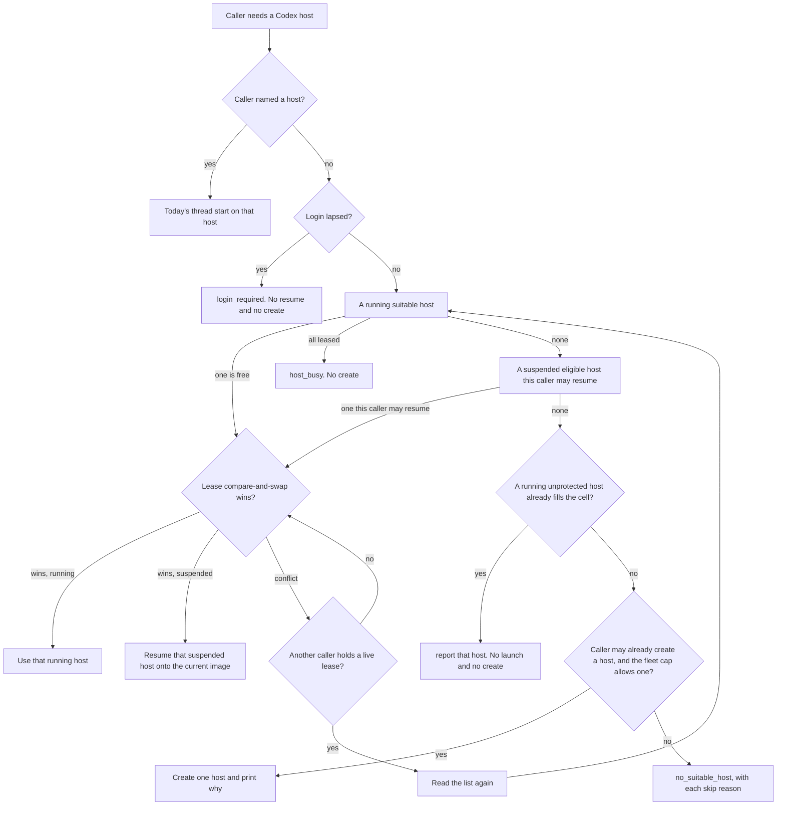

# DESIGN-063: Reuse paired Codex hosts

- **Status:** Accepted 2026-11-11 by the coordinator
  (dev-env-fable-coordinator-1109, story OP696), with the rulings in
  section 11. Slice 1 (story 698) is the pure choice. This document
  switches nothing on, and it does not resume, restart or change the
  cluster.
- **Tracking:** [Story OP696](https://work.haynesnetwork.com/projects/haynes-engineering/work_packages/696),
  under [Epic #91](https://work.haynesnetwork.com/work_packages/91).
- **Origin:** Tom, 2026-11-10, to Meatball. The sentence in
  `~/.shared/handoffs/meatball-fable-20261110/to-fable-022.md` is quoted in
  section 1. The story records two earlier sentences from the same evening,
  also quoted there. Nothing else in this document is Tom's.
- **Cause:** story 571's description says the live check provisioned a new
  Codex host and Tom had to pair it, although three Codex hosts were already
  suspended. The host is `dev-env-1110-230548`, created `2026-11-10T23:05:48Z`
  (section 3). The platform can show that a pairing code was issued. It cannot
  show that a phone paired. Section 3 is the inventory, read only.
- **Builds on:** [DESIGN-057](057-generic-thread-launch.md) (thread start on an
  existing host), [DESIGN-060](060-meatball-front-door.md) (the front door and
  coordinator start), the Codex session model in
  [docs/workflow-guide.md](../../../../docs/workflow-guide.md) and
  [docs/v2-quickstart.md](../../../../docs/v2-quickstart.md). Story
  [OP695](https://work.haynesnetwork.com/projects/haynes-engineering/work_packages/695)
  is the folder-trust rule a pooled host needs before it is ready.
- **Decision:** this does not change who may create a host, who may resume a
  named session, the profile fence, retention, archive, or the shared login.
  It does not need an ADR. An ADR would be needed later if ordinary sessions
  gained the right to create a Codex host, if archive were held for pooled
  hosts, or if Tom allowed some other person's suspended host into the pool.
  None of those is decided here. ADR-024 is the next free number
  (ADR-023 is the last one on 2026-11-10) and is not written.
- **Evidence:** dev-env `291d8f57` (origin/main; every source line below).
  Live reads 2026-11-10T23:33Z to 23:42Z, `kubectl get` and `agent-run` only.
  No exec, resume, suspend, reap or pair. This session did not write a
  session, a pod or a volume.

## 1. Outcome

When a thread needs a Codex host, the tooling uses a suitable host that is
already paired. If none is running, it resumes one eligible suspended host
onto the current image. It keeps a few of those hosts, and it creates a new
host only when no safe host can be used, and it says why. Agents provision
hosts. Tom only pairs.

A headless Codex task stays its own session. It does not take a paired host.
Section 7 says which commands change.

Tom's words, and only these:

- Recorded in the handoff file, Tom to Meatball: “Get that codified with Fable in the tooling good to have a few we reuse so I don’t have to pair constantly”
- Recorded on story 696, earlier the same evening, Tom to Meatball: "Done but why ? Why do we keep adding new sessions instead of using existing paired ones"
- Recorded on story 696, the same report: "I don't start them"

"A few" is his. This design does not turn it into a number he chose.

## 2. How a Codex host works today

A Codex host is an AgentSession with `spec.agent` `codex` and `spec.mode`
`remote`. It is created with `agent-run --repo <name> --agent codex
--interactive`. It runs Codex's phone daemon on the session volume and on the
keeper's access projection. It is not a project task
(`internal/apiserver/validate.go:149-166`).

Who may create one: Tom's human caller, a trusted client (the workbench and
the v1 pod), and a session pod that is the workbench. An ordinary session is
refused, because the host uses the keeper's Codex login
(`internal/apiserver/validate.go:156-163`). A workbench session may not name
a profile. The host it starts runs on the templates' default profile
(`internal/apiserver/validate.go:305-324`). The default profile in the live
templates is `full` (ConfigMap `dev-env-templates`, key `templates.yaml`,
`defaultProfile:`). A human caller can name a profile. `dev-env-1110-230548`
is profile `dev`, and its parent is `dev-env-system/dev-env-human`.

The enrollment Codex keeps for the computer, the state sqlite and the
installation id, lives under `CODEX_HOME` on the session volume. That is
`~/.codex` unless the pod sets `CODEX_HOME`
(`internal/agentd/codex_remote.go:25-27`,
`internal/agentd/settings.go:160`). The file that records "a pairing code was
issued" is `~/.agentd/codex-pair-issued.json`. It holds a time and no code
(`internal/agentd/codex_remote.go:76-78`,
`internal/agentd/codex_remote.go:459-460`). `agent-run pair` returns the code
to its caller and does not write the code anywhere else
(`internal/agentd/codex_remote.go:417-421`).

What the platform can know, from `collectCodexRemote`
(`internal/agentd/codex_remote.go:369-410`):

| Daemon and login | `status.remoteControl.state` | Pairing code issued? | Phone paired? |
| --- | --- | --- | --- |
| Keeper projection not current | `login-required` | Not read. The function returns before the marker file | Unknown |
| Daemon not live | `starting` or `offline` | Not read | Unknown |
| Connected, marker file absent | `unpaired` | No. No phone can have paired through this host | No |
| Connected, marker file present | `pair-code-issued` | Yes, at least once | Unknown. Codex has no read for the phone's side |
| Connected, Codex reports the connection errored | `errored` | Not read on this path | Unknown |

`agent-run show` prints the same limit: "Codex cannot confirm a phone paired"
(`internal/agentrun/sessions.go:400-401`). A suspended host keeps the last
heartbeat. That heartbeat is not a new reading. A `login-required` value
frozen at suspend is not a reading of the marker file, and it is not a
reading of the keeper projection now.

A live daemon is reported `busy`, so the idle timer does not suspend the host
and drop the phone's computer (`internal/agentd/codex_remote.go:393-395`,
`internal/controller/reconciler.go:803-814`). The quickstart says a host
never suspends itself for that reason
(`docs/v2-quickstart.md`, "A host never suspends itself"). That is true while
the daemon is live. When the projection is missing, the agent state is
`login-required`, which is not `busy`, and the idle timer can suspend the
host. Section 3 shows three hosts the idle timer suspended on 2026-11-07
while they were `login-required`.

A remote session is never moved to a new image by the automatic drain
(`internal/controller/drain.go:65-72`). `agent-run suspend` then
`agent-run resume` is how a host changes image. Resume sets
`spec.operatingMode` to `Running` (`internal/apiserver/lifecycle.go:17-31`).
The reconciler then builds a pod from the current templates on the same
volume (`internal/controller/reconciler.go:1276-1333`,
`internal/controller/pod.go:185-188`). The pairing marker and `~/.codex` stay
on that volume. Reaping the host deletes the volume, and the pairing with it
(`docs/v2-quickstart.md`, Codex section).

`agent-run thread start --agent codex --host <name>` requires a Running Codex
remote host (`internal/apiserver/threads.go:79-85`). A session caller may
use a host of its own profile, or a host it or its children started
(`internal/apiserver/threads.go:118-144`). Inside the host, a missing marker
file stops the launch with `pairing_required`. A present marker is reported
as pairing unknown, reason `pair_code_issued`, and the launch continues
(`internal/agentd/thread_launch_codex.go:288-294`). The current image is
`2.101.0`. Thread start on an older agentd returns `host_unsupported`.

The keeper projection is one shared access file. `agent-run auth status`
reads it and does not refresh it. `SyncCodexAccess` accepts it when it
decodes and expires more than five minutes ahead
(`internal/agentd/codex_auth.go:66-68`). It installs a private `auth.json`
and does not change enrollment. The keeper is the one owner of the refresh.
A host does not have its own login.

Archive of a suspended session is `status.suspendedAt` plus
`spec.lifecycle.archiveAfter`, or the templates' `archiveAfter` of `168h`
(`internal/controller/reconciler.go:1005-1021`; templates `lifecycle:`).
A valid rescue is `Verified` or `CleanAndPushed`, not superseded
(`internal/controller/rescue.go:530-537`). `Failed` blocks archive.

## 3. Inventory on 2026-11-10

Reads, all in namespace `dev-agents` unless named:

- `kubectl get agentsessions -o json`, then the objects with `spec.agent`
  `codex` and `spec.mode` not `task`. Six hosts. No other non-task Codex
  session.
- `kubectl get pvc home-<name>` for each host and for the three protected
  sessions that are not Codex hosts.
- `kubectl get pod <name> -o json` where a pod exists: image, resources,
  labels `profile`, `revision` and `hold`.
- `agent-run show <name>` for `dev-env-1110-230548`,
  `haynes-ops-1109-115326`, `dev-env-1027-010042` and
  `dev-env-1020-002245`.
- `agent-run fleet`. First line: `revision: 2.101.0-68cbb6fc63`. Phases at
  that read: Pending 2, Running 11, Suspended 148, Archived 15, Failed 23.
- `agent-run auth status` in this session: Codex `Ready`, generation 4,
  access expires `2026-11-18T02:26:21Z`, keeper last refresh
  `2026-11-08T02:26:22Z`. Claude on this session is `NotConfigured`. That
  Claude line is this session's mount, not a fact about the hosts.
- `kubectl -n dev-env-system get cm dev-env-templates`, key `templates.yaml`:
  image tag `ghcr.io/thaynes43/dev-env:2.101.0`, `rollout.newSessionsOnlyImage`
  set to that same image, sizes below, home `20Gi` on `gasha01-rbd`,
  `defaultProfile: full`.

`agent-run show` prints `profile` only when `spec.profile` is set
(`internal/agentrun/sessions.go:202-204`). An empty spec uses the default
when the pod is built (`internal/templates/templates.go:460-464`,
`internal/controller/pod.go:316`). The resolved name is the pod label
`dev-env.haynesops.com/profile`. A suspended host has no pod, so its last
resolved profile is Unknown. Its next pod would use today's default, `full`,
when the spec is empty.

The hands-off list from the coordinator, treated here as protected: host
`haynes-ops-1109-115326` and its thread, and sessions
`dev-env-1027-111645`, `dev-env-1104-010332` and `dev-env-1027-010058`. A host
with a failed rescue is excluded as well. Protected means this design's
selector must not resume it, restart it, re-image it, lease it or start a
thread on it.

### 3.1 Codex hosts that are not tasks

| Host | Phase | Revision | Code issued | Phone paired | Rescue | Unpushed | Parent | Profile | Repo | Last activity | Protected |
| --- | --- | --- | --- | --- | --- | --- | --- | --- | --- | --- | --- |
| `dev-env-1110-230548` | Running on talosw03 | `2.101.0-68cbb6fc63`, current | Yes. `pair-code-issued` | Unknown to the platform | No rescue record | Unknown. No rescue, and this read did not exec | `dev-env-system/dev-env-human` | `dev` (spec and pod label) | `dev-env` | `2026-11-10T23:36:41Z` | No |
| `haynes-ops-1109-115326` | Running on talosw02 | `2.89.0-71bda058f0`, outdated; current is `2.101.0-68cbb6fc63` | Yes. `pair-code-issued` | Unknown to the platform | No rescue record | Unknown. Same limit | `dev/dev-env` | spec empty; pod label `full` | `haynes-ops` | `2026-11-10T23:37:17Z` | Yes. The host and its thread |
| `dev-env-1027-010042` | Suspended since `2026-11-07T21:10:07Z`, by `idle-timer` | No pod, so no revision | Unknown. Last state `login-required` does not read the marker | Unknown | `CleanAndPushed`, stamp `20261107-2108`, not superseded | 0 | `haynes-ops-1022-015547` | spec empty. Last pod label Unknown. Next pod would be `full` | `dev-env` | `2026-10-27T01:05:33Z`. Heartbeat `2026-11-07T21:10:05Z` | No. Not on the hands-off list |
| `dev-env-1019-205125` | Suspended since `2026-11-07T21:12:35Z`, by `idle-timer`. Resumed `2026-10-30T12:18:00Z` | No pod | Unknown. Last state `login-required` | Unknown | `Verified`, stamp `20261107-2108` | 67 refs, clones `dev-env`, `hass-sandbox`, `haynes-ops` | `dev/dev-env` | spec empty. Last pod label Unknown. Next pod would be `full` | `dev-env` | `2026-10-19T20:52:06Z`. Heartbeat `2026-11-07T21:12:34Z` | No. It is the parent of protected session `dev-env-1027-111645` |
| `haynes-ops-1023-041051` | Suspended since `2026-11-07T21:11:01Z`, by `idle-timer` | No pod | Unknown. Last state `login-required` | Unknown | `Verified`, stamp `20261107-2108` | 42 refs, clones `haynes-ops`, `haynesnetwork` | `dev/dev-env` | `workbench` | `haynes-ops` | `2026-10-28T12:12:23Z`. Heartbeat `2026-11-07T21:11:00Z` | No |
| `dev-env-1020-002245` | Suspended phase, hold pod on talosw02. `deletionTimestamp` `2026-10-20T00:23:15Z`. `spec.operatingMode` still `Running` | `2.45.0-eac7e410f2` on the hold pod | Unknown. Last state `offline` does not read the marker | Unknown | `Failed`, reason `NotProven`, stamp `20261110-2334` | Not proven. The failure says the `dev-env` clone is missing from the report | `haynes-ops-1019-233310` | spec empty; hold pod label `full` | `dev-env` | No `lastActivity`. Heartbeat `2026-10-20T00:23:16Z` | Excluded. Failed rescue and a reap in progress |

More from the same reads:

- `dev-env-1110-230548`: size S, model `gpt-6-astra`, effort `low`, created
  `2026-11-10T23:05:48Z`, agent `busy`, PodReady, Outdated false. PVC
  `home-dev-env-1110-230548` Bound `20Gi`. Pod requests `100m` CPU and `1Gi`
  memory, limits `2` CPU and `4Gi`. Project bootstrap Ready, 9 of 9
  repositories. No child session. `agent-run show` says a pairing code was
  issued and that Codex cannot confirm a phone paired.
- `haynes-ops-1109-115326`: size M, model `gpt-6-astra`, effort `xhigh`,
  created `2026-11-09T11:53:26Z`, agent `busy`. Image
  `ghcr.io/thaynes43/dev-env:2.89.0`. PVC Bound `20Gi`. Pod requests `250m`
  and `2Gi`, limits `4` and `8Gi`. Outdated reason `OlderRevisionHeld`:
  automatic drain is held, so this host moves only by its own suspend and
  resume. No child session. Its thread is not an AgentSession. The thread id
  is Unknown, because listing threads needs exec and this read did not exec.
  The whole host is protected, so every thread on it is out of bounds.
- `dev-env-1027-010042`: size M, model `gpt-6.1-sol`, effort `medium`, created
  `2026-10-27T01:00:42Z`. PVC Bound `20Gi`. Rescue message: every clone clean
  and pushed, agent not running. No child session. Bootstrap at the last
  heartbeat was Partial. `agent-run show` names `haynesnetwork` Preserved,
  TimedOut. Meatball's file says this host kept a pairing on the volume.
  The API does not show that. The marker was not read.
- `dev-env-1019-205125`: size S, model `gpt-6-astra`, created
  `2026-10-19T20:51:25Z`. PVC Bound `40Gi`, requested `40Gi`, not the
  templates' current `20Gi`. Rescue message: 67 refs bundled, agent not
  running. Sixty sessions have this host as `spec.parent`, including
  `dev-env-1027-111645`.
- `haynes-ops-1023-041051`: size M, model `gpt-6.1-sol`, effort `medium`,
  created `2026-10-23T04:10:51Z`. PVC Bound `20Gi`. One child session,
  `haynes-ops-1103-141902`. Rescue message: 42 refs bundled, agent not
  running.
- `dev-env-1020-002245`: size S, model `gpt-6-luna`, created
  `2026-10-20T00:22:45Z`. PVC Bound `20Gi`. The pod label `hold` is `true`.
  It runs no agent (`PodReady` reason `HoldPod`). `RemovalBlocked` is true,
  reason `DeleteNeedsRescue`. At the read, the condition said the rescue
  runs again at `2026-11-10T23:49:42Z`. That retry is the operator's hold
  pod. This session did not start it.

The keeper refresh on 2026-11-08 is after the three idle-timer suspends on
2026-11-07. Those three `login-required` values are snapshots from before
that refresh. `agent-run auth status` on this evening is `Ready`. The
snapshots are not proof that a login, or a pairing, is required now.

Archive, if the existing timer runs, is 168h after `suspendedAt`:
`dev-env-1027-010042` at `2026-11-14T21:10:07Z`,
`haynes-ops-1023-041051` at `2026-11-14T21:11:01Z`,
`dev-env-1019-205125` at `2026-11-14T21:12:35Z`. Their rescues are valid, so
the guard allows archive. `dev-env-1020-002245` is `Failed`, so archive waits.
This design does not move those clocks.

### 3.2 Protected sessions that are not Codex hosts

Same AgentSession read, plus PVC and pod where they exist.

| Session | What it is | Phase | Profile | Parent | Rescue | Why it is listed |
| --- | --- | --- | --- | --- | --- | --- |
| `dev-env-1027-111645` | Claude remote, `claude-opus-5-5`, repo `dev-env`, revision `2.45.0-eac7e410f2` | Running on talosw03, agent `busy`, last activity `2026-11-10T23:36:39Z` | `full` | `dev-env-1019-205125` | `CleanAndPushed`, superseded | Hands-off list. Active |
| `dev-env-1104-010332` | Claude local, `claude-opus-5-5`, repo `dev-env`, revision `2.89.0-71bda058f0` | Running on talosw03, agent `idle` | `workbench` | `dev-env-1027-010058` | No rescue record | Hands-off list |
| `dev-env-1027-010058` | Claude remote, `claude-opus-5-5`, repo `dev-env` | Suspended since `2026-11-07T18:25:20Z`, by `idle-timer` | `workbench` | `haynes-ops-1022-015547` | `Verified`, 109 unpushed refs in `dev-env` and `haynes-ops` | Hands-off list |

Each of these PVCs is Bound `20Gi`. None of them is a Codex host. The
selector never considers them, and it also refuses their names if they
appear on the protected list, so a bug cannot treat them as hosts.

### 3.3 What was in use

Codex remote hosts overlapping, from `creationTimestamp` to `suspendedAt`, or
to the read if still Running. `dev-env-1020-002245` has no `suspendedAt` and
was deleted the minute it was created, so it is not in the overlap.

- Treating each host as running from creation until its 2026-11-07 suspend
  overstates `dev-env-1019-205125`: its `resumedAt` is `2026-10-30T12:18:00Z`,
  so it was suspended at least once before that, and the annotation does not
  keep the earlier interval.
- The proven overlap of all three is from that resume until
  `2026-11-07T21:10:07Z`, when `dev-env-1027-010042` was suspended. That is
  two `dev-env` hosts with empty `spec.profile`, plus the `workbench`
  `haynes-ops` host. It is not one profile cell.
- From the 2026-11-07 suspends until 2026-11-09, no Codex remote host was
  Running.
- Tonight, two are Running: the protected `haynes-ops` host and
  `dev-env-1110-230548`.

Codex tasks are a different thing. The same list has 63, all `mode: task`.
None is Running. Forty-two are Suspended, twenty Failed, one Pending.
Counting a task from creation until `suspendedAt` (42 of them have one), the
peak overlap is 17 session records at `2026-10-26T04:58:58Z`, of which 11
are profile `full` and repo `dev-env`. Since 2026-11-09 there are 18 Codex
tasks, all Suspended. That peak is how many task records had not been
suspended yet. It is not a count of phone threads, and it is not a pool size.

Threads inside a host: Unknown. `thread/list` is an exec, and this read did
not exec.

Running sessions of every kind at the read: 4 Cursor tasks on profile `dev`
and repo `dev-env`, plus one each of several Claude sessions, plus the two
Codex hosts above. No running Codex task.

## 4. What suitable means

A program can decide from the AgentSession object, the pod label when a pod
exists, the templates' `defaultProfile`, the protected list, and the login
fact taken from session status. It does not exec into the host, and it does
not read the Secret `dev-env-codex-live`.

**Shared login, checked once per selection.** The operator never reads the
Secret `dev-env-codex-live`, and this slice changes no Role. The login fact
comes from session status. Every AgentSession with `spec.agent` `codex` and
`spec.mode` `remote` that is Running, with a pod Ready and a heartbeat
inside the operator's existing staleness bound
(`authority.DefaultHeartbeatStaleAfter`), is a reading. Protected and
hands-off hosts are included, because this only reads their status. The one
with the newest heartbeat decides: remote state `login-required` is lapsed;
any other state is current. No such host is unknown. Only lapsed returns
`login_required`. Unknown does not block. A suspended host's frozen
`login-required` is not a reading, and a create with an unknown login is
what create does today. A fact published by the keeper is a later option
and is not built.

**A running host is suitable** when all of these hold:

1. `spec.agent` is `codex` and `spec.mode` is `remote`.
2. Phase `Running`, `spec.operatingMode` `Running`, no deletion timestamp,
   pod Ready, and the pod is not a hold pod.
3. Resolved profile fits the caller. The resolved profile is the pod label,
   else `spec.profile`, else the templates' `defaultProfile`. The choice
   fits on profile alone: the host's resolved profile equals the profile
   the request resolves to, which for a session is its own. A `dev` caller
   does not fit a `full` host. A `full` caller does not fit the `dev` host
   `dev-env-1110-230548`. Ancestry is not a fit: `threadProfileFence` still
   lets a session start a thread on a host it or its children started when
   it names that host, and a named host does not enter the choice.
4. The requested repository is Ready in the host's reported project
   bootstrap. That report is `status.agent.projectBootstrap.repositories`:
   one entry per repository, state `Ready` or `Preserved`
   (`api/v1alpha1/agentsession_types.go:1294-1320`,
   `internal/apiserver/view.go:128-136`). `spec.repo` is only the default.
   `resolveCwd` uses the request's repository, and the host's own only when
   the request names none (`internal/agentd/thread_launch_codex.go:335-340`).
   A cell is the resolved profile. One paired host serves every repository
   of that profile whose bootstrap entry is `Ready`. The profile fence
   admits a caller by profile (`internal/apiserver/threads.go:118-144`).
   The host's credentials are that profile's.
5. Not protected. Protected is: the name is on the configured hands-off
   list, or the annotation `dev-env.haynesops.com/protected` is `true`, or
   a rescue result is `Failed`, or `RescueFailed` is True, or
   `RemovalBlocked` is True. The annotation is not on any host today. The
   list is the operator flag `--codex-host-hands-off`. The flag has no
   default. The operator refuses to start with `--enable-codex-host-select`
   unless `--codex-host-hands-off` is given; an explicit empty value is a
   stated choice. The failed-rescue rule catches
   `dev-env-1020-002245` even if the list is empty.
6. Not busy. Busy means an unexpired lease annotation held by another
   caller, as section 5 defines it. Agent state `busy` on a live daemon is
   the normal state. It is not busy for this rule.
7. `status.remoteControl.state` is `pair-code-issued`. `unpaired` is not
   suitable: no phone can have paired, and making it suitable would mean
   asking Tom for a code. `login-required`, `offline`, `starting` and
   `errored` are not suitable. A running host in those states is left
   alone. This feature does not restart it.
8. The host's reported agentd is at least `2.102.0`. The route reads
   `status.agent.agentd` and the pool parses that line strictly. The
   reported form is what `version.Info.String("agentd")` writes:
   `agentd v<major>.<minor>.<patch> (commit <commit>, <go>, <platform>)`,
   with no leading zero in a component. A version below the minimum, or a
   missing or unparsable line, is `image_outdated`. The host is not used
   and it is not suspended. It still counts toward the cell.
   `internal/codexhostpool` keeps one constant for that minimum,
   `MinAgentdVersion`. Raise it, in a reviewed change, when a release
   changes what a thread launch needs from agentd. `2.102.0` is the
   release in which agentd trusts a bootstrapped folder itself. `2.101.1`
   carried the reply reading and is below the minimum. The pod revision
   is not this rule. The answer's `outdated` is true when the chosen host
   is running and its pod revision label is not the current template
   revision. It is information only. Ready stays true exactly when the
   action is `use`. A suspended eligible host does not take this test: a
   resume puts it on the current image, and a resume answer leaves
   `outdated` false. Nothing here suspends, resumes or restarts a host.
   `haynes-ops-1109-115326` fails the protected rule before this one. Its
   image `2.89.0` is also below the minimum, so a launch there would be
   `host_unsupported` even if it were not protected.
9. The login fact is not lapsed. Unknown does not block.

**The present pod has reported.** The agentd line, the remote state and the
repository readiness are status fields. They keep the previous pod's values
until a heartbeat from the present pod is stored. A running host's reported
facts count only when its present pod reported them. The route sets one
boolean on the host fact, true only when the pod is present,
`status.agent.podUID` is not empty and equals that pod's UID, and
`status.agent.lastHeartbeat` is set, is not after now, and is inside the
staleness bound `codexHeartbeatFresh` already uses (no new number). In the
judge, a running host without that fact is skipped with
`remote_unavailable`, in the same place as the pod Ready test, before the
remote state, the version and the lease are read. It still counts toward
the cell. Suitable and the lease step use the judge, so the lease's fresh
read applies it. A suspended host is not held to it. The login fact is
read as before.

The pod UID binds those facts to the pod.
`POST /v1/sessions/{name}/heartbeat` records `status.agent.podUID` from the
authenticated caller, never from the request body, and it stamps
`lastHeartbeat` with the operator's clock (`agentStatus` takes `s.now()`).
Every status patch from a caller with a pod carries that caller's UID,
whatever the handler's read held, so a patch computed from an earlier read
stamps the caller's own UID. The write is a merge patch against that read,
and a field equal to the read is left out. A heartbeat stored with no
other write between its read and its patch leaves `status.agent` and
`status.remoteControl` wholly that caller's. A caller with no pod leaves
`podUID` empty and forces nothing into the patch. The merge patch then
sends null for a key the read had and the new object lacks, so a stored
UID is removed.

A heartbeat from the previous pod that is stored late carries the previous
pod's UID and so does not count. When a UID is already stored and it is
not this caller's, the status patch carries the resource version of that
read. A status write that landed after the read is refused, so the other
pod's later fields are not left under this caller's UID. An empty stored
UID takes no such lock: it does not bind a report, and until the CRD has
the field the UID reads back empty on every heartbeat. Until the cluster's
CRD has the field the API server drops it and no running host counts as
reported.

A limit stays. A heartbeat from the present pod whose read already held
its own UID takes no lock. If a write from the previous pod lands between
that read and its patch, the fields the present pod did not change keep
the previous pod's values under the present pod's UID until the present
pod's next heartbeat. This needs a request from the previous pod to stay
in flight inside the operator across the whole replacement and to land
inside one run of the handler. Every heartbeat is not locked, because that
would refuse a heartbeat whenever any other writer changes the session
between the read and the patch, and this route carries every session's
liveness, usage and task result. Ruling S says the same in short, and the
lock of dcfb7207 stays.

A container restart inside the same pod keeps the pod UID, so the previous
container's report counts for at most the staleness bound. The image is
the same, so the version is right, and the remote state can be that old.
The route still accepts a heartbeat from the session's own pod, including
one that is deleting, and it does not change who may post one. Still not
defended: a process inside the host that sends a false heartbeat. The
version string is only length-clipped.

**A suspended host is eligible to resume** when all of these hold:

1. Phase `Suspended`, operating mode `Suspended`, no deletion timestamp, not
   archived.
2. Profile fit is the same test as running rule 3, and the requested
   repository is Ready as in running rule 4. With no pod, an empty
   `spec.profile` resolves to today's `defaultProfile`. `spec.repo` is only
   the default.
3. Not protected, by the same rule.
4. The newest rescue is `CleanAndPushed` or `Verified`, not superseded, with
   `unpushedRefs` empty and `omittedRefs` empty. Someone else's unpushed
   branches stay on that volume. `dev-env-1019-205125` (67) and
   `haynes-ops-1023-041051` (42) fail this.
5. Pairing evidence. The test until slice 6 and the test after it are
   different.

   Until slice 6 (story 703) the status field does not exist. The last
   `remoteControl.state` must be `pair-code-issued`. A frozen
   `login-required` or `offline` means the marker was not read. The host is
   not eligible. Resuming it to go and look would wake a volume this feature
   cannot show was paired. This test cannot tell "never paired" from
   "paired, then the login lapsed". `dev-env-1027-010042` is clean and
   pushed, and it still fails this, because its last state is
   `login-required`. Slice 1's choice uses this test.

   After slice 6 the session carries a durable record that a pairing code
   was issued. Eligibility for resume uses that record together with a
   current keeper login, not the last transient remote-control state. A
   host the idle timer suspended after the keeper login lapsed is eligible
   when that record is set and the keeper login is current, and the other
   rules of this list still hold. A host with no record that a pairing code
   was issued is not eligible. The field, and the CRD copy that lands in
   haynes-ops before the operator writes it, are slice 6. Slice 1 does not
   add the field.
6. The login fact is not lapsed. A frozen `login-required` is not a reading
   and does not fail this check. Unknown does not block.
7. Resuming it would stay inside the pool caps in section 6.
8. This caller is one today's resume route would accept for that host. A
   caller of kind `coordinator` is accepted only for its own child
   (`internal/apiserver/lifecycle.go:51-56`,
   `internal/apiserver/coordinator.go:99-106`). A pooled host is not that
   child. Select does not return `resume` to that caller, and it does not
   widen the route. A session, human or workbench caller still may resume,
   which is the reach that route already has: `authorizeChildMutation`
   returns before the child check when the kind is not `coordinator`
   (`internal/apiserver/coordinator.go:100-102`).

Who suspended the host does not matter. Until slice 6, a suspended host is
eligible for resume when its last recorded remote-control state before the
suspend was `pair-code-issued`, its rescue is clean with nothing unpushed,
it is not protected, and it fits the profile, including a requested
repository the reported bootstrap lists as Ready. A named suspend can leave
that state. The idle timer cannot. `pair-code-issued` is reported only on
the live daemon path, which sets the agent busy, and a busy agent is not
suspended (`internal/agentd/codex_remote.go:393-404`,
`internal/controller/reconciler.go:812-814`). When the keeper projection
lapses, the state becomes `login-required` and the idle timer can suspend
after 72 hours. Until slice 6, rule 5 then excludes that host. After slice
6, rule 5 is the durable record together with a current keeper login, so
that lapse does not by itself exclude a host the record shows was paired.

The three hosts the idle timer suspended on 2026-11-07 stay out under the
rule that applies until slice 6. `dev-env-1027-010042` fails rule 5: its
last state is `login-required`, not `pair-code-issued`.
`dev-env-1019-205125` fails rule 4 (67 unpushed refs) and rule 5 (last state
`login-required`). `haynes-ops-1023-041051` fails rule 4 (42 unpushed refs)
and rule 5 (last state `login-required`). Section 3 has no durable record
that a pairing code was issued for any of them. After slice 6 they stay out
until such a record exists, and the unpushed-work rule still excludes the
two that have unpushed refs.

No suspended host in section 3 is eligible. That is a result of the rules,
not a gap in the read.

**Ready** is true exactly when the action is `use`. Folder trust is not an
input. Story 695 writes trust at each thread start, and that trust does not
survive a boot, so selection does not read it. Missing trust is not a
reason to create another host.

On this evening, for a caller whose profile fits `dev`,
`dev-env-1110-230548` is the only running paired host that fits the
profile. Its project bootstrap is Ready, 9 of 9 repositories, so a
request for any repository in that report fits. `spec.repo` `dev-env` is
only the default. Its image was `2.101.0`, which rule 8 now treats as
below the agentd minimum, so the action is `report` with reason
`image_outdated`. The host fills the cell, and nothing is created. Its
pod revision was the current template revision, so `outdated` is false.
Ready is false. For a profile that does not fit `dev`, no host is
suitable.

## 5. Selection

A cell is the resolved profile (section 4, rule 4). Login lapsed is the
session-status fact in section 4. Unknown does not take the stop.

Order:

1. A running suitable host. If several fit, prefer one that already carries
   the pool label, then the one with the newest `lastActivity`. Slice 2
   reads that label as `dev-env.haynesops.com/codex-host-pool=true` on the
   session, and on the pod when the session has none. This slice does not
   write it.
2. A suspended eligible host, resumed onto the current image, and only when
   rule 8 in section 4 says this caller may resume it. Resume is the
   existing operating-mode change. The new pod is the current templates, on
   the same volume. If several fit, resume the one suspended longest ago,
   and only one. A caller of kind `coordinator` does not take this branch
   for a pooled host.
3. A new host, only as the fallback in section 6, with the reason printed.
   Before that create, every running unprotected Codex remote host in the
   cell already counts, suitable or not. If one is there, the result names
   it with action `report` and does not create a second host. The reason
   names the skip result for every existing host.

The result is one JSON object the caller prints: `host`, `action`
(`use`, `resume`, `create` or `report`), `ready` (true or false),
`outdated` (true or false), `reason`, and `skipped` as a list of
`{name, reason}`. `outdated` is true when the chosen host is running and
its pod revision label is not the current template revision. When a lease
was written, that revision is the one read with the lease, not the list.
It does not change `ready`, which stays true exactly when the action is
`use`. A resume answer leaves `outdated` false. `report` names the running host
that already fills the cell, and the cell is the resolved profile. The
selector does not launch on it and does not create another. Reasons are the
fixed codes in section 7. No pairing code, no prompt text, no transcript.

**A caller that names a host gets that host.** `--host` does not enter this
order. Today's thread start runs, including `host_not_running`,
`pairing_required`, `caller_not_allowed` and `host_unsupported`. The selector
does not substitute another host, and it does not refuse a protected host
that the caller named. The refusal of protected hosts is only for the
automatic path. This feature itself never names a protected host.

**Race.** Before `use` or `resume`, the selector writes one annotation,
`dev-env.haynesops.com/codex-host-lease`, with a purpose word, an expiry,
the caller's identity and a launch id, space-separated. A value whose second
field parses as a time in the future is busy for acquisition and for
suitability, whatever its other fields are; a fully parsed four-field value
still lets the same holder and launch id renew and release. The write is a compare-and-swap on the session's
`resourceVersion`. A status write bumps that version too, and a running
host's heartbeat does it often. The operating-mode route already retries
that kind of conflict (`internal/apiserver/lifecycle.go:34-38`,
`internal/apiserver/lifecycle.go:142-143`). The lease does the same for one
host. On a conflict the selector reads that same host again. It retries the
lease while the annotation is absent, expired, malformed, or already this
caller's for the same launch id. The same caller with another launch id is
busy. It moves to the next host when the lease is busy. A heartbeat is not
that. It does not start a thread on a host
whose lease another caller holds. The lease lasts at most 15 minutes, which
covers a resume and a thread start wait of 10 minutes. The caller clears it
when the launch result is known. A dead caller leaves it until expiry. A
select answer lost in transit leaves the lease until its expiry, at most
15 minutes (ruling I). The lease serializes this tooling's own launches. It does not mean the phone is
idle. The platform cannot see an in-progress phone turn without exec, and
this design does not exec to decide. Two launches over time on one host are
the reuse we want. Two launches at the same moment are the race the lease
stops.

The selector does not write the lease on a protected host, a rescue-failed
host, or a host it is not going to use. A read-only check writes nothing.

**Create race.** Idempotency keys are per parent
(`internal/apiserver/sessions.go:266-278`), so two callers with the same key
string still create two hosts. The fallback takes one operator-owned
ConfigMap, `dev-env-codex-host-pool` in `dev-env-system`, with one key per
resolved profile. The compare-and-swap of that key holds the session name
being created and an expiry of at most 15 minutes, the same bound as the
lease. The loser reads the named session. If that session exists and fits,
the loser uses it and does not create another. If the name is absent and
the claim has not expired, the loser waits and reads again, and it still
does not create. If the claim has expired, or the named session exists and
does not fit (it is Failed, it is being deleted, its profile does not fit,
or the requested repository is not Ready in its reported bootstrap), the
loser clears that claim with its own compare-and-swap and runs selection
again. A creator that dies, or whose create is refused, blocks that cell
only until the expiry. The ConfigMap holds names and an expiry, not codes
or prompts.

## 6. The pool

"A few" is what Tom asked for. The count has to come from the use in section
3.3 and from what a host costs.

**Use.** The thing that needs a pairing is a Codex remote host, not a Codex
task. Tasks peaked at 17 unsuspended records and do not use a host. Hosts
peaked at three unsuspended at once, then the idle timer suspended all three
while their login snapshots were stale. Tonight two hosts are Running, and
none is suitable: the one that fits profile `dev` is below the agentd
minimum, and the other is protected. Per profile, that overlap was two hosts with empty
`spec.profile` (the next pod would be `full`) and one host on profile
`workbench`. No profile has two suitable hosts tonight. Threads per host
are Unknown.

**Cost.** Each host has a volume. The live claims are `20Gi` on
`gasha01-rbd`, except `dev-env-1019-205125` at `40Gi`. A suspended host keeps
the volume and spends no CPU. A running size S host, which is what
`dev-env-1110-230548` is, requests `100m` CPU and `1Gi` memory and is limited
to `2` CPU and `4Gi`. A size M host requests `250m` and `2Gi`, limits `4`
and `8Gi`. Those are the templates' S and M classes, and they match the two
running pods. The login is not per host. Every daemon uses the one keeper
projection. A second login would be a second refresher, which this design
does not add.

**The number is a setting, with a default from that evidence.**

- `maxRunningPerCell` defaults to 1. A cell is one resolved profile. One
  running host in the cell is enough for the reuse that was missing on
  story 571, and that host serves every repository of the profile whose
  bootstrap reports Ready. The historical pair of empty-profile `dev-env`
  hosts is not evidence of two simultaneous suitable threads.
- `maxRunning` defaults to 2 for the whole fleet. It counts the same running
  unprotected Codex remote hosts as the cell cap. Tonight one host counts:
  `dev-env-1110-230548`, the pool's host for profile `dev`.
  `haynes-ops-1109-115326` is protected, so it stays outside the cap. A
  fleet cap of 2 leaves room for one more profile later without a host per
  repository. Seven catalog projects times a running host would be a host
  per repo, which the thread evidence does not support.
- Both values are operator flags. Code does not bury a second copy. A change
  to either flag is a reviewed template or operator change, with the use
  from `agent-run fleet` at that time. This design does not ask Tom for a
  number.

**What counts toward the cap.** Every Running Codex remote host in the cell
that is not protected. Suitable or not, pool label or not. That includes
`unpaired`, `login-required`, `offline`, `starting`, `errored`, a running
host the present pod has not reported (`remote_unavailable`), and a
running host whose reported agentd is below the minimum, missing or
unparsable (`image_outdated`). A pod revision that is not current does
not by itself keep a host out of the cap or out of use.
A new host beside an unpaired one would ask Tom to pair again. The cell cap
stops that. A protected host does not count. A leased host counts, so a
second caller waits or gets `host_busy` instead of a new host. When the
one host that fills the cell is not suitable, the result is action
`report` with that host and its reason (`unpaired`, `image_outdated` or
`remote_unavailable`). The selector does not launch on it. `at_capacity`
is a resume or a create that would exceed `maxRunning`. A cell that
already has its running host returns `use`, `host_busy` or `report`.

**What retires a pooled host.** When a create or a resume would exceed a
cap, it does not happen. The tooling does not suspend a running host to get
under the cap: that would re-image or stop a host that may be in use. A
pooled host leaves the selectable set when it becomes protected, its rescue
fails, its deletion timestamp is set, or archive has removed the volume.
The existing 168h archive still applies after a normal suspend. This design
does not lengthen archive, and it does not delete a volume. A suspended
host is archived 168 hours after its suspend and its pairing goes with the
volume. The idle timer does not suspend a host whose agent is busy.
`pair-code-issued` is reported only while the daemon is live, and that path
sets the agent busy (`internal/agentd/codex_remote.go:393-404`), so
`idleDeadline` does not suspend it
(`internal/controller/reconciler.go:812-814`). The idle timer can suspend
the host after the keeper projection lapses: the state becomes
`login-required`, which is not busy, and the window for a remote session is
72 hours. Until slice 6, rule 5 then excludes that host, and the next
request creates a host Tom has to pair. After slice 6, rule 5 is the
durable record that a pairing code was issued, used with a current keeper
login (ruling E), and this lapse does not exclude a host that has the
record. Holding archive for a pool host is not built here
(section 10).

`dev-env-1110-230548` is the pool's host for profile `dev`. No tooling in
this design suspends it.

**Ready**, repeated so the pool has one sentence: ready is true exactly
when the action is `use`. Folder trust is not an input. Until slice 6, a
host that can be used is one whose remote state is `pair-code-issued`.
After slice 6, paired is the durable record that a pairing code was issued,
together with a current keeper login (ruling E). Suitable can be short of
ready. The result says which.

No host in section 3 is adopted by this design. Question 1 is answered no
(section 11). `dev-env-1110-230548` is the only running host that fits
profile `dev` and reports the requested repository Ready. Its image that
evening was `2.101.0`, below the agentd minimum in section 4 rule 8, so
the selector reports it and does not use it.

## 7. The contract

One new operator route, `POST /v1/codex-hosts/select`, beside the existing
`/v1/sessions/{name}/threads` route. The body names the repository, and may
name a profile. The answer is the JSON object in section 5. `?check=true`
is the read-only form: it chooses and writes nothing.

The profile the host must fit is resolved once and passed in. Select has
no default of its own. An ordinary session gets its own profile; naming
another is refused, and omitting it means its own. A workbench session, a
human and a trusted client get the profile they name, or the templates'
default profile when they name none. Naming `dev` is how the live check
selects `dev-env-1110-230548`. A workbench may create a host only when the
resolved profile equals the templates' default. Naming another profile and
finding no host is `caller_cannot_create`.

| Command or route | Change |
| --- | --- |
| `agent-run thread start --agent codex` with `--host` | None. The named host, today's errors |
| `agent-run codex-host select --repo <name> [--profile <name>] [--check]` | New. Prints the section 5 object. `--check` is `?check=true` and writes nothing. Without `--check`, the command prints `use`, `resume`, `create` or `report`. A `use` still writes the lease (ruling G). Slices 3 and 4 carry resume and create out. The live check in section 9 is this command with `--check` |
| `agent-run thread start --agent codex` without `--host` | Calls select. `use` runs today's thread start on the chosen host and is the only answer that can exit 0. `report`, `resume` and `create` start nothing. The `thread-launch.v1` line is written to stdout before anything is written to stderr: outcome `blocked`, code `no_host_selected`, then that action's fixed sentence and the select object on stderr, and the exit is the blocked code. `report` has no sentence. `resume` says resume is not built yet. `create` says this command does not create a host. A selector refusal (`login_required`, `caller_cannot_create`, `at_capacity`, `host_busy`) and an action this client does not know write the same blocked line first, then the refusal's code and fixed sentence on stderr, and exit with the blocked code. With stderr closed the process may end on SIGPIPE after the line is out. Carrying out resume and create is later slices |
| `agent-run --agent codex --interactive` | Calls select with `?check=true` before create, so the call holds no lease. A suitable or eligible host is printed and no host is created. Create remains the fallback. A `report` action prints the object and does not create |
| `agent-run thread status` | None. Still the named host, exec route only |
| `agent-run pair` | None. Still a person's command. The selector never runs it |
| `agent-run suspend`, `resume`, `reap` of a named session | None. A person or a caller who names a session keeps today's reach. The select route returns `resume` only for an eligible host and only to a caller today's resume route would accept. Caller kind `coordinator` does not get `resume` for a pooled host it did not start |
| `agent-run coordinator start` and front door `coordinator_start` | None. A coordinator is a task session on profile `dev`. It does not need a paired host. A thread it starts later uses `thread start`, and then this selector |
| Headless `agent-run --project ... -p` for Codex | None. Not a host |
| Front door tools | No new tool. The front door's allow list stays |

When `thread start` without `--host` gets no response from select, a 404, or any 5xx, it keeps today's `invalid_input` result and exit 2 and adds one line. A select call the API itself refuses, or that cannot be decoded, prints no result line and keeps that call's non-zero exit: HTTP 401, 403, 409, 422, 429, another non-200 that is not 404 or 5xx, and a 200 that cannot be decoded.

A session that may not create a host still may not. Select's `create`
action checks the same rule as create does today
(`internal/apiserver/validate.go:156-163`). A session on profile `dev` can
use a fitting running host, and it can resume a fitting suspended host,
because that caller is not kind `coordinator`. It cannot create one. The
API's coordinator identity is the other caller: it can use a fitting
running host, and it cannot resume a pooled host and cannot create one.
A workbench may name a profile for selection. It may create a host only
when the resolved profile equals the templates' default profile. It does
not become a stand-in for the `dev` host by omitting the name.

Existing limits stay: depth at most 2, at most 4 unfinished children per
agent kind (`internal/apiserver/caller.go:46-53`). A created fallback host
counts as a child. A reused host does not.

**Errors.** Existing thread-start codes stay for a launch that has begun.
Select adds these, each a fixed code and one sentence, with `skipped`
filled where a host was considered:

| Code | When | What does not happen |
| --- | --- | --- |
| `login_required` | The login fact from session status is lapsed | No resume, no create |
| `no_suitable_host` | Nothing suitable or eligible, and this caller may not create | No create |
| `caller_cannot_create` | A create would have been the fallback, and this caller may not create a Codex host | No create |
| `at_capacity` | A create or a resume would exceed `maxRunning` | No create, no resume |
| `host_busy` | Every suitable running host holds a live lease | No create |
| `caller_cannot_resume` | Caller kind is `coordinator` and the host is not its child | Not resumed. The resume route is not called |
| `remote_unavailable` | Running, and the present pod has not reported, or the remote state is `login-required`, `offline`, `starting` or `errored` | Not restarted. It still counts toward the cell cap, and the result may `report` it |
| `protected` | Recorded on a skipped host | That host is not leased, resumed or launched |
| `rescue_blocked` | Rescue `Failed`, or removal blocked | Not resumed |
| `pairing_unknown` | Suspended, and pairing is not shown. Until slice 6, the last state is not `pair-code-issued`. After slice 6, the session has no durable record that a pairing code was issued | Not resumed |
| `unpaired` | Running and `unpaired` | Not used, and not sent to `pair` |
| `image_outdated` | Running, and the reported agentd is below the minimum, missing or unparsable | Not suspended and not used. It still counts toward the cell |
| `profile_mismatch` | Resolved profile does not fit | Not used |
| `repo_not_ready` | The requested repository is not Ready in the host's reported project bootstrap | Not used |
| `unpushed_work` | Suspended rescue has unpushed refs, or the rescue is missing | Not resumed |
| `resume_unconfirmed` | The resume was accepted and the host was not Running before the wait | No second resume and no create |

A conflict with no live foreign lease is not an error. The selector retries
that same host. A lease another caller still holds moves selection to the
next host. `host_busy` is the result when no suitable running host is left.

## 8. Safety

This feature never resumes, restarts, re-images or types into a protected
host, or into a running host it did not select. It never deletes a volume.
It adds no credential, grant, profile, network or exposure. It does not
pair, and a pairing code never goes through a transcript, a file, a log
line, a result JSON or the tracker. The lease stores a purpose word, an
expiry, a caller identity and a launch id, space-separated. A value in the
old three-field form is malformed. The pool ConfigMap stores a session name
and an expiry.

The read-only check writes nothing. The live check in section 9, slice 3,
is that form, against `dev-env-1110-230548`, and it starts no thread.

An agentd below the minimum is not used and is not suspended. A pod
revision that is not current is information only: the host can still be
used, and the answer's `outdated` says so. A protected running host stays
as it is, including `haynes-ops-1109-115326` and the three other hands-off
sessions. A rescue-failed host stays excluded, including
`dev-env-1020-002245`.

## 9. Build slices

Each slice is one worker session. Tests use fakes. No slice execs into a
live host, and none creates a host in the cluster. A new package
`internal/codexhostpool` gets a line in `docs/repo-layout.md` in the slice
that adds it. `make test` stays at two Go packages and two CPUs.

**Slice 1. The choice, pure.** `internal/codexhostpool` takes a list of host
facts and a three-valued login fact (current, lapsed, unknown) and returns
the section 5 object. Named tests:
`TestSelectsRunningPairedHost`, `TestSkipsBusyLease`, `TestSkipsProtected`,
`TestSkipsRescueBlocked`, `TestStaleLoginSnapshotDoesNotBlock`,
`TestCurrentLoginFailureBlocksResumeAndCreate`, `TestSuspendedEligibleComesAfterRunning`,
`TestPairingUnknownIsNotResumed`, `TestIdleSuspendedPoolHostIsResumed`,
`TestSelectsHostWhoseRepoDiffersWhenRequestedRepoReady`,
`TestSkipsHostWhenRequestedRepoNotReady`, `TestUnpushedWorkIsNotResumed`,
`TestOutdatedRunningIsNotUsed`, `TestAtCapacityDoesNotCreate`,
`TestNamedHostIsNotReplaced`, `TestUseIsReady`,
`TestLostLeaseReselects`, `TestHeartbeatConflictRetriesSameHost`,
`TestCoordinatorKindDoesNotResume`, `TestUnsuitableRunningHostBlocksCreate`.

**Slice 2. The route and the commands that call it.** `POST
/v1/codex-hosts/select` and `?check=true`. The new command is
`agent-run codex-host select --repo <name> [--profile <name>] [--check]`.
`thread start` without `--host`, and `--agent codex --interactive`, call
the same route. Fakes cover `caller_cannot_create`, a workbench create that
omits profile, a named `--host` that never calls select, and `--check`
printing the object. `TestCheckWritesNothing` asserts no patch client is
called.

**Slice 3. Resume.** The route's `resume` action uses the existing resume
route, then waits. It never calls that route for caller kind `coordinator`
on a host that is not its child. Fakes: a suspended eligible host is
resumed once for a session caller; a protected host is not; a second caller
that loses the lease does not resume; a coordinator-kind caller gets no
resume patch.
Live validation, and the only one: from a workbench session,
`agent-run codex-host select --profile dev --repo dev-env --check` prints
`dev-env-1110-230548`, action `use`, ready true, and a skip reason for
each of the other five hosts matching section 3. `kubectl get agentsession
dev-env-1110-230548` shows no annotation
`dev-env.haynesops.com/codex-host-lease`, and `spec.operatingMode` is still
`Running`. `kubectl -n dev-env-system get cm dev-env-codex-host-pool` is
absent, or it has no key for profile `dev`. A heartbeat bumps
`resourceVersion` on its own, so that field is not the proof. No new
host. No thread start. No resume.

**Slice 4. Fallback create.** The ConfigMap claim, its expiry, the caps, and
`at_capacity`. Fakes only. No live create. The test
`TestTwoCallersCreateOneHost` loses the second create and returns the first
name. `TestExpiredCreateClaimIsRetried` clears a claim past its expiry when
the named session never appears, then runs selection again, and it does not
create while the claim is still inside its expiry.

**Slice 5. Ready.** Ready is true exactly when the action is `use`.
Selection does not read folder trust: story 695 writes it at each thread
start, and it does not survive a boot (ruling K). This slice does not
invent a trust write of its own.

**Slice 6. The durable pairing record (story 703).** A status field on the
session records that a pairing code was issued. Resume eligibility uses that
record together with a current keeper login, not the last transient
remote-control state (ruling E). The slice copies the CRD to haynes-ops
before any operator that writes the field. Tests: a host that was paired,
then read `login-required` and was suspended, is eligible once the keeper
login is current; a host that never had a code issued is not. Slice 1 does
not add the field.

## 10. Open questions

Answered 2026-11-11 by the coordinator. Section 11 records each answer.
Nothing below asks Tom.

1. **May any suspended host from earlier work be adopted into the pool?**
   **Answered: no.** Those volumes hold earlier sessions' files, and two of
   them hold unpushed branches. `dev-env-1019-205125` is also the parent of
   a protected running session. Recommendation: do not adopt any of them.
   None is eligible under section 4 anyway, because none has a last state of
   `pair-code-issued`. Until slice 6 that last state is the test. After it,
   the test is the durable record, and section 3 does not contain one.
   Leave them on the existing archive clock. Do not ask Tom unless a later
   story names one host and asks to resume it. This design's live check does
   not.

2. **Are the cap defaults, 1 per cell and 2 running fleet-wide, accepted?**
   **Answered: yes,** as flag defaults, with the cell redefined as the
   resolved profile (ruling A). Recommendation: yes, as flags, from section 6.
   Not a question for Tom. He asked for a few, and he did not name a count.

3. **Should an ordinary session become able to create a Codex host, so a
   `dev` coordinator can do the fallback itself?** **Answered: no.**
   Recommendation: no. That widens who may start a daemon on the shared
   login. A session on profile `dev` uses or resumes a fitting host and
   otherwise gets `caller_cannot_create`. The API coordinator identity uses
   a running host only. The workbench and Tom's caller keep the create right
   they have.

4. **Should the selector exec a read-only thread list to see a phone turn in
   progress?** **Answered: no.** Recommendation: no. Busy is the lease. An
   exec into a live host is more reach than this story has, and the live
   check must not use one.

5. **Story 695 is still open. Does selection wait for it?** **Answered:
   no.** Recommendation: no. Select the suitable host. Ready is true exactly
   when the action is `use`. Do not create a host because trust is missing.

**Later decision, not one of the five.** Hold archive for a pool host.
A suspended host is archived 168 hours after its suspend, and the pairing
goes with the volume (section 6). Holding that archive would keep the
volume. It would not make a host eligible whose last state is
`login-required`: rule 5 still excludes it. Recommendation: leave archive
as it is until a later ADR, and do not treat an archive hold as the fix for
a lapsed projection. That is a retention change. It needs its own ADR. It
is not built here, and this design does not write that ADR.

## 11. Rulings (coordinator dev-env-fable-coordinator-1109, 2026-11-11)

The coordinator accepted this design and ruled the five questions and the
points below. None of this is Tom's. His words are the three sentences
in section 1.

1. **Adopting the older suspended hosts: no.** Their pairing state is
   unknown, two hold unpushed branches, and one is the parent of sixty
   sessions including a protected one. They stay on the existing archive
   clock. Nobody asks Tom about them.
2. **The caps: accepted as flag defaults.** `maxRunningPerCell` 1 and
   `maxRunning` 2, and a cell is the resolved profile (ruling A).
3. **An ordinary session creating a Codex host: no.** `caller_cannot_create`
   stands.
4. **An exec to see a phone turn in progress: no.** Busy is the lease.
5. **Waiting for story 695: no.** Select the host. Ready is true exactly
   when the action is `use`.

**Ruling A.** A cell is the resolved profile. `resolveCwd` launches in the
requested repository (`internal/agentd/thread_launch_codex.go:335-340`), the
profile fence admits by profile (`internal/apiserver/threads.go:118-144`),
and each repository's bootstrap state is on the session
(`api/v1alpha1/agentsession_types.go:1294-1320`). A host fits when the
requested repository is Ready in that report, and `spec.repo` is only the
default.

**Ruling B.** A suspended host is eligible for resume when its last recorded
remote-control state before the suspend was `pair-code-issued`, its rescue
is clean with nothing unpushed, it is not protected, and it fits the
profile, whoever suspended it. The idle timer does not produce that state
today (section 4), so the reachable case is a named suspend.
`TestIdleSuspendedPoolHostIsResumed` states the rule. The three older hosts
stay out: rule 5 excludes `dev-env-1027-010042`, and rules 4 and 5 exclude
`dev-env-1019-205125` and `haynes-ops-1023-041051`.

**Ruling C.** A suspended host is archived 168 hours after its suspend and
its pairing goes with the volume. The review of this fold-in corrected the
ten-day wording: the idle timer does not suspend a `pair-code-issued` host,
because that state is reported only while the agent is busy. The host the
idle timer can suspend is one whose keeper projection has lapsed
(`login-required`), and rule 5 then excludes it. Holding archive for a pool
host is a later ADR, recommended in section 10, and is not built here.

**Ruling D.** `dev-env-1110-230548` is the pool's host for profile `dev`.
No tooling in this design suspends it. Slice 3's live check stays on that
host, and its expected reason updates once story 695 has shipped.

**Ruling E** (coordinator dev-env-fable-coordinator-1109, merge comment on
dev-env PR 1059, 2026-11-11). The pool loses a host when the keeper's Codex
login lapses for more than 72 hours: the host reads `login-required`, the
idle timer suspends it, and rule 5 excludes it because its last state is
not `pair-code-issued`, although its pairing on the volume is intact. Rule
5 cannot tell "never paired" from "paired, then the login lapsed". So the
platform records, durably on the session, that a pairing code was issued,
and eligibility for resume uses that record together with a current keeper
login, not the last transient state. That is a status field, so the slice
that adds it copies the CRD to haynes-ops first. The status field is slice
6, story 703.

**Ruling F** (coordinator dev-env-fable-coordinator-1109, 2026-11-11). Off
by default. The operator flag `--enable-codex-host-select` (default false)
registers the routes. With it off they are not registered, as the other
gated routes are not. The caps are two operator flags with the design's
defaults: `--codex-host-max-running-per-cell` (1) and
`--codex-host-max-running` (2).

**Ruling G** (coordinator dev-env-fable-coordinator-1109, 2026-11-11). This
slice carries out use and report only. `POST /v1/codex-hosts/select` gathers
the host facts from the AgentSession objects and the login fact (ruling J),
calls `codexhostpool.Select`, and returns its object. With `?check=true` it
writes nothing. Without check it writes the lease of section 5 only when
the action is use: a compare-and-swap on `resourceVersion`, retried on the
same host while the lease is absent, expired or already this caller's, and
moved to the next host only when another caller holds an unexpired lease.
For resume and create the route returns the object and writes nothing;
slices 3 and 4 build those.

**Ruling H** (coordinator dev-env-fable-coordinator-1109, 2026-11-11). The
commands. `agent-run codex-host select --repo <name> [--profile <name>]
[--check]` prints the object as JSON and exits 0 for any action; a refusal
prints the fixed code and sentence and exits non-zero. `agent-run thread
start --agent codex` without `--host` calls select: on use it runs today's
thread start on that host and releases the lease when the launch result is
known, on every path; on report it prints the object and starts nothing; on
resume it prints the object and one fixed sentence that resume is not built
yet, and starts nothing; on create it prints the object and one fixed
sentence that this command does not create a host. `agent-run --agent codex
--interactive` calls select before create: on use, resume or report it
prints the object and creates nothing; on create it continues with today's
create unchanged. With `--host`, neither command calls select. When the
route is absent (flag off, or an older operator), `codex-host select`
reports `route_unsupported`, and the other two commands behave exactly as
they do today and print one line that host selection is off.

**Ruling I** (coordinator dev-env-fable-coordinator-1109, 2026-11-11).
Release. `POST /v1/codex-hosts/release` with a body naming the host removes
the lease only when its holder is this caller, by compare-and-swap. An
absent lease is success. Another caller's lease is a fixed refusal and is
left alone. A lease lasts at most 15 minutes and a dead caller's lease ends
at its expiry. The lease value holds a purpose word, an expiry, the
caller's identity and a launch id (ruling 5). A value in the old
three-field form is malformed.

**Ruling J** (coordinator dev-env-fable-coordinator-1109, 2026-11-11). The
login fact, with no new access. The operator never reads the Secret
`dev-env-codex-live`, and this slice changes no Role. agentd already reports
the reading: `collectCodexRemote` returns `login-required` whenever its
check of the keeper projection fails, before anything else. So the route
takes the login fact from session status. Consider every AgentSession with
`spec.agent` `codex` and `spec.mode` `remote` that is Running with a pod
Ready and a heartbeat inside the operator's existing staleness bound for a
heartbeat (the constant the operator already has; add no new number),
protected and hands-off hosts included, since this only reads their status.
The one with the newest heartbeat decides: remote state `login-required` is
lapsed; any other state is current. No such host is unknown. Only lapsed
returns `login_required`. Unknown does not block: a suspended host's frozen
`login-required` is not a reading, and a create with an unknown login is
what create does today. In `internal/codexhostpool`, `Input.Projection` is
replaced by a three-valued `Input.Login` (current, lapsed, unknown).
`TestStaleLoginSnapshotDoesNotBlock` and
`TestCurrentLoginFailureBlocksResumeAndCreate` stay, restated on those
values. A fact published by the keeper is a later option and is not built.

**Ruling 5** (coordinator dev-env-fable-coordinator-1109, 2026-11-11). This
is the coordinator's ruling, not Tom's. A select request carries a launch
id the client makes with `crypto/rand`: 16 to 64 characters of `[a-z0-9]`.
The lease value is a purpose word, an expiry, the caller identity and that
launch id, space-separated. "Already this caller's" means the same holder
and the same launch id. The same holder with another launch id is busy.
Release needs both the holder and the launch id. A value in the old
three-field form is malformed: vacant for acquisition, refused for release,
which is what happens to any malformed value. The id is not a secret.
Neither side logs it beyond its presence.

**Ruling K** (coordinator dev-env-fable-coordinator-1109, 2026-11-11). This
is the coordinator's ruling, not Tom's. `folder_trust_pending` and
`TrustedRepos` are removed. Folder trust is written at each thread start
since dev-env#1062 and does not survive a boot, so selection does not read
it. Ready is true exactly when the action is `use`.

**Ruling L** (coordinator dev-env-fable-coordinator-1109, 2026-11-11). This
is the coordinator's ruling, not Tom's. No session names in code.
`--codex-host-hands-off` has no default. The operator refuses to start with
`--enable-codex-host-select` unless `--codex-host-hands-off` is given. An
explicit empty value is allowed and is a stated choice.

**Ruling M** (coordinator dev-env-fable-coordinator-1109, 2026-11-11). This
is the coordinator's ruling, not Tom's. A running host is suitable when
its agentd is new enough, not when its image is the newest. The old rule
existed because a thread started through an older agentd lacks fixes the
launch depends on. That is a statement about a version, not about being
the newest. `internal/codexhostpool` has one constant, the minimum agentd
version automatic selection accepts, set to `2.102.0` (the release in
which agentd trusts a bootstrapped folder itself; `2.101.1` carried the
reply reading). The route reads the host's reported agentd version from
`status.agent.agentd` and parses that line strictly. A running host whose
version parses and is at or above the minimum is suitable as far as this
rule goes. A host whose version is below the minimum, missing or
unparsable is skipped with the existing reason `image_outdated` and still
counts toward the cell. The answer gains one boolean, `outdated`, true
when the chosen running host's pod revision is not the current template
revision. It is information only and does not change `ready`, which stays
true exactly for `use`. A suspended eligible host is unaffected: a resume
puts it on the current image, and a resume answer leaves `outdated`
false. Nothing in this ruling suspends, resumes or restarts a host. The
constant is raised, in a reviewed change, whenever a release changes what
a thread launch needs from agentd.

**Ruling N** (coordinator dev-env-fable-coordinator-1109, 2026-11-11). This
is the coordinator's ruling, not Tom's. `agent-run thread start` without
`--host` never exits 0 unless a thread was started. For any answer that
is not `use` (`report`, `resume`, `create`), the command prints one
`thread-launch.v1` result on stdout with outcome `blocked` and the fixed
blocker code `no_host_selected`, prints the select object on stderr after
the existing fixed sentence for that action, and exits with the exit code
`blocked` already has. `report` has no sentence. `resume`'s sentence is
that resume is not built yet. `create`'s sentence is that this command
does not create a host. `no_host_selected` and its one sentence live in
`internal/threadlaunch`. The interactive create and `agent-run codex-host
select` are unchanged. `--host` does not call select. When the route is
absent, thread start behaves as it does today. This replaces the
print-and-exit sentences of ruling H for `thread start` without `--host`.
Ruling H's other points stand.

**Ruling O** (coordinator dev-env-fable-coordinator-1109, 2026-11-11). This
is the coordinator's ruling, not Tom's. A running host's reported facts
count only when its present pod reported them. The agentd version, the
remote state and the repository readiness are all read from the session's
status, which keeps the previous pod's values until the new pod's first
heartbeat is accepted. The host fact gains one boolean, set true only when
the pod is present, `status.agent.lastHeartbeat` is set, is not after now,
is inside the staleness bound the login reading already uses, and is not
earlier than the present pod's start time. A pod without a start time has
not reported. In the judge, a running host without the fact is skipped
with the existing reason `remote_unavailable`, after the pod Ready test
and before the remote state, the version and the lease are read. It still
counts toward the cell. Suitable and the lease step use the judge, so the
lease's fresh read applies it. A suspended host is unaffected. No CRD
change, no new reason code, and no change to how the login fact is read.
`lastHeartbeat` is stamped with the operator's clock when a heartbeat from
the session's own pod is accepted. The route checks that the token is a
projected ServiceAccount token bound to a pod that exists, that the pod
UID matches, that the pod's controller is an AgentSession of the same API
version, and that the session UID matches. It does not check deletion, so
a deleting pod's heartbeat is accepted while the pod still exists and the
token still matches. A process inside the host that sends a false
heartbeat is not defended.

**Ruling P** (coordinator dev-env-fable-coordinator-1109, 2026-11-11). This
is the coordinator's ruling, not Tom's. `agent-run thread start` without
`--host` prints exactly one `thread-launch.v1` line on stdout for every
selection answer that did not start a thread, whatever happens to stderr.
A failed write to stderr does not return before that line. The selector's
refusals (`login_required`, `caller_cannot_create`, `at_capacity`,
`host_busy`) and an action this client does not know also print the
blocked / `no_host_selected` line on stdout, after the refusal's code and
fixed sentence on stderr, and exit with the blocked exit code. Only
`thread start` changes: `agent-run codex-host select` and the interactive
create keep their refusal as it is. A select call the API itself refuses
or that cannot be decoded (HTTP 401, 403, 409, 422, 429, another non-200
that is not 404 or 5xx, an unreadable 200) stays as it is: no result
line, the same non-zero exit.

**Ruling Q** (coordinator dev-env-fable-coordinator-1109, 2026-11-11). This
replaces the pod start comparison of ruling O, because comparing
`lastHeartbeat` with `pod.status.startTime` does not say which pod
reported: a heartbeat from the previous pod can be stored after the new
pod starts, and a node clock can sit behind the operator's. The operator
records the UID of the pod a heartbeat came from in `status.agent.podUID`,
taken from the authenticated caller, never from the request body. A
running host has reported when that UID is not empty and equals the
present pod's UID and `lastHeartbeat` is not in the future and is inside
the existing staleness bound, both on the operator's clock. There is no
comparison with `pod.status.startTime`. A late heartbeat from the previous
pod carries the previous pod's UID, and the host stays
`remote_unavailable` until the present pod reports. The judge, Suitable,
the lease step and the reason `remote_unavailable` stay as ruling O placed
them. This is one additive status field. Until the cluster's CRD has the
field the API server drops it and no running host counts as reported. A
container restart inside the same pod keeps the pod UID, so the previous
container's report counts for at most the staleness bound. The image is
the same, so the version is right, and the remote state can be that old.
A process inside the host that sends a false heartbeat is not defended.
This is the coordinator's ruling, not Tom's.

**Ruling R** (coordinator dev-env-fable-coordinator-1109, 2026-11-11). This
is the coordinator's ruling, not Tom's. On every path of `agent-run thread
start` without `--host` where a decoded selection answer starts no thread
(`report`, `resume`, `create`, the four selector refusals, and an unknown
action), the `thread-launch.v1` line is written to stdout before anything
is written to stderr. `threadRefuse` prints that line and returns the exit
error. The command calls it first, holds the error, writes the stderr
text, ignores a stderr error, and returns the held error. No signal
handling is added. With stderr closed the process may end on SIGPIPE
after the line is out. `agent-run help thread` and section 7 say the line
comes first. `agent-run codex-host select` and the interactive create are
unchanged.

**Ruling S** (coordinator dev-env-fable-coordinator-1109, 2026-11-11). This
is the coordinator's ruling, not Tom's. A status patch from a heartbeat
whose caller has a pod always carries `status.agent.podUID`, whatever the
handler's read held. The write is a merge patch against that read, and a
field equal to the read is left out, so without this a late patch from the
previous pod could leave the present pod's UID over the previous pod's
changed fields. The patch now stamps the caller's own UID. A heartbeat
stored with no other write between its read and its patch leaves
`status.agent` and `status.remoteControl` wholly that caller's. The lock
of dcfb7207 stays: a stored UID that is not empty and is not the caller's
still carries the resource version of that read. A heartbeat from the
present pod whose read already held its own UID takes no lock. If a write
from the previous pod lands between that read and its patch, the fields
the present pod did not change keep the previous pod's values under the
present pod's UID until the present pod's next heartbeat. That needs a
request from the previous pod to stay in flight inside the operator across
the whole replacement and to land inside one run of the handler. Every
heartbeat is not locked, because that would refuse a heartbeat whenever
any other writer changes the session between the read and the patch, and
this route carries every session's liveness, usage and task result. A
caller with no pod forces nothing into its patch.
