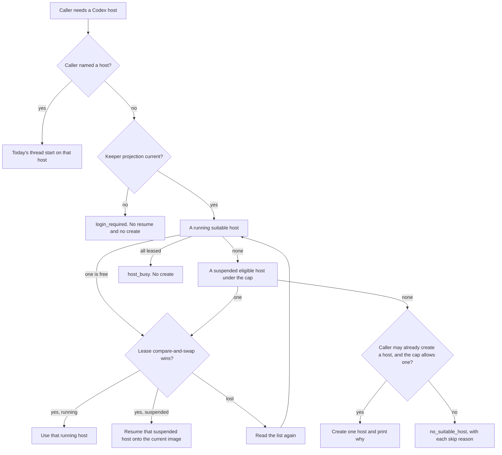

# DESIGN-063: Reuse paired Codex hosts

- **Status:** Proposed 2026-11-10. Design only. Nothing is built, switched on,
  resumed, restarted or changed in the cluster by this document.
- **Tracking:** [Story OP696](https://work.haynesnetwork.com/projects/haynes-engineering/work_packages/696),
  under [Epic #91](https://work.haynesnetwork.com/work_packages/91).
- **Origin:** Tom, 2026-11-10, to Meatball. The sentence in
  `~/.shared/handoffs/meatball-fable-20261110/to-fable-022.md` is quoted in
  section 1. The story records two earlier sentences from the same evening,
  also quoted there. Nothing else in this document is Tom's.
- **Cause:** story 571's description says the live check provisioned a new
  Codex host and Tom had to pair it, although three Codex hosts were already
  suspended. The host is `dev-env-1110-230548`, created `2026-11-10T23:05:48Z`
  (section 3). The platform can show that a pairing code was issued. It cannot
  show that a phone paired. Section 3 is the inventory, read only.
- **Builds on:** [DESIGN-057](057-generic-thread-launch.md) (thread start on an
  existing host), [DESIGN-060](060-meatball-front-door.md) (the front door and
  coordinator start), the Codex session model in
  [docs/workflow-guide.md](../../../../docs/workflow-guide.md) and
  [docs/v2-quickstart.md](../../../../docs/v2-quickstart.md). Story
  [OP695](https://work.haynesnetwork.com/projects/haynes-engineering/work_packages/695)
  is the folder-trust rule a pooled host needs before it is ready.
- **Decision:** this does not change who may create a host, who may resume a
  named session, the profile fence, retention, archive, or the shared login.
  It does not need an ADR. An ADR would be needed later if ordinary sessions
  gained the right to create a Codex host, if archive were held for pooled
  hosts, or if Tom allowed some other person's suspended host into the pool.
  None of those is decided here. ADR-024 is the next free number
  (ADR-023 is the last one on 2026-11-10) and is not written.
- **Evidence:** dev-env `291d8f57` (origin/main; every source line below).
  Live reads 2026-11-10T23:33Z to 23:42Z, `kubectl get` and `agent-run` only.
  No exec, resume, suspend, reap or pair. This session did not write a
  session, a pod or a volume.

## 1. Outcome

When a thread needs a Codex host, the tooling uses a suitable host that is
already paired. If none is running, it resumes one eligible suspended host
onto the current image. It keeps a few of those hosts, and it creates a new
host only when no safe host can be used, and it says why. Agents provision
hosts. Tom only pairs.

A headless Codex task stays its own session. It does not take a paired host.
Section 6 says which commands change.

Tom's words, and only these:

- Recorded in the handoff file, Tom to Meatball: “Get that codified with Fable in the tooling good to have a few we reuse so I don’t have to pair constantly”
- Recorded on story 696, earlier the same evening, Tom to Meatball: "Done but why ? Why do we keep adding new sessions instead of using existing paired ones"
- Recorded on story 696, the same report: "I don't start them"

"A few" is his. This design does not turn it into a number he chose.

## 2. How a Codex host works today

A Codex host is an AgentSession with `spec.agent` `codex` and `spec.mode`
`remote`. It is created with `agent-run --repo <name> --agent codex
--interactive`. It runs Codex's phone daemon on the session volume and on the
keeper's access projection. It is not a project task
(`internal/apiserver/validate.go:149-166`).

Who may create one: Tom's human caller, a trusted client (the workbench and
the v1 pod), and a session pod that is the workbench. An ordinary session is
refused, because the host uses the keeper's Codex login
(`internal/apiserver/validate.go:156-163`). A workbench session may not name
a profile. The host it starts runs on the templates' default profile
(`internal/apiserver/validate.go:305-324`). The default profile in the live
templates is `full` (ConfigMap `dev-env-templates`, key `templates.yaml`,
`defaultProfile:`). A human caller can name a profile. `dev-env-1110-230548`
is profile `dev`, and its parent is `dev-env-system/dev-env-human`.

The enrollment Codex keeps for the computer, the state sqlite and the
installation id, lives under `CODEX_HOME` on the session volume. That is
`~/.codex` unless the pod sets `CODEX_HOME`
(`internal/agentd/codex_remote.go:25-27`,
`internal/agentd/settings.go:160`). The file that records "a pairing code was
issued" is `~/.agentd/codex-pair-issued.json`. It holds a time and no code
(`internal/agentd/codex_remote.go:76-78`,
`internal/agentd/codex_remote.go:459-460`). `agent-run pair` returns the code
to its caller and does not write the code anywhere else
(`internal/agentd/codex_remote.go:417-421`).

What the platform can know, from `collectCodexRemote`
(`internal/agentd/codex_remote.go:369-410`):

| Daemon and login | `status.remoteControl.state` | Pairing code issued? | Phone paired? |
| --- | --- | --- | --- |
| Keeper projection not current | `login-required` | Not read. The function returns before the marker file | Unknown |
| Daemon not live | `starting` or `offline` | Not read | Unknown |
| Connected, marker file absent | `unpaired` | No. No phone can have paired through this host | No |
| Connected, marker file present | `pair-code-issued` | Yes, at least once | Unknown. Codex has no read for the phone's side |
| Connected, Codex reports the connection errored | `errored` | Not read on this path | Unknown |

`agent-run show` prints the same limit: "Codex cannot confirm a phone paired"
(`internal/agentrun/sessions.go:400-401`). A suspended host keeps the last
heartbeat. That heartbeat is not a new reading. A `login-required` value
frozen at suspend is not a reading of the marker file, and it is not a
reading of the keeper projection now.

A live daemon is reported `busy`, so the idle timer does not suspend the host
and drop the phone's computer (`internal/agentd/codex_remote.go:393-395`,
`internal/controller/reconciler.go:803-814`). The quickstart says a host
never suspends itself for that reason
(`docs/v2-quickstart.md`, "A host never suspends itself"). That is true while
the daemon is live. When the projection is missing, the agent state is
`login-required`, which is not `busy`, and the idle timer can suspend the
host. Section 3 shows three hosts the idle timer suspended on 2026-11-07
while they were `login-required`.

A remote session is never moved to a new image by the automatic drain
(`internal/controller/drain.go:65-72`). `agent-run suspend` then
`agent-run resume` is how a host changes image. Resume sets
`spec.operatingMode` to `Running` (`internal/apiserver/lifecycle.go:17-31`).
The reconciler then builds a pod from the current templates on the same
volume (`internal/controller/reconciler.go:1276-1333`,
`internal/controller/pod.go:185-188`). The pairing marker and `~/.codex` stay
on that volume. Reaping the host deletes the volume, and the pairing with it
(`docs/v2-quickstart.md`, Codex section).

`agent-run thread start --agent codex --host <name>` requires a Running Codex
remote host (`internal/apiserver/threads.go:79-85`). A session caller may
use a host of its own profile, or a host it or its children started
(`internal/apiserver/threads.go:118-144`). Inside the host, a missing marker
file stops the launch with `pairing_required`. A present marker is reported
as pairing unknown, reason `pair_code_issued`, and the launch continues
(`internal/agentd/thread_launch_codex.go:288-294`). The current image is
`2.101.0`. Thread start on an older agentd returns `host_unsupported`.

The keeper projection is one shared access file. `agent-run auth status`
reads it and does not refresh it. `SyncCodexAccess` accepts it when it
decodes and expires more than five minutes ahead
(`internal/agentd/codex_auth.go:66-68`). It installs a private `auth.json`
and does not change enrollment. The keeper is the one owner of the refresh.
A host does not have its own login.

Archive of a suspended session is `status.suspendedAt` plus
`spec.lifecycle.archiveAfter`, or the templates' `archiveAfter` of `168h`
(`internal/controller/reconciler.go:1005-1021`; templates `lifecycle:`).
A valid rescue is `Verified` or `CleanAndPushed`, not superseded
(`internal/controller/rescue.go:530-537`). `Failed` blocks archive.

## 3. Inventory on 2026-11-10

Reads, all in namespace `dev-agents` unless named:

- `kubectl get agentsessions -o json`, then the objects with `spec.agent`
  `codex` and `spec.mode` not `task`. Six hosts. No other non-task Codex
  session.
- `kubectl get pvc home-<name>` for each host and for the three protected
  sessions that are not Codex hosts.
- `kubectl get pod <name> -o json` where a pod exists: image, resources,
  labels `profile`, `revision` and `hold`.
- `agent-run show <name>` for `dev-env-1110-230548`,
  `haynes-ops-1109-115326`, `dev-env-1027-010042` and
  `dev-env-1020-002245`.
- `agent-run fleet`. First line: `revision: 2.101.0-68cbb6fc63`. Phases at
  that read: Pending 2, Running 11, Suspended 148, Archived 15, Failed 23.
- `agent-run auth status` in this session: Codex `Ready`, generation 4,
  access expires `2026-11-18T02:26:21Z`, keeper last refresh
  `2026-11-08T02:26:22Z`. Claude on this session is `NotConfigured`. That
  Claude line is this session's mount, not a fact about the hosts.
- `kubectl -n dev-env-system get cm dev-env-templates`, key `templates.yaml`:
  image tag `ghcr.io/thaynes43/dev-env:2.101.0`, `rollout.newSessionsOnlyImage`
  set to that same image, sizes below, home `20Gi` on `gasha01-rbd`,
  `defaultProfile: full`.

`agent-run show` prints `profile` only when `spec.profile` is set
(`internal/agentrun/sessions.go:202-204`). An empty spec uses the default
when the pod is built (`internal/templates/templates.go:460-464`,
`internal/controller/pod.go:316`). The resolved name is the pod label
`dev-env.haynesops.com/profile`. A suspended host has no pod, so its last
resolved profile is Unknown. Its next pod would use today's default, `full`,
when the spec is empty.

The hands-off list from the coordinator, treated here as protected: host
`haynes-ops-1109-115326` and its thread, and sessions
`dev-env-1027-111645`, `dev-env-1104-010332` and `dev-env-1027-010058`. A host
with a failed rescue is excluded as well. Protected means this design's
selector must not resume it, restart it, re-image it, lease it or start a
thread on it.

### 3.1 Codex hosts that are not tasks

| Host | Phase | Revision | Code issued | Phone paired | Rescue | Unpushed | Parent | Profile | Repo | Last activity | Protected |
| --- | --- | --- | --- | --- | --- | --- | --- | --- | --- | --- | --- |
| `dev-env-1110-230548` | Running on talosw03 | `2.101.0-68cbb6fc63`, current | Yes. `pair-code-issued` | Unknown to the platform | No rescue record | Unknown. No rescue, and this read did not exec | `dev-env-system/dev-env-human` | `dev` (spec and pod label) | `dev-env` | `2026-11-10T23:36:41Z` | No |
| `haynes-ops-1109-115326` | Running on talosw02 | `2.89.0-71bda058f0`, outdated; current is `2.101.0-68cbb6fc63` | Yes. `pair-code-issued` | Unknown to the platform | No rescue record | Unknown. Same limit | `dev/dev-env` | spec empty; pod label `full` | `haynes-ops` | `2026-11-10T23:37:17Z` | Yes. The host and its thread |
| `dev-env-1027-010042` | Suspended since `2026-11-07T21:10:07Z`, by `idle-timer` | No pod, so no revision | Unknown. Last state `login-required` does not read the marker | Unknown | `CleanAndPushed`, stamp `20261107-2108`, not superseded | 0 | `haynes-ops-1022-015547` | spec empty. Last pod label Unknown. Next pod would be `full` | `dev-env` | `2026-10-27T01:05:33Z`. Heartbeat `2026-11-07T21:10:05Z` | No. Not on the hands-off list |
| `dev-env-1019-205125` | Suspended since `2026-11-07T21:12:35Z`, by `idle-timer`. Resumed `2026-10-30T12:18:00Z` | No pod | Unknown. Last state `login-required` | Unknown | `Verified`, stamp `20261107-2108` | 67 refs, clones `dev-env`, `hass-sandbox`, `haynes-ops` | `dev/dev-env` | spec empty. Last pod label Unknown. Next pod would be `full` | `dev-env` | `2026-10-19T20:52:06Z`. Heartbeat `2026-11-07T21:12:34Z` | No. It is the parent of protected session `dev-env-1027-111645` |
| `haynes-ops-1023-041051` | Suspended since `2026-11-07T21:11:01Z`, by `idle-timer` | No pod | Unknown. Last state `login-required` | Unknown | `Verified`, stamp `20261107-2108` | 42 refs, clones `haynes-ops`, `haynesnetwork` | `dev/dev-env` | `workbench` | `haynes-ops` | `2026-10-28T12:12:23Z`. Heartbeat `2026-11-07T21:11:00Z` | No |
| `dev-env-1020-002245` | Suspended phase, hold pod on talosw02. `deletionTimestamp` `2026-10-20T00:23:15Z`. `spec.operatingMode` still `Running` | `2.45.0-eac7e410f2` on the hold pod | Unknown. Last state `offline` does not read the marker | Unknown | `Failed`, reason `NotProven`, stamp `20261110-2334` | Not proven. The failure says the `dev-env` clone is missing from the report | `haynes-ops-1019-233310` | spec empty; hold pod label `full` | `dev-env` | No `lastActivity`. Heartbeat `2026-10-20T00:23:16Z` | Excluded. Failed rescue and a reap in progress |

More from the same reads:

- `dev-env-1110-230548`: size S, model `gpt-6-astra`, effort `low`, created
  `2026-11-10T23:05:48Z`, agent `busy`, PodReady, Outdated false. PVC
  `home-dev-env-1110-230548` Bound `20Gi`. Pod requests `100m` CPU and `1Gi`
  memory, limits `2` CPU and `4Gi`. Project bootstrap Ready, 9 of 9
  repositories. No child session. `agent-run show` says a pairing code was
  issued and that Codex cannot confirm a phone paired.
- `haynes-ops-1109-115326`: size M, model `gpt-6-astra`, effort `xhigh`,
  created `2026-11-09T11:53:26Z`, agent `busy`. Image
  `ghcr.io/thaynes43/dev-env:2.89.0`. PVC Bound `20Gi`. Pod requests `250m`
  and `2Gi`, limits `4` and `8Gi`. Outdated reason `OlderRevisionHeld`:
  automatic drain is held, so this host moves only by its own suspend and
  resume. No child session. Its thread is not an AgentSession. The thread id
  is Unknown, because listing threads needs exec and this read did not exec.
  The whole host is protected, so every thread on it is out of bounds.
- `dev-env-1027-010042`: size M, model `gpt-6.1-sol`, effort `medium`, created
  `2026-10-27T01:00:42Z`. PVC Bound `20Gi`. Rescue message: every clone clean
  and pushed, agent not running. No child session. Bootstrap at the last
  heartbeat was Partial. `agent-run show` names `haynesnetwork` Preserved,
  TimedOut. Meatball's file says this host kept a pairing on the volume.
  The API does not show that. The marker was not read.
- `dev-env-1019-205125`: size S, model `gpt-6-astra`, created
  `2026-10-19T20:51:25Z`. PVC Bound `40Gi`, requested `40Gi`, not the
  templates' current `20Gi`. Rescue message: 67 refs bundled, agent not
  running. Sixty sessions have this host as `spec.parent`, including
  `dev-env-1027-111645`.
- `haynes-ops-1023-041051`: size M, model `gpt-6.1-sol`, effort `medium`,
  created `2026-10-23T04:10:51Z`. PVC Bound `20Gi`. One child session,
  `haynes-ops-1103-141902`. Rescue message: 42 refs bundled, agent not
  running.
- `dev-env-1020-002245`: size S, model `gpt-6-luna`, created
  `2026-10-20T00:22:45Z`. PVC Bound `20Gi`. The pod label `hold` is `true`.
  It runs no agent (`PodReady` reason `HoldPod`). `RemovalBlocked` is true,
  reason `DeleteNeedsRescue`. At the read, the condition said the rescue
  runs again at `2026-11-10T23:49:42Z`. That retry is the operator's hold
  pod. This session did not start it.

The keeper refresh on 2026-11-08 is after the three idle-timer suspends on
2026-11-07. Those three `login-required` values are snapshots from before
that refresh. `agent-run auth status` on this evening is `Ready`. The
snapshots are not proof that a login, or a pairing, is required now.

Archive, if the existing timer runs, is 168h after `suspendedAt`:
`dev-env-1027-010042` at `2026-11-14T21:10:07Z`,
`haynes-ops-1023-041051` at `2026-11-14T21:11:01Z`,
`dev-env-1019-205125` at `2026-11-14T21:12:35Z`. Their rescues are valid, so
the guard allows archive. `dev-env-1020-002245` is `Failed`, so archive waits.
This design does not move those clocks.

### 3.2 Protected sessions that are not Codex hosts

Same AgentSession read, plus PVC and pod where they exist.

| Session | What it is | Phase | Profile | Parent | Rescue | Why it is listed |
| --- | --- | --- | --- | --- | --- | --- |
| `dev-env-1027-111645` | Claude remote, `claude-opus-5-5`, repo `dev-env`, revision `2.45.0-eac7e410f2` | Running on talosw03, agent `busy`, last activity `2026-11-10T23:36:39Z` | `full` | `dev-env-1019-205125` | `CleanAndPushed`, superseded | Hands-off list. Active |
| `dev-env-1104-010332` | Claude local, `claude-opus-5-5`, repo `dev-env`, revision `2.89.0-71bda058f0` | Running on talosw03, agent `idle` | `workbench` | `dev-env-1027-010058` | No rescue record | Hands-off list |
| `dev-env-1027-010058` | Claude remote, `claude-opus-5-5`, repo `dev-env` | Suspended since `2026-11-07T18:25:20Z`, by `idle-timer` | `workbench` | `haynes-ops-1022-015547` | `Verified`, 109 unpushed refs in `dev-env` and `haynes-ops` | Hands-off list |

Each of these PVCs is Bound `20Gi`. None of them is a Codex host. The
selector never considers them, and it also refuses their names if they
appear on the protected list, so a bug cannot treat them as hosts.

### 3.3 What was in use

Codex remote hosts overlapping, from `creationTimestamp` to `suspendedAt`, or
to the read if still Running. `dev-env-1020-002245` has no `suspendedAt` and
was deleted the minute it was created, so it is not in the overlap.

- Treating each host as running from creation until its 2026-11-07 suspend
  overstates `dev-env-1019-205125`: its `resumedAt` is `2026-10-30T12:18:00Z`,
  so it was suspended at least once before that, and the annotation does not
  keep the earlier interval.
- The proven overlap of all three is from that resume until
  `2026-11-07T21:10:07Z`, when `dev-env-1027-010042` was suspended. That is
  two `dev-env` hosts with empty `spec.profile`, plus the `workbench`
  `haynes-ops` host. It is not one profile cell.
- From the 2026-11-07 suspends until 2026-11-09, no Codex remote host was
  Running.
- Tonight, two are Running: the protected `haynes-ops` host and
  `dev-env-1110-230548`.

Codex tasks are a different thing. The same list has 63, all `mode: task`.
None is Running. Forty-two are Suspended, twenty Failed, one Pending.
Counting a task from creation until `suspendedAt` (42 of them have one), the
peak overlap is 17 session records at `2026-10-26T04:58:58Z`, of which 11
are profile `full` and repo `dev-env`. Since 2026-11-09 there are 18 Codex
tasks, all Suspended. That peak is how many task records had not been
suspended yet. It is not a count of phone threads, and it is not a pool size.

Threads inside a host: Unknown. `thread/list` is an exec, and this read did
not exec.

Running sessions of every kind at the read: 4 Cursor tasks on profile `dev`
and repo `dev-env`, plus one each of several Claude sessions, plus the two
Codex hosts above. No running Codex task.

## 4. What suitable means

A program can decide from the AgentSession object, the pod label when a pod
exists, the templates' `defaultProfile`, the protected list, and one current
read of the keeper Codex projection. It does not exec into the host.

**Shared login, checked once per selection.** The projection decodes and
expires more than five minutes ahead, the same test as `SyncCodexAccess`.
`agent-run auth status` printing Codex `Ready`, with expiry outside the
warning window, is that test as a person runs it. This evening it passed.
A suspended host's `login-required` snapshot is not this test. It does not
fail the check, and it does not prove the host needs a pairing. The proof
that a login is needed is a current projection that fails this test. Then
every path stops with `login_required`. Nothing is resumed and nothing is
created. Renewing the keeper stays the existing workbench path.

**A running host is suitable** when all of these hold:

1. `spec.agent` is `codex` and `spec.mode` is `remote`.
2. Phase `Running`, `spec.operatingMode` `Running`, no deletion timestamp,
   pod Ready, and the pod is not a hold pod.
3. Resolved profile fits the caller. The resolved profile is the pod label,
   else `spec.profile`, else the templates' `defaultProfile`. Fit uses the
   thread profile fence already in `threadProfileFence`: the caller's
   profile equals the host's, or the caller is an ancestor of the host.
   A `dev` caller does not fit a `full` host. A `full` caller does not fit
   the `dev` host `dev-env-1110-230548`.
4. `spec.repo` equals the requested repository. A host clones every catalog
   repository, and that is not enough. The cell is the host's own repo.
5. Not protected. Protected is: the name is on the configured hands-off
   list, or the annotation `dev-env.haynesops.com/protected` is `true`, or
   a rescue result is `Failed`, or `RescueFailed` is True, or
   `RemovalBlocked` is True. The annotation is not on any host today. The
   list is configuration, seeded with the four names in section 3. The
   failed-rescue rule catches `dev-env-1020-002245` even if the list is
   empty.
6. Not busy. Busy means an unexpired lease annotation held by another
   caller, as section 5 defines it. Agent state `busy` on a live daemon is
   the normal state. It is not busy for this rule.
7. `status.remoteControl.state` is `pair-code-issued`. `unpaired` is not
   suitable: no phone can have paired, and making it suitable would mean
   asking Tom for a code. `login-required`, `offline`, `starting` and
   `errored` are not suitable. A running host in those states is left
   alone. This feature does not restart it.
8. The pod revision equals the current template revision (`Outdated` false).
   An outdated running host is not suitable, and it is not suspended to
   move it. `haynes-ops-1109-115326` fails this as well as the protected
   rule. Its image `2.89.0` is from before thread start, so a launch there
   would be `host_unsupported` even if it were not protected.
9. The shared-login check passed.

**A suspended host is eligible to resume** when all of these hold:

1. Phase `Suspended`, operating mode `Suspended`, no deletion timestamp, not
   archived.
2. The same profile and repo fit. With no pod, an empty `spec.profile`
   resolves to today's `defaultProfile`.
3. Not protected, by the same rule.
4. The newest rescue is `CleanAndPushed` or `Verified`, not superseded, with
   `unpushedRefs` empty and `omittedRefs` empty. Someone else's unpushed
   branches stay on that volume. `dev-env-1019-205125` (67) and
   `haynes-ops-1023-041051` (42) fail this.
5. The last `remoteControl.state` is `pair-code-issued`. A frozen
   `login-required` or `offline` means the marker was not read. The host is
   not eligible. Resuming it to go and look would wake a volume this feature
   cannot show was paired. `dev-env-1027-010042` is clean and pushed, and it
   still fails this, because its last state is `login-required`.
6. The shared-login check passed. The frozen `login-required` does not fail
   it.
7. Resuming it would stay inside the pool caps in section 5.

No suspended host in section 3 is eligible. That is a result of the rules,
not a gap in the read.

**Ready** is stricter than suitable. A pooled host is ready when it is
suitable, its revision is the current image, and story 695 has recorded the
requested repository's folder `~/repos/<repo>` as trusted. 695 is in
progress and not installed. Until it is, `ready` is false and the reason
includes `folder_trust_pending`. The host can still be selected. Missing
trust is not a reason to create another host. Creating one would ask Tom to
pair again for a prompt the existing host can already hit.

On this evening, for a caller whose profile fits `dev` and whose repo is
`dev-env`, the only suitable host is `dev-env-1110-230548`. It is not ready,
because folder trust is not recorded. For every other profile or repo, no
host is suitable.

## 5. Selection

Order:

1. A running suitable host. If several fit, prefer one that already carries
   the pool label, then the one with the newest `lastActivity`.
2. A suspended eligible host, resumed onto the current image. Resume is the
   existing operating-mode change. The new pod is the current templates, on
   the same volume. If several fit, resume the one suspended longest ago,
   and only one.
3. A new host, only as the fallback in section 6, with the reason printed.
   The reason names the skip result for every existing host.

The result is one JSON object the caller prints: `host`, `action`
(`use`, `resume` or `create`), `ready` (true or false), `reason`, and
`skipped` as a list of `{name, reason}`. Reasons are the fixed codes in
section 6. No pairing code, no prompt text, no transcript.

**A caller that names a host gets that host.** `--host` does not enter this
order. Today's thread start runs, including `host_not_running`,
`pairing_required`, `caller_not_allowed` and `host_unsupported`. The selector
does not substitute another host, and it does not refuse a protected host
that the caller named. The refusal of protected hosts is only for the
automatic path. This feature itself never names a protected host.

**Race.** Before `use` or `resume`, the selector writes one annotation,
`dev-env.haynesops.com/codex-host-lease`, with the caller's identity, an
expiry and a purpose word. The write is a compare-and-swap on the session's
`resourceVersion`. The winner proceeds. A conflict means someone else wrote
the session: the selector reads again and chooses the next host. It does not
start a thread on a host whose lease it lost. The lease lasts at most 15
minutes, which covers a resume and a thread start wait of 10 minutes. The
caller clears it when the launch result is known. A dead caller leaves it
until expiry. The lease serializes this tooling's own launches. It does not
mean the phone is idle. The platform cannot see an in-progress phone turn
without exec, and this design does not exec to decide. Two launches over
time on one host are the reuse we want. Two launches at the same moment are
the race the lease stops.

The selector does not write the lease on a protected host, a rescue-failed
host, or a host it is not going to use. A read-only check writes nothing.

**Create race.** Idempotency keys are per parent
(`internal/apiserver/sessions.go:266-278`), so two callers with the same key
string still create two hosts. The fallback takes one operator-owned
ConfigMap, `dev-env-codex-host-pool` in `dev-env-system`, with one key per
profile and repo. The compare-and-swap of that key holds the session name
being created. The loser waits for that session and uses it. The ConfigMap
holds names, not codes or prompts.

## 6. The pool

"A few" is what Tom asked for. The count has to come from the use in section
3.3 and from what a host costs.

**Use.** The thing that needs a pairing is a Codex remote host, not a Codex
task. Tasks peaked at 17 unsuspended records and do not use a host. Hosts
peaked at three unsuspended at once, then the idle timer suspended all three
while their login snapshots were stale. Tonight two hosts are Running, and
only one is suitable. Per repository, `dev-env` had two overlapping hosts
with empty profiles, and `haynes-ops` had one. No cell has two suitable
hosts tonight. Threads per host are Unknown.

**Cost.** Each host has a volume. The live claims are `20Gi` on
`gasha01-rbd`, except `dev-env-1019-205125` at `40Gi`. A suspended host keeps
the volume and spends no CPU. A running size S host, which is what
`dev-env-1110-230548` is, requests `100m` CPU and `1Gi` memory and is limited
to `2` CPU and `4Gi`. A size M host requests `250m` and `2Gi`, limits `4`
and `8Gi`. Those are the templates' S and M classes, and they match the two
running pods. The login is not per host. Every daemon uses the one keeper
projection. A second login would be a second refresher, which this design
does not add.

**The number is a setting, with a default from that evidence.**

- `maxRunningPerCell` defaults to 1. A cell is one resolved profile and one
  `spec.repo`. One running host in the cell is enough for the reuse that was
  missing on story 571. The historical pair of `dev-env` hosts is not
  evidence of two simultaneous suitable threads.
- `maxRunning` defaults to 2 for the whole fleet of pooled hosts. Tonight's
  two running hosts are two cells, and one of them is protected rather than
  pooled. A fleet cap of 2 lets one more cell have a host later without a
  host per repository. Seven catalog projects times a running host would be
  a host per repo, which the thread evidence does not support.
- Both values are operator flags. Code does not bury a second copy. A change
  to either flag is a reviewed template or operator change, with the use
  from `agent-run fleet` at that time. This design does not ask Tom for a
  number.

**What counts toward the cap.** A Running host that is suitable, or that
carries the pool label `dev-env.haynesops.com/codex-host-pool` equal to its
`profile/repo`. A protected host does not count. A leased host counts, so a
second caller waits or gets `host_busy` instead of a new host.

**What retires a pooled host.** When a create or a resume would exceed a
cap, it does not happen. The tooling does not suspend a running host to get
under the cap: that would re-image or stop a host that may be in use. A
pooled host leaves the selectable set when it becomes protected, its rescue
fails, its deletion timestamp is set, or archive has removed the volume.
The existing 168h archive still applies after a normal suspend. This design
does not lengthen archive, and it does not delete a volume. It also does
not suspend `dev-env-1110-230548` to make it "idle". A live daemon stays
Running until someone suspends that host by name, as today.

**Ready**, repeated so the pool has one sentence: paired
(`pair-code-issued`), on the current image, and the requested folder trusted
by story 695. Suitable can be short of ready. The result says which.

No host in section 3 is adopted by this design. Adoption of an older
suspended host is question 1 in section 10. Until that is answered, the only
host the selector can use is one that passes section 4 on its own, which
tonight is `dev-env-1110-230548` for `dev` and `dev-env`.

## 7. The contract

One new operator route, `POST /v1/codex-hosts/select`, beside the existing
`/v1/sessions/{name}/threads` route. The body names the repository, and may
name a profile. The answer is the JSON object in section 5. `?check=true`
is the read-only form: it chooses and writes nothing.

The profile the host must fit is an input, not a silent default of `full`.
A session caller may only ask for its own profile; omitting it means that
profile. A workbench or human caller may name the profile, which is the
only way the live check selects `dev-env-1110-230548`. If that caller omits
the profile, select uses `full`, because a workbench create that omits the
profile is forced onto the default profile. It then does not reuse the `dev`
host, and a fallback it is allowed to create is a `full` host.

| Command or route | Change |
| --- | --- |
| `agent-run thread start --agent codex` with `--host` | None. The named host, today's errors |
| `agent-run thread start --agent codex` without `--host` | Calls select, then today's thread start on the chosen host. A `resume` action resumes first and waits until the host is Running or the wait ends. A `create` action creates only when section 6 allows it, then the caller still has to pair before a thread will pass `paired` |
| `agent-run --agent codex --interactive` | Calls select before create. A suitable or eligible host is printed and no host is created. Create remains the fallback |
| `agent-run thread status` | None. Still the named host, exec route only |
| `agent-run pair` | None. Still a person's command. The selector never runs it |
| `agent-run suspend`, `resume`, `reap` of a named session | None. A person or a caller who names a session keeps today's reach. The new resume is only the select route's `resume` action, and only for an eligible host |
| `agent-run coordinator start` and front door `coordinator_start` | None. A coordinator is a task session on profile `dev`. It does not need a paired host. A thread it starts later uses `thread start`, and then this selector |
| Headless `agent-run --project ... -p` for Codex | None. Not a host |
| Front door tools | No new tool. The front door's allow list stays |

A session that may not create a host still may not. Select's `create`
action checks the same rule as create does today
(`internal/apiserver/validate.go:156-163`). A `dev` session, which is what
a coordinator is, can use or resume a fitting host and cannot create one.
A workbench fallback host still cannot name a profile, so it is `full`. It
does not become a stand-in for the `dev` host.

Existing limits stay: depth at most 2, at most 4 unfinished children per
agent kind (`internal/apiserver/caller.go:46-53`). A created fallback host
counts as a child. A reused host does not.

**Errors.** Existing thread-start codes stay for a launch that has begun.
Select adds these, each a fixed code and one sentence, with `skipped`
filled where a host was considered:

| Code | When | What does not happen |
| --- | --- | --- |
| `login_required` | The keeper projection is not current now | No resume, no create |
| `no_suitable_host` | Nothing suitable or eligible, and this caller may not create | No create |
| `caller_cannot_create` | A create would have been the fallback, and this caller may not create a Codex host | No create |
| `at_capacity` | A create or a resume would exceed `maxRunningPerCell` or `maxRunning` | No create, no resume |
| `host_busy` | Every suitable running host holds a live lease | No create |
| `protected` | Recorded on a skipped host | That host is not leased, resumed or launched |
| `rescue_blocked` | Rescue `Failed`, or removal blocked | Not resumed |
| `pairing_unknown` | Suspended, and the last state is not `pair-code-issued` | Not resumed |
| `unpaired` | Running and `unpaired` | Not used, and not sent to `pair` |
| `image_outdated` | Running, revision not current | Not suspended and not used |
| `profile_mismatch` or `repo_mismatch` | Resolved profile or `spec.repo` does not fit | Not used |
| `unpushed_work` | Suspended rescue has unpushed refs, or the rescue is missing | Not resumed |
| `folder_trust_pending` | Selected, and story 695 has not recorded trust for the repo | Still selected. Not a reason to create |
| `resume_unconfirmed` | The resume was accepted and the host was not Running before the wait | No second resume and no create |

A lost lease is not an error by itself. The selector tries the next host.
`host_busy` is the result when none is left.

## 8. Safety

This feature never resumes, restarts, re-images or types into a protected
host, or into a running host it did not select. It never deletes a volume.
It adds no credential, grant, profile, network or exposure. It does not
pair, and a pairing code never goes through a transcript, a file, a log
line, a result JSON or the tracker. The lease and the pool ConfigMap store
a session name, a caller identity, an expiry and a purpose word.

The read-only check writes nothing. The live check in section 9, slice 3,
is that form, against `dev-env-1110-230548`, and it starts no thread.

An outdated or protected running host stays as it is, including
`haynes-ops-1109-115326` and the three other hands-off sessions. A
rescue-failed host stays excluded, including `dev-env-1020-002245`.

## 9. Build slices

Each slice is one worker session. Tests use fakes. No slice execs into a
live host, and none creates a host in the cluster. A new package
`internal/codexhostpool` gets a line in `docs/repo-layout.md` in the slice
that adds it. `make test` stays at two Go packages and two CPUs.

**Slice 1. The choice, pure.** `internal/codexhostpool` takes a list of host
facts and a projection fact and returns the section 5 object. Named tests:
`TestSelectsRunningPairedHost`, `TestSkipsBusyLease`, `TestSkipsProtected`,
`TestSkipsRescueBlocked`, `TestStaleLoginSnapshotDoesNotBlock`,
`TestCurrentLoginFailureBlocksResumeAndCreate`, `TestSuspendedEligibleComesAfterRunning`,
`TestPairingUnknownIsNotResumed`, `TestUnpushedWorkIsNotResumed`,
`TestOutdatedRunningIsNotUsed`, `TestAtCapacityDoesNotCreate`,
`TestNamedHostIsNotReplaced`, `TestFolderTrustPendingStillSelects`,
`TestLostLeaseReselects`.

**Slice 2. The route and the two commands.** `POST /v1/codex-hosts/select`
and `?check=true`. `thread start` without `--host`, and
`--agent codex --interactive`, call it. Fakes cover `caller_cannot_create`,
a workbench create that omits profile, and a named `--host` that never calls
select. `TestCheckWritesNothing` asserts no patch client is called.

**Slice 3. Resume.** The route's `resume` action uses the existing resume
route, then waits. Fakes: a suspended eligible host is resumed once; a
protected host is not; a second caller that loses the lease does not resume.
Live validation, and the only one: from a workbench session,
`agent-run codex-host select --profile dev --repo dev-env --check` prints
`dev-env-1110-230548`, action `use`, ready false, reason
`folder_trust_pending`, and a skip reason for each of the other five hosts
matching section 3. Before and after, `kubectl get agentsession
dev-env-1110-230548 -o jsonpath='{.metadata.resourceVersion}'` is unchanged.
No new host. No thread start. No resume.

**Slice 4. Fallback create.** The ConfigMap claim, the caps, and
`at_capacity`. Fakes only. No live create. The test
`TestTwoCallersCreateOneHost` loses the second create and returns the first
name.

**Slice 5. Ready.** When story 695 records trust for `~/repos/<repo>`, the
result's `ready` becomes true for that repo. Until that record exists, the
slice's test expects `folder_trust_pending`. This slice does not invent a
trust write of its own.

## 10. Open questions

1. **May any suspended host from earlier work be adopted into the pool?**
   This is Tom's question if anyone wants to adopt one. Those volumes hold
   earlier sessions' files, and two of them hold unpushed branches.
   `dev-env-1019-205125` is also the parent of a protected running session.
   Recommendation: do not adopt any of them. None is eligible under section
   4 anyway, because none has a last state of `pair-code-issued`. Leave them
   on the existing archive clock. Do not ask Tom unless a later story names
   one host and asks to resume it. This design's live check does not.

2. **Are the cap defaults, 1 per cell and 2 running fleet-wide, accepted?**
   The coordinator can rule. Recommendation: yes, as flags, from section 6.
   Not a question for Tom. He asked for a few, and he did not name a count.

3. **Should an ordinary session become able to create a Codex host, so a
   `dev` coordinator can do the fallback itself?** Recommendation: no. That
   widens who may start a daemon on the shared login. A `dev` caller reuses
   or resumes a fitting host and otherwise gets `caller_cannot_create`.
   The workbench and Tom's caller keep the create right they have.

4. **Should the selector exec a read-only thread list to see a phone turn in
   progress?** Recommendation: no. Busy is the lease. An exec into a live
   host is more reach than this story has, and the live check must not use
   one.

5. **Story 695 is still open. Does selection wait for it?** Recommendation:
   no. Select the suitable host and report `folder_trust_pending`. Do not
   create a host because trust is missing.
