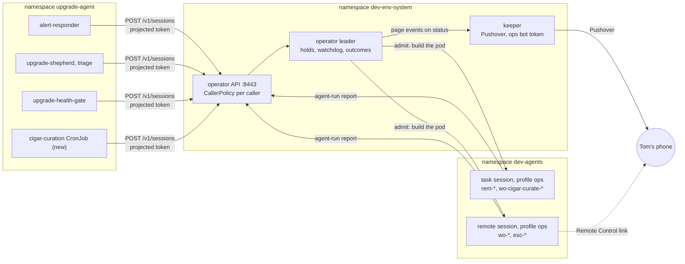

# DESIGN-064: Summoned sessions and the ops profile against today's code

- **Status:** Proposed 2026-11-11 for coordinator review (story OP734). The
  coordinator sets Accepted when it rules on the reviewed PR. This document
  builds, deploys and switches nothing.
- **Tracking:** [Story OP734](https://work.haynesnetwork.com/projects/haynes-engineering/work_packages/734),
  under [Epic #112](https://work.haynesnetwork.com/work_packages/112). The
  coordinator's story is [OP751](https://work.haynesnetwork.com/projects/haynes-engineering/work_packages/751),
  owned by session `dev-env-1111-143337`. Author: worker session
  `dev-env-1111-144138`.
- **Origin:** two sentences of Tom's, as item 734 quotes them. 2026-11-11, typed
  in coordinator session `dev-env-fable-coordinator-1109`: "Let's get another
  superuser fable 5.2 remote control session going with the work handed off to
  get v2 an ops profile, we will need that to retire  v1." 2026-10-06, quoted
  by plan 10: "we need to preserve the functionality". Nothing else here is
  Tom's unless a section cites the record that quotes him.
- **Amends:** [DESIGN-001](001-dev-env-v2.md) sections 3.7 (D-36), 6.10 and
  7.3, through [ADR-025](../adrs/025-summoned-sessions-on-v2.md). Section 11
  lists every sentence that changes.
- **Builds on:** [plan 10](../backlog/10-summoned-sessions.md),
  [R-01](../research/R-01-summoned-agents-audit.md) (V-01 to V-17),
  [ADR-020](../adrs/020-task-session-cleanup.md) and
  [DESIGN-061](061-task-session-cleanup.md) (task clean-up),
  [DESIGN-060](060-meatball-front-door.md) 7.1 (the first CallerPolicy),
  [DESIGN-038](038-remote-control-launch.md) (`agent-run rc`),
  [DESIGN-054](054-scheduled-agent-work.md) (scheduled work, not used here) and
  the [switch sheet](../../../../docs/switches-2026-11-10.md).
- **Evidence, pinned:** every claim was read at these two commits.
  - dev-env `6ded38a49e583c0e05d780ed41ad0bca583e7e3f` (origin/main,
    2026-11-11).
  - haynes-ops `3c78d4f2030c97ec0b9a09fdd7161a1051d08c10` (origin/main,
    2026-11-11T14:18:28Z). Item 734 was written against `0db751a5`; this
    design re-read every file at `3c78d4f2`.
  - Tracker records: items 734, 751, 115 (comments 6965, 6970, 7010), 609,
    601, 603, 211, 497, 717, 116, 610, 512 (comments 6170, 6173, 6193) and
    the build stories 735 to 743 and 745 to 750.
  - No live read. No `kubectl`, no exec, no Secret, no credential file, no
    transcript and no log of `dev-env-ops` was read. Where git cannot answer,
    the row says "not verified".

## 1. Outcome

Every automated caller in `upgrade-agent` that summons a Claude session today
keeps doing so, through the v2 operator API, under a policy in git. The v1
executor `dev-env-ops` then has nothing to run and can be stopped, and its
own monthly Max login lapses with nobody renewing it.

Each build story in OP751's list cites one section of this document:

| Story | Section |
|---|---|
| #735 ops egress tier | [6.1](#61-op735-the-ops-egress-tier) |
| #736 keeper mints the ops bot token | [6.2](#62-op736-the-keeper-mints-the-ops-bot-token) |
| #737 ops profile and its Claude login | [6.3](#63-op737-the-ops-profile-and-its-claude-credentials) |
| #738 CallerPolicy for summoning callers | [6.4](#64-op738-callerpolicy-for-summoning-callers) |
| #739 caller transport | [6.5](#65-op739-the-caller-transport) |
| #740 outcome reporting, guaranteed outcome | [6.6](#66-op740-outcome-reporting-and-the-guaranteed-outcome) |
| #741 lanes and watchdog | [6.7](#67-op741-lanes-holds-and-the-watchdog) |
| #742 pages and the digest | [6.8](#68-op742-pages-and-the-daily-digest) |
| #743 quota priority and the fallback model | [6.9](#69-op743-quota-priority-and-the-fallback-model) |
| #745 joinable remote sessions | [6.10](#610-op745-joinable-remote-sessions-with-a-verified-link) |
| #746 move curation | [6.11](#611-op746-move-curation) |
| #747 move remediation | [6.12](#612-op747-move-remediation) |
| #748 move escalations | [6.13](#613-op748-move-escalations) |
| #610 move upgrade work orders | [6.14](#614-op610-move-upgrade-work-orders) |
| #749 scale dev-env-ops to zero | [6.15](#615-op749-scale-dev-env-ops-to-zero) |
| #750 remove dev-env-ops | [6.16](#616-op750-remove-dev-env-ops) |

## 2. Terms

- **Caller:** a ServiceAccount outside dev-env that starts sessions through the
  API under a CallerPolicy. Today Meatball is the only one. Plan 10 adds the
  five in `upgrade-agent` (section 5.1).
- **Summoned session:** an AgentSession whose `spec.caller` is set. A caller
  started it, not Tom.
- **Kind:** `task` (headless `claude -p`, `spec.mode: task`) or `remote`
  (interactive with Remote Control, `spec.mode: remote`).
- **Lane:** `spec.lane`. `remediation`, `upgrade` and `curation` are
  single-flight: at most one admitted, unfinished session each. `escalation` is
  a label.
- **Outcome:** `status.outcome`, what the work came to. Not
  `status.taskResult` (how the process ended) and not `status.taskOutcome`
  (the immutable PR and SHA snapshot).
- **Terminal outcome:** `done`, `failed` or `escalated`.
- **Hold:** a summoned session that exists but has no pod yet, because its lane,
  its caller's `concurrent` limit or the quota gate says wait.

## 3. What changed since plan 10 (2026-10-06)

1. A first CallerPolicy exists, but its schema can express only Meatball
   (row R1).
2. AgentSession carries `caller`, `lane`, `idempotencyKey`, `outcome`,
   `remoteControl`, `taskResult`, `taskOutcome` and `usage` (rows R7 to R15).
3. Task limits, idempotent creates and the 7-day task clean-up are live
   (rows R11, R16, R17).
4. `agent-run rc start` returns a verified Remote Control link, client-side
   (row R20).
5. The keeper's access-only Claude projection exists for `full` and
   `workbench`, not for `ops` (rows R22, R24).
6. `dev-env-ops` got its own monthly Max login on 2026-10-05 (section 5.3).
   R-01's statement that no summon path uses a `/login` credential was true
   on its date and is not true now.
7. The escalation model moved from Fable to `claude-sonnet-5-5`
   (section 5.1). DESIGN-001 3.7's example is stale.
8. Tom ruled the task clean-up: 7 days for every finished task (ADR-020). That
   replaces plan 10's 1 day after `done` for task sessions.

## 4. Reuse table

Each row: the claim, where it is proven at the pinned commits, and the verdict.
"dev-env:" paths are at `6ded38a4`; "haynes-ops:" paths are at `3c78d4f2`,
under `kubernetes/main/apps/` unless they start with `.agents/`.

| Row | Claim | Proof | Verdict |
|---|---|---|---|
| R1 | CallerPolicy exists for one caller. The schema fixes `serviceAccount` to `dev-env-system/dev-env-meatball`, `mode` to `task`, `profile` to `dev`, and `models` to three ids; `maxConcurrent` 1–2, `maxTimeout` at most 4h, `maxWorkers` 1–4. | dev-env: `api/v1alpha1/callerpolicy_types.go`, `CallerPolicySpec` | reused with a change (6.4): a `summon` block beside the seven fields |
| R2 | The API reads only `dev-env-system/meatball`, uncached, and fails closed on a stale schema. | dev-env: `internal/apiserver/callerpolicy.go`, `readCallerPolicy`, constants `callerPolicyNamespace`, `callerPolicyName` | reused with a change (6.4): one more read path, by derived name |
| R3 | Any other ServiceAccount gets 403 "... summoning callers (CallerPolicy) arrive in plan 10". | dev-env: `internal/apiserver/caller.go`, `resolveCaller` (line 168) | reused with a change (6.4) |
| R4 | A policy caller may create, read and delete its own sessions and use parent notes, nothing else. | dev-env: `callerpolicy.go`, `policyCallerAllowed`, `policyParentNoteRoute` | reused with a change (6.4, Q-19): summoning callers get create and own reads only |
| R5 | `preparePolicySession` checks mode, profile, model, agent, effort, timeout and worker cap before the ordinary create path. | dev-env: `callerpolicy.go`, `preparePolicySession` | reused as the pattern; the summoning check is built new beside it (6.4) |
| R6 | A policy caller's unfinished sessions are counted by `spec.parent` under the create lock. | dev-env: `callerpolicy.go`, `admitCallerCapacityExcept`, `createWithCallerCap` | reused with a change (6.4, 6.7): `concurrent` from the policy; past it the create is held |
| R7 | AgentSession has `spec.caller`, `spec.lane` (enum remediation, upgrade, curation, escalation) and `spec.idempotencyKey`, all immutable. | dev-env: `api/v1alpha1/agentsession_types.go`, `AgentSessionSpec.Caller`, `.Lane`, `.IdempotencyKey`, type `Lane` | reused as is |
| R8 | CEL: caller and lane go together; idempotencyKey needs caller; a summoned session is never `local` and never profile `full`. | dev-env: `agentsession_types.go` lines 144–147 | reused with a change (6.4): also never `workbench`, agent `claude` only |
| R9 | The API refuses `name` and `lane` from every caller. | dev-env: `internal/apiserver/validate.go` lines 105–106 | reused with a change (6.4) |
| R10 | The create request already carries `name`, `lane`, `idempotencyKey`, `limits`, `prompt`, `profile`, `repo`. | dev-env: `internal/apiserver/apiv1/types.go`, `CreateSessionRequest` | reused as is (wire shape) |
| R11 | A repeated key returns the caller's newest unfinished session; a finished one does not block a new create. | dev-env: `internal/apiserver/sessions.go`, `byIdempotencyKey`, `unfinished` | reused with a change (6.4): a terminal outcome counts as finished; the name gets a suffix |
| R12 | `status.outcome` has state (pending, running, done, failed, escalated), note and time. | dev-env: `agentsession_types.go`, `OutcomeState`, `OutcomeStatus` | reused with a change (6.6): a writer, and a `MaxLength` on the note |
| R13 | Today only the decision path writes `status.outcome` (state escalated, note `decision/<id>`), and only for a Codex task session with a workspace, behind `--enable-managed-child-decisions`, which is off live. | dev-env: `internal/apiserver/heartbeat.go` lines 61–93, `decisions.go` lines 164–172; `docs/switches-2026-11-10.md`, row `--enable-managed-child-decisions` | reused as is; the one-writer rule is in 6.6 |
| R14 | `status.taskResult` records how a task ended: Succeeded, Failed, TimedOut, Unknown. | dev-env: `agentsession_types.go`, `TaskResultStatus`, `TaskResultState` | reused as is (an input to 6.6) |
| R15 | `status.taskOutcome` is the immutable snapshot of `~/work/<session>.outcome.json`. | dev-env: `agentsession_types.go`, `TaskOutcome` and the CEL rule "original task outcome cannot be erased"; `internal/agentd/runagent.go`, `readTaskOutcome` | reused as is; it is not the summoned outcome |
| R16 | The controller passes `limits.timeout` and `limits.maxTurns` to agentd; agentd passes `--max-turns` and stops the task at the timeout. | dev-env: `internal/controller/pod.go` lines 788–791; `internal/agentd/launch.go` line 246; `internal/agentd/protocol/status.go`, `TimedOut` | reused as is |
| R17 | Finished task sessions are deleted 7 days after their terminal observation, live. | dev-env: ADR-020 decision 2; haynes-ops: `dev-env-system/operator/app/helmrelease.yaml`, `--enable-task-session-cleanup=true`, `--task-cleanup-max-active=2` | reused as is |
| R18 | Lifecycle timers: a task idle 1h, a remote session idle 72h with no client, archive 168h after suspend. | haynes-ops: `dev-env-system/templates/app/templates.yaml`, `lifecycle` | reused with a change (6.7): no idle suspend before a terminal outcome |
| R19 | `status.remoteControl` has name, sessionId, url and state; agentd reports `login-required`, `starting`, `registered`, `offline`, and sets the URL only once registered. | dev-env: `agentsession_types.go`, `RemoteControlStatus`; `internal/agentd/protocol/status.go` lines 51–60; `heartbeat.go`, `remoteControlStatus` | reused with a change (6.10): the operator derives "registration failed" |
| R20 | `agent-run rc start` creates a remote session, polls `GET /v1/sessions/{name}` until `registered`, and returns a validated link. It is a client-only contract. | dev-env: `internal/agentrun/rc.go`, `startClaude` and the wait at line 352; `internal/apiserver/apiv1/rclaunch.go`, `RCLaunchVersion` | reused as the pattern: the operator applies the same check (6.10) |
| R21 | The static token is set for Claude task and local sessions only. | dev-env: `internal/controller/pod.go`, `staticTokenFor`; haynes-ops: `templates.yaml`, `claude.staticToken` | reused as is |
| R22 | With `AGENTD_CLAUDE_LIVE_FILE`, agentd merges the keeper's access fields and never holds, writes or runs a refresh; a pod-owned refresh token stops the agent. | dev-env: `internal/agentd/claude_auth.go`, package comment and `ErrClaudeLoginConflict`; haynes-ops: `templates.yaml`, profiles `full` and `workbench` | reused with a change (6.3): added to `ops` |
| R23 | No session can bill a metered key: agentd strips `ANTHROPIC_API_KEY` and `ANTHROPIC_AUTH_TOKEN`, and the templates set neither. | dev-env: `internal/agentd/launch.go` lines 99–114; haynes-ops: `templates.yaml` (no `ANTHROPIC_API_KEY`) | reused as is |
| R24 | Profile `ops` has `CIGAR_JOURNAL_TOKEN`, an optional UniFi token, the optional Proxmox read Secret, `/creds` from `dev-env-ops-gh-token`, and label `dev-env.haynesops.com/egress: ops`. It has no Claude projection and no `dev-env-mcp-secret`. | haynes-ops: `templates.yaml`, `profiles.ops` | reused with a change (6.3) |
| R25 | `ops` sets no `serviceAccount`, so its pods run as `dev-agents/dev-env-agent`. That role copies v1's operator tier rule for rule, plus read on `dev-env.haynesops.com`, under `dev-env-agent-guard`, `dev-env-identity-guard` and the Kyverno `dev-env-exec-guard`. | haynes-ops: `templates.yaml`, `profiles.ops`; `dev-env-system/rbac/app/agent.yaml`, header and rules | reused as is; narrower than dev-env-ops's unguarded binding (check in 6.12) |
| R26 | No grant policy approves a request from profile `ops`. | dev-env: `internal/broker/match.go`, `ProfileOps` and line 157 | reused as is |
| R27 | The web tier excludes `egress: ops`; the platform tier selects every session pod, ops included; no ops tier exists. | haynes-ops: `dev-env-system/network/app/session-web.yaml`, `endpointSelector`; `session-platform.yaml` | built new (6.1), and the platform selector changes (Q-01) |
| R28 | The operator admits 8443 from `dev-agents`, `dev/dev-env` and `dev-env-system`, not `upgrade-agent`, and has egress to `api.pushover.net`. | haynes-ops: `dev-env-system/network/app/operator.yaml` | reused with a change (6.5) |
| R29 | The API takes tokens for audience `dev-env-operator`. The front door shows the client pattern: a projected token and the `dev-env-api-ca` copy pki publishes. | dev-env: `apiv1/types.go`, `TokenAudience`; haynes-ops: `dev-env-system/frontdoor/app/deployment.yaml`, volumes `operator-token`, `operator-ca` | reused as the pattern (6.5) |
| R30 | The keeper mints one App (haynes-dev-bot) into one Secret. `dev-env-ops-gh-token` exists empty and the keeper's Role names it. | dev-env: `cmd/dev-env-keeper/main.go`, flags `gh-token-secret`, `github-app-dir`; haynes-ops: `dev-env-system/rbac/app/keeper.yaml` line 24; `dev-env-system/secrets/app/keeper-secrets.yaml` | built new (6.2) |
| R31 | The keeper holds the Pushover token and sends pushes for objects it watches, with a dedupe ledger ConfigMap. | dev-env: `cmd/dev-env-keeper/main.go`, `pushover-token-file`; `internal/keeper/ask_notifications.go`, `notifier.go`; haynes-ops: `dev-env-system/keeper/app/externalsecret-pushover.yaml`, `dev-env-system/rbac/app/keeper-ask-notifications.yaml` | reused with a change (6.8, Q-16) |
| R32 | The operator has no Pushover sender; its one mention is a placeholder. | dev-env: `cmd/dev-env-operator/broker.go` line 167 | nothing to reuse |
| R33 | Plan usage is read for the 5-hour and weekly windows. How fresh the reading is was not verified. | dev-env: `internal/providerallowance/claude_statusline.go` (`five_hour`, `seven_day`); haynes-ops: operator flag `--enable-session-allowances` | reused with a change (6.9) |
| R34 | ScheduledWork has two switches, both off live, recommended to stay off. | dev-env: `docs/switches-2026-11-10.md`, rows `--enable-scheduled-work`, `--enable-scheduled-work-api` | not used (Q-04) |
| R35 | `status.usage` is written from the task's own result (cost and tokens); remote sessions have `status.conversationUsage`. | dev-env: `heartbeat.go`, `usageStatus` and line 117; `internal/agentd/runagent.go` lines 566–569 | reused as is for V-16; metrics export not verified |
| R36 | Session pods read the `dev-env.haynesops.com` group, and the API serves `/v1/activities` when configured. | haynes-ops: `dev-env-system/rbac/app/agent.yaml` header; dev-env: `caller.go`, `Policy.ActivityNamespace` | reused as is (V-17) |
| R37 | No model pre-flight and no model fallback exist in v2. Proof is a search: `preflight` matches only the private pilot and the Codex RC paths. | dev-env: `internal/apiserver/private_pilot.go`, `internal/apiserver/codex_rc.go` | built new (6.9) |
| R38 | No watchdog for summoned sessions exists, and #211 has no code in dev-env. Proof is a search: `watchdog` matches only `internal/pages/response.go`. | dev-env: `internal/pages/response.go`; tracker #211 constraints ("BACKLOG ONLY") | built new (6.7) |
| R39 | Running sessions drain on a new templates revision unless `rollout.newSessionsOnlyImage` holds them. The controller's drain code was not opened. | haynes-ops: `templates.yaml`, `rollout` and its comment | built new (6.7): summoned sessions never drain |
| R40 | The CallerPolicy CRD copy and the Meatball object are in haynes-ops. | haynes-ops: `dev-env-system/crds/app/dev-env.haynesops.com_callerpolicies.yaml`; `dev-env-system/frontdoor/app/callerpolicy.yaml` | reused with a change (6.4) |
| R41 | The keeper admits the operator on 8443. | haynes-ops: `dev-env-system/network/app/keeper.yaml`, `ingress` | reused as is; not needed under Q-16 option A |

The v1 pieces each story replaces, all under haynes-ops
`upgrade-agent/` at `3c78d4f2`:

| v1 piece | What it does | Replaced by |
|---|---|---|
| `dev-env-ops/app/resources/work-order-watch.sh` | polls the ConfigMap every 60 s, one active session per lane (`for lane in esc wo rem`), orphan sweep, `wo_watchdog` (180 min), retention, daily login check | 6.7 (lanes, watchdog), 6.16 |
| `dev-env-ops/app/resources/session-launch.sh` | model probe and fallback, Remote Control choice (`want_rc=0` for curation and rem), headless rem with 40 min and 120 turns, close an unreported order | 6.6, 6.9, 6.10 |
| `dev-env-ops/app/resources/order-status.sh` | `working`, `done`, `failed`, `escalate`; pages on wo and esc `failed`; rem promotion to `esc-rem-` | 6.6, 6.8 |
| `dev-env-ops/app/resources/rc-state.sh` | waits up to 120 s for a `bridgeSessionId` before a page carries a link | 6.10 |
| `dev-env-ops/app/resources/ops-digest.sh` | quiet digest at Pushover priority -1 | 6.8 |
| `dev-env-ops/app/resources/login-check.sh` | days left on dev-env-ops's own Max login; pages at 7 days | nothing; it ends with the pod (6.15) |
| `dev-env-ops/app/helmrelease.yaml`, container `gh-refresher` | mints the haynes-ops-bot token every 40 min | 6.2 |
| `dev-env-ops/app/helmrelease.yaml`, controller `curation-order` | files `wo-cigar-curate-YYYYMMDD` daily at 10:15 New York | 6.11 |
| `health-gate/app/resources/remediate.sh` | files `rem-<source>-<sig8>` | 6.12 |
| `health-gate/app/resources/escalate.sh` | files `esc-<source>-<sig8>` | 6.13 |
| `shepherd/app/resources/work-order.sh` | files `wo-<PR>` | 6.14 |
| `alert-responder/app/resources/respond.sh`, `rem_watchdog` (line 264) | fails a rem order pending 20 min or claimed 120 min | 6.7, 6.12 |

## 5. The shared contract

### 5.1 Callers, kinds and lanes

| Caller (ServiceAccount, image) | Summons | Kind / lane / priority | Name prefix | Model, fallback | Limits |
|---|---|---|---|---|---|
| alert-responder (`upgrade-agent/alert-responder`, `upgrade-shepherd:0.1.0`) | remediation of an urgent alert | task / remediation / urgent | `rem-responder-` | `claude-opus-5-5`, `claude-opus-5` | 40m, 120 turns, onUnreported `escalated` |
| alert-responder | its own diagnosis died; `rem_watchdog` until 6.12 | remote / escalation / urgent | `esc-responder-`, and `esc-rem-` for the operator's filing | `claude-sonnet-5-5`, `claude-opus-5-5` | onUnreported `failed` |
| upgrade-shepherd (`upgrade-agent/upgrade-shepherd`, `upgrade-shepherd:0.1.0`) | a consequential bump | remote / upgrade / normal | `wo-` | `claude-opus-5-5`, `claude-opus-5` | staleAfter 180m, onUnreported `failed` |
| upgrade-shepherd, shepherd-triage (same account) | a terminal HOLD, a failed run, a DEFER streak; a remediate run with no fix | remote / escalation / urgent | `esc-shepherd-` | `claude-sonnet-5-5`, `claude-opus-5-5` | onUnreported `failed` |
| upgrade-health-gate (`upgrade-agent/upgrade-health-gate`, `upgrade-agent:0.1.0`) | a signature re-paged after 6 h | remote / escalation / urgent | `esc-gate-` | `claude-sonnet-5-5`, `claude-opus-5-5` | onUnreported `failed` |
| cigar-curation (new account `upgrade-agent/cigar-curation`, image per 6.11) | the daily batch | task / curation / bulk | `wo-cigar-curate-` | `claude-opus-5-5`, `claude-opus-5` | 2h, no turn cap, onUnreported `failed` |

Sources: the models and limits are the live v1 values in haynes-ops
`upgrade-agent/dev-env-ops/app/helmrelease.yaml` (`OPS_SESSION_MODEL`,
`OPS_REM_MODEL`, `OPS_ESC_MODEL`, `OPS_FALLBACK_MODEL`, `OPS_SESSION_EFFORT`
xhigh, `OPS_REM_TIMEOUT`, `OPS_REM_MAX_TURNS`, `OPS_WO_STALE_MINUTES`). The
HelmRelease comment and the runbook record the escalation model as Tom's
2026-10-14 direction; neither quotes him. Curation's `opus` alias becomes the
current Opus id, as DESIGN-001 3.7 already decided. Curation's kind is Q-03.
Every model is a full id; whether `claude-opus-5` is still served was not
verified (6.5 probes it).

Three differences from v1, on purpose:

1. **Curation has its own lane.** v1 runs it in the `wo` lane behind upgrade
   orders. In v2 an upgrade and a curation can run at once. Curation acts on
   cigar-journal, not the cluster, so the actuator rule does not need them
   serialised.
2. **Escalations are not single-flight** (DESIGN-001 3.7, Q-13). v1 runs one
   at a time (`for lane in esc wo rem`).
3. **The remediation's own escalation is named `esc-` plus the remediation's
   name** (for example `esc-rem-responder-b7baaf6c`), not v1's
   `esc-rem-<sig8>`, so the two sessions sort together.



### 5.2 Credentials per kind

| Kind | Claude credential | Supported today | Refresher |
|---|---|---|---|
| `task` (remediation, curation) | the static token `CLAUDE_CODE_OAUTH_TOKEN` from `dev-env-claude-secret`, which the operator sets for Claude task and local sessions on every profile (R21) | yes, for profile `ops` too | none: it is a setup token with no refresh token (DESIGN-001 6.1) |
| `remote` (escalation, upgrade) | the keeper's access-only projection: `AGENTD_CLAUDE_LIVE_FILE` and the `dev-env-claude-live` mount (R22) | only on `full` and `workbench`; 6.3 adds it to `ops` | the keeper alone. agentd never refreshes, and refuses to start an agent when the pod's credentials hold a refresh token of their own (`ErrClaudeLoginConflict`) |

So "the ops profile follows the keeper's Claude login" (story 737's title)
applies to remote sessions. A task keeps the static token. Profile `full`
already mounts both for its task pods, and `ops` will match it. Which of the
two the CLI uses for a task when both are present was not verified here.
Neither path adds a refresher: one holds no refresh token, and the other reads
a projection that holds none.

No v2 pod holds a metered key (R23). If no plan credential works, the session
fails to start and its outcome follows `onUnreported` (6.6); it never falls
back to metered.

`dev-env-ops`'s own Max login is never copied. It is not read, moved or reused.

### 5.3 dev-env-ops's own login today (work order 7d)

R-01 (2026-10-05) F-01 found the pod's credentials file synthesized from the
setup token, so no summon path used a `/login` credential. That changed the
same week:

- haynes-ops commit `313e508c` (2026-10-05, PR #3422, "feat(dev-env-ops): own
  Max login for wo-*/esc-* Remote Control, verified before any page (#3414)").
- `upgrade-agent/dev-env-ops/app/resources/ops-init.sh` lines 19–45: the
  credentials file is "dev-env-ops' OWN Max login, written ONLY by `claude auth
  login` during the renewal ceremony"; the old synthesized file is removed.
- `.agents/runbooks/agentic-remediation.md`, section "dev-env-ops Max login":
  "Tom's ruling on haynes-ops#3414 (2026-10-06): `dev-env-ops` has its **own**
  Claude Max login". The table there runs `esc-*` and shepherd `wo-*` on that
  login, and curation and `rem-*` on the setup token.
- The last recorded renewal is OP512 comment 6173 (2026-11-09T23:47Z, session
  `haynes-ops-1109-230612`): `login-check.sh` read "expires 2026-12-09 04:29
  UTC". This design did not re-check it.

So in story 749, "let its login lapse" means: after `dev-env-ops` is at zero,
nobody runs the renewal ceremony again; its refresh token expires about 30
days after the last `claude auth login`; the file stays on PVC
`dev-env-ops-home` until #750; and nothing copies it anywhere. Until the
escalation and upgrade lanes move (6.13, 6.14), they still need that login.
Q-11 on #749 covers one more renewal.

### 5.4 Outside this work: the callers' own LLM runs (work order 7e)

R-01's Option A is live: `respond.sh` and `run-shepherd.sh` (and `triage.sh`
through it) run `claude -p` in their own CronJob pods, plan token first, with a
metered fallback key from `upgrade-shepherd-llm-secret`, and record spend in
their own ConfigMaps. Those runs are diagnosis inside the caller, not sessions
v2 runs, and no story here moves them. So they stay outside this work.

Plan 10's acceptance line "No metered spend on any summon path (the spend
ConfigMaps stay at their July values)" reads those very ConfigMaps. This
design reads it as two checks: v2 summoned sessions cannot bill a metered key
(R23, enforced), and the callers' spend ConfigMaps are observed and reported
over the acceptance week, not enforced by v2. Q-17 asks the coordinator to
confirm.

## 6. Contracts per build story

### 6.1 OP735: the ops egress tier

One new CiliumClusterwideNetworkPolicy, `dev-env-session-ops`, in haynes-ops
`dev-env-system/network/app/` and its `kustomization.yaml`. It selects pods in
`dev-agents` with `dev-env.haynesops.com/egress: ops`, with the same
maintenance, project-canary and fixture exclusions the other two tiers carry.

Egress, and nothing else:

| Destination | Port | v1 source (`upgrade-agent/dev-env-ops/app/networkpolicy.yaml`) |
|---|---|---|
| kube-dns, with DNS rule `matchPattern: "*"` (so Hubble records lookups and `toFQDNs` resolves) | 53 | rule 1 (v1 lists names; v2's platform tier uses `*`) |
| `kube-apiserver` entity | 443, 6443 | rule 2 |
| `dev-env-system` pods `app.kubernetes.io/name: dev-env-operator` | 8443 | none (v1 had no v2 API) |
| `github.com`, `*.github.com`, `*.githubusercontent.com`, `ghcr.io` | 443 | rule 4 |
| `anthropic.com`, `*.anthropic.com`, `claude.ai`, `*.claude.ai`, `claude.com`, `*.claude.com`, `bridge.claudeusercontent.com` | 443 | rule 5 |
| `cigars.haynesnetwork.com` | 443 | rule 6 |
| Prometheus, Alertmanager, Loki in `observability`, each by its app label | 9090, 9093, 3100 | rule 3, narrowed |

- v1 rule 3 admits the whole `observability` namespace on 9093, 9090, 3100, 80
  and 8080. The ops tier selects each service by label and keeps 80 or 8080
  only if a script or contract the sessions run uses it. The builder reads the
  labels and the URLs (for example `alert-responder/app/resources/loki-query.sh`)
  and lists each in the PR.
- Not allowed: `api.pushover.net` (Q-02), any other public host, the LAN
  (`192.168.0.0/16`), and every in-cluster service not listed.
- **Platform tier (Q-01).** `session-platform.yaml`'s `endpointSelector` gets
  `dev-env.haynesops.com/egress NotIn [ops]`. The ops policy carries its own
  DNS, API server and operator rules (the first three rows), so an ops pod
  reaches no shared MCP service, OpenProject or authoring pod.
- Every pod still renders `mcp.json`. In an ops pod those servers fail to
  connect, except cigar-journal. Not verified: that Claude Code starts without
  stalling on them; the probe below shows it.
- Fix the comments that say the tier is not built: `session-web.yaml` and the
  `ops` profile comment in `templates.yaml`. DESIGN-001 6.10's ops row changes
  by ADR-025 (no Pushover; platform excluded).
- Acceptance stays as item 735 states it: a probe task on profile `ops` gets a
  model reply, runs `git ls-remote https://github.com/thaynes43/haynes-ops`,
  and is refused for `https://example.com`, which Hubble shows.

### 6.2 OP736: the keeper mints the ops bot token

- A second App mint loop in `internal/keeper`, behind a default-off flag, with
  D-52's schedule (40 minutes or two thirds of the token's life, the same
  backoff), the same Lease and the same redaction rules. The haynes-dev-bot
  loop does not change.
- Flags (names for the builder to keep or improve):
  `--ops-github-app-dir` (default `/etc/dev-env-keeper/github-ops-bot`),
  `--ops-gh-token-secret` (default `dev-env-ops-gh-token`),
  `--ops-gh-token-permissions` (default v1's
  `{"contents":"write","pull_requests":"write","checks":"read","issues":"write"}`,
  from `GITHUB_BOT_TOKEN_PERMISSIONS` in the dev-env-ops HelmRelease line 163),
  `--ops-gh-token-repositories` (the list Q-09 rules).
- The write is D-52's: one merge patch on `dev-agents/dev-env-ops-gh-token`,
  key `gh_token`, with the expiry annotations. The keeper never creates, lists
  or reads it. Readiness covers both tokens once the flag is on.
- haynes-ops: an ExternalSecret for the App's files from the 1Password item
  that feeds `upgrade-shepherd-bot-secret` today (item name not verified),
  mounted only in the keeper. Q-14 (on #736) asks Tom before that merges.
- Q-09: the playbook (`cigar-curation.md`, "Today the fallback is what
  actually fires") says the installation covers cigar-journal but grants no
  `issues`; the HelmRelease asks for `issues: write`; DESIGN-001 6.4 says
  GitHub refuses a mint that asks for a permission the App lacks. One of these
  texts is stale. The builder reads the installation's permissions and
  repositories from GitHub and records them before the flag goes on.
- An installation token has no refresh token. The keeper and the
  `gh-refresher` sidecar minting the same App during the overlap do not
  revoke each other.

### 6.3 OP737: the ops profile and its Claude credentials

In haynes-ops `templates.yaml`, profile `ops`:

| Item | Before | After |
|---|---|---|
| `AGENTD_CLAUDE_LIVE_FILE=/opt/dev-env/claude-access/access.json` | absent | present, as `full` |
| mount `claude-access` from `dev-env-claude-live`, mode 0440 | absent | present, as `full` |
| `CIGAR_JOURNAL_TOKEN` | present | kept (curation) |
| `UNIFI_MCP_AUTH_TOKEN` (optional) | present | removed: with Q-01 an ops pod cannot reach mcp-unifi, and mcp-unifi can write to the network |
| `dev-env-proxmox-secret` (optional, read token) | present | kept, as D-18 lists it. It is unusable without a LAN grant, and the broker sends every ops grant to Tom (R26) |
| `/creds` from `dev-env-ops-gh-token` | present | kept (6.2 fills it) |
| Codex projection | absent | absent: summoned sessions run Claude only (6.4) |

- Follow the rollout rule at the top of `templates.yaml`
  (`rollout.newSessionsOnlyImage`), so the profile change drains no running
  session. The PR carries a before-and-after table of every profile.
- Token ownership is 5.2's. No second Max login is created.
- Not verified: whether the keeper's Remote Control archive and phone-list
  handling treat an ops session like any other. The acceptance probe (a remote
  session on `ops` reads "remote control: registered") shows registration,
  not archive.

### 6.4 OP738: CallerPolicy for summoning callers

**One policy per caller, by a name derived from its ServiceAccount.** The
policy for `upgrade-agent/alert-responder` is
`dev-env-system/upgrade-agent.alert-responder`. The API reads exactly that
object, uncached, so a second policy for one account cannot exist and a
deleted policy revokes the caller at once.

```yaml
apiVersion: dev-env.haynesops.com/v1alpha1
kind: CallerPolicy
metadata:
  name: upgrade-agent.alert-responder
  namespace: dev-env-system
spec:
  summon:
    serviceAccount: upgrade-agent/alert-responder
    limits: { concurrent: 2, createsPerHour: 6 }
    sessions:
      - kind: task
        lane: remediation
        priority: urgent
        namePrefixes: [rem-responder-]
        profile: ops
        model: { default: claude-opus-5-5, fallback: claude-opus-5 }
        effort: xhigh
        timeout: 40m
        maxTurns: 120
        onUnreported: escalated
      - kind: remote
        lane: escalation
        priority: urgent
        namePrefixes: [esc-responder-, esc-rem-]
        profile: ops
        model: { default: claude-sonnet-5-5, fallback: claude-opus-5-5 }
        effort: xhigh
        onUnreported: failed
```

**Schema (CEL in the CRD; every string, list and map a rule reads has a
`MaxLength` or `MaxItems`):**

| Field | Rule |
|---|---|
| `spec` | exactly one of the front-door shape (the seven fields of R1, all required together, unchanged) and `spec.summon` |
| `summon.serviceAccount` | `<namespace>/<name>`, MaxLength 128; namespace not `dev-agents`, `dev-env-system` or `dev-tools`; `metadata.name` equals it with `/` replaced by `.` |
| `summon.limits.concurrent` | 1 to 4 |
| `summon.limits.createsPerHour` | 1 to 30 |
| `summon.sessions` | 1 to 6 entries; `(kind, lane)` unique |
| `kind` | `task` or `remote` |
| `lane` | the AgentSession `Lane` enum |
| `priority` | `urgent`, `normal` or `bulk`; `urgent` required for lanes `remediation` and `escalation` |
| `namePrefixes` | 1 to 4, each MaxLength 32, a DNS label prefix ending in `-`; the first segment matches the lane: `rem-` remediation, `esc-` escalation, `wo-` upgrade, `wo-cigar-curate-` curation |
| `profile` | never `full`, never `workbench`, MaxLength 32 |
| `model.default`, `model.fallback` | full Claude ids matching `^claude-[a-z]+(-[0-9]+)+$`, MaxLength 64, and different from each other (V-04, F-05). No alias can match. The Meatball enum is untouched |
| `effort` | the AgentSession effort enum |
| `timeout`, `maxTurns` | `task` only; `timeout` required, a positive duration at most 4h; `maxTurns` 0 (no cap) to 500 |
| `staleAfter` | `remote` lane `upgrade` only, default 180m, at most 24h |
| `onUnreported` | `failed` or `escalated`; `escalated` only for lane `remediation`, and only when the policy also has a `remote`/`escalation` entry |

**API.**

- `resolveCaller` keeps every existing class and order. Meatball's path is
  unchanged (R2). For any other account, after every existing class, the API
  derives the policy name and reads it uncached. It requires
  `spec.summon.serviceAccount` to equal the token's account and the object
  not to be deleting; anything else is the existing 403, without the words
  "arrive in plan 10".
- Route list for a summoning caller (Q-19): `POST /v1/sessions`,
  `GET /v1/sessions` (its own only), `GET /v1/sessions/{name}` (its own only).
  No DELETE, no parent notes, no log route. Meatball keeps its own list
  exactly.
- A create names `lane` and `mode`; that pair selects the entry, or the
  request gets 422. The request may name `model` only as the entry's default
  or leave it empty. It may not set `effort`, `limits`, `lifecycle`,
  `restore`, `tools`, `canaryID` or any coordinator field. `profile` must
  equal the entry's or be empty. `agent` is `claude`.
- `name` is required. It must start with one of the entry's prefixes, be a
  DNS label, and be at most 60 characters, so a suffix fits in 63.
- The API writes `spec.parent` = the account (`upgrade-agent/alert-responder`),
  depth 0, `spec.caller` = the policy name, `spec.lane`, `spec.profile`,
  `spec.model` = default, `spec.effort`, `spec.limits` from the entry, and a
  new immutable `spec.summon` snapshot: `{priority, fallbackModel,
  onUnreported, staleAfter}`. The snapshot keeps a session's rules fixed if
  the policy changes later. AgentSession CEL: `has(self.summon) ==
  has(self.caller)`.
- **Idempotency (V-03).** Per caller. A key whose session is unfinished
  **and** has no terminal outcome returns that session with 200. If the
  earlier one is finished or has a terminal outcome, the new session takes
  the requested name with the first free suffix `-2` to `-99`; the earlier
  record is kept (finished tasks stay 7 days, R17). A name held by an
  unfinished session with a different key is 409.
- **Limits.** `createsPerHour` counts the caller's sessions created in the
  last hour; past it, 429 with the reason. The count holds because a
  summoning caller cannot delete. Past `concurrent`, #738 alone refuses with
  429; once #741 is on, the create is held instead (6.7). Both are logged.
- A session whose `spec.caller` is set may not create child sessions (Q-19).
  Native subagents are unaffected.
- `make generate`; the CRD copy merges in haynes-ops before the operator pin.
  The Meatball tests pass unchanged; an account with no policy still gets
  403.

### 6.5 OP739: the caller transport

| Caller pod (label not verified; read from the live pods) | ServiceAccount | Policy |
|---|---|---|
| alert-responder | `upgrade-agent/alert-responder` | `upgrade-agent.alert-responder` |
| upgrade-shepherd, triage, upgrade-night | `upgrade-agent/upgrade-shepherd` | `upgrade-agent.upgrade-shepherd` |
| upgrade-health-gate | `upgrade-agent/upgrade-health-gate` | `upgrade-agent.upgrade-health-gate` |
| cigar-curation (new) | `upgrade-agent/cigar-curation` (new; it must not keep `dev-env-ops`'s operator-tier account) | `upgrade-agent.cigar-curation` |

- **Token:** a projected ServiceAccount token, audience `dev-env-operator`,
  `expirationSeconds: 3600`, at `/var/run/secrets/dev-env/token`, as the front
  door does (R29).
- **CA:** pki publishes `dev-env-api-ca` into `upgrade-agent` from the same
  pinned file, mounted at `/etc/dev-env/ca.crt`.
- **Network:** `operator.yaml` admits 8443 from `upgrade-agent` pods with
  exactly those app labels; each caller's CNP adds egress to
  `dev-env-system`/`dev-env-operator` 8443. The API URL is the one the front
  door uses (not copied here).
- **Client (Q-06):** `dev-env-api.sh`, curl and jq, in a new ConfigMap
  `dev-env-api-client` in `upgrade-agent` that `dev-env-ops` does not mount, so
  adding it rolls nothing. Subcommands: `create` (a JSON request on stdin;
  prints the session view), `get <name>`, `list`, `wait-registered <name>
  --for <s>`, `selftest`. Exit 0 created or reused; 2 refused (4xx, the
  API's message printed); 3 unconfirmed (5xx, timeout): the caller retries
  with the same key, which is safe because the create is idempotent. It
  never prints the token. The selftest runs in CI against a fake server, in
  the style of `scripts/upgrade-agent/*selftest*`.
- The scripts in `upgrade-shepherd:0.1.0`, `upgrade-agent:0.1.0` and
  `dev-env:0.6.8` already call curl and jq (`respond.sh`, `gate.sh`,
  `triage.sh`, the curation-order args). That is evidence, not a run; the
  selftest in each image is the proof.
- **Proof of reach:** one best-effort `GET /v1/sessions` per caller run,
  logged with the status code, never failing the run.
- **Probe the ids** each policy names before it merges
  (`claude --model <id> -p 'reply with your model id'` from a session), so a
  retired fallback such as `claude-opus-5` is found before a real start.

### 6.6 OP740: outcome reporting and the guaranteed outcome

**The route and the verb.** `POST /v1/sessions/{name}/outcome`, body
`{"state": "working"|"done"|"failed"|"escalate", "note": "..."}`. Only the
session itself may call it: a session caller whose pod-bound token resolves
to that session, and whose `spec.caller` is set. Any other caller, the
session's caller included, gets 403. `agent-run report
working|done|failed|escalate [--note "..."]` is the CLI. The note gets a
`MaxLength` (1024 bytes) in the CRD.

| Verb | `status.outcome.state` | Terminal |
|---|---|---|
| (create) | `pending`, written by the operator on first reconcile | no |
| (agent started) | `running`, written by the operator | no |
| `working` | `running`; `at` moves, which the watchdog reads as progress | no |
| `done` | `done` | yes |
| `failed` | `failed` | yes |
| `escalate` | `escalated` | yes |

A terminal outcome is final. The same terminal report again returns 200; a
different one returns 409 with the stored outcome. Every write uses the
optimistic lock the heartbeat already uses for outcome changes
(`heartbeat.go`, `MergeFromWithOptimisticLock`).

**One writer per session class (work order 7b).**

1. A session with `spec.caller` set: only this route and the operator's
   guaranteed close write `status.outcome`. The decision path adds
   `spec.caller == ""` to its condition. It already requires a Codex task with
   a workspace (R13) and summoned sessions are Claude, so this changes no
   live behaviour.
2. A session without `spec.caller`: only the decision path writes it. This
   route refuses it.

**The guaranteed outcome (V-08).** The operator leader watches summoned
sessions whose outcome is not terminal. When one of these happens, it writes
`spec.summon.onUnreported` once, with the note `unreported: <reason>`:

| Event | Reason |
|---|---|
| a task's agent exits: `status.taskResult` is set (Succeeded, Failed, TimedOut, Unknown) | `agent-exited`, `timed-out`, `turn-cap` or `exit-unknown` |
| a remote session's agent exits | `agent-exited` |
| the pod is gone and the session was not reaped or suspended | `session-lost` |
| the watchdog trips (6.7) | `stale` or `escalation-bound` |
| no usable model at start (6.9) | `no-usable-model` |
| a bulk hold past its bound (6.9) | `quota-hold-expired` |

`taskResult` says how the process ended; `outcome` says what the work came to.
A task can succeed with outcome `failed` (it reported an honest failure).
Callers read `outcome`.

**A remediation that ends `escalated`,** by its own report or by
`onUnreported`, makes the operator file one remote escalation under the same
caller: name `esc-` plus the remediation's name (if over 60 characters,
`esc-rem-` and the first 8 hex of a SHA-256 of the name), the policy's
`remote`/`escalation` entry, `idempotencyKey` the remediation's key, and a
fixed brief that names the remediation session and carries its note in a
fenced data block. If remote summoned sessions are not available yet (6.10
not installed, or the profile cannot register), the remediation gets the
condition `EscalationPending` with the reason, a page event goes out (6.8),
and the operator retries each pass. The filing is never dropped.

**Log line.** One line per outcome decision on the operator's stdout, so it
reaches Loki:
`ops-event: event=outcome session=<name> caller=<policy> lane=<lane>
state=<state> source=report|unreported reason=<reason> note_bytes=<n>`.
The note's text stays in status, not in the log.

`GET /v1/sessions/{name}` already shows the outcome (`internal/apiserver/view.go`
line 102). `docs/workflow-guide.md` gets a section on summoned sessions, and
`agent-run help report` says who may call it.

### 6.7 OP741: lanes, holds and the watchdog

All of this runs in the operator leader, behind a new default-off flag
(for example `--enable-summoned-lanes`).

**Holds.** A summoned session is created at once (the caller gets 201), but
the controller builds no pod until it is admitted. The condition
`SummonAdmitted=False` names the reason: `LaneBusy`, `CallerBusy` (past
`concurrent`) or `QuotaHold` (6.9). `agent-run show` and the portal show the
reason. A held session counts toward its caller's `concurrent`.

**Lanes.** At most one admitted session without a terminal outcome per lane
for `remediation`, `upgrade` and `curation`. A session frees its lane at its
terminal outcome, even if its pod stays for the post-mortem (v1's #2974 rule).
In one pass the operator admits the oldest held session per lane, in the
order upgrade, remediation, curation. `escalation` is never held for its lane,
only for `CallerBusy` or `QuotaHold`. An escalation held over 15 minutes is a
page event (6.8).

**Watchdog (V-11).** Every 60 seconds, with a clock the tests can fake:

| Session | Trips when | Then |
|---|---|---|
| task | no agentd heartbeat for its `timeout` plus 10 minutes (agentd enforces the timeout itself; this covers a hung agentd or node) | `onUnreported`, reason `stale` |
| remote, lane upgrade | no agent activity and no `working` report for `staleAfter` (180m) | `onUnreported`, reason `stale`, page event |
| remote, lane escalation | idle 24 hours after its last activity | one reminder page event |
| remote, lane escalation | idle 72 hours | `failed`, reason `escalation-bound`, note says so |
| any, pod gone without a reap or suspend | at once | `onUnreported`, reason `session-lost`, page event |

"Agent activity" is the newest busy observation agentd reports in
`status.agent`; the exact field is not verified, and the builder names it.

**No automatic resume.** A lost summoned session is reported and closed, never
resumed by the operator. An actuator that resumes on its own could act twice.
This replaces DESIGN-001 3.7's "resumed from its volume where it can be"
(ADR-025).

**No drain, no early suspend (V-13, #609's ask).** A session with
`spec.caller` set is never marked Draining for a templates revision; it runs
to its outcome on the revision it started on. Before its terminal outcome it
is not idle-suspended either: the watchdog governs it. After it, the ordinary
timers apply (R18, Q-12). That is the "idle-suspend exemption during a
rollout" #609 asks for.

**Waiting for Tom or a booked time (#601 acceptance 3, #603).** A summoned
session that waits for Tom or a booked time is not a running session. Under
Q-15's recommendation the asking session ends with `done` and the note
`awaiting-owner` or `scheduled <time>`, which frees the lane and stops the
watchdog; the shepherd files the executing session later. Nothing here holds
a lane while it waits.

**#211.** The general task watchdog (#211) has no code (R38) and is
backlog-only by its own constraints. #741 builds only this narrow check on
fields that exist (`status.outcome`, the hold condition, `status.agent`). If
#211 is built later, it reads these fields; it does not re-implement them.

### 6.8 OP742: pages and the daily digest

**Who sends (Q-16, recommended A).** The keeper, which already holds the
Pushover token and sends Ask pushes from objects it watches (R31). The
operator holds no Pushover token.

- The operator records each page event on the summoned session's status: a
  bounded list `status.summon.pages[]` of `{event, at}` (MaxItems 8).
- The keeper watches AgentSessions in `dev-agents` with `spec.caller` set
  (new read-only RBAC: get, list, watch on agentsessions), sends each event
  once, and records it in its own ledger ConfigMap (for example
  `dev-env-keeper-summon-pages`, precreated by GitOps like the Ask ledger).
  The send result Pushover returns goes in the keeper's page record
  (`internal/pages`).

**Events, all at priority 0, at any hour:**

| Event | When |
|---|---|
| `escalation-started` | a remote escalation's registration settled (6.10); carries the verified link or says why there is none |
| `failed` | any summoned session reached `failed` |
| `lost` | `session-lost` (6.7) |
| `stale` | an upgrade session closed by the watchdog |
| `escalation-held` | an escalation held over 15 minutes |
| `escalation-reminder` | an escalation idle 24 hours |
| `escalation-pending` | a remediation's escalation could not be filed (6.6) |

v1 pages every `failed` report, whatever the lane (`order-status.sh`, branch
`failed)`, lines 112–125), so a failed curation pages today. DESIGN-001 3.7
pages only upgrade and escalation failures. This design keeps v1's behaviour:
`failed` pages in every lane. A remediation that ends `escalated` does not
page itself; its escalation does.

Ruling 99 (Ask pushes only between 07:00 and midnight) is about Ask pushes.
Summoned pages are not Asks, so they keep v1's any-hour behaviour. The
coordinator may rule otherwise.

**The digest.** Every terminal outcome that did not page (every `done`,
including remediation `done`) goes into one quiet message at priority -1. It
is sent every 24 hours, or early once 8 are pending (v1's
`OPS_DIGEST_INTERVAL_H` and `OPS_DIGEST_MAX_PENDING`). Each outcome appears in
exactly one digest, across keeper restarts, through the ledger.

**Limits.** One page per event per session (the ledger key is session UID and
event). At most 6 pages an hour; past that, one "N more events" page. No email
path exists (R-01: SMTP in an injectable pod would be an exfiltration relay).
Page text starts `[dev-env]` and the event; a drill starts `DRILL`.

**Delivery is not proven by a send.** #717 records pages that never reached
Tom. Acceptance asks Tom once, in one plain phone question, whether the first
real digest arrived.

Under Q-16 option B the operator would mount its own Pushover token and send
directly; that is a new holder of a credential and needs Tom.

### 6.9 OP743: quota priority and the fallback model

**The gate.** At admission, for summoned sessions only, by
`spec.summon.priority`. Tom's sessions are never gated.

| Priority | Starts | Held while | Bound |
|---|---|---|---|
| `urgent` (every remediation and escalation) | always | never | none |
| `normal` (upgrades) | unless the 5-hour window is past 95 % | the 5-hour window is past 95 % | none |
| `bulk` (curation) | unless the 5-hour window is past 80 % or the weekly window past 90 % | either is past its line, or the reading is stale | refused after 12 hours: outcome `failed`, reason `quota-hold-expired`, page event `failed` |

- The thresholds are operator flags in the haynes-ops HelmRelease, in git:
  `--summon-normal-max-five-hour=95`, `--summon-bulk-max-five-hour=80`,
  `--summon-bulk-max-seven-day=90`, `--summon-bulk-max-hold=12h`,
  `--summon-usage-max-age=15m`.
- A reading older than `--summon-usage-max-age`, or missing: urgent and normal
  start; bulk holds with reason `UsageReadingStale`, within the same 12-hour
  bound.
- Every admit and hold logs the percentages it read and their age.
- Not verified: which reading is freshest (`dev-env-session-allowances` or
  the operator's collector) and how often it updates (R33). If none is fresh
  within 15 minutes, the story stops and records what a gate needs.

**The fallback model (V-04).** For a summoned session, agentd runs one
pre-flight turn on `spec.model` before the agent starts (v1 sends `reply with
ok` with a 90 s limit, `session-launch.sh` line 118). If that is refused, for
a model error or a quota error, it tries `spec.summon.fallbackModel`. If the
fallback answers, the session starts on it, and `status.agent` records the
model in use. If neither answers, the agent does not start, and the outcome
is `onUnreported` with reason `no-usable-model`. It never launches anyway (v1
F-05 did).

A quota error **during** a run does not switch models: it ends the run, and
the guaranteed outcome applies. Restarting an actuator mid-run could repeat
its actions. This replaces DESIGN-001 7.3's "On a quota wall a summoned
session moves to its policy's fallback plan model" (ADR-025). One plan pool
serves every model (the dev-env-ops HelmRelease comment records that as
Tom-verified on 2026-07-13), so a fallback helps for a per-model limit or a
refused model, not for the plan's own wall.

This story is not required before the curation move: v1 has no gate. The
pre-flight is part of it, so the curation move runs without a fallback until
it lands; a refused model then ends as `failed` with a page.

### 6.10 OP745: joinable remote sessions with a verified link

- A summoned `remote` session on profile `ops` is created with the caller's
  name. DESIGN-001 6.7 says the Remote Control name is the session's name;
  the code that passes it was not opened here, and the builder confirms it.
- **The operator watches registration,** the same check `agent-run rc start`
  makes (R20): `status.remoteControl.state == registered` and a URL matching
  `https://claude.ai/code/<id>`. Registration has failed when the state is
  `login-required`, or `starting` (or absent) for 120 seconds after the agent
  started (v1's `rc-state.sh` wait), or `offline` before it registered.
  agentd has no `failed` state (R19); the operator derives it.
- For an escalation, the settled registration is the `escalation-started`
  page event (6.8). With a link, the page carries it. Without, the page says
  Remote Control is not available, gives the reason, and links the session's
  page in the console instead of a dead handle (the portal's URL pattern was
  not opened here).
- Upgrade sessions are quiet on success: no page at start.
- The caller does not have to wait. The client's `wait-registered` exists for
  a caller that wants the link for its own record (for example a PR comment).
  DESIGN-001 3.7's `agent-run wait <name> --registered` is not built.
- **The brief.** Not verified: whether a remote session runs `spec.prompt` as
  its first turn. If it does not, the operator sends the brief once after
  registration through the route `agent-run rc start` uses to send its
  handoff.
- Retention follows Q-12. A drill page starts `DRILL`.
- Not verified: whether the keeper's phone-list archive treats summoned
  remote sessions like others.

### 6.11 OP746: move curation

- A new app in haynes-ops `upgrade-agent/cigar-curation/` (not inside the
  dev-env-ops HelmRelease): a CronJob `15 10 * * *`, time zone
  America/New_York (v1's), ServiceAccount `cigar-curation` with no Kubernetes
  RBAC, the token, CA and client of 6.5, on an image that carries curl and jq
  (scripts in `upgrade-shepherd:0.1.0` call both; the client's selftest in the
  image is the proof).
- The create: `name: wo-cigar-curate-<YYYYMMDD>` (UTC date, as v1's
  `date -u`), `idempotencyKey: cigar-curate-<YYYYMMDD>`, `lane: curation`,
  `mode: task`, `repo: haynes-ops`, and a fixed prompt that names the
  playbook's path in the worktree (Q-08). The policy entry: task, curation,
  bulk, `wo-cigar-curate-`, `claude-opus-5-5` with fallback `claude-opus-5`,
  xhigh, 2h, no turn cap, onUnreported `failed`; limits `concurrent: 1`,
  `createsPerHour: 2`.
- **Reports must survive the session.** v1 keeps them under
  `~/.local/state/cigar-curation/reports/` on its PVC. A v2 task's HOME is
  deleted 7 days after it ends, and the rescue bundle keeps only files inside a
  repository (ADR-020 decision 4). So the playbook writes reports inside the
  haynes-ops worktree (for example `.agents/relay/<key>/`) and publishes them
  as today: the cigar-journal issue first, the haynes-ops relay PR on refusal.
  `publish-report.sh` moves with the playbook. Not verified: whether the
  playbook keeps other state between runs under `~/.local/state`; if it does,
  that state moves to the cigar-journal app or the repo.
- The session closes with `agent-run report done --note "<counts>"`.
- Remove the `curation-order` controller from the dev-env-ops HelmRelease in
  the same PR (or set it suspended in git first). It is a separate CronJob in
  that release: its removal changes no Deployment template, so it rolls
  nothing. If the PR also touches `dev-env-ops-scripts`, it merges only with
  no order pending or claimed.
- Accepted as item 746 states it; #115 is completed with the same evidence.

### 6.12 OP747: move remediation

- `remediate.sh` calls the client: `mode: task`, `lane: remediation`, `name:
  rem-<source>-<sig8>`, `idempotencyKey: <sig8>` (a hash of the full
  signature when it is longer than 63), the alert and diagnosis in a fenced
  data block in the prompt. The policy is 6.4's example.
- A remediation that escalates gets a v2 remote session (6.6), not a
  ConfigMap order.
- `rem_watchdog` in `respond.sh` is removed: the operator's watchdog and
  guaranteed outcome cover it. Every reader of `rem-*` orders in the
  ConfigMap moves to `GET /v1/sessions` (Q-07).
- The remediation contract moves per Q-08. Its activity check reads v2
  `Activity` resources (`kubectl get activities.dev-env.haynesops.com -n
  dev-env-system`, which the agent role may read, R36) instead of
  `dev-activity-check.sh`, which execs into the v1 pod. Until v1 retires, v1's
  own declarations are not in that list. The builder records that gap or
  shows that v1 sessions declare through v2.
- **RBAC check.** An ops session runs as `dev-env-agent`: v1's operator verbs,
  but guarded (R25). R-01 records three real fixes: a multus config on
  `talosw01`, a Ceph crash archived, and dev-env PVC space freed twice. The
  builder checks each against `dev-env-agent-guard`, `dev-env-identity-guard`
  and `dev-env-exec-guard` and records which v2 would refuse. A refused fix
  becomes an escalation, not a widened role; widening is a separate decision.
- `upgrade-coordination-lib` is mounted in dev-env-ops: merge only with no
  order pending or claimed. Q-10 (on #747) covers waiting for a real alert.

### 6.13 OP748: move escalations

- `escalate.sh` calls the client under the calling caller's policy: `mode:
  remote`, `lane: escalation`, `name: esc-<source>-<sig8>`, `idempotencyKey:
  <sig8>`. Its callers are `run-shepherd.sh`, `triage.sh`, `gate.sh` and
  `respond.sh`; the fifth v1 source, `order-status.sh`'s promotion, is
  replaced by the operator's filing in 6.6.
- Not single-flight (Q-13): each starts at once within its caller's limits;
  one held over 15 minutes pages (6.8).
- The escalation contract moves per Q-08. The page link is 6.10's.
- Every reader of `esc-*` orders in the ConfigMap moves to the API.
- Two escalations from different callers both start: a test here and plan
  10's acceptance.

### 6.14 OP610: move upgrade work orders

- `work-order.sh` calls the client under the shepherd's policy: `mode:
  remote`, `lane: upgrade`, `name: wo-<PR>`, priority `normal`, `staleAfter:
  180m`, onUnreported `failed`.
- **Waiting (Q-15, recommended A):** the asking session uses
  `idempotencyKey: <PR>-ask` and ends with `done`, note `awaiting-owner` or
  `scheduled <time>`. The shepherd files `wo-<PR>-exec` with key
  `<PR>-exec` once it sees Tom's approving GitHub review at the current head
  (the approval of record, per #601's constraints) and the booked time has
  come. Starting at a booked time stays the caller's job; DESIGN-054 is not
  used.
- upgrade-night (`run-night.mjs` line 216) reads the work orders from
  `GET /v1/sessions` instead of the ConfigMap (Q-07).
- #610 belongs to epic #676. Its acceptance (a month with no use of the
  dev-env-ops fallback) is that saga's; this section is the v2 contract it
  calls.

### 6.15 OP749: scale dev-env-ops to zero

- As item 749 says: replicas 0 in git, the PVC kept, `declare-activity`
  around the change, the keep-until date recorded.
- "Let its login lapse" is 5.3's meaning. Q-11 (on #749) covers one more
  renewal.
- Epic #116's acceptance says Tom explicitly accepts everyday workflows,
  retained data and operational ownership before v1 or dev-env-ops
  retirement. Scaling to zero is reversible, so it can come first; the
  coordinator records Tom's acceptance before #750.

### 6.16 OP750: remove dev-env-ops

- As item 750 says, after 30 days at zero and with #116's acceptance. The PVC
  `dev-env-ops-home` holds the old sign-in, transcripts and worktrees; it is
  deleted only on Tom's recorded yes.
- If the playbooks still live in `dev-env-ops-scripts`, Q-08 was not carried
  out; they move first.

## 7. Traceability

Every requirement and bullet maps to a story and a section, or to a recorded
deferral.

### 7.1 R-01 requirements

| Req | Story | Section |
|---|---|---|
| V-01 per-caller authorization | #738, #739 | 6.4, 6.5 |
| V-02 two kinds | #738, #745 | 6.4, 6.10 |
| V-03 names, idempotency, suffix | #738 | 6.4 |
| V-04 model pin, pre-flight, distinct fallback, effort | #738 (schema), #743 (pre-flight) | 6.4, 6.9 |
| V-05 plan credentials only | #737; R23 already holds | 5.2, 6.3 |
| V-06 verified join handle | #745 | 6.10 |
| V-07 ops profile | #735, #736, #737 | 6.1, 6.2, 6.3 |
| V-08 outcome, guaranteed close, digest | #740, #742 | 6.6, 6.8 |
| V-09 lanes, escalation page at 15 min | #741, #742 | 6.7, 6.8 |
| V-10 storm limits | #738 | 6.4 |
| V-11 watchdogs, session lost, escalation bound | #741 | 6.7 |
| V-12 static token mint date, pages at 30 and 7 days | none: **deferred** (Q-18) | 8 |
| V-13 never ended by a change | #741 | 6.7 |
| V-14 priority, fallback on quota | #743 | 6.9 |
| V-15 retention | tasks: ADR-020 (live, R17); remote: #745 | 6.10, Q-12 |
| V-16 cost record | reused: `status.usage` and `status.conversationUsage` (R35); metrics export not verified, no story | 4 |
| V-17 read Activity | #747 | 6.12 |

### 7.2 Plan 10, "In this repo"

| Bullet | Story | Section |
|---|---|---|
| CallerPolicy CRD and its checks | #738 | 6.4 |
| task kind with timeout and turn cap; remote registered under the caller's name | #738, #745 | 6.4, 6.10 |
| name and idempotencyKey, suffix | #738 | 6.4 |
| agentd's pre-flight and fallback | #743 | 6.9 |
| plan credentials only, `503 plan credential unavailable` | #737; R23. The create does not fail with 503: the session's outcome follows onUnreported with `no-usable-model` (6.9), and the caller reads it | 5.2, 6.9 |
| `agent-run wait <name> --registered`, the link in status | #745: the operator waits; the client has `wait-registered`; no `agent-run wait` verb | 6.10 |
| outcome route, `agent-run report`, `status.outcome`, `ops-event`, digest, onUnreported | #740, #742 | 6.6, 6.8 |
| single-flight lanes, start order, escalation label lane, 15-minute page | #741, #742 | 6.7, 6.8 |
| watchdogs, session lost, escalation bound | #741 | 6.7 |
| priority per kind, urgent for escalation and remediation | #738 | 6.4 |
| static token mint date in `GET /v1/auth`, pages at 30 and 7 days | **deferred** (Q-18) | 8 |
| no drain for summoned sessions | #741 | 6.7 |
| quota priority, error-count fallback | #743; the error-count fallback is replaced by "stale reading: bulk holds" | 6.9 |
| retention 1 day after done, 7 after failed or escalated | tasks: ADR-020 (7 days for all); remote: Q-12 | 6.10 |
| `status.usage` and its metrics | reused (R35); metrics not verified | 4 |
| the keeper mints the ops bot token | #736 | 6.2 |
| tests: no full session, no foreign prefix or model, repeated key, unreported task closed | #738, #740 | 6.4, 6.6 |

### 7.3 Plan 10, "In haynes-ops"

| Bullet | Story | Section |
|---|---|---|
| a CallerPolicy for each caller; curation's model a full id | #739, #746 | 5.1, 6.5, 6.11 |
| profile `ops` (ops bot, cigar-journal, Proxmox read) and its egress tier | #735, #736, #737 | 6.1–6.3 |
| operator ingress from the callers | #739 | 6.5 |
| the `minted` field on the static token's item, and its ExternalSecret | **deferred** with V-12 (Q-18) | 8 |
| callers move one at a time: curation, remediate.sh, escalate.sh, work-order.sh | #746, #747, #748, #610 | 6.11–6.14 |
| scale to zero, keep the PVC 30 days, stop renewing | #749 | 6.15 |
| delete the writers' Role rules and the executor's app | #750 | 6.16 |

### 7.4 Plan 10, "Acceptance"

| Line | Story | Section |
|---|---|---|
| every caller runs on v2 a week with no lost order | #746–#748, #610, observed by #751 | 6.11–6.14 |
| an escalation page link opens the session on Tom's phone | #745 drill, #748 | 6.10, 6.13 |
| two escalations from different callers run at once; an unanswered one never holds back the next | #741 tests, #748 Accepted | 6.7, 6.13 |
| with the 5-hour window past 95 %, a shepherd escalation still starts while its upgrade order waits | #743 tests (urgent never held, normal held past 95 %); live only if the window gets there | 6.9 |
| an unreported remediation is closed as escalated and files an `esc-rem-…` session | #740 tests, #747 | 6.6, 6.12 |
| a re-fired signature returns the running session, then a suffixed one; the first record is kept | #738 tests, #747 | 6.4 |
| with the 5-hour window past 80 %, curation waits and Tom is unaffected | #743 | 6.9 |
| no metered spend on any summon path | v2 side: R23; callers' Option A: Q-17 | 5.4 |
| dev-env-ops at zero, its login not renewed | #749 | 6.15 |

Item 751's Accepted line does not repeat the third and fourth lines (work
order 7f). They are covered by tests in #741 and #743 and by #748's Accepted
line, and #751's acceptance should list them.

### 7.5 Item 609's extra asks

| Ask | Answer | Section |
|---|---|---|
| an in-cluster caller identity and its admission for `upgrade-agent` | CallerPolicy per caller | 6.4, 6.5 |
| an order-intake route reachable from `upgrade-agent` | `POST /v1/sessions` under the policy; no separate intake | 6.5 |
| an executor profile: ops bot, operator-equivalent RBAC, the egress, Remote Control through the keeper's login | `ops` | 6.1–6.3, R25 |
| an idle-suspend exemption during a rollout | no idle suspend before a terminal outcome | 6.7 |
| start at a time | out of scope (item 734); the caller starts the session at its own time | 6.14 |
| status written back to `upgrade-work-orders` | no; readers move to the API (Q-07) | 6.12, 6.14 |

## 8. Questions

Each question's premise was checked at the pinned commits. Each was sent to
the coordinator as its own note (`agent-run parent tell --key op734-q-<NN>`).
States are as of the PR; section 10 records what the coordinator answered
before it opened.

| Q | Question | Premise (where checked) | Options | Recommendation | State | Blocks |
|---|---|---|---|---|---|---|
| Q-01 | platform tier for ops pods | `session-platform.yaml` selects ops pods and allows the shared MCP services, OpenProject and authoring pods; v1's CNP reaches none | A exclude ops, its own DNS, API server, operator rules; B keep platform | A | Pending coordinator | #735, #737 |
| Q-02 | Pushover from ops pods | v1 pages from the pod (`dev-env-ops-secret`, `api.pushover.net`) | A no egress, no token; B direct pages | A | Pending coordinator | #735, #742 |
| Q-03 | curation kind | `session-launch.sh` `want_rc=0` for curation; DESIGN-001 3.7 says remote | A task, 2h, no turn cap, failed; B remote | A | Pending coordinator | #738, #746 |
| Q-04 | curation trigger | switch sheet: scheduled work off, turning it on needs Tom | A CronJob and policy; B ScheduledWork | A | Pending coordinator | #746 |
| Q-05 | models | enum of three ids; live v1 ids include `claude-sonnet-5-5`, `claude-opus-5` | A pattern for summon policies, Meatball enum unchanged; B a wider enum | A | Pending coordinator | #738, #739 |
| Q-06 | caller client | caller images run curl and jq today; no v2 `agent-run` | A wrapper in a new ConfigMap; B in `upgrade-coordination-lib`; C `agent-run` in images | A | Pending coordinator | #739 |
| Q-07 | status write-back | `run-night.mjs` line 216 and `respond.sh` line 264 read the ConfigMap | A readers use the API; B operator writes into `upgrade-agent` | A | Pending coordinator | #739, #747, #610 |
| Q-08 | contracts' home | playbooks in `dev-env-ops-scripts`; common rules assume tracker and phone | A haynes-ops `.agents/runbooks/ops/`, prompt names the file, one ops paragraph in common rules; B a ConfigMap mount | A | Pending coordinator | #746–#748 |
| Q-09 | ops bot permissions and repositories | HelmRelease asks `issues: write`; the playbook says the App has none | A v1's permissions, repositories read from the App; B haynes-ops only | A | Pending coordinator | #736 |
| Q-12 | retention | ADR-020; templates `lifecycle` | tasks: ADR-020; remote: A v2 timers, B per-outcome timers | A | Tasks: **Ruled** 2026-11-10 by Tom, ADR-020 decision 2 (quoted in ADR-020). Remote: Pending coordinator | #745 |
| Q-13 | escalations in parallel | DESIGN-001 3.7: "Escalations are not single-flight" | keep DESIGN-001's rule | keep | **Ruled** 2026-10-06: D-36 in DESIGN-001 3.7, accepted with ADR-001. The saga decision log, row 3, records D-01 to D-37 as decided that day with ADR-001; it does not quote Tom on this rule. No new question | — |
| Q-15 | an upgrade order waiting for Tom or a time | #603's states; #601's approval of record is a GitHub review | A two sessions, the ask ends `done`; B a `waiting` state | A | Pending coordinator | #610 (#741 under B) |
| Q-16 | who sends pages and the digest | operator has egress, no sender (R32); keeper holds the token and pushes from watched objects (R31) | A keeper, from events on status; B operator gets a token (Tom's list) | A | Pending coordinator | #742, #745 |
| Q-17 | Option A and "no metered spend" | 5.4 | A outside, observed and reported; B in scope | A | Pending coordinator | #751's Accepted wording |
| Q-18 | V-12 | no story covers it; v1 has no such alarm (F-07); token ends about 2027-07 | A defer to a new story; B fold into #742 | A | Pending coordinator | nothing in #751; must land before about 2027-06 |
| Q-19 | containment | `policyCallerAllowed` includes DELETE; ADR-020 deletes purged tasks at once | A summoning callers create and read only; summoned sessions create no children; B Meatball's list | A | Pending coordinator | #738 |

Q-10 (#747), Q-11 (#749) and Q-14 (#736) belong to those items and are not
repeated here. Q-04's option B and Q-16's option B are on Tom's list; the
others are not, under their recommended options.

## 9. Not verified

- That `claude-opus-5` is still served (5.1; 6.5 probes it).
- The caller pods' app labels and the operator URL the front door uses (6.5).
- That Claude Code in an ops pod starts cleanly with unreachable MCP servers
  (6.1).
- Which credential the CLI uses in a task pod that has both the static token
  and the keeper projection (5.2).
- The keeper's archive and phone-list handling for ops sessions (6.3, 6.10).
- The field that carries agent activity in `status.agent` (6.7).
- How fresh the usage reading is (6.9, R33).
- That agentd passes the session name as the Remote Control name, and whether
  a remote session runs `spec.prompt` (6.10).
- The portal's session page URL pattern (6.10).
- The ops bot App's real permissions and repositories (6.2, Q-09), and the
  1Password item that holds its key (6.2).
- Whether the curation playbook keeps state between runs (6.11).
- The live ConfigMap contents, the dev-env-ops login's current expiry and the
  pod's state: no live read was made (5.3).
- The controller's drain code (R39).

## 10. Coordinator rulings

None yet. The worker checks each question note once just before the PR opens
and records any answer here as a dated coordinator ruling.

## 11. What changes in DESIGN-001, and what was found wrong

ADR-025 supersedes these parts of DESIGN-001 (Accepted with ADR-001):

1. 3.7 caller table, row "curation CronJob": `remote / curation` becomes
   `task / curation` (Q-03).
2. 3.7 D-36's YAML example: replaced by 6.4's shape (its `claude-fable-5-1`
   and `onUnreported: escalate` are stale).
3. 3.7 "A verified join handle": the operator waits and pages, not the
   caller; there is no `agent-run wait` verb (6.10).
4. 3.7 "Plan credentials only": no `503 plan credential unavailable` on
   create; a session with no usable model closes as `onUnreported` (6.9).
5. 3.7 "Watchdogs": no automatic resume of a lost session (6.7).
6. 3.7 "Pages" and 6.10's operator bullet: the keeper sends, not the operator
   (Q-16); a `failed` outcome pages in every lane, as in v1 (6.8).
7. 3.7 "Storm limits" and "Escalations are not single-flight": past
   `concurrent` a create is held, not refused; past `createsPerHour` it is
   refused (6.4, 6.7).
8. 3.7 "Retention": tasks follow ADR-020; remote sessions follow v2's timers
   (Q-12).
9. 6.10 D-24 table: the ops tier has no Pushover (Q-02), and the platform tier
   no longer selects ops pods (Q-01).
10. 7.3 "On a quota wall a summoned session moves to its policy's fallback":
    only at start (6.9).
11. 3.7 "Authorization": summoning callers cannot reap, and summoned sessions
    cannot create child sessions (Q-19).

Found wrong or stale while reading (for the coordinator):

- **Item 738's Tested line** refuses "a create past concurrent". DESIGN-001
  3.7 queues an escalation and pages after 15 minutes, and item 741 says a
  create is "never refused only because the lane is busy". This design
  holds past `concurrent` once #741 is on and refuses only past
  `createsPerHour` (6.4, 6.7).
- **Item 734's reuse list** says only the decision path writes
  `status.outcome`. True, and that path runs only for Codex tasks with a
  workspace behind a switch that is off live, so nothing writes it live today
  (R13).
- **R-01 F-01 and its closing paragraph** are outdated, not wrong at their
  date: dev-env-ops has had its own Max login since haynes-ops #3422 (5.3).
- **Item 734 Q-06** puts the client in `upgrade-coordination-lib`; that
  ConfigMap is mounted in dev-env-ops, so a change rolls it (R-01 F-03). A new
  ConfigMap avoids that (6.5).
- **DESIGN-001 6.7** lists Remote Control states `registering`, `registered`,
  `offline`, `failed`, `archived`; agentd reports `login-required`,
  `starting`, `registered`, `offline` (R19).
- **DESIGN-054's header** says no source exists, while the switch sheet lists
  its two flags in the operator (`main.go` lines 240–241). Not this story's
  file; noted.
- **Item 751** lists what needs Tom but not epic #116's acceptance ("Tom
  explicitly accepts ... before v1/dev-env-ops/Headlamp retirement"), which
  #750 needs (6.15).
- **Item 734's description** says `dev-env-ops` runs curation "interactive";
  the runbook's table confirms it runs without Remote Control on the setup
  token. Both hold: interactive in tmux, but no one can join it.
- **Plan 10's retention bullet** (1 day after done) is superseded for tasks by
  ADR-020.
- **v1's lanes** put curation behind upgrades in one `wo` lane; v2 gives each
  its own (5.1). A difference, recorded so nobody reads it as a regression.
