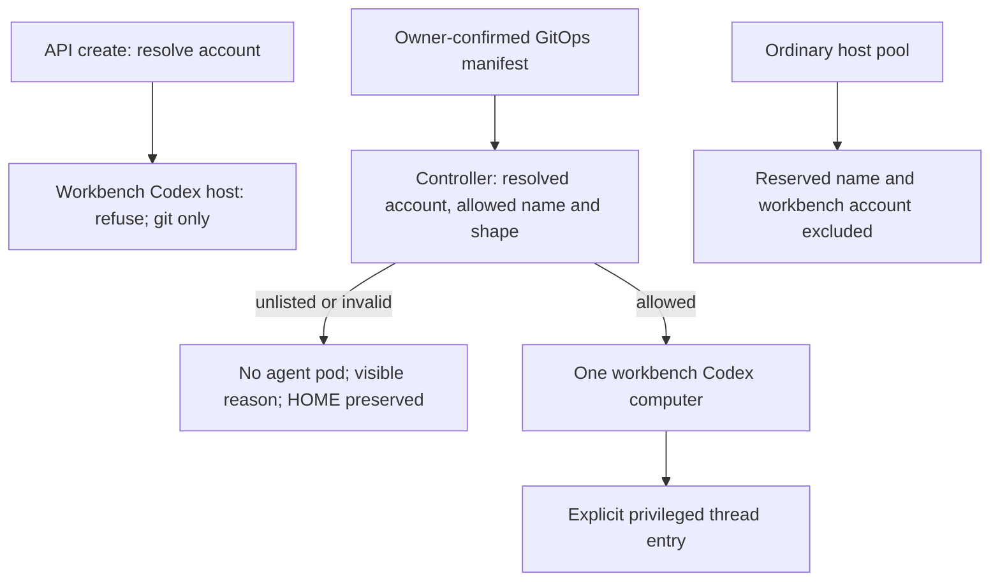

# DESIGN-067: A Codex coordinator on the workbench profile, named by the operator

- **Status:** Proposed. Docs only. Nothing is built, installed or accepted.
- **Date:** 2026-11-14.
- **Tracking:** [OP858](https://work.haynesnetwork.com/work_packages/858), under epic
  #91 and the distributed-dev-env saga. Coordinator: `dev-env-fable-coordinator-1109`.
- **ADR:** [ADR-030](../adrs/030-named-codex-workbench-coordinator.md), Proposed.
- **Scope:** one persistent Codex remote host on the existing workbench account;
  admission, threads, pool exclusion, phone use, questions, wake, custody and ending.
  No new credential, grant, account, RBAC right or depth exemption. No installation
  is authorized by this document. OP830, OP831, Studio and the OP812 lane transfer
  remain separate work.
- **Evidence pin:** dev-env main
  `768935da630b2675e55860ece925f0e3b390c880`, fetched 2026-11-14. Every dev-env source
  link below pins that commit, except the explicitly marked PR 1145 raise readers
  in section 11.1, which are not yet on main. haynes-ops main
  `dec3c06241bd6bd74b4d5f9017bd8d804d5596f9`, fetched the same day, supplies the GitOps
  evidence. Git is evidence of declarations, not proof of their installation.
  No host, Secret value, session log or conversation transcript was read for this
  design. The worker read its own session metadata and OP858.

## 1. The ask and who decided what

OP858 records Tom's words, relayed by Meatball: “Do codex”; “Sol 6.1 is fine Astra
is expensive and should be used as a specialist.”; “Can the fable dev-env super
user fix this?”. The work order attributes the title **Dev-env coordinator 2**,
model `gpt-6.1-sol` and effort `medium` to Tom. These are requirements for the
coordinator thread. They do not prove a served model or approve installation.

The coordinator's rulings in OP858 and its work order are:

1. A Codex host may run on a workbench-account profile only when the operator names
   it. Both the API and the controller enforce that rule.
2. The allowed host is declared in git at depth 0, after Tom confirms its exact
   effects. A raw manifest is not a bypass.
3. Story110 T30 stays: a workbench session creating an ordinary Codex host must
   omit the profile and receives the template default.

Everything proposed below is the design worker's proposal for the coordinator's
review. It is not another ruling by Tom. Acceptance of this design is separate
from confirmation of a concrete install.

## 2. What exists today

### 2.1 API creation and identity

The API classifies Tom's configured ServiceAccount as `human`. A configured client
is `client`, except that a workbench token bound to a session-owned pod resolves
as that session first. The live pod owner and UID are checked. A session caller's
next child depth is its own depth plus one.
([caller.go:138–153][caller-class], [caller.go:288–328][caller-session])

| Caller creating `agent: codex`, `mode: remote` | Current API result | Profile and provenance |
| --- | --- | --- |
| Tom's configured account | Allowed, subject to field validation | May name a template profile, including one on the workbench account; omitted profile resolves to the default. Parent is the account; depth 0. |
| Trusted client | Same host permission as Tom | Same profile choice and depth 0. The pinned GitOps client list contains the workbench account and v1 account. |
| Session whose pod uses the workbench account | Allowed | Any explicit profile is refused, even the default's name. Omitted profile stays empty and resolves through the template default. Parent is the caller session; its child depth is recorded. |
| Ordinary session | Refused | Same-profile inheritance does not override the Codex remote caller check. |
| Configured coordinator host, named coordinator session, portal or CallerPolicy caller | No general Codex remote create right | The configured coordinator class is restricted to project tasks; the Codex remote check admits only human, client or workbench session. |

Evidence for the table: [validate.go:106–123][create-name],
[validate.go:152–170][create-codex], [validate.go:315–369][create-profile],
[validate.go:384–389][create-depth], [caller.go:98–110][caller-parent],
[caller.go:138–153][caller-class], [templates.go:472–481][profile-resolve],
[operator manifest:577–581][ops-clients]. Model and effort are checked by
[validate.go:168–170,236–239][create-effort].

“Default, never workbench” is T30's stated intent. The code's actual switch
requires an omitted profile; it does not independently refuse a template default
that uses the workbench account. Template validation permits that account on the
default profile; it prohibits a *named coordinator* account there. The new guard
must resolve the account, including the default and aliases.
([validate.go:315–348][create-profile], [templates.go:600–624][template-account])

A workbench session is not the separately configured coordinator-host caller
class, nor a `dev-env-coordinator-<name>` delegate identity. Named identities are
Claude-only and have their own launcher and one-holder rules.
([caller.go:71–88][caller-policy], [named_coordinator.go:23–37][named-rules],
[named_coordinator.go:75–89][named-launch])

### 2.2 A manifest and the pod builder

An AgentSession applied through Kubernetes does not call `newSession`. The
controller resolves its profile and builds the pod from the stored spec. For a
valid ordinary `codex`/`remote` object on a profile whose `serviceAccount` is
`dev-env-workbench`, the builder selects that account and sets
`DEV_ENV_WORKBENCH=1`. It does not ask how that object was created. The special
admission label applies to named coordinator accounts, not the workbench account.
Thus source permits this shape; a successful live bootstrap still depends on the
image, templates, storage, mounts and keeper projection.
([validate.go:76–82][create-contract], [reconciler.go:1418–1446][ensure-build],
[pod.go:320–323,378–394][pod-account])

The Codex remote boot starts the phone daemon, without a normal CLI launch or a
conversation to resume. It uses the keeper's access-only Codex projection.
([daemon.go:341–348][daemon-remote], [codex_remote.go:20–33][remote-home],
[codex_remote.go:280–305][remote-start])

| Pod content | What the source supplies on that manifest shape |
| --- | --- |
| Account and API access | `dev-env-workbench`, its ordinary Kubernetes token, the projected operator-audience token, `AGENTD_API_URL` and its token-file pointer. |
| Profile environment | The workbench profile's keeper projection file pointers, MCP variables, GCP pointer, Omni configuration and optional hardware/PVE environment sources. These are references; no values were read. |
| Storage | Private HOME PVC; shared handoff PVC; temporary and grant volumes; global config/script/CA mounts; the workbench `/creds`, GCP and keeper projection mounts, read-only. No shared workspace mounts unless `spec.workspace` asks for that separate route. |
| Provider-only content | No static Claude task token. A remote profile block, if present, is added to a remote agent pod; the pinned workbench profile has none. |
| Agent environment | The thread wrapper scrubs alternate provider/auth channels but does not turn a workbench pod into an ordinary pod. Its mounted files and ServiceAccount remain the host's. |

Evidence: [pod.go:353–394][pod-env], [pod.go:413–443][pod-profile-env],
[pod.go:471–522][pod-mounts], [pod.go:548–551][pod-token],
[pod.go:668–681][pod-remote-content], [templates:199–230][ops-global],
[templates:328–362][ops-workbench], [thread_launch_codex.go:533–539][thread-env].

The work order reports an older workbench-profile host,
`haynes-ops-1023-041051`, created by the v1 API client on 2026-10-23 and suspended.
That is coordinator-supplied context, not a live finding here. The create and
builder evidence above explains what source permits. It does not establish that
host's past threads, use of authority, pairing or current state. Do not resume it
to prove this design.

### 2.3 The existing GitOps precedent

The Fable coordinator manifest declares a remote session on `workbench`, depth
`"0"`, with parent `flux-system/kustomize-controller`. It uses `ssa: IfNotPresent`
and disables pruning. Its Kustomization uses `prune: false`, `deletionPolicy:
Orphan`, depends on CRDs, templates and operator, and does not wait on session
health. Removing the app does not end the session. Reaping while the manifest
remains active would recreate an empty session of the same name.
([coordinator agentsession.yaml:11–36][ops-coordinator],
[coordinator ks.yaml:3–44][ops-coordinator-ks])

### 2.4 Designs are not installed capabilities

DESIGN-042 section 6.4 is absent from main. Its P6 proposal was read at open PR
782 head `5449647f421b4ad6211dc46fc8e9b70329d45a6f`: a separate Claude-only delegate
identity on agent bindings, with activation held. It is not the proposed Codex
superuser host. Main's own DESIGN-066 records the same source distinction.
([DESIGN-042:345–375][design042], [DESIGN-066:207–238][design066-current])

DESIGN-066 and Accepted ADR-028 concern raising another running session. This
proposal creates a new host on its declared profile. It does not implement a
raise, accept an annotation as approval, grant delegate powers, or change that
ADR. Its source/installed/accepted evidence ladder and explicit limits are the
model for sections 11 and 12 here.
([ADR-028][adr028], [DESIGN-066:1–35][design066-status])

## 3. The operator names one host



### 3.1 One small setting, a guard with no bypass flag

Here **Codex host** means the platform's `agent: codex`, `mode: remote` computer.
That is the exact existing host predicate, not a rule for every Codex process.
Codex task/local modes are outside this access change. The proposal leaves their
existing admission and profile policy intact; in particular, workbench workers
may already request the workbench profile. Extending this allow-list to every
Codex mode would remove that existing worker behavior and exceeds OP858's named
remote-host scope. Arbitrary daemon launch from a powerful task/exec process is
part of the superuser trust limit in section 12, not prevented by this guard.
([codexhost.go:325–326][host-kind], [validate.go:171–175,324–347][create-profile])

Add operator argument `--codex-workbench-hosts`, default empty, in the session
namespace. Accept zero or one exact DNS session name. Refuse duplicates, wildcards,
more than one name and an invalid name at startup. The plural spelling allows a
list parser; it does not authorize a pool or a second host. Proposed initial name:
`dev-env-codex-coordinator-2`, confirmed with the eventual install packet.

Add one shared policy function used by the API and controller. Its inputs are the
session identity/spec, resolved templates and configured allowed name. It must:

1. Resolve `spec.profile`, including an empty default, and inspect the profile's
   account. An unreadable template or account is a refusal, never an ordinary
   profile assumption.
2. For any Codex remote host on the workbench account, require the configured
   name, namespace, exact depth `"0"`, parent `flux-system/kustomize-controller`,
   no caller, project canary, private pilot, shared workspace or scheduled-work
   origin. The ordinary remote shape is required; do not broaden another route.
3. Reserve the configured name even if its spec points to another account, agent
   or mode. A coordinator name on an ordinary profile is an error, not a pool host.
4. Return a fixed refusal reason and no pod plan on failure. No caller category,
   trusted client, model, title, annotation or claimed role exempts the check.

The test is the resolved **account**, not the literal profile name `workbench`.
No admission label copied from a session is sufficient. Parent and depth are
shape checks, not proof that Flux applied the object or that Tom approved it.
The trust root is the operator's GitOps setting and the existing Kubernetes writers.

### 3.2 API and controller both enforce it

**API create:** retain T30's explicit-profile refusal first. Then resolve the
requested account even when profile is omitted. Refuse every API create of a
workbench-account Codex remote host with `403`, code
`codex_workbench_host_git_only`. Explain that the named host is declared in git.
The current API deliberately refuses a user-supplied name; keep that restriction.
Do not add a caller-controlled coordinator bit or named create exception.
([validate.go:106–108][create-name])

The shared check also runs in final admission and resume before any write or
exec. A trusted client cannot create a different host on this account, including
through a default/alias. A workbench-created ordinary host still receives the
default, but the create refuses if that default uses the workbench account. This
makes T30's stated intent hold without allowing an explicit profile.

**Controller:** run the shared check before agent pod construction on every
create, resume, recovery and alternate agent-pod build path. Recheck at the final
pod-create boundary using the loaded policy and templates. An unlisted host gets
no agent pod and no silent downgrade to `dev-env-agent`. Preserve any existing
HOME; do not allocate a new one for a refused fresh object. For a podless Running
request show phase `Pending`, `PodReady=False`, reason
`CodexWorkbenchHostNotNamed`, with the sentence “The operator has not named this
Codex host to run on the workbench account.” Report a distinct invalid-shape or
unavailable-template reason when appropriate. Configuration repair can unblock
it; this is not an irreversible terminal failure.

This fits the existing ensure/status split, where pod construction precedes a
new HOME allocation and build errors become visible conditions. It needs a
specific refusal case, rather than `sessionInvalidError`, whose current result is
`Failed`.
([reconciler.go:1356–1429][ensure-build], [reconciler.go:1901–1914][build-status])

**Rescue remains possible:** the hold pod runs on the ordinary account and
starts no agent. The guard must allow this rescue path for a refused old host,
without admitting a privileged agent pod.
([pod.go:378–394][pod-account], [reconciler.go:1915–1922][hold-status])

The setting is a construction/admission control, not a kill switch. It must not
make an operator upgrade delete a running session. Section 10 requires stopping
any existing unlisted workbench Codex host before enabling the guarded install,
and suspending the allowed host before removing its name. If configuration drifts
while a pod runs, show an admission-blocked condition, refuse new platform thread
operations and replacement pods, and require an explicit stop by its custodian.
Do not pretend that this revokes a running process's Kubernetes token.

## 4. Creation, after the owner's confirmation

The later haynes-ops change declares one separate app, using the Fable precedent.
This is the proposed document shape, not an apply instruction:

```yaml
apiVersion: dev-env.haynesops.com/v1alpha1
kind: AgentSession
metadata:
  name: dev-env-codex-coordinator-2
  namespace: dev-agents
  labels:
    dev-env.haynesops.com/depth: "0"
  annotations:
    kustomize.toolkit.fluxcd.io/ssa: IfNotPresent
    kustomize.toolkit.fluxcd.io/prune: disabled
spec:
  agent: codex
  mode: remote
  model: gpt-6.1-sol
  effort: medium
  title: Dev-env coordinator 2
  repo: dev-env
  base: main
  size: L
  profile: workbench
  parent: flux-system/kustomize-controller
  operatingMode: Running
```

Use a separate Kustomization with the same prerequisites, orphaning behavior and
nonblocking health policy. Give it a runbook that removes the app from git before
reap. Do not copy API bookkeeping, project snapshots, refresh credentials,
coordinator identity labels or the Fable session's identity.

Before its manifest is applied, the accountable installer must record:

- Tom's confirmation of the exact name, account, mounts, always-allow threads,
  persistence, wake plan, costs and stop procedure in sections 5, 10 and 13.
- Accepted ADR-030 and reviewed build; required CI on every implementation head.
- All operator replicas on the guarded build and the same setting. The agent
  image must contain the reviewed thread and safe-stop support. Watch-dependent
  lanes also require proved wake support from slice (c2). No automatic restart of
  an existing session is part of this rollout.
- The current profile and account match the reviewed packet, mounted references
  exist, and the keeper's projection is healthy. Never inspect credential values.
- No active unlisted workbench-account Codex host and no collision with the chosen
  name, HOME or old UID. A legacy host stays suspended and unlisted. Its resume
  must be refused, not grandfathered.
- Explicit pool exclusion is already active. The allowed name is added to the
  existing hands-off list in git; construction does not precede protection.

Depth 0 makes this host the parent of depth-1 workers, whose workers are depth 2.
Today the API refuses deeper creates and caps unfinished children at four per
canonical agent. Native threads are not child AgentSessions and share that host
parent identity. Do not claim separate per-thread worker quotas.
([caller.go:49–56][depth-limits], [caller.go:321–328][caller-session],
[sessions.go:699–710][create-limits], [thread_launch_codex.go:56–60][thread-request])

## 5. Safety rules

1. **One named privileged host.** An empty setting permits none. At most one name
   is accepted. A trusted client and a raw manifest meet the same account guard.
2. **No default-profile escape.** Resolve the account in both guards; aliases,
   empty profiles and later template changes are tested.
3. **No ordinary session drives it.** Before a generic profile or ancestry
   allowance, privileged thread routes admit only Tom, a trusted client or a
   session that is workbench by creation **and** whose pod runs as the workbench
   account. Resolve its `spec.profile`, including the default; an unreadable
   template refuses. A session raised to workbench fails this gate. A forged title
   or same-profile label grants nothing (section 6.1).
4. **No pool crossover.** Protection applies to every pool decision and lease
   recheck. The coordinator launcher requires an explicit reserved host.
5. **Every thread has the host's power.** This host does not isolate native
   threads or in-pod subagents from one another. Phone-created threads also run
   on its account. One allowed host does not mean one powerful conversation.
6. **Always-allow is explicit in Tom's confirmation.** The coordinator thread
   bypasses Codex approvals and sandboxing. Kubernetes RBAC, admission and egress
   remain external boundaries; a prompt or a model name is not one.
7. **The existing workbench rights are broad.** Exec can reach other pods' mounted
   credentials and identities, including privileged services. Never describe a
   missing direct Secret-read verb as protection from indirect credential access.
8. **Only the keeper refreshes Codex.** No `codex login`, copied refresh login,
   second refresher or new grant is part of this design.
9. **No typed wake.** Preserve ADR-024. A file, child note or timer is information,
   never the owner's answer or authorization. A pending decision blocks only its
   dependent lane and cannot be answered by a background wake.
10. **Keep provenance and state.** Parent, profile and depth remain the creation
    record. Wake and custody records bind the Session UID and exact native thread.
11. **No live experiment before the install line.** Phone visibility, title,
    question return and idle wake are proof steps after confirmation, not claims
    derived from a source test.
12. **Preserve running work.** Checkpoint and rescue before a stop or deletion.
    The allowed-name setting is not a substitute for stopping the daemon.

The current workbench declarations grant cluster-wide pod exec/delete, proxy
access, restart patches, Flux and ExternalSecret patches, Jobs and CronJob writes,
and named storage roles. The restart guard narrows workload patches. Hardware
material is optional in the existing profile; reaching hardware still needs the
existing egress and target authority. This design neither adds nor removes those
rights.
([workbench-operator.yaml:16–37,45–136][ops-workbench-rights],
[templates:307–362][ops-workbench], [launch preflight:13–24][profile-preflight])

## 6. Threads and host reuse

### 6.1 Entry points

| Route | Today | Proposal for the reserved host |
| --- | --- | --- |
| Operator `POST /v1/sessions/{host}/threads` | Starts the host's `agentd ctl thread-start`. Session callers pass equal-profile or strict-ancestor fence. Human/client callers bypass that fence. | Apply section 3 eligibility and the privileged caller gate first, using the live host pod account and resolved template. Require a session caller to be workbench by creation (its `spec.profile`, default resolved, runs as the workbench account) and its pod to run as that account. Unreadable templates refuse. Ordinary, named coordinator and raised-to-workbench sessions fail even if an ancestry/profile test would otherwise pass. Add expected Session/Pod UID fences to this host's exec. |
| CLI exec route with explicit `--host` | v1, workbench or an authorized external client execs `thread-start`; ordinary session pods use the API. Kubernetes rights are the final exec gate. | Keep those rights. Check reserved-host eligibility in agentd as well as the operator-mediated path. This does not claim to constrain a superuser issuing arbitrary exec. |
| Phone on the paired computer | The documented owner route can create a remote interactive thread on that host. | Supported owner route after confirmation. It has the same host power. Source cannot prevent Tom creating a second conversation there. |
| One-use `/codex-thread` route (`rc fresh`) | Separate feature and UID/PID/boot/pairing/deadline qualification, with an operator reservation and host one-use marker. Not a repeatable replacement for `thread start`. | Do not enable it for this coordinator. If it is independently enabled later, it must run the same privileged-host check before its qualification and mutation. No bypass through a trusted client. |

Evidence: [threads.go:21–31,79–115][thread-api],
[threads.go:118–164][thread-fence], [thread.go:129–178][thread-cli],
[attach.go:99–148][exec-client], [workflow guide:838–877][phone-workflow],
[codex_rc.go:20–55][rc-gate], [codex_rc.go:74–111][rc-qualify],
[codex_rc.go:124–156][rc-reserve].

Today `isWorkbenchSession` checks the pod's authenticated account, not creation
profile. DESIGN-066 Ruling 7 and sections 8.2/8.4 require the creation distinction
so a raise cannot spread through platform routes. The reserved-host gate must
check both creation profile and pod account; an active raise is never a substitute.
([caller.go:255–281][workbench-predicate],
[DESIGN-066:516–552][design066-no-spread],
[DESIGN-066:1219–1254][design066-child-profile],
[DESIGN-066:1280–1297][design066-readers], [ADR-028 decision 9][adr028-no-spread])

For the supported exec route, carry the controller's admitted host name and
Session UID in a controller-owned pod environment field, proposed
`AGENTD_CODEX_COORDINATOR_HOST`, absent for every other pod. Agentd compares it
with its own immutable session input and requires explicit coordinator intent.
The CLI passes that purpose to `ctl thread-start`; the operator API supplies it
only after its caller and live-target checks. This field is deployment metadata,
not a credential or independent approval. It cannot revoke an existing pod on a
flag change, and a workbench process can forge its own environment; the real
construction and API fences remain in the operator. Tests must say that limit.

The normal launcher must specify `gpt-6.1-sol`, `medium`, the exact host and a fresh
unique tmux name. The initial handoff says it owns no lane until OP812 releases
one. It asks for a worktree before repository edits. Never let a missing reserved
host fall back to selection, creation, a different model or a pool host.

Host `spec.model` does not select every native thread's model. Thread start takes
its own model and effort. `protocol.ValidateCodexModel` admits the pinned list:
`gpt-6-astra`, `gpt-6.1-sol`, `gpt-6.1-terra`, `gpt-6-sol`, `gpt-6-luna`,
`gpt-5.6-sol`, `gpt-5.6-terra`, `gpt-5.6-luna`, `gpt-5.5`. Effort validation accepts
`medium` for `gpt-6.1-sol`; the thread wrapper has its own narrower effort set.
Admission is not proof that a provider served a turn on a model.
([protocol/session.go:353–363,389–405][codex-models],
[thread_launch_codex.go:50–60,273–277][thread-validation],
[codex-clean-session.py:68–70,139][wrapper-model])

The wrapper starts a fresh `codex --remote` client with
`--dangerously-bypass-approvals-and-sandbox`. The thread has the host's credentials,
egress and Kubernetes identity. No per-thread profile input exists. None of this
turns a `kindSession` into a human or configured coordinator caller.
([codex-clean-session.py:68–79][wrapper-model],
[threads.go:118–127][thread-fence], [caller.go:138–153][caller-class])

### 6.2 Pool isolation in both directions

Today hands-off and protected hosts are rejected before profile matching. The
selector operates on resolved profiles. Workbench callers may ask for a named
profile; an ordinary session asks only for its own. A lease repeats suitability
checks. Explicit `--host` bypasses selection.
([select.go:324–340][pool-protected], [codexhost.go:231–272][pool-caller],
[codexhost.go:506–545][pool-lease], [workflow guide:895–926][pool-workflow])

Proposed changes:

- Derive pool protection from the reserved-name setting, in addition to the
  existing hands-off list and protected annotation. Exclude **every** host whose
  resolved account is workbench, even an invalid/unlisted one. Protect the reserved
  name regardless of account. Failure to resolve an account makes it ineligible.
- Apply it in fact collection, pure suitability/selection, lease recheck and any
  later resume/create automation. The host never counts as spare ordinary pool
  capacity and is never adopted, leased, resumed, rotated or cleaned up by it.
- Retain explicit hands-off GitOps as a visible second protection. Do not require
  it to be the only protection or trust an editable session annotation.
- Add a coordinator launch selector to the CLI, proposed spelling
  `thread start --agent codex --coordinator --host <reserved-name>`. It refuses a
  missing `--host`, an unreserved name, wrong account/UID, or pool selection.
  Without `--coordinator`, a platform launch to the reserved host refuses with a
  sentence explaining its purpose. The API takes the same explicit purpose;
  caller authorization is checked independently of that untrusted intent field.
- The phone is an owner-controlled entry point, outside that CLI intent field.
  Ordinary thread work uses other computers. A superuser can bypass the CLI with
  raw exec; this is an acknowledged workbench trust root, not a sandbox claim.

Amend the implementation-facing workflow and preflight docs in the build slice.
DESIGN-063 remains the ordinary-pool contract; this design supplies a reserved
class, not a new pool cell that anyone can select.

## 7. Pairing, visibility and names

**Pairing prerequisites today:** the host must be Running, the daemon live and
the keeper projection current. `codexPair` does not separately probe connection
state; the native pair call must return a valid code. Thread launch later checks
that the daemon is connected. `agent-run pair` uses pod exec;
Tom, v1, a workbench session or another already authorized exec client runs it.
An ordinary session's CLI refuses that path. The owner enters the private,
short-lived code in the ChatGPT app's Remote “add a computer” flow. Never put the
code in Git, a work order, a PR, a tracker comment or a shared handoff.
([pair.go:7–26][pair-cli], [attach.go:99–148][exec-client],
[codex_remote.go:417–463][pair-server], [agent-run help pair:913–923][pair-workflow],
[thread_launch_codex.go:326–348][thread-host-ready])

The host keeps enrollment under its private CODEX_HOME on HOME. A connected
status with `pair-code-issued` means only that a code was issued at least once.
The phone's pairing is held by the relay and is not readable through this
platform. An enrollment record alone is not evidence of owner pairing.
([codex_remote.go:20–45][remote-home])

**A fresh visible thread:** use the native remote TUI path through `thread start`,
not `codex exec` or `queue`. Agentd checks the pairing-issued marker, establishes
folder trust for a bootstrap-qualified repository, launches once, binds a new
thread for that cwd and observes it in the default source list. A text response
is a later phase. `visible` or an uncertain launch is not permission to resend.
The initial handoff is at most 4096 UTF-8 bytes.
([thread_launch_codex.go:22–34,39–60][thread-request],
[thread_launch_codex.go:280–323][thread-preflight],
[thread_launch_codex.go:381–405][thread-create],
[thread_launch_codex.go:446–466,510–528][thread-observe])

That proves a source-visible native record, not a screen seen by Tom. Installation
requires his confirmation that this exact new thread is visible and answers.

| Name | What is known from source | Proposal / Unknown |
| --- | --- | --- |
| AgentSession stable name | Pod name and session identity derive from it. | Use the proposed reserved name in section 4 after confirmation. |
| Host display title | `spec.title` is a platform title. GPT models compose as `GPT \| <role>`. A later title change is the ADR-027 annotation, not a spec edit. | Set `Dev-env coordinator 2` at create. A different authorized workbench session can change the platform title; self-title is refused. |
| Computer name in the phone | Remote status reports `sess.Name`. The daemon start path does not pass a computer title. | **Unknown:** which name the phone actually renders, and whether its own UI can rename it. Do not promise that `spec.title` renames the computer. |
| Native thread name | `--name` names the tmux client session. The wrapper passes no native title field. The typed title applier serves Claude remote only. Pinned upstream supports a separate native name operation, below. | Set a native thread title through that operation after binding the exact new ID. **Unknown:** what the phone renders, automatic-title interactions, owner UI rename and persistence on this deployment. |

Evidence: [pod.go:537–551][pod-token], [title.go:141–158][title-access],
[sessiontitle/title.go:141–158,201–211][title-compose],
[ADR-027][adr027], [codex_remote.go:298–305,369–403][remote-status],
[codex-clean-session.py:68–79,109–112][wrapper-model],
[rename.go:656–660][title-kind].

**Native thread title proposal:** upstream Codex 0.160.1's
`thread_processor.rs:666–681,1848–1878` implements the name setter: it validates
the thread ID/name, updates stored metadata and emits a name-update notification.
Its read helper restores that stored name. The current official app-server docs
name the method `thread/name/set`; those docs alone are not installed-version
proof. The pinned handler is the version evidence.
([thread_processor.rs:666–681][native-name-notify],
[thread_processor.rs:1848–1878][native-name-set],
[thread_processor.rs:4838–4855][native-name-read],
[OpenAI app-server, API overview][official-app-server])

Add a bounded setter to the existing peer-verified daemon RPC client in slice (b),
after the fresh thread ID is unambiguously bound. Set `GPT | Dev-env coordinator 2`
as native thread metadata, separately from the tmux name and host title. Admit
only the reserved coordinator launch; validate the exact Session/Pod/thread
binding and title. Read name metadata back; a lost ACK stays unconfirmed and must
not relaunch the thread. No shell/TUI rename, resume or new turn is needed.
The daemon RPC transport already checks its Unix peer PID and UID.
([codex_host_rpc.go:51–99][native-rpc-peer])

## 8. Questions to Tom and the answer's way back

The repository says Codex native phone-prompt delivery is not verified; an
undeliverable question stays pending while independent work continues.
([CLAUDE.md:146–152][phone-rule])

| Existing path | What source proves | What it does not prove |
| --- | --- | --- |
| Owner's thread | Documented owner-interactive phone workflow on the paired host. | A pushed native question notification, the actual phone display, or receipt of an answer. |
| `agent-run msg` | API supplies caller identity and delivers through `agentd ctl deliver`. Managed native Codex TUI resumes have a special path; legacy launches use queue. | A remote host's arbitrary named thread is not selected. Deliver requires a current CLI launch and live PID; remote boot deliberately makes no such launch. It is not a verified route into this coordinator thread, nor proof that a peer speaks for Tom. |
| Session Ask routes | Own-session info/approval creation/read/withdraw; portal reader answers. Workbench session tokens are session callers. | A native Codex question modal, automatic execution of an approval, or per-native-thread identity. |
| Keeper Ask push | Separate opt-in notifier; write-ahead dedupe, rate and window controls; generic board notice. Pinned GitOps enables Asks and notices. | A phone seeing it, an immediate push outside its window, or an answer delivered into Codex. |
| dev-env MCP `ask` | Creates and returns an Ask immediately; `ask_status`/`list_my_asks` read it. | Waiting, native wake or a platform-verified owner identity. Current store explicitly requires the requester to read the answer. |

Evidence: [workflow guide:838–845][phone-workflow],
[podcmd.go:198–246][message-api], [deliver.go:95–167][message-deliver],
[daemon.go:341–344][daemon-remote], [asks.go:22–44,73–118][ask-api],
[portal_asks.go:59–75][ask-answer], [ask_notifications.go:20–43,149–151][ask-push],
[operator manifest:797–811][ops-asks], [keeper manifest:125–144][ops-ask-push],
[mcp.go:603–606,651–661][ask-mcp], [asks/store.go:1–3][ask-read].

**Proposed supported path:** verify one harmless question and Tom's direct reply
in the new phone-visible thread at installation. Until that passes, questions
needing Tom stay with the outgoing coordinator. The successor asks one question
at a time in that thread, records `Q-067-NN` and the affected action, and waits
without treating silence, a file or a child note as an answer. It records the
direct answer and its conversation context as an owner-reported ruling in the
tracker, with no transcript export or claim of cryptographic verification.

For an asynchronous notice and structured answer, reuse the existing session
Ask/MCP and portal board, after checking the installed route and sender. The
question names this coordinator's role and tracker item, since the requester is
the host Session UID, not a native thread. The coordinator reads its Ask on the
next supported wake/turn and checks scope, expiry and answer. Do not claim that
an Ask answer is already pushed into the conversation. Do not add credentials,
notification destinations or a new approval channel. Native `request_user_input`
may be tested later; it is not an installation prerequisite if the direct-thread
and existing board paths pass and Tom accepts Q-067-03.

Do not send peer `msg` text as Tom's answer. A verified coordinator relay remains
subject to existing source-provenance rules and cannot consume the owner's
confirmation of a different action. Raw messages to this host must not gain a
thread bridge as a side effect of section 9.

## 9. Wake and watch

Today nothing wakes an idle Codex thread by itself. Until that is proved, a Codex
coordinator works when Tom or another session writes to it. It does not watch on
its own. The current daemon and completion paths do not supply that wake; section
9.2 separates a completed command from a new idle-thread turn.
([daemon.go:341–344][daemon-remote], [codex_remote.go:309–340][remote-poll],
[async_watcher.rs:327–379][native-exit-event])

### 9.1 What exists today

“Command returned”, “event reached a process”, “turn started” and “coordinator
acknowledged the event” are separate facts.

| Source | Current result for a Codex remote-host thread | Evidence |
| --- | --- | --- |
| `agent-run remind` | **Does not wake this thread.** Targets are phone notification or calendar, not a thread. | [remind.go:37–50][remind], [targets.go:11–30][reminder-targets] |
| `agent-run schedule` | **Does not wake this thread.** It launches a new bounded task or remote session using a dispatch template. | [schedule.go:45–77][schedule] |
| `agent-run parent wait-any` | **Works as a held API read:** returns metadata for a new addressed child note or timeout, with cursor/resync rules. **Unknown:** whether this Codex harness delivers completion to an otherwise idle phone thread. A command alone does not prove that. | [parent_note_wait_any.go:58–110,262–274][parent-wait-api], [parent_wait.go:83–130][parent-wait-cli], [ADR-024][adr024] |
| `agent-run msg <host>` | **Does not address the arbitrary remote thread.** Requires a current agent CLI launch/PID; no remote host launch is made. Its terminal target is the fixed `agent` session, not this thread's chosen tmux name. | [deliver.go:95–166][message-deliver], [daemon.go:341–344][daemon-remote], [wrapper:109–112][wrapper-model] |
| Direct tmux paste into the named client | No supported thread-specific platform route. It would introduce typed-input races. **Excluded** by ADR-024 for wake. | [ADR-024 decisions 1–4][adr024] |
| Agentd remote supervisor | Keeps/restarts the daemon with backoff and reports status. It is not an event-to-thread wake loop. | [codex_remote.go:309–340][remote-poll] |
| New file in shared handoff directory | No timer/note/file-to-remote-thread adapter in the paths above. **Unknown:** native harness background-file-wait completion delivery until tested. Merely creating the file is not a wake. | [daemon.go:341–344][daemon-remote], [thread_launch_codex.go:22–34][thread-request], [ADR-024 decision 3][adr024] |
| Native RPC | The one-use RC path can create a thread and first turn; it is not a repeatable wake for an existing phone thread. | [codex_rc_create.go:50–114][rc-native], [codex_rc.go:47–67][rc-reserve] |

### 9.2 The pinned CLI and its completion boundary

The local design-worker binary reports `codex-cli 0.160.1`; this was a local
`--version` read, not a host probe. The image pin and agentd's native version
check name that same version. Main's retained R-05 audit identifies its upstream
source commit as `d27764b82f7118f674371e6d6e76271d9d606edb`.
([managed_codex.go:25][codex-pin], [Dockerfile:197][codex-image-pin],
[R-05:25–39][codex-source-pin])

At that upstream pin, `unified_exec/async_watcher.rs:155–239` waits for the
parent-started terminal process to exit. Its completion path at `:327–379` emits
an execution-end event using the original Session, turn and call ID. That is a
concrete terminal-completion signal available in source. Those paths do not
establish a new model turn for an idle remote conversation.
([async_watcher.rs:155–239][native-exit],
[async_watcher.rs:327–379][native-exit-event])

The official OpenAI Hooks documentation, read 2026-11-14, also describes async
command hooks: they supply information at a safe point in an active turn, or wait
for the next user turn when idle. Hook completion itself does not start a turn.
This current documentation is not version-specific acceptance of the installed
binary. Neither that documented hook nor the inspected exit-event path is a
proved idle wake. No supported idle-wake hook was established by this audit.
([OpenAI Hooks, “How background hooks run”][official-hooks])

### 9.3 Smallest proposal, preserving ADR-024

**Coordinator ruling, 2026-11-14:** the reply to the worker's parent-note question
`op858-design-q1` directs this design to keep ADR-024 intact. The thread owns its
held wait, plus the smallest native completion hook returning that wait's result.
There is no typed wake, unsolicited agentd turn or terminal injection. This is the
coordinator's ruling, not the owner's answer.

Preserve ADR-024's parent-owned wait and **no typed input**. First qualify the
existing harness: on a disposable ordinary-profile test host authorized by a
later test story, have its own thread start one timer wait, one `parent wait-any`
and one bounded file wait through its supported background tool facility. Let
the thread go idle. Prove each completion causes a fresh turn in that same native
thread and an acknowledgement. Source cannot certify this provider behavior.
A live test needs its own authorization; this docs task performs none.

If all three pass, retain the existing native completion facility. Add only a
small dev-env wait adapter for cursor persistence and the handoff-directory scan
where necessary. Do not build a scheduler to replace a working harness timer.

If the harness cannot do it, the missing component is a **native harness
completion hook**, not a tmux sender or a scheduled replacement Session. Proposed
contract: the parent starts `agent-run coordinator wait` from its own tool call.
It combines a deadline, one existing parent-note held read and a bounded local
file wait. It returns only an event kind, event ID, path or note reference, cursor
and time. No file/note text or shell command becomes a wake payload. The native
harness must resume the same tool call/thread on completion and surface its
result as tool output. A completion that creates no native turn is
`wake_unconfirmed`; watch-dependent lanes do not transfer.

Persist one parent-owned wait record in private HOME: Session UID, native thread
ID, wait/tool-call identity, next timer deadline, parent cursor, directory watermark,
pending event IDs, budget/deadline and stopped state. The proposed default timer
is hourly, subject to Q-067-02. Watch one explicit handoff directory only. Refuse
symlinks and paths outside it; scan bounded directory metadata at a modest cadence
if inotify is unreliable on shared storage. File contents remain untrusted data
for the coordinator to read deliberately. Coalesce bursts; bound the pending set;
on overflow report `resync` and read the source list. A replayed event must not
create another autonomous turn.

The hook must be implemented in a supported provider/harness extension, not by
patching Codex's installed binary or pretending an MCP notification starts a turn.
**Unknown:** whether another supported extension surface exists in the pinned CLI.
If it does not, the smallest missing addition is an upstream native harness hook
that resumes its own registered wait as tool completion, retaining its thread,
tool-call identity, owner-input ordering and budget/stop controls. This slice is
then blocked on provider support and Q-067-04; the outgoing coordinator retains
watch lanes. No automatic
`turn/start`, `thread/resume`, fork, queued prompt or terminal injection is a
fallback. ADR-024 is not amended. If its parent-owned-wait contract cannot be
satisfied, record that conflict for the coordinator rather than design around it.

On suspend, cancel waits and persist cursors. On resume the thread's custodian
must reestablish and acknowledge the exact native thread/tool binding; do not
adopt a latest thread by cwd or title. A held owner question pauses its dependent
lane, not unrelated event collection. No wake answers a question, resumes a paused
worker, overrides a denial or outlives the authorized budget. Re-arm from the
returned cursor, not by repeatedly listing in a tight loop.

## 10. Custody, rollback and ending

### 10.1 Custody comes after proof

The outgoing coordinator owns OP812 until it records a lane release. The new
thread acknowledges the exact checkpoint and names the lanes it can take, its
wake source, its owner-question path and remaining limits. A created Session,
issued pairing code or `responded` result alone is not custody. Record the host
Session UID, native thread reference in private custody records, implementation
heads, installed pins and the tracker ACK. Public evidence contains no real
session link, pairing code or transcript.

### 10.2 Suspend and resume

Today enrollment lives on HOME, and daemon shutdown leaves it there. Pod loss
removes processes; remote boot supervises a new daemon, not each tmux client or
coordinator conversation. Native history is on private CODEX_HOME, but persistence
of history is not a promise that a live client or an active turn resumes.
([codex_remote.go:20–33,342–366][remote-home],
[daemon.go:341–344][daemon-remote], [historyexport_layout.go:95–113][codex-history])

The source reports a live Codex remote daemon as `busy` to keep the idle timer
from removing the computer. Remote sessions are excluded from automatic revision
drain. Do not assume “72 hours idle” is a coordinator stop timer. Pinned templates
have a 168-hour suspended archive timer and 720-hour rescue-bundle retention;
those are defaults, not a backup of native enrollment/history.
([codex_remote.go:393–410][remote-status], [drain.go:62–72][drain-remote],
[templates:183–194][ops-lifecycle])

Proposed procedure: checkpoint all threads and worker ownership, stop/re-arm the
wait hook deliberately, then have an authorized custodian suspend the host through
the supported lifecycle route. The operator rescues before removing a pod that
ran. Shutdown sends SIGTERM to the daemon; pod removal ends all remaining tmux
clients. A successful git rescue does **not** prove every remote thread stopped
before the snapshot: the generic rescue stop reads the normal agent PID, which
this remote boot does not create. Slice (c1) below must explicitly quiesce remote
threads/daemon before rescue for this host and prove they cannot mutate the HOME
while it is saved.
([controller/rescue.go:25–32][rescue-controller],
[agentd/stop.go:23–46][stop-agent], [daemon.go:341–344][daemon-remote],
[codex_remote.go:342–366][remote-stop])

On resume, require the same original HOME and Session UID, keeper projection and
operator allowance. Confirm daemon connection, enrollment retention, thread
history availability and the same phone computer with Tom. **Unknown:** whether
native threads need a supported explicit attach/resume step and whether a phone
open alone reloads a stopped thread. This must be measured; no automatic “latest
thread” adoption and no second host as a recovery shortcut.

### 10.3 Take back access or remove the host

1. Stop new lane assignments. Checkpoint workers, branches, PRs and pending owner
   decisions. Push all source; get the successor's ACK or retain custody elsewhere.
2. Disable the wake source and quiesce every coordinator thread, then suspend the
   host and verify no agent pod/process remains through the authorized lifecycle
   evidence. A blocked rescue stops deletion; it is not bypassed.
3. Remove the declarative app from git so Flux cannot recreate it. Keep the
   operator name and pool protection while a stopped object or retained HOME needs
   lifecycle handling. If ending with reap, remove the app **before** reap.
4. Reap only after rescue evidence and work handoff are recorded. Before loss of
   HOME, explicitly preserve native history under its existing supported private
   retention/export process if required. A git bundle alone does not preserve the
   phone enrollment or all native chats. Do not export a refresh login or copy
   enrollment to manufacture a replacement computer.
5. Remove the allowed name in git after the privileged pod has stopped. Keep a
   hands-off entry for any retained old host. Record actual removal separately from
   suspension, source rescue, history retention and successor acceptance.

The Fable app's orphan/recreate ordering and the controller rescue finalizer are
the existing precedents, not a new deletion permission.
([coordinator ks.yaml:7–21][ops-coordinator-ks], [guard.go:20–52][rescue-finalizer])

**Rollback:** first suspend and preserve this host, then remove/disable its GitOps
app. Only then remove the name, roll back the guarded operator/agent pins or
remove wake support. An older binary does not enforce this design. Rollback must
not leave the same raw manifest running under an older controller. There is no
safe “remove the flag and leave it running” revocation. No operator upgrade is
permission to restart a running host.

## 11. Build slices and evidence gates

These are future bounded stories. Ready dependent slices run serially. Each gets
its own tracker scope, budget and exact-head review by another model family before
merge. The coordinator owns that review and the install decision. Slice (d) depends
on (a), (b) and (c1) only. If provider support blocks (c2), (d) and (e) still proceed
for lanes Tom drives from the phone. Only watch-dependent lane transfer waits on
(c2). This docs PR ends after its own CI/review handoff and implements no slice.

| Slice | Source and tests | Install step and its checks | Owner confirmation |
| --- | --- | --- | --- |
| (a) Shared account guard and reserved host | Flag parser; shared predicate; API create/final admission/resume; controller agent-pod and status paths. Tests: empty setting; zero/one/duplicate/two names; raw manifest; human/client API create; ordinary and workbench origins; T30 explicit refusal; default/alias on workbench; missing templates; wrong parent/depth/namespace/shape; no new HOME/pod on refusal; rescue hold allowed; resume of unlisted legacy refused. Remove each guard in mutation checks and show its test fail. | Publish guarded operator only after tests and review. Install with an empty allowed set after inventory shows no active unlisted workbench Codex host. Verify every replica's pin/config and a separately authorized negative canary's condition/no pod. Running sessions keep their pods. | No host is created. Existing legacy-host suspension or any disruptive test requires its own in-scope authorization. Stop before adding a name or manifest until Q-067-01 is answered. |
| (b) Thread and pool fences | Explicit coordinator intent/host; privileged gate on both thread routes, UID-fenced operator exec; controller-to-agentd metadata/purpose checks; pool facts/pure selector/lease exclusions; exact-ID native thread title setter. Tests: ordinary same-profile and ancestor spoof; named coordinator caller; raised-to-workbench caller refused despite matching pod account or patched profile label; unreadable creation profile refused; human/client and workbench-by-creation caller with workbench pod allowed; pool with only reserved host; default/account alias; removed annotation/hands-off list; lease race; explicit ordinary intent to reserved host; coordinator intent to pool/missing host; no fallback; title metadata/readback and lost ACK without relaunch. Existing ordinary thread cases stay green. Update workflow/preflight docs. | Publish operator and agent image; pin both without restarting any host. Install reserved-name/pool setting only with the confirmed packet, all replicas consistent. Verify read-only selection never offers the reserved host and negative requests do not exec. | Q-067-01 before nonempty allowance or any host manifest. |
| (c1) Safe stop and retention | Stop tests prove every remote writer is quiesced before rescue and no daemon restart races it. Test retained native history and explicit same-thread binding after resume. No wake hook is required for safe stop. | Publish/pin stop handling. On an authorized ordinary disposable host, prove a stop leaves no writer and preserved history can be reopened. Required before (d), independently of (c2). | The proof host/test needs its own approved story; no experiment in this design task. Any stop proof needs its own in-scope authorization. |
| (c2) Wake | Resolve section 9's harness hook. Tests with fake clock/events: timer, addressed child note, new file, idle tool completion; unrelated note; replay/coalescing/resync; path traversal/symlink; lost ACK; question/hold; budget end; suspend cancellation; resume requires explicit same-thread bind. No CPU-heavy/timing stress suite. | Publish/pin supported hook. On an authorized ordinary disposable host, prove each source wakes the **same idle thread** once. If the provider has no supported hook, (c2) is blocked; record that fact and do not substitute terminal input. This does not block (d) or (e) for phone-driven lanes. | The proof host/test needs its own approved story. Q-067-02 controls unattended work and budget. Required only before a watch-dependent lane moves; all three wake proofs must pass. |
| (d) One GitOps host and phone proof | Separate haynes-ops app and allow-name/hands-off settings, reviewed together. Render and validate exact account/mounts/depth/parent/name; check no copied API or credential state. Source checks cannot prove pairing. | After (a), (b) and (c1) only, apply flags/protection first, then manifest. A blocked (c2) does not block this phone-driven host. Read back Session and pod UID/account/profile/mount **references**. Authorized custodian runs pair privately; Tom enters it. Launch one fresh explicit coordinator thread on `gpt-6.1-sol`/`medium`; observe response, default-list presence and Tom's phone display/title. Verify harmless question and reply; test existing Ask/notice/read path if used. | Tom's concrete confirmation of the full packet **before flags/manifest/host/pairing**. His pairing step and phone/question confirmation remain required. |
| (e) Custody and end rehearsal | Exact OP812 checkpoint and ACK; defined lane list; budget/stop record; documented suspend/resume/removal procedure. No new source unless earlier proof finds a fault, which returns to its owner. | For phone-driven lanes, record model evidence and owner question return. Checkpoint, perform an authorized quiet suspend/resume proof and verify retained computer/history. Record each ready lane release and ACK. For watch-dependent lanes, first pass (c2), prove timer, child note and file wake on the installed host and re-arm the same-thread watch after resume. Item 772's acceptance watch, item 829's acceptance, a Meatball handoff channel and any worker's parent note need a watch. They stay with the outgoing coordinator until (c2) passes; phone-driven lanes can move meanwhile. Record source, tested, installed and accepted separately. | OP812 owner/coordinator lane release. Any stop/restart proof is explicitly included in the confirmed install plan. |

For this design PR: `make check-layout`; own diff/citation review; independent
native review at the final head; ready PR; required `CI - Success` on that head;
answer advisory findings. Do not label story 858 complete: its build, install and
usable acceptance remain with the coordinator.

### 11.1 Every `isWorkbenchSession` reader

This is the complete production call-site inventory at the evidence pin, found
by searching `isWorkbenchSession` in `internal/`. The predicate depends on caller
class, TokenReview namespace and account, not provider, model or literal profile.
A valid Codex host on the workbench account therefore returns true.
([caller.go:255–281][workbench-predicate])

| Call site | Today for that Codex host as caller | Proposed treatment |
| --- | --- | --- |
| `validate.go:162`, Codex remote caller admission | May create a Codex remote host. | Keep; account guard still refuses any workbench-account result. |
| `validate.go:331`, T30 profile branch | Any explicit profile refused for its remote Codex child. | Keep unchanged, then reject a workbench-account default. |
| `validate.go:339`, other child profile branch | May name a valid profile; omitted profile stays default. | Keep existing workbench power; no new right. |
| `named_coordinator.go:121`, launcher classifier | Classified as workbench-session; at depth 0 can launch a Claude named identity as a depth-1 child if that policy is enabled. | Keep; this is existing workbench authority, not a new delegate identity for the Codex host. |
| `codex_rc.go:29`, one-use RC route | Passes caller-class gate; all target qualifications still apply. | Keep gate; add shared reserved-host checks at target admission; do not activate route here. |
| `codexhost.go:238`, asked profile | May ask pool for any named profile; absent means default. | Keep ordinary requests, but never return a workbench-account/reserved host. |
| `codexhost.go:271`, pool caller facts | Sets `Workbench=true`. | Keep; exclusions win before caller suitability. |
| `title.go:152`, title access | May title any other session; own-session refusal runs first. | Keep. Native thread metadata has a separate setter; phone rendering is Unknown. |
| `keeper_login.go:339`, `isWorkbench` helper | Returns true. `keeperLoginGate` at `:350` accepts that class, then checks provider and enabled keeper route. | Keep existing ceremony route; it does not authorize `codex login` in this pod. |

Evidence: [validate.go:152–170,315–348][create-profile],
[named_coordinator.go:113–126][named-classifier], [codex_rc.go:26–45][rc-gate],
[codexhost.go:231–272][pool-caller], [title.go:139–158][title-access],
[keeper_login.go:334–355][keeper-workbench].

Adjacent readers matter too: `resolveCaller` checks the workbench pod **before**
the trusted-client list; `resolveSession` derives the caller profile from the
pod label then spec. The thread fence uses those profiles/ancestry. The pod
builder sets the account and env marker. `agent-run inWorkbenchPod` reads only
that marker to lift its local exec refusal; RBAC is the actual exec gate. These
must have regression coverage for this host, without reclassifying it as a human,
client, delegate or configured coordinator-host account.
([caller.go:138–153,255–281,317–328][caller-session],
[threads.go:128–143][thread-fence], [pod.go:378–394][pod-account],
[attach.go:139–148][exec-client])

DESIGN-066 adds adjacent readers in `internal/apiserver/raise.go` on
[PR 1145][raise-pr], head `4d0f77de1269b22bc52a22205b9fa4a728417a22`, **not yet on
main**. These are branch-source facts, not installed behavior:

| Adjacent reader | Branch behavior | For the reserved host |
| --- | --- | --- |
| `workbenchByCreation`, `raise.go:588–601` | Resolves `spec.profile`, including the default, and tests the workbench account. A failed templates/profile read returns false. | True for this host's declared workbench profile. Reuse this creation test alongside the authenticated pod-account check at privileged thread entry; a raised caller cannot substitute its pod account. |
| `raisedToWorkbench`, `raise.go:603–639` | Checks an active profile raise against its signature, UID and ledger, then resolves whether that profile uses the workbench account. Key/ledger/template read errors refuse. | A raise record does not grant entry to this host. The host needs no raise; its creation profile already gives the account. |

A thread on this host is a **superuser session** in DESIGN-066's sense. It may
perform a raise on Tom's word like any workbench-by-creation session, under the
same notice, ancestry and other raise gates once that route is installed. The host
itself is depth 0 on the workbench profile, so it is not a raise target. PR 1145
also rejects a Codex target outright; its caller test permits a workbench-created
session without restricting its provider. This does not reclassify the host as
the separately configured coordinator-host caller.
([DESIGN-066:407–428][design066-performer],
[raise.go:545–601][raise-performer], [raise.go:603–639][raise-raised],
[raise.go:641–689][raise-target])

## 12. Known limits and Unknowns

1. **Whole workbench power.** The guards constrain supported operator routes.
   They cannot contain a malicious or mistaken workbench agent that can exec into
   privileged pods and use their identities. GitOps writers and cluster admins can
   also change the allow-name setting or build bare pods. No second supported
   privileged Codex host is admitted; this is not a cluster-wide proof that another
   privileged process cannot exist.
2. **Several powerful threads.** The single-name setting limits hosts, not native
   chats, in-pod subagents or phone users. Threads share HOME and identity. A native
   phone-created thread does not pass the operator's model/purpose fence.
3. **Confirmation is a work record.** The install records Tom's confirmation and
   the performing agent's context; no new platform verifier proves his identity or
   that he read a notice. A pairing-issued marker is weaker still.
4. **No instant revocation.** Removing an allowed name blocks construction and
   platform launches; it does not kill an already running pod. Explicit suspension
   comes first. An older controller lacks this guard entirely.
5. **Unknown U1 — phone names and pairing.** Exact computer/thread titles, owner
   rename controls and actual pairing/visibility need Tom's device proof. Platform
   `spec.title`, tmux name and default source list do not settle them.
6. **Unknown U2 — question delivery.** Native Codex phone prompts and push receipt
   are unverified. The thread and existing Ask/board return must be proved in the
   chosen installation; no transcript or native thread identity is stored by Ask.
7. **Unknown U3 — idle wake and hook.** Completion delivery for timer, held child
   note and new-file wait needs live proof. The supported native extension surface
   is Unknown. Section 9 stays blocked if provider support cannot satisfy
   ADR-024. A running daemon is not a waking coordinator.
8. **Unknown U4 — resume.** Enrollment is persisted by source; same phone entry,
   thread reopening, active-turn recovery and watch re-arm on the installed CLI
   require a quiet suspend/resume proof. No generic launch record restores all
   native threads.
9. **Unknown U5 — installed state.** Pinned haynes-ops files declare profiles,
   clients, Ask flags and notification window. They do not prove current RBAC,
   admission, Secret-reference availability, projection health or replica pins.
   Install preflight measures those without credential values.
10. **Unknown U6 — model service.** Admission accepts `gpt-6.1-sol`/`medium`.
    A provider turn and available served-model metadata, not the request or the
    host spec, establish what ran. If unavailable, served model stays Unknown.
11. **Rescue and retention are different.** Existing generic rescue does not prove
    remote writers were quiesced. Slice (c1) must fix that for this host. A git
    bundle is not a native-history/enrollment backup. Suspend retains HOME only
    until the applicable archive policy allows removal.
12. **Watch data remains untrusted.** A child note or shared file may contain
    misleading instructions. Metadata delivery grants no owner authority. A burst
    may delay a wake; overflow requires resync, never silent event loss.

Limits 1–4 rest on the source boundaries and GitOps rights cited in sections 2,
3, 5 and 6. Unknowns are acceptance work, not facts inferred from the historical
host or coordinator handoff. This design does not authorize probing any of them.

## 13. Open questions for the owner

Each question is still pending. The installer delivers them one at a time through
the current verified owner-question route, records the answer with its source and
date, and folds it into the install packet. This section is a record, not proof
that the questions reached Tom.

- **Q-067-01:** May we install `dev-env-codex-coordinator-2` as the always-allow
  workbench computer described here, so you can direct superuser work from the
  phone and every thread on that computer can exec into privileged pods and reach
  their credentials? Saying yes also means that after slice (a), nobody, including
  your own account and the v1 pod, can create another Codex host on the workbench
  account. The existing suspended host `haynes-ops-1023-041051` can no longer be
  resumed. Today the API permits those callers and the builder accepts that profile
  (sections 2.1/2.2); the new guard deliberately removes those paths. Saying no
  leaves that work with the existing coordinator.
- **Q-067-02:** May the coordinator run unattended on an hourly timer and child/file
  events within a stated operating budget and stop threshold, so it keeps watches
  while you are away at the cost of ongoing model and pod usage? Without that
  confirmation, autonomous watch lanes stay with the outgoing coordinator.
- **Q-067-03:** May the coordinator ask you in its visible thread and use the existing
  Asks board for asynchronous notices and answers, so decisions can return before
  native Codex phone prompts are verified, with board answers read on its next
  wake rather than pushed into the conversation? Without that agreement, owner
  decisions stay with the outgoing coordinator.
- **Q-067-04, only if the pinned harness lacks the needed hook:** May we take on a
  separate upstream Codex change for the parent-owned completion hook, so the
  successor can keep autonomous watches while preserving ADR-024, at the cost of
  a provider dependency and extra review? Without it, watch-dependent lanes stay
  with the outgoing coordinator. This is outside the dev-env build and is not
  authorized by accepting this document.

Before Q-067-01 is delivered, the packet must state the exact operator/agent
pins, size L resource limits and HOME/retention policy, target name/account/mount
references, any reviewed wake hook, the separate pairing step, all known limits,
and the concrete suspend/remove order. Do not turn a general “Do codex” into
confirmation of those effects. The packet must also say:

- After slice (a), nobody, including Tom's own account and the v1 pod, can create
  another Codex host on the workbench account. The suspended
  `haynes-ops-1023-041051` can no longer be resumed. Today's API create and pod
  builder allow that account; the historical host's state is coordinator-supplied
  context, not a new live check (sections 2.1/2.2).
  ([validate.go:152–170,315–369][create-profile], [pod.go:320–394][pod-account])
- Each thread is a superuser session under DESIGN-066 and may perform a raise on
  Tom's word like any workbench-by-creation session once the raise route is
  installed, with the same gates. The host itself is depth 0 on workbench, so it is
  not a raise target. PR 1145's implementation is not yet on main (section 11.1).
  ([DESIGN-066:407–428][design066-performer],
  [raise.go:545–601][raise-performer], [raise.go:641–689][raise-target])

The pinned size L declaration is 1 CPU/6 GiB requested and 8 CPU/24 GiB limited,
with a 20 GiB HOME default. Re-read those declarations for the actual packet.
([templates:165–194][ops-size-home])

## 14. Review and handoff

This proposal leaves the coordinator's source-versus-install hold intact. The
independent native review, final head, layout result, CI result, advisory findings,
remaining Unknowns and owner questions are recorded in the PR and the one worker
handoff comment on OP858. Cross-family design review and acceptance remain the
coordinator's next step. No merge is authorized to this worker.

The independent native review of `00cf485121ec191b9f569309c3254c567e13092b`
found three precision issues: distinguish native name metadata from phone
rendering, state the actual pairing checks, and correct the pairing citation
label. The author fixed all three. The advisory review on that head also asked
for explicit non-remote scope and one other citation-label correction; section
3.1 now states why task/local policy is unchanged, and both labels match their
source targets. Final-head review and CI evidence belong in the PR handoff.

The coordinator session `dev-env-fable-coordinator-1109` (`claude-fable-5-2`)
reviewed this design and ADR-030 on 2026-11-14 at head `159f487f`. Verdict: accept
after four changes; HIGH 0, MEDIUM 2, LOW 2. These are the coordinator's rulings:

| Finding | Change |
| --- | --- |
| M1 | Require workbench by creation and the workbench pod account at reserved-host thread entry; record the adjacent raise readers and the host's performer/target roles in section 11.1 and the owner's packet. |
| M2 | Split safe stop/retention (c1) from wake (c2); (d) depends only on (a), (b), (c1), and phone-driven custody can proceed while watch lanes wait. |
| L1 | State in Q-067-01 and the packet that nobody can create another workbench Codex host after (a), and the existing suspended host cannot resume. |
| L2 | State plainly at the top of section 9 that idle threads do not wake or watch on their own today. |

<!-- Evidence links pin source, not deployment state. -->

[adr024]: https://github.com/thaynes43/dev-env/blob/768935da630b2675e55860ece925f0e3b390c880/.agents/sagas/distributed-dev-env/adrs/024-parent-held-wait.md
[adr027]: https://github.com/thaynes43/dev-env/blob/768935da630b2675e55860ece925f0e3b390c880/.agents/sagas/distributed-dev-env/adrs/027-session-title-annotation.md
[adr028]: https://github.com/thaynes43/dev-env/blob/768935da630b2675e55860ece925f0e3b390c880/.agents/sagas/distributed-dev-env/adrs/028-raise-a-running-session.md
[ask-answer]: https://github.com/thaynes43/dev-env/blob/768935da630b2675e55860ece925f0e3b390c880/internal/apiserver/portal_asks.go#L59-L75
[ask-api]: https://github.com/thaynes43/dev-env/blob/768935da630b2675e55860ece925f0e3b390c880/internal/apiserver/asks.go#L22-L118
[ask-mcp]: https://github.com/thaynes43/dev-env/blob/768935da630b2675e55860ece925f0e3b390c880/internal/agentrun/mcp.go#L603-L661
[ask-push]: https://github.com/thaynes43/dev-env/blob/768935da630b2675e55860ece925f0e3b390c880/internal/keeper/ask_notifications.go#L20-L151
[ask-read]: https://github.com/thaynes43/dev-env/blob/768935da630b2675e55860ece925f0e3b390c880/internal/asks/store.go#L1-L3
[build-status]: https://github.com/thaynes43/dev-env/blob/768935da630b2675e55860ece925f0e3b390c880/internal/controller/reconciler.go#L1901-L1914
[caller-class]: https://github.com/thaynes43/dev-env/blob/768935da630b2675e55860ece925f0e3b390c880/internal/apiserver/caller.go#L138-L153
[caller-parent]: https://github.com/thaynes43/dev-env/blob/768935da630b2675e55860ece925f0e3b390c880/internal/apiserver/caller.go#L98-L110
[caller-policy]: https://github.com/thaynes43/dev-env/blob/768935da630b2675e55860ece925f0e3b390c880/internal/apiserver/caller.go#L71-L88
[caller-session]: https://github.com/thaynes43/dev-env/blob/768935da630b2675e55860ece925f0e3b390c880/internal/apiserver/caller.go#L138-L328
[codex-history]: https://github.com/thaynes43/dev-env/blob/768935da630b2675e55860ece925f0e3b390c880/internal/agentd/historyexport_layout.go#L95-L113
[codex-image-pin]: https://github.com/thaynes43/dev-env/blob/768935da630b2675e55860ece925f0e3b390c880/images/agent/Dockerfile#L193-L199
[codex-models]: https://github.com/thaynes43/dev-env/blob/768935da630b2675e55860ece925f0e3b390c880/internal/agentd/protocol/session.go#L353-L405
[codex-pin]: https://github.com/thaynes43/dev-env/blob/768935da630b2675e55860ece925f0e3b390c880/internal/agentd/managed_codex.go#L25-L25
[codex-source-pin]: https://github.com/thaynes43/dev-env/blob/768935da630b2675e55860ece925f0e3b390c880/.agents/sagas/distributed-dev-env/research/R-05-codex-native-routing.md#L25-L39
[create-codex]: https://github.com/thaynes43/dev-env/blob/768935da630b2675e55860ece925f0e3b390c880/internal/apiserver/validate.go#L152-L170
[create-contract]: https://github.com/thaynes43/dev-env/blob/768935da630b2675e55860ece925f0e3b390c880/internal/apiserver/validate.go#L76-L82
[create-depth]: https://github.com/thaynes43/dev-env/blob/768935da630b2675e55860ece925f0e3b390c880/internal/apiserver/validate.go#L384-L389
[create-effort]: https://github.com/thaynes43/dev-env/blob/768935da630b2675e55860ece925f0e3b390c880/internal/apiserver/validate.go#L168-L239
[create-limits]: https://github.com/thaynes43/dev-env/blob/768935da630b2675e55860ece925f0e3b390c880/internal/apiserver/sessions.go#L699-L710
[create-name]: https://github.com/thaynes43/dev-env/blob/768935da630b2675e55860ece925f0e3b390c880/internal/apiserver/validate.go#L106-L123
[create-profile]: https://github.com/thaynes43/dev-env/blob/768935da630b2675e55860ece925f0e3b390c880/internal/apiserver/validate.go#L152-L369
[daemon-remote]: https://github.com/thaynes43/dev-env/blob/768935da630b2675e55860ece925f0e3b390c880/internal/agentd/daemon.go#L341-L348
[depth-limits]: https://github.com/thaynes43/dev-env/blob/768935da630b2675e55860ece925f0e3b390c880/internal/apiserver/caller.go#L49-L56
[design042]: https://github.com/thaynes43/dev-env/blob/5449647f421b4ad6211dc46fc8e9b70329d45a6f/.agents/sagas/distributed-dev-env/designs/042-homelab-operator-access.md#L345-L375
[design066-current]: https://github.com/thaynes43/dev-env/blob/768935da630b2675e55860ece925f0e3b390c880/.agents/sagas/distributed-dev-env/designs/066-raise-a-running-session.md#L207-L238
[design066-status]: https://github.com/thaynes43/dev-env/blob/768935da630b2675e55860ece925f0e3b390c880/.agents/sagas/distributed-dev-env/designs/066-raise-a-running-session.md#L1-L35
[drain-remote]: https://github.com/thaynes43/dev-env/blob/768935da630b2675e55860ece925f0e3b390c880/internal/controller/drain.go#L62-L72
[ensure-build]: https://github.com/thaynes43/dev-env/blob/768935da630b2675e55860ece925f0e3b390c880/internal/controller/reconciler.go#L1356-L1446
[exec-client]: https://github.com/thaynes43/dev-env/blob/768935da630b2675e55860ece925f0e3b390c880/internal/agentrun/attach.go#L99-L148
[hold-status]: https://github.com/thaynes43/dev-env/blob/768935da630b2675e55860ece925f0e3b390c880/internal/controller/reconciler.go#L1915-L1922
[host-kind]: https://github.com/thaynes43/dev-env/blob/768935da630b2675e55860ece925f0e3b390c880/internal/apiserver/codexhost.go#L325-L326
[keeper-workbench]: https://github.com/thaynes43/dev-env/blob/768935da630b2675e55860ece925f0e3b390c880/internal/apiserver/keeper_login.go#L334-L355
[message-api]: https://github.com/thaynes43/dev-env/blob/768935da630b2675e55860ece925f0e3b390c880/internal/apiserver/podcmd.go#L198-L246
[message-deliver]: https://github.com/thaynes43/dev-env/blob/768935da630b2675e55860ece925f0e3b390c880/internal/agentd/deliver.go#L95-L167
[named-classifier]: https://github.com/thaynes43/dev-env/blob/768935da630b2675e55860ece925f0e3b390c880/internal/apiserver/named_coordinator.go#L113-L126
[named-launch]: https://github.com/thaynes43/dev-env/blob/768935da630b2675e55860ece925f0e3b390c880/internal/apiserver/named_coordinator.go#L75-L89
[named-rules]: https://github.com/thaynes43/dev-env/blob/768935da630b2675e55860ece925f0e3b390c880/internal/apiserver/named_coordinator.go#L23-L37
[native-exit]: https://github.com/openai/codex/blob/d27764b82f7118f674371e6d6e76271d9d606edb/codex-rs/core/src/unified_exec/async_watcher.rs#L155-L239
[native-exit-event]: https://github.com/openai/codex/blob/d27764b82f7118f674371e6d6e76271d9d606edb/codex-rs/core/src/unified_exec/async_watcher.rs#L327-L379
[native-name-notify]: https://github.com/openai/codex/blob/d27764b82f7118f674371e6d6e76271d9d606edb/codex-rs/app-server/src/request_processors/thread_processor.rs#L666-L681
[native-name-read]: https://github.com/openai/codex/blob/d27764b82f7118f674371e6d6e76271d9d606edb/codex-rs/app-server/src/request_processors/thread_processor.rs#L4838-L4855
[native-name-set]: https://github.com/openai/codex/blob/d27764b82f7118f674371e6d6e76271d9d606edb/codex-rs/app-server/src/request_processors/thread_processor.rs#L1848-L1878
[native-rpc-peer]: https://github.com/thaynes43/dev-env/blob/768935da630b2675e55860ece925f0e3b390c880/internal/agentd/codex_host_rpc.go#L51-L99
[official-app-server]: https://learn.chatgpt.com/docs/app-server#api-overview
[official-hooks]: https://learn.chatgpt.com/docs/hooks#how-background-hooks-run
[ops-ask-push]: https://github.com/thaynes43/haynes-ops/blob/dec3c06241bd6bd74b4d5f9017bd8d804d5596f9/kubernetes/main/apps/dev-env-system/keeper/app/helmrelease.yaml#L125-L144
[ops-asks]: https://github.com/thaynes43/haynes-ops/blob/dec3c06241bd6bd74b4d5f9017bd8d804d5596f9/kubernetes/main/apps/dev-env-system/operator/app/helmrelease.yaml#L797-L811
[ops-clients]: https://github.com/thaynes43/haynes-ops/blob/dec3c06241bd6bd74b4d5f9017bd8d804d5596f9/kubernetes/main/apps/dev-env-system/operator/app/helmrelease.yaml#L577-L581
[ops-coordinator]: https://github.com/thaynes43/haynes-ops/blob/dec3c06241bd6bd74b4d5f9017bd8d804d5596f9/kubernetes/main/apps/dev-env-system/coordinator-session/app/agentsession.yaml#L11-L36
[ops-coordinator-ks]: https://github.com/thaynes43/haynes-ops/blob/dec3c06241bd6bd74b4d5f9017bd8d804d5596f9/kubernetes/main/apps/dev-env-system/coordinator-session/ks.yaml#L3-L44
[ops-global]: https://github.com/thaynes43/haynes-ops/blob/dec3c06241bd6bd74b4d5f9017bd8d804d5596f9/kubernetes/main/apps/dev-env-system/templates/app/templates.yaml#L199-L230
[ops-lifecycle]: https://github.com/thaynes43/haynes-ops/blob/dec3c06241bd6bd74b4d5f9017bd8d804d5596f9/kubernetes/main/apps/dev-env-system/templates/app/templates.yaml#L183-L194
[ops-size-home]: https://github.com/thaynes43/haynes-ops/blob/dec3c06241bd6bd74b4d5f9017bd8d804d5596f9/kubernetes/main/apps/dev-env-system/templates/app/templates.yaml#L165-L194
[ops-workbench]: https://github.com/thaynes43/haynes-ops/blob/dec3c06241bd6bd74b4d5f9017bd8d804d5596f9/kubernetes/main/apps/dev-env-system/templates/app/templates.yaml#L307-L362
[ops-workbench-rights]: https://github.com/thaynes43/haynes-ops/blob/dec3c06241bd6bd74b4d5f9017bd8d804d5596f9/kubernetes/main/apps/dev-env-system/rbac/app/workbench-operator.yaml#L16-L136
[pair-cli]: https://github.com/thaynes43/dev-env/blob/768935da630b2675e55860ece925f0e3b390c880/internal/agentrun/pair.go#L7-L26
[pair-server]: https://github.com/thaynes43/dev-env/blob/768935da630b2675e55860ece925f0e3b390c880/internal/agentd/codex_remote.go#L417-L463
[pair-workflow]: https://github.com/thaynes43/dev-env/blob/768935da630b2675e55860ece925f0e3b390c880/internal/agentrun/help.go#L913-L923
[parent-wait-api]: https://github.com/thaynes43/dev-env/blob/768935da630b2675e55860ece925f0e3b390c880/internal/apiserver/parent_note_wait_any.go#L58-L274
[parent-wait-cli]: https://github.com/thaynes43/dev-env/blob/768935da630b2675e55860ece925f0e3b390c880/internal/agentrun/parent_wait.go#L83-L130
[phone-rule]: https://github.com/thaynes43/dev-env/blob/768935da630b2675e55860ece925f0e3b390c880/CLAUDE.md#L146-L152
[phone-workflow]: https://github.com/thaynes43/dev-env/blob/768935da630b2675e55860ece925f0e3b390c880/docs/workflow-guide.md#L838-L877
[pod-account]: https://github.com/thaynes43/dev-env/blob/768935da630b2675e55860ece925f0e3b390c880/internal/controller/pod.go#L320-L394
[pod-env]: https://github.com/thaynes43/dev-env/blob/768935da630b2675e55860ece925f0e3b390c880/internal/controller/pod.go#L353-L394
[pod-mounts]: https://github.com/thaynes43/dev-env/blob/768935da630b2675e55860ece925f0e3b390c880/internal/controller/pod.go#L471-L522
[pod-profile-env]: https://github.com/thaynes43/dev-env/blob/768935da630b2675e55860ece925f0e3b390c880/internal/controller/pod.go#L413-L443
[pod-remote-content]: https://github.com/thaynes43/dev-env/blob/768935da630b2675e55860ece925f0e3b390c880/internal/controller/pod.go#L668-L681
[pod-token]: https://github.com/thaynes43/dev-env/blob/768935da630b2675e55860ece925f0e3b390c880/internal/controller/pod.go#L537-L551
[pool-caller]: https://github.com/thaynes43/dev-env/blob/768935da630b2675e55860ece925f0e3b390c880/internal/apiserver/codexhost.go#L231-L272
[pool-lease]: https://github.com/thaynes43/dev-env/blob/768935da630b2675e55860ece925f0e3b390c880/internal/apiserver/codexhost.go#L506-L545
[pool-protected]: https://github.com/thaynes43/dev-env/blob/768935da630b2675e55860ece925f0e3b390c880/internal/codexhostpool/select.go#L324-L340
[pool-workflow]: https://github.com/thaynes43/dev-env/blob/768935da630b2675e55860ece925f0e3b390c880/docs/workflow-guide.md#L895-L926
[profile-preflight]: https://github.com/thaynes43/dev-env/blob/768935da630b2675e55860ece925f0e3b390c880/docs/launch-profile-preflight.md#L13-L24
[profile-resolve]: https://github.com/thaynes43/dev-env/blob/768935da630b2675e55860ece925f0e3b390c880/internal/templates/templates.go#L472-L481
[rc-gate]: https://github.com/thaynes43/dev-env/blob/768935da630b2675e55860ece925f0e3b390c880/internal/apiserver/codex_rc.go#L20-L55
[rc-native]: https://github.com/thaynes43/dev-env/blob/768935da630b2675e55860ece925f0e3b390c880/internal/agentd/codex_rc_create.go#L50-L114
[rc-qualify]: https://github.com/thaynes43/dev-env/blob/768935da630b2675e55860ece925f0e3b390c880/internal/apiserver/codex_rc.go#L74-L111
[rc-reserve]: https://github.com/thaynes43/dev-env/blob/768935da630b2675e55860ece925f0e3b390c880/internal/apiserver/codex_rc.go#L47-L156
[remind]: https://github.com/thaynes43/dev-env/blob/768935da630b2675e55860ece925f0e3b390c880/internal/agentrun/remind.go#L37-L50
[reminder-targets]: https://github.com/thaynes43/dev-env/blob/768935da630b2675e55860ece925f0e3b390c880/internal/reminders/targets.go#L11-L30
[remote-home]: https://github.com/thaynes43/dev-env/blob/768935da630b2675e55860ece925f0e3b390c880/internal/agentd/codex_remote.go#L20-L45
[remote-poll]: https://github.com/thaynes43/dev-env/blob/768935da630b2675e55860ece925f0e3b390c880/internal/agentd/codex_remote.go#L309-L340
[remote-start]: https://github.com/thaynes43/dev-env/blob/768935da630b2675e55860ece925f0e3b390c880/internal/agentd/codex_remote.go#L280-L305
[remote-status]: https://github.com/thaynes43/dev-env/blob/768935da630b2675e55860ece925f0e3b390c880/internal/agentd/codex_remote.go#L298-L410
[remote-stop]: https://github.com/thaynes43/dev-env/blob/768935da630b2675e55860ece925f0e3b390c880/internal/agentd/codex_remote.go#L342-L366
[rescue-controller]: https://github.com/thaynes43/dev-env/blob/768935da630b2675e55860ece925f0e3b390c880/internal/controller/rescue.go#L25-L32
[rescue-finalizer]: https://github.com/thaynes43/dev-env/blob/768935da630b2675e55860ece925f0e3b390c880/internal/controller/guard.go#L20-L52
[schedule]: https://github.com/thaynes43/dev-env/blob/768935da630b2675e55860ece925f0e3b390c880/internal/agentrun/schedule.go#L45-L77
[stop-agent]: https://github.com/thaynes43/dev-env/blob/768935da630b2675e55860ece925f0e3b390c880/internal/agentd/stop.go#L23-L46
[template-account]: https://github.com/thaynes43/dev-env/blob/768935da630b2675e55860ece925f0e3b390c880/internal/templates/templates.go#L600-L624
[thread-api]: https://github.com/thaynes43/dev-env/blob/768935da630b2675e55860ece925f0e3b390c880/internal/apiserver/threads.go#L21-L115
[thread-cli]: https://github.com/thaynes43/dev-env/blob/768935da630b2675e55860ece925f0e3b390c880/internal/agentrun/thread.go#L129-L178
[thread-create]: https://github.com/thaynes43/dev-env/blob/768935da630b2675e55860ece925f0e3b390c880/internal/agentd/thread_launch_codex.go#L381-L405
[thread-env]: https://github.com/thaynes43/dev-env/blob/768935da630b2675e55860ece925f0e3b390c880/internal/agentd/thread_launch_codex.go#L533-L539
[thread-fence]: https://github.com/thaynes43/dev-env/blob/768935da630b2675e55860ece925f0e3b390c880/internal/apiserver/threads.go#L118-L164
[thread-host-ready]: https://github.com/thaynes43/dev-env/blob/768935da630b2675e55860ece925f0e3b390c880/internal/agentd/thread_launch_codex.go#L326-L348
[thread-observe]: https://github.com/thaynes43/dev-env/blob/768935da630b2675e55860ece925f0e3b390c880/internal/agentd/thread_launch_codex.go#L446-L528
[thread-preflight]: https://github.com/thaynes43/dev-env/blob/768935da630b2675e55860ece925f0e3b390c880/internal/agentd/thread_launch_codex.go#L280-L323
[thread-request]: https://github.com/thaynes43/dev-env/blob/768935da630b2675e55860ece925f0e3b390c880/internal/agentd/thread_launch_codex.go#L22-L60
[thread-validation]: https://github.com/thaynes43/dev-env/blob/768935da630b2675e55860ece925f0e3b390c880/internal/agentd/thread_launch_codex.go#L50-L277
[title-access]: https://github.com/thaynes43/dev-env/blob/768935da630b2675e55860ece925f0e3b390c880/internal/apiserver/title.go#L139-L158
[title-compose]: https://github.com/thaynes43/dev-env/blob/768935da630b2675e55860ece925f0e3b390c880/internal/sessiontitle/title.go#L141-L211
[title-kind]: https://github.com/thaynes43/dev-env/blob/768935da630b2675e55860ece925f0e3b390c880/internal/agentd/rename.go#L656-L660
[workbench-predicate]: https://github.com/thaynes43/dev-env/blob/768935da630b2675e55860ece925f0e3b390c880/internal/apiserver/caller.go#L255-L281
[wrapper-model]: https://github.com/thaynes43/dev-env/blob/768935da630b2675e55860ece925f0e3b390c880/scripts/codex-clean-session.py#L68-L139
[adr028-no-spread]: https://github.com/thaynes43/dev-env/blob/768935da630b2675e55860ece925f0e3b390c880/.agents/sagas/distributed-dev-env/adrs/028-raise-a-running-session.md#L133-L152
[design066-no-spread]: https://github.com/thaynes43/dev-env/blob/768935da630b2675e55860ece925f0e3b390c880/.agents/sagas/distributed-dev-env/designs/066-raise-a-running-session.md#L516-L552
[design066-child-profile]: https://github.com/thaynes43/dev-env/blob/768935da630b2675e55860ece925f0e3b390c880/.agents/sagas/distributed-dev-env/designs/066-raise-a-running-session.md#L1219-L1254
[design066-readers]: https://github.com/thaynes43/dev-env/blob/768935da630b2675e55860ece925f0e3b390c880/.agents/sagas/distributed-dev-env/designs/066-raise-a-running-session.md#L1280-L1297
[design066-performer]: https://github.com/thaynes43/dev-env/blob/768935da630b2675e55860ece925f0e3b390c880/.agents/sagas/distributed-dev-env/designs/066-raise-a-running-session.md#L407-L428
[raise-pr]: https://github.com/thaynes43/dev-env/pull/1145
[raise-performer]: https://github.com/thaynes43/dev-env/blob/4d0f77de1269b22bc52a22205b9fa4a728417a22/internal/apiserver/raise.go#L545-L601
[raise-raised]: https://github.com/thaynes43/dev-env/blob/4d0f77de1269b22bc52a22205b9fa4a728417a22/internal/apiserver/raise.go#L603-L639
[raise-target]: https://github.com/thaynes43/dev-env/blob/4d0f77de1269b22bc52a22205b9fa4a728417a22/internal/apiserver/raise.go#L641-L689
