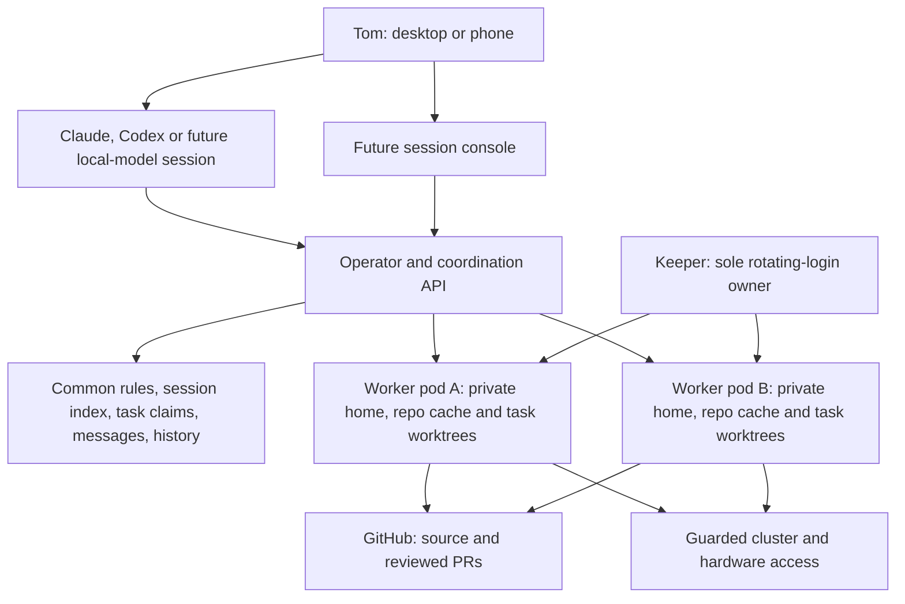
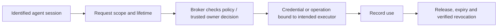

# Dev-env v2: workflow, quick start and feature set

**Daily use:** the [v2 quick start](v2-quickstart.md) is the one-page version
for Tom's phone-first workflow, with what was proven up to 2026-10-20.

**Current state, 2026-10-22:** [release 2.39.1](https://github.com/thaynes43/dev-env/releases/tag/v2.39.1)
is published and its matching [GitOps pin is merged](https://github.com/thaynes43/haynes-ops/pull/4161).
The [current handoff](../.agents/HANDOFF.md#current-state--2026-10-22-utc-v2-release-2391-documentation-reconciliation)
links the notice fix, the closed timezone regression and plan 13 follow-ups,
and separates source/publication evidence from runtime and review acceptance.
Keep CR-1020 phone acceptance, W3 limits and preservation/copy gates intact;
the planned cutover date below grants no authority or proof of completion.

**October 20 checkpoint (historical):** release 2.39.0 is installed, and v2 is ready for
all agent work. Tom accepted the phone workflow (the Claude standby on cellular,
the Codex host in the ChatGPT app, keeper status). A workbench session has v1's
cluster write tier (haynes-ops #4141), Proxmox reads and writes through grants,
restarts of the v2 services and messages between sessions, all proven live. The
v1 cutover is planned for 2026-10-21, after the v1 sessions wind down and write
handoffs, and only with Tom's written approval. The
[handoff](../.agents/HANDOFF.md) has the evidence, and plan 05 has the
[cutover runbook](../.agents/sagas/distributed-dev-env/backlog/05-cutover.md#cutover-runbook-2026-10-21).
v2 has no code-server: a proper front end comes later, and until then a terminal
is an exec into a session pod (quick start section 1).

**Current continuation, 2026-10-13:** the
[2026-10-13 Claude pickup brief](../.agents/CLAUDE-RESUME-2026-10-13.md) records
the deployed state, counters, rulings and next work. The
[2026-10-12 brief](../.agents/CLAUDE-RESUME-2026-10-12.md) still records the
requirements, the roadmap, source-review targets and stopped attempts. Read both
before selecting implementation or executing the bounded probe examples below.

**Scope corrected 2026-10-10, America/New_York.** V2 solves five problems with
v1: upgrades kill sessions, work concentrates on one node, agents have broad
access, session management is difficult, and model usage/cost is unclear.
Agents share rules and authorized context and coordinate tasks. Each independent
Claude Code, Codex or local-model session has its own bounded pod and failure
boundary, private provider home, repositories and ordinary task worktrees.

**Coordination archive reads have source support.** The operator has a
default-off `--enable-coordination-archive-reads` setting for the designed
archive fallback and `archived=only` lists. Existing caller ACLs and create
paths remain unchanged. Installation and activation require separate acceptance;
this source change applies no runtime configuration.

The controlling decision is [ADR-003](../.agents/sagas/distributed-dev-env/adrs/003-session-coordination-private-repositories.md).
It supersedes the shared-Git/RWX prerequisite. The original ADRs and storage
trial records remain historical evidence. No storage retry or runtime cutover
is part of this documentation change.

## Create and inspect an assigned campaign (source, 2026-10-18)

Inside an already configured owning coordinator host, the new CLI source supports:

```sh
agent-run budget create TASK_UID --success "observable result" --overall 45m --effort 1h --checkpoint 10m
agent-run budget show TASK_UID -o json
```

The operator must already assign that task UID to the host. Create sends once;
exit 6 means its outcome is unconfirmed, so inspect retained state before any
follow-up. Repeating create conflicts instead of resetting the campaign. Show
reports the immutable binding, deadline, checkpoint, stop latch and elapsed-effort
estimate; provider usage remains unavailable. A due checkpoint can latch on read.
These commands do not admit or launch an executor. General private launch and
native readiness remain unfinished, and this source change is not installed.

**Child cap source policy, 2026-10-29:** A session caller is limited to four
unfinished children per parent and canonical agent (`claude`, `codex`, or
`opencode`), across modes. Existing admission restrictions still apply; empty or
unknown legacy agents count against every bucket. The per-replica create lock
cannot prevent two replicas from admitting concurrently after each sees three.
This is repository policy, not a resource measurement or proof of installation;
portal launches have their separate cap.

## Start here: how you would use it

1. Open a Claude or Codex session and select the project. The project supplies
   common rules and repository identities; its local folders can differ by pod.
2. See existing tasks and live or stopped sessions. Read relevant transcripts,
   memory and handoffs before claiming work already being done elsewhere.
3. Claim a task. The chosen pod fetches the selected repo, records the base
   commit and creates its own worktree. A missing repo is cloned first.
4. Work within the session’s resource, access and attempt budget. Message peers
   or delegate a bounded unit; results carry task, model and source identities.
5. Review and ship the change. Suspend preserves local conversation state.
   Archive must preserve discoverable history before removing the provider home.
6. Continue on another pod by reading the predecessor’s context and restoring
   committed/rescued work into a new local worktree. Verify the previous executor
   stopped before transferring ownership.

These are the target journeys. The feature table identifies gaps; section 3
contains commands for the Claude subset that works today.

## 1. What we are building

The **operator is an API and controller**, not a reasoning agent. It manages
session lifecycle and platform records. The **requester** is `agent-run` or
another client. A **coordinator** is the Claude/Codex agent discussing your
request and assigning work. A future frontend uses the same API.



A Codex computer link identifies a persistent host. Native chats and children
run on that host unless a supported dispatch route creates another worker pod.
Multiple links remain distinct; shared context does not merge enrollment or
move a chat automatically. Keep actual thread, host, executor and node visible.

The [pinned routing audit](../.agents/sagas/distributed-dev-env/research/R-05-codex-native-routing.md)
did not establish complete native-chat federation behind one paired entry.
Independent native-session failure boundaries need independent app-servers;
isolated command executors alone do not provide that boundary. The owner routing
choice is pending in DESIGN-006 Q-24.

The local-model adapter has the same task, source/rules, context, claim/message,
access, budget and placement contracts. Live inference is disabled until GPUs
are ready, with every household reservation preserved. Qwen is a candidate,
not an accepted running backend. Claude/Codex keep subscription-backed execution;
the platform must not silently switch them to paid APIs.

Provider homes contain credentials and native state and remain private. The
coordination service exposes authorized context; peers do not mount each
other’s writable authentication directories. Common context needs reliable
storage, but it does not require shared Git directories or NFS Git benchmarks.

## 2. Feature set and delivery state

This table reflects source and saved runtime evidence as of 2026-10-12.
A released feature is not automatically enabled or accepted on live sessions.
*(Historical. The current state is in the [quick start](v2-quickstart.md) and
the [handoff](../.agents/HANDOFF.md).)*

| Goal or capability | Available evidence | Remaining work |
|---|---|---|
| Upgrade without killing sessions | Last accepted operator image delivery preserved 11 peers in its saved observation window | Safe agent-image replacement and busy-host drains; interrupted native recovery |
| Distribute load | Bounded task Pods scheduled on workers; real Claude task ran with CPU/memory limits | Prove placement across nodes; native Codex threads still share their host’s resources |
| Claude task and terminal workflows | Task, attach/detach, TUI messages, suspend/resume and Git rescue exercised | Owner pilot and history-preserving archive |
| Codex sessions across pods | Keeper login, scoped-host/task and owned-native source foundations released | Two live distinct links, refresh adoption, native execution/recovery and device acceptance |
| Common rules and projects | Catalog bootstrap, private roots/client guards and common-rule inputs shipped; trusted startup/refresh foundations installed | Actual private GitHub authorization/worktrees and rule loading by both providers |
| See live and stopped work | Managed list/show, fleet placement and retained Directory/identity guards; one complete pre-Codex page accepted | Actual live/stopped native indexing and accurate activity; post-Create cardinality remains Unknown |
| Communicate and avoid duplicates | Live TUI route, idempotency, explicit claim and durable inbox/ACK foundations shipped | Actual cross-parent claims, stopped-recipient durability and authorized consumer acceptance |
| Read prior context | Installed private HOME/identity preservation and stored managed-context result route; one retained Claude result read | Full provider transcripts/memory/handoffs without the source Pod; managed output is partial history |
| Guard powerful access | Scoped broker/grant foundations; keeper-only CA and node trust prepared | Usable guarded Headlamp/hardware replacements, approved policies and use/revocation acceptance |
| Stop wasted attempts | Accepted 60-minute stall/three-failure policy; ledger/stop foundations and v2.24 ownership proof published | Private dispatch inspector remains unwired and refuses reservation; whole-task runtime accounting, verified stop and phone escalation |
| Model usage and cost | Requested-model identity and provider-specific parsers/provenance foundations | Exact served-model provenance, truthful Unknown values, fleet aggregation and no parent/child double counting |
| Frontend | Existing management API and CLI | Console for sessions, nodes, tasks, messages, retained history, renewal and cost |
| Local LLMs and GPUs | Local provider included in contracts; live inference disabled | GPU readiness, household-safe allocation and actual backend acceptance |

The saved installed task template is signed v2.20.0, digest `823e0155…`, revision
`2.20.0-ec26880d2a`; its actual agentd source is `3aab27ce…`, not the revision
suffix. The accepted operator image is source `cd966d17…`, digest `cc03ae82…`.
Signed v2.24.0 (`36d26662…`) is published and not deployed. Private-project
admission remains disabled. Catalog/bootstrap, roots and common-rule source
foundations have shipped; the earlier empty-common-rule configuration was a
historical checkpoint. Actual both-provider loading remains unaccepted:
Claude's retained response hit its weekly limit, and Codex output is Unknown.
See the [current checkpoint](../.agents/CLAUDE-RESUME-2026-10-12.md#what-is-actually-delivered)
for full revisions and acceptance limits.
*Update, 2026-10-13: the sentences above are the 2026-10-12 record. Release
2.28.0 is now deployed: operator `sha-cbf0700` (actual binary version
`v2.28.0-1-gcbf0700`) and task agent 2.28.0. The
[delivery record](../.agents/sagas/distributed-dev-env/verification/d92-shared-history-delivery-2026-10-13.md)
has the source, signed digests and separate operator/template deployments.
The shared-history correction is installed with reads still off. Rule loading is accepted for both providers; private
GitHub authorization, a `Ready` private bootstrap and a fresh task pin are
accepted for Claude. HOME expiry (DESIGN-025 H1 to H6) is installed with only
the terminal record on; H4's commands are in the task template's agent image,
and the shelf, which runs `history-archive`, waits for H7. Private-project admission is still disabled. The
[2026-10-13 brief](../.agents/CLAUDE-RESUME-2026-10-13.md#deployed-state)
has the digests.* The
[bootstrap contract](../.agents/sagas/distributed-dev-env/designs/006-private-catalog-bootstrap.md)
uses private catalogs without shared preflight or locks; startup refresh does
not replace a fresh selected-repository fetch and immutable pin before each task.
A `Partial` or `Failed` bootstrap is diagnosable without exec: `agent-run show
NAME` prints a `project bootstrap` row and a row for each repository or project
that is not Ready, with closed-set reason codes, and the AgentSession holds them
in `status.agent.projectBootstrap`
([reason codes](../.agents/sagas/distributed-dev-env/designs/006-private-catalog-bootstrap.md#reason-codes-diagnosis-without-exec)).

The [private retention guard](../.agents/sagas/distributed-dev-env/designs/008-private-provider-history-retention.md)
preserves HOME and Session identity rather than declaring archive complete.
Its latch survives flag disable; absent executors remain Unknown and cannot
start replacements. Managed-context readers are separate; preservation alone
does not prove complete stopped native history. The expiry policy is decided
([ADR-005](../.agents/sagas/distributed-dev-env/adrs/005-private-home-expiry.md),
Q-31: archive, then delete, 30 days after a recorded stop; corrected by
[ADR-006](../.agents/sagas/distributed-dev-env/adrs/006-private-home-expiry-corrections.md))
but not built. *(Update, 2026-10-13: DESIGN-025 H1 to H6 are built and
installed, H4 in the task template's agent image only (the shelf waits for
H7); only the terminal record is on. H7 to H10 remain.)*
Existing coordinator scope is preserved; the legacy ordinary-session ACL is
not a new authorization contract for peer context. Claude review is optional,
including releases; required CI and native independent review remain gates.

The ordinary worker template was still 2.9.1 at the historical overnight checkpoint;
2.11.0 was signed and used for a separate native fixture. That fixture failed
without a valid acceptance result. A later reviewed source fix does not count
as a new runtime pass. See [HANDOFF](../.agents/HANDOFF.md) and
[overnight evidence](trials/2026-10-10-overnight-results.md). This note is
historical: the current installed template is 2.20.0, as the first paragraph
after the table above says. *(Since October 13, 2026 (EDT), it is 2.28.0; see the update
under that paragraph.)* The
[pickup brief](../.agents/CLAUDE-RESUME-2026-10-12.md#what-is-actually-delivered)
has the full revisions.

### Offline upgrade-shepherd check

`agent-run maintenance check --input <file>` validates one bounded operation
envelope and correlates a supplied snapshot. It is offline and source-only.
The JSON decision is `candidate`, `respond`, or `insufficient-evidence`.
A candidate is not alert deferral, suppression, or operational authorization.
The role contract and its proposed numeric defaults are in the
[upgrade-shepherd role](upgrade-shepherd-role.md). The command does not install
that role into a provider, contact the cluster, or change Activity.

## 3. Quick start with the working paths

### Pick the launcher first

In the current v1 pod, the command named `agent-run` is **v1's shell launcher**.
V2 is a different Go binary. Do not overwrite the v1 command or assume identical
verbs mean identical behavior. The examples below use `v2run` as a shell array
holding an explicitly selected v2 binary that is already installed for the
caller.

Since 2026-10-20 ordinary work runs on v2: see the [quick start](v2-quickstart.md),
whose "Which `agent-run`" section sets up the v2 client in the v1 pod. Until v1
is retired (planned 2026-10-21), v1's own launcher still works:

```bash
# V1: Claude terminal plus phone session.
agent-run --repo dev-env --agent claude --interactive \
  --model claude-opus-5-5 --effort xhigh

# V1: separate Codex terminal session; phone access belongs to the daemon.
agent-run --repo dev-env --agent codex --local \
  --model gpt-6-astra --effort max

# V1: check whether the daemon supervisor session exists.
tmux has-session -t codex-remote
```

Keep `-p` separate from `--local` and `--interactive`. A headless task has its
prompt at creation; an interactive session gets its first prompt after its
banner is checked. No laptop kubeconfig ceremony is required for Tom's current
workflow.

### Select the v2 CLI and connection path

Do not build current source merely to obtain a client: a source checkout is not
evidence that its binary is the installed or released client. Select the exact
v2 binary already supplied to the caller and inspect its own help:

```bash
v2run=(/path/to/an/already-installed/agent-run-v2)
"${v2run[@]}" version
"${v2run[@]}" help run
```

Each `v2.x.y` release carries `agent-run-linux-amd64`, `agent-run-darwin-arm64`
and `SHA256SUMS` as release assets (the `cli-assets` job in `publish-agent.yml`;
a release made before it has none). Name the version you want; do not choose a
file by sorting versions or take a URL from a source branch. Download, verify
against `SHA256SUMS`, install, then check what you installed:

```bash
# Linux (amd64). Replace v2.x.y with the release you want.
v=v2.x.y; u=https://github.com/thaynes43/dev-env/releases/download/$v; d=$(mktemp -d) &&
(cd "$d" && curl -fsSLO "$u/agent-run-linux-amd64" -O "$u/SHA256SUMS" &&
  sha256sum -c --ignore-missing SHA256SUMS) &&
install -D -m 0755 "$d/agent-run-linux-amd64" ~/.local/bin/agent-run && agent-run version

# macOS (Apple silicon)
v=v2.x.y; u=https://github.com/thaynes43/dev-env/releases/download/$v; d=$(mktemp -d) &&
(cd "$d" && curl -fsSLO "$u/agent-run-darwin-arm64" -O "$u/SHA256SUMS" &&
  grep ' agent-run-darwin-arm64$' SHA256SUMS | shasum -a 256 -c -) &&
install -d ~/.local/bin && install -m 0755 "$d/agent-run-darwin-arm64" ~/.local/bin/agent-run && agent-run version
```

`agent-run version` must print the release you asked for (`agent-run v2.x.y
(commit ...)`). If a release has no assets, re-run its publish with
`gh workflow run publish-agent.yml --ref v2.x.y`: the image job leaves the
existing image alone and the assets job uploads them (replacing any). The managed
`rc fresh` route needs 2.71 or later. A Codex `-p` task is a project task: pass
`--project <repo>`, and the CLI says so when the API refuses one that has none.

Connection is caller-specific. A session pod discovers its projected API
identity. An already-authorized in-cluster caller, including v1, uses its own
ServiceAccount identity; it may need the approved public operator CA passed
with `DEV_ENV_API_CA_FILE` or `--ca-file`. A laptop uses its existing authorized
kubeconfig and a temporary local port-forward. The CA is trust material, not a
credential, and these facts do not create a new laptop authorization path.
Consult the selected binary's top-level help for the current API, token and CA
precedence. For an already-authorized v1 caller whose environment does not
already provide the operator CA, the existing ConfigMap route is:

```bash
guide_ca="$HOME/.cache/dev-env-api-ca.crt"
mkdir -p "$HOME/.cache" &&
kubectl -n dev-agents get configmap dev-env-api-ca \
  -o jsonpath='{.data.ca\.crt}' > "$guide_ca" &&
test -s "$guide_ca" &&
export DEV_ENV_API_CA_FILE="$guide_ca"
```

Do not print or save a minted credential. External clients have a separate
optional path in the [external CLI handoff](../.agents/handoffs/2026-10-08-laptop-access.md).

### Start and follow a v2 session

These examples start **Claude**. Run a task or start a local session according
to the work you actually need; each command creates a separate pod. Use a full
provider model ID and an effort level that the selected binary says it accepts.
For non-Claude agents, the CLI requires an explicit model but the operator is
authoritative for whether that provider is admitted.

```bash
# A bounded headless task. The prompt runs once.
"${v2run[@]}" --repo dev-env --agent claude \
  --model claude-opus-5-5 --effort xhigh --size S \
  --timeout 30m --max-turns 20 -p "Read HANDOFF and report the current plan status."

# An interactive terminal session.
"${v2run[@]}" --repo dev-env --local --agent claude \
  --model claude-opus-5-5 --effort xhigh --size S

"${v2run[@]}" list --repo dev-env
"${v2run[@]}" show SESSION
"${v2run[@]}" log SESSION --tail 40
"${v2run[@]}" fleet
"${v2run[@]}" attach SESSION
"${v2run[@]}" detach SESSION
```

Replace `SESSION` with the returned name. Attach is for the owner/client identity,
including the trusted v1 client; session agents use the message API. `attach`
and `detach` execute into a running session using the caller's Kubernetes
rights, and are refused from an ordinary session pod. `detach SESSION`
disconnects every attached client; `Ctrl-b d` detaches only your client.
The session keeps running. A Pending session is waiting for capacity, not a
reason to launch duplicates.

`--repo` starts an ordinary repository session; it does not select an accepted
project snapshot. `--project <name> [--repo <name>] -p ...` is a separate,
headless managed-task entrypoint: the server selects the declared repository and
rules and remains authoritative for catalog admission. It cannot combine with
`--local` or `--interactive`. `--profile` selects a template profile only where
the caller is allowed to choose it. A session child normally inherits its
parent's profile. A workbench session's child is the exception (OP502): it runs
on the profile it names, `workbench` included, or on the default profile when it
names none. A Codex remote host created by a workbench session takes no
`--profile` at all; the server uses the default profile, not workbench.
Starting a native thread does not select a Kubernetes profile.

A headless `-p` task runs its prompt once. `msg` applies to a local TUI session; a headless task does not accept messages. Coordinator custody of that result is recorded separately in the [coordinator result handoff](coordinator-result-handoff.md). A delivery receipt is not acknowledgment, ownership, or completion. The offline checker only validates a bounded handoff record.

```bash
# Local TUI only; headless tasks do not accept messages.
"${v2run[@]}" msg SESSION "The coordinator is reviewing the deployment evidence for this project."

# Rescue, stop the pod, keep its home and conversation.
"${v2run[@]}" suspend SESSION
"${v2run[@]}" show SESSION
"${v2run[@]}" resume SESSION

# Finish only after required history is separately retained: Git rescue then reap.
"${v2run[@]}" reap SESSION
"${v2run[@]}" rescue list --session SESSION

# If a complete bundle exists, create a new session from it.
"${v2run[@]}" rescue restore OLD_SESSION/STAMP --local
```

Follow transitions with `show`/`list`; `reap` returning does not mean cleanup has
already finished. An archived session is restored into a new session, not resumed.

**Reaping a private session (DESIGN-025 section 25).** With private history
retention on, as the live operator runs, a reaped private task session is not
rescued to a bundle and its volume is not archived. The operator asks its agent
to stop and keeps its private HOME. Nothing is archived or deleted at the reap.
The session stays, reaping and `Pending`, until the HOME expiry has archived
its history and deleted the HOME; that archive is not switched on yet
(2026-11-09).
`agent-run reap`, `show` and `list` print the operator's own words for it, and
its `RemovalBlocked` condition usually gives one of two reasons:

- `ExecutorEnded`: the agent stopped. The text gives the time the operator
  recorded it, and how: "stopped as the reap asked" when the reap's own stop
  request ended its Pod, else how its Pod ended.
- `RetentionPending`: the stop is not proven yet, and the text says why: the
  stop request is still in flight, the agent still runs, or its Pod ended but
  the operator cannot confirm that yet. In the last case the operator checks
  again after a wait that doubles from 30 seconds to at most 30 minutes.

The other reasons stay as they were and say what they mean in their text:
`TaskComputeReclaimed`, `PreservationUnknown`, `HomeDeleting` and `HomeExpired`.

The gauges `dev_env_reaped_sessions_retained{reason}` and
`dev_env_reaped_sessions_oldest_seconds{reason}` count these sessions and the
age of the oldest reap.

Rescue preserves Git work. **Without private history retention, the ordinary
private reap path deletes the home; it does not retain the provider transcript
or memory.** Suspend preserves the home temporarily, but private sessions auto-archive
after their configured `archiveAfter` (default 168 hours). Verify required
history retention before that deadline; suspend is not an indefinite backup.
Archive/history retention is a remaining feature. Rescue does not back up ignored files or every home file; snapshots
stay private and are never pushed.

V2 `--interactive` (Remote Control on a pod-owned Claude login, set up with
`agent-run login`) is source-only until released and accepted, and its use is
pending Tom's authorization of one isolated v2 login. V2 `--agent codex
--interactive` (the Codex phone daemon on the keeper's login, paired with
`agent-run pair <name>`) is also source-only until released, installed and
accepted; see [plan 03](../.agents/sagas/distributed-dev-env/backlog/03-remote-control.md).
Automatic image
drains and the complete grant/login CLI remain unfinished. The first #173 source slice admits declared project tasks
into private worktrees and supplies project rules without RWX. New budget-bound
private dispatch remains refused pending separate integration. GitOps delivery
and actual-provider acceptance are recorded separately on
[#173](https://github.com/thaynes43/dev-env/issues/173). The new private-project
admission flag stays disabled for that promotion; existing fixture/coordinator
flags remain unchanged. The two-host and both-provider coordination
workflow is unaccepted. Use the selected binary’s help and current deployment
evidence. [DESIGN-005](../.agents/sagas/distributed-dev-env/designs/005-private-project-tasks.md)
defines the bounded contract.

A session that follows the keeper's shared logins can check them without
exec: `agent-run auth status` reads the mounted Claude and Codex access
projections (no API call, no refresh token) and prints each login's state,
generation, access expiry and time left, plus the keeper's last refresh for
Codex. It finds the Codex projection at its default mount when agentd has
removed the variable from a Codex session's environment. Exit 0 is fine, 1 is expired or inside the `--warn` window (default
30m), 2 means it cannot tell, as v1's `claude-login-check` does. The Claude
login's own roughly 30-day lifetime lives with the keeper and is not in the
projection.

### Start a bounded coordinator on a tracker item

Source contract: [DESIGN-060 section 7.2](../.agents/sagas/distributed-dev-env/designs/060-meatball-front-door.md#72-coordinator-cli-contract-op527-2026-11-10).
This requires an operator with the coordinator worker-cap admission change;
source tests do not prove it is installed.

```bash
agent-run coordinator start --item 527 --project dev-env --model gpt-6-astra --hours 4 --workers 2
agent-run coordinator status --item 527
agent-run coordinator status SESSION -o json
agent-run coordinator stop SESSION
agent-run coordinator brief --item 527 --hours 4 --workers 2
```

Tom supplies the model every time: `claude-opus-5-5`, `claude-fable-5-2` or
`gpt-6-astra`. There is no model default or effort flag. Hours and workers are
whole numbers from 1 to 4. Claude also accepts `--repo NAME` instead of
`--project`; Codex needs a declared project. The launcher needs no tracker
credential: the coordinator reads and claims its item when it runs.

Start looks up the caller's existing run for the same item, including retained
results after exit. To deliberately run it again, add `--run retry-2` to start
and to item-based status. Keep that label when retrying. Start sends one POST;
exit 6 means its result is unconfirmed. Inspect status before repeating start.
This lookup lasts while the Session record is retained. Cached lists and
concurrent creates on different replicas have the race limits in section 7.2.
Status prints the task verdict and retained summary, PR links and
head SHAs when present. Start/status JSON is one object with `item` and
`session`; stop uses the existing reap and returns one Session object.

The caller must be the enrolled CallerPolicy identity, Tom's human caller or a
trusted client such as the workbench. Ordinary session callers cannot set a
coordinator's worker cap. The coordinator runs on `dev`, size M, as a task.
Its brief directs worker selection, budget checkpoints, tracker reports and
the outcome file. Routine work proceeds; risky access gets one ask to Tom;
an API refusal is recorded and never routed around. It finishes alone where it
can and never stalls on whoever started it; when only that parent can answer,
it leaves one note with `agent-run parent tell`, carries on, and reads the
answer with `agent-run parent wait` or `parent read`.

### Launch a project-bound child on another provider

*OpenProject #402, 2026-11-04. Checked against source at `801de50d` and
against `agent-run help run` from the installed v2.89.0 client. Paths below
are in this repository unless they name haynes-ops.*

A coordinator on one provider sometimes needs a child on the other one: for
example, a Claude Remote Control coordinator that wants a Codex review. The
supported route is a managed project task started with `agent-run`. The child
is its own Session in its own pod, with its own record, project rules, timeout
and retained result.

```bash
# The flags used in the OP402 launch on 2026-11-04:
agent-run --project haynes-studio --agent codex \
  --model gpt-6-astra --effort max \
  --prompt-file work-order.md --wait 3m

# Optional extras, valid in source but not exercised in that launch:
#   --timeout 2h                       stop the task after this long
#   --idempotency-key op000-review-1   a repeat finds the first Session
```

| Flag | What it does | Source |
| --- | --- | --- |
| `--project <name>` | Names a project in the operator's accepted catalog. The client sends only the name; the server picks the repository, base and rules. A managed Codex task needs it. | `internal/agentrun/create.go:74,108-118`; `internal/apiserver/validate.go:105-120,149-150` |
| `--repo <name>` | Optional. Picks one repository of a project that has several. | `internal/agentrun/help.go:393-397` |
| `--agent codex --model <id>` | Codex needs a full model ID. The server checks the model and the effort. | `create.go:201-205`; `internal/agentd/protocol/session.go:316-347`; `validate.go:190-194` |
| `--prompt-file <path>` | Reads the work order from a file, or from stdin with `-`. At most 64 KiB. | `create.go:163-176,381-395` |
| `--timeout <d>` | Stops the task after this long. Leave out `--max-turns`: the server refuses it for Codex. | `create.go:215-226`; `validate.go:227` |
| `--idempotency-key <k>` | The same command run again with the same key returns the first Session instead of starting a second one, while that Session is unfinished. A different request under the same key is refused with 409. | `create.go:242-248,327-328`; `internal/apiserver/sessions.go:98-111` |
| `--wait <d>` | How long agent-run waits for the **pod to start**. It does not wait for the task. Exit 0 with "Running on NODE" means the pod started, and nothing more. | `create.go:21-29,335,397-448`; `help.go:446-447` |

Record the printed name. Then read `agent-run show NAME -o json` once and keep
`uid`, `parent`, `agent`, `model`, `effort`, `repo`, `base`, `revision` and
`createdAt` in the status record.

Keep three model facts apart:

- **Requested:** `model` and `effort` on the Session, what the create asked
  for. For Claude an omitted `--model` takes `$DEV_ENV_CLAUDE_MODEL`, then the
  built-in default (`internal/agentrun/create.go:185-200`).
- **Configured:** what a template, a default or a client UI says the provider
  should use. It is not evidence of what served the task.
- **Served:** what the provider itself reported, kept in the Session's usage
  observation. `show` prints it as `Actual model ... (provider reported)` and
  otherwise `Unknown` (`internal/agentrun/sessions.go:299,365-373`). For Codex,
  agentd takes it from the turn's own event (`internal/agentd/codex_stream.go:130`).

Never copy a requested or configured model into the served model. A synthetic
test fixture cannot attest a real served model either: the OP402 tests use
fixtures with no served model, and `show` prints `Unknown` for them.

#### Refusals and what to do

agent-run retries only a transport failure or a 502, 503 or 504, at most twice,
with the same idempotency key (`internal/agentrun/client.go:20-30,155-156`). It
sends a refused create once and maps the refusal to an exit code
(`client.go:268-319`, `internal/agentrun/agentrun.go:36-64`; one request for a
422 is pinned by `TestProjectCatalogRefusalsRemainServerAuthoritative`). A
refusal creates no Session. Do not retry it, change flags to get past it, or
switch to another route.

| What agent-run prints | Exit | What it means | What to do |
| --- | --- | --- | --- |
| `the API refused the request (422 invalid):` then `--agent: managed codex tasks require the enabled feature and an accepted project snapshot` | 1 | The Codex task has no accepted project snapshot: `--project` is missing, the mode is not task, or the operator's managed-Codex feature is off (`validate.go:149-150`). A request with `--repo` and no `--project` gets this. | Add `--project` only when the work record names an authorized project. If the project is right and this still appears, the feature is off: record it and stop this launch. Never try to turn a feature on, change the profile or use another host. |
| `the API refused the request (422 invalid):` then `project: accepted project/repository is unavailable or invalid`, or `project: accepted project catalog is not configured` | 1 | The operator's catalog does not have that project, or does not have that repository in it, or no catalog is configured (`validate.go:105-114`). The same message covers a catalog the operator cannot read or parse, a repository outside the clone owner, and a snapshot over its size bound (`internal/apiserver/catalog.go:30-55`). | Stop this launch. The fix is the reviewed catalog path: a haynes-ops pull request that changes only `kubernetes/main/apps/dev-env-system/projects/app/catalog.json`, which kustomize turns into the `dev-env-project-catalog` ConfigMap the operator reads ([shared project catalog](shared-project-catalog.md)). haynes-ops #4645 added `haynes-studio` that way. Open it only inside the story's authorized scope. Once it is merged and Flux has applied it, the launch is a new attempt with the cause fixed. `--repo`, a local clone or a reachable repository is not a substitute. |
| `not allowed (403 forbidden): dry-run requires a configured exact sealed pilot request` | 3 | `--dry-run=server` posts to `/v1/private-pilot/preflight` (`create.go:281-305`, `internal/apiserver/apiv1/types.go:21`). The server answers there only for the one configured sealed private pilot. Without that configuration it refuses every request with 403 (`internal/apiserver/sessions.go:66-67`). Exit 3 means retrying the same call will not help. | Keep the refusal as evidence and do not retry it. It says nothing about whether your create would be admitted. |

**`--dry-run=server` is not a general preflight.** It is for the exact sealed
pilot only. Its help line, "admission only, never creates or falls back"
(`help.go:400`), describes that pilot route. An ordinary create has no server
dry run. The checks before a launch are reading checks: the work record names
the project and the provider, `agent-run help run` gives the flags, and the
[launch-profile preflight](launch-profile-preflight.md) covers the profile. The
create is the admission check.

#### A Cursor or Grok child

*DESIGN-058, 2026-11-09. Source only: not deployed or run live yet.*

`cursor` is the third task provider. Grok and other vendors are Cursor model
ids, not providers of their own.

```bash
agent-run --project haynes-studio --agent cursor \
  --model <cursor-model-id> --prompt-file work-order.md --timeout 2h --wait 3m
```

- It is a headless `--project` task only. `--local` and `--interactive` are
  refused.
- `--model` is required and checked for shape only. The Cursor CLI refuses an
  id it does not know.
- `--effort` is refused: Cursor puts effort in the model id. `--max-turns` is
  refused: use `--timeout`.
- The pod runs the pinned Cursor CLI always-allow. agentd fetches it at boot
  and checks its SHA-256; the image does not contain it.
- Usage, cost and the served model are Unknown. The log shows the model the
  CLI names at start as "CLI-reported", never as provider reported.
- Cursor takes the prompt as one exec argument. The usual 64 KiB prompt limit
  keeps it under the kernel's 128 KiB limit; agentd also refuses a composed
  prompt that would not fit. Put long material in a repository file and name
  it in the prompt.
- A cursor task never resumes.
- If the templates name no Cursor key, the create is refused with
  `provider_unconfigured` and no Session is created. Record it and stop: it
  is a deploy step, not a flag to work around.

#### Never run another provider inside your own pod

The agent image carries both `claude` and `codex`. Running the other provider
inside your own pod, for example `codex exec` in a Claude session pod, is not a
managed session and never stands in for one:

- it runs with your Session's identity, pod, profile and sandbox, not a child's;
- it has no Session record, project snapshot, project rules, timeout, task
  result or retained outcome, so nobody else can read how it ended;
- its usage is not attributed to a child Session.

In the OP402 incident, an in-pod `codex exec --sandbox workspace-write` hit a
bwrap namespace failure. It reported exit 0 and wrote no files; its final
response said it was blocked. When a child on the other provider is
authorized, use the managed route above. If that route is refused, the refusal
is the answer: handle it as the table says.

This page does not make a cross-provider child a requirement. The global rules
(haynes-ops
`kubernetes/main/apps/dev-env-system/session-config/app/config/claude/CLAUDE.md`,
"Subagent dispatch rules", lines 559-561) say: "Stay within the driving
provider: Claude Code delegates to Claude Code, and Codex to Codex. Do not start
a cross-provider session as a quota or complexity fallback. Start a separate
session with `agent-run` only when the task calls for one, or Tom asks." A
separate `agent-run` session is a permission for those cases. An in-pod run of
the other provider is never one of them. Managed Codex execution is not a
fallback route either
([launch-profile preflight](launch-profile-preflight.md#managed-codex-task-admission)).

#### Read how the child ended

Four facts can each look like "done". Keep them apart:

1. **The provider process or turn completed.** agentd records the provider's
   exit code, or 128 plus the signal when a signal ended it
   (`internal/agentd/runagent.go:507-555`). For Codex it does not keep a 0 that
   hides a failure: a failed turn, or a protocol it refuses, that exits 0 is
   recorded as exit 1 with an error (`runagent.go:316-337`). The heartbeat
   carries the result into the Session's status
   (`internal/apiserver/heartbeat.go:187`). `agent-run show` prints it as
   `task: exit N at ...` and the verdict as `task result:`
   (`internal/agentrun/sessions.go:192-194,227-235`,
   `internal/apiserver/apiv1/types.go:385-428`). In JSON it is
   `agentStatus.task.exitCode`. This proves the process ended, and how.
2. **A tool command failed inside the turn.** A provider can end its turn
   normally after one of its own commands failed. The verdict then reads
   `Succeeded`: for Codex, agentd records a completed turn as `success`
   whatever its commands did, and prints a command's output without tracking
   its status (`internal/agentd/codex_stream.go:104-130`). `Succeeded` means
   the turn completed, not that its commands or the deliverable did.
3. **A wrapper masked the exit.** `cmd | tail` returns `tail`'s status, and a
   trailing `echo` returns 0. Then even the process exit is lost. Use the
   pattern below.
4. **The accepted deliverable is missing.** The work order names the
   deliverable: a `review.md`, a commit, a PR head. If it is missing or not yet
   reviewed, the work is not done, whatever the first three say.

**Exit 0, `Running` or a final message is not a successful review. Only the
accepted deliverable is.**

The phase is the pod's, not the task's. The phases are Pending, Running, Idle,
Draining, Suspended, Archived and Failed
(`api/v1alpha1/agentsession_types.go:90`); there is no Succeeded. A task's pod
keeps running after its task ends, until the idle suspend. Watch
`agentStatus.state`: `exited` means the task finished and `agentStatus.task`
says how; `failed` means agentd could not start it; `interrupted` means its
process is gone without a result (`internal/agentd/protocol/status.go:26-42`).
`show` reports the child's exit as data and itself exits 0. agent-run does not
turn a child's exit into its own exit code: read it. The test that pins this,
`TestShowReportsAFailedTaskChildsRealExitAndRetainedOutcome`
(`internal/agentrun/task_exit_test.go`), runs against a fake API. It covers
`show`'s formatting, the outcome opt-in header and exit handling. It is not
evidence of persistence, of retrieval after a reap, or of recovery after a
restart; for those see [where the retained outcome lives](#where-the-retained-outcome-lives).

Keep each command's own exit status:

```bash
# Wrong: the status is tail's, or echo's.
agent-run show "$CHILD" -o json | tail -5
agent-run show "$CHILD" -o json; echo done

# Right: save the output, keep the status, then read the child's exit.
agent-run show "$CHILD" -o json > child.json; rc=$?
echo "agent-run show exit=$rc"
if [ "$rc" -eq 0 ]; then
  jq -r '[.agentStatus.state // "none", (.agentStatus.task.exitCode // "none")] | @tsv' child.json
fi

# In a pipeline, set pipefail or read PIPESTATUS before anything else runs.
set -o pipefail
agent-run log "$CHILD" --tail 40 | tail -n 20; rc=$?
```

#### Where the retained outcome lives

*OpenProject #402, round 2. Source refs at this branch; the tests named below
ran against a real kube-apiserver (envtest) with synthetic fixtures.*

**Write path.** At the initial task's exit, agentd reads and validates
`~/work/<session>.outcome.json` (`internal/agentd/task_outcome.go:14`,
`internal/agentd/runagent.go:544`) and offers it in every later heartbeat
(`internal/agentd/status.go:74`). The API's heartbeat route writes it last and
best-effort (`internal/apiserver/heartbeat.go:137`) through
`recordTaskOutcome` (`internal/apiserver/task_outcome.go:18-57`). That writes
only when no outcome is stored yet, only for a task Session, and only when the
outcome, the bound task exit and the initial usage observation all name this
Session and the pod that sent it. It uses an optimistic lock, and a schema
refusal means no record. The record is `status.taskOutcome` on the
AgentSession. The CRD refuses to change it (`api/v1alpha1/task_outcome_types.go:4`)
or erase it (`api/v1alpha1/agentsession_types.go:1853`).

**Read path.** `GET /v1/sessions/NAME` (`internal/apiserver/sessions.go:420-437`)
builds the view (`internal/apiserver/view.go:108`,
`internal/apiserver/task_outcome.go:59-69`) and strips the outcome unless the
reader sends `X-Dev-Env-Task-Outcome: v1` (`internal/apiserver/server.go:468-470`).
agent-run sends it on every request (`internal/agentrun/client.go:219`).

**What the envtest proves** (`TestEnvtestTaskOutcomeRetention` in
`internal/apiserver/task_outcome_envtest_test.go`; the suite plays the
operator's pod, phase and finalizer steps by hand, as envtest has no
reconciler or kubelet):

- an outcome sent by the original pod's real heartbeat is in the store, and a
  second API server, with a new manager, cache and listener over the same
  store, still serves it; the real agent-run `show` prints it;
- it is still served after the pod is deleted and with the phase Suspended,
  then Archived, and during a reap while the finalizer holds;
- a heartbeat that carries no outcome leaves no outcome and no outcome row (a
  missing or invalid outcome file is agentd's case: it then offers none,
  `internal/agentd/task_outcome.go:14`; the envtest only sends the heartbeat
  without one); a summary-only outcome shows only the summary; a failed exit with an outcome that claims readiness
  reads `Failed (TaskExitedNonZero)` beside it;
- a later heartbeat with a different record, and a direct status write that
  replaces or erases the record, do not change it;
- once the reaped Session is released, `GET` answers 404 and `show` exits 4.

Not proved there: a real operator restart, the real reconciler's reap and
release, a real pod's agentd, the timing of any of them, or any served model.

Already covered elsewhere, and not repeated: the fake-client unit tests in
`internal/apiserver/task_outcome_test.go` (a controller-runtime fake client,
`internal/apiserver/fake_test.go:113-118`, not a real API server) cover the
first write and its replay, second, omitted and wrong-pod heartbeats, and a
Suspended read (`TestTaskOutcomeHeartbeat`); thirteen refusals
(`TestTaskOutcomeHeartbeatRefusals`); a concurrent first write
(`TestTaskOutcomeConcurrentFirstWrite`); the opt-in read
(`TestTaskOutcomeNegotiatedRead`); and a schema refusal as no record
(`TestTaskOutcomeSchemaRefusalKeepsHeartbeatAndChildUsage`). The CRD's change
and erasure rules are proved on a real API server by `TestTaskOutcomeSchema`
(`api/v1alpha1/task_outcome_validation_test.go`). The new envtest adds the
real store, a second server, the real agent-run client, pod deletion, the
Archived phase, a reap and the release.

**After a reap, the outcome can be gone.** The Session object is its only
durable copy. When a reaped Session has no pod and no volume left, the
controller lifts its finalizer (`internal/controller/reconciler.go:1150-1197`)
and the object, with its outcome, is deleted. Then `show` answers 404, exit 4.
A Session under private-history protection stays until its HOME expiry allows
release (`internal/controller/private_history.go:34-45`,
`internal/controller/reconciler.go:1150-1157`). Copy the outcome, PR and head
into your custody record before a reap.

**Live mitigation.** The live operator runs with
`--enable-private-history-retention=true` (read from the `dev-env-operator`
Deployment on 2026-11-04 at 17:00Z). With it, a task Session without a
workspace is protected, so a reap does not release it, or delete its outcome,
until its HOME expiry allows it. The one exception is the never-started reap
(DESIGN-025 section 23), which has no outcome to lose.

**Gap and proposal.** No supported route serves a released Session's outcome.
The skipped `TestEnvtestTaskOutcomeAfterReleaseGap` records it; unskipped, it
fails with 404. Keeping an outcome beyond its Session would need a new retained
record or store with its own design, schema, retention and review; no existing
record holds it. This is a proposal only: an unsupported contract, recorded as
an OP402 follow-up, that blocks acceptance only if acceptance requires
retrieval after release.

### Start an owner-interactive Claude session

When Tom asks for a remote Claude agent on a repository, any caller that can
create sessions (a v2 session, a workbench session or the v1 pod) runs:

```bash
"${v2run[@]}" --repo <repo> --interactive --agent claude \
  --model claude-opus-5-5 --effort xhigh
"${v2run[@]}" show <name>    # wait for "remote control: registered"
```

It needs no flag, pairing or sign-in on the default profile, which follows the
keeper's shared login. Tell Tom the session name once `show` reads
`registered` (about two minutes; [quickstart section
1](v2-quickstart.md#1-a-claude-session-on-your-phone) has the measured
timings). If it reads `login-required`, the keeper's login needs renewing
(quickstart section 6): Tom signs in, and a workbench session drives it with
`agent-run keeper-login claude url`. The phone list itself is Tom's
check: `registered` proves the CLI registered its entry, not that he saw it.
The standby (quickstart section 1) is the zero-step alternative when it is
awake. A suspended standby has an archived phone entry until it is resumed.

### Start an owner-interactive Codex task on a paired v2 host

Use this when Tom must see and drive the thread on his phone.

1. **Start it as an interactive thread.** From a v2 session pod on the host's
   profile or one that started the host (the profile fence, step 5), the v1
   pod, a workbench session or Tom's laptop, run `agent-run thread start`
   (below, DESIGN-057). Tom can
   also start it from the ChatGPT app on the paired host, or an agent on that
   host can start it with the remote TUI, `codex --remote unix://<control
   socket>`, or with [`scripts/codex-clean-session.py`](codex-clean-session.md),
   which wraps that TUI and which `thread start` runs.
2. **Not `codex exec` or `codex queue`.** Their threads have the exec source,
   and the phone's default thread list hides it
   (`ThreadListParams.sourceKinds`). They never show on the phone.
3. **Pass no sandbox or approval flag.** Never pass `-s`/`--sandbox`,
   `-a`/`--ask-for-approval`, `--approve-for-me` or `--full-auto`. Leave them
   out, so the host default applies (approval `never`, sandbox
   `danger-full-access`), or pass `--dangerously-bypass-approvals-and-sandbox`
   as the managed routes do (`internal/agentd/managed_codex.go`). The
   requirements allow only `read-only` and `danger-full-access`, and set
   `default_permissions = ":danger-full-access"` (OpenProject #487, Tom
   approved 2026-11-09). A request they refuse, such as `workspace-write`
   (`-s workspace-write` or `--approve-for-me`), now falls back to full access
   with approval `never`. An explicit `-s read-only` request also becomes full
   access. Before #487 the fallback was `read-only`, where bwrap cannot run in
   a session pod and every shell command and MCP call failed; a pod that still
   mounts the older requirements has that trap. The agent image smoke test
   (`images/agent/smoke-test.sh`) pins the new results and that `codex
   app-server` and `codex remote-control` still load the requirements. Current
   Codex rejects `--full-auto` as an unknown flag.
4. **`agent-run rc fresh` is not available, and it is not a repeatable route.**
   It needs agent-run v2.71 or later, the operator flag
   `--enable-codex-rc-thread` and a qualified target. The flag was off in the
   live operator on 2026-11-09, and enabling it is OpenProject #272, which needs
   Tom's approval. Do not enable it. Even when enabled it starts at most **one**
   thread per host: the operator keeps a one-use reservation annotation on the
   Session and agentd a one-use marker on the host, and neither is ever cleared
   (`internal/apiserver/codex_rc.go`, `internal/agentd/codex_rc_ctl.go`). The
   qualified target (`apiv1.CodexRCTarget`) is a deployment-owned packet pinned
   to one Session UID, pod UID, daemon PID, boot ID and pairing, and it expires
   at most 15 minutes after it was verified. The host must mount the same
   packet at `/opt/dev-env/config/codex/rc-target.json`. So it cannot serve
   "give me another thread", and a daemon or pod restart invalidates it.
5. **Reaching the host from elsewhere: `agent-run thread start`.** From the v1
   pod, a workbench session or a laptop it uses the exec route `agent-run pair`
   uses. An ordinary session pod has no exec (D-19), so there agent-run asks
   the operator's API instead (`POST /v1/sessions/<host>/threads`, DESIGN-057
   section 10), which runs the same command in the host as it delivers
   `agent-run msg`. It is narrower than `msg`: a session reaches only a
   host of its own profile, or one it or its children started, because the
   handoff is the first instruction of an always-allow thread that acts with
   the host's profile (otherwise `caller_not_allowed`). An operator released
   before that route answers `route_unsupported`; agent-run never falls back
   or retries:

   ```bash
   "${v2run[@]}" thread start --agent codex --host <codex-host> \
     --model gpt-6-astra --effort xhigh --handoff task.md [--repo dev-env]
   ```

   Without `--host`, and only when the operator was started with
   `--enable-codex-host-select`, `thread start --agent codex` first calls
   `POST /v1/codex-hosts/select`. The flag is off by default, so the command
   still needs `--host`. If it tries selection while the route is absent it
   behaves as it does today and prints one line that host selection is off.
   With the flag on, `use` starts the thread on the chosen host and releases
   the lease when the launch result is known. The command exits 0 only when
   a thread was started. On `report`, `resume`, `create`, a selector refusal
   and an unknown action, the `thread-launch.v1` line is written to stdout
   before anything is written to stderr. The line has outcome `blocked` and
   code `no_host_selected`, and the exit is 1. `report`, `resume` and
   `create` then write that action's sentence, when it has one, and the
   choice. A refusal and an unknown action then write the code and sentence.
   `report` has no sentence. `resume` says resume is not built yet.
   `create` says this command does not create a host. With stderr closed the
   process may end on SIGPIPE after the line is out. A select call the
   API refuses (401, 403, 409, 422, 429, or another non-200 that is not
   404 or 5xx) or a 200 that cannot be decoded prints no result line and
   keeps that call's exit. Neither resumes nor creates. A running host is
   chosen when `status.agent.podUID` is that host's present pod and the
   heartbeat is fresh, and its reported agentd is at least 2.102.0, even
   when its pod revision is not the current template revision. The choice's
   `outdated` field says that. When a lease was written, it is taken from
   that lease's read, and it does not change `ready`. `--host` never calls
   select.
   `agent-run codex-host select --repo <name> [--profile <name>] [--check]`
   prints the same choice, including `outdated`. It prints `use`, `resume`,
   `create` and `report`; it does not carry resume or create out, and it
   prints no `thread-launch.v1` line. It exits 0 for any action.
   `--check` writes nothing. A `use` without `--check` still writes the lease.
   `agent-run --agent codex --interactive` calls select before create, and
   creates a host only when the choice is `create`.

   Either way `agentd ctl thread-start` runs in the host, which checks the daemon is
   connected and the host was paired, runs the clean-session wrapper once (the
   handoff on stdin), and watches the daemon's thread list. It prints one
   `thread-launch.v1` JSON line with the phases `host_ready`, `paired`,
   `client_started`, `thread_created`, `source_visible` (in the phone's default
   list), `handoff` and `first_response`, and the effective `permission` mode:
   always-allow (`--dangerously-bypass-approvals-and-sandbox`, which the wrapper
   always passes; nobody picks a flag by hand). Before the wrapper runs, agentd
   asks the host daemon's `config/value/write` to record folder trust for that
   one repository (`projects."<resolved ~/repos/<repo>>".trust_level`), so the
   client does not stop on its folder prompt. The repository qualifies only
   when this session's bootstrap record names it `Ready`. Anything else stops
   at once with `folder_not_qualified`, before config is read. A failure before
   the write, including a private Codex host, stops with `codex_config_invalid`:
   nothing changed. A failure after the write was sent stops with
   `codex_trust_unconfirmed`: trust may have been written. `thread status` does not write
   trust. Only `responded` exits 0. `visible`
   (exit 7) means the thread is listed and its answer was not seen before
   `--wait`; never resend. `hidden` means the thread got a source the phone
   hides. `action_required` with `pairing_required` means run `agent-run pair`
   first. A host started from an image before this command answers
   `host_unsupported`: move it to a newer image. The thread runs in a tmux
   session named `--name` in `~/repos/<repo>` on the host, so the handoff should
   ask it to make its own worktree. `--agent claude --project P` starts a new
   remote Claude session through `rc start`'s flow instead; `--agent cursor` or
   `grok` is refused as not yet qualified. If that session's agent state is
   `login-required` and the status is not a pending keeper refresh, the
   projection warning, or a logged-in, rejected or unverifiable projection
   line, the result is `action_required` with `claude_login_required` at
   once. `agent-run help thread` has the
   outcome table.

   To recheck a thread that ended `visible`, run `thread status` with the
   result's `threadId` (and the same `--repo`, if you gave one). It only
   observes: it runs `agentd ctl thread-status` in the host, which reads the
   host's state, the thread lists and the first turn once, and prints one
   `thread-launch.v1` line. It never runs the wrapper or sends the thread
   anything, so repeating it is safe:

   ```bash
   "${v2run[@]}" thread status --agent codex --host <codex-host> --thread <threadId>
   ```

   `responded` (exit 0) means the first response exists now. `visible` with
   `response_pending` (exit 7) means it is still pending; with
   `response_not_observable` the first turn completed with no agent message
   seen, and rechecking will not change that, so look on the phone. `failed` with
   `turn_failed` means the first turn failed or was interrupted, and with
   `thread_not_found` that the id is not among the newest 20 threads for that
   repo on the host. Status uses the exec route only: from an ordinary session
   pod it answers `status_route_unavailable` (DESIGN-057 section 11), so run it
   from the v1 pod, a workbench session or a laptop. A host on an image before
   this command answers `status_unsupported`.

## 4. The everyday workflow

```mermaid
sequenceDiagram
    participant O as Owner / coordinator
    participant API as Coordination API
    participant A as Agent A on pod A
    participant B as Agent B on pod B
    O->>API: Find project, prior work and current task owner
    API-->>O: Session states, context and rule revisions
    O->>API: Claim explicit task
    API->>A: Start bounded work with fresh local source
    B->>API: Discover task before starting duplicate work
    API-->>B: Existing owner and authorized context
    B->>API: Send attributed message / offer assistance
    API-->>A: Deliver or retain message
    A->>API: Publish result and retained history
    O->>API: Stop and verify old executor before handoff
    API->>B: Transfer task; restore work into B’s local worktree
```

The claims, offline inbox and stopped-history portions are delivery targets.
Current messages go to a live TUI; the log endpoint needs a Ready source Pod.
A same-parent idempotency key does not prevent two unrelated coordinators from
starting the same objective. Use explicit task/issue identity for atomic claims;
the platform cannot reliably infer all duplicates from free-form prompts.

To ask your coordinator a routine question and see its reply, use
`agent-run inbox ask` and `agent-run inbox reply` on the durable inbox: see
[How to ask your coordinator](ask-your-coordinator.md) (source, 2026-10-31).
A reply is information, not an approval, and a running task sees it only when
it reads its inbox.

For a recorded session parent that has no project snapshot, use the separate
parent-note commands (DESIGN-062 slices 2 and 3, source only):

```sh
agent-run parent tell --key build-result --kind result < result.txt
agent-run parent list --sent
# In the parent session:
agent-run parent list
agent-run parent read <name>
agent-run parent answer <name> --key build-answer < answer.txt
# Before dispatching a worker, take a cursor:
agent-run parent wait-any --for 0
# After dispatching, in the background, and again after a note or waiting:
agent-run parent wait-any --after <cursor>
# On resync, keep that wait cursor. Read every page, then start again.
# The list continuation is not the wait cursor.
agent-run parent list
agent-run parent list --continue <continuation>
agent-run parent wait-any --after <cursor>
# Back in the child session:
agent-run parent wait <name> --for 15m
```

`tell` takes no recipient or project flag. The server reads the parent from
the child's recorded parent and the project from its snapshot. The child needs
an enabled inbox project and no workspace. The parent needs no snapshot, and a
workbench session uses its own session identity. `--kind` defaults to `question`;
the other kinds are `result` and `blocker`. None grants access or approval.

Text is 1 to 16384 UTF-8 bytes on stdin. Use one stable `--key` for each intent.
Tell sends once and prints a JSON receipt. Repeat an unconfirmed request only
with the same key and intent. A changed intent returns 409. Sender and project
limits remain 512 and 4096 inbox records, shared with peer messages.

`list` prints metadata only, with questions and blockers before results across
pages. It defaults to 20 records; `--limit` accepts 1 to 100. Use `--continue`
with the returned cursor and the same box. `--sent` selects the caller's sent
notes. `read` prints exact text; `-o json` includes metadata. Both saved parties
can read, using their live session and pod proof, even without a current project
snapshot. Removing a project from the inbox allowlist stops new publishing;
existing notes remain readable while parent notes are enabled.

`answer` accepts the same text and key bounds as `tell`. The note's recipient
may answer a question, result or blocker. The server binds the reply to the
live note and sends it to that note's saved sender. The parent needs no project
snapshot. The reply keeps the child's saved project provenance and the parent's
writer attribution. Answer sends once and prints a JSON receipt. The same key
and intent return the stored receipt; a second different answer is 409 and
replaces nothing. As with peer inbox replies, concurrent distinct answers can
race past the check; reads choose the oldest stored reply.

`wait` is one held read by the note's sender. `--for` defaults to `15m` and
accepts whole seconds from `1s` to `15m` (900 seconds). It prints the exact
answer, or `waiting` when the deadline passes with no reply. `-o json` includes
the state and reply metadata. A waiting response contains no text. An already
stored answer returns at once. A reply that arrives during the wait is
read back once, and the command prints the oldest stored reply. Each held
request uses one Kubernetes watch from the reply list's resource version,
so an answer between the list and the watch is not missed. The caller's live session and pod are checked again
before returning the answer. More than eight held waits for one session on
one API replica return 429. Two replicas can hold sixteen. Cancellation
releases the watch and its slot.

The wait handler moves its request's read and write deadlines to the wait plus
30 seconds. The CLI copies its HTTP client and uses the wait plus two minutes;
the other parent commands keep the 30 second client. A watch that is refused
or cannot start answers 503 and holds nothing. Neither side polls or retries
automatically. Call `wait` again when more than 900 seconds are needed or a
connection ends before the answer arrives.

The operator flag `--enable-parent-notes` defaults to false and requires
`--enable-durable-inbox`. With it off these routes answer 503 and store
nothing; an operator older than this feature answers 404. The wait needs the
verb watch on inboxmessages for the operator's Role, granted in haynes-ops
before the flag is on. This source does not enable the flag in the cluster.
The parent finds notes by listing them or with `parent wait-any`. A child whose recorded parent is the
Meatball account `dev-env-system/dev-env-meatball` uses the same `parent tell`.
The server stores `callerRecipient` from the live CallerPolicy. Any other
ServiceAccount parent is refused with 422. The child reads an answer with
`parent read` or `parent wait`. `parent wait` stays the note's sender. The
Meatball account does not wait.

Meatball reads and answers through the front door, and only for sessions it
started. The tools are `parent_waiting`, `parent_read`, `parent_answer` and
`parent_send`. `session_status` adds `parent notes waiting: N` for that
session. The count and the waiting list are notes with no reply, and they have
no note text. The waiting list takes a continuation and returns one when
another page remains. An empty page says none on this page and still returns
the continuation. `parent list` still returns the historical record,
including a note that already has an answer. A session Meatball
did not start is hidden. A plain message from Meatball is in the child's
inbox list, with replies and results, after questions and blockers. The child
reads it with `parent read`. The caller's sent list is replies, then plain
messages. The caller's sender cap counts across projects. The project cap stays
per project. A session that names a child on tell is refused with 400 and stores
nothing. A session parent sending to its own child is not this slice.
A parent that wants to be woken runs `agent-run parent wait-any` itself.
Nothing is typed into its terminal, and no note text is pasted into its
session. The command is one held read on `GET /v1/parent-notes/wait`,
counted together with `parent wait`: at most eight for one session on one
API replica. It returns when a question, result or blocker addressed to the
caller is stored after the cursor, or when its time is up. It prints the
note's name, child and kind, then the next cursor; or `waiting` and the
cursor; or `resync` and a fresh cursor. On `resync`, keep that cursor.
Read every page of `agent-run parent list`, passing `--continue` until
none is returned, then start `agent-run parent wait-any --after` with the
kept cursor. The wait cursor and the list continuation are different
things. It never prints the note's text or key. The cursor
is the API server's resource version. With no `--after`, notes already
stored are not returned. `--for` defaults to `15m`. `--for 0` returns
`waiting` and the cursor at once: the given `--after`, or the list's version
when none is given. It takes no slot and opens no watch. A longer wait calls
again with the cursor the previous call returned, in chunks of at most 900
seconds. The client timeout is that chunk plus two minutes, the same as
`parent wait`. A refused watch answers 503 and holds nothing. Neither side
polls. A CallerPolicy caller has no wait. If a call after the first fails,
text prints the last cursor the server confirmed and one sentence: run the
same command again with `--after` and that cursor. JSON carries the cursor
only. The exit code is that failure's own. If no cursor was confirmed, the
command says to read `agent-run parent list` before starting again. Before
dispatching a worker, take a cursor with `agent-run parent wait-any --for 0`.
After dispatching, run `agent-run parent wait-any --after <cursor>` in the
background. On a note, read it and start again with the printed cursor. On
`waiting`, start again with that cursor. On `resync`, keep the cursor it
printed. Read every page of `agent-run parent list`, passing `--continue`
until none is returned. Then start `agent-run parent wait-any --after` with
the kept cursor. The wait cursor and the list continuation are different
things.

The record is an InboxMessage marked by the server-set label
`coordination.dev-env.haynesops.com/parent-note=true`. The label distinguishes
the route; the stored sender and recipient identities authorize each read.
Peer inbox reads, including coordinator and archive reads, omit these records.
Peer and parent routes share the sender/key namespace, so using the same key
on both routes conflicts. Listing uses two bounded Kubernetes selections:
questions and blockers, then results, replies and plain messages. The caller's
sent list is replies, then plain messages. The opaque continuation records the
selection and its Kubernetes cursor; the two selections do not promise one
shared snapshot.

A task may use multiple sessions or pods. Its budget, prior failures and context
follow the task. Peer messages are attributed data, not new owner authority.
The management client should show uncertainty and the observation time when
status is stale, rather than calling a missing heartbeat a confirmed stop.

## 5. One project for both agents, across pods

A project is a common repository map and rule set. It is not a shared checkout.
Both providers load the same accepted global/project rules plus repository
instructions. Task records retain the effective rule revision for later review.

| Shared through the platform | Private to each pod or logical host |
|---|---|
| Accepted global/project rules and repository identities | Local reference clones and task worktrees |
| Task claims, session metadata and attributed messages | Provider credentials, refresh/enrollment state and sockets |
| Authorized transcripts, published memory, handoffs and results | Writable native provider databases and live home |
| Usage, budget and source/rule provenance | Build caches and local execution processes |

Repository history and provider conversation history have different retention
needs. Git rescue does not preserve the transcript or all memory. Keep readable
context and a discoverable session record after stop/archive; exact native
conversation restoration is a separate capability. A receiving agent can start
a new conversation after reading the predecessor’s context.

A rescue failure alert reports unproved Git preservation, not a failed transcript
recording. Missing a declared clone does not prove an empty HOME. Even a proven
interrupted bootstrap remains failed and protected when deletion is pending.
[DESIGN-050](../.agents/sagas/distributed-dev-env/designs/050-rescue-incident-notifications.md)
adds source for bounded native notification ownership: unchanged owned incidents
remain visible, while changed risk or stale/expired native ownership keeps urgent
visibility. This changes no rescue outcome or removal guard and requires separate
configuration and rollout qualification.

Two Codex links may expose similarly named project folders backed by different
local clones. Each link has private enrollment and a stable host identity.
Choosing the other link must still show who is doing the work and provide
context reads; it must not silently launch another copy or steal an active task.
The [first atomic claim source unit](../.agents/sagas/distributed-dev-env/designs/010-atomic-task-claims.md)
retains explicit project/repo/task ownership and original Session UID across
retries and stopped owners. Its own project read scope exposes bounded claim
metadata; it does not grant session mutation or transcript access. Deployment
and real cross-parent contention remain acceptance gates. Durable offline
messages, acknowledgements and verified ownership transfer follow separately.
See [session coordination](session-coordination.md) for the source audit and
[two Codex hosts](codex-coordinator-hosts.md) for the host lifecycle boundary.

## 6. Protection from stale repositories

At pod/host startup, bootstrap missing declared repositories and fetch the
catalog. Update clean reference views safely and report failures. Dirty state,
local-only commits, other worktrees and unfinished Git operations are preserved.
A startup fetch cannot guarantee freshness hours later.

Before each new task:

1. Fetch the selected repository. If that fails, block fresh implementation;
   use an explicitly verified rescue/offline recovery path when appropriate.
2. Resolve and record the exact base commit, origin and requested branch.
3. Create a task worktree and branch from that commit, outside the reference clone.
4. Load project/repository rules and record the revision actually supplied.
5. Publish source/rule identities with the task so peers can assess its context.

Private clone/worktree task-start fetch and pinning already exist. Opt-in
catalog-wide bootstrap now covers managed-daemon startup and explicit private
refresh. The [private roots contract](../.agents/sagas/distributed-dev-env/designs/007-private-project-roots.md)
adds owned Git-backed project folders and pinned private repo anchors, default
off. Native hosts and other client entry points still need integration. Git/file
discovery is separate from actual provider rule loading.
The [private native Codex preflight](../.agents/sagas/distributed-dev-env/designs/009-private-native-codex-preflight.md)
is a default-off source guard for trusted roots and private provider state.
It preserves live/uncertain startup state and checks daemon absence and
configuration identity before writing. A private native API/profile and actual
native instruction loading still need acceptance. The installed model-free
roots check failed before its verifier; its fixture is retained and no runtime
pass is claimed. Private-project admission remains disabled.
Resume preserves existing WIP; it does not reset the worktree to the latest main.
No broad reset, clean or deletion of ambiguous local state is a freshness policy.

## 7. Access, credentials and approval

The goal is useful access with recorded scope and bounded lifetime. V1 currently
has a reachable Headlamp admin path and hardware credentials with powerful
access. Existing Omni is Reader; wider Omni permissions are a separate guarded
scope. GitOps self-merge is also an authority path and must appear in the design.



Replace the standing admin bypass with a usable guarded path for required
operations. Prove authorized use and unauthorized refusal, expiration and
cleanup. The docs reset grants no new access and removes no running v1 caller.
Routine access policies and elevated owner approval remain distinct.

Questions should arrive as actionable prompts in the controlling app, one at
a time when a decision is needed. A delivered question is not by itself a
trusted privileged approval protocol. The existing ruling favors approval in
the Claude app; no new approval app has been selected. Phone delivery and the
broker’s trusted decision path need acceptance.

The keeper owns rotating login refresh; session pods receive access-only
projections. Account login is different from computer pairing. Fresh v2 login
must not create a second refresher for v1’s credential.

### Tokens the keeper mints

The keeper writes each GitHub installation token it is configured to mint
with one merge patch, and it does not create, list or read the Secret.
GitOps creates the Secret empty. A session mounts it as a directory; the
token file is `gh_token`.

| Token | Secret in `dev-agents` | Who mounts it | When the keeper mints it |
|---|---|---|---|
| haynes-dev-bot | `dev-env-gh-token` | ordinary session profiles, at `/creds/gh_token` | every keeper process |
| haynes-ops-bot | `dev-env-ops-gh-token` | the ops profile, at `/creds/gh_token` | `--enable-ops-gh-token`, which defaults off |

Both tokens use one schedule and the keeper's one Lease. A mint runs on
becoming leader, then every 40 minutes or after two thirds of the token's
life, whichever is sooner. A failed mint waits 10 seconds and doubles that
wait up to 5 minutes. Readiness is the tokens this process has written that
have not expired. With the ops flag off, that is the dev bot token. With the
flag on, it is both tokens.

The ops loop reads its App from `--ops-github-app-dir` (default
`/etc/dev-env-keeper/github-ops-bot`) at every mint. That directory holds
`client-id` or `app-id`, `installation-id` and `private-key`. The issuer is
`client-id` when that file is filled, else `app-id`. A value that is all
digits is an app id, whichever of the two files holds it.
`--ops-gh-token-secret` (default `dev-env-ops-gh-token`) is the Secret. The
patch sets key `gh_token` and the annotations
`dev-env.haynesops.com/expires-at` and `dev-env.haynesops.com/written-at`.
`--ops-gh-token-permissions` defaults to v1's haynes-ops-bot set: contents,
pull requests and issues write, and checks read.
`--ops-gh-token-repositories` is a comma-separated list of repository names,
and the enable flag requires it, so the token is limited to that list.

Before it calls GitHub, the ops mint compares its App with the dev bot's App
and refuses when the two could be one App: the same issuer, one issuer a
client id and the other an app id (those two cannot be compared), the same
signing key, or the same installation id. It also refuses when the dev bot's
App cannot be read. A refused mint sends no request and waits on the backoff
above. The dev bot token is still minted. The keeper is not ready while it
holds no unexpired ops token.

A successful mint logs the repository selection and, as `permissions`, the
granted permissions the keeper asked for, each with its level. A permission
in GitHub's answer that the keeper did not ask for is not logged by name:
the line carries how many there were as `permissionsDropped`. GitHub adds
`metadata: read` to an installation token and neither default set names it,
so a normal mint shows `permissionsDropped` 1. A permission the keeper asked
for and did not get at that level is listed in `permissionsNotGranted`. The
log leaves out the token, the App key and the request headers.

A mint GitHub refuses, including a permission the App lacks, is logged with
GitHub's message and then waits on the backoff above. Before that message
reaches an error or a log line, anything shaped like a JWT or a GitHub
token, and any run of 20 or more base64url characters, is replaced, and the
text is cut to 300 characters. An installation token has no refresh token,
so the keeper and another minter of the same App do not revoke each other.

This repository leaves the ops flag off. Turning it on is a haynes-ops
change, after a mint log has recorded the permissions and repository
selection the installation granted.

### Proxmox activation checkpoint

Q-19's CA storage step is complete by owner confirmation in existing
`HaynesKube/dev-env`. Keeper-only projection shipped through haynes-ops #3642:
ESO is SecretSynced and the keeper is Ready with a read-only CA mount. Minting
stays disabled. Q-22's delegated trust installation is complete on all five PVE
nodes, with original key bytes and existing v1 access preserved. Do not generate
another CA or item. One offline in-keeper validation now confirms its saved
private/public pair is valid, after the keeper-only #3669 rollout. Existing
v1/controller/broker/shelf pod identities and restart counts were preserved.
Remaining activation order:

1. Supply private targets, pinned host keys, keeper TCP22 access and accepted
   policies. Keep actual trust material and private addresses out of public docs.
2. Enable keeper and broker together only after prerequisites pass. Declare
   activity; test real mint/install/use/release/expiry/recovery and cleanup.
3. Remove fixtures and compare v1/existing session UIDs and restart counts.

[Node-trust guide](keeper-node-trust.md) records the restricted CA installation
and guarded rollback. Temporary delivery cleanup is merged and deployed.
Certificate/provider acceptance remains separate from the successful local pair
check. The validator neither connects to nodes nor mints a credential.

General hw-ssh certificates are a separate unfinished feature. Certificate
expiry alone does not terminate an existing SSH connection; P-19 needs its
connection/revocation contract before acceptance.

## 8. Remaining work and the cutover gate

The first useful pilot demonstrates two independent agent environments that
load common rules, start fresh worktrees, discover each other, exchange messages
and read a stopped session’s context. It also reports actual placement and
preserves running work through an operator upgrade.

| Delivery unit | Concrete completion evidence |
|---|---|
| Decouple project/rule preparation from shared Git | Independent local clones; selected-task fetch; both providers load the expected rules |
| Retain and index session context | Live/stopped/archived records; authorized history read with source Pod absent |
| Coordinate tasks and messages | Conflicting explicit claim refused; attributed message survives recipient stop; acknowledgement visible |
| Finish native lifecycle and budgets | Owned stop/recovery, retained WIP, shared task attempt history and real owner escalation |
| Guard required access | Supported task succeeds through scoped policy; bypass/unauthorized action refused; expiry/revocation verified |
| Correct usage/cost reporting | Exact model/task attribution; missing amounts Unknown; billing versus estimates labelled; no duplicate totals |
| Add console and local provider | UI uses the same API; local models follow resource, rules, context and access contracts |

Plan [11](../.agents/sagas/distributed-dev-env/backlog/11-project-workspaces.md)
and the [coordination audit](session-coordination.md) define the first units.
The prior 7–14 hour estimate included superseded storage work and is withdrawn.
Size new implementation units after their acceptance contract is concrete;
each unit needs a bounded checkpoint before spending more time.

**Pilot acceptance is distinct from v1 retirement.** The historical capability
inventory remains useful for migration planning. Required owner workflows need
usable replacements before cutover, and Tom must explicitly approve retirement.
It is not necessary to finish every inventory row, the full frontend or local
models before testing a smaller coherent workflow.

**Cutover status, 2026-10-20 (story CR-1020).** Every prerequisite an agent can
verify is verified: plan 05's
[prerequisite table](../.agents/sagas/distributed-dev-env/backlog/05-cutover.md#prerequisites-on-2026-10-20)
lists each with its evidence, and R-04's
[status table](../.agents/sagas/distributed-dev-env/research/R-04-v1-capability-parity.md#status-2026-10-20)
closes the parity rows that are done. What is left is the drain itself (each v1
session pushes its branches and writes a handoff; v1's notes and memory are
copied into `~/.shared/v1-home/` and verified), then Tom's written approval;
only after those, stopping v1's Codex daemon and the held-draft haynes-ops PR
that scales v1 to zero. The date alone authorizes nothing, and if Tom does not
approve, nothing is stopped. No PR merge from v2 has been run yet; the first one
after the cutover is the live proof. A final `agent-run sweep` is not a drain.

## 9. How we keep the project on track

Each unit states the owner problem, acceptance evidence, current task owner,
source/rule revision and time/attempt budget. Reports distinguish built, deployed
and accepted; a passing source test does not prove a phone or native-host journey.

The stall thresholds are **60 minutes without progress or three failed attempts
at the same blocker**
([saga decision 94](../.agents/sagas/distributed-dev-env/README.md),
[ADR-019](../.agents/sagas/distributed-dev-env/adrs/019-stalled-work-steers-not-stops.md)).
Counters carry across agents, pods, methods and resumes. Observed progress must
describe a useful result; restarting a tool is not progress by itself.

Reaching a threshold does not end the work. While authorized repair remains, it
triggers:

1. **Diagnosis:** read the evidence and name the blocker.
2. **Steering:** a correction to the owner that changes the approach. Repeating
   the same failed attempt is not steering.
3. **A checkpoint:** work, evidence and the next step preserved in the status
   record and the tracker.
4. **Continuity:** the same owner continues, or a fresh worker starts from the
   handoff when the owner's context or session is gone.

Ask one actionable owner question, with a concrete bounded next option, only when
real input or a permission decision is missing. Work stops only on a demonstrated
outcome, Tom's cancellation or pause (or his verified coordinator's), a genuine
unresolvable blocker, an exhausted authorized budget (its recorded budget spent,
or a budget checkpoint or stop threshold recorded on the story reached; never a
stall threshold, [ADR-019](../.agents/sagas/distributed-dev-env/adrs/019-stalled-work-steers-not-stops.md)),
or a required safety or permission decision, each with specific evidence (a
denied decision ends the dependent work; one that is asked but not yet answered
stops only the action that depends on it, with a checkpoint and no timer or
poll for it, per budget-contract item 5, and resumes on the verified answer). A
latch the platform has actually set, read with
`agent-run budget show <task-uid>` (`latched: true` and its reason), is a
platform denial that agents never bypass; an expected or estimated latch is not
a stop. The agent-loop skills in [`.agents/skills/`](../.agents/skills/) apply
this rule. Steering an existing provider CLI session in tmux follows
[tmux-cli-handoff](../.agents/skills/tmux-cli-handoff/SKILL.md).

*Adopted 2026-11-04 and recorded as decision 94, on Tom's words relayed by
session dev-env-1027-010058 (parent coordinator) as trusted conversation
evidence, original timestamp not available; coordinator dev-env-1104-010332
applied them to the decision 55 stop clause, which they do not name: "...work
in a loop where it doesn't stop until the requirements are met via some test
feedback... not fire and forget sets of instructions that do not have goals the
agents have to demonstrate to stop working" and "Power through harden the mvp
test and fix on a loop". It supersedes the stop clause of decision 55 (Q-23, 2026-10-09), which stopped
further attempts at a threshold and asked one owner question. Decision 55's
ledger, budget history, carried counters and child accounting stay. Decision 55,
its [budget contract](../.agents/sagas/distributed-dev-env/requirements/2026-10-09-task-budgets.md)
and ADR-003 are not edited; ADR-019 amends ADR-003's restatement. Source that
latches the old stop, `internal/taskbudget`'s 60-minute `Stalled` and
three-failure `RepeatedFailure` latches, changes only by its own reviewed PR
(#400).*

The stopped NFS helper and observer remain historical. They demonstrated
problems in our test tooling, not a NAS failure. Shared-Git trials no longer gate
this scope, and the old routes are closed without another attempt: #130 closed as
not planned and haynes-ops #3737 closed unmerged. Gasha01
remains an available storage option when an actual home/context workload needs
it. Avoid replacing a real product outcome with an infrastructure benchmark.

Keep decisions in the ADR, tasks in durable issues and actual workflow evidence
in delivery records. The guide is the owner’s product map; update it whenever a
scope decision changes the experience.

### Where the agent-loop skills load

*Checked 2026-11-04 in one Claude session pod for OpenProject #402. Merged
source is not loaded runtime.* The three agent-loop skills
(`supervised-dispatch`, `worker-qa-loop`, `timer-checkin`) are files under
`.agents/skills/` on `main` from `801de50d` (#908); a fourth,
`tmux-cli-handoff`, arrives with #920 and loads the same way. A running session
does not get them because they merged:

- **Claude Code** loads skills from `~/.claude/skills/`, from a project's
  `.claude/skills/` and from installed plugins. This repository has no `.claude/skills/`. In the installed
  Claude Code 2.1.312, the string `.agents/skills` appears only in its config
  import code, which copies such skills into `.claude/skills/` when a user runs
  the import. That is a string search of the binary, not a load test.
- **`~/.claude/skills/`** in the checked pod holds only the account-synced skills
  (under `synced/`), none of these skills. **`~/.codex/skills/`** does not exist
  there.
- **The reference clone** `~/repos/dev-env` in that pod has `main` checked out
  at `2828fa9f` (#895), older than `801de50d`, so it has no `.agents/skills/`
  even though `origin/main` does. A reference clone's checkout is not kept at
  the latest `main`. A Remote Control session's clone, in its own pod, was
  reported the same way by the OP402 investigator; that is not re-verified here.
- **Codex** 0.160.1, installed in the same image, contains the string
  `.agents/skills`. Whether a Codex session loads these skills is not verified
  here.
- **The global rules**, `~/.claude/CLAUDE.md`, come from haynes-ops GitOps
  (`kubernetes/main/apps/dev-env-system/session-config/app/config/claude/CLAUDE.md`).
  At haynes-ops `83df979c` that file is byte-identical to the checked pod's
  copy. Its lines 534-551 make a Remote Control session a coordinator. Lines
  559-561 keep delegation within the driving provider, forbid a cross-provider
  session as a quota or complexity fallback, and allow a separate `agent-run`
  session only when the task calls for one or Tom asks. Its launcher table (lines 321-328) has no
  `--project` and still lists `--agent codex` under "plan 04". Its Traps section
  (lines 594-597) says how to run `codex exec` from a tool shell without a hang,
  and does not say that this never stands in for a managed session. The
  proposed edits are an OP402 follow-up in haynes-ops; this repository does not
  change that file.

Until the skills are installed where a provider loads them, read them as files:
open `.agents/skills/<name>/SKILL.md` in a checkout at or after `801de50d`, or
run `git show origin/main:.agents/skills/<name>/SKILL.md` after a fetch.

### Read retained session metadata

**Historical API-shape examples:** these commands document bounded client
interfaces, not fresh execution permission. Both fixed probe IDs are consumed;
Claude's named/result reads are consumed too. Codex reads remain zero, but their
preparation is stopped under Q-27. Do not copy these examples into the current
campaign or substitute a new key. Follow the current pickup brief and obtain any
required bounded owner ruling before a separately reviewed runtime action.

The source directory client reads through the operator/API with the caller's
existing project authorization. It does not grant access to private payloads
or session control:

```sh
agent-run directory list --project dev-env --limit 20 --json --once
```

The command makes one request and refuses redirects and retries. Its JSON page
includes a continuation when more metadata remains; use `--continue <cursor>`
for a separate page. A failed or incomplete read does not prove zero records.
Metadata can retain original identities after the source Session stops, while
fresh observations may remain Unknown. Source/installation alone does not prove
actual authorized discovery or full native-history retention. See
[the directory client contract](../.agents/sagas/distributed-dev-env/designs/020-directory-cli.md).

### Invoke an approved fixed rule probe

For a separately authorized future campaign, use the server-selected ID-only
route after the reviewed configuration and
fresh complete authorized directory gate. Each permanent record permits one
initial provider attempt:

```sh
agent-run canary create --id NEW_APPROVED_FIXED_ID --json --once
```

The receipt distinguishes original creation from an existing original; neither
proves the provider ran or loaded instructions. The client sends one request and
does not retry, redirect or poll. Preserve an uncertain response for observation
without creating another Session or changing the key: it exits 6
(unconfirmed). Every one-shot request (`msg`, `canary create`, a `--once` read)
uses that exit code when it was sent and got no confirmed answer, and exits 5
only when nothing was sent (no token, no port-forward, or a connection that was
never made). This source client does
not enable general private admission or select Codex fleet routing. See
[the ID-only client contract](../.agents/sagas/distributed-dev-env/designs/021-canary-cli.md).

### Tell a finished task's success from its failure

A canary's Pod always ends at its 600-second active deadline, so its session
phase is Failed whatever the task did (D-44). Read the task's own result instead.
`agent-run show NAME` prints a `task result` row. `list` and `fleet` add
`task Succeeded`, `task Failed`, `task TimedOut` or `task Unknown` to NOTE, and
`kubectl get agentsessions` shows the state in the `Task` column. With `--json`,
the facts are in `agentStatus.task`. Unknown means exit 0 with no success
result event. Phase still counts it as Failed: `agent-run list --state Failed`
and the `dev_env_sessions{phase="Failed"}` metric include a canary that
succeeded. Read the task result, not those counts, for the outcome. See [the task result rule](../.agents/sagas/distributed-dev-env/designs/021-canary-cli.md#the-task-result-of-an-ended-session--2026-10-12-history-04-174).

### Retain a task's PR and handoff after pod reclaim

On images with task outcome retention (#320), a headless task can leave a small
result that `agent-run show NAME` reads from Session status after its pod has
been reclaimed or suspended. It requires no running pod or HOME access.

**It lasts only as long as the Session.** With the operator's task clean-up on
(ADR-020, DESIGN-061), a task Session is deleted, with its HOME, 7 days after
its task ended, and minutes after a reap. Its `status.taskOutcome`, usage
numbers and `agent-run show` go with it; only a git bundle of work that never
reached GitHub stays, 30 days (`agent-run rescue list --session NAME`). Write
what must outlive that to the tracker item or to Git before the task returns.
Before returning, atomically write `~/work/<session>.outcome.json`:

```sh
# Replace example-session and the example refs with this task's actual values.
cat > ~/work/example-session.outcome.json.tmp <<'JSON'
{"prURLs":["https://github.com/thaynes43/dev-env/pull/123"],"headSHAs":["0123456789abcdef0123456789abcdef01234567"],"summary":"Ready for lead review; focused tests passed"}
JSON
mv ~/work/example-session.outcome.json.tmp ~/work/example-session.outcome.json
```

The file must be a regular file, at most 2048 bytes, containing exactly one JSON
object with only these fields:

- `prURLs`: optional array of at most three URLs matching
  `^https://github\.com/thaynes43/(?:\.?[A-Za-z0-9_-][A-Za-z0-9._-]*|\.\.[A-Za-z0-9._-]+)/pull/[0-9]{1,6}$`,
  each at most 256 bytes. No off-org links, `.` or `..` repository segments,
  queries, fragments or trailing paths.
- `headSHAs`: optional array of at most three 40-character hexadecimal commit SHAs.
- `summary`: required nonempty line of at most 200 printable characters from the
  Basic Multilingual Plane that Unicode 15.0 already assigned. Emoji and other
  characters above U+FFFF are refused: the Kubernetes API server checks this
  field with older Unicode tables than the operator, so the operator accepts
  only characters both agree on.

A Python writer should use `json.dumps(record, ensure_ascii=False)`, so each
non-ASCII character takes its 2 or 3 UTF-8 bytes rather than a 6-byte `\uXXXX`
escape and a 200-character summary stays inside 2048 bytes.

Agentd validates the complete file at the initial task's exit and retains that
snapshot with the original Session/Pod identity. Missing, malformed, oversized,
unknown-field or otherwise invalid files publish nothing; no partial text is
copied. Symlinks and special files are refused. Never put prompts, transcripts
or secrets in this record. Outcomes are task-authored claims, not merge,
deployment or acceptance evidence.

The original pod sends the snapshot through the authenticated heartbeat. The
operator validates it again and stores the first record immutably at
`status.taskOutcome`. Repeated heartbeats, later edits and other pods cannot
replace it. `agent-run show` prints its summary, PR URLs and heads in every
phase until the Session is cleaned up; JSON output includes `taskOutcome`. No
file means no outcome row.
The portal's Sessions detail shows the same record in a **Task outcome** panel
in every phase, including after the pod is reclaimed, with its pull requests as
links and Process exit kept as a separate row. It asks for the field with
`X-Dev-Env-Task-Outcome: v1`, so an older portal is unaffected; a missing record
reads "No outcome recorded" (see [the portal read boundary](portal-read-boundary.md)).

Rollout: this change adds a CRD field and runs `make generate`. Copy the generated
AgentSession CRD to haynes-ops **before** pinning the new operator; install the
matching agent and CLI to publish/read outcomes. Source tests do not prove an
installed rollout or runtime acceptance. Roll back with care, as for
`usageObservation`: once any Session holds `status.taskOutcome`, an older
operator that writes the whole status without that field is refused by the
CRD's erasure rule for that Session.

### Read a fixed probe's retained result

For a separately reviewed read, after accepting the original HTTP201 receipt,
read that named Session once:

```sh
agent-run show ORIGINAL_SESSION_NAME --json --once
```

This explicit mode refuses retries and redirects and preserves the validated
server JSON. Match the original UID/name and retained executor provenance before
deriving the context name. Missing or mismatched private-history or executor
identity holds retrieval. The ordinary `show` command keeps its existing behavior;
see [the named-read contract](../.agents/sagas/distributed-dev-env/designs/023-named-session-cli-once.md).

The server-side result reader is deployed (haynes-ops #3825, operator source
`cd966d17…`). The client is published in `agent-run` v2.22.0 and later but is not
installed: task pods run 2.20.0, which lacks `canary result`. Use the accepted
bound local client. Use the original Session UID from the accepted creation
receipt and the named context from authorized discovery:

```sh
agent-run canary result --id APPROVED_FIXED_ID \
  --session-uid ORIGINAL_SESSION_UID --context PUBLISHED_CONTEXT_NAME --json --once
```

This command sends one read and refuses redirects and retries. Here `--context`
names the publication, rather than selecting a kubeconfig context. The reader
requires the fixed record's initiating client, the retained original Session
and matching publication authority. It can read a stored result after the source
Pod exits, and after a reap while the original is retained; an absent, replaced,
suspended or mismatched original holds the read. A change to another key of the
common source ConfigMaps does not; changed instruction bytes do. It cannot
create a replacement or inspect a private home.

The returned receipt proves only that stored publication. Missing output or an
uncertain capture ACK remains Unknown. Partial managed output does not prove
complete native history, served model or billed cost. Source tests alone do not
accept actual rule loading. See [the result reader contract](../.agents/sagas/distributed-dev-env/designs/022-fixed-canary-result-reader.md).

### Prepared owned-root HOME and one within-budget continuation

The source-owned Codex PID1 route can prepare a private HOME at
`/workspace/home` on its original RWOP PVC. Its policy binds a nonsecret
ConfigMap by name, UID and SHA-256 of the JSON-encoded data map. That map has
exactly `input.json` and `requirements.toml`. The version-1 input contains the
existing common-rules snapshot and `codexConfig`; preparation composes
`CODEX_HOME/AGENTS.md` through `Snapshot.CodexGlobal`, writes config and disables
the daemon updater. It requires the existing `CLAUDE.md` fallback and effective
`project_doc_max_bytes >= 131072`. The requirements file mounts at
`/etc/codex/requirements.toml`. Credentials/history are never preparation inputs.

Preparation precedes the baseline and irreversible bootstrap intent. It refuses
conflicting retained config, aliases or unsafe ownership/modes. A release operator
must bind the baseline measured **after** those exact inputs have been prepared.
Keeper access projection stays separate. Composed bytes do not prove the native
process loaded instructions; that remains native acceptance evidence. No policy,
HOME input or activation manifest is installed by this source change.

With explicit policy `allowContinuation: true`, the original living guard can
wait after a proven native-process stop for one trusted-owner request:

```text
agent-run budget continue --decision <unique-owner-decision-id> <task-uid>
```

The existing authenticated human route owns this request; model/coordinator
credentials cannot issue it. Both native and child stops must be independently
confirmed, and all original deadline, effort, checkpoint, stall and failure
limits must still permit work. Frozen startup config/rules must still match;
missing or changed inputs are refused without repair. Unknown stop or exhausted
campaigns are refused. The request grants no extra budget and does not replace
the existing budget-extension decision contract.

A successful request advances epoch 1 to 2 on the **same original guard, Pod,
HOME and budget**. The guard closes its old evidence listener before launching
the next foreground native process. Old stop receipts, bootstrap intent, worker
history and counters remain; epoch 2 has a separate one-use receipt. The policy
baseline remains the original baseline; the resumed epoch separately measures
its actual retained HOME. Lost acknowledgements do not authorize replay.

This supports native-process continuation only while that original environment
and budget remain valid. Recovery after container/Pod loss, automatic exhausted
campaign recovery and full native conversation recovery parity are not provided.
Native phone control and provider-history behavior still require authorized live
acceptance; model-free process/API tests are source evidence only.

Operator replacement must preserve the original task and native process. The
observation client permits the standard HTTP transport to replace a lost reused
connection for observation only, within the original context and two-second
authority bound. It still requires a new complete authenticated response with
the exact original binding. Denials, malformed responses, cancellation, timeout
and fresh-connection failure remain refusals; admission and mutation requests
do not gain replay permission. Local access synchronization remains required.

The API drains existing requests for nineteen seconds at shutdown, covering
the existing eighteen-second owner HTTP envelope (including preflight) plus
its response. This does
not extend any task or request deadline. Deployment must keep a terminating
endpoint serving fresh authority until service routing withdraws it; connection
replacement alone cannot repair a fresh dial to an already closed listener.
The model-free TLS regressions cover these boundaries. Actual endpoint timing
and survival of an active native process still require rollout evidence.

For CLI version and model admission changes, see the [CLI and model upgrade checklist](cli-model-upgrades.md).

## Reporting a summoned session's outcome

A session started under a CallerPolicy reports its work from its own pod:

```sh
agent-run report working --note "investigating"
agent-run report done --note "the requested change is ready"
agent-run show <session>
```

`agent-run report` uses the pod's projected token and hostname. The API verifies
that the token belongs to the live session's pod and refuses every other caller
with 403, including the policy that summoned it. Sessions without `spec.caller`
cannot use this route. `agent-run show` prints the outcome's state and note.

| Verb | Stored state | Effect |
|---|---|---|
| `working` | `running` | Moves the progress timestamp; work stays open. |
| `done` | `done` | Ends the work. |
| `failed` | `failed`, or `escalated` in lane `remediation` | Remediation prefixes the note with `reported failed: `. |
| `escalate` | `escalated` | Ends the work with an escalation. |

The note is preserved without truncation. Before checking length, the route
refuses with 422 any C0 or C1 control character (including newline and tab),
DEL, or Unicode format character (category Cf). Printable Unicode such as `é`
is accepted. Its stored limit is 1024 UTF-8 bytes;
a remediation's `failed` accepts 1007 bytes before its 17-byte prefix. A longer
stored note gets 422. The operator initializes `pending` and records `running`
when the agent reports a started state (`busy`, `idle` or `waiting`). Ordinary
observations do not refresh the progress timestamp.

The first terminal write wins. The same resulting state and note again returns
200 without a write only when `status.summon.closed.source` is `report`. A report
equal to a guaranteed close, a different report, or `working` after a terminal
outcome returns 409 with the stored outcome. The CLI prints `outcome is final:`
with that state and note and exits 1. A 409 error envelope instead prints
`outcome write kept conflicting; read the session before retrying`, also with
exit 1. It sends once; after an unconfirmed response, read `agent-run show`
before retrying. The decision-question path writes and clears outcomes only for
sessions without `spec.caller`.

The operator leader also closes a summoned session that ends without reporting.
It applies the create-time `spec.summon.onUnreported` snapshot, with
`unreported: <reason>` as the note. In order, the currently supported inputs are:

1. A stored task result, or the existing result function's projection of stored
   `status.agent.task` or `status.privateHistory.taskTerminal`: `timed-out` for
   TimedOut, `exit-unknown` for Unknown,
   otherwise `agent-exited`; `turn-cap` requires a result reason explicitly
   naming the turn cap. Current result producers do not name it.
2. Agent `exited` without a task result: `agent-exited`.
3. Agent `failed`: `agent-failed`.
4. Agent `interrupted`: `agent-interrupted`.
5. A pod in phase `Succeeded` or `Failed`, or every container terminated with
   `spec.restartPolicy: Never`, without a task result: `pod-terminated`.

The leader's watchdog (story 779) adds, below these, in this order:
`session-lost` (a task's recorded executor pod is gone, or another pod holds
its name, by an uncached read), `never-started` (admitted, outcome still
`pending`, agentd never reported a heartbeat, and `admittedAt` plus 16 minutes
has passed), `deadline` (a task past `admittedAt` plus 15 minutes, its
`limits.timeout` and 10 minutes, whatever agentd reports), `heartbeat-lost`
(a remote session whose pod exists with no heartbeat for 10 minutes), `stale`
(a remote upgrade with no agent activity and no `working` report for its
`staleAfter`) and `escalation-bound` (a remote escalation idle 72 hours; it
closes `failed` and its note says so). A Queued session closes `not-charged`
(below) or `hold-expired`, once it has waited its `maxHold` since it was
created. A remediation's `onUnreported` is `escalated`, so a remediation held
past 20 minutes records its pending filing; a curation closes `failed`.
Upgrades and escalations have no hold bound. When agentd itself refuses a
start it reports `failed`, and `agent-failed` wins over `never-started`. A
heartbeat of `busy` or `interrupted` before any provider spawn counts as a
report, not as a started agent; the deadline still bounds it.

After the leader's first admission pass in a process, `never-started` and
`heartbeat-lost` wait ten minutes before being judged. The Reconciler records
that first pass once on its own clock; a new leader starts its own ten
minutes. This lets agentd heartbeats recover after an outage of all operator
replicas. `deadline`, `session-lost`, `stale`, `escalation-bound` and
`hold-expired` keep their durable bounds.

**What a stop becomes** (ruling D1 on item 741). A reap or a suspend recorded
before the close wins over every input above except `no-usable-model` and
`agent-failed`, the start failures. A stop made by a person (a reap or a
suspend through the API as Tom) closes the session `failed`, reason
`stopped`, with no pending filing, whatever its `onUnreported` says. Any other
stop (another session, a client or any account that is not a person, a change
of `spec.operatingMode` or a delete made past the API, and the idle timer's
suspend) closes it by its `onUnreported`, reason `suspended-unreported`, so a
remediation still escalates. The API's suspend route already records its
caller in `suspended-by`; its reap route now records the caller in the
annotation `dev-env.haynesops.com/reaped-by`, for a summoned session only.
After authorization and the existing refusals, the API writes an absent
marker under the optimistic lock and returns 202 with the Session. It does
not delete it. The first recorded reap wins: repeated calls, including from
another caller, write nothing. A Session already being deleted gets no
marker. The marker itself is the stop, even without `deletionTimestamp`.
Its presence, even with an empty value, removes the session from the
leader's queue at once. For a never-admitted session with that marker, an
admission pass writes no close, hold condition, page, new grant or
`admittedAt`. An existing grant keeps its lane and pool slot until the
reconciler's close releases it; only `closeSummon` and the shared reason
ordering decide the stop's outcome.
The leader stores the close, then deletes the marked Session only once its
outcome is terminal, with UID and resourceVersion preconditions. The usual
finalizer path rescues and cleans up after that delete. An ordinary
session's reap keeps its existing API delete path.

If that delete fails with an error other than a conflict or not-found, the
reconciler still runs the release and suspend step before returning the
delete error. A failing delete therefore does not itself hold the lane:
the existing safe-release evidence is still required, and the operator
still suspends a closed session whose release waits for its pod.

The API derives caller attribution (`human/...` is a person). The operator
also writes its own non-person suspend markers: `idle-timer`, the terminal
task reclaim and `summon-close`. No API route copies caller-supplied
annotations onto a Session. This does not protect the annotations from a
privileged Kubernetes writer.

The protocol stores the close even for a reap immediately after create,
before the first reconcile has added the finalizer. A delete made past the
API before that reconcile can still remove the object without a close; that
action requires an operator-tier Kubernetes identity. If a recorded reap's
close cannot be written, it remains recorded and this protocol does not
delete the Session. The CRD already refuses an invalid `onUnreported`
snapshot; there is no new recovery path for it. Keeping a pending filing
after a reap removes the Session belongs to story 768.

**Nobody resumes a summoned session** (N3). The resume route answers 409 for
any session with `spec.caller`, for Tom, a session and a client alike, whether
it is suspended or not; a summoning caller has no lifecycle route and gets
403. A later create starts the work again.

A fresh heartbeat suppresses none of these inputs. The close does not set a task
result: that remains the ordinary controller's observation of the process. A
timeout can therefore close in its first pass, before that observer materializes
`status.taskResult`; no lifecycle work postpones the outcome.
The outcome describes the work, so a process may succeed while reporting `failed`.

One optimistic status write stores the terminal outcome and
`status.summon.closed` (`at`, `source`, `reason`). A remediation ending `escalated`
also stores `status.summon.escalation = {state: Pending, name}` in that write.
Other lanes file nothing. This release retains the pending record; story 768
adds the filing, name-collision handling and its blocked/abandoned states.

Each confirmed terminal write that retains `status.summon.closed` emits one
operator stdout line beginning
`ops-event: event=outcome`, with session, caller, lane, state, source, reason and
`note_bytes`. Report reasons are the requested verbs. The note text is never
logged. A pending filing adds one `event=filing` line. Working reports, identical
repeats and refusals add no outcome event. A terminal patch response missing
`status.summon.closed` returns and logs an error, with no outcome or filing event;
copy the current CRD into haynes-ops before pinning the operator. A lost patch
response can still leave a stored outcome without an event line. Stories 742
and 768 read the durable record, never the log line.

Story 777 added release and admission (below); story 779 the watchdog, the
stops and the operator's suspend; 743 adds `no-usable-model`; 742 adds page
events in the terminal write. The shared reason table defines their ordering.
Until story 780's agentd fence, an in-place restart can leave an agent running
under a final outcome, and its later reports get 409.
No caller cutover (746, 747, 748, 610) or story 768 filing is enabled before
item 741's latch is installed.

**Page events** (ruling D9, DESIGN-064 6.8). The leader records page events
in `status.summon.pages[]`, a list of `{event, at}` of at most 8 entries from
which nothing is removed or changed. This release writes two lifecycle
events, each at most once per session: `escalation-held`, for an escalation
Queued 15 minutes, and `escalation-reminder`, for a remote escalation idle 24
hours. Nothing sends them yet; story 742 adds the keeper and the terminal
events.

## Summoning callers

A summoning caller is a ServiceAccount with one CallerPolicy in
`dev-env-system`, named `<namespace>.<name>` (DESIGN-064 6.4 and 5.6, ADR-025
decisions 1, 12 and 13). The API reads that object uncached. It admits the
caller only when `spec.summon.serviceAccount` is that account and the object
is not being deleted. Any other account still receives 403.

Meatball's policy and route list are unchanged. One refusal sentence changed:
an account with no CallerPolicy is told it is not Tom's, a client's or a
session's ServiceAccount, nor a summoning caller with a CallerPolicy. The
reserved name prefix `esc-rem-` applies to every
caller-driven create, Meatball's included. Nothing in this section installs
a caller's policy.

The caller may create a session, and may list or get a session only when
`spec.caller` is its policy's name and `spec.parent` is its account. It may
not delete a session, read a log, or write a parent note. A summoned session
cannot submit scheduled work.

**Summoning creates are off until their kind is switched on** (DESIGN-064
5.9, its correction of 2026-11-12, story 770). The operator's
`--summon-create-kinds` names the session kinds a summoning caller may
create: `task`, `remote` or both. It is empty by default, and empty refuses
every summoning create. A create whose entry's kind the flag does not name
is refused with 403; the message names the flag and the kind. The request's
own checks come first (its keys, name prefix, lane, kind, model, data, the
size of the rendered brief and, since story 778, the bound on the session
document sent to agentd), so a request that fails one of them still gets
its own refusal, such as 400 or 422. The agentd bound is checked before the
switch on the longest name the create may take (the requested name with the
suffix `-99`), that name's brief and a placeholder as long as a dispatch id
(32 hex characters); it reads nothing. The dispatch step checks it again with
the real id. Neither refusal reads back, charges or creates anything. Then the switch's 403
comes before anything else: a repeat of a key gets the 403 and nothing
of its session, nothing is charged in the create ledger, no Session is
written and a refused urgent create is not counted. List and get answer as
before, and Meatball's creates and every other caller's are unchanged.
`task` is not named before story 741 is installed, and `remote` not before
stories 741 and 745 are installed and the pinned agent image accepts a
summoned remote session. A value other than `task` or `remote`, a value
named twice or an empty element stops the operator at start, and its start
line logs the value. Since story 777 the operator also refuses to start with a
kind named and `--enable-summoned-lanes` off, with `task` named and either task
latch flag off, and with `remote` named at all (see "Admission by the leader"
below). The rules below apply once a kind is on.

A create whose parent is a session — the session's own request, or a
scheduled dispatch on the session basis — is refused when the session already
in hand has `spec.caller` set. The API then reads that session live and
refuses when it is missing, when the read fails, or when the live object has
`spec.caller` set. No child is written in those cases. On a scheduled
dispatch the UID compared is the authorizer's session reference, already on
the dispatch; a later session of the same name has a different UID. An
ordinary session whose live object has another UID and no `spec.caller`
still creates: the usage-capture binding does not copy that UID. A parent
that is an account (a slash in the name) is not a session and is not this
rule.

A create may carry `name`, `mode`, `lane`, `idempotencyKey` and `data`. It
may also repeat `agent` as `claude`, `model` as the entry's default, and
`profile` as the entry's profile, or leave those three empty. Any other
field is refused with 422, named. A member name in the body or inside `data`
that contains any byte outside printable ASCII is refused before a value map
is decoded. Two printable-ASCII members of the same name, compared after JSON
unescaping and without regard to case, are refused the same way, before a
value is kept; a body with two `data` members is refused for that, without a
look inside either. `mode` and `lane` select the policy entry,
or the create is refused. `name` is required: a DNS label of at most 60
characters, starting with one of that entry's prefixes. A final name starting
with `esc-rem-` is refused for every caller-driven create, including a name
generated from the repository. A create in lane upgrade whose name
starts with `wo-cigar-curate-` is refused.

The API writes the parent (the account), the caller (the policy name), the
lane, the profile, the model, the effort, the limits and the immutable
`spec.summon` snapshot from the entry, including the escalation entry copied
for a remediation. It does not write `spec.base`; the default `origin/main`
applies. `spec.summon.dispatchID` is the id the create ledger charged
before the session was created (below).

The API renders the brief into `spec.prompt`. The entry's template is copied
verbatim, then one line naming the session by the name it is stored under
(the requested name, or a suffix of it, below), its policy and its lane, then one
fenced block of the data fields in the order `brief.fields` lists them. The
fence boundary is 16 random hex characters. Before rendering, each value loses
every control character except newline and tab, and every default-ignorable
code point: category Cf, variation selectors, and other default-ignorable
code points. Then every literal `BEGIN DATA` and `END DATA`, in any case, is
removed, repeatedly, so a marker joined by one of those removed characters is
removed too. The fence is the random boundary. Nothing here says how a model
reads other text. A `prompt` on the create is refused. A data key the entry
does not name is refused. Each value is at most 4096 bytes and the values
together at most 16384. An ordinary remote session still cannot carry a prompt. A summoned
remote session can, because the brief is that prompt. Handing the brief to
the CLI at first launch is a later story.

### Repeating a create, the hourly limit and the pool

These rules are DESIGN-064 5.9, with its correction of 2026-11-12 and that
correction's amendment of the same day, and 6.4 (story 758). They apply to summoning callers only. Ordinary and
budget-bound replay rules are unchanged, and Meatball's are too.

**A repeated key.** `idempotencyKey` is per caller: the API looks among this
caller's own sessions that carry the key, and takes the newest. Every
summoned session carries its generation, an annotation
(`dev-env.haynesops.com/summon-generation`) holding an integer: 1 for a key's
first session, else the newest earlier session's generation plus one. The
newest is the session with the highest generation; creation times and names
do not order. A session without the annotation counts as 0. A tie, which
sessions without the annotation, a hand edit or the stale-destination window
below can make, goes to the greater UID. A generation that is not a
non-negative integer is 503: nothing is charged or created. The supported
range is 0 to 9223372036854775806, the largest 64-bit integer less one; the
largest value is refused the same way, since the next would not fit.

- If that session is unfinished and has no terminal outcome (`done`,
  `failed` or `escalated`), the create returns it with 200. Nothing is
  charged or written. The match covers `mode`, `lane`, the requested
  `name` and the entry's priority, not `data`: a repeat with other `data` gets
  the same session, and its brief is not changed. So a 200 on a repeated key does not mean the new
  data was delivered. Do not read it as an update, and do not reuse a key for
  unrelated work.
- While that session is live, the same key with another `mode`, `lane` or
  `name`, or an edited entry priority, is 409. So is a create whose dispatch
  is already charged for a request with another `mode`, `lane`, `name` or
  priority (two replicas racing with one key): the charge records the request,
  and the second one writes nothing.
- If that session is finished, or has a terminal outcome, the create makes a
  new session, and may change `mode`, `lane` or `name`. It takes the
  requested name if no session holds it, else the first free suffix `-2` to
  `-99` (a name of 60 characters still fits in 63). The earlier session is
  kept. The brief names the session as stored, `-2` included; the request
  is still matched by the requested name.
- A requested name held by any session that is not one of this key's own is
  409; so is a held name on a keyless create. A keyless create is never a
  repeat.

**The create ledger.** The ConfigMap `dev-env-system/dev-env-summon-creates`
holds one key per caller, named after its policy. Its value is the caller's
entry: `clock`, the latest time any write of it used; `charges`, each
`{id, at, attempt, hash, name}`; `urgentRefusals`, the count of refused
urgent creates; and `lastUrgentRefusal`, when the last was refused. A charge
binds one dispatch id to its request's hash (mode, lane, requested name and
entry priority) and to the one session name it creates; `at` is when it was counted, and
`attempt` the last time a create was about to be made for it. GitOps
precreates the object; the operator reads it uncached and writes it only
with the resourceVersion it read. If it is missing or cannot be read, a
summoning create is refused with 503 and nothing is created; a repeat that
returns an existing session still answers 200. An absent key is an empty
entry. A key whose value is empty, is not a JSON object, repeats a member,
lacks a required member or has a member of the wrong type is 503: nothing is
written, nothing is created, and the value is left as it is.

The order of one create is fixed. The 422s, 403s and 409s of the request
and its names come first. Then the API chooses the dispatch id: for a keyed
create, a hash of the caller's account, the key and the UID of the key's
newest earlier session (or none); for a keyless create, a random id. Then
the pool, with `--enable-summoned-lanes` off only (with it on, a create past
its pool is Queued: see "The queues" below). Then the first ledger write,
which decides the binding: a new charge, subject to the hour and then, with
the lanes on, to its queue; or, for an id already charged with the same
request, an attempt mark on its charge while the charge still counts; or a
re-charge, counted again, of one past its window whose session does not
exist. Nothing is created on a charge that was only read.

Then each create attempt, and there may be more than one. First its mark: a
compare-and-set ledger write that succeeds only if the ledger still binds the
id to the name about to be created, and applies the same window rule (an
attempt mark inside the charge's window, or a re-charge outside it, subject
to the hour). If another replica moved the binding, the mark writes nothing
and the dispatch follows the binding it returns; a session of this id under
that name is this request's (200). Then the session, carrying the id, under
that name. A retry of a create that failed after its charge maps to the same
id, creates the same name and is not charged twice. If the create meets a
name that another request took a moment before, the API reads that session:
the same id is this request's session (200, or 409 if it is another caller's
or another request's); another id moves the charge to the next free suffix by
one more ledger write, under the same window rule, and the next attempt's
mark follows. A NotFound right after AlreadyExists retries the name once,
after its own mark. One request makes at most 200 create attempts: 99 names,
two attempts each, and two to spare. Past that it answers 503. There is no
refund, and normal pruning applies.

**The deadline.** Each mark sets one absolute deadline: the mark's reading of
the replica's own monotonic clock, plus 2 minutes. The create, and the read
after its AlreadyExists, run under one context that ends at that deadline;
nothing computes a fresh timeout later. A call the client still holds when
it ends (in its rate limiter, on a slow connection, or in a paused process)
is refused by the client: 503. There is no refund, and normal pruning
applies. A request the API server has already received, and a process frozen
before it sends, are outside what the client can stop; see the limits below.

**What spends a charge.** A refusal before the first ledger write has
charged anything spends nothing: the 422s, 403s and 409s of the request and
its names, a 429 from the pool, and a 429 from `createsPerHour` or from a
full queue when the first write finds the window or the queue full (for an
urgent create that write only adds to the count of urgent refusals). A
failure after a write that charged or
marked the dispatch keeps the charge, whatever its status, and its message
says so: 409 when no free name is left by the time
of the create; 422 when the Kubernetes API server refuses the object (for
example from an installed schema that does not accept it); 503 when the
deadline ends, the ledger cannot be written or the charge left it; and 429
when a mark or a rebind finds the charge past its window and the hour full,
or when a retry's first write, a mark or a rebind finds its queue full for a
charge whose last attempt mark had passed the 15 minute hold. A first-bind
503 for unreadable `_admission` also carries this sentence when it finds a
charge already in the ledger; the same refusal for a new charge omits it.
There is no refund, and normal pruning applies, so the message does not
promise that the charge is still there; past its window it no longer counts.
The 503 for a charge that has already left the ledger carries no retention
sentence. Nothing is refunded, since another replica may be creating under
the same charge.

**`createsPerHour`.** The limit is on charges, not creates: at most
`createsPerHour` charges in any window of 65 minutes by the entry's clock (60
minutes and 5 for replica clocks that differ). A create may follow its
charge at any time inside that charge's window, because a retry reuses it,
so two creates can be closer together than their charges. For example, with
`createsPerHour: 1`: a charge at minute 0 whose create fails, its retry
creating the session at minute 64, and another key charged and created at
minute 65 make two creates one minute apart.

"Now", for one caller's entry, is the later of the replica's clock and the
entry's `clock`, and every write stores it back, so a replica whose clock is
behind writes the later time and a clock that jumps back does not move the
entry back. The stated assumption, whole: replica clocks agree within 5
minutes, and none steps forward against real time by more than that. A
larger forward step, even one every replica takes together, expires charges
early by the excess and can make an attempt mark look old; once the entry
holds that later time, charges count from it until the other clocks catch
up. Nothing here is a time authority. A create whose caller already has
`createsPerHour` charges in the window gets 429, and nothing is charged or
created. Of two API replicas racing for the last slot, the ledger's write
decides: one update wins, and the other reads the ledger again, finds the
window full, and answers 429.

A charge leaves the ledger at a later write only when it is 65 minutes old
and its last attempt mark is at least 15 minutes old, and no session of its
id exists that is neither admitted nor closed (story 777): a Queued session
keeps the charge the leader admits it by, however long it waits. The 15
minutes cover the 2 minute create deadline,
5 minutes for clocks that differ and 5 minutes for a forward step. So a
create the client may still send, whose mark is at most 2 minutes old, keeps
its charge while the clock assumption holds. When no session carries the id,
pruning starts from a charge that is already 65 minutes old: both ages are
required, and an attempt mark alone does not drop a charge that is still
inside its window. A retry after a charge left is charged again, in its new
window.

One exception is not built against. A summoning caller cannot delete a
session. If an authorized deleter (Tom, an operator) deletes a summoned
session while its charge is still in the ledger, the key's next create maps
to the same id and reuses that charge: a new session, no new charge.

**The two windows the API cannot close.** No check, read or timeout in the
API closes the time between a replica's last ledger write and the moment the
Kubernetes API server accepts its create: two objects cannot be written as
one from here. Two windows remain at the API, each with its schedule:

1. *A create that lands after its charge was pruned.* The charge is already
   65 minutes old. Replica A marks dispatch X and sends its create inside
   the deadline. The API server has received it and has not persisted it
   when, 15 minutes after the mark by the entry's clock, another replica's
   write prunes X. The 15 minutes cover the 2 minute create deadline, 5
   minutes for clocks that differ and 5 minutes for a forward step. A
   process frozen before it sends, and a request the API server has already
   received, are outside what the client can stop; so is a process frozen
   between the mark and the send for longer than the hold allows. The
   session is then persisted with no charge.
2. *A stale destination after a rebind.* A marks X for name N and is paused
   before its create. B, a retry of the same request, marks X for N, meets
   an unrelated session that took N, rebinds X to N-2 and creates N-2. That
   unrelated session is deleted, so N is free again. A resumes inside its
   deadline and creates N. Two sessions carry X, and the ledger binds X to
   N-2 only.

Since story 777 the operator leader closes both at admission (below): no
summoned session gets a pod or a volume unless an uncached read of the ledger
holds its dispatch id bound to that session's name, so no dispatch id runs two
sessions. The uncharged session of the first window and the surplus session of
the second are closed `not-charged` and never get a pod or a volume; the
session the ledger binds runs. Until story 777's operator is installed, both
could be violated in the two windows above.

**Admission by the leader** (DESIGN-064 5.9 and 6.7, story 777). A summoned
session gets no volume and no pod until the operator leader admits it, and
never another once it is closed. Every rule here keys on `spec.caller`, so a
session without one is built exactly as before.

- *The gate.* Inside `ensure`, including the shared-workspace path, before
  the reconciler builds a summoned session's volume and pod,
  it reads the session from the API server, past the cache, and builds
  nothing unless `status.summon.admittedAt` is set, the outcome is not
  terminal, and, for a task, the private task latch applies to it. It holds
  whatever `--enable-summoned-lanes` says. The task latch's write repeats the
  check on the record it locks. A close after the gate's read stops the pod
  if it lands before the latch write commits. After that boundary a first
  Pod Create can already be in flight; the release rules below keep its
  reservation while that first launch remains possible.
- *Admission.* With `--enable-summoned-lanes` (default off) the leader runs a
  pass at start, every 60 seconds, and at once after the leader's own close
  or release. A terminal report through the API is picked up by the next
  pass, within 60 seconds. Each pass reads Sessions and the ledger uncached.
  Occupancy is the union, by Session UID, of admitted, unreleased Sessions
  and open grants whose Session exists with that UID and is not released:
  one per single-flight lane (`remediation`, `upgrade`,
  `curation`, across callers) and one slot each in the caller's pool
  (`limits.escalations` for escalations, `limits.concurrent` for every other
  lane). It takes the Queued sessions oldest first (creation time, then UID)
  and admits each whose dispatch id an uncached read of the create ledger
  binds to its own name, whose CallerPolicy still names its account, whose
  latch applies, whose lane is free and whose pool has a slot.
  Before writing `status.summon.admittedAt`, the leader adds a grant to
  ConfigMap `dev-env-system/dev-env-summon-creates` with an Update on the
  resourceVersion read for that decision. The reserved key `_admission`,
  which cannot be a CallerPolicy name, holds each grant's Session name,
  UID, lane, caller, pool and time. Only a confirmed Update permits the
  Session admission write. A conflict restarts the decision from fresh
  reads; an unknown write result stops further grants in that pass. A grant
  without `admittedAt` is completed using its original time, without being
  decided again. This shared compare-and-set fences overlapping leaders,
  including an old leader's request completing after a handover.
  The Session write also sets `SummonAdmitted=True`. A held session shows
  `SummonAdmitted=False` with `LaneBusy`, `PoolBusy`, `PolicyGone`,
  `TaskLatchMissing` (a task while the operator lacks either latch flag, or
  whose latch record cannot start) or `RemoteLatchMissing` (every summoned
  remote session, until slice d of item 741 builds the remote latch). An
  escalation is never held for its lane, and an open escalation never holds a
  remediation. A leader that restarts recomputes everything from these
  records. A missing ConfigMap, failed read or malformed grant document
  holds admission and prevents queued charge and hold closes. Grants for
  gone, replaced or released Sessions are removed by the same kind of
  Update, together with a new grant where there is one. With no summoned
  Sessions a pass makes just one
  uncached Session list and defers grant cleanup until the next active pass;
  a stale grant never holds capacity. API charge, mark, rebind, prune and
  urgent-refusal writes carry `_admission` through unchanged and never
  count or decode it as a caller's entry.
- *Not charged* (ruling D5 on item 741). A Queued session whose dispatch id
  the ledger does not hold, or holds for another name, is never admitted. It
  is closed by its `onUnreported` (a remediation `escalated`, with its pending
  filing), reason `not-charged`, and shows `SummonAdmitted=False NotCharged`.
  An existing ConfigMap emptied to `data: {}` has no charges and causes
  these closes; it is different from an unreadable or missing ConfigMap.
  An unreadable caller entry blocks `not-charged` and admission for that
  caller. When the grants document is readable and holds no grant for the
  Queued Session, its independent `maxHold` is still judged: a remediation
  can close `hold-expired` with its pending filing despite that unreadable
  entry. Once the entry is readable again, normal charge pruning applies.
- *Release.* `status.summon.closed.released` frees the lane and the pool slot,
  and true is never reversed. A report releases at once, in its terminal
  write. A close the operator declares releases in that write when the session
  was never admitted, and otherwise once no launch can follow: when there was
  no attempt or a known non-attempt, when the latch's recorded executor pod
  is gone or replaced by an uncached read, or when a stored task result
  exists (`status.agent.task` or its `privateHistory.taskTerminal` copy)
  and that pod carries the retained-task latch. `Busy`, `Interrupted`, and
  other heartbeat states alone are no evidence that run-agent finished;
  they can precede the first provider spawn. Otherwise the reservation
  stays until the pod is gone. With an attempt recorded but no recorded
  executor and no known non-attempt, release needs both uncached pod
  absence and `admittedAt` plus 15 minutes plus one minute. A late first
  pod that appears holds the reservation until it is gone, even past that
  deadline. Story 779 adds one row: the recorded executor pod is in a
  terminal phase (`Failed` or `Succeeded`) by an uncached read, and its
  terminal record for that pod UID is stored; such a pod never runs a
  container again. Every container terminated while the phase is `Running`
  is not enough. An unreleased close keeps its lane and its slot.
- *The operator's suspend* (story 779, item 779 comment 7377, ruling D3).
  After an operator close of an admitted session whose release waits for its
  pod (`deadline`, `agent-interrupted`, `agent-failed`, `never-started`,
  `heartbeat-lost` and the like), the operator suspends it with
  `suspended-by: summon-close`. A remote session's suspend rescues and
  deletes its pod as any suspend does, and the "pod gone" rule releases. A
  task's executor is a private one, which a suspend never deletes: for a
  closed, unreleased summoned task that is suspended, by the operator or by
  anyone, the private executor stop applies (DESIGN-025 4: the pod's
  `activeDeadlineSeconds`). The kubelet ends the pod, its terminal record is
  written, and the terminal-phase row releases. The pod object and the
  volume stay; nothing is deleted, and the task clean-up of ADR-020 applies
  later as to any ended task. Limit: a recorded pod that is never scheduled
  has no start time, so the stop cannot end it. Its session is still closed
  (a remediation escalates), but the lane holds until the pod schedules
  (then agentd refuses the late launch and the stop ends it). A reap stops
  such a pod the same way, so it does not free the lane sooner; this was
  not tested further.
- *The pass goes on.* A failed status write while completing one kept grant
  is reported and the pass continues; the grant still holds its slot, and
  another lane's ready session is admitted in the same pass.
- *The start deadline.* An admitted summoned pod gets
  `AGENTD_START_DEADLINE`, `admittedAt` plus 15 minutes. Pinned agent 2.105.0
  checks this before writing its first `launch.json`; it does not fence a
  provider spawn already pending after that write (story 780). Such a pod
  runs on the templates image, as a scheduled session's does.
- *Start refusals* (ruling D8). The operator refuses to start with
  `--enable-summoned-lanes` on and `--leader-elect=false`; with
  `--summon-create-kinds` set and `--enable-summoned-lanes` off; with `task`
  named and either `--enable-private-history-retention` or
  `--enable-terminal-task-pod-reclaim` off; and with `remote` named at all,
  until slice d.

The admission, overlapping-write, release and delayed-Create proofs use
fake-client controller tests with request hooks and a fake clock. They
assert stored reservations and resource creates, without launching a
provider. Envtests prove schema rejection, including removal or nulling of
the whole `status`, and the ordinary admission gate against an API server.
`internal/agentd`'s existing `TestTerminalPrivateTaskNeverAutomaticallyResumes`
checks that retained launches/results make no runner calls on a reconstructed
daemon and that `BuildResume` refuses them. The pending-first-spawn states
and late-first-boot deadline guarantee also rest on the pinned 2.105.0
`launch.go`, `status.go`, `daemon.go` and `start_deadline.go` source. These
are source and test proofs, not a live cluster or provider failover test.

**The API's pool, with `--enable-summoned-lanes` off.** The API counts the caller's
unfinished summoned session records, uncached: escalations against
`limits.escalations`, every other lane against `limits.concurrent`.
"Unfinished" is what the session record says, not whether a pod runs: not
being deleted, not set to suspend, not in phase `Suspended`, `Archived` or
`Failed`, and no agent that exited, failed or was interrupted. A create that would pass its pool gets 429. It is checked before the
charge. A session with a terminal outcome whose record is still unfinished
still holds its slot. This is the API's own count, not the leader's: the
leader counts admitted, unreleased records (above). The count is not a
reservation: a pool can be exceeded by at most the number of API replicas minus one (one,
with two replicas), when every replica has a create in flight at once. That
bound holds for fixed limits and session states, and when no earlier failed
call is still able to land. The operator refuses to start with a summoning
kind switched on and the lanes off, so this count applies only while every
summoning create is refused anyway.

**The queues, with `--enable-summoned-lanes` on** (DESIGN-064 5.9 "The
queues" and its correction for story 778). The API no longer refuses a
create past its pool: the create returns 201, the session is Queued (no
`status.summon.admittedAt`, no pod, no volume) and the leader admits it when
its lane and pool allow (above). What bounds the waiting is two queue limits
per caller:

- `limits.queued` (default 4, 0 to 16) counts Queued sessions of priority
  `normal` and `bulk`, upgrades and curation together. Past it: 429 `summon
  queue full`. The refusal writes nothing.
- `limits.queuedUrgent` (default 4, 1 to 16) counts Queued sessions of
  priority `urgent` per pool: Queued remediations (the `concurrent` pool)
  apart from Queued escalations (the `escalations` pool). Past it: 429
  `summon urgent queue full`, naming the pool, counted as an urgent refusal
  (below). A full escalations queue never refuses a remediation, nor the
  reverse.

Every new create is Queued first, even with its pool free, until the
leader's next pass admits it, so a burst of creates counts toward the queue
until then. The count is taken inside the ledger's compare-and-set, in the
same write that charges (ruling D2 on item 741): from the uncached session
list that write reads, the caller's Queued sessions in that queue, plus the
caller's charges that have no Session and whose last attempt mark is younger
than the 15 minute hold (a create under way, or one that failed within the
hold). So two API replicas racing for a queue's last place cannot both pass:
one write wins and the other decides again on the winner's charge and gets
429. Queued has one definition, the leader's (`summonoutcome.Queued`): not
admitted (no `admittedAt`, and no grant in the ledger's reserved key
`_admission`), not closed (no `status.summon.closed`, no terminal outcome),
and with no stop: neither suspended nor being deleted, and no recorded reap
(the annotation `reaped-by`). A session with a recorded reap leaves the
leader's queue and the API's count at once; the reconciler closes it. A
charge records no lane, so it is
put in the queue of the policy entry its request hash names (its name, or
its name less a suffix `-2` to `-99`); a charge no current entry names (the
policy was edited since) counts in every queue, so a bound can refuse early.
The request hash binds the entry's priority as well as mode, lane and requested
name. A retry after a priority edit gets the existing different-request 409
and writes nothing: no charge, attempt mark or Session. A charge is never
attributed to the edited entry's queue alone: after a priority edit its entry
can no longer be told, so it counts in every queue during the attempt hold.
The key stays refused until that charge leaves the ledger: not before its
65-minute window ends, and then only when another create of that caller writes
its entry. Use a new key. This 409 names no session, and a caller must not
read it as "already started". A persisted
Session counts by its own priority snapshot. A charge whose attempt mark has
passed the hold is in no queue; a later retry of it needs a place again, and a queue that filled
meanwhile refuses it with 429 (its charge is kept). The API reads
`_admission` only to tell a granted session from a Queued one and carries it
unchanged in every write; when it is present and cannot be read, a write
that needs the count answers 503 and writes nothing, while a create already
under way still makes its own mark. This 503 includes the no-refund/normal-pruning
sentence when the charge was already in the ledger, including at the first
bind; it omits that sentence for a new charge.

**Queue limit boundary** (story 778 fix round 1, coordinator rulings in
[PR 1094 comment 6833388211](https://github.com/thaynes43/dev-env/pull/1094#issuecomment-6833388211);
not a ruling by Tom). The queue limits hold for every create whose Session
lands within 15 minutes of its last attempt mark, under the clock assumptions
above, apart from the stale-destination limit above, whose surplus Session is
Queued until the leader's next pass closes it `not-charged`. The main
cluster's API servers time a request out after one minute, the default
(coordinator read, 2026-11-12). A write received before
the client's deadline but persisted after the attempt hold can land beside a
later create that took its place. Each such late landing adds one extra Queued
Session, with no volume or pod while it waits. If its charge is still bound,
the leader does not close it `not-charged`; the leader's pool and single-flight
lane bounds still hold. A priority edit racing a create already in flight is
part of this stated limit: the pending Session can still land with its original
snapshot. No new fence is added. Story 779 supplies `maxHold` closure and refuses
every resume of a summoned session; `task` creates turn on only after both
stories are installed.

**Urgent refusals.** A refused create of priority `urgent` (remediation and
escalation), whether by `createsPerHour`, by its pool (lanes off) or by its
queue (lanes on), adds one to the caller's urgent refusals in the write that
refuses it, once, whichever limit refused it: the hour is checked first, and
a create both limits refuse is counted once. The count stops at its largest value rather than wrapping. If
that write cannot be made, the answer is 503 instead of 429. A refused
`normal` or `bulk` create is logged and not counted. Story 742 pages on the
count; nothing reads it yet.

Every refusal is logged with the caller, the lane and the reason, never a
data value. A 422 logs the names of its fields only.
