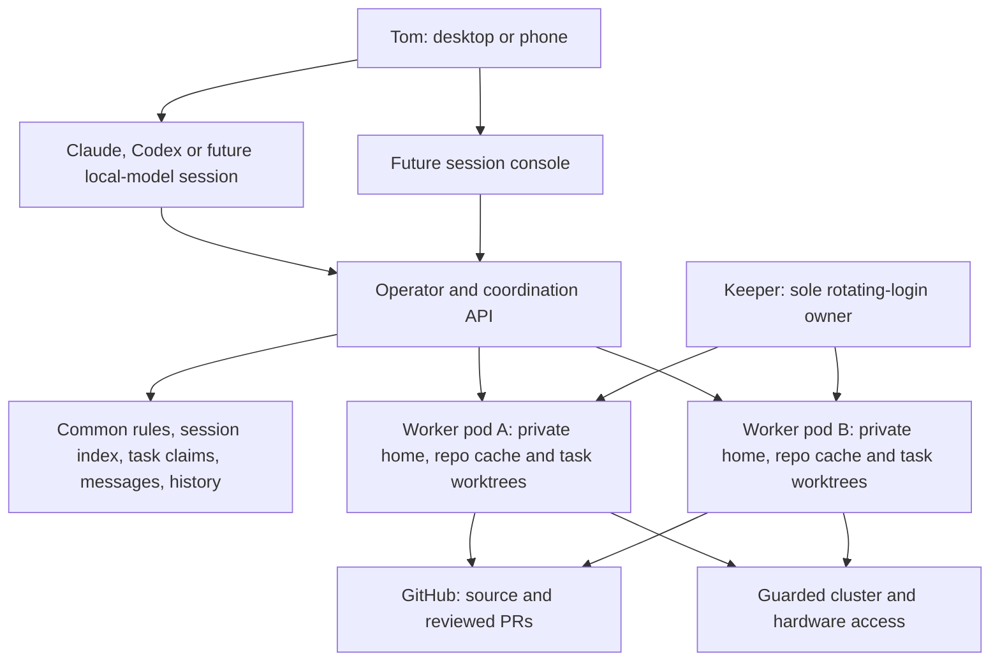
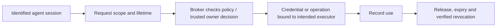

# Dev-env v2: workflow, quick start and feature set

**Daily use:** the [v2 quick start](v2-quickstart.md) is the one-page version
for Tom's phone-first workflow, with what was proven up to 2026-10-20.

**Current state, 2026-10-22:** [release 2.39.1](https://github.com/thaynes43/dev-env/releases/tag/v2.39.1)
is published and its matching [GitOps pin is merged](https://github.com/thaynes43/haynes-ops/pull/4161).
The [current handoff](../.agents/HANDOFF.md#current-state--2026-10-22-utc-v2-release-2391-documentation-reconciliation)
links the notice fix, the closed timezone regression and plan 13 follow-ups,
and separates source/publication evidence from runtime and review acceptance.
Keep CR-1020 phone acceptance, W3 limits and preservation/copy gates intact;
the planned cutover date below grants no authority or proof of completion.

**October 20 checkpoint (historical):** release 2.39.0 is installed, and v2 is ready for
all agent work. Tom accepted the phone workflow (the Claude standby on cellular,
the Codex host in the ChatGPT app, keeper status). A workbench session has v1's
cluster write tier (haynes-ops #4141), Proxmox reads and writes through grants,
restarts of the v2 services and messages between sessions, all proven live. The
v1 cutover is planned for 2026-10-21, after the v1 sessions wind down and write
handoffs, and only with Tom's written approval. The
[handoff](../.agents/HANDOFF.md) has the evidence, and plan 05 has the
[cutover runbook](../.agents/sagas/distributed-dev-env/backlog/05-cutover.md#cutover-runbook-2026-10-21).
v2 has no code-server: a proper front end comes later, and until then a terminal
is an exec into a session pod (quick start section 1).

**Current continuation, 2026-10-13:** the
[2026-10-13 Claude pickup brief](../.agents/CLAUDE-RESUME-2026-10-13.md) records
the deployed state, counters, rulings and next work. The
[2026-10-12 brief](../.agents/CLAUDE-RESUME-2026-10-12.md) still records the
requirements, the roadmap, source-review targets and stopped attempts. Read both
before selecting implementation or executing the bounded probe examples below.

**Scope corrected 2026-10-10, America/New_York.** V2 solves five problems with
v1: upgrades kill sessions, work concentrates on one node, agents have broad
access, session management is difficult, and model usage/cost is unclear.
Agents share rules and authorized context and coordinate tasks. Each independent
Claude Code, Codex or local-model session has its own bounded pod and failure
boundary, private provider home, repositories and ordinary task worktrees.

**Coordination archive reads have source support.** The operator has a
default-off `--enable-coordination-archive-reads` setting for the designed
archive fallback and `archived=only` lists. Existing caller ACLs and create
paths remain unchanged. Installation and activation require separate acceptance;
this source change applies no runtime configuration.

The controlling decision is [ADR-003](../.agents/sagas/distributed-dev-env/adrs/003-session-coordination-private-repositories.md).
It supersedes the shared-Git/RWX prerequisite. The original ADRs and storage
trial records remain historical evidence. No storage retry or runtime cutover
is part of this documentation change.

## Create and inspect an assigned campaign (source, 2026-10-18)

Inside an already configured owning coordinator host, the new CLI source supports:

```sh
agent-run budget create TASK_UID --success "observable result" --overall 45m --effort 1h --checkpoint 10m
agent-run budget show TASK_UID -o json
```

The operator must already assign that task UID to the host. Create sends once;
exit 6 means its outcome is unconfirmed, so inspect retained state before any
follow-up. Repeating create conflicts instead of resetting the campaign. Show
reports the immutable binding, deadline, checkpoint, stop latch and elapsed-effort
estimate; provider usage remains unavailable. A due checkpoint can latch on read.
These commands do not admit or launch an executor. General private launch and
native readiness remain unfinished, and this source change is not installed.

**Child cap source policy, 2026-10-29:** A session caller is limited to four
unfinished children per parent and canonical agent (`claude`, `codex`, or
`opencode`), across modes. Existing admission restrictions still apply; empty or
unknown legacy agents count against every bucket. The per-replica create lock
cannot prevent two replicas from admitting concurrently after each sees three.
This is repository policy, not a resource measurement or proof of installation;
portal launches have their separate cap.

## Start here: how you would use it

1. Open a Claude or Codex session and select the project. The project supplies
   common rules and repository identities; its local folders can differ by pod.
2. See existing tasks and live or stopped sessions. Read relevant transcripts,
   memory and handoffs before claiming work already being done elsewhere.
3. Claim a task. The chosen pod fetches the selected repo, records the base
   commit and creates its own worktree. A missing repo is cloned first.
4. Work within the session’s resource, access and attempt budget. Message peers
   or delegate a bounded unit; results carry task, model and source identities.
5. Review and ship the change. Suspend preserves local conversation state.
   Archive must preserve discoverable history before removing the provider home.
6. Continue on another pod by reading the predecessor’s context and restoring
   committed/rescued work into a new local worktree. Verify the previous executor
   stopped before transferring ownership.

These are the target journeys. The feature table identifies gaps; section 3
contains commands for the Claude subset that works today.

## 1. What we are building

The **operator is an API and controller**, not a reasoning agent. It manages
session lifecycle and platform records. The **requester** is `agent-run` or
another client. A **coordinator** is the Claude/Codex agent discussing your
request and assigning work. A future frontend uses the same API.



A Codex computer link identifies a persistent host. Native chats and children
run on that host unless a supported dispatch route creates another worker pod.
Multiple links remain distinct; shared context does not merge enrollment or
move a chat automatically. Keep actual thread, host, executor and node visible.

The [pinned routing audit](../.agents/sagas/distributed-dev-env/research/R-05-codex-native-routing.md)
did not establish complete native-chat federation behind one paired entry.
Independent native-session failure boundaries need independent app-servers;
isolated command executors alone do not provide that boundary. The owner routing
choice is pending in DESIGN-006 Q-24.

The local-model adapter has the same task, source/rules, context, claim/message,
access, budget and placement contracts. Live inference is disabled until GPUs
are ready, with every household reservation preserved. Qwen is a candidate,
not an accepted running backend. Claude/Codex keep subscription-backed execution;
the platform must not silently switch them to paid APIs.

Provider homes contain credentials and native state and remain private. The
coordination service exposes authorized context; peers do not mount each
other’s writable authentication directories. Common context needs reliable
storage, but it does not require shared Git directories or NFS Git benchmarks.

## 2. Feature set and delivery state

This table reflects source and saved runtime evidence as of 2026-10-12.
A released feature is not automatically enabled or accepted on live sessions.
*(Historical. The current state is in the [quick start](v2-quickstart.md) and
the [handoff](../.agents/HANDOFF.md).)*

| Goal or capability | Available evidence | Remaining work |
|---|---|---|
| Upgrade without killing sessions | Last accepted operator image delivery preserved 11 peers in its saved observation window | Safe agent-image replacement and busy-host drains; interrupted native recovery |
| Distribute load | Bounded task Pods scheduled on workers; real Claude task ran with CPU/memory limits | Prove placement across nodes; native Codex threads still share their host’s resources |
| Claude task and terminal workflows | Task, attach/detach, TUI messages, suspend/resume and Git rescue exercised | Owner pilot and history-preserving archive |
| Codex sessions across pods | Keeper login, scoped-host/task and owned-native source foundations released | Two live distinct links, refresh adoption, native execution/recovery and device acceptance |
| Common rules and projects | Catalog bootstrap, private roots/client guards and common-rule inputs shipped; trusted startup/refresh foundations installed | Actual private GitHub authorization/worktrees and rule loading by both providers |
| See live and stopped work | Managed list/show, fleet placement and retained Directory/identity guards; one complete pre-Codex page accepted | Actual live/stopped native indexing and accurate activity; post-Create cardinality remains Unknown |
| Communicate and avoid duplicates | Live TUI route, idempotency, explicit claim and durable inbox/ACK foundations shipped | Actual cross-parent claims, stopped-recipient durability and authorized consumer acceptance |
| Read prior context | Installed private HOME/identity preservation and stored managed-context result route; one retained Claude result read | Full provider transcripts/memory/handoffs without the source Pod; managed output is partial history |
| Guard powerful access | Scoped broker/grant foundations; keeper-only CA and node trust prepared | Usable guarded Headlamp/hardware replacements, approved policies and use/revocation acceptance |
| Stop wasted attempts | Accepted 60-minute stall/three-failure policy; ledger/stop foundations and v2.24 ownership proof published | Private dispatch inspector remains unwired and refuses reservation; whole-task runtime accounting, verified stop and phone escalation |
| Model usage and cost | Requested-model identity and provider-specific parsers/provenance foundations | Exact served-model provenance, truthful Unknown values, fleet aggregation and no parent/child double counting |
| Frontend | Existing management API and CLI | Console for sessions, nodes, tasks, messages, retained history, renewal and cost |
| Local LLMs and GPUs | Local provider included in contracts; live inference disabled | GPU readiness, household-safe allocation and actual backend acceptance |

The saved installed task template is signed v2.20.0, digest `823e0155…`, revision
`2.20.0-ec26880d2a`; its actual agentd source is `3aab27ce…`, not the revision
suffix. The accepted operator image is source `cd966d17…`, digest `cc03ae82…`.
Signed v2.24.0 (`36d26662…`) is published and not deployed. Private-project
admission remains disabled. Catalog/bootstrap, roots and common-rule source
foundations have shipped; the earlier empty-common-rule configuration was a
historical checkpoint. Actual both-provider loading remains unaccepted:
Claude's retained response hit its weekly limit, and Codex output is Unknown.
See the [current checkpoint](../.agents/CLAUDE-RESUME-2026-10-12.md#what-is-actually-delivered)
for full revisions and acceptance limits.
*Update, 2026-10-13: the sentences above are the 2026-10-12 record. Release
2.28.0 is now deployed: operator `sha-cbf0700` (actual binary version
`v2.28.0-1-gcbf0700`) and task agent 2.28.0. The
[delivery record](../.agents/sagas/distributed-dev-env/verification/d92-shared-history-delivery-2026-10-13.md)
has the source, signed digests and separate operator/template deployments.
The shared-history correction is installed with reads still off. Rule loading is accepted for both providers; private
GitHub authorization, a `Ready` private bootstrap and a fresh task pin are
accepted for Claude. HOME expiry (DESIGN-025 H1 to H6) is installed with only
the terminal record on; H4's commands are in the task template's agent image,
and the shelf, which runs `history-archive`, waits for H7. Private-project admission is still disabled. The
[2026-10-13 brief](../.agents/CLAUDE-RESUME-2026-10-13.md#deployed-state)
has the digests.* The
[bootstrap contract](../.agents/sagas/distributed-dev-env/designs/006-private-catalog-bootstrap.md)
uses private catalogs without shared preflight or locks; startup refresh does
not replace a fresh selected-repository fetch and immutable pin before each task.
A `Partial` or `Failed` bootstrap is diagnosable without exec: `agent-run show
NAME` prints a `project bootstrap` row and a row for each repository or project
that is not Ready, with closed-set reason codes, and the AgentSession holds them
in `status.agent.projectBootstrap`
([reason codes](../.agents/sagas/distributed-dev-env/designs/006-private-catalog-bootstrap.md#reason-codes-diagnosis-without-exec)).

The [private retention guard](../.agents/sagas/distributed-dev-env/designs/008-private-provider-history-retention.md)
preserves HOME and Session identity rather than declaring archive complete.
Its latch survives flag disable; absent executors remain Unknown and cannot
start replacements. Managed-context readers are separate; preservation alone
does not prove complete stopped native history. The expiry policy is decided
([ADR-005](../.agents/sagas/distributed-dev-env/adrs/005-private-home-expiry.md),
Q-31: archive, then delete, 30 days after a recorded stop; corrected by
[ADR-006](../.agents/sagas/distributed-dev-env/adrs/006-private-home-expiry-corrections.md))
but not built. *(Update, 2026-10-13: DESIGN-025 H1 to H6 are built and
installed, H4 in the task template's agent image only (the shelf waits for
H7); only the terminal record is on. H7 to H10 remain.)*
Existing coordinator scope is preserved; the legacy ordinary-session ACL is
not a new authorization contract for peer context. Claude review is optional,
including releases; required CI and native independent review remain gates.

The ordinary worker template was still 2.9.1 at the historical overnight checkpoint;
2.11.0 was signed and used for a separate native fixture. That fixture failed
without a valid acceptance result. A later reviewed source fix does not count
as a new runtime pass. See [HANDOFF](../.agents/HANDOFF.md) and
[overnight evidence](trials/2026-10-10-overnight-results.md). This note is
historical: the current installed template is 2.20.0, as the first paragraph
after the table above says. *(Since October 13, 2026 (EDT), it is 2.28.0; see the update
under that paragraph.)* The
[pickup brief](../.agents/CLAUDE-RESUME-2026-10-12.md#what-is-actually-delivered)
has the full revisions.

### Offline upgrade-shepherd check

`agent-run maintenance check --input <file>` validates one bounded operation
envelope and correlates a supplied snapshot. It is offline and source-only.
The JSON decision is `candidate`, `respond`, or `insufficient-evidence`.
A candidate is not alert deferral, suppression, or operational authorization.
The role contract and its proposed numeric defaults are in the
[upgrade-shepherd role](upgrade-shepherd-role.md). The command does not install
that role into a provider, contact the cluster, or change Activity.

## 3. Quick start with the working paths

### Pick the launcher first

In the current v1 pod, the command named `agent-run` is **v1's shell launcher**.
V2 is a different Go binary. Do not overwrite the v1 command or assume identical
verbs mean identical behavior. The examples below use `v2run` as a shell array
holding an explicitly selected v2 binary that is already installed for the
caller.

Since 2026-10-20 ordinary work runs on v2: see the [quick start](v2-quickstart.md),
whose "Which `agent-run`" section sets up the v2 client in the v1 pod. Until v1
is retired (planned 2026-10-21), v1's own launcher still works:

```bash
# V1: Claude terminal plus phone session.
agent-run --repo dev-env --agent claude --interactive \
  --model claude-opus-5-5 --effort xhigh

# V1: separate Codex terminal session; phone access belongs to the daemon.
agent-run --repo dev-env --agent codex --local \
  --model gpt-6-astra --effort max

# V1: check whether the daemon supervisor session exists.
tmux has-session -t codex-remote
```

Keep `-p` separate from `--local` and `--interactive`. A headless task has its
prompt at creation; an interactive session gets its first prompt after its
banner is checked. No laptop kubeconfig ceremony is required for Tom's current
workflow.

### Select the v2 CLI and connection path

Do not build current source merely to obtain a client: a source checkout is not
evidence that its binary is the installed or released client. Select the exact
v2 binary already supplied to the caller and inspect its own help:

```bash
v2run=(/path/to/an/already-installed/agent-run-v2)
"${v2run[@]}" version
"${v2run[@]}" help run
```

This repository documents neither a general release asset nor a general client
installation route. Use the release-approved binary made available to the
caller; do not infer an asset URL from a source branch or choose a filename by
version sorting.

Connection is caller-specific. A session pod discovers its projected API
identity. An already-authorized in-cluster caller, including v1, uses its own
ServiceAccount identity; it may need the approved public operator CA passed
with `DEV_ENV_API_CA_FILE` or `--ca-file`. A laptop uses its existing authorized
kubeconfig and a temporary local port-forward. The CA is trust material, not a
credential, and these facts do not create a new laptop authorization path.
Consult the selected binary's top-level help for the current API, token and CA
precedence. For an already-authorized v1 caller whose environment does not
already provide the operator CA, the existing ConfigMap route is:

```bash
guide_ca="$HOME/.cache/dev-env-api-ca.crt"
mkdir -p "$HOME/.cache" &&
kubectl -n dev-agents get configmap dev-env-api-ca \
  -o jsonpath='{.data.ca\.crt}' > "$guide_ca" &&
test -s "$guide_ca" &&
export DEV_ENV_API_CA_FILE="$guide_ca"
```

Do not print or save a minted credential. External clients have a separate
optional path in the [external CLI handoff](../.agents/handoffs/2026-10-08-laptop-access.md).

### Start and follow a v2 session

These examples start **Claude**. Run a task or start a local session according
to the work you actually need; each command creates a separate pod. Use a full
provider model ID and an effort level that the selected binary says it accepts.
For non-Claude agents, the CLI requires an explicit model but the operator is
authoritative for whether that provider is admitted.

```bash
# A bounded headless task. The prompt runs once.
"${v2run[@]}" --repo dev-env --agent claude \
  --model claude-opus-5-5 --effort xhigh --size S \
  --timeout 30m --max-turns 20 -p "Read HANDOFF and report the current plan status."

# An interactive terminal session.
"${v2run[@]}" --repo dev-env --local --agent claude \
  --model claude-opus-5-5 --effort xhigh --size S

"${v2run[@]}" list --repo dev-env
"${v2run[@]}" show SESSION
"${v2run[@]}" log SESSION --tail 40
"${v2run[@]}" fleet
"${v2run[@]}" attach SESSION
"${v2run[@]}" detach SESSION
```

Replace `SESSION` with the returned name. Attach is for the owner/client identity,
including the trusted v1 client; session agents use the message API. `attach`
and `detach` execute into a running session using the caller's Kubernetes
rights, and are refused from an ordinary session pod. `detach SESSION`
disconnects every attached client; `Ctrl-b d` detaches only your client.
The session keeps running. A Pending session is waiting for capacity, not a
reason to launch duplicates.

`--repo` starts an ordinary repository session; it does not select an accepted
project snapshot. `--project <name> [--repo <name>] -p ...` is a separate,
headless managed-task entrypoint: the server selects the declared repository and
rules and remains authoritative for catalog admission. It cannot combine with
`--local` or `--interactive`. `--profile` selects a template profile only where
the caller is allowed to choose it. A session child normally inherits its
parent's profile. The exception is a Codex remote host created by a workbench
session: omit `--profile`; the server uses the default profile, not workbench.
Starting a native thread does not select a Kubernetes profile.

A headless `-p` task runs its prompt once. `msg` applies to a local TUI session; a headless task does not accept messages. Coordinator custody of that result is recorded separately in the [coordinator result handoff](coordinator-result-handoff.md). A delivery receipt is not acknowledgment, ownership, or completion. The offline checker only validates a bounded handoff record.

```bash
# Local TUI only; headless tasks do not accept messages.
"${v2run[@]}" msg SESSION "The coordinator is reviewing the deployment evidence for this project."

# Rescue, stop the pod, keep its home and conversation.
"${v2run[@]}" suspend SESSION
"${v2run[@]}" show SESSION
"${v2run[@]}" resume SESSION

# Finish only after required history is separately retained: Git rescue then reap.
"${v2run[@]}" reap SESSION
"${v2run[@]}" rescue list --session SESSION

# If a complete bundle exists, create a new session from it.
"${v2run[@]}" rescue restore OLD_SESSION/STAMP --local
```

Follow transitions with `show`/`list`; `reap` returning does not mean cleanup has
already finished. An archived session is restored into a new session, not resumed.
Rescue preserves Git work. **The ordinary private reap path deletes the home;
it does not retain the provider transcript or memory.** Suspend preserves the home temporarily, but private sessions auto-archive
after their configured `archiveAfter` (default 168 hours). Verify required
history retention before that deadline; suspend is not an indefinite backup.
Archive/history retention is a remaining feature. Rescue does not back up ignored files or every home file; snapshots
stay private and are never pushed.

V2 `--interactive` (Remote Control on a pod-owned Claude login, set up with
`agent-run login`) is source-only until released and accepted, and its use is
pending Tom's authorization of one isolated v2 login. V2 `--agent codex
--interactive` (the Codex phone daemon on the keeper's login, paired with
`agent-run pair <name>`) is also source-only until released, installed and
accepted; see [plan 03](../.agents/sagas/distributed-dev-env/backlog/03-remote-control.md).
Automatic image
drains and the complete grant/login CLI remain unfinished. The first #173 source slice admits declared project tasks
into private worktrees and supplies project rules without RWX. New budget-bound
private dispatch remains refused pending separate integration. GitOps delivery
and actual-provider acceptance are recorded separately on
[#173](https://github.com/thaynes43/dev-env/issues/173). The new private-project
admission flag stays disabled for that promotion; existing fixture/coordinator
flags remain unchanged. The two-host and both-provider coordination
workflow is unaccepted. Use the selected binary’s help and current deployment
evidence. [DESIGN-005](../.agents/sagas/distributed-dev-env/designs/005-private-project-tasks.md)
defines the bounded contract.

A session that follows the keeper's shared logins can check them without
exec: `agent-run auth status` reads the mounted Claude and Codex access
projections (no API call, no refresh token) and prints each login's state,
generation, access expiry and time left, plus the keeper's last refresh for
Codex. It finds the Codex projection at its default mount when agentd has
removed the variable from a Codex session's environment. Exit 0 is fine, 1 is expired or inside the `--warn` window (default
30m), 2 means it cannot tell, as v1's `claude-login-check` does. The Claude
login's own roughly 30-day lifetime lives with the keeper and is not in the
projection.

## 4. The everyday workflow

```mermaid
sequenceDiagram
    participant O as Owner / coordinator
    participant API as Coordination API
    participant A as Agent A on pod A
    participant B as Agent B on pod B
    O->>API: Find project, prior work and current task owner
    API-->>O: Session states, context and rule revisions
    O->>API: Claim explicit task
    API->>A: Start bounded work with fresh local source
    B->>API: Discover task before starting duplicate work
    API-->>B: Existing owner and authorized context
    B->>API: Send attributed message / offer assistance
    API-->>A: Deliver or retain message
    A->>API: Publish result and retained history
    O->>API: Stop and verify old executor before handoff
    API->>B: Transfer task; restore work into B’s local worktree
```

The claims, offline inbox and stopped-history portions are delivery targets.
Current messages go to a live TUI; the log endpoint needs a Ready source Pod.
A same-parent idempotency key does not prevent two unrelated coordinators from
starting the same objective. Use explicit task/issue identity for atomic claims;
the platform cannot reliably infer all duplicates from free-form prompts.

To ask your coordinator a routine question and see its reply, use
`agent-run inbox ask` and `agent-run inbox reply` on the durable inbox: see
[How to ask your coordinator](ask-your-coordinator.md) (source, 2026-10-31).
A reply is information, not an approval, and a running task sees it only when
it reads its inbox.

A task may use multiple sessions or pods. Its budget, prior failures and context
follow the task. Peer messages are attributed data, not new owner authority.
The management client should show uncertainty and the observation time when
status is stale, rather than calling a missing heartbeat a confirmed stop.

## 5. One project for both agents, across pods

A project is a common repository map and rule set. It is not a shared checkout.
Both providers load the same accepted global/project rules plus repository
instructions. Task records retain the effective rule revision for later review.

| Shared through the platform | Private to each pod or logical host |
|---|---|
| Accepted global/project rules and repository identities | Local reference clones and task worktrees |
| Task claims, session metadata and attributed messages | Provider credentials, refresh/enrollment state and sockets |
| Authorized transcripts, published memory, handoffs and results | Writable native provider databases and live home |
| Usage, budget and source/rule provenance | Build caches and local execution processes |

Repository history and provider conversation history have different retention
needs. Git rescue does not preserve the transcript or all memory. Keep readable
context and a discoverable session record after stop/archive; exact native
conversation restoration is a separate capability. A receiving agent can start
a new conversation after reading the predecessor’s context.

Two Codex links may expose similarly named project folders backed by different
local clones. Each link has private enrollment and a stable host identity.
Choosing the other link must still show who is doing the work and provide
context reads; it must not silently launch another copy or steal an active task.
The [first atomic claim source unit](../.agents/sagas/distributed-dev-env/designs/010-atomic-task-claims.md)
retains explicit project/repo/task ownership and original Session UID across
retries and stopped owners. Its own project read scope exposes bounded claim
metadata; it does not grant session mutation or transcript access. Deployment
and real cross-parent contention remain acceptance gates. Durable offline
messages, acknowledgements and verified ownership transfer follow separately.
See [session coordination](session-coordination.md) for the source audit and
[two Codex hosts](codex-coordinator-hosts.md) for the host lifecycle boundary.

## 6. Protection from stale repositories

At pod/host startup, bootstrap missing declared repositories and fetch the
catalog. Update clean reference views safely and report failures. Dirty state,
local-only commits, other worktrees and unfinished Git operations are preserved.
A startup fetch cannot guarantee freshness hours later.

Before each new task:

1. Fetch the selected repository. If that fails, block fresh implementation;
   use an explicitly verified rescue/offline recovery path when appropriate.
2. Resolve and record the exact base commit, origin and requested branch.
3. Create a task worktree and branch from that commit, outside the reference clone.
4. Load project/repository rules and record the revision actually supplied.
5. Publish source/rule identities with the task so peers can assess its context.

Private clone/worktree task-start fetch and pinning already exist. Opt-in
catalog-wide bootstrap now covers managed-daemon startup and explicit private
refresh. The [private roots contract](../.agents/sagas/distributed-dev-env/designs/007-private-project-roots.md)
adds owned Git-backed project folders and pinned private repo anchors, default
off. Native hosts and other client entry points still need integration. Git/file
discovery is separate from actual provider rule loading.
The [private native Codex preflight](../.agents/sagas/distributed-dev-env/designs/009-private-native-codex-preflight.md)
is a default-off source guard for trusted roots and private provider state.
It preserves live/uncertain startup state and checks daemon absence and
configuration identity before writing. A private native API/profile and actual
native instruction loading still need acceptance. The installed model-free
roots check failed before its verifier; its fixture is retained and no runtime
pass is claimed. Private-project admission remains disabled.
Resume preserves existing WIP; it does not reset the worktree to the latest main.
No broad reset, clean or deletion of ambiguous local state is a freshness policy.

## 7. Access, credentials and approval

The goal is useful access with recorded scope and bounded lifetime. V1 currently
has a reachable Headlamp admin path and hardware credentials with powerful
access. Existing Omni is Reader; wider Omni permissions are a separate guarded
scope. GitOps self-merge is also an authority path and must appear in the design.



Replace the standing admin bypass with a usable guarded path for required
operations. Prove authorized use and unauthorized refusal, expiration and
cleanup. The docs reset grants no new access and removes no running v1 caller.
Routine access policies and elevated owner approval remain distinct.

Questions should arrive as actionable prompts in the controlling app, one at
a time when a decision is needed. A delivered question is not by itself a
trusted privileged approval protocol. The existing ruling favors approval in
the Claude app; no new approval app has been selected. Phone delivery and the
broker’s trusted decision path need acceptance.

The keeper owns rotating login refresh; session pods receive access-only
projections. Account login is different from computer pairing. Fresh v2 login
must not create a second refresher for v1’s credential.

### Proxmox activation checkpoint

Q-19's CA storage step is complete by owner confirmation in existing
`HaynesKube/dev-env`. Keeper-only projection shipped through haynes-ops #3642:
ESO is SecretSynced and the keeper is Ready with a read-only CA mount. Minting
stays disabled. Q-22's delegated trust installation is complete on all five PVE
nodes, with original key bytes and existing v1 access preserved. Do not generate
another CA or item. One offline in-keeper validation now confirms its saved
private/public pair is valid, after the keeper-only #3669 rollout. Existing
v1/controller/broker/shelf pod identities and restart counts were preserved.
Remaining activation order:

1. Supply private targets, pinned host keys, keeper TCP22 access and accepted
   policies. Keep actual trust material and private addresses out of public docs.
2. Enable keeper and broker together only after prerequisites pass. Declare
   activity; test real mint/install/use/release/expiry/recovery and cleanup.
3. Remove fixtures and compare v1/existing session UIDs and restart counts.

[Node-trust guide](keeper-node-trust.md) records the restricted CA installation
and guarded rollback. Temporary delivery cleanup is merged and deployed.
Certificate/provider acceptance remains separate from the successful local pair
check. The validator neither connects to nodes nor mints a credential.

General hw-ssh certificates are a separate unfinished feature. Certificate
expiry alone does not terminate an existing SSH connection; P-19 needs its
connection/revocation contract before acceptance.

## 8. Remaining work and the cutover gate

The first useful pilot demonstrates two independent agent environments that
load common rules, start fresh worktrees, discover each other, exchange messages
and read a stopped session’s context. It also reports actual placement and
preserves running work through an operator upgrade.

| Delivery unit | Concrete completion evidence |
|---|---|
| Decouple project/rule preparation from shared Git | Independent local clones; selected-task fetch; both providers load the expected rules |
| Retain and index session context | Live/stopped/archived records; authorized history read with source Pod absent |
| Coordinate tasks and messages | Conflicting explicit claim refused; attributed message survives recipient stop; acknowledgement visible |
| Finish native lifecycle and budgets | Owned stop/recovery, retained WIP, shared task attempt history and real owner escalation |
| Guard required access | Supported task succeeds through scoped policy; bypass/unauthorized action refused; expiry/revocation verified |
| Correct usage/cost reporting | Exact model/task attribution; missing amounts Unknown; billing versus estimates labelled; no duplicate totals |
| Add console and local provider | UI uses the same API; local models follow resource, rules, context and access contracts |

Plan [11](../.agents/sagas/distributed-dev-env/backlog/11-project-workspaces.md)
and the [coordination audit](session-coordination.md) define the first units.
The prior 7–14 hour estimate included superseded storage work and is withdrawn.
Size new implementation units after their acceptance contract is concrete;
each unit needs a bounded checkpoint before spending more time.

**Pilot acceptance is distinct from v1 retirement.** The historical capability
inventory remains useful for migration planning. Required owner workflows need
usable replacements before cutover, and Tom must explicitly approve retirement.
It is not necessary to finish every inventory row, the full frontend or local
models before testing a smaller coherent workflow.

**Cutover status, 2026-10-20 (story CR-1020).** Every prerequisite an agent can
verify is verified: plan 05's
[prerequisite table](../.agents/sagas/distributed-dev-env/backlog/05-cutover.md#prerequisites-on-2026-10-20)
lists each with its evidence, and R-04's
[status table](../.agents/sagas/distributed-dev-env/research/R-04-v1-capability-parity.md#status-2026-10-20)
closes the parity rows that are done. What is left is the drain itself (each v1
session pushes its branches and writes a handoff; v1's notes and memory are
copied into `~/.shared/v1-home/` and verified), then Tom's written approval;
only after those, stopping v1's Codex daemon and the held-draft haynes-ops PR
that scales v1 to zero. The date alone authorizes nothing, and if Tom does not
approve, nothing is stopped. No PR merge from v2 has been run yet; the first one
after the cutover is the live proof. A final `agent-run sweep` is not a drain.

## 9. How we keep the project on track

Each unit states the owner problem, acceptance evidence, current task owner,
source/rule revision and time/attempt budget. Reports distinguish built, deployed
and accepted; a passing source test does not prove a phone or native-host journey.

The default is **60 minutes without progress or three failed attempts at the
same blocker**. Stop further attempts, preserve work and evidence, and ask one
actionable owner question with a concrete bounded next option. Counters carry
across agents, pods, methods and resumes. Observed progress must describe a
useful result; restarting a tool is not progress by itself.

The stopped NFS helper and observer remain historical. They demonstrated
problems in our test tooling, not a NAS failure. Shared-Git trials no longer gate
this scope, and the old routes are closed without another attempt: #130 closed as
not planned and haynes-ops #3737 closed unmerged. Gasha01
remains an available storage option when an actual home/context workload needs
it. Avoid replacing a real product outcome with an infrastructure benchmark.

Keep decisions in the ADR, tasks in durable issues and actual workflow evidence
in delivery records. The guide is the owner’s product map; update it whenever a
scope decision changes the experience.

### Read retained session metadata

**Historical API-shape examples:** these commands document bounded client
interfaces, not fresh execution permission. Both fixed probe IDs are consumed;
Claude's named/result reads are consumed too. Codex reads remain zero, but their
preparation is stopped under Q-27. Do not copy these examples into the current
campaign or substitute a new key. Follow the current pickup brief and obtain any
required bounded owner ruling before a separately reviewed runtime action.

The source directory client reads through the operator/API with the caller's
existing project authorization. It does not grant access to private payloads
or session control:

```sh
agent-run directory list --project dev-env --limit 20 --json --once
```

The command makes one request and refuses redirects and retries. Its JSON page
includes a continuation when more metadata remains; use `--continue <cursor>`
for a separate page. A failed or incomplete read does not prove zero records.
Metadata can retain original identities after the source Session stops, while
fresh observations may remain Unknown. Source/installation alone does not prove
actual authorized discovery or full native-history retention. See
[the directory client contract](../.agents/sagas/distributed-dev-env/designs/020-directory-cli.md).

### Invoke an approved fixed rule probe

For a separately authorized future campaign, use the server-selected ID-only
route after the reviewed configuration and
fresh complete authorized directory gate. Each permanent record permits one
initial provider attempt:

```sh
agent-run canary create --id NEW_APPROVED_FIXED_ID --json --once
```

The receipt distinguishes original creation from an existing original; neither
proves the provider ran or loaded instructions. The client sends one request and
does not retry, redirect or poll. Preserve an uncertain response for observation
without creating another Session or changing the key: it exits 6
(unconfirmed). Every one-shot request (`msg`, `canary create`, a `--once` read)
uses that exit code when it was sent and got no confirmed answer, and exits 5
only when nothing was sent (no token, no port-forward, or a connection that was
never made). This source client does
not enable general private admission or select Codex fleet routing. See
[the ID-only client contract](../.agents/sagas/distributed-dev-env/designs/021-canary-cli.md).

### Tell a finished task's success from its failure

A canary's Pod always ends at its 600-second active deadline, so its session
phase is Failed whatever the task did (D-44). Read the task's own result instead.
`agent-run show NAME` prints a `task result` row. `list` and `fleet` add
`task Succeeded`, `task Failed`, `task TimedOut` or `task Unknown` to NOTE, and
`kubectl get agentsessions` shows the state in the `Task` column. With `--json`,
the facts are in `agentStatus.task`. Unknown means exit 0 with no success
result event. Phase still counts it as Failed: `agent-run list --state Failed`
and the `dev_env_sessions{phase="Failed"}` metric include a canary that
succeeded. Read the task result, not those counts, for the outcome. See [the task result rule](../.agents/sagas/distributed-dev-env/designs/021-canary-cli.md#the-task-result-of-an-ended-session--2026-10-12-history-04-174).

### Retain a task's PR and handoff after pod reclaim

On images with task outcome retention (#320), a headless task can leave a small
result that `agent-run show NAME` reads from Session status after its pod has
been reclaimed or suspended. It requires no running pod or HOME access.
Before returning, atomically write `~/work/<session>.outcome.json`:

```sh
# Replace example-session and the example refs with this task's actual values.
cat > ~/work/example-session.outcome.json.tmp <<'JSON'
{"prURLs":["https://github.com/thaynes43/dev-env/pull/123"],"headSHAs":["0123456789abcdef0123456789abcdef01234567"],"summary":"Ready for lead review; focused tests passed"}
JSON
mv ~/work/example-session.outcome.json.tmp ~/work/example-session.outcome.json
```

The file must be a regular file, at most 2048 bytes, containing exactly one JSON
object with only these fields:

- `prURLs`: optional array of at most three URLs matching
  `^https://github\.com/thaynes43/(?:\.?[A-Za-z0-9_-][A-Za-z0-9._-]*|\.\.[A-Za-z0-9._-]+)/pull/[0-9]{1,6}$`,
  each at most 256 bytes. No off-org links, `.` or `..` repository segments,
  queries, fragments or trailing paths.
- `headSHAs`: optional array of at most three 40-character hexadecimal commit SHAs.
- `summary`: required nonempty line of at most 200 printable characters from the
  Basic Multilingual Plane that Unicode 15.0 already assigned. Emoji and other
  characters above U+FFFF are refused: the Kubernetes API server checks this
  field with older Unicode tables than the operator, so the operator accepts
  only characters both agree on.

A Python writer should use `json.dumps(record, ensure_ascii=False)`, so each
non-ASCII character takes its 2 or 3 UTF-8 bytes rather than a 6-byte `\uXXXX`
escape and a 200-character summary stays inside 2048 bytes.

Agentd validates the complete file at the initial task's exit and retains that
snapshot with the original Session/Pod identity. Missing, malformed, oversized,
unknown-field or otherwise invalid files publish nothing; no partial text is
copied. Symlinks and special files are refused. Never put prompts, transcripts
or secrets in this record. Outcomes are task-authored claims, not merge,
deployment or acceptance evidence.

The original pod sends the snapshot through the authenticated heartbeat. The
operator validates it again and stores the first record immutably at
`status.taskOutcome`. Repeated heartbeats, later edits and other pods cannot
replace it. `agent-run show` prints its summary, PR URLs and heads in every
phase; JSON output includes `taskOutcome`. No file means no outcome row.
The portal's separately versioned strict reader is unchanged in this slice.

Rollout: this change adds a CRD field and runs `make generate`. Copy the generated
AgentSession CRD to haynes-ops **before** pinning the new operator; install the
matching agent and CLI to publish/read outcomes. Source tests do not prove an
installed rollout or runtime acceptance. Roll back with care, as for
`usageObservation`: once any Session holds `status.taskOutcome`, an older
operator that writes the whole status without that field is refused by the
CRD's erasure rule for that Session.

### Read a fixed probe's retained result

For a separately reviewed read, after accepting the original HTTP201 receipt,
read that named Session once:

```sh
agent-run show ORIGINAL_SESSION_NAME --json --once
```

This explicit mode refuses retries and redirects and preserves the validated
server JSON. Match the original UID/name and retained executor provenance before
deriving the context name. Missing or mismatched private-history or executor
identity holds retrieval. The ordinary `show` command keeps its existing behavior;
see [the named-read contract](../.agents/sagas/distributed-dev-env/designs/023-named-session-cli-once.md).

The server-side result reader is deployed (haynes-ops #3825, operator source
`cd966d17…`). The client is published in `agent-run` v2.22.0 and later but is not
installed: task pods run 2.20.0, which lacks `canary result`. Use the accepted
bound local client. Use the original Session UID from the accepted creation
receipt and the named context from authorized discovery:

```sh
agent-run canary result --id APPROVED_FIXED_ID \
  --session-uid ORIGINAL_SESSION_UID --context PUBLISHED_CONTEXT_NAME --json --once
```

This command sends one read and refuses redirects and retries. Here `--context`
names the publication, rather than selecting a kubeconfig context. The reader
requires the fixed record's initiating client, the retained original Session
and matching publication authority. It can read a stored result after the source
Pod exits, and after a reap while the original is retained; an absent, replaced,
suspended or mismatched original holds the read. A change to another key of the
common source ConfigMaps does not; changed instruction bytes do. It cannot
create a replacement or inspect a private home.

The returned receipt proves only that stored publication. Missing output or an
uncertain capture ACK remains Unknown. Partial managed output does not prove
complete native history, served model or billed cost. Source tests alone do not
accept actual rule loading. See [the result reader contract](../.agents/sagas/distributed-dev-env/designs/022-fixed-canary-result-reader.md).

### Prepared owned-root HOME and one within-budget continuation

The source-owned Codex PID1 route can prepare a private HOME at
`/workspace/home` on its original RWOP PVC. Its policy binds a nonsecret
ConfigMap by name, UID and SHA-256 of the JSON-encoded data map. That map has
exactly `input.json` and `requirements.toml`. The version-1 input contains the
existing common-rules snapshot and `codexConfig`; preparation composes
`CODEX_HOME/AGENTS.md` through `Snapshot.CodexGlobal`, writes config and disables
the daemon updater. It requires the existing `CLAUDE.md` fallback and effective
`project_doc_max_bytes >= 131072`. The requirements file mounts at
`/etc/codex/requirements.toml`. Credentials/history are never preparation inputs.

Preparation precedes the baseline and irreversible bootstrap intent. It refuses
conflicting retained config, aliases or unsafe ownership/modes. A release operator
must bind the baseline measured **after** those exact inputs have been prepared.
Keeper access projection stays separate. Composed bytes do not prove the native
process loaded instructions; that remains native acceptance evidence. No policy,
HOME input or activation manifest is installed by this source change.

With explicit policy `allowContinuation: true`, the original living guard can
wait after a proven native-process stop for one trusted-owner request:

```text
agent-run budget continue --decision <unique-owner-decision-id> <task-uid>
```

The existing authenticated human route owns this request; model/coordinator
credentials cannot issue it. Both native and child stops must be independently
confirmed, and all original deadline, effort, checkpoint, stall and failure
limits must still permit work. Frozen startup config/rules must still match;
missing or changed inputs are refused without repair. Unknown stop or exhausted
campaigns are refused. The request grants no extra budget and does not replace
the existing budget-extension decision contract.

A successful request advances epoch 1 to 2 on the **same original guard, Pod,
HOME and budget**. The guard closes its old evidence listener before launching
the next foreground native process. Old stop receipts, bootstrap intent, worker
history and counters remain; epoch 2 has a separate one-use receipt. The policy
baseline remains the original baseline; the resumed epoch separately measures
its actual retained HOME. Lost acknowledgements do not authorize replay.

This supports native-process continuation only while that original environment
and budget remain valid. Recovery after container/Pod loss, automatic exhausted
campaign recovery and full native conversation recovery parity are not provided.
Native phone control and provider-history behavior still require authorized live
acceptance; model-free process/API tests are source evidence only.

Operator replacement must preserve the original task and native process. The
observation client permits the standard HTTP transport to replace a lost reused
connection for observation only, within the original context and two-second
authority bound. It still requires a new complete authenticated response with
the exact original binding. Denials, malformed responses, cancellation, timeout
and fresh-connection failure remain refusals; admission and mutation requests
do not gain replay permission. Local access synchronization remains required.

The API drains existing requests for nineteen seconds at shutdown, covering
the existing eighteen-second owner HTTP envelope (including preflight) plus
its response. This does
not extend any task or request deadline. Deployment must keep a terminating
endpoint serving fresh authority until service routing withdraws it; connection
replacement alone cannot repair a fresh dial to an already closed listener.
The model-free TLS regressions cover these boundaries. Actual endpoint timing
and survival of an active native process still require rollout evidence.

For CLI version and model admission changes, see the [CLI and model upgrade checklist](cli-model-upgrades.md).
